# 0 一些问题

## 0.1 操作系统的历史

### 0.1.1 裸机开发

>在我们前面的STM32相关知识学习中, 我们对STM32的时钟和IO输出、信号和电平控制、以及硬件交互等行为, 都是通过剔除中间层的面向过程的流式编程, 来直接操作硬件, 或者通过库函数调用硬件操作的方式来实现业务逻辑. 
>
>这样做的好处, 是让我们可以熟悉信息和数据的每一步在硬件的流转和变化.  (比如寄存的值变化和状态, 比如电平的高低变化和时钟频率等等).
>
>但是随着不断贴近现实生产, 业务逻辑也随之变的不断复杂.  交互硬件的增加、控制逻辑(中断、主逻辑、时钟等等等)的增加,  这些都导致我们的代码会变得臃肿和冗余,  高耦合的代码不仅降低结构性, 从性能角度上运行效率也在不断降低.
>
>```C
>总结
>// 裸机开发的好处
>更加直接的硬件控制,裸机开发允许我们直接控制硬件资源,我们编写的代码可以直接操作硬件资源,如中断处理、I/O操作、定时器管理等.裸机开发从性能角度上也更有优势,因为不存在中间层(比如操作系统)的逻辑和内存开销,减少底层程序大小和复杂度,而且可以以实时性更高的方式响应系统事件,在资源受限的设备上,一个良好的控制逻辑不仅速度快性能高、需要的软硬件资源也更少.
>
>// 裸机开发的不足
>对代码的编写能力要求很高, 在复杂的业务逻辑中, 裸机开发极容易因为程序不断的修改和结构调整、以及多硬件的同步问题让代码丧失解耦性和变得性能低下.
>
>// 我们有什么迫切需求
>我们的迫切需要增加一个极具轻量级的中间层级, 来帮我们解决'业务分离'、'任务同步'、'信息共享'等诸多问题.
>```
>
>```C
>什么是中间层: 举个栗子
>// 假设我们我们需要一个点亮连接在PA1引脚上的LED灯行为, 如果能有一个现成的a函数, 在这个a函数内部具有现成的开启时钟、输出控制等实现, 而我们不需要关心a函数的具体实现, 只需要直接调用a函数就可以点亮LED, 那么这个介于我们开发的代码和硬件底层的电平控制、时钟控制的中间实现者a函数, 对我们来说就是一个中间层. 隔开我们和硬件之间的联系.
>    
>// 假设在PA1和PA2上分别外接一个按键, 我们要监听按键是否按下, 我们可以选择使用一个while循环反复对按键1和2进行按下的顺序判断, 但是这种情况下, 如果我们认为按键按下和松开是一个完整的流程, 如果一个按键被按下之后一直没有松开, 同时另一个按键按下我们也不会被感知, 因为程序卡在第一个按键按下的逻辑中; 所以为了解决这个问题, 我们可以考虑把按键1和按键2的检测封装为两个函数, 然后我们使用一个具有计时能力的函数来分别调用上面两个函数, 但是在这个过程中假设调用了1的函数, 无论它需要运行多久, 我们只给它10ms的运行时间, 如果10ms过去, 我们保存这个函数运行到这一时刻的所有数据(上下文), 切换为函数2运行, 也控制位10ms, 10ms结束之后, 保存程序2的数据, 恢复程序1的运行, 而这个实现控制逻辑的程序我们也可以认为是一个中间层, 我们在主观上很难感受到函数1和函数2存在执行的切换, 我们在实现程序1和2的时候也不知道它们怎么被切换的(这种切换在我们实现程序1和2的时候是透明的).
>    
>// ...
>```
>
>而在很多现实的生产环境中, 为了应对复杂的业务需求, 以及降低程序开发的难度, 提升产品开发效率, 我们迫切需要解决在复杂业务逻辑下, 代码开发的臃肿耦合, 甚至于逐渐变成硬编码问题.
>
>这个解决办法, 就是引入操作系统.

### 0.1.2 操作系统的历史

以计算机的操作系统为例:

>在计算机早期(在1940-1950年左右),  是没有操作系统的。程序员需要直接和硬件打交道，手动控制计算机的各个方面。计算任务基本都是是一次性的，每次运行都需要重新加载和编写程序。(比如像: ENIAC, 第二台电子计算机和第一台通用计算机)
>
>```C
>以ENIAC(ElectronicNumerical Integrator And Computer)为例，在操作上，ENIAC采用插拔电缆的方式来设定程序，并需要人工干预来更改计算任务，操作复杂且不够灵活(例如: 计算加法、减法、乘法或除法时，程序员需要通过不同的硬件配置来实现相应的计算。甚至, ENIAC并没有现代意义上的键盘和鼠标, 数据需要通过纸带或穿孔卡片的形式输入。程序员需要将输入数据通过类似纸带的方式吧数据喂入计算机, 也需要观察计算过程，并手动收集输出结果)。程序设定过程中，用户需要连接不同的电缆和开关来配置计算任务，这使得其操作既繁琐又不易修改。此外，ENIAC并没有现代计算机的存储器，而是通过大量的硬件实现计算，数据处理过程相对低效且易出错。尽管如此，ENIAC仍被认为是现代计算机的奠基者，推动了电子计算机的发展
>```
>
>随着时代的发展(在1950-1960年左右), 计算机出现了批处理操作系统。
>
>```C
>所谓批处理操作系统, 就是程序员将要执行的任务编写成一个程序, 这个程序被称为一个任务, 操作员可以把多个任务放在一起，交给计算机的批处理程序系统, 计算机的批处理系统会一个一个读取任务, 把读取到的每个任务顺序的并交给计算机执行，当一个任务执行完成以后，批处理系统会自动地取出下一个任务。在批处理系统中，存在的最严重的问题是任务执行的过程，会经常需要等待IO操作，这会导致CPU经常性地空闲。
>    
>```
>
>再后来出现的分时操作系统(在1960-1970年左右)
>
>```C
>所谓分时操作系统, 和批处理不同的是我们不再让程序按照顺序一个一个执行完毕才加载下一个程序, 我们会从要执行的任务中选取一个程序来执行, 但是选取一个程序上CPU进行执行的时候, 我们不允许它过长的占用CPU(即使这个程序执行完毕需要很长时间), 我们会给这个程序分配一个比较短的时间(假设:10ms), 等在CPU上运行了指定的时间之后, 如果这个程序没有运行/处理完毕, 我们也要求这个程序暂时从CPU上'卸载', 并保存这个程序执行到这个时刻的所有用到的上下文数据(并把这个程序放回所有的等待执行程序列表). 然后选取另外一个程序重新上CPU按照上述流程执行.   
>而这种将能在计算机CPU上运行时间, 或者说这种将任务的运行时间分成一小段一小段时间运行的方式, 我们称之为"时间片/时间片轮转", 这种操作系统我们称之为分时操作系统.
>这样做的好处是，操作系统会给每个任务分配一些时间来使用CPU，这样CPU就不会沉浸在一个大型的任务中，期间的用户操作也会很快地得到响应。
>    
>```
>
>```C
>// 在上述过程中我们涉及到一个概念, 那就是程序的切换(或者我们称为:'进程'的切换)问题, 这也就引入了一个新的问题, 就绪程序的状态.  (以进程最基本的三种状态为例: 执行态、就绪态、阻塞态)
>执行态：该进程正在运行，即进程正在占用CPU。
>就绪态：进程已经具备执行的一切条件，正在等待分配CPU的处理时间片。 (就绪队列)
>等待态：进程不能使用CPU，通常由于等待IO操作、信号量或者其他操作。
>```
>
>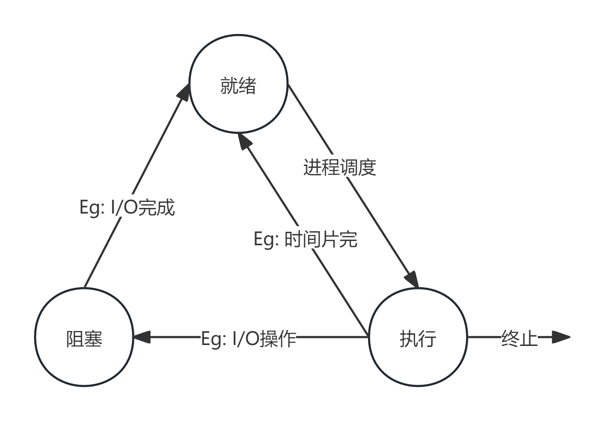
>
>现代操作系统
>
>```C
>而当下现实常见的操作系统则是在分时操作系统的引入更多的调度机制和功能集成.
>以调度机制为例, 现在操作系统处理具有时间片轮转的调度方式, 还引入了任务的优先级和抢占式等等调度方式.
>以功能集成为例, 现代操作系统的资源管理更加复杂, 不仅要管理CPU、内存, 还需要有效地管理磁盘、网络等其他硬件资源, 并且要处理复杂的并发执行、数据一致性、虚拟化、容错和安全性等问题. 现代操作系统可能支持多核处理器、虚拟化技术、容器化技术等，需要更复杂的调度算法和管理策略.
>除此之外, 现在操作系统在多用户和权限支持, 安全和隔离以及用户交互上都有很多重要的实现和支持.
>```
>

### 0.1.3 实时操作系统

>在嵌入式开发中, 对在处理复杂业务逻辑的时候, 我们也是有很迫切引入操作系统管理程序切换,、保证任务的'并发运行'、以及对逻辑和程序解耦支持的必要性.
>
>不过于和很多常见的用户级计算机不同的是, 我们在嵌入式开发中对操作系统在用户、文件、UI和交互等功能上的需求并不是特别迫切, 反而在很多时候`更在意对外部事件响应的及时程度、在意任务在有限环境上的更低资源消耗`. 而`实时操作系统(Real-Time Operating System，RTOS)`更能满足我们这种需求.
>
>```C
>// 也就是说: 通用操作系统如Linux、Windows虽然功能强大,但它们的任务调度通常是基于`非实时`的原则,可能会出现不可预测的延迟,比如操作系统内核的调度延迟、I/O 操作的延迟等. 这种延迟在一些嵌入式应用中是不可接受的,   而且这种操作系统内部实现复杂程度更高(对我们嵌入式开发是很冗余的)、资源开销也更大
>```
>
>实时操作系统(RTOS)是一种能够在严格的时间限制内对外部事件作出响应的操作系统.它的核心特点是提供高精度的时间管理和任务调度,确保系统在规定的时间内完成关键任务,尤其适用于需要实时处理的嵌入式系统和控制系统.
>
>```C
>实时操作系统的一些特点:
>// 能够保证在指定时间内响应事件和执行任务,不会像通用操作系统一样存在不确定的延迟
>// 通过优先级和时间片调度策略,同时也可以保证高优先级任务能及时执行
>// 中断响应和任务切换比较高效,能对实时性要求的任务快速和及时执行
>// 系统资源简洁高效,尤其在内存、CPU时间等有限资源的管理上具备优势
>// 支持多任务并发执行和任务间通信,同样也适合处理复杂的多任务场景
>```
>
>网络摘抄: "RTOS 被广泛应用于需要实时响应和高可靠性的领域，如嵌入式控制、工业自动化、汽车电子、航天航空、医疗设备、物联网（IoT）等。"
>
>RTOS-> 实时操作系统 -> 嵌入式设备

### 0.1.4 FreeRTOS

>虽然我们明确了在嵌入式开发中需要实时操作系统, 但是实时操作系统很多, 它们在细微和功能支持上也有所区别.
>
>```C
>// FreeRTOS是一个开源、轻量的实时操作系统,广泛应用于嵌入式开发.很适用于微控制器和小型嵌入式系统,尤其是在内存资源和处理能力有限的环境下表现良好.
>开源且免费的，支持多种架构(比如ARM、AVR、MIPS等)
>具有任务调度、内存管理、消息队列、信号量等基础实时功能
>提供API简单、易于使用
>常用于工业控制、物联网(IoT)设备、家电、汽车电子等
>    
>// RTEMS是一个开源实时操作系统,设计目标是支持多处理器系统和复杂的实时应用 
>支持多处理器和多核架构  
>提供丰富的实时操作功能，如任务调度、内存管理、时间管理、消息传递等  
>支持POSIX标准和多种硬件平台  
>应用于高可靠性、高性能的嵌入式系统，如航天、军事、医疗设备等。  
>    
>// Zephyr是一个由Linux基金会托管的开源RTOS,专为资源受限的设备(如微控制器)设计.提供了高度模块化的架构,可以根据硬件和应用需求选择不同功能.  
>支持多种硬件平台,包括ARM、x86、RISC-V等  
>提供丰富的硬件抽象层(HAL)和驱动支持  
>适合物联网(IoT)设备，特别是在电池驱动和低功耗设备上  
>广泛用于物联网设备、智能家居、可穿戴设备、车载设备等。  
>    
>// VxWorks是由Wind River开发的商用RTOS,广泛应用于航天、汽车、军事、工业控制等领域 
>提供高性能和可靠性  
>支持多核、多处理器和分布式计算  
>具有强大的网络和通信功能  
>适用于高可靠性、高实时性要求的系统，如航空航天、汽车电子等 
>    
>// Micrium OS是一个商用的RTOS,适用于嵌入式开发.它提供了高效的任务调度和丰富的中间件支持,广泛应用于工业、医疗、汽车等领域
>支持多种硬件架构  
>提供任务调度、内存管理、时间管理、I/O管理等功能  
>应用于嵌入式系统，如医疗设备、汽车电子、工业自动化等  
>    
>// ChibiOS是一个开源RTOS,适用于中小型嵌入式系统,特别是在资源有限的设备上表现出色  
>轻量级，适合内存有限的嵌入式设备  
>支持多种硬件平台，提供多种设备驱动程序和库  
>常用于微控制器项目、IoT设备、家电等
>    
>// Nucleus RTOS是由Mentor Graphics(现为西门子公司一部分)提供的商用RTOS,广泛应用于消费电子、汽车、医疗、工业等领域
>提供高效的任务调度  
>支持多核处理器和分布式系统  
>适用于高并发、多任务的环境，应用于消费电子、医疗设备等。 
>    
>// QNX是一个商用的RTOS,广泛应用于嵌入式系统,尤其是在汽车、工业自动化、医疗设备等领域  
>支持微内核架构,具有高度的模块化和可扩展性  
>提供严格的实时性保障  
>广泛用于汽车电子、工业控制、医疗设备、航空航天等领域
>// RTX是由Keil提供的商用RTOS,专为嵌入式系统设计,优化了ARM处理器  
>提供多任务和优先级调度  
>支持多核处理器，提供线程间同步和通信机制  
>用于嵌入式系统、工业自动化、汽车电子等领域
>// embOS是一个商用RTOS,专为嵌入式应用设计,提供实时性能和低功耗管理  
>支持高效的任务调度和资源管理  
>适合多核处理器和高并发任务环境  
>应用于自动化控制、消费电子、医疗设备等
>
>// 总的来说这些不同的RTOS都各有特点,选择合适的RTOS更多时候要需要项目的实际需求、硬件资源情况、实时性、甚至开发工具等因素来决定
>// FreeRTOS是最常见的开源RTOS,更适合资源有限的嵌入式设备,而VxWorks和QNX等很多商用的RTOS则更适合于高可靠性和高性能要求的复杂嵌入式系统
>```

# 1 移植FreeRTOS

>什么叫FreeRTOS的移植和剪裁?
>
>```c
>// 1, FreeRTOS -> 嵌入式,汽车,电子, 物联网, 智能设备, 航空航天.....
>// 2, FreeRTOS: 要在多种类型的芯片上-> 通用  (写了多套代码 -> 适配不同架构的芯片)
>// 3, FreeRTOS要做任务的上下文切换:  保存上下文
>//                 不同芯片的上下文保存, 一定一样吗? 不一样
>
>
>// 我们今天要使用FreeRTOS -> 需要把FreeRTOS所有代码取过来? 不需要-> 只需要取出我们的芯片版本需要对应代码 
>//  我们把这个选取一部分FreeRTOS源代码使用的过程 ->  FreeRTOS移植
>
>```
>
>```c
>// 1, 在FreeRTOS中, 有很多函数, 很多相同逻辑的不同方式
>// 2, 
>       举例: 创建一个任务: 动态创建, 静态创建
>             要么使用动态创建,  要么使用静态创建
>
>// 3, 在FreeRTOS中虽然提供了很多函数, 但是, 如果某个函数, 我们不需要使用它, 我们希望这个函数不要被最终编译到可执行程序中( 如果编译, 会导致可执行程序变大,  在嵌入式设备中, 内存资源非常宝贵, 不要浪费  )
>
>           // 以如下为例
>#if ( configSUPPORT_STATIC_ALLOCATION == 1 )
>    TaskHandle_t xTaskCreateStatic( TaskFunction_t pxTaskCode,
>                                    const char * const pcName,
>                                    const configSTACK_DEPTH_TYPE uxStackDepth,
>                                    void * const pvParameters,
>                                    UBaseType_t uxPriority,
>                                    StackType_t * const puxStackBuffer,
>                                    StaticTask_t * const pxTaskBuffer ) PRIVILEGED_FUNCTION;
>#endif 
>
>// 虽然FreeRTOS实现了一个函数xTaskCreateStatic, 但是这个函数, 如果预处理阶段发现configSUPPORT_STATIC_ALLOCATION这个宏 不等于 1, 这个函数就不会存在预处理之后的结果中
>
>// 所谓FreeRTOS的剪裁-> 我们可以通过修改配置文件(FreeRTOSConfig.h)的方式, 来影响我们可以使用哪些FreeRTOS的源代码
>//  可以影响最终哪些源代码被编译到最终可执行程序中
>```

## 1.1 基于STM32标准库的移植

>环境准备工作： 安装好Keil，有ST-LINK链接的外设系统板。

### 1.1.1 下载和文件目录说明

><span style="color:red">访问FreeRTOS官网:</span> https://www.freertos.org/   。 
>
><span style="color:red">点击下载按钮。</span>
>
>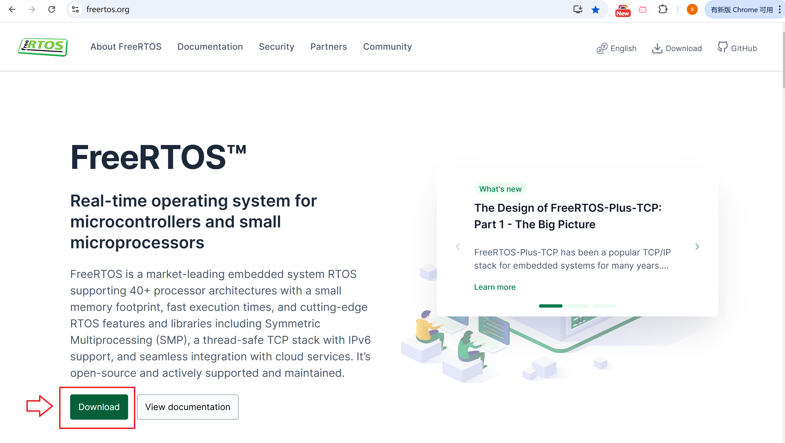
>
>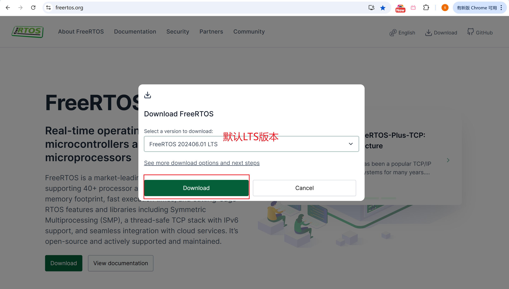
>
>

><span style="color:red">解压文件</span>
>
>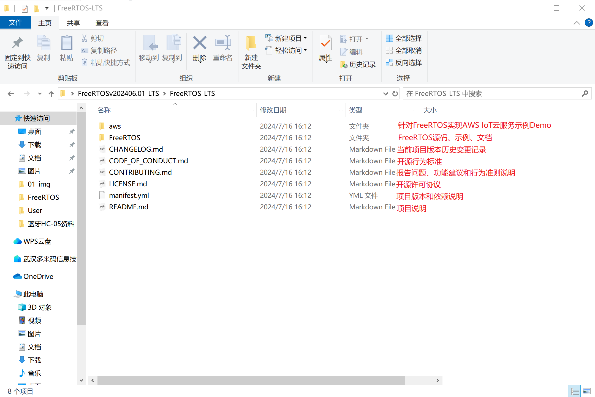
>
>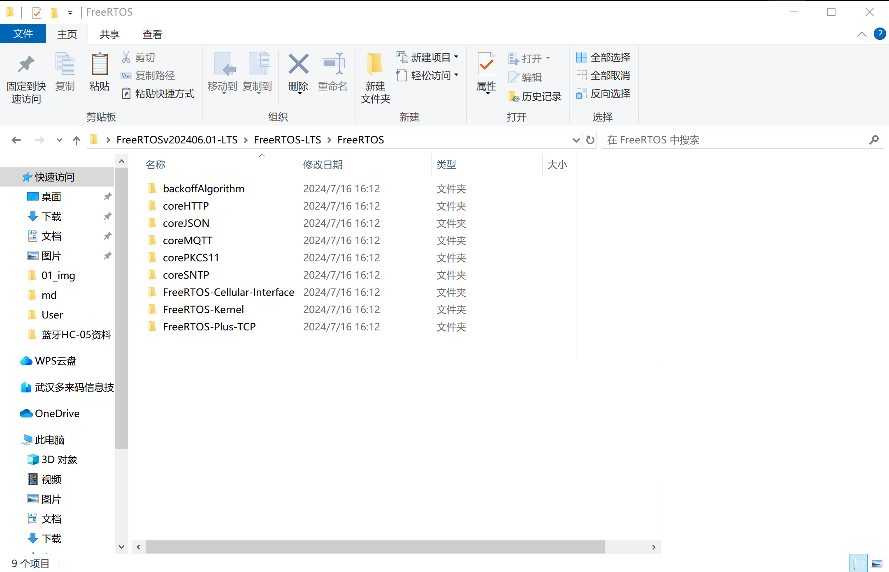
>
>```C
>// backoffAlgorithm: 该backoffAlgorithm库是一个实用程序库，用于分隔同一数据块的重复重传，以避免网络拥塞。该库使用带抖动的指数回退算法计算重试网络操作（例如与服务器的网络连接失败）的回退时间段。带抖动的指数退避通常用于重试失败的网络连接或服务器操作请求。通过将重试请求分散到尝试网络操作的多个设备上，有助于缓解由于网络拥塞或服务器请求负载过高而导致的服务器网络操作失败。此外，在连接性较差的环境中，客户端可能随时断开连接。退避策略可帮助客户端在不太可能成功的情况下不反复尝试重新连接。
>https://github.com/FreeRTOS/backoffAlgorithm
>https://freertos.github.io/backoffAlgorithm/v1.0.0/
>
>// coreHTTP：coreHTTP库是FreeRTOS提供的一个轻量级HTTP客户端库，旨在帮助嵌入式系统通过HTTP协议与服务器进行通信，是HTTP/1.1标准子集的客户端实现。该HTTP标准提供了一种在TCP/IP之上运行的无状态协议，通常用于分布式、协作式的超文本信息系统。该库已针对低内存占用空间进行了优化。此库提供了一个完全同步的API， 允许应用程序完全管理其并发机制。此外，此库只在固定缓冲区上运行， 因此应用程序可以完全控制其内存分配策略。该库的唯一依赖项是标准C库和来自 Node.js的http-parser LTS版本(v12.19.1)
>https://github.com/FreeRTOS/coreHTTP
>https://www.freertos.org/zh-cn-cmn-s/Documentation/03-Libraries/03-FreeRTOS-core/04-coreHTTP/01-coreHTTP
>
>// coreJSON：coreJSON库是FreeRTOS提供的一个JSON解析库，旨在为嵌入式系统提供轻量级的JSON格式数据解析和生成功能。它能够在内存和处理能力有限的嵌入式设备上高效地解析和生成JSON数据。其同时严格执行标准（ECMA-404：JSON 数据交换标准external_link）。 此库以C编写，已被证明具有内存使用安全性，并且不分配堆， 因此适用于 IoT 微控制器，也可以完全移植到其他平台。
>https://github.com/FreeRTOS/coreJSON
>https://www.freertos.org/zh-cn-cmn-s/Documentation/03-Libraries/03-FreeRTOS-core/07-coreJSON/01-coreJSON
>
>// coreMQTT：coreMQTT是FreeRTOS提供的一个轻量级MQTT客户端库，主要用于嵌入式设备通过MQTT协议与云端或其他设备进行通信。MQTT（Message Queuing Telemetry Transport）是一种广泛使用的物联网协议，以其轻量、高效、适应低带宽和不可靠网络的特性而闻名。coreMQTT 是专门为资源受限的嵌入式系统设计的，旨在高效地处理设备间的消息传递。
>https://github.com/FreeRTOS/coreMQTT
>https://www.freertos.org/zh-cn-cmn-s/Documentation/03-Libraries/03-FreeRTOS-core/02-coreMQTT/00-coreMQTT
>
>// corePKCS11：是FreeRTOS提供的一个实现了PKCS#11标准的加密库，专门为嵌入式设备提供硬件加密支持。PKCS#11是一个由 RSA Security发布的标准，它定义了加密设备（如硬件安全模块 HSM 或智能卡）与应用程序之间的接口，corePKCS11 提供了一组标准化的 API 接口，程序可以通过这些接口与设备上的硬件加密模块进行通信，无论硬件加密模块的具体实现是什么样的。这样，程序无需关心硬件加密模块的内部细节，它只需要按照统一的接口调用相应的功能即可。
>https://github.com/FreeRTOS/corePKCS11
>https://www.freertos.org/zh-cn-cmn-s/Documentation/03-Libraries/03-FreeRTOS-core/08-corePKCS11/01-corePKCS11
>
>// coreSNTP：coreSNTP库是FreeRTOS提供的一个用于实现简单网络时间协议（SNTP, Simple Network Time Protocol）的库，它的作用是使嵌入式设备能够通过网络同步时间，通常用于获取网络时间服务器（如 NTP 服务器）提供的时间信息。（通常通过连接到公共的NTP服务器或SNTP服务器，来校准和同步设备的系统时钟。）
>https://github.com/FreeRTOS/coreSNTP
>https://www.freertos.org/zh-cn-cmn-s/Documentation/03-Libraries/03-FreeRTOS-core/05-coreSNTP/01-coreSNTP
>
>// FreeRTOS-Cellular-Interface：这是一个FreeRTOS蜂窝接口库，它提供了一个接口层，简化了嵌入式设备通过蜂窝网络（例如 4G、3G、2G 或 NB-IoT 等）进行通信的过程。通过这个接口，它隐藏了蜂窝调制解调器专用AT命令的复杂性，并为C程序员提供了一个类似套接字的接口。嵌入式设备能够与蜂窝网络进行连接，发送和接收数据，从而实现物联网（IoT）设备通过蜂窝网络进行远程通信、数据传输和控制。
>https://github.com/FreeRTOS/FreeRTOS-Cellular-Interface
>https://www.freertos.org/zh-cn-cmn-s/Documentation/03-Libraries/03-FreeRTOS-core/09-Cellular-interface/01-Cellular-interface
>    
>// FreeRTOS-Kernel：是FreeRTOS操作系统的核心部分，它为嵌入式系统提供了一个轻量级的、实时的操作系统内核。
>https://github.com/FreeRTOS/FreeRTOS-Kernel
>https://www.freertos.org/Documentation/02-Kernel/01-About-the-FreeRTOS-kernel/01-FreeRTOS-kernel
>    
>// FreeRTOS-Plus-TCP：是FreeRTOS提供的一个TCP/IP协议栈，用于嵌入式系统中实现网络通信。它是基于FreeRTOS内核构建的一个高效、轻量级的协议栈，专为嵌入式设备设计，旨在为物联网（IoT）设备、智能硬件、传感器、工业设备等提供可靠的网络通信功能。
>https://github.com/freertos/freertos-plus-tcp
>https://www.freertos.org/zh-cn-cmn-s/Documentation/03-Libraries/02-FreeRTOS-plus/02-FreeRTOS-plus-TCP/01-FreeRTOS-Plus-TCP
>```
>
>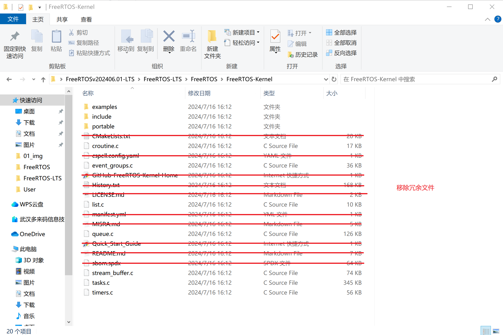
>
>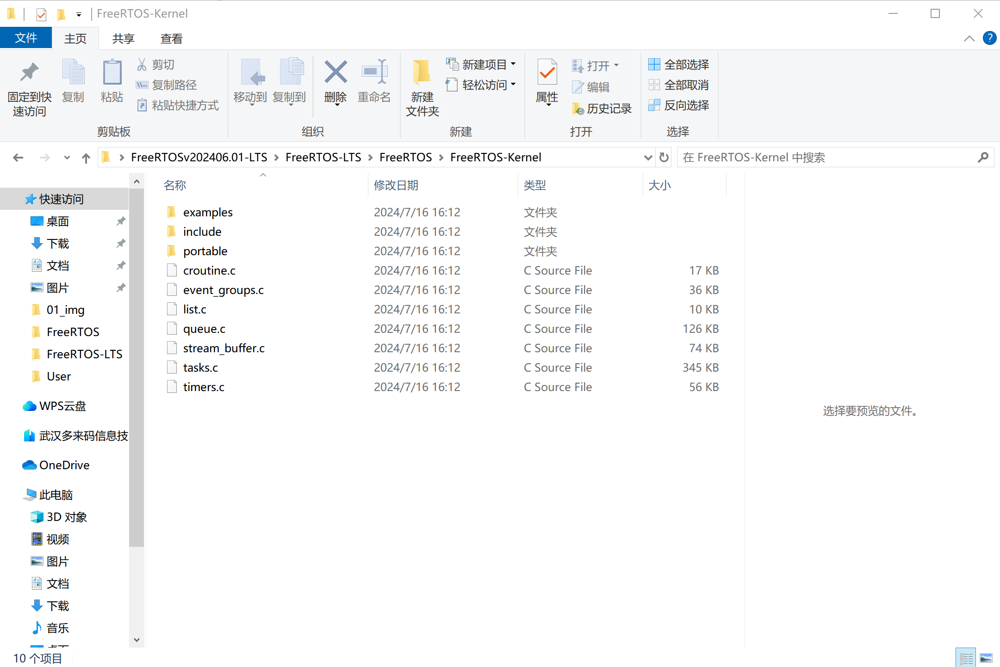
>
>```C
>这是 FreeRTOS 的核心文件夹，包含了内核的主要源代码文件。
>
>// examples目录：包含了一些示例项目，用于展示如何在不同的平台和环境中使用FreeRTOS。它们通常包括对FreeRTOS特性的实际应用，并为开发者提供如何将FreeRTOS集成到自己的项目中的参考。
>
>// include目录：主要存放了FreeRTOS内核的头文件，这些文件定义了FreeRTOS的 API、宏、数据结构以及核心功能的接口。开发者在编写应用程序时需要引用这些头文件，以便使用FreeRTOS提供的任务管理、内存管理、时间管理、同步机制等功能。
>    
>// portable目录：用于存放与特定硬件平台相关的移植代码和头文件。（这是因为FreeRTOS是一个跨平台的实时操作系统，因此它需要为不同的处理器架构、编译器和硬件平台提供平台特定的实现）。 portable目录就是为了支持不同平台移植而设计的，它包含了与硬件相关的底层代码和配置文件。
>    
>// croutine.c：协程模块，提供轻量级的任务功能。
>// event_groups.c：是实现事件组（Event Groups）功能的核心代码。事件组是FreeRTOS中的一种同步机制，用于任务间的通信和同步。它允许任务等待一个或多个标志位（bits）被设置，或者检查多个条件是否都满足，常用于实现任务之间的协作、信号传递、状态管理等场景。
>// list.c： 实现链表/List数据结构的核心代码。List是FreeRTOS内部实现任务调度、事件管理、内存管理等多个模块的重要数据结构。
>// queue.c：队列管理模块，提供了任务间通信和数据交换的机制，对于实现实时操作系统中的任务调度、资源管理和事件通知等功能至关重要。
>// stream_buffer.c：实现了FreeRTOS中的流缓冲区功能，是一种适用于流式数据传输的缓冲机制。它适用于任务间的异步通信、数据流的传输和中断与任务之间的数据传递。流缓冲区的设计具有高效性和灵活性，能够保证数据传输的可靠性，并支持任务阻塞与同步。
>// task.c：任务管理模块，包含了任务创建、调度、挂起、优先级管理等功
>// timers.c：定时器模块，允许在系统中设置和管理定时器。
>```
>
>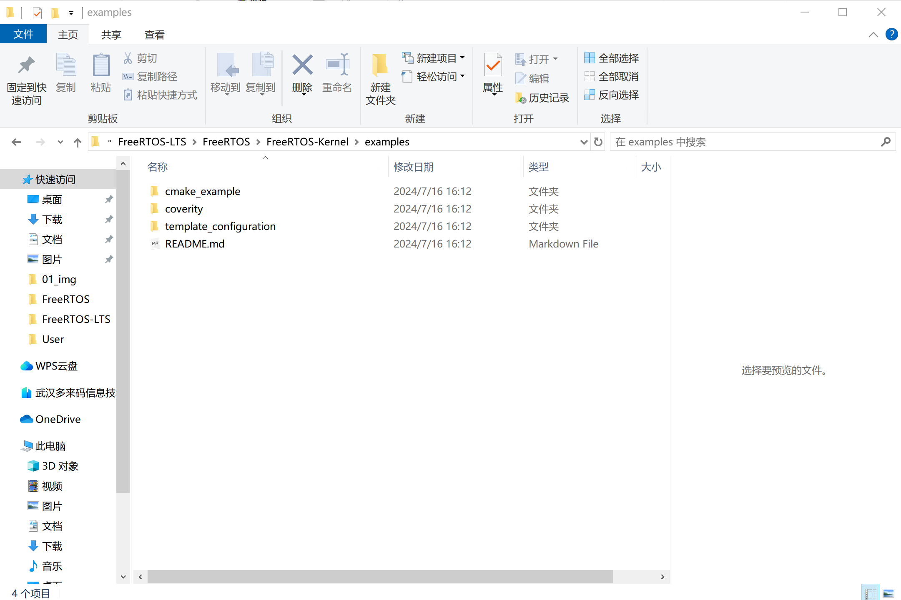
>
>```C
>examples目录包含了一些示例项目，用于展示如何在不同的平台和环境中使用FreeRTOS。
>    
>// cmake_example：提供了一个使用CMake构建系统的最小化的FreeRTOS示例项目。展示了如何使用CMake构建和配置FreeRTOS 项目。
>// coverity：与FreeRTOS配合使用的静态分析工具，检查代码的MISRA兼容性(Motor Industry Software Reliability Association: 是一个为嵌入式系统软件开发提供一组规范和指导方针的组织-> MISRA代码标准)。包含一些用于测试的示例代码，主要目的是帮助开发人员使用Coverity工具来分析代码质量，确保 FreeRTOS 或其应用项目符合行业标准。
>// template_configuration：提供一个模板配置文件FreeRTOSConfig.h，用于帮助开发者为其应用程序准备适当的FreeRTOS 配置。 FreeRTOSConfig.h包含了很多宏定义，帮助开发者根据目标平台和需求配置系统。 
>```
>
>我们已经明白对于FreeRTOS来说， 它是开源的、跨平台的，而移植到不同的硬件平台，还需要修改其部分配置以适应不同的硬件平台要求，而在这个过程中FreeRTOSConfig.h文件是最重要要修改的文件， 所以在移植FreeRTOS的时候， 我们要根据自己的硬件平台找到适合自己配置的FreeRTOSConfig.h文件。
>
>而在examples目录下的README.md文件上记载了不同平台的示例。
>
>```C
>https://github.com/FreeRTOS/FreeRTOS/tree/main/FreeRTOS/Demo
>```
>
>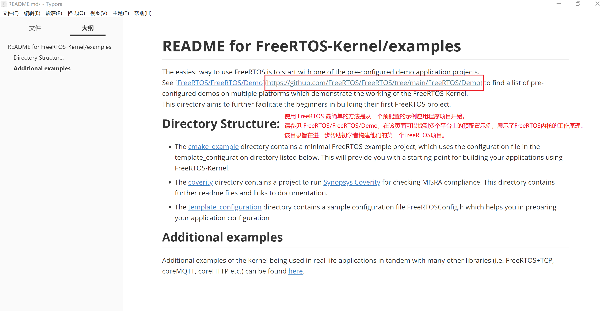
>
>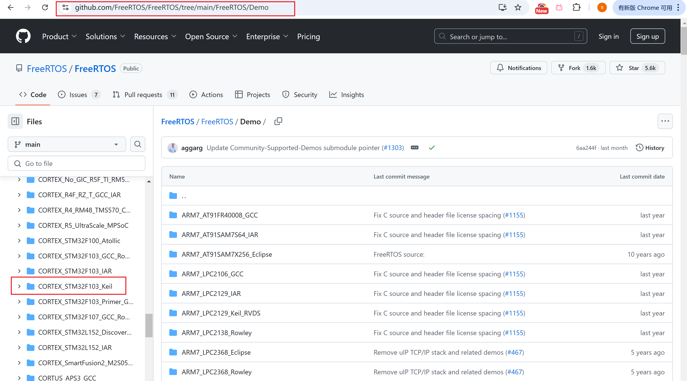
>
>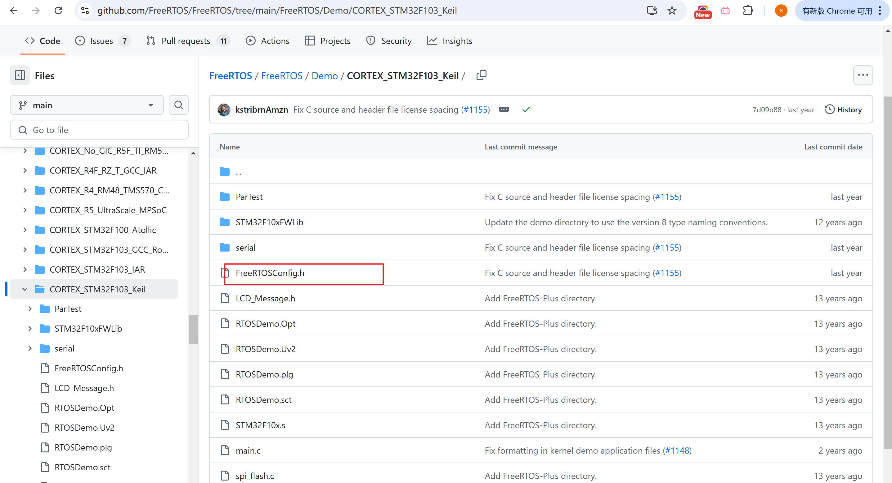
>
>```h
>/*
> * FreeRTOS V202212.00
> * Copyright (C) 2020 Amazon.com, Inc. or its affiliates. All Rights Reserved.
> *
> * Permission is hereby granted, free of charge, to any person obtaining a copy of
> * this software and associated documentation files (the "Software"), to deal in
> * the Software without restriction, including without limitation the rights to
> * use, copy, modify, merge, publish, distribute, sublicense, and/or sell copies of
> * the Software, and to permit persons to whom the Software is furnished to do so,
> * subject to the following conditions:
> *
> * The above copyright notice and this permission notice shall be included in all
> * copies or substantial portions of the Software.
> *
> * THE SOFTWARE IS PROVIDED "AS IS", WITHOUT WARRANTY OF ANY KIND, EXPRESS OR
> * IMPLIED, INCLUDING BUT NOT LIMITED TO THE WARRANTIES OF MERCHANTABILITY, FITNESS
> * FOR A PARTICULAR PURPOSE AND NONINFRINGEMENT. IN NO EVENT SHALL THE AUTHORS OR
> * COPYRIGHT HOLDERS BE LIABLE FOR ANY CLAIM, DAMAGES OR OTHER LIABILITY, WHETHER
> * IN AN ACTION OF CONTRACT, TORT OR OTHERWISE, ARISING FROM, OUT OF OR IN
> * CONNECTION WITH THE SOFTWARE OR THE USE OR OTHER DEALINGS IN THE SOFTWARE.
> *
> * https://www.FreeRTOS.org
> * https://github.com/FreeRTOS
> *
> */
>
>#ifndef FREERTOS_CONFIG_H
>#define FREERTOS_CONFIG_H
>
>/*-----------------------------------------------------------
> * Application specific definitions.
> *
> * These definitions should be adjusted for your particular hardware and
> * application requirements.
> *
> * THESE PARAMETERS ARE DESCRIBED WITHIN THE 'CONFIGURATION' SECTION OF THE
> * FreeRTOS API DOCUMENTATION AVAILABLE ON THE FreeRTOS.org WEB SITE. 
> *
> * See http://www.freertos.org/a00110.html
> *----------------------------------------------------------*/
>
>#define configUSE_PREEMPTION		1
>#define configUSE_IDLE_HOOK			0
>#define configUSE_TICK_HOOK			0
>#define configCPU_CLOCK_HZ			( ( unsigned long ) 72000000 )	
>#define configTICK_RATE_HZ			( ( TickType_t ) 1000 )
>#define configMAX_PRIORITIES		( 5 )
>#define configMINIMAL_STACK_SIZE	( ( unsigned short ) 128 )
>#define configTOTAL_HEAP_SIZE		( ( size_t ) ( 17 * 1024 ) )
>#define configMAX_TASK_NAME_LEN		( 16 )
>#define configUSE_TRACE_FACILITY	0
>#define configUSE_16_BIT_TICKS		0
>#define configIDLE_SHOULD_YIELD		1
>
>/* Co-routine definitions. */
>#define configUSE_CO_ROUTINES 		0
>#define configMAX_CO_ROUTINE_PRIORITIES ( 2 )
>
>/* Set the following definitions to 1 to include the API function, or zero
>to exclude the API function. */
>
>#define INCLUDE_vTaskPrioritySet		1
>#define INCLUDE_uxTaskPriorityGet		1
>#define INCLUDE_vTaskDelete				1
>#define INCLUDE_vTaskCleanUpResources	0
>#define INCLUDE_vTaskSuspend			1
>#define INCLUDE_vTaskDelayUntil			1
>#define INCLUDE_vTaskDelay				1
>
>/* This is the raw value as per the Cortex-M3 NVIC.  Values can be 255
>(lowest) to 0 (1?) (highest). */
>#define configKERNEL_INTERRUPT_PRIORITY 		255
>/* !!!! configMAX_SYSCALL_INTERRUPT_PRIORITY must not be set to zero !!!!
>See http://www.FreeRTOS.org/RTOS-Cortex-M3-M4.html. */
>#define configMAX_SYSCALL_INTERRUPT_PRIORITY 	191 /* equivalent to 0xb0, or priority 11. */
>
>
>/* This is the value being used as per the ST library which permits 16
>priority values, 0 to 15.  This must correspond to the
>configKERNEL_INTERRUPT_PRIORITY setting.  Here 15 corresponds to the lowest
>NVIC value of 255. */
>#define configLIBRARY_KERNEL_INTERRUPT_PRIORITY	15
>
>#endif /* FREERTOS_CONFIG_H */
>```
>
><span style="color:red">include目录</span>
>
>```C
>// FreeRTOS-Kernel中，include目录包含了FreeRTOS内核的公共头文件，这些头文件定义了FreeRTOS API、数据结构、宏、配置选项和其他核心功能。include目录对于FreeRTOS的使用和扩展至关重要。
>```
>
>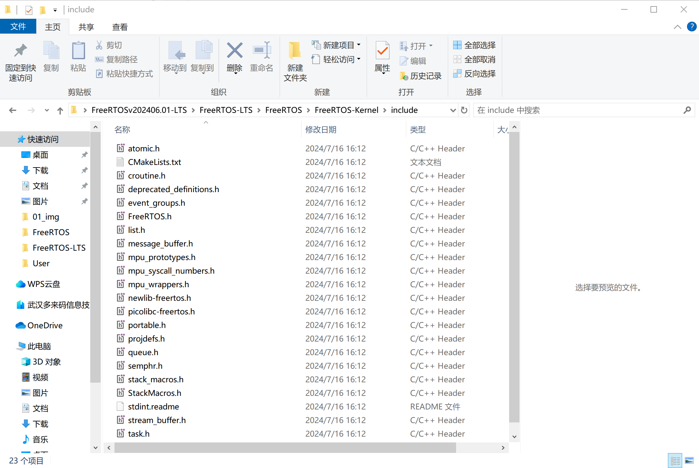
>
>````C
>后面要详细用到include目录的内容， 后续详细说明
>````
>
><span style="color:red">portable目录</span>
>
>```C
>portable目录是一个非常重要的目录，它用于实现FreeRTOS的移植层。该目录包含与特定硬件平台相关的代码，确保FreeRTOS内核能够在不同的硬件架构上正常运行。由于FreeRTOS是一个高度可移植的操作系统，portable目录为不同的处理器架构（如 ARM Cortex-M、RISC-V、AVR、x86 等）提供了适配代码。
>```
>
>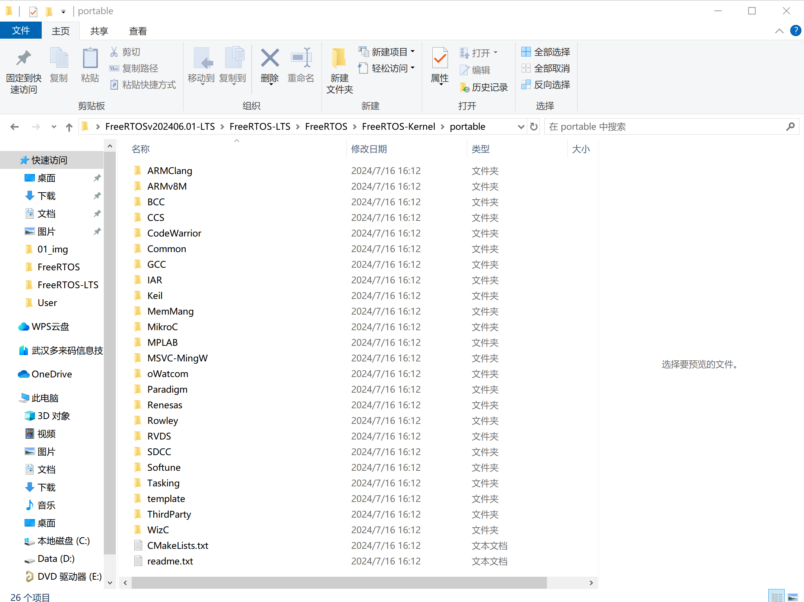
>
>```C
>// ARMClang目录: 包含与ARM架构微控制器和Clang编译器相关的特定配置文件和移植代码。这个目录中的文件是为了帮助FreeRTOS 在使用ARM处理器的设备上，并且使用Clang编译器进行编译的时候，能够正确运行和工作。
>// ARMV8M目录：ARMv8-M架构微控制器的移植代码和配置文件。ARMv8-M是ARM公司推出的一种处理器架构。
>// BCC目录：为Borland C Compiler（BCC）编译器进行移植的代码和配置文件。Borland C Compiler是一个较旧的C语言编译器。
>// CCS目录：对Code Composer Studio (CCS)编译器的移植代码和配置文件。Code Composer Studio是TI（德州仪器）公司推出的一款集成开发环境。用于开发 TI 的微控制器和处理器（例如 MSP430、Tiva C、C2000 系列等）。
>// CodeWarrior目录：对CodeWarrior编译器的移植代码和配置文件。CodeWarrior是由NXP（原 Freescale）公司提供的一款集成开发环境（IDE），主要用于开发NXP的微控制器和处理器（如68K、ColdFire、Kinetis等系列）。
>// Common目录：包含与特定硬件平台或编译器无关的通用移植代码和配置文件。这些文件是FreeRTOS内核移植所需的基本代码，不依赖于任何特定的编译器或微控制器架构，因此可以在多个平台上共享和使用。
>// GCC目录：对GCC编译器的移植代码和配置文件。GCC（GNU Compiler Collection）是一个开源编译器，广泛用于多种硬件平台和编程语言，特别是在嵌入式系统中，GCC 是最常用的编译器之一。
>// IAR目录：对IAR编译器的移植代码和配置文件。IAR Embedded Workbench是一款嵌入式系统开发的集成开发环境（IDE）和编译器，特别适用于多种微控制器平台，如 ARM、8051、AVR 等。   
>// Keil目录：对Keil编译器的移植代码和配置文件。  
>
>// MemMang目录：包含内存管理相关的代码，用于支持FreeRTOS在不同平台上的内存分配机制。FreeRTOS提供了多种内存分配器（memory allocator），这个目录里包含了几种常用的内存管理方案，供开发者选择和使用。
>    
>// MikroC目录：对MikroC编译器的移植代码和配置文件。MikroC是一款广泛用于嵌入式开发的C语言编译器，特别适用于微芯片（Microchip）的PIC系列、dsPIC、PIC32和ARM微控制器。
>// MPLAB目录：对MPLAB编译器的移植代码和配置文件。MPLAB是由Microchip提供的一套集成开发环境（IDE）和编译器，专门用于开发PIC微控制器和dsPIC系列的嵌入式系统。
>// MSVC-MingW目录：对MSVC（Microsoft Visual C++） 和MingW（Minimalist GNU for Windows）编译器的移植代码和配置文件。MSVC是Microsoft提供的C/C++编译器，主要用于Windows平台的开发；MingW是一个适用于Windows的GCC编译器版本，通常用于开发跨平台应用。  
>// oWatcom目录：对Open Watcom编译器的移植代码和配置文件。Open Watcom是一个开源的C、C++和Fortran编译器，最初由 Watcom International发展，后由开源社区维护。它曾被广泛用于DOS和嵌入式系统开发。
>// Paradigm 目录的作用是包含针对 Paradigm 编译器 的移植代码和配置文件。Paradigm 是一种编译器，主要用于嵌入式系统开发，尤其是一些特定的微控制器平台。该编译器通常用于较为小众的硬件平台。
>// Renesas目录：对Renesas编译器的移植代码和配置文件。Renesas是一家专注于半导体和微控制器的公司，提供多种用于嵌入式系统的微控制器（如RX、RL78、RX等系列）。该目录中的代码确保FreeRTOS可以在使用Renesas编译器和Renesas微控制器的系统上正确运行。
>// Rowley目录：对Rowley编译器的移植代码和配置文件。Rowley Associates提供了一种专门为嵌入式系统开发设计的编译器，称为Rowley CrossWorks，支持多种微控制器架构，特别是ARM架构。
>  
>// RVDS目录：对RVDS（RealView Development Suite）编译器 的移植代码和配置文件。RVDS是由Arm提供的一套开发工具，专门为ARM微控制器架构（如ARM Cortex-M 系列）设计，常用于嵌入式系统开发。
>    
>// SDCC目录：对SDCC（Small Device C Compiler）编译器的移植代码和配置文件。SDCC是一个开源的C编译器，专门用于编译 8 位微控制器（如8051、Zilog Z80、PIC等）的代码。 
>// Softune目录：对Softune编译器的移植代码和配置文件。Softune是由NEC（现为 Renesas）提供的一套集成开发环境（IDE）和编译器，通常用于开发NEC/RENESAS的8位和16位微控制器（如78K、RL78等系列）。
>// Tasking目录：对Tasking编译器的移植代码和配置文件。Tasking是一款嵌入式系统开发用的编译器，支持多种微控制器架构，尤其是在高性能嵌入式处理器（如ARM和16/32位微控制器）方面有广泛应用。
>// template目录：提供一种通用模板，供开发者用作移植FreeRTOS到新平台时的参考。它包含了一些基础的移植代码和配置，帮助开发者根据具体的硬件平台快速进行定制和适配。
>// ThirdParty目录：是包含第三方库或外部组件，这些组件或库是FreeRTOS在某些平台或应用场景中可能需要的附加支持。它们不是FreeRTOS核心的一部分，但可能用于扩展或增强FreeRTOS的功能，通常由其他厂商或开源社区提供。   
>// WizC目录的：对WizC编译器的移植代码和配置文件。WizC是由Wiznet提供的一款C语言编译器，通常用于其自家生产的嵌入式产品和微控制器，特别是在网络相关的嵌入式应用中比较常见。
>```
>
>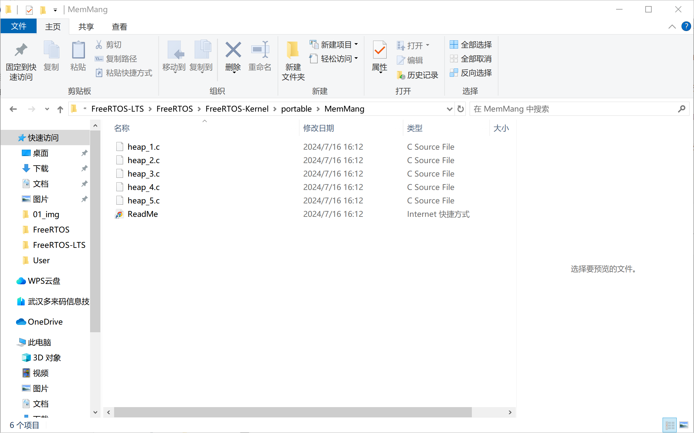
>
>```C
>heap_1.c: 固定大小的内存块分配策略
>// 内存分配简单，不需要维护内存碎片（因为只分配固定大小的块）。
>// 不支持内存释放（即，分配的内存块不能被释放）。
>// 适用于只需要单次分配，不需要释放的应用场景。
>// 无法处理内存碎片问题，因为一旦分配了内存就不能释放。
>heap_2.c：支持内存的分配和释放，并采用的是链表管理，每个分配的内存块会包含指向下一个空闲内存块的指针。
>// 内存可以被释放，解决了heap_1.c中无法释放内存的问题。
>// 在内存使用过程中，有可能会导致内存碎片（即分配的内存块大小不一致，造成碎片化）。
>// 它比 heap_1.c 更灵活，适用于需要动态内存管理的系统。
>heap_3.c：使用标准C库的malloc()和free()函数来管理内存。
>// 依赖于平台的标准C库实现的内存分配函数，通常可以自动处理内存碎片。
>// 在FreeRTOS环境中，使用malloc()和free()来进行内存分配和释放。
>// 内存碎片处理由标准C库实现，不做额外的优化。
>heap_4.c：支持内存分配和释放，采用更复杂的内存块管理方式，包括内存块合并和内存碎片管理。
>// 支持内存合并，即在内存块释放后，它能够自动尝试合并相邻的空闲内存块，减少内存碎片。
>// 采用了更复杂的算法来优化内存管理，适合需要频繁分配和释放内存的系统。
>// 适用于需要频繁动态内存操作的场景。
>heap_5.c：是heap_4.c的扩展，支持多个内存区域的管理。
>// 除了支持内存分配、释放、内存块合并等功能外，还支持将内存分配到多个内存区域。
>// 适用于内存较为分散、内存分布较为复杂的或者需要特殊内存布局的系统。
>```
>
>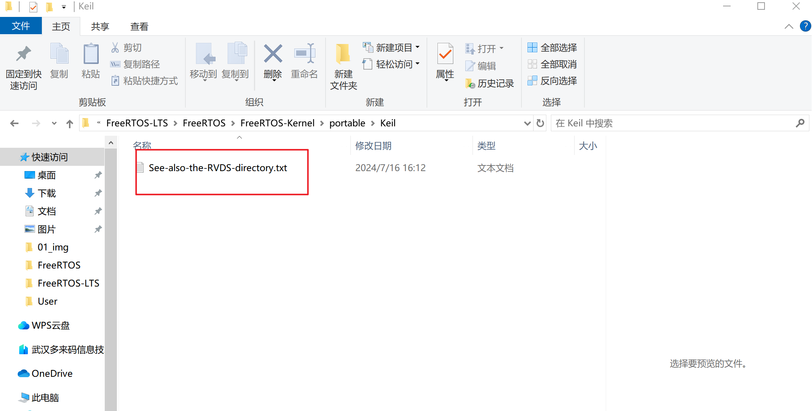
>
>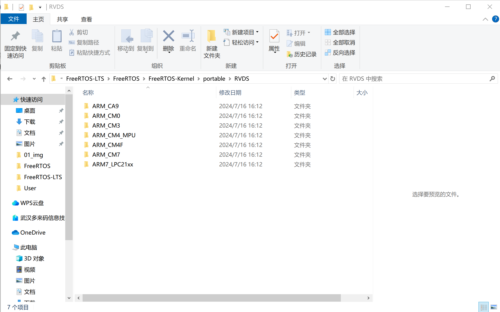
>
>```C
>ARM Cortex-A9微处理器架构:高性能应用处理器，适合智能设备(平板、电视盒子...)
>ARM Cortex-M0微处理器架构:低功耗、低成本的嵌入式处理器
>ARM Cortex-M3微处理器架构:中端嵌入式应用的处理器，具有较好的性能
>ARM Cortex-M4微处理器架构:支持浮点运算和数字信号处理（DSP）的高性能处理器，带内存保护
>ARM Cortex-M4F微处理器架构：与ARM_CM4基本相同，但有硬件浮点单元，适用于需要浮点计算的应用
>ARM Cortex-M7微处理器架构：高性能的嵌入式处理器，适合复杂控制任务
>ARM7_LPC21xx：基于ARM7核心的微控制器，适用于低功耗、低成本的嵌入式系统
>```
>
>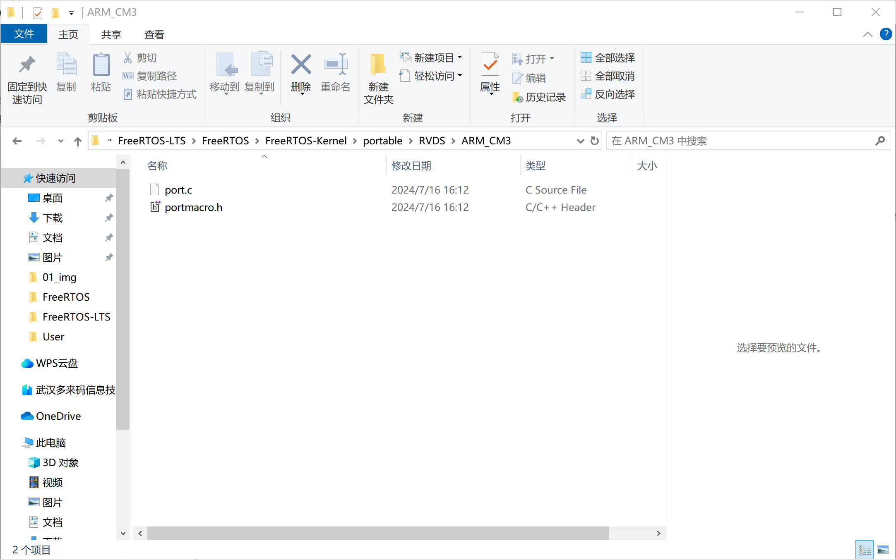
>
>```C
>port.c文件: 负责实现FreeRTOS内核所需的硬件抽象层如任务调度、上下文切换、定时器中断等。
>// 上下文切换函数：负责任务切换时保存和恢复寄存器的内容。
>// 系统时钟配置：配置硬件定时器来生成系统节拍（tick）中断。
>// 中断处理：定义如何处理中断以及在中断中如何调度任务。
>    
>portmacro.h文件: 文件包含了与编译器和硬件平台相关的宏定义和类型定义。它主要提供硬件相关的定义，用于支持port.c文件中的实现和FreeRTOS内核的高效运行。不同的编译器和硬件平台可能会有不同的宏和类型定义，因此需要根据具体的硬件平台定制该文件。
>// 任务堆栈指针宏：定义如何访问任务堆栈指针。
>// 中断相关的宏：例如 portENABLE_INTERRUPTS()、portDISABLE_INTERRUPTS() 等，用于启用或禁用中断。
>// 处理器寄存器操作：用于保存和恢复处理器的寄存器状态。
>```

### 1.1.2 构建一个基于寄存器的工程

>获取`STM32F10x标准固件库`并解压。
>
>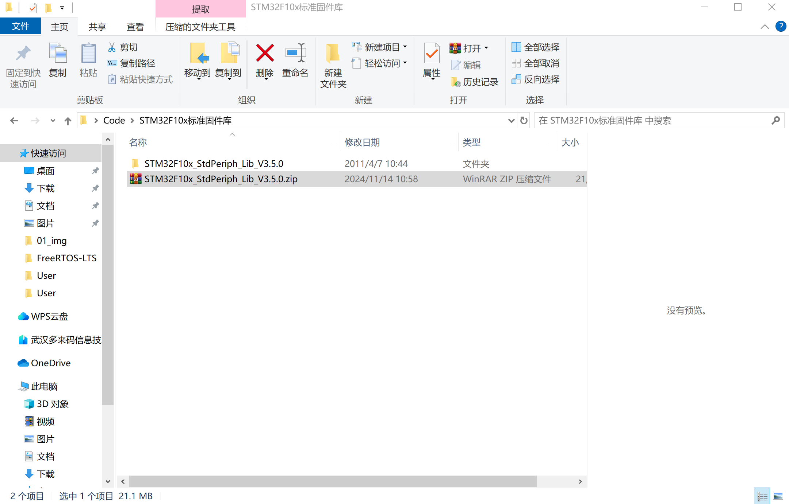
>
>打开Keil创建项目。
>
>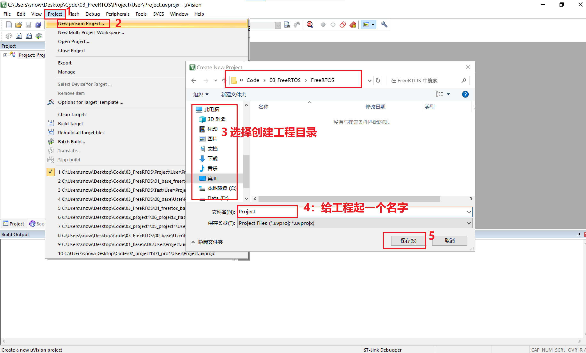
>
>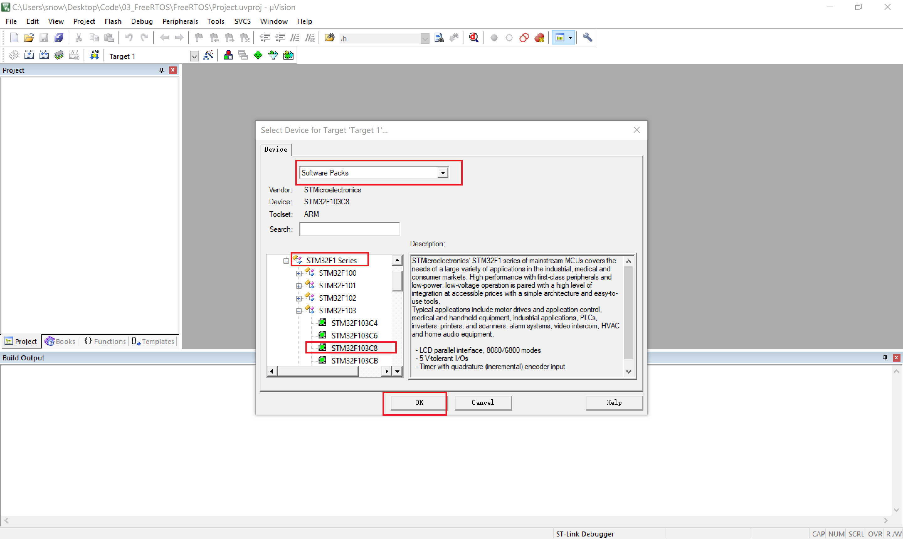
>
>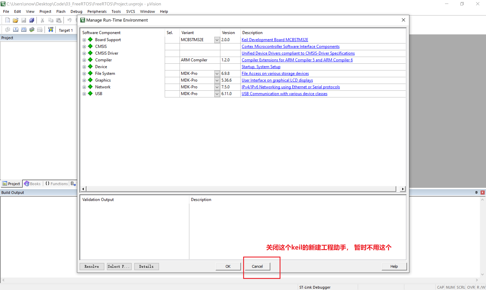
>
><span style="color:red">这样， 就构建好了一个空的工程。</span>
>
>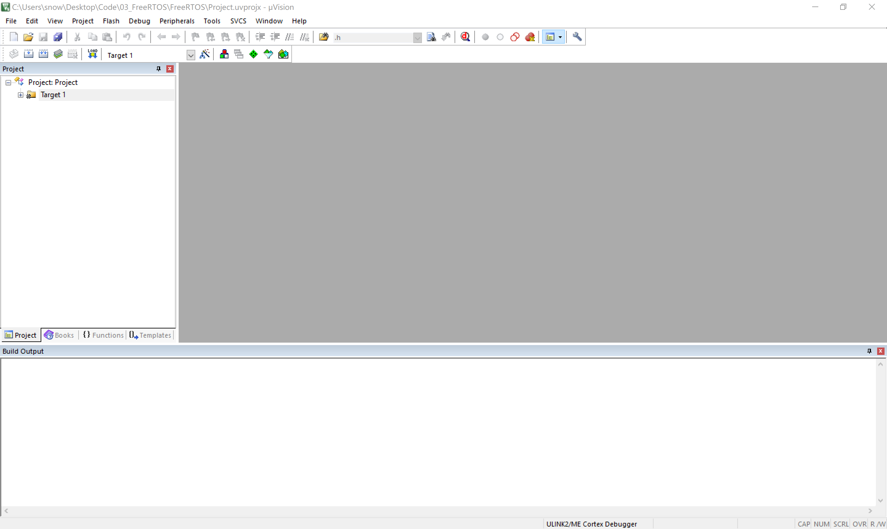
>
><span style="color:red">在创建好的项目中引入STM32文件, 需要引入的文件如下：</span>
>
>````C
>目录：STM32F10x_StdPeriph_Lib_V3.5.0\Libraries\CMSIS\CM3\CoreSupport
>
>// core_cm3.h：声明了针对Cortex-M3核心的各种数据类型、宏定义、函数原型以及中断处理相关的接口。
>// core_cm3.c：实现了core_cm3.h中声明的各种函数，包括中断使能/禁用、系统时钟配置、异常处理等具体功能。
>````
>
>```C
>STM32F10x_StdPeriph_Lib_V3.5.0\Libraries\CMSIS\CM3\DeviceSupport\ST\STM32F10x\startup\arm
>
>// startup_stm32f10x_md.s：负责系统的初始启动和配置
>//		负责在微控制器上电复位或复位信号触发后，进行系统的初始配置和启动流程，包括：
>//				中断向量表的定义：定义各类中断和异常处理函数的入口地址。
>//				堆栈指针的初始化：设置主堆栈指针的初始值。
>//				复位处理函数的实现：在复位后调用主程序main函数之前执行必要的初始化工作。
>    
>//	md: 代表中等内存容量，如 STM32F103C8、STM32F103RB 等。
>```
>
>```C
>STM32F10x_StdPeriph_Lib_V3.5.0\Libraries\CMSIS\CM3\DeviceSupport\ST\STM32F10x
>    
>stm32f10x.h
>//	定义了各个外设（如GPIO、USART、SPI、I2C、定时器等）的基地址，便于在程序中引用这些外设。
>//	为每个外设定义了对应的寄存器结构体，使开发者可以通过结构体成员直接访问和操作寄存器。例如GPIOA的寄存器可以通过 GPIOA->CRL访问。
>//	....
>system_stm32f10x.h
>//	声明了系统初始化相关的函数、宏和变量。
>//	定义了与系统初始化相关的宏，如默认时钟频率值、时钟源选择宏等，便于在不同模块中统一使用。
>
>system_stm32f10x.c
>//	实现了system_stm32f10x.h对系统初始化相关的函数的相关实现。
>//	初始化system_stm32f10x.h定义的变量
>```
>
>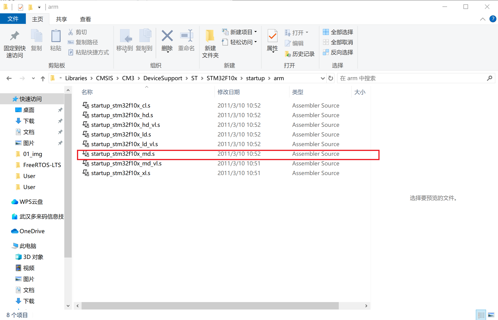
>
>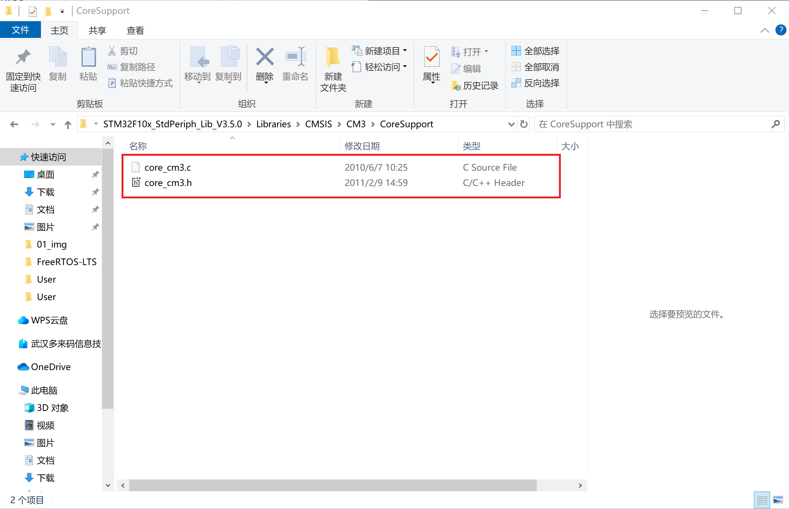
>
>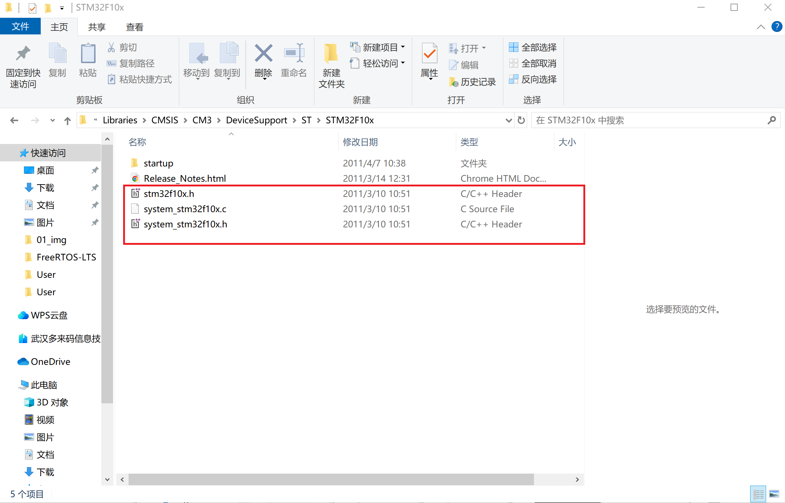

><span style="color:red">在刚才构建好的空的工程中新建两个目录</span>
>
>```C
>STM32Core: 用来存储上面需要引入的STM32系统启动、核心支持、设备定义和系统初始化的关键源代码和头文件。
>User：用来存储后续我们自己实现要的代码。
>```
>
>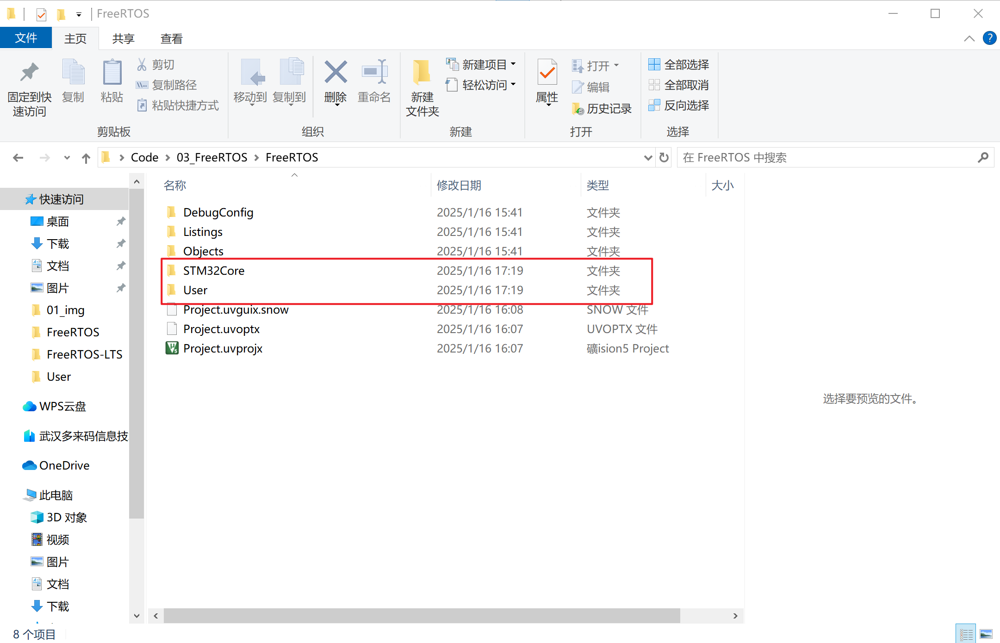
>
><span style="color:red">移植文件</span>
>
>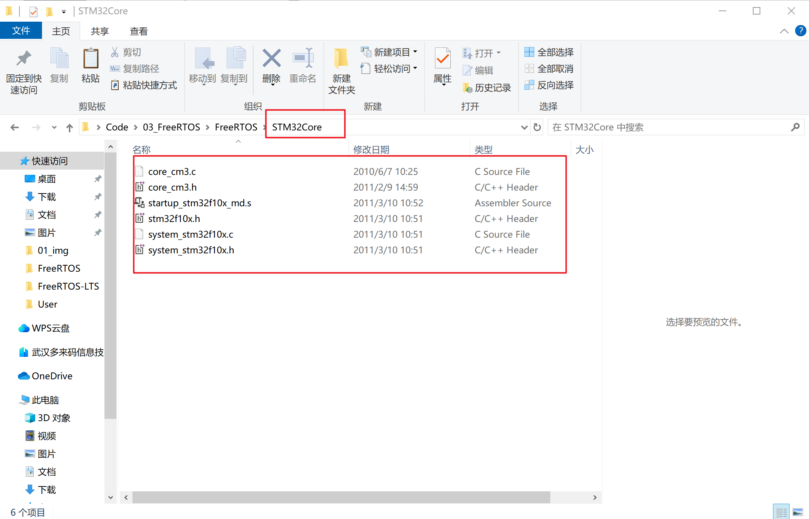
>
><span style="color:red">配置项目， 在项目中引入刚才的目录和文件</span>
>
>```C
>//	先移除空目录
>//	再创建STM32Core目录和User目录
>//	在STM32Core目录中引入对应的文件
>```
>
>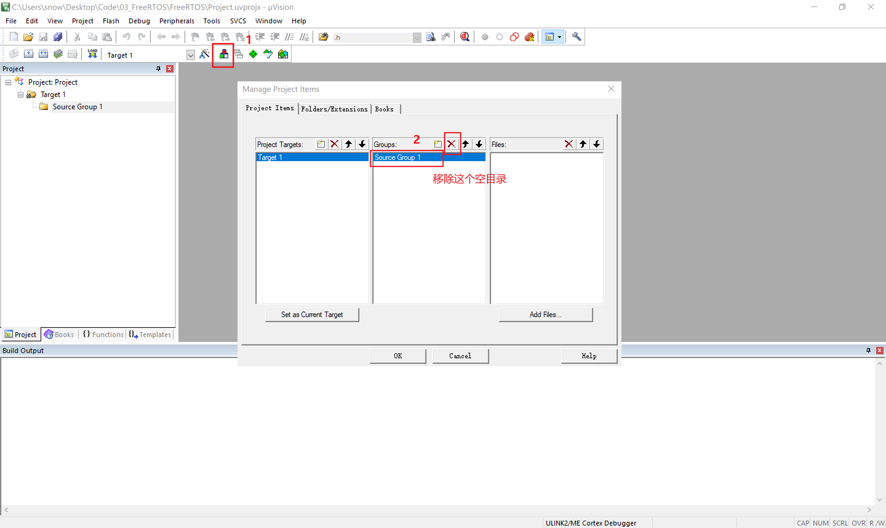
>
>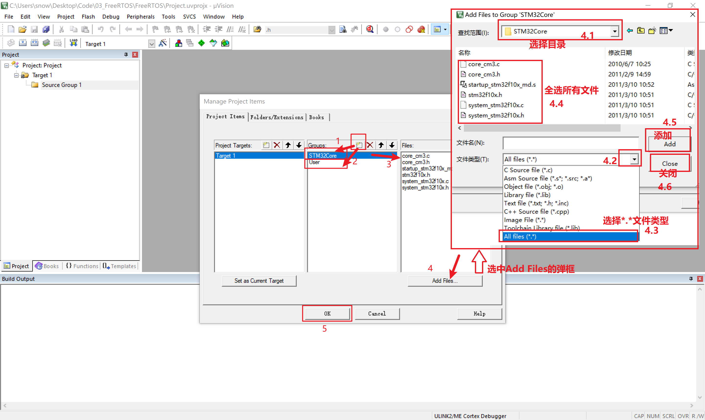
>
>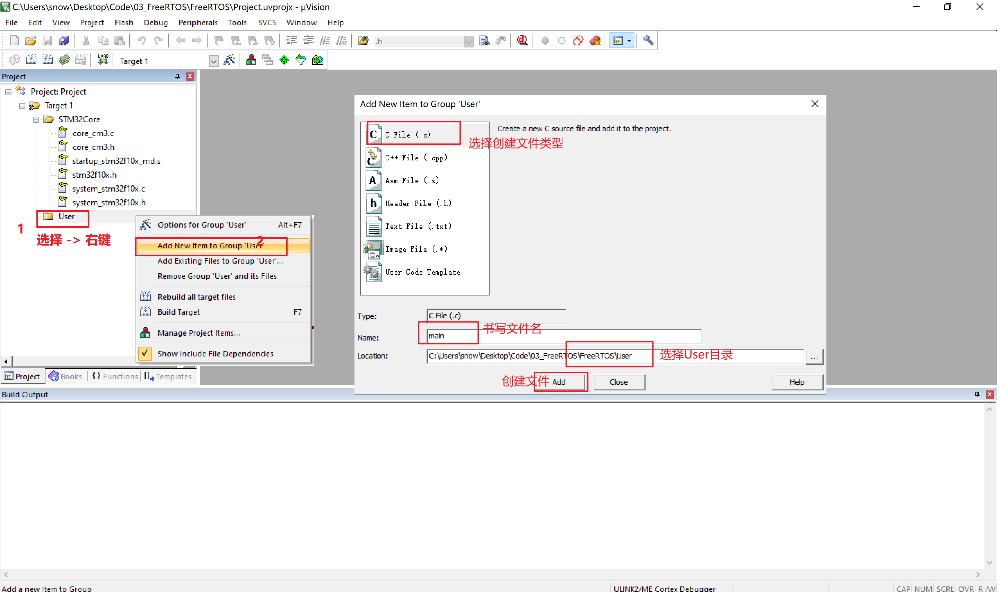
>
><span style="color:red">在创建的main.c中书写代码</span>
>
>```C
>// 控制PA1和PA2变量
>#include "stm32f10x.h"      
>int main(void){	
>	RCC->APB2ENR = 0x00000004;
>	GPIOA->CRL = 0x00000330;
>	GPIOA->ODR = 0x00000006;
>	while(1){
>	}
>}
>
>```
>
>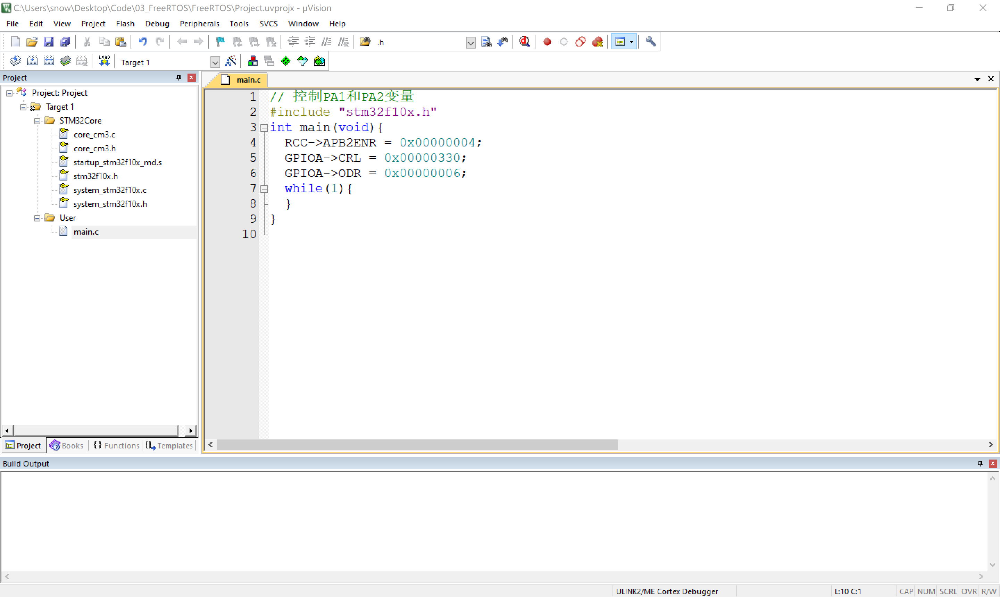
>
><span style="color:red">配置文件包含路径</span>
>
>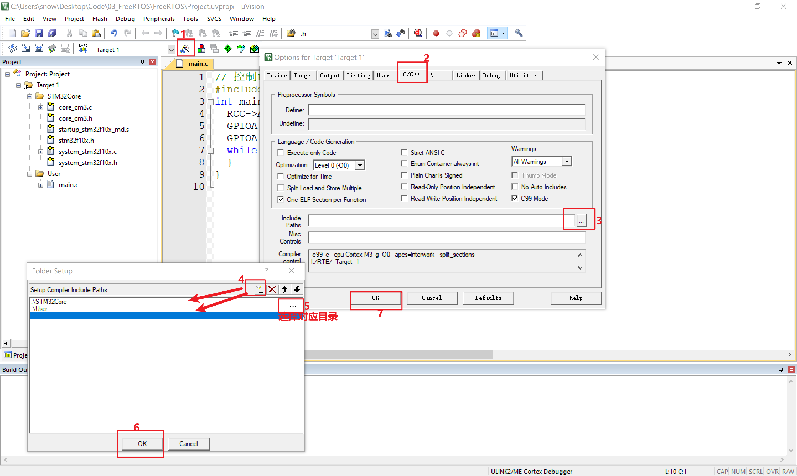
>
><span style="color:red">配置烧录程序选项信息</span>
>
>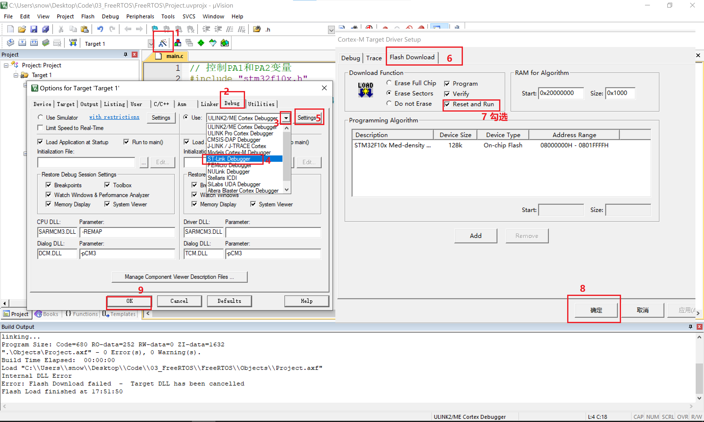
>
><span style="color:red">编译代码烧录程序</span>
>
>```C
>注意：需要硬件已经连接好
>```
>
>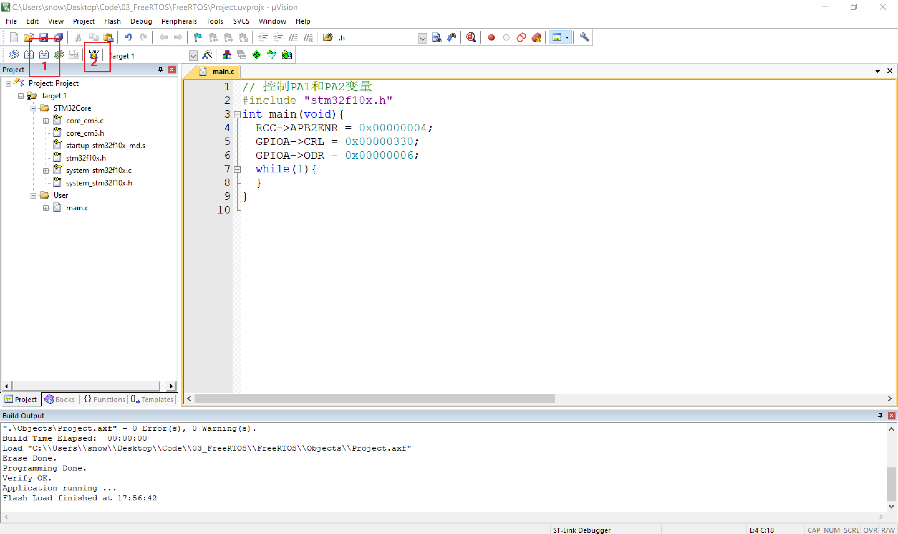

>通过上述步骤， 我们已经实现了一个基于寄存器操作STM32F103C8t6的工程， 并实现对PA1，PA2接LED正极的点灯操作。

### 1.1.3 移植FreeRTOS到上面工程

><span style="color:red">创建FreeRTOS目录，并移植/复制文件。</span>
>
>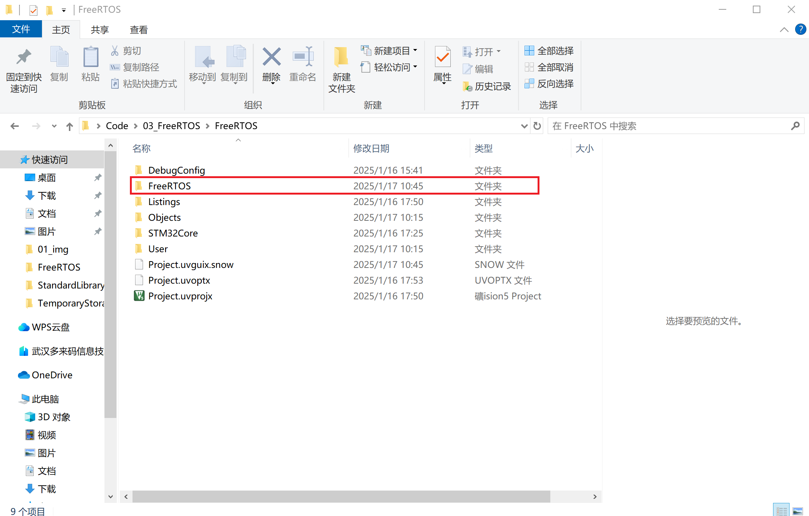
>
>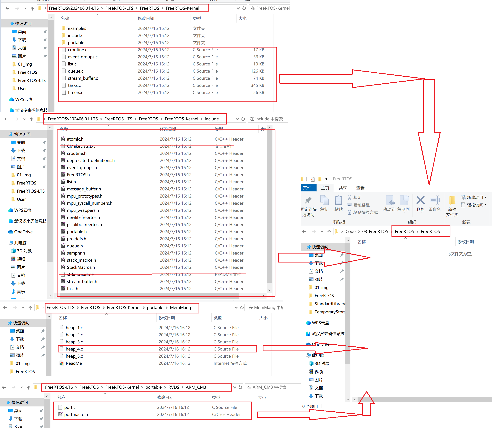
>
><span style="color:red">添加STM32F103_Keil平台的FreeRTOSConfig.h文件。（注意最后的添加中断配置）</span>
>
>```C
>/*
>* FreeRTOS V202212.00
>* Copyright (C) 2020 Amazon.com, Inc. or its affiliates. All Rights Reserved.
>*
>* Permission is hereby granted, free of charge, to any person obtaining a copy of
>* this software and associated documentation files (the "Software"), to deal in
>* the Software without restriction, including without limitation the rights to
>* use, copy, modify, merge, publish, distribute, sublicense, and/or sell copies of
>* the Software, and to permit persons to whom the Software is furnished to do so,
>* subject to the following conditions:
>*
>* The above copyright notice and this permission notice shall be included in all
>* copies or substantial portions of the Software.
>*
>* THE SOFTWARE IS PROVIDED "AS IS", WITHOUT WARRANTY OF ANY KIND, EXPRESS OR
>* IMPLIED, INCLUDING BUT NOT LIMITED TO THE WARRANTIES OF MERCHANTABILITY, FITNESS
>* FOR A PARTICULAR PURPOSE AND NONINFRINGEMENT. IN NO EVENT SHALL THE AUTHORS OR
>* COPYRIGHT HOLDERS BE LIABLE FOR ANY CLAIM, DAMAGES OR OTHER LIABILITY, WHETHER
>* IN AN ACTION OF CONTRACT, TORT OR OTHERWISE, ARISING FROM, OUT OF OR IN
>* CONNECTION WITH THE SOFTWARE OR THE USE OR OTHER DEALINGS IN THE SOFTWARE.
>*
>* https://www.FreeRTOS.org
>* https://github.com/FreeRTOS
>*
>*/
>
>#ifndef FREERTOS_CONFIG_H
>#define FREERTOS_CONFIG_H
>
>/*-----------------------------------------------------------
>* Application specific definitions.
>*
>* These definitions should be adjusted for your particular hardware and
>* application requirements.
>*
>* THESE PARAMETERS ARE DESCRIBED WITHIN THE 'CONFIGURATION' SECTION OF THE
>* FreeRTOS API DOCUMENTATION AVAILABLE ON THE FreeRTOS.org WEB SITE. 
>*
>* See http://www.freertos.org/a00110.html
>*----------------------------------------------------------*/
>
>#define configUSE_PREEMPTION		1
>#define configUSE_IDLE_HOOK			0
>#define configUSE_TICK_HOOK			0
>#define configCPU_CLOCK_HZ			( ( unsigned long ) 72000000 )	
>#define configTICK_RATE_HZ			( ( TickType_t ) 1000 )
>#define configMAX_PRIORITIES		( 5 )
>#define configMINIMAL_STACK_SIZE	( ( unsigned short ) 128 )
>#define configTOTAL_HEAP_SIZE		( ( size_t ) ( 17 * 1024 ) )
>#define configMAX_TASK_NAME_LEN		( 16 )
>#define configUSE_TRACE_FACILITY	0
>#define configUSE_16_BIT_TICKS		0
>#define configIDLE_SHOULD_YIELD		1
>
>/* Co-routine definitions. */
>#define configUSE_CO_ROUTINES 		0
>#define configMAX_CO_ROUTINE_PRIORITIES ( 2 )
>
>/* Set the following definitions to 1 to include the API function, or zero
>to exclude the API function. */
>
>#define INCLUDE_vTaskPrioritySet		1
>#define INCLUDE_uxTaskPriorityGet		1
>#define INCLUDE_vTaskDelete				1
>#define INCLUDE_vTaskCleanUpResources	0
>#define INCLUDE_vTaskSuspend			1
>#define INCLUDE_vTaskDelayUntil			1
>#define INCLUDE_vTaskDelay				1
>
>/* This is the raw value as per the Cortex-M3 NVIC.  Values can be 255
>(lowest) to 0 (1?) (highest). */
>#define configKERNEL_INTERRUPT_PRIORITY 		255
>/* !!!! configMAX_SYSCALL_INTERRUPT_PRIORITY must not be set to zero !!!!
>See http://www.FreeRTOS.org/RTOS-Cortex-M3-M4.html. */
>#define configMAX_SYSCALL_INTERRUPT_PRIORITY 	191 /* equivalent to 0xb0, or priority 11. */
>
>
>/* This is the value being used as per the ST library which permits 16
>priority values, 0 to 15.  This must correspond to the
>configKERNEL_INTERRUPT_PRIORITY setting.  Here 15 corresponds to the lowest
>NVIC value of 255. */
>#define configLIBRARY_KERNEL_INTERRUPT_PRIORITY	15
>
>#define xPortPendSVHandler PendSV_Handler
>#define vPortSVCHandler SVC_Handler
>#define xPortSysTickHandler SysTick_Handler
>
>#endif /* FREERTOS_CONFIG_H */
>
>```
>
>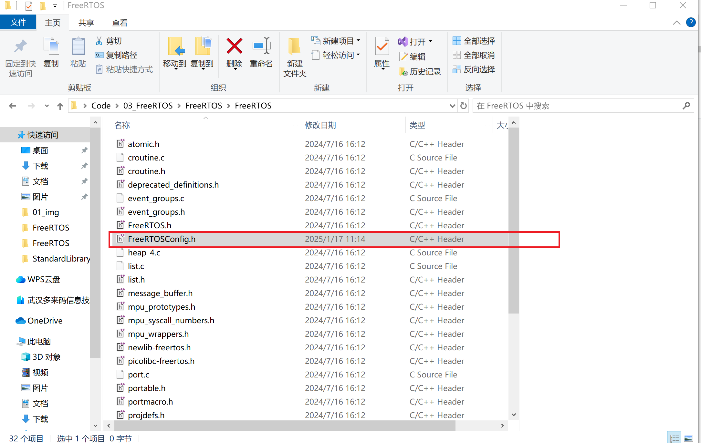
>
>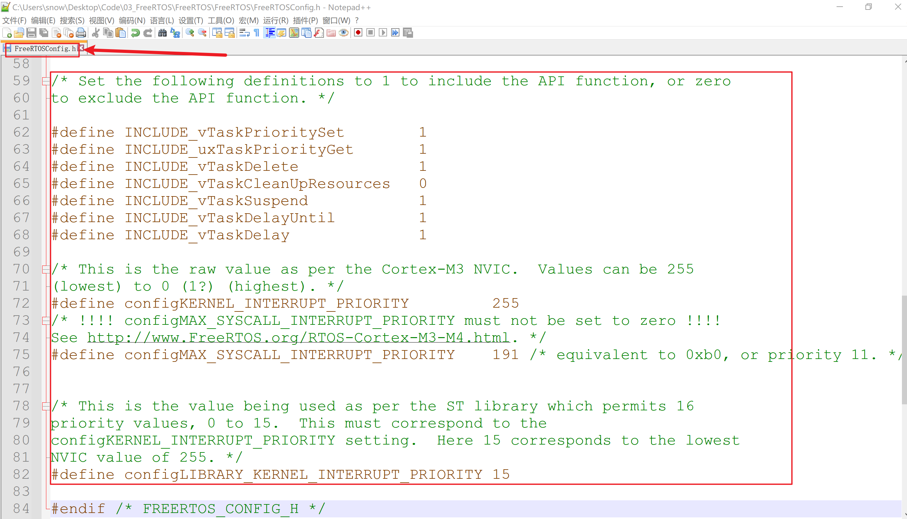
>
><span style="color:red">在Keil工程中引入这些配置。</span>
>
>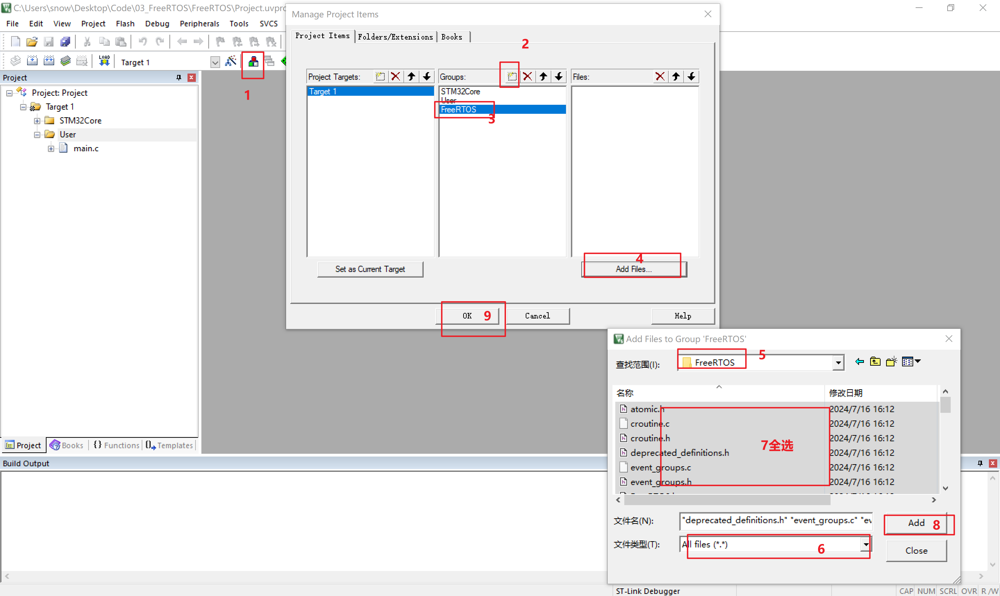
>
>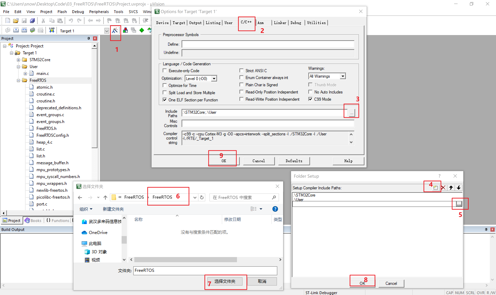
>
><span style="color:red">使用FreeRTOS：Eg: main.c实现如下代码</span>
>
>````C
>#include "stm32f10x.h"    
>#include "freertos.h"
>#include "task.h"
>void task1 ( void * arg ){	
>	// 控制PB0的Led显示
>	RCC->APB2ENR = 0x0000000C;
>	GPIOB->CRL = 0x00000003;
>	GPIOB->ODR = 0x00000001;
>	while(1){
>		GPIOB->ODR = 0x00000001;
>		vTaskDelay(1000);
>		GPIOB->ODR = 0x00000000;
>		vTaskDelay(1000);
>	}
>}
>void task2 ( void * arg ){
>	// 控制PA1的Led显示
>	RCC->APB2ENR = 0x0000000C;
>	GPIOA->CRL = 0x00000030;
>	GPIOA->ODR = 0x00000002;
>	while(1){
>		GPIOA->ODR = 0x00000002;
>		vTaskDelay(1000);
>		GPIOA->ODR = 0x00000000;
>		vTaskDelay(1000);
>	}
>}
>int main(void){
>	xTaskCreate(task1,"Task1",configMINIMAL_STACK_SIZE,NULL,tskIDLE_PRIORITY+1,NULL);
>	xTaskCreate(task2,"Task2",configMINIMAL_STACK_SIZE,NULL,tskIDLE_PRIORITY+1, NULL);
>  vTaskStartScheduler();
>	while(1){
>	}
>}
>
>````
>
>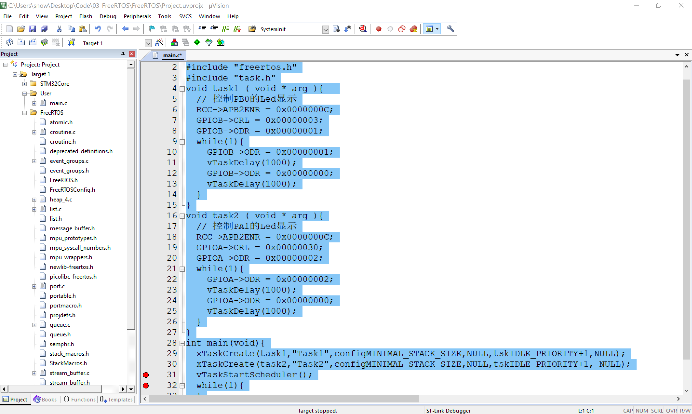

>通过上述步骤， 我们已经实现了一个基于寄存器操作STM32F103C8t6的工程，并且在这个工程中引入FreeRTOS管理任务。以现对PA1，PB0接LED正极的点灯操作。

### 1.1.4 引入标准库

>经过前面操作， 我们使用在一个基于寄存器操作STM32F103C8t6的工程中引入了FreeRTOS。但是操作外设依旧使用寄存器我们感觉不太方便， 所以接下来， 我们准备在上面的基础上， 进一步引入标准库。

><span style="color:red">创建Lib目录，并移植/复制文件。</span>
>
>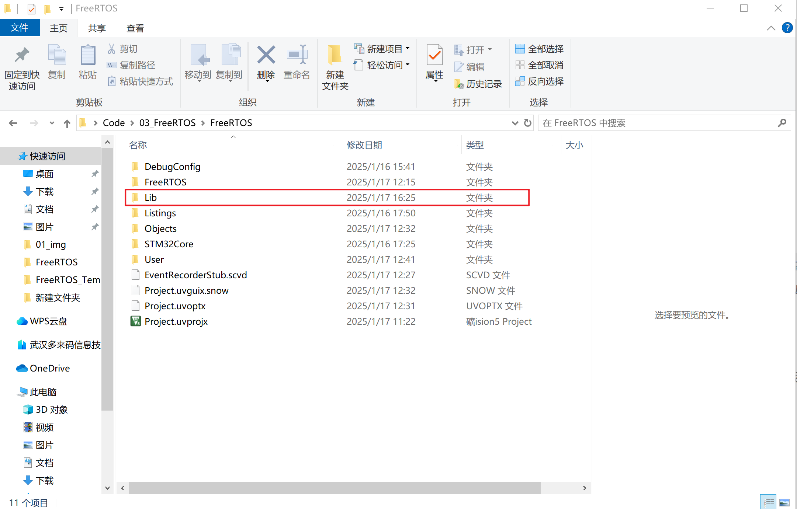
>
>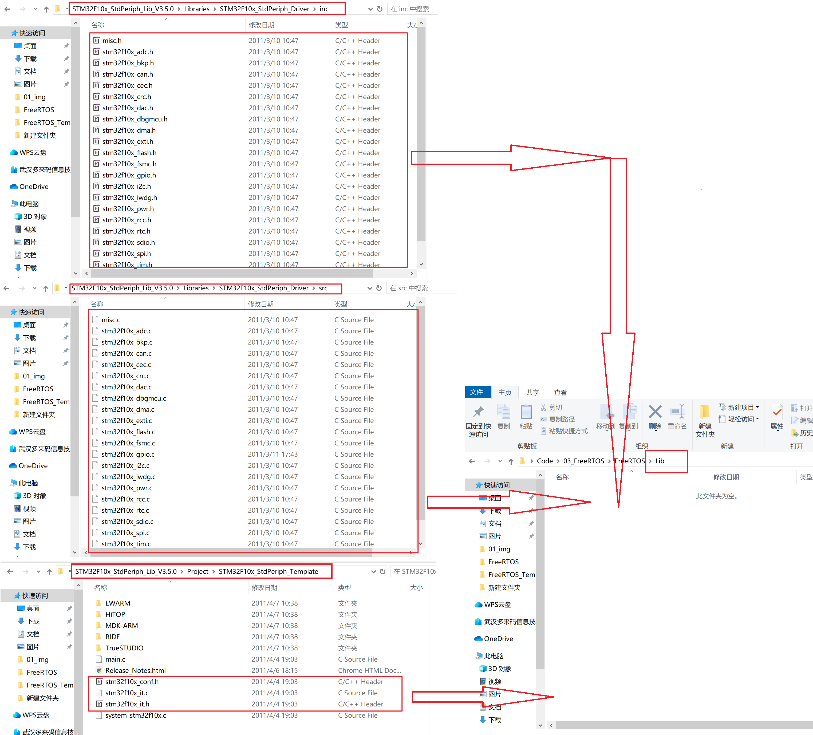
>
><span style="color:red">在Keil工程中引入这些配置。</span>
>
>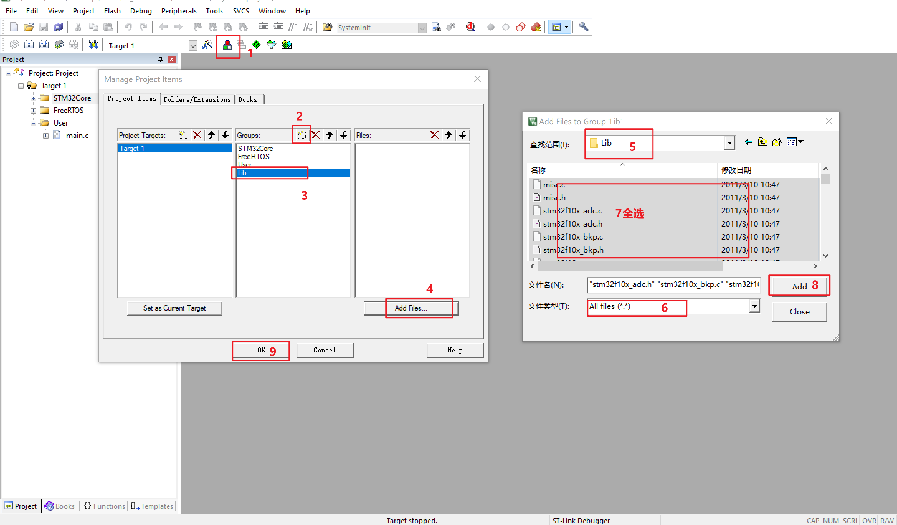
>
>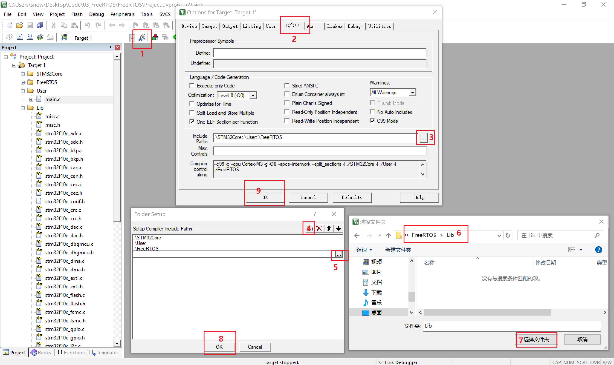
>
>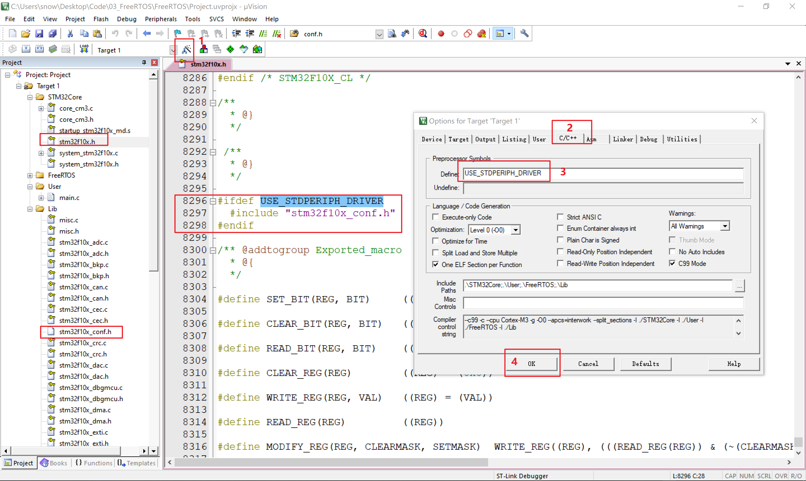
>
>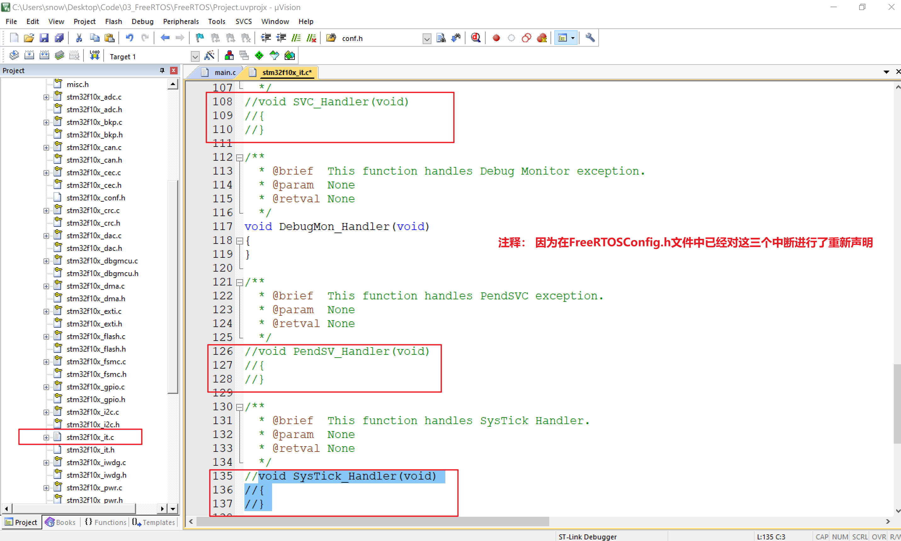

><span style="color:red">使用标准库：Eg: main.c实现如下代码</span>
>
>```C
>#include "stm32f10x.h"    
>#include "freertos.h"
>#include "task.h"
>void task1 ( void * arg ){	
>	// 控制PB1的Led显示
>	RCC_APB2PeriphClockCmd(RCC_APB2Periph_GPIOB, ENABLE);
>	GPIO_InitTypeDef initType;
>	initType.GPIO_Pin = GPIO_Pin_1 ;
>	initType.GPIO_Mode = GPIO_Mode_Out_PP;
>	initType.GPIO_Speed = GPIO_Speed_50MHz;
>	GPIO_Init(GPIOB, &initType);
>	while(1){
>			GPIO_SetBits(GPIOB, GPIO_Pin_1);
>			vTaskDelay(1000);
>			GPIO_ResetBits(GPIOB, GPIO_Pin_1);
>			vTaskDelay(1000);
>	}
>}
>void task2 ( void * arg ){
>	// 控制PA2的Led显示
>	RCC_APB2PeriphClockCmd(RCC_APB2Periph_GPIOA, ENABLE);
>	GPIO_InitTypeDef initType;
>	initType.GPIO_Pin =  GPIO_Pin_2;
>	initType.GPIO_Mode = GPIO_Mode_Out_PP;
>	initType.GPIO_Speed = GPIO_Speed_50MHz;
>	GPIO_Init(GPIOA, &initType);
>	while(1){
>			GPIO_SetBits(GPIOA, GPIO_Pin_2);
>			vTaskDelay(1000);
>			GPIO_ResetBits(GPIOA, GPIO_Pin_2);
>			vTaskDelay(1000);
>	}
>}
>int main(void){
>	xTaskCreate(task1,"Task1",configMINIMAL_STACK_SIZE,NULL,tskIDLE_PRIORITY+1,NULL);
>	xTaskCreate(task2,"Task2",configMINIMAL_STACK_SIZE,NULL,tskIDLE_PRIORITY+1, NULL);
>  	vTaskStartScheduler();
>	while(1){
>	}
>}
>
>```
>
>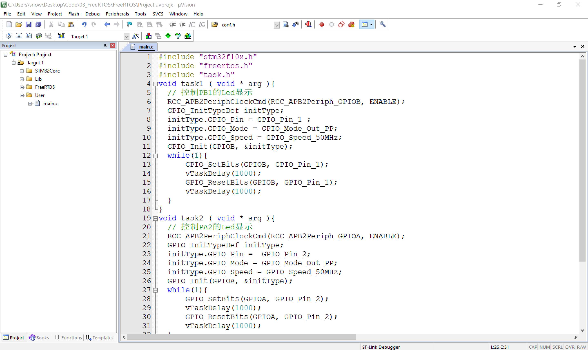

## 1.2 使用STM32CubeMX工具配置移植

>环境准备工作： 安装好Keil，安装好STM32CubeMX，有ST-LINK链接的外设系统板。

><span style="color:red">创建项目</span>
>
>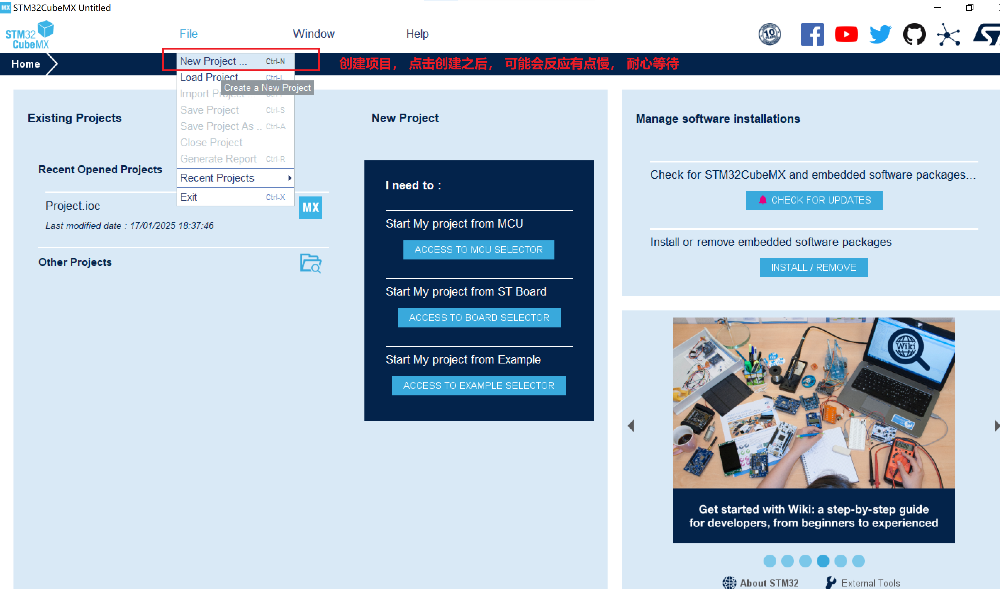
>
>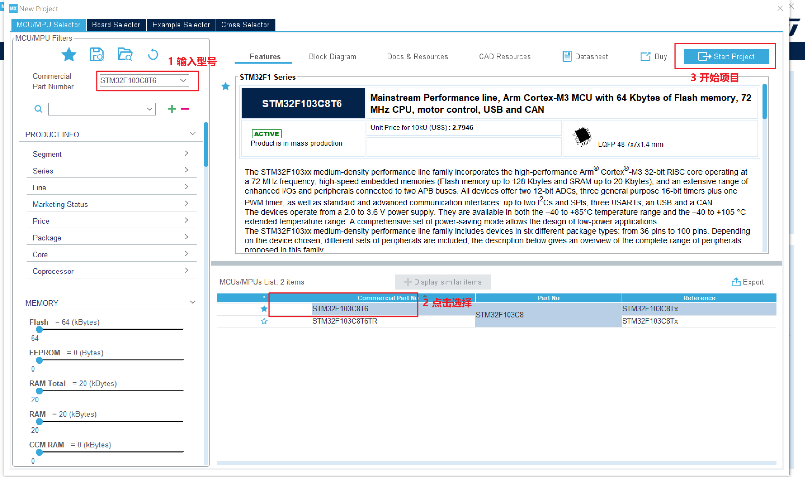
>
>
>
>
>
><span style="color:red">引入FreeRTOS</span>
>
>
>
><span style="color:red">修改中断优先级</span>
>
>

><span style="color:red">配置时钟系统</span>
>
>
>
><span style="color:red">设置工程路径和目录选项</span>
>
>
>
>

>经过上述配置， 已经构建了一个基于HAL的FreeRTOS项目。
>
>

><span style="color:red">配置任务和GPIO：亮灯灭</span>
>
>
>
>
>
>
>
>
>
>```C
>/* USER CODE BEGIN Header */
>/**
>  ******************************************************************************
>  * File Name          : freertos.c
>  * Description        : Code for freertos applications
>  ******************************************************************************
>  * @attention
>  *
>  * Copyright (c) 2025 STMicroelectronics.
>  * All rights reserved.
>  *
>  * This software is licensed under terms that can be found in the LICENSE file
>  * in the root directory of this software component.
>  * If no LICENSE file comes with this software, it is provided AS-IS.
>  *
>  ******************************************************************************
>  */
>/* USER CODE END Header */
>
>/* Includes ------------------------------------------------------------------*/
>#include "FreeRTOS.h"
>#include "task.h"
>#include "main.h"
>#include "cmsis_os.h"
>
>/* Private includes ----------------------------------------------------------*/
>/* USER CODE BEGIN Includes */
>
>/* USER CODE END Includes */
>
>/* Private typedef -----------------------------------------------------------*/
>/* USER CODE BEGIN PTD */
>
>/* USER CODE END PTD */
>
>/* Private define ------------------------------------------------------------*/
>/* USER CODE BEGIN PD */
>
>/* USER CODE END PD */
>
>/* Private macro -------------------------------------------------------------*/
>/* USER CODE BEGIN PM */
>
>/* USER CODE END PM */
>
>/* Private variables ---------------------------------------------------------*/
>/* USER CODE BEGIN Variables */
>
>/* USER CODE END Variables */
>osThreadId defaultTaskHandle;
>osThreadId MyTask02Handle;
>
>/* Private function prototypes -----------------------------------------------*/
>/* USER CODE BEGIN FunctionPrototypes */
>
>/* USER CODE END FunctionPrototypes */
>
>void StartDefaultTask(void const * argument);
>void StartTask02(void const * argument);
>
>void MX_FREERTOS_Init(void); /* (MISRA C 2004 rule 8.1) */
>
>/* GetIdleTaskMemory prototype (linked to static allocation support) */
>void vApplicationGetIdleTaskMemory( StaticTask_t **ppxIdleTaskTCBBuffer, StackType_t **ppxIdleTaskStackBuffer, uint32_t *pulIdleTaskStackSize );
>
>/* USER CODE BEGIN GET_IDLE_TASK_MEMORY */
>static StaticTask_t xIdleTaskTCBBuffer;
>static StackType_t xIdleStack[configMINIMAL_STACK_SIZE];
>
>void vApplicationGetIdleTaskMemory( StaticTask_t **ppxIdleTaskTCBBuffer, StackType_t **ppxIdleTaskStackBuffer, uint32_t *pulIdleTaskStackSize )
>{
>  *ppxIdleTaskTCBBuffer = &xIdleTaskTCBBuffer;
>  *ppxIdleTaskStackBuffer = &xIdleStack[0];
>  *pulIdleTaskStackSize = configMINIMAL_STACK_SIZE;
>  /* place for user code */
>}
>/* USER CODE END GET_IDLE_TASK_MEMORY */
>
>/**
>  * @brief  FreeRTOS initialization
>  * @param  None
>  * @retval None
>  */
>void MX_FREERTOS_Init(void) {
>  /* USER CODE BEGIN Init */
>
>  /* USER CODE END Init */
>
>  /* USER CODE BEGIN RTOS_MUTEX */
>  /* add mutexes, ... */
>  /* USER CODE END RTOS_MUTEX */
>
>  /* USER CODE BEGIN RTOS_SEMAPHORES */
>  /* add semaphores, ... */
>  /* USER CODE END RTOS_SEMAPHORES */
>
>  /* USER CODE BEGIN RTOS_TIMERS */
>  /* start timers, add new ones, ... */
>  /* USER CODE END RTOS_TIMERS */
>
>  /* USER CODE BEGIN RTOS_QUEUES */
>  /* add queues, ... */
>  /* USER CODE END RTOS_QUEUES */
>
>  /* Create the thread(s) */
>  /* definition and creation of defaultTask */
>  osThreadDef(defaultTask, StartDefaultTask, osPriorityNormal, 0, 128);
>  defaultTaskHandle = osThreadCreate(osThread(defaultTask), NULL);
>
>  /* definition and creation of MyTask02 */
>  osThreadDef(MyTask02, StartTask02, osPriorityIdle, 0, 128);
>  MyTask02Handle = osThreadCreate(osThread(MyTask02), NULL);
>
>  /* USER CODE BEGIN RTOS_THREADS */
>  /* add threads, ... */
>  /* USER CODE END RTOS_THREADS */
>
>}
>
>/* USER CODE BEGIN Header_StartDefaultTask */
>/**
>  * @brief  Function implementing the defaultTask thread.
>  * @param  argument: Not used
>  * @retval None
>  */
>/* USER CODE END Header_StartDefaultTask */
>void StartDefaultTask(void const * argument)
>{
>  /* USER CODE BEGIN StartDefaultTask */
>  /* Infinite loop */
>  for(;;)
>  {
>      HAL_GPIO_WritePin(GPIOB, GPIO_PIN_1, GPIO_PIN_RESET);
>      vTaskDelay(1000);
>      HAL_GPIO_WritePin(GPIOB, GPIO_PIN_1, GPIO_PIN_SET);
>    vTaskDelay(1000);
>  }
>  /* USER CODE END StartDefaultTask */
>}
>
>/* USER CODE BEGIN Header_StartTask02 */
>/**
>* @brief Function implementing the MyTask02 thread.
>* @param argument: Not used
>* @retval None
>*/
>/* USER CODE END Header_StartTask02 */
>void StartTask02(void const * argument)
>{
>  /* USER CODE BEGIN StartTask02 */
>  /* Infinite loop */
>  for(;;)
>  {
>		HAL_GPIO_WritePin(GPIOA, GPIO_PIN_1, GPIO_PIN_RESET); 
>		vTaskDelay(1000);
>		HAL_GPIO_WritePin(GPIOA, GPIO_PIN_1, GPIO_PIN_SET);
>		vTaskDelay(1000);
>  }
>  /* USER CODE END StartTask02 */
>}
>
>/* Private application code --------------------------------------------------*/
>/* USER CODE BEGIN Application */
>
>/* USER CODE END Application */
>
>```
>
><span style="color:red;font-size:12px">需要注意， 在FreeRTOS中， 尽量不要继续使用HAL_Delay函数了， 因为HAL_Delay的函数会持续占用CPU，而不会主动让出CPU。</span>
>
>```C
>
>void StartDefaultTask(void const * argument)
>{
>  for(;;)
>  {
>		HAL_GPIO_WritePin(GPIOB, GPIO_PIN_1, GPIO_PIN_RESET);
>		HAL_Delay(1000);
>        HAL_GPIO_WritePin(GPIOB, GPIO_PIN_1, GPIO_PIN_SET);
>        HAL_Delay(1000);
>  }
>}
>void StartTask02(void const * argument)
>{
>  for(;;)
>  {
>		HAL_GPIO_WritePin(GPIOA, GPIO_PIN_1, GPIO_PIN_RESET); 
>		HAL_Delay(1000);
>		HAL_GPIO_WritePin(GPIOA, GPIO_PIN_1, GPIO_PIN_SET);
>		HAL_Delay(1000);
>  }
>}
>```
>
>

## 1.3 手动在HAL工程中移植FreeRTOS

>HAL: 提供了自己的一套函数

### 1.3.1 构建一个HAL库工程

>
>
>
>
>
>
>
>
>
>
>
>
>
>
>
>
>
>
>上面这种方式可能就是我们日常在未引入FreeRTOS之前创建HAL工程的方式了

### 1.3.2 手动移植FreeRTOS

><span style="color:red">重新打开上面工程，修改时基配置</span>
>
>
>
>
>
>

><span style="color:red">引入FreeRTOS文件: (注意添加STM32F103_Keil平台的FreeRTOSConfig.h文件。和前面一样)</span>
>
>
>
>
>
>
>
><span style="color:red">Keil配置</span>
>
>
>
>
>
><span style="color:red">注释重定义中断函数（在FreeRTOS中有它用，已经在FreeRTOSCOnfig.h文件中进行了改写声明）。</span>
>
>

><span style="color:red">控制LED的亮灭。</span>
>
><span style="color:red">重新在STM32CubeMX中打开当前工程， 配置GPIO。</span>

>
>
><span style="color:red">重新注释重复定义的中断函数。</span>
>
>
>
><span style="color:red">使用FreeRTOS和HAL函数点灯。</span>
>
>```C
>/* USER CODE BEGIN Header */
>/**
>  ******************************************************************************
>  * @file           : main.c
>  * @brief          : Main program body
>  ******************************************************************************
>  * @attention
>  *
>  * Copyright (c) 2025 STMicroelectronics.
>  * All rights reserved.
>  *
>  * This software is licensed under terms that can be found in the LICENSE file
>  * in the root directory of this software component.
>  * If no LICENSE file comes with this software, it is provided AS-IS.
>  *
>  ******************************************************************************
>  */
>/* USER CODE END Header */
>/* Includes ------------------------------------------------------------------*/
>#include "main.h"
>#include "gpio.h"
>
>/* Private includes ----------------------------------------------------------*/
>/* USER CODE BEGIN Includes */
>#include "FreeRTOS.h"
>#include "task.h"
>/* USER CODE END Includes */
>
>/* Private typedef -----------------------------------------------------------*/
>/* USER CODE BEGIN PTD */
>
>/* USER CODE END PTD */
>
>/* Private define ------------------------------------------------------------*/
>/* USER CODE BEGIN PD */
>
>/* USER CODE END PD */
>
>/* Private macro -------------------------------------------------------------*/
>/* USER CODE BEGIN PM */
>
>/* USER CODE END PM */
>
>/* Private variables ---------------------------------------------------------*/
>
>/* USER CODE BEGIN PV */
>
>/* USER CODE END PV */
>
>/* Private function prototypes -----------------------------------------------*/
>void SystemClock_Config(void);
>/* USER CODE BEGIN PFP */
>
>/* USER CODE END PFP */
>
>/* Private user code ---------------------------------------------------------*/
>/* USER CODE BEGIN 0 */
>void task1 ( void * arg ){	
>	// 控制PA1的Led显示
>	
>	while(1){
>		HAL_GPIO_WritePin(GPIOA, GPIO_PIN_1, GPIO_PIN_RESET); 
>		vTaskDelay(1000);
>		HAL_GPIO_WritePin(GPIOA, GPIO_PIN_1, GPIO_PIN_SET);
>		vTaskDelay(1000);
>	}
>}
>void task2 ( void * arg ){
>	// 控制PA2的Led显示
>	while(1){
>		HAL_GPIO_WritePin(GPIOA, GPIO_PIN_2, GPIO_PIN_RESET); 
>		vTaskDelay(1000);
>		HAL_GPIO_WritePin(GPIOA, GPIO_PIN_2, GPIO_PIN_SET);
>		vTaskDelay(1000);
>	}
>}
>/* USER CODE END 0 */
>
>/**
>  * @brief  The application entry point.
>  * @retval int
>  */
>int main(void)
>{
>  /* USER CODE BEGIN 1 */
>  /* USER CODE END 1 */
>
>  /* MCU Configuration--------------------------------------------------------*/
>
>  /* Reset of all peripherals, Initializes the Flash interface and the Systick. */
>  HAL_Init();
>
>  /* USER CODE BEGIN Init */
>  /* USER CODE END Init */
>
>  /* Configure the system clock */
>  SystemClock_Config();
>
>  /* USER CODE BEGIN SysInit */
>  /* USER CODE END SysInit */
>
>  /* Initialize all configured peripherals */
>  MX_GPIO_Init();
>  /* USER CODE BEGIN 2 */
>	xTaskCreate(task1,"Task1",configMINIMAL_STACK_SIZE,NULL,tskIDLE_PRIORITY+1,NULL);
>	xTaskCreate(task2,"Task2",configMINIMAL_STACK_SIZE,NULL,tskIDLE_PRIORITY+1, NULL);
>  vTaskStartScheduler();
>  /* USER CODE END 2 */
>
>  /* Infinite loop */
>  /* USER CODE BEGIN WHILE */
>  while (1)
>  {
>    /* USER CODE END WHILE */
>
>    /* USER CODE BEGIN 3 */
>  }
>  /* USER CODE END 3 */
>}
>
>/**
>  * @brief System Clock Configuration
>  * @retval None
>  */
>void SystemClock_Config(void)
>{
>  RCC_OscInitTypeDef RCC_OscInitStruct = {0};
>  RCC_ClkInitTypeDef RCC_ClkInitStruct = {0};
>
>  /** Initializes the RCC Oscillators according to the specified parameters
>  * in the RCC_OscInitTypeDef structure.
>  */
>  RCC_OscInitStruct.OscillatorType = RCC_OSCILLATORTYPE_HSE;
>  RCC_OscInitStruct.HSEState = RCC_HSE_ON;
>  RCC_OscInitStruct.HSEPredivValue = RCC_HSE_PREDIV_DIV1;
>  RCC_OscInitStruct.HSIState = RCC_HSI_ON;
>  RCC_OscInitStruct.PLL.PLLState = RCC_PLL_ON;
>  RCC_OscInitStruct.PLL.PLLSource = RCC_PLLSOURCE_HSE;
>  RCC_OscInitStruct.PLL.PLLMUL = RCC_PLL_MUL9;
>  if (HAL_RCC_OscConfig(&RCC_OscInitStruct) != HAL_OK)
>  {
>    Error_Handler();
>  }
>
>  /** Initializes the CPU, AHB and APB buses clocks
>  */
>  RCC_ClkInitStruct.ClockType = RCC_CLOCKTYPE_HCLK|RCC_CLOCKTYPE_SYSCLK
>                              |RCC_CLOCKTYPE_PCLK1|RCC_CLOCKTYPE_PCLK2;
>  RCC_ClkInitStruct.SYSCLKSource = RCC_SYSCLKSOURCE_PLLCLK;
>  RCC_ClkInitStruct.AHBCLKDivider = RCC_SYSCLK_DIV1;
>  RCC_ClkInitStruct.APB1CLKDivider = RCC_HCLK_DIV2;
>  RCC_ClkInitStruct.APB2CLKDivider = RCC_HCLK_DIV1;
>
>  if (HAL_RCC_ClockConfig(&RCC_ClkInitStruct, FLASH_LATENCY_2) != HAL_OK)
>  {
>    Error_Handler();
>  }
>}
>
>/* USER CODE BEGIN 4 */
>
>/* USER CODE END 4 */
>
>/**
>  * @brief  Period elapsed callback in non blocking mode
>  * @note   This function is called  when TIM4 interrupt took place, inside
>  * HAL_TIM_IRQHandler(). It makes a direct call to HAL_IncTick() to increment
>  * a global variable "uwTick" used as application time base.
>  * @param  htim : TIM handle
>  * @retval None
>  */
>void HAL_TIM_PeriodElapsedCallback(TIM_HandleTypeDef *htim)
>{
>  /* USER CODE BEGIN Callback 0 */
>
>  /* USER CODE END Callback 0 */
>  if (htim->Instance == TIM4) {
>    HAL_IncTick();
>  }
>  /* USER CODE BEGIN Callback 1 */
>
>  /* USER CODE END Callback 1 */
>}
>
>/**
>  * @brief  This function is executed in case of error occurrence.
>  * @retval None
>  */
>void Error_Handler(void)
>{
>  /* USER CODE BEGIN Error_Handler_Debug */
>  /* User can add his own implementation to report the HAL error return state */
>  __disable_irq();
>  while (1)
>  {
>  }
>  /* USER CODE END Error_Handler_Debug */
>}
>
>#ifdef  USE_FULL_ASSERT
>/**
>  * @brief  Reports the name of the source file and the source line number
>  *         where the assert_param error has occurred.
>  * @param  file: pointer to the source file name
>  * @param  line: assert_param error line source number
>  * @retval None
>  */
>void assert_failed(uint8_t *file, uint32_t line)
>{
>  /* USER CODE BEGIN 6 */
>  /* User can add his own implementation to report the file name and line number,
>     ex: printf("Wrong parameters value: file %s on line %d\r\n", file, line) */
>  /* USER CODE END 6 */
>}
>#endif /* USE_FULL_ASSERT */
>
>```
>
>
>
>
>
>
>
>

# 2 end

