# 1, 任务的基本使用

>

## 1.1 概述

### 1.1.1 任务的说明

>在之前的裸机开发中, 我们所有程序逻辑的执行, 都是建立在以`Main函数为主体`的`自上而下`的`顺序执行`结构. 
>
>在FreeRTOS中, 我们可以把代码拆分成一个个独立的`函数`, 让每个函数分别处理我们所需的不同业务需求功能, 通过在FreeRTOS中一系列配置, 这样的函数我们称之为任务/Task, FreeRTOS通过对任务的按照时间片,以及设定的调度规则,对这些任务进行切换,交替执行(给任务分配时间片,分配内存,切换时保存和恢复上下文操作), 可以让本来以`Main函数为主体`的`自上而下`的`顺序执行`结构, 变成不同Task/函数逻辑可以并发执行.
>
>这就是说`常规单核处理器一次只能按照顺序执行一个代码逻辑/任务, 但多任务操作系统可以快速切换任务(假设快要用户没有感知), 使所有任务看起来像是同时在执行.`
>
>
>
>ps: 关于并行和并发
>
>```C
>并发:"一段时间内"
>// 多个任务交替执行,看起来像是同时进行,但实际上是通过快速切换实现的.
>// 或者说,多个程序在'一段'时间内同时得到执行,这种行为我们称之为并发.
>并行:"同一时刻"
>// 在真实时间维度上的同一时刻, 有两个任务同时被执行(需要依赖多核CPU)
>// (常见的STM32F1系列和STM32F4系列都是单核心设计)
>```

### 1.1.2 拓展了解

>我们知道, 内存的构成通常情况下是由RAM和ROM两个模块构成.
>
>```C
>RAM(Random Access Memory，随机存取存储器): 易失存储断电丢失
>ROM(Read-Only Memory，只读存储器): 非易失性存储,断电数据不丢失
>```
>
>在STM32系统中, 存在易失性存储SRAM用于运行时数据,以及非易失性内存(用Flash充当)用于存储程序代码和常量数据.
>
>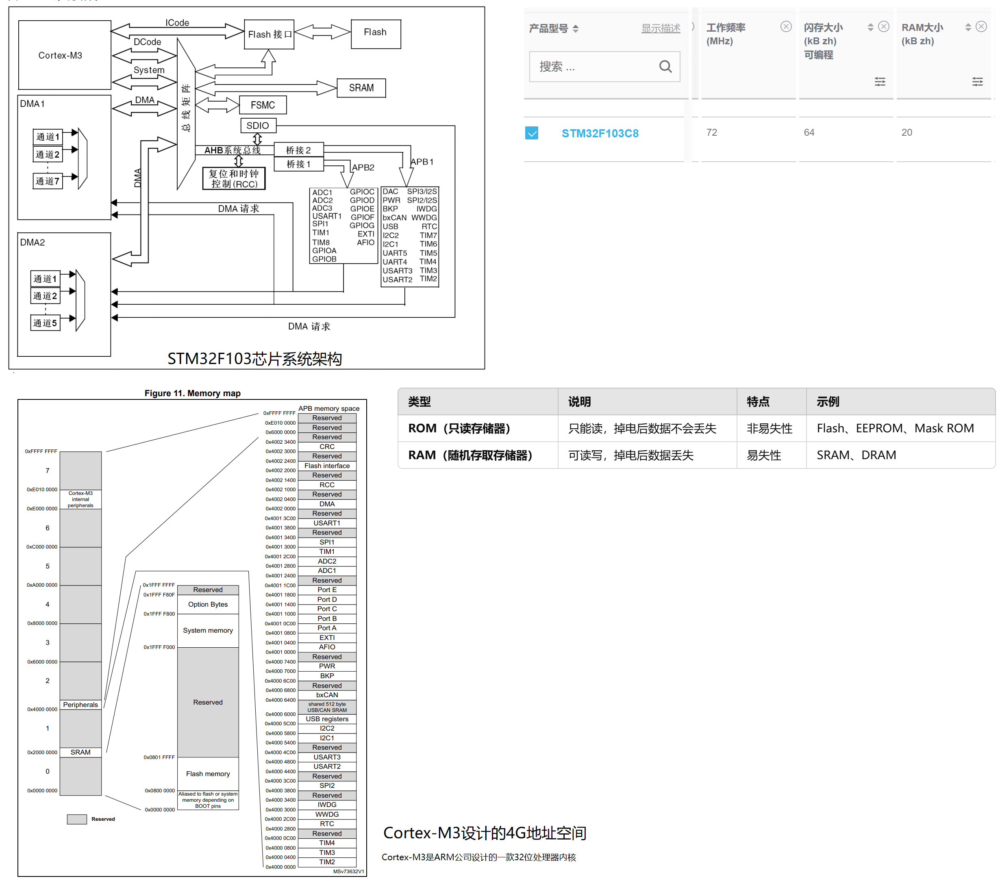
>
>而在STM32F103C8T6中, SRAM的内存布局是相对固定的. 这20KB的SRAM, 用于存储基本大多数程序运行时所产生的数据(如堆栈局部变量、动态内存分配等).
>
>我们可以通过研究Keil工程的程序的内存布局文件以及STM32F103C8T6的启动文件对堆栈的配置项, 我们可以分析出一些SRAM被使用的情况和结构布局. 
>
>```C
>// Keil工程的程序的内存布局文件: 可以查阅Listings下的'项目.map'文件
>// STM32F103C8T6的启动文件: 引入项目的startup_stm32f10x_md.s文件
>```
>
>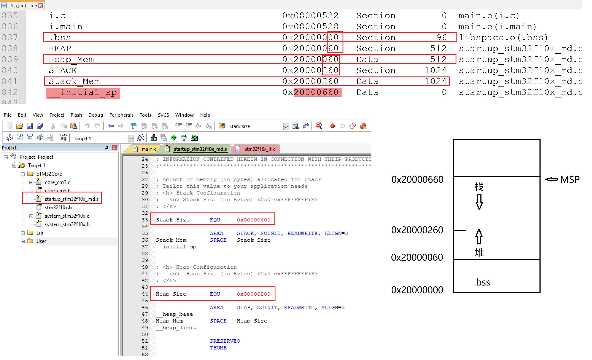
>
>```C
>在上面的文件研究中, 我们可以得到很多关键的推论:
>// 1, SRAM中包含.bass段(可能有时候还有.data段): 用来存放一些全局和静态变量
>// 2, SRAM中包含堆/Heap, 用于存储程序运行过程中动态分配的内存(malloc)
>// 3, SRAM中包含栈(有地方也称其为'堆栈')/Stack, 用于存储函数调用、局部变量
>// 4, 堆内存的使用是从低地址向高地址增长, 而栈的使用是从高地址向低地址增长
>// 5, 初始化是SP执行(MSP)(Main Stack Pointer，我们也称它为主堆栈指针)是指向栈的起始高地址
>// 6, startup_stm32f10x_md.s启动文件中的默认配置, 并没有完全用完STM32C8T6的所有SRAM (这是因为多方面原因, 比如可能在不同项目具体实现中我们对堆和栈的需求并不相同, 没有办法定义统一的标准 )(这其实也代表着在不同情况下, 我们可以根据我们具体实现项目的需求去修改startup_stm32f10x_md文件中设置的默认堆栈大小)
>```
>
>我们也可以在Keil中验证栈的增长问题:
>
>```C
>// 有如下代码, 我们可以通过Keil的DeBUG模式观察MSP/主堆栈指针变化
>
>void b(){
>	int nums[20] = {0};
>}
>void a(){
>	int nums[10] = {0};
>	b();
>	nums[0] = 1;
>}
>int main(void){	
>	a();
>}
>
>```
>
>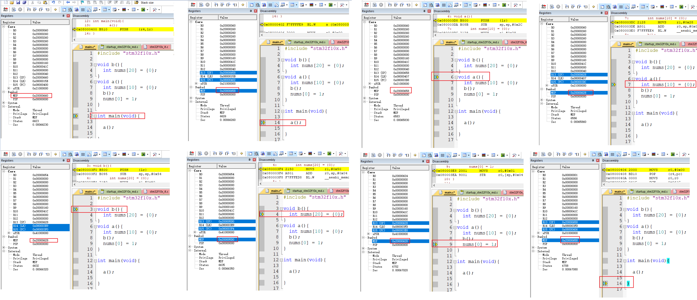
>
>```C
>// 在Cortex-M3中, MSP是主栈指针(Main Stack Pointer)的缩写.用来指向当前程序运行过程中栈的当前栈顶.
>```
>
>**注意:** 因为在SRAM中存在堆和栈之间的相向增长问题, 以默认设置为例, 栈的大小为1024个字节( 0x400 -> 100 0000 0000 ), 而堆的大小为512字节, 所以`从理论上讲`不建议使用堆和栈超过指定设置的容量大小. 但是在实际使用中, 假设我们使用栈的时候超过的时候, 甚至栈上数据覆盖到了堆空间, 好像也没什么问题, 但是这种行为是很危险的, 容易导致程序复位或者进入死循环.
>
>```C
>// 以如下代码为例: 
>int main(void){	
>
>	int nums[300] = {0};
>	
>	int x = 1;
>	
>	while(1){
>	}
>}
>// 我们发现堆栈指针已经到0x200001B0位置, 这个位置从逻辑上属于堆空间, 但是好像程序也能正常向下继续执行, 但是这种行为是极其不健康的对内存的使用.
>// 这种因为有可能导致栈增长过大, 甚至覆盖全局变量区域或者访问非法的地址, 进而导致程序进入HardFault_Handler(硬件以中断处理函数)导致程序进程复位或者死循环.
>```
>
>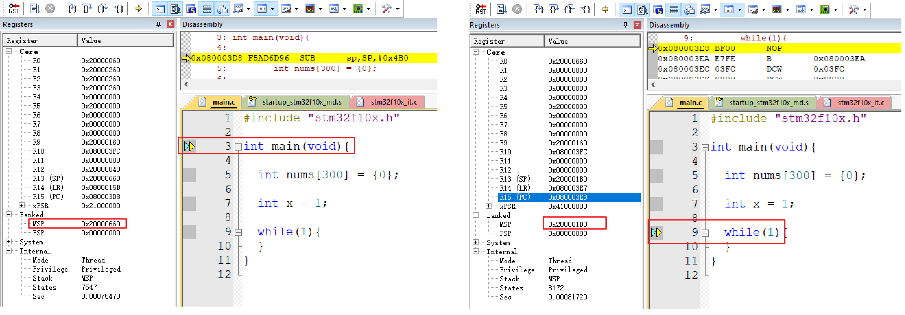

>**双堆栈结构**
>
>```C
>我们之前介绍过，MSP(Main Stack Pointer)是Cortex-M3处理器内核中的主栈指针,主栈指针在程序运行过程中起着重要的作用.在常规的、未引入操作系统的嵌入式系统设计中,通常仅会使用MSP来指向系统的主栈栈顶.这是因为在没有操作系统管理多任务环境的情况下,系统只需维护一个单一的栈空间,用于支持程序的执行和函数调用.
>但是当我们引入操作系统之后(以FreeRTOS为例),在Cortex-M3内核中,用到的栈顶指针就不仅仅只有MSP,而是一种双堆栈结构.在双堆栈结构中,会存在一个PSP(Process Stack Pointer)指针,(或者称其为任务堆栈指针),这个指针用于指向当前任务或线程的私有栈顶.操作系统通过管理MSP和PSP,可以在任务切换时快速保存和恢复不同任务的栈环境,从而实现多任务并发执行.这种双堆栈结构的设计,为嵌入式系统提供了更加灵活和高效的任务管理能力.
>```
>
>它的内存分布,大致如下图所示:
>
>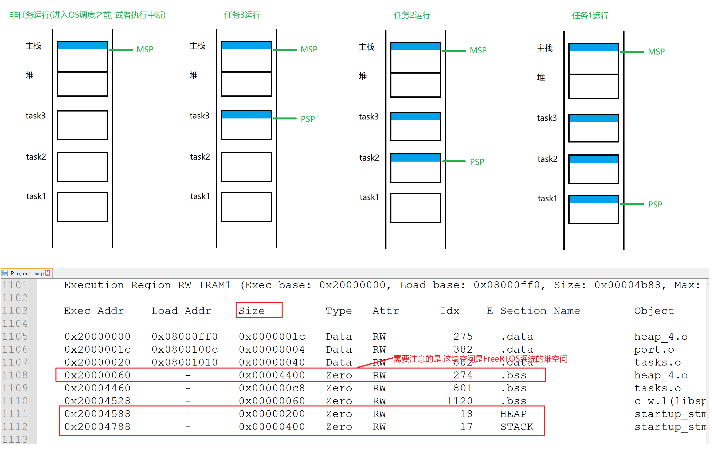
>
>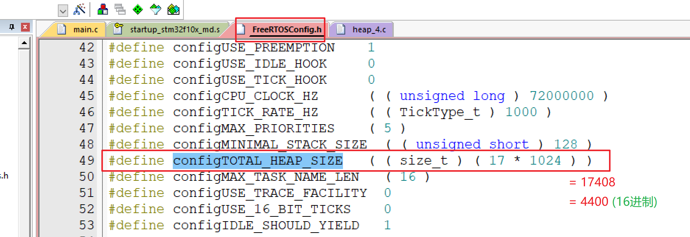
>
>我们也可以在Keil中验证这个双堆栈结构问题:
>
>```C
>#include "stm32f10x.h"    
>#include "freertos.h"
>#include "task.h"
>void task1 ( void * arg ){	
>	int arr1[10] = {0};
>	while(1){
>	}
>}
>void task2 ( void * arg ){
>	int arr2[20] = {0};
>	while(1){
>	}
>}
>void task3 ( void * arg ){
>	int arr3[30] = {0};
>	while(1){
>	}
>}
>int main(void){
>	int arr[10];
>	xTaskCreate(task1,"Task1",configMINIMAL_STACK_SIZE,NULL,tskIDLE_PRIORITY+1,NULL);
>	xTaskCreate(task2,"Task2",configMINIMAL_STACK_SIZE,NULL,tskIDLE_PRIORITY+1, NULL);
>	xTaskCreate(task3,"Task3",configMINIMAL_STACK_SIZE,NULL,tskIDLE_PRIORITY+1, NULL);
>	vTaskStartScheduler();
>	while(1){
>	}
>}
>
>```
>
>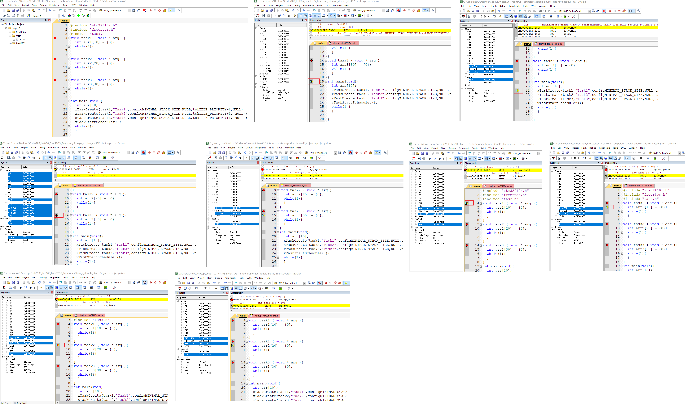

## 1.2 创建任务

### 1.2.0 准备工作

>**引入串口**   
>
>为了后续在执行FreeRTOS任务运行的过程中方便调试, 我们可以在构建好的项目中引入串口通信打印到PC串口助手的操作, 以方便代码运行的调试.
>
>```C
>// UART1.h
>#ifndef __UART1_H__
>#define __UART1_H__
>
>// STM32外设库头文件
>#include "stm32f10x.h" 
>#include <stdio.h>
>#include <stdarg.h>
>
>void USART1_Init(void);
>void USART1_SendByte(uint8_t Byte);
>void printf1(char *format, ...);
>
>#endif
>
>```
>
>```C
>// UART1.c
>#include "UART1.h"
>
>void USART1_Init(void){
>	// 开启时钟
>	RCC_APB2PeriphClockCmd(RCC_APB2Periph_USART1, ENABLE);
>	RCC_APB2PeriphClockCmd(RCC_APB2Periph_GPIOA, ENABLE);
>	
>	// 初始化引脚
>	GPIO_InitTypeDef GPIO_InitStructure;
>	GPIO_InitStructure.GPIO_Mode = GPIO_Mode_AF_PP;
>	GPIO_InitStructure.GPIO_Pin = GPIO_Pin_9;//PA9:USART1_TX
>	GPIO_InitStructure.GPIO_Speed = GPIO_Speed_50MHz;
>	GPIO_Init(GPIOA, &GPIO_InitStructure);
>	GPIO_InitStructure.GPIO_Mode = GPIO_Mode_IPU;
>	GPIO_InitStructure.GPIO_Pin = GPIO_Pin_10;//PA10:USART1_RX
>	GPIO_InitStructure.GPIO_Speed = GPIO_Speed_50MHz;
>	GPIO_Init(GPIOA, &GPIO_InitStructure);
>	
>	// USART配置
>	USART_InitTypeDef USART_InitStructure;
>	USART_InitStructure.USART_BaudRate = 115200;
>	USART_InitStructure.USART_HardwareFlowControl = USART_HardwareFlowControl_None;
>	USART_InitStructure.USART_Mode = USART_Mode_Tx | USART_Mode_Rx;
>	USART_InitStructure.USART_Parity = USART_Parity_No;
>	USART_InitStructure.USART_StopBits = USART_StopBits_1;
>	USART_InitStructure.USART_WordLength = USART_WordLength_8b;
>	USART_Init(USART1, &USART_InitStructure);	
>
>	// 启动USART1
>	USART_Cmd(USART1, ENABLE);
>}
>
>// 发送字节
>void USART1_SendByte(uint8_t Byte){
>	USART_SendData(USART1, Byte);
>	while(USART_GetFlagStatus(USART1, USART_FLAG_TXE) == RESET);
>}
>
>
>void printf1(char *format, ...)
>{
>	char strs[100];	
>	va_list list;
>	va_start(list, format);
>	vsprintf(strs, format, list);
>	va_end(list);
>
>	for (uint8_t i=0; strs[i] != '\0'; i++){
>		USART1_SendByte(strs[i]);
>	}
>}
>
>```
>
>```C
>// main.c
>#include "stm32f10x.h"    
>#include "freertos.h"
>#include "task.h"
>#include "UART1.h"
>
>void task1(void * arg ){	
>	while(1){
>		printf1("i am task1 \n");
>		vTaskDelay(1000);
>	}
>}
>void task2(void * arg ){
>	while(1){
>		printf1("i am task2 \n");
>		vTaskDelay(1000);
>	}
>}
>
>int main(void){
>	USART1_Init();
>	
>	xTaskCreate(task1,"Task1",configMINIMAL_STACK_SIZE,NULL,tskIDLE_PRIORITY+1,NULL);
>	xTaskCreate(task2,"Task2",configMINIMAL_STACK_SIZE,NULL,tskIDLE_PRIORITY+1, NULL);
>	vTaskStartScheduler();
>	while(1){
>	}
>}
>
>```
>
>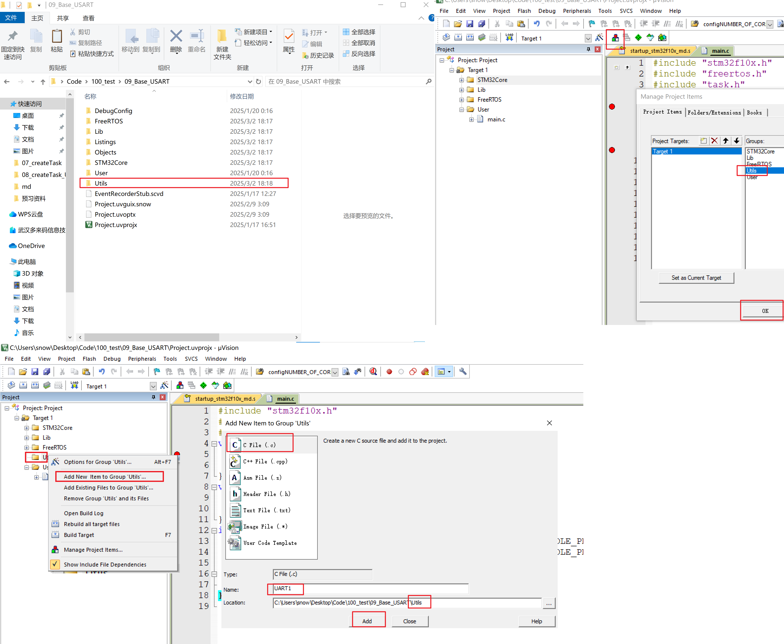
>
>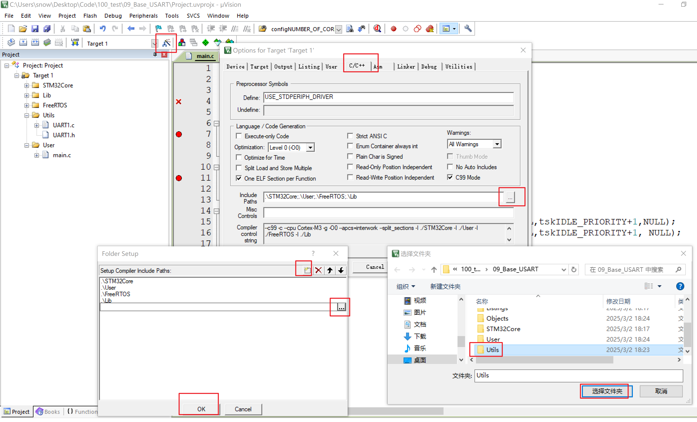

### 1.2.1 动态创建

>`xTaskCreate()` 是FreeRTOS中用于动态创建任务的核心函数,它允许用户在运行时创建一个新的任务.
>
>```C
>// 函数定义: task.h (382)
>BaseType_t xTaskCreate( TaskFunction_t pxTaskCode,
>                   const char * const pcName,
>                   const configSTACK_DEPTH_TYPE uxStackDepth,
>                   void *pvParameters,
>                   UBaseType_t uxPriority,
>                   TaskHandle_t *pxCreatedTask );
>
>注意: 要使用动态创建任务, 参数configSUPPORT_DYNAMIC_ALLOCATION需配置为1  (其实已经默认配置为1)
>```
>
>参数: pxTaskCode
>
>```C
>// pxTaskCode用于指定任务的执行函数的入口, 这个任务函数必须是一个无返回值的函数.
>// 原型如下：
>	typedef void (* TaskFunction_t)( void * arg );
>// 其中 arg 是传递给任务的参数, 对应xTaskCreate函数中的pvParameters传参
>```
>
>参数: pcName
>
>```C
>// pcName用于指明任务的名字(可以给一个字符串), 任务名字主要用于便于调试和任务管理的标识符. FreeRTOS不会在实际的任务调度中直接使用这个名字.
>
>注意:虽然对这个名字可以给定任意字符串, 但是FreeRTOS要求, 这个名字的要满足小于指定长度,可以参考FreeRTOSConfig.h定义的宏configMAX_TASK_NAME_LEN.
>
>#define configMAX_TASK_NAME_LEN		( 16 )
>```
>
>参数: usStackDepth
>
>```C
>// usStackDepth参数用于指定任务堆栈的大小(configSTACK_DEPTH_TYPE类型). 即用于存储任务的局部变量、返回地址、任务的上下文信息等内容.
>
>// configSTACK_DEPTH_TYPE类型说明:
>(portable.h:89)
>#define configSTACK_DEPTH_TYPE    StackType_t
>(portmacro.h:58)
>typedef portSTACK_TYPE   StackType_t;
>(portmacro.h:55)
>#define portSTACK_TYPE    uint32_t
>
>注意: 每个任务的堆栈大小应该根据任务执行时的需求来决定, 堆栈大小设置得过小可能会导致堆栈溢出, 过大则浪费内存. 通常情况下应该根据任务的复杂度来估算堆栈大小.
>注意: 在FreeRTOSConfig.h文件定义中, 提供了一个栈的参考大小configMINIMAL_STACK_SIZE; 理论上我们可以设置比这个值大,或者比这个值小,但是在没有特殊需求的情况下,建议使用该宏作为当前任务栈的大小(稍大一些也是可以的).
>```
>
>参数: pvParameters
>
>```C
>// pvParameters参数用于在任务创建的时候,把参数传递给任务函数.在任务的入口函数中,可以使用入口函数的参数接收.如果任务不需要函数,可以将此值设为NULL. (注意: 不能传递堆栈变量的地址)
>```
>
>参数: uxPriority
>
>```C
>// uxPriority参数用于设置任务调度的优先级, FreeRTOS使用优先级来决定任务怎么调度. 
>
>// 我们可以把优先级设置为0到configMAX_PRIORITIES-1, configMAX_PRIORITIES这个宏来自于FreeRTOSConfig.h中对FreeRTOS系统支持的最大优先级数量的定义.
>// FreeRTOSConfig.h中, 宏configMAX_PRIORITIES用来设置系统中可用的最大优先级数目, 其中0表示最低优先级,configMAX_PRIORITIES-1表示最高优先级.
>// FreeRTOS在调度任务执行的时候, 会在等待调度的任务重选取具有最高优先级的任务执行.如果优先级相同, 则是通过时间片轮转的方式调度任务.
>
>// 如果在最开始, 我们不确定任务优先级设置多少合适, 可以暂时给任务优先级为tskIDLE_PRIORITY+1.
>#define tskIDLE_PRIORITY    ( ( UBaseType_t ) 0U )
>(task.h: 196)
>// tskIDLE_PRIORITY, 它是FreeRTOS中给空闲任务设置的优先级(Idle Task).
>```
>
>参数: pxCreatedTask
>
>```C
>// pxCreatedTask参数用来维护任务的句柄, 在任务创建成功后, FreeRTOS会给被启动的任务维护一个任务控制块(TCP),在TCB中记录了这个任务的跟多关键信息, 比如当前状态、优先级、栈指针、任务的执行时间、任务的句柄、任务栈的大小等, 并且我们也可以通过这个TCB任务控制块句柄来对任务进行关系, 比如停止或者删除任务. 
>
>TaskHandle_t类型:
>(task.h: 92)
>typedef struct tskTaskControlBlock         * TaskHandle_t;
>
>(tasks.c: 358)
>typedef struct tskTaskControlBlock 
>{
>    
>	volatile StackType_t * pxTopOfStack;// 任务栈当前当前栈顶, 在上下文切换时用于保存和回复寄存器
>    ListItem_t xStateListItem; // 状态列表项:用于将任务挂载到就绪列表OR阻塞列表OR挂起列表
>    ListItem_t xEventListItem; // 时间列表项:用于将任务怪哉事件列表,比如信号量事件,消息队列等待事件队列
>    UBaseType_t uxPriority; // 当前任务优先级(值越大,优先级越高)
>    StackType_t * pxStack;// 任务栈的起始地址
>    char pcTaskName[ configMAX_TASK_NAME_LEN ];// 任务名字,仅用于识别
>    #if ( configUSE_TASK_NOTIFICATIONS == 1 ) // 用于设置支持任务通知机制,默认开启
>    	// 记录通知值
>        volatile uint32_t ulNotifiedValue[ configTASK_NOTIFICATION_ARRAY_ENTRIES ];
>    	// 记录通知状态
>        volatile uint8_t ucNotifyState[ configTASK_NOTIFICATION_ARRAY_ENTRIES ];
>    #endif
>    #if ( tskSTATIC_AND_DYNAMIC_ALLOCATION_POSSIBLE != 0 )
>        uint8_t ucStaticallyAllocated; // 用于区分任务的 内存分配方式,pdTRUE:静态分配,pdFALSE:动态分配
>    #endif
>
>    
>
>    #if ( portUSING_MPU_WRAPPERS == 1 )
>        xMPU_SETTINGS xMPUSettings; // MPU保护单元, 默认不开启
>    #endif
>    #if ( configUSE_CORE_AFFINITY == 1 ) && ( configNUMBER_OF_CORES > 1 )
>        UBaseType_t uxCoreAffinityMask; // 多核CPU中,用于任务和固定某个核心的绑定, 默认不开启
>    #endif
>    #if ( configNUMBER_OF_CORES > 1 ) // 也用于多核CPU中,默认不开启
>        volatile BaseType_t xTaskRunState; 
>        UBaseType_t uxTaskAttributes; 
>    #endif
>    #if ( configUSE_TASK_PREEMPTION_DISABLE == 1 )
>        BaseType_t xPreemptionDisable;// 用于设置禁止当前任务被高优先级抢占, 默认不开启(也就是默认可以被高优先级抢占)
>    #endif
>    #if ( ( portSTACK_GROWTH > 0 ) || ( configRECORD_STACK_HIGH_ADDRESS == 1 ) )
>        StackType_t * pxEndOfStack;// pxEndOfStack指向任务栈的最高有效地址,用于任务栈检测,防止栈溢出,默认不开启
>    #endif
>    #if ( portCRITICAL_NESTING_IN_TCB == 1 )
>        UBaseType_t uxCriticalNesting; // 用于记录当前任务进入临界区的嵌套层数,默认不开启
>    #endif
>    #if ( configUSE_TRACE_FACILITY == 1 )
>        UBaseType_t uxTCBNumber; //记录整个系统任务控制块TCB创建的次数,默认不开启
>        UBaseType_t uxTaskNumber;//为第三方调试工具提供任务追踪编号,默认不开启 
>    #endif
>    #if ( configUSE_MUTEXES == 1 )
>        UBaseType_t uxBasePriority;// 记录任务的原始优先级(存在优先级上升的时候),默认不开启
>        UBaseType_t uxMutexesHeld;// 记录任务当前持有的互斥量数量,默认不开启
>    #endif
>    #if ( configUSE_APPLICATION_TASK_TAG == 1 )
>        TaskHookFunction_t pxTaskTag;// 使用pxTaskTag存储任务的自定义钩子函数指针,默认不开启
>    #endif
>    #if ( configNUM_THREAD_LOCAL_STORAGE_POINTERS > 0 )
>        void * pvThreadLocalStoragePointers[ configNUM_THREAD_LOCAL_STORAGE_POINTERS ];
>    // 为任务提供线程本地存储(存储一些任务用到的额外数据),默认不开启
>    #endif
>    #if ( configGENERATE_RUN_TIME_STATS == 1 )
>        configRUN_TIME_COUNTER_TYPE ulRunTimeCounter; // ulRunTimeCounter用于记录任务的运行(Runing状态下)时间,有助于性能分析和调试,默认不开启
>    #endif
>    #if ( configUSE_C_RUNTIME_TLS_SUPPORT == 1 )
>        configTLS_BLOCK_TYPE xTLSBlock;  // 存储一些多任务环境中的某些C库全局变量(errno), 避免任务之间的数据污染,默认不开启
>    #endif
>    #if ( INCLUDE_xTaskAbortDelay == 1 )
>        uint8_t ucDelayAborted;//用于检测和标记任务的延时(Block Delay)是否被中止(比如当任务进入vTaskDelay,还没有延时到指定时间,阻塞就被xTaskAbortDelay()函数取消, 解除阻塞),默认不开启
>    #endif
>    #if ( configUSE_POSIX_ERRNO == 1 )
>        int iTaskErrno;//为每个任务提供独立的(errno),默认不开启
>    #endif
>}
>```
>
>返回值:BaseType_t
>
>```C
>// xTaskCreate()返回一个BaseType_t类型的值,用于表示任务创建的结果.
>(portmacro.h: 59)
>typedef long             BaseType_t;
>
>// 这个返回值常见的值有:
>pdPASS:表示任务创建成功
>errCOULD_NOT_ALLOCATE_REQUIRED_MEMORY:表示没有足够的内存来创建任务
>errINVALID_PRIORITY:表示给定的任务优先级无效
>```

>Eg: 创建任务
>
>```C
>#include "stm32f10x.h"    
>#include "freertos.h"
>#include "task.h"
>#include "UART1.h"
>
>void task1 ( void * arg ){	
>	int num = * (int *)arg;
>	while(1){
>		printf1("i am task %d \n", num);
>		vTaskDelay(1000);
>	}
>}
>void task2 ( void * arg ){
>	int num = * (int *)arg;
>	while(1){
>		printf1("i am task %d \n", num);
>		vTaskDelay(1000);
>	}
>}
>int main(void){
>	USART1_Init();
>	
>	TaskHandle_t hand1, hand2;
>	static int num1=10, num2=20; // static是因为FreeRTOS不允许这个传参放入主栈中
>	
>	xTaskCreate(task1,"Task1",configMINIMAL_STACK_SIZE,&num1,2,&hand1);
>	xTaskCreate(task2,"Task2",configMINIMAL_STACK_SIZE,&num2,3, &hand2);
>    
>	vTaskStartScheduler();
>	while(1){
>	}
>}
>
>```

>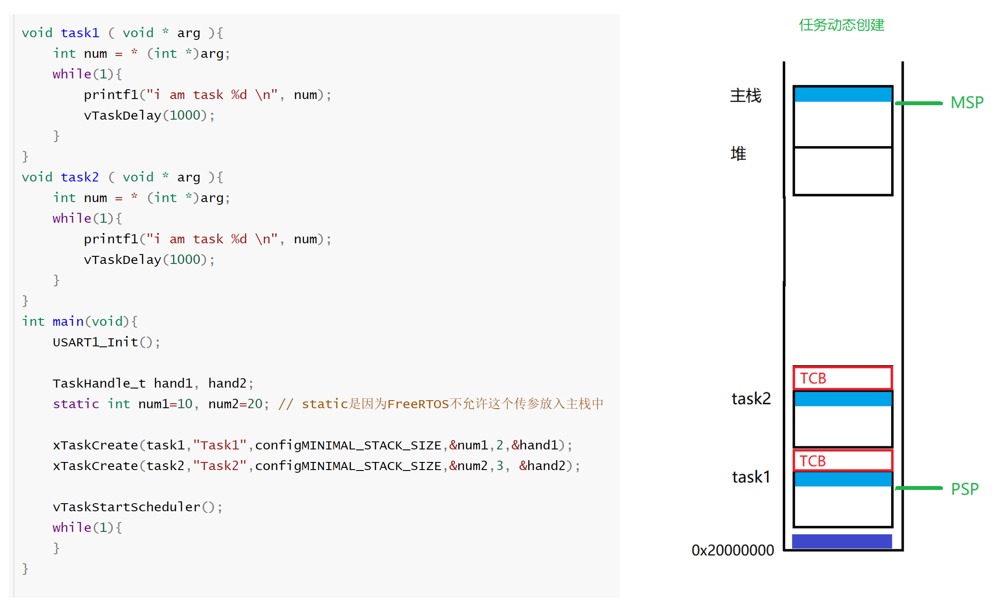

### 1.2.2 静态创建

>`xTaskCreateStatic()`函数是FreeRTOS中用于**静态创建任务**的函数.
>
>```C
>// 函数定义: task.h (508)
>TaskHandle_t xTaskCreateStatic( TaskFunction_t pxTaskCode,
>                          const char * const pcName,
>                          const configSTACK_DEPTH_TYPE uxStackDepth,
>                          void * const pvParameters,
>                          UBaseType_t uxPriority,
>                          StackType_t * const puxStackBuffer,
>                          StaticTask_t * const pxTaskBuffer ) 
>    
>注意: 要使用静态创建任务, 参数configSUPPORT_STATIC_ALLOCATION需配置为1 (需要手动配置)
>```
>
>参数:pxTaskCode
>
>```C
>// pxTaskCode用于指定任务的执行函数的入口, 这个任务函数必须是一个无返回值的函数.
>// 原型如下：
>	typedef void (* TaskFunction_t)( void * arg );
>// 其中 arg 是传递给任务的参数, 对应xTaskCreate函数中的pvParameters传参
>```
>
>参数:pcName
>
>```C
>// pcName用于指明任务的名字(可以给一个字符串), 任务名字主要用于便于调试和任务管理的标识符. FreeRTOS不会在实际的任务调度中直接使用这个名字.
>
>注意:虽然对这个名字可以给定任意字符串, 但是FreeRTOS要求, 这个名字的要满足小于指定长度,可以参考FreeRTOSConfig.h定义的宏configMAX_TASK_NAME_LEN.
>
>#define configMAX_TASK_NAME_LEN		( 16 )
>```
>
>参数:uxStackDepth
>
>```C
>// usStackDepth参数用于指定任务堆栈的大小(configSTACK_DEPTH_TYPE类型). 即用于存储任务的局部变量、返回地址、任务的上下文信息等内容.
>
>// configSTACK_DEPTH_TYPE类型说明:
>(portable.h:89)
>#define configSTACK_DEPTH_TYPE    StackType_t
>(portmacro.h:58)
>typedef portSTACK_TYPE   StackType_t;
>(portmacro.h:55)
>#define portSTACK_TYPE    uint32_t
>
>注意: 每个任务的堆栈大小应该根据任务执行时的需求来决定, 堆栈大小设置得过小可能会导致堆栈溢出, 过大则浪费内存. 通常情况下应该根据任务的复杂度来估算堆栈大小.
>注意: 在FreeRTOSConfig.h文件定义中, 提供了一个栈的参考大小configMINIMAL_STACK_SIZE; 理论上我们可以设置比这个值大,或者比这个值小,但是在没有特殊需求的情况下,建议使用该宏作为当前任务栈的大小(稍大一些也是可以的).
>```
>
>参数: pvParameters
>
>```C
>// pvParameters参数用于在任务创建的时候,把参数传递给任务函数.在任务的入口函数中,可以使用入口函数的参数接收.如果任务不需要函数,可以将此值设为NULL.
>```
>
>参数: uxPriority
>
>```C
>// uxPriority参数用于设置任务调度的优先级, FreeRTOS使用优先级来决定任务怎么调度. 
>
>// 我们可以把优先级设置为0到configMAX_PRIORITIES-1, configMAX_PRIORITIES这个宏来自于FreeRTOSConfig.h中对FreeRTOS系统支持的最大优先级数量的定义.
>// FreeRTOSConfig.h中, 宏configMAX_PRIORITIES用来设置系统中可用的最大优先级数目, 其中0表示最低优先级,configMAX_PRIORITIES-1表示最高优先级.
>// FreeRTOS在调度任务执行的时候, 会在等待调度的任务重选取具有最高优先级的任务执行.如果优先级相同, 则是通过时间片轮转的方式调度任务.
>
>// 如果在最开始, 我们不确定任务优先级设置多少合适, 可以暂时给任务优先级为tskIDLE_PRIORITY+1.
>#define tskIDLE_PRIORITY    ( ( UBaseType_t ) 0U )
>(task.h: 196)
>// tskIDLE_PRIORITY, 它是FreeRTOS中给空闲任务设置的优先级(Idle Task).
>```
>
>参数: puxStackBuffer
>
>```C
>// puxStackBuffer参数用于给静态创建任务时, 给任务提供内存堆栈区域指针地址. 这是因为在以静态方式创建任务时, 无论是任务的需要的堆栈空间还是TCB(进程控制块)空间, 都需要用户在创建之前手动开辟; 然后在创建任务的时候,传递给静态创建任务函数.
>
>注意1: 虽然从参数类型上我们发现静态任务创建函数需要的堆栈空间参数为(StackType_t * const puxStackBuffer), 是一个StackType_t类型的指针, 但是本着内存空间连续的使用方式, 也就是说我们可以创建一个StackType_t类型的数组, 提供一片连续的内存空间给静态任务作为堆栈使用.
>    
>注意2: 当我们手动给静态任务创建函数分配内存空间时, 这个分配的分配的堆栈空间大小, 应该要和uxStackDepth保持一致. 也就是说这个数组实际开辟的连续的内存空间, 应该和uxStackDepth经过(*4  - 4字节单位)计算出的结果保持一致和匹配. 
>//Eg: StackType_t pxStackBuffer[configMINIMAL_STACK_SIZE]; 
>    
>注意3: 由于静态创建任务需要手动开辟和指明堆栈内存空间, FreeRTOS要求,因为这个开辟的数组将用作任务堆栈的原因, 因此必须持久存在, 即:不能在函数的堆栈上声明. 
>```
>
>参数: pxTaskBuffer
>
>```C
>// pxTaskBuffer参数用于给静态创建任务时, 给任务提供任务的TCB存储的指针地址. 这是因为在以静态方式创建任务时, 无论是任务的需要的堆栈空间还是TCB(进程控制块)空间, 都需要用户在创建之前手动开辟; 然后在创建任务的时候,传递给静态创建任务函数.
>
>注意1: 虽然pxTaskBuffer类型为StaticTask_t(实际上是一个叫struct xSTATIC_TCB结构体类型), 和我们在动态创建任务时获得任务句柄不同, 但是本质上都是用来存储任务的各种信息: 包括优先级、堆栈指针、任务状态等等
>    
>注意2: 虽然pxTaskBuffer参数也需要一个我们手动开辟内存空间, 但是由于FreeRTOS已经定义好了TCB存储数据的固定性(优先级、堆栈指针、任务状态), 所以FreeRTOS直接定义了一个结构体(即:struct xSTATIC_TCB, 即:StaticTask_t)来具体指明创建大小.所以我们在预先手动开辟TCB空间的时候, 只需要定义一个StaticTask_t类型的结构体, 以取地址的方式把这个开辟有固定大小的TCB提供给静态创建函数即可. (即: xSTATIC_TCB和TaskHandle_t实际在内存布局上是相同的)
>// Eg: StaticTask_t  pxTaskBuffer;
>//     TaskHandle_t hand1=xTaskCreateStatic( , ,, ,  &pxTaskBuffer);
>	
>注意3: 由于静态创建任务需要手动开辟和指明堆栈内存空间, FreeRTOS要求,pxTaskBuffer必须持久存在, 即:不能在函数的堆栈上声明. 
>```
>
>返回值: TaskHandle_t类型
>
>````C
>// xTaskCreateStatic()返回一个TaskHandle_t类型的值,即被创建出来的任务的任务句柄. 在静态创建任务创建成功后, xTaskCreateStatic通过返回值提供给我们一个任务句柄, 这个任务句柄本质上是我们提供给静态创建任务函数的pxTaskBuffer参数, 两者指向同一个地址(我们甚至可以通过获取地址发现,两者完全相同),在TCB中记录了这个任务的跟多关键信息, 比如当前状态、优先级、栈指针、任务的执行时间、任务的句柄、任务栈的大小等, 并且我们也可以通过这个TCB任务控制块句柄来对任务进行关系, 比如停止或者删除任务. 
>
>注意1: 关于返回值TaskHandle_t类型内的具体参数, 可以参照动态创建时任务句柄的说明.
>    
>注意2: 当任务创建成功,返回句柄(非NULL); 当静态创建失败,返回NULL.
>````
>

>**注意:**在使用静态创建任务函数的时候, FreeRTOS强制要求我们实现一个vApplicationGetIdleTaskMemory函数, 用于给Idle任务提供静态空间分配(堆栈空间, TCB内存空间).
>
>```C
>// 给Idle任务开辟空间
>StackType_t idle_puxStackBuffer[configMINIMAL_STACK_SIZE];// 任务栈
>StaticTask_t idle_pxTaskBuffer;// TCB
>
>
>// 给Idle任务配置内存
>void vApplicationGetIdleTaskMemory( StaticTask_t ** ppxIdleTaskTCBBuffer,
>                                   StackType_t ** ppxIdleTaskStackBuffer,
>                                   configSTACK_DEPTH_TYPE * puxIdleTaskStackSize )
>{
>
>		*ppxIdleTaskTCBBuffer = &idle_pxTaskBuffer;
>		*ppxIdleTaskStackBuffer = idle_puxStackBuffer;
>		*puxIdleTaskStackSize = configMINIMAL_STACK_SIZE;
>}
>```

>Eg:
>
>```C
>#include "stm32f10x.h"    
>#include "freertos.h"
>#include "task.h"
>#include "UART1.h"
>
>// 给Idle任务开辟空间
>StackType_t idle_puxStackBuffer[configMINIMAL_STACK_SIZE];// 任务栈
>StaticTask_t idle_pxTaskBuffer;// TCB
>// 起始任务
>StackType_t puxStackBuffer[configMINIMAL_STACK_SIZE];// 任务栈
>StaticTask_t pxTaskBuffer;// TCB
>// 任务1
>StackType_t puxStackBuffer1[configMINIMAL_STACK_SIZE];// 任务栈
>StaticTask_t pxTaskBuffer1;// TCB
>// 任务2
>StackType_t puxStackBuffer2[configMINIMAL_STACK_SIZE];// 任务栈
>StaticTask_t pxTaskBuffer2;// TCB
>
>// 给Idle任务配置内存
>void vApplicationGetIdleTaskMemory( StaticTask_t ** ppxIdleTaskTCBBuffer,
>                              StackType_t ** ppxIdleTaskStackBuffer,
>                              configSTACK_DEPTH_TYPE * puxIdleTaskStackSize )
>{
>
>		*ppxIdleTaskTCBBuffer = &idle_pxTaskBuffer;
>		*ppxIdleTaskStackBuffer = idle_puxStackBuffer;
>		*puxIdleTaskStackSize = configMINIMAL_STACK_SIZE;
>}
>
>void printTaskInfo(TaskHandle_t taskHandle)
>{
>TaskStatus_t xTaskDetails;
>
>   // 获取任务信息
>   vTaskGetInfo(taskHandle, &xTaskDetails, pdTRUE, eInvalid);
>
>// 打印任务信息
>   printf1("Task Name: %s\n", xTaskDetails.pcTaskName);
>   printf1("Task Priority: %d\n", xTaskDetails.uxCurrentPriority);
>   printf1("Base Priority: %d\n", xTaskDetails.uxBasePriority);
>   printf1("Task State: %d\n", xTaskDetails.eCurrentState);
>   printf1("Stack Base Address: %p\n", xTaskDetails.pxStackBase);
>   printf1("Stack High Water Mark: %d\n", xTaskDetails.usStackHighWaterMark);
>   printf1("Task Run Time: %d ticks\n", xTaskDetails.ulRunTimeCounter);
>	
>	printf1("                   \n");
>}
>
>void task1 ( void * arg ){	
>	int num = * (int *)arg;
>	while(1){
>		printf1("i am task %d \n", num);
>		vTaskDelay(10000);
>	}
>}
>void task2 ( void * arg ){
>	int num = * (int *)arg;
>	while(1){
>		printf1("i am task %d \n", num);
>		vTaskDelay(10000);
>	}
>}
>
>int num1=10, num2=20;
>void beginTask(void *arg){
>
>	TaskHandle_t hand1=xTaskCreateStatic(task1,
>                               "Task1",
>                                    configMINIMAL_STACK_SIZE,
>                                    &num1,
>                                    2,
>                                    puxStackBuffer1, 
>                                    &pxTaskBuffer1);
>	
>	TaskHandle_t hand2=xTaskCreateStatic(task2,
>                               "Task2",
>                                    configMINIMAL_STACK_SIZE,
>                                    &num2,
>                                    3, 
>                                    puxStackBuffer2, 
>                                    &pxTaskBuffer2);
>
>	while(1){
>		// 打印任务 1 和任务 2 的详细信息
>		printTaskInfo(hand1);
>		printTaskInfo(hand2);
>		printTaskInfo(NULL);
>
>		printf1("hand1: %p\n ", hand1);
>		printf1("hand2: %p\n ", hand2);
>
>		vTaskDelay(10000);
>	}
>}
>
>int main(void){
>	
>	USART1_Init();
>
>	TaskHandle_t hand=xTaskCreateStatic(beginTask, 
>									"beginTask",
>									configMINIMAL_STACK_SIZE,
>									NULL,
>									4, 
>									puxStackBuffer,
>									&pxTaskBuffer );
>	
>	vTaskStartScheduler();
>	while(1){
>	}
>}
>
>```

>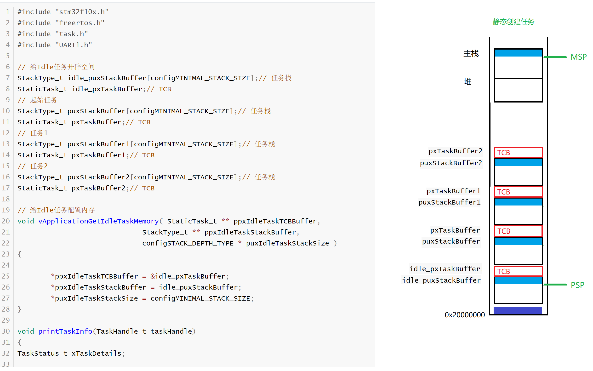

### 1.2.3 其它方式: 了解

>实际上再FreeRTOS中创建任务除了普通的动态创建和静态创建任务以外, 还有其他创建任务的方式.
>
>```C
>// Eg:
>xTaskCreateRestricted();// 创建任务
>xTaskCreateRestrictedStatic();// 创建任务
>```
>
>而和普通创建任务不同的是, 使用上述两个任务创建函数, 要求设备具有内存保护单元(MPU)功能(并不是每一种硬件架构都具有该功能).
>
>简而言之, 就是如果使用上述两个函数创建任务, 就要求我们在启动和创建任务的时候, 在更安全的模式下的,提供`更细致`的内存访问限制.这种限制的本质就是控制任务的堆栈空间的读写和访问权限(需要创建者在创建任务的时候指明这些权限). 而且这种控制是离散的, 所以在实际中我们可能很少使用这两个函数.

### 1.2.4 动态和静态创建的区别

>我们知道在FreeRTOS中, 当创建任务的时候, 伴随着任务产生的有两个重要的内存模块产生, 一个是任务控制块TCB, 一个是任务在运行过程中需要使用到的堆栈空间.
>
>在动态创建任务的时候, FreeRTOS底层通过函数pvPortMalloc为任务开辟TCB控制块空间和任务运行堆栈空间.
>
>而在静态创建任务的时候, 在创建任务之前需要我们手动开辟好TCB控制块空间和任务运行堆栈空间, 并且在xTaskCreateStatic()执行的时候, 把创建好的内存空间地址传递给创建函数, 以供函数分配给任务使用.
>
>除此之外, 动态创建的任务在删除的时候, 内存自动由删除函数(vTaskDelete())实现释放; 而静态创建任务需要用户手动释放内存空间(也就是说vTaskDelete()删除静态任务, 不会主动释放TCB和堆栈空间).
>
>```C
>// 删除静态任务的资源释放示例(清空)
>#include "stm32f10x.h"    
>#include "freertos.h"
>#include "task.h"
>#include "UART1.h"
>#include <string.h>
>
>
>// 给Idle任务开辟空间
>StackType_t idle_puxStackBuffer[configMINIMAL_STACK_SIZE];// 任务栈
>StaticTask_t idle_pxTaskBuffer;// TCB
>// 起始任务
>StackType_t puxStackBuffer[configMINIMAL_STACK_SIZE];// 任务栈
>StaticTask_t pxTaskBuffer;// TCB
>// 任务1
>StackType_t puxStackBuffer1[configMINIMAL_STACK_SIZE];// 任务栈
>StaticTask_t pxTaskBuffer1;// TCB
>
>// 给Idle任务配置内存
>void vApplicationGetIdleTaskMemory( StaticTask_t ** ppxIdleTaskTCBBuffer,
>                              StackType_t ** ppxIdleTaskStackBuffer,
>                              configSTACK_DEPTH_TYPE * puxIdleTaskStackSize )
>{
>
>		*ppxIdleTaskTCBBuffer = &idle_pxTaskBuffer;
>		*ppxIdleTaskStackBuffer = idle_puxStackBuffer;
>		*puxIdleTaskStackSize = configMINIMAL_STACK_SIZE;
>}
>
>
>void task1 ( void * arg ){	
>	int num = * (int *)arg;
>	while(1){
>		printf1("i am task %d \n", num);
>		vTaskDelay(1000);
>	}
>}
>
>void beginTask(void *arg){
>
>	int num1=10;
>	
>	TaskHandle_t hand1=xTaskCreateStatic(task1,
>                               "Task1",
>                                    configMINIMAL_STACK_SIZE,
>                                    &num1,
>                                    2,
>                                    puxStackBuffer1, 
>                                    &pxTaskBuffer1);
>	while(1){
>
>		vTaskDelay(10000);
>        if(hand1 != NULL){
>            vTaskDelete(hand1);
>            hand1 = NULL;
>            memset(puxStackBuffer1, 0, sizeof(puxStackBuffer1));
>            memset(&pxTaskBuffer1, 0, sizeof(pxTaskBuffer1));
>        }
>        printf1("i am beginTask  \n");
>	}
>}
>
>int main(void){
>	
>	USART1_Init();
>
>	TaskHandle_t hand=xTaskCreateStatic(beginTask, 
>									"beginTask",
>									configMINIMAL_STACK_SIZE,
>									NULL,
>									4, 
>									puxStackBuffer,
>									&pxTaskBuffer );
>	
>	vTaskStartScheduler();
>	while(1){
>	}
>}
>
>```


## 1.3 其它

### 1.3.1 任务的调度和切换

#### 1.3.1.1 vTaskStartScheduler函数

>在FreeRTOS中, 通过创建任务函数创建任务之后, 必须通过调度函数vTaskStartScheduler(),  启动FreeRTOS的任务调度器, 才能使系统开始运行多个任务.
>
>```C
>void vTaskStartScheduler( void );
>```
>
>- vTaskStartScheduler将启动FreeRTOS任务调度器, 使FreeRTOS进入多任务调度状态
>- 一旦通过任务调度器vTaskStartScheduler开启任务调度, FreeRTOS将进入任务的调度执行, 正常情况下代码将不会返回主栈逻辑继续执行
>- 在vTaskStartScheduler内部实现中, 将为当前任务调度创建一个优先级最低的空闲任务(IdleTask)
>
>Eg:
>
>```C
>#include "stm32f10x.h"    
>#include "freertos.h"
>#include "task.h"
>#include "UART1.h"
>
>void task1 ( void * arg ){	
>	while(1){
>		printf1("i am task1 \n");
>		vTaskDelay(1000);
>	}
>}
>
>void beginTask(void *arg){
>	TaskHandle_t hand1; 
>	xTaskCreate(task1,"Task1",configMINIMAL_STACK_SIZE, NULL,2,&hand1);
>	while(1){
>		vTaskDelay(10000);
>    	printf1("i am beginTask  \n");
>	}
>}
>
>int main(void){
>	
>	USART1_Init();
>
>	TaskHandle_t hand;
>	xTaskCreate(beginTask,"beginTask",configMINIMAL_STACK_SIZE,NULL,4,&hand);
>	
>	vTaskStartScheduler();
>	while(1){
>        // 如果注释vTaskStartScheduler, 将打印下面"i am main"
>        // 如果不注释vTaskStartScheduler, 下面"i am main"将永远无法打印
>		printf1("i am main  \n");
>	}
>}
>
>```

#### 1.3.1.2 空闲任务

>当在FreeRTOS中调用vTaskStartScheduler函数启动任务的时候, 在vTaskStartScheduler函数内部实现中会自然的创建一个空闲任务, 也就是IdleTask. 并且在默认情况下为这个空闲任务配置最低的运行优先级(即0).
>
>任务调度函数创建空闲任务的原因是有多个的:
>
>- 当任务被删除的时候, 需要依赖于空闲任务释放资源
>
>```C
>// 在动态创建任务的时候, 我们说任务创建需要自动的为其开辟内存空间, 同样的在任务退出删除的时候需要释放其资源.
>// 而在FreeRTOS的内核实现中, 动态开辟TCB和任务堆栈是借助其pvPortMalloc()函数实现(可以在xCreateTask()实现内部找到), 这就要求在任务退出的时候, 释放其内存空间使用对应的函数vPortFree().
>// 而删除任务的函数vTaskDelete()函数在删除任务的时候, vTaskDelete()函数的实现机制是通过标记位删除, 当空闲任务运行的时候, 在空闲任务重通过vPortFree()函数释放被删除任务的资源
>```
>
>- 当所有任务都进入阻塞或者挂起状态后, 空闲任务的存在可以保证FreeRTOS中有任务可以继续被调度执行.
>- 由于空闲任务优先级比较低, 只有等别的处于跟高优先级的任务被删除或者阻塞挂起之后, 空闲任务才有机会执行.

#### 1.3.1.3 任务调度和优先级的关系

>在FreeRTOS中任务调度和优先级设置有紧密关系, 其中最重要的两个即抢占式优先和时间片轮转.
>
>- FreeRTOS中采用抢占式任务调度策略, 也就是说, 当存在高优先级的任务时, 高优先级任务总是先执行.
>- 在FreeRTOS的任务调度中, 高优先级的任务总是先执行, 当同时存在多个优先级相同的任务的时候, FreeRTOS的任务调度采用时间片轮转方式进行.
>
>```C
>// 具体细节可以参照任务优先级的详细说明
>```

### 1.3.2 任务优先级问题

>在FreeRTOS中, 一个任务可以被设置的优先级为: 0 到configMAX_PRIORITIES - 1 
>
>```C
>// configMAX_PRIORITIES在FreeRTOSConfig.h中定义
>#define configMAX_PRIORITIES		( 5 )
>```
>
>- 在FreeRTOS中可以在创建任务的时候给任务设置优先级
>- 任务的优先级数值越小优先级越低, 数值越大优先级越高, 空闲任务的优先级默认为0.  (和STM32的中断不同的是, 中断是数值越小优先级越高)
>- 甚至我们可以在任务运行的vTaskPrioritySet()函数,在运行的过程中动态修改任务的优先级
>
>```C
>// 函数说明
>void vTaskPrioritySet(
>    TaskHandle_t xTask, // 任务句柄
>    UBaseType_t uxNewPriority// 优先级配置
>);
>```
>
>```C
>Eg:
>#include "stm32f10x.h"    
>#include "freertos.h"
>#include "task.h"
>#include "UART1.h"
>#include <string.h>
>
>void task1 ( void * arg ){	
>	while(1){
>		printf1("i am task1 \n");
>	}
>}
>void task2 ( void * arg ){	
>	while(1){
>		printf1("i am task2 \n");
>	}
>}
>void beginTask(void *arg){
>	
>	TaskHandle_t hand1, hand2; 
>	xTaskCreate(task1,"Task1",configMINIMAL_STACK_SIZE, NULL,3,&hand1);
>	xTaskCreate(task2,"Task2",configMINIMAL_STACK_SIZE, NULL,2,&hand2);
>	
>	while(1){
>
>		vTaskDelay(10000);
>    	vTaskPrioritySet(hand2, 3);
>	}
>}
>
>int main(void){
>	
>	USART1_Init();
>
>	xTaskCreate(beginTask,"beginTask",configMINIMAL_STACK_SIZE,NULL,4,NULL);
>	vTaskStartScheduler();
>	while(1){
>	}
>}
>
>```
>
>- 我们在**任务列表**章节中对任务列表概念进行了阐述, FreeRTOS通过对任务列表的管理, 进一步管理任务的调度/流转/运行机制, 而在任务列表中最重要的一个列表就是**就绪任务列表数组**
>
>```C
>static List_t pxReadyTasksLists[ configMAX_PRIORITIES ]; // 就绪任务列表数组
>```
>
>```C
>// 我们通过FreeRTOS对就绪任务的存储源码的研究发现, 这个就绪任务列表是按照数组存储的. 这是因为在FreeRTOS的就绪集合中划分就绪任务是按照优先级为单位的.
>// 其中pxReadyTasksLists[i]就代表优先级为i的就绪任务列表, 而configMAX_PRIORITIES则是我们在FreeRTOSConfig.h文件中定义的最高优先级范围
>```
>
>- FreeRTOS中采用抢占式任务调度策略, 也就是说, 当存在高优先级的任务时, 高优先级任务总是先执行.
>
>````C
>// 而高优先级任务先执行的本质, 是FreeRTOS在调度任务, 选择任务执行的时候, 是通过对pxReadyTasksLists就绪任务列表数组, 按照索引从高到低的查找顺序遍历就绪任务列表数组, 在这种机制下, 调度器可以快速找到最高优先级任务, 而不需要在整个任务队列中遍历所有任务
>
>// 这个逻辑的具体实现, 我们可以参考FreeRTOS内核中prvSelectHighestPriorityTask()函数内部实现(这个函数内部的while循环).
>tasks.c 1018
>````
>
>- 在FreeRTOS的任务调度中, 高优先级的任务总是先执行, 当同时存在多个优先级相同的任务的时候, FreeRTOS的任务调度采用时间片轮转方式进行
>
>```C
>//参考: vTaskSwitchContext函数:FreeRTOS任务调度的核心函数, 用于执行任务切换
>tasks.c 5056
>// 在vTaskSwitchContext函数中, 调用taskSELECT_HIGHEST_PRIORITY_TASK函数查找一个具有最高优先顺序的任务执行
>// taskSELECT_HIGHEST_PRIORITY_TASK()函数是FreeRTOS用于选择当前系统中最高优先级的就绪任务
>tasks.c 5114
>tasks.c 219
>// 进一步调用listGET_OWNER_OF_NEXT_ENTRY()函数
>list.h 286
>```

### 1.3.3 任务列表

>在FreeRTOS中任务有多种状态: 阻塞, 就绪,挂起等,  FreeRTOS通过任务在不同状态下的流转, 进而实现任务运行控制机制.
>
>在FreeRTOS中, 列表是一种很重要的维护用于维护不同分类任务的机制.
>
>```C
>// 例如常见列表:
>static List_t pxReadyTasksLists[ configMAX_PRIORITIES ]; // 就绪任务列表数组
>static List_t xDelayedTaskList1;// 存储处于延时任务的列表
>static List_t xPendingReadyList;// 存储已经从阻塞状态恢复的任务列表
>static List_t xSuspendedTaskList;// 存储因为vTaskSuspend()函数导致任务挂起的任务列表
>....
>```
>
>```C
>// 我们说任务列表是为了维护任务状态, 我们可以稍微举个例子,  假设一个任务A被创建, 在xTaskCreate()函数的内部中, 被创建的任务会立即被添加到pxReadyTasksLists就绪任务列表中, 等待被调度上CPU
>  通过xTaskCreate()内的prvAddNewTaskToReadyList( pxNewTCB )代码
>// 当经过一定时间后, 这个任务A被调度得以上CPU执行, 那么在FreeRTOS中, 这个任务会被移动到就绪列表的尾部(还在就绪列中, 这个移到尾部的本质实际是列表的遍历标记后移, 即pxIndex后移, 有的资料说是移除就绪列表, 是不正确的说法)
>// 当A在CPU上执行的时候如果运行的过程中遇到vTaskDelay()函数, 进入Delay延时的阻塞, 我们会把这个任务的信息, 从就绪列表移动存放到延时任务的列表.
>// 当一段时间之后, 设置的延时到达指定时间, FreeRTOS内核会把放在延时任务的列表的任务TCB从延时任务的列表中移动到xPendingReadyList列表, 表示这个任务已经从阻塞中恢复就绪, 但是不能立即运行,暂存在xPendingReadyList列表中
>// 如果任务A的信息已经存储到xPendingReadyList列表中之后, 一旦FreeRTOS内核又发生了任务切换, 在任务切换的同时,内核会检查xPendingReadyList列表, 把处于恢复就绪的任务, 继续移动到pxReadyTasksLists就绪列表, 等待后续的调度执行
>```
>
>综上所述, 任务列表是FreeRTOS控制任务切换/运行/状态流转的一种核心机制.
>
>而在FreeRTOS中每一个列表的本质, 都是一个链表(双向链表). 我们可以通过研究列表结构得到更进一步的信息
>
>```C
>typedef struct xLIST
>{
>    listFIRST_LIST_INTEGRITY_CHECK_VALUE// 用于数据完整性检查
>    
>    configLIST_VOLATILE UBaseType_t uxNumberOfItems;// 列表中的元素/任务个数
>    ListItem_t * configLIST_VOLATILE pxIndex;  // 迭代列表的索引，指向最近访问的项
>    MiniListItem_t xListEnd;   // 迷你列表项, 存在的意义是用于标记链表的末尾(不存储任务信息), 作为终止标记
>    
>    listSECOND_LIST_INTEGRITY_CHECK_VALUE // 用于数据完整性检查
>} List_t;
>```
>
>```C
>struct xLIST_ITEM
>{
>    listFIRST_LIST_ITEM_INTEGRITY_CHECK_VALUE// 用于数据完整性检查
>    
>    configLIST_VOLATILE TickType_t xItemValue; // 列表项的值
>    // 注意: 在普通列表中'列表项的值'并无特殊作用, 当我们通过vTaskDelay()函数进入延时列表时, 这个xItemValue可以用来记录和存储任务的唤醒时间, 以便在阻塞列表中按时间顺序排列, 方便时间到达检查
>    // 具体可以参考vTaskDelay()函数中的prvAddCurrentTaskToDelayedList( xTicksToDelay, pdFALSE )内部的实现(进一步调用vListInsert函数)
>    
>    struct xLIST_ITEM * configLIST_VOLATILE pxNext;  // 指向链表中下一个列表项
>    struct xLIST_ITEM * configLIST_VOLATILE pxPrevious;  // 指向链表中下一个列表项
>    
>    void * pvOwner;  // 指向拥有该列表项的任务(即: 当前列表项任务的TCB_t) 
>    
>    struct xLIST * configLIST_VOLATILE pxContainer;  // 指向当前列表项所在的列表(List_t)
>    
>    listSECOND_LIST_ITEM_INTEGRITY_CHECK_VALUE// 用于数据完整性检查
>};
>
>typedef struct xLIST_ITEM ListItem_t;
>```
>
>```C
>struct xMINI_LIST_ITEM
>    {
>        listFIRST_LIST_ITEM_INTEGRITY_CHECK_VALUE // 用于数据完整性检查
>        configLIST_VOLATILE TickType_t xItemValue; // 列表项的值(用于存储任务的唤醒时间)
>        struct xLIST_ITEM * configLIST_VOLATILE pxNext;// 指向链表中下一个列表项
>        struct xLIST_ITEM * configLIST_VOLATILE pxPrevious; // 指向链表中下一个列表项
>    };
>    typedef struct xMINI_LIST_ITEM MiniListItem_t;
>```

### 1.3.4 获取任务信息相关函数

>在FreeRTOS中为了方便程序开发, FreeRTOS提供了多种类型的API, 可以帮助我们获取任务的状态、任务统计信息、任务列表等.

##### vTaskGetInfo()函数

>在FreeRTOS中vTaskGetInfo函数可以帮助我们获取任务的详细状态信息
>
>```C
>// 注意: 如果要使用vTaskGetInfo函数需要启用配置:
>//		#define configUSE_TRACE_FACILITY 1
>//		可获取任务信息,如:任务名称、优先级、栈使用情况、运行时间统计、任务状态等。
>
>void vTaskGetInfo(
>    TaskHandle_t xTask,       // 要查询对应信息的任务句柄(NULL表示获取当前任务信息)
>    TaskStatus_t *pxTaskStatus, // 用于存储查询出的结果信息的结构体
>    BaseType_t xGetFreeStackSpace, // 是否获取任务的最小剩余栈空间(pdTRUE/pdFALSE)
>    eTaskState eState           // 任务状态过滤(传入eInvalid用于获取此刻状态信息)
>);
>
>// 保存获取信息的结构体
>typedef struct xTASK_STATUS
>{
>        TaskHandle_t xHandle;      // 任务句柄
>        const char *pcTaskName;    // 任务名称（字符串）
>        UBaseType_t uxCurrentPriority; // 当前优先级
>        UBaseType_t uxBasePriority; // 基础优先级
>        uint32_t ulRunTimeCounter; // 任务运行时间(需要启用配置configGENERATE_RUN_TIME_STATS == 1)
>        StackType_t *pxStackBase;  // 任务栈的低地址(而非起始地址, 很多资料在这有重大错漏)
>        UBaseType_t usStackHighWaterMark; // 任务栈的最小剩余空间(单位:字)
>        eTaskState eCurrentState;  // 任务状态(eReady, eRunning, eBlocked, eSuspended)
>} TaskStatus_t;
>```
>
>```C
>#include "stm32f10x.h"    
>#include "freertos.h"
>#include "task.h"
>#include "UART1.h"
>
>void printTaskInfo(TaskHandle_t taskHandle)
>{
>TaskStatus_t xTaskDetails;
>
>// 获取任务信息
>vTaskGetInfo(taskHandle, &xTaskDetails, pdTRUE, eInvalid);
>
>// 打印任务信息
>printf1("Task Name: %s\n", xTaskDetails.pcTaskName);
>printf1("Task Priority: %d\n", xTaskDetails.uxCurrentPriority);
>printf1("Base Priority: %d\n", xTaskDetails.uxBasePriority);
>printf1("Task State: %d\n", xTaskDetails.eCurrentState);
>printf1("Stack Base Address: %p\n", xTaskDetails.pxStackBase);
>printf1("Stack High Water Mark: %d\n", xTaskDetails.usStackHighWaterMark);
>printf1("Task Run Time: %d ticks\n", xTaskDetails.ulRunTimeCounter);
>}
>
>void task1 ( void * arg ){	
>	int num = * (int *)arg;
>	while(1){
>		printf1("i am task %d \n", num);
>		vTaskDelay(10000);
>	}
>}
>void task2 ( void * arg ){
>	int num = * (int *)arg;
>	while(1){
>		printf1("i am task %d \n", num);
>		vTaskDelay(10000);
>	}
>}
>
>void beginTask(void *arg){
>	
>	TaskHandle_t hand1, hand2;
>	static int num1=10, num2=20;
>	
>	xTaskCreate(task1,"Task1",configMINIMAL_STACK_SIZE,&num1,2,&hand1);
>	xTaskCreate(task2,"Task2",configMINIMAL_STACK_SIZE,&num2,3, &hand2);
>	
>	while(1){
>		// 打印任务 1 和任务 2 的详细信息
>       printTaskInfo(hand1);
>       printTaskInfo(hand2);
>		vTaskDelay(10000);
>	}
>}
>int main(void){
>	
>	USART1_Init();
>	
>	xTaskCreate(beginTask,"beginTask",configMINIMAL_STACK_SIZE,NULL,4, NULL);
>	vTaskStartScheduler();
>	while(1){
>	}
>}
>
>```

##### vTaskList()函数

>vTaskList()函数, 可以帮我们追踪当前系统任务的运行信息
>
>```C
>// 注意: 如果要使用vTaskList函数需要启用配置:
>//		#define configUSE_TRACE_FACILITY 1   
>//		#define configUSE_STATS_FORMATTING_FUNCTIONS 1 (默认为0)
>//		可获取任务信息,如:任务名称、优先级、任务栈的剩余空间, FreeRTOS内部给任务分配的编号
>
>void vTaskList( char * pcWriteBuffer );
>```
>
>```C
>// 我们需要给vTaskList提供一个字符串数组,以供存储获得的任务信息的最终结果
>// 需要注意的是, 这个数组大小要根据任务个数来设置(要够大才好), 同时也要注意我们在printf1函数中提供的用来构建最终打印的字符串数组是要设置超过提供给vTaskList函数的数组大小的
>// vTaskList底层是一个vTaskListTasks函数
>// 而vTaskListTasks函数获取任务信息本质上是依赖于uxTaskGetSystemState函数
>// 所以vTaskList建议仅在测试时使用(有些鸡肋)
>```
>
>```C
>// 任务状态
>- `X` = Running (运行)
>- `R` = Running（就绪态）(在有些版本中运行也是R)
>- `B` = Blocked（阻塞）
>- `S` = Suspended（挂起）
>- `D` = Deleted（已删除）
>```
>
>```C
>#include "stm32f10x.h"    
>#include "freertos.h"
>#include "task.h"
>#include "UART1.h"
>#include <string.h>
>
>void task1 ( void * arg ){	
>	while(1){
>        vTaskDelay(3000);
>        vTaskSuspend(NULL); // 挂起任务
>	}
>}
>void task2 ( void * arg ){	
>	while(1){
>		vTaskDelay(3000);
>	}
>}
>char buffer[99]={0};  // 确保缓冲区足够大
>void beginTask(void *arg){
>	
>	TaskHandle_t hand1, hand2; 
>	xTaskCreate(task1,"Task1",configMINIMAL_STACK_SIZE, NULL,3,&hand1);
>	xTaskCreate(task2,"Task2",configMINIMAL_STACK_SIZE, NULL,2,&hand2);
>	
>	while(1){
>
>		vTaskDelay(5000);
>		vTaskList(buffer);
>		printf1("%s \r\n", buffer);
>		
>    vTaskPrioritySet(hand2, 3);
>		vTaskDelay(1000);
>		
>		memset(buffer, 0, sizeof(buffer));
>		vTaskList(buffer);
>		printf1("%s \r\n", buffer);
>	}
>}
>
>int main(void){
>	
>	USART1_Init();
>	xTaskCreate(beginTask,"beginTask",configMINIMAL_STACK_SIZE,NULL,4,NULL);
>	vTaskStartScheduler();
>	while(1){
>	}
>}
>
>```

##### uxTaskGetSystemState()函数

>uxTaskGetSystemState()函数, 也可以帮我们追踪当前系统任务的运行信息
>
>```C
>// 注意: 如果要使用uxTaskGetSystemState函数需要启用配置:
>//		#define configUSE_TRACE_FACILITY 1   (默认已配置)
>//		可获取任务信息,如:任务名称、优先级、任务栈的剩余空间等信息
>
>UBaseType_t uxTaskGetSystemState(
>    TaskStatus_t * const pxTaskStatusArray,// 任务状态数组,每个下标位存储一个任务信息
>    const UBaseType_t uxArraySize,// 数组长度/大小 
>    uint32_t * const pulTotalRunTime// 系统运行总时间, NULL代表不需要
>);
>// 返回值: 标识当前任务的总数(pxTaskStatusArray数组中有效任务的数量)
>
>// 注意保持数组足够大
>```
>
>```C
>// 保存获取信息的结构体
>typedef struct xTASK_STATUS
>{
>    TaskHandle_t xHandle;      // 任务句柄
>    const char *pcTaskName;    // 任务名称（字符串）
>    UBaseType_t uxCurrentPriority; // 当前优先级
>    UBaseType_t uxBasePriority; // 基础优先级
>    uint32_t ulRunTimeCounter; // 任务运行时间(需要启用配置configGENERATE_RUN_TIME_STATS == 1)
>    StackType_t *pxStackBase;  // 任务栈的低地址(而非起始地址, 很多资料在这有重大错漏)
>    UBaseType_t usStackHighWaterMark; // 任务栈的最小剩余空间(单位:字)
>    eTaskState eCurrentState;  // 任务状态(eReady, eRunning, eBlocked, eSuspended)
>} TaskStatus_t;
>```
>
>Eg:
>
>```C
>#include "stm32f10x.h"    
>#include "freertos.h"
>#include "task.h"
>#include "UART1.h"
>#include <string.h>
>
>void task1 ( void * arg ){	
>	while(1){
>			vTaskDelay(3000);
>			vTaskSuspend(NULL);
>	}
>}
>void task2 ( void * arg ){	
>	while(1){
>		vTaskDelay(3000);
>	}
>}
>
>TaskStatus_t pxTaskStatusArray[5]; // 任务信息结构体数组
>uint32_t ulTotalRunTime;// 运行时间
>UBaseType_t uxTaskCount;// 获得任务个数
>
>void beginTask(void *arg){
>	
>	TaskHandle_t hand1, hand2; 
>	xTaskCreate(task1,"Task1",configMINIMAL_STACK_SIZE, NULL,3,&hand1);
>	xTaskCreate(task2,"Task2",configMINIMAL_STACK_SIZE, NULL,2,&hand2);
>	
>	while(1){
>
>		vTaskDelay(5000);
>		uxTaskCount = uxTaskGetSystemState(pxTaskStatusArray, 5, &ulTotalRunTime);
>		for (UBaseType_t i = 0; i < uxTaskCount; i++)
>		{
>				printf1("Task: %s, State: %d, Priority: %lu, Stack High Water Mark: %u \r\n",
>							 pxTaskStatusArray[i].pcTaskName,
>							 pxTaskStatusArray[i].eCurrentState,
>							 (unsigned long)pxTaskStatusArray[i].uxCurrentPriority,
>							 pxTaskStatusArray[i].usStackHighWaterMark);
>		}
>	}
>}
>
>int main(void){
>	
>	USART1_Init();
>	xTaskCreate(beginTask,"beginTask",configMINIMAL_STACK_SIZE,NULL,4,NULL);
>	vTaskStartScheduler();
>	while(1){
>	}
>}
>
>```

##### uxTaskGetNumberOfTasks()函数

>uxTaskGetNumberOfTasks()函数, 可以帮我们获取当前系统任务数
>
>```C
>
>UBaseType_t uxTaskGetNumberOfTasks( void );
>// 返回值: 标识当前任务的总数(包括就绪、阻塞、挂起的任务)
>```
>
>Eg:
>
>```C
>#include "stm32f10x.h"    
>#include "freertos.h"
>#include "task.h"
>#include "UART1.h"
>#include <string.h>
>
>void task1 ( void * arg ){	
>	while(1){
>			vTaskDelay(3000);
>			vTaskSuspend(NULL);
>	}
>}
>void task2 ( void * arg ){	
>	while(1){
>		vTaskDelay(3000);
>	}
>}
>void beginTask(void *arg){
>	
>	TaskHandle_t hand1, hand2; 
>	xTaskCreate(task1,"Task1",configMINIMAL_STACK_SIZE, NULL,3,&hand1);
>	xTaskCreate(task2,"Task2",configMINIMAL_STACK_SIZE, NULL,2,&hand2);
>	
>	while(1){
>
>		vTaskDelay(5000);
>		UBaseType_t taskCount = uxTaskGetNumberOfTasks();
>		printf1("Number of tasks: %lu  \r\n", (unsigned long)taskCount);
>	}
>}
>
>int main(void){
>	
>	USART1_Init();
>	xTaskCreate(beginTask,"beginTask",configMINIMAL_STACK_SIZE,NULL,4,NULL);
>	vTaskStartScheduler();
>	while(1){
>	}
>}
>
>```

##### pcTaskGetName()函数

>pcTaskGetName()函数, 可以帮我们获取任务名
>
>```C
>char * pcTaskGetName(
>    TaskHandle_t xTaskToQuery // 任务句柄, NULL表示获取当前任务
>)
>// 返回值: 任务名
>```
>
>Eg:
>
>```C
>#include "stm32f10x.h"    
>#include "freertos.h"
>#include "task.h"
>#include "UART1.h"
>#include <string.h>
>
>void task1 ( void * arg ){	
>	while(1){
>			vTaskDelay(3000);
>			vTaskSuspend(NULL);
>	}
>}
>void task2 ( void * arg ){	
>	while(1){
>		vTaskDelay(3000);
>	}
>}
>void beginTask(void *arg){
>	
>	TaskHandle_t hand1, hand2; 
>	xTaskCreate(task1,"Task1",configMINIMAL_STACK_SIZE, NULL,3,&hand1);
>	xTaskCreate(task2,"Task2",configMINIMAL_STACK_SIZE, NULL,2,&hand2);
>	
>	while(1){
>
>		vTaskDelay(5000);
>		printf1("Current task: %s \r\n", pcTaskGetName(NULL));
>	}
>}
>
>int main(void){
>	
>	USART1_Init();
>	xTaskCreate(beginTask,"beginTask",configMINIMAL_STACK_SIZE,NULL,4,NULL);
>	vTaskStartScheduler();
>	while(1){
>	}
>}
>
>```

##### uxTaskPriorityGet()函数

>uxTaskPriorityGet()函数, 可以帮我们获取任务优先级
>
>```C
>UBaseType_t uxTaskPriorityGet(
>    TaskHandle_t xTask // 任务句柄, NULL表示当前任务
>);
>// 返回值, 优先级
>```
>
>Eg:
>
>```C
>#include "stm32f10x.h"    
>#include "freertos.h"
>#include "task.h"
>#include "UART1.h"
>#include <string.h>
>
>void task1 ( void * arg ){	
>	while(1){
>			vTaskDelay(3000);
>			vTaskSuspend(NULL);
>	}
>}
>void task2 ( void * arg ){	
>	while(1){
>		vTaskDelay(3000);
>	}
>}
>void beginTask(void *arg){
>	
>	TaskHandle_t hand1, hand2; 
>	xTaskCreate(task1,"Task1",configMINIMAL_STACK_SIZE, NULL,3,&hand1);
>	xTaskCreate(task2,"Task2",configMINIMAL_STACK_SIZE, NULL,2,&hand2);
>	
>	while(1){
>		vTaskDelay(5000);
>		UBaseType_t priority = uxTaskPriorityGet(NULL);
>		printf1("Current task priority: %lu \r\n", (unsigned long)priority);
>	}
>}
>int main(void){
>	
>	USART1_Init();
>	xTaskCreate(beginTask,"beginTask",configMINIMAL_STACK_SIZE,NULL,4,NULL);
>	vTaskStartScheduler();
>	while(1){
>	}
>}
>
>```

##### xTaskGetHandle()函数

>xTaskGetHandle()函数, 可以帮我们通过任务名获取任务句柄
>
>```C
>// 注意: 如果要使用xTaskGetHandle函数需要启用配置:
>//		#define INCLUDE_xTaskGetHandle 1 (默认为0)
>
>TaskHandle_t xTaskGetHandle(
>    const char *pcName // 任务名
>);
>// 返回值: 任务句柄
>```
>
>Eg:
>
>```C
>#include "stm32f10x.h"    
>#include "freertos.h"
>#include "task.h"
>#include "UART1.h"
>#include <string.h>
>
>void task1 ( void * arg ){	
>	while(1){
>			vTaskDelay(3000);
>			vTaskSuspend(NULL);
>	}
>}
>void task2 ( void * arg ){	
>	while(1){
>		vTaskDelay(3000);
>	}
>}
>void beginTask(void *arg){
>	
>	TaskHandle_t hand1, hand2; 
>	xTaskCreate(task1,"Task1",configMINIMAL_STACK_SIZE, NULL,3,&hand1);
>	xTaskCreate(task2,"Task2",configMINIMAL_STACK_SIZE, NULL,2,&hand2);
>	
>	while(1){
>
>		vTaskDelay(5000);
>		
>		TaskHandle_t handle = xTaskGetHandle("Task1");
>		TaskStatus_t xTaskDetails;
>		vTaskGetInfo(handle, &xTaskDetails, pdTRUE, eInvalid);
>		printf1("Task: %s, State: %d, Priority: %lu, Stack High Water Mark: %u \r\n",
>							 xTaskDetails.pcTaskName,
>							 xTaskDetails.eCurrentState,
>							 (unsigned long)xTaskDetails.uxCurrentPriority,
>							 xTaskDetails.usStackHighWaterMark);
>	}
>}
>
>int main(void){
>	
>	USART1_Init();
>	xTaskCreate(beginTask,"beginTask",configMINIMAL_STACK_SIZE,NULL,4,NULL);
>	vTaskStartScheduler();
>	while(1){
>	}
>}
>
>```

##### eTaskGetState()函数

>eTaskGetState()函数, 可以帮我们获取任务的状态
>
>```C
>// 注意: 如果要使用eTaskGetState函数需要启用配置: (有其一即可)
>//		#define INCLUDE_eTaskGetState 1 
>//		#define configUSE_TRACE_FACILITY 1
>//		#define INCLUDE_xTaskAbortDelay 1
>
>eTaskState eTaskGetState( 
>    TaskHandle_t xTask // 任务句柄
>)
>// 返回值状态信息
>```
>
>| **返回值** | **状态描述**       |
>| ---------- | ------------------ |
>| eRunning   | 任务正在运行       |
>| eReady     | 任务就绪，等待 CPU |
>| eBlocked   | 任务阻塞，等待事件 |
>| eSuspended | 任务挂起           |
>| eDeleted   | 任务已删除         |
>
>Eg:
>
>```C
>#include "stm32f10x.h"    
>#include "freertos.h"
>#include "task.h"
>#include "UART1.h"
>#include <string.h>
>
>void task1 ( void * arg ){	
>	while(1){
>			vTaskDelay(3000);
>			//vTaskSuspend(NULL);
>	}
>}
>void task2 ( void * arg ){	
>	while(1){
>		vTaskDelay(3000);
>	}
>}
>void beginTask(void *arg){
>	
>	TaskHandle_t hand1, hand2; 
>	xTaskCreate(task1,"Task1",configMINIMAL_STACK_SIZE, NULL,3,&hand1);
>	xTaskCreate(task2,"Task2",configMINIMAL_STACK_SIZE, NULL,2,&hand2);
>	
>	while(1){
>
>		vTaskDelay(5000);
>		
>		eTaskState state = eTaskGetState(hand1);
>		if(state == eRunning){
>			printf1("eRunning \r\n");
>		}else if(state == eReady){
>			printf1("eReady \r\n");
>		}else if(state == eBlocked){
>			printf1("eBlocked \r\n");
>		}else if(state == eSuspended){
>			printf1("eSuspended \r\n");
>		}else if(state == eDeleted){
>			printf1("eDeleted \r\n");
>		}
>	}
>}
>
>int main(void){
>	
>	USART1_Init();
>	xTaskCreate(beginTask,"beginTask",configMINIMAL_STACK_SIZE,NULL,4,NULL);
>	vTaskStartScheduler();
>	while(1){
>	}
>}
>
>```

### 1.3.5 任务的状态和挂起

>从前面的任务列表中我们知道FreeRTOS把任务分为多种状态,包括运行态(Running)/就绪态(Ready)/阻塞态(Blocked)/挂起态(Suspended).
>
>```C
>// 运行态:
>// 当任务实际执行时,它被称为处于运行状态.任务当前正在使用处理器.如果运行RTOS的处理器只有一个内核,那么在任何给定时间内都只能有一个任务处于运行状态.
>
>// 就绪态:
>// 准备就绪任务指那些能够执行(它们不处于阻塞或挂起状态),但目前没有执行的任务,因为同等或更高优先级的不同任务已经处于运行状态.
>
>// 阻塞态:
>// 如果任务当前正在等待时间或外部事件,则该任务被认为处于阻塞状态.
>// 例如,如果一个任务调用vTaskDelay(),它将被阻塞(被置于阻塞状态),直到延迟结束.
>// 任务也可以通过阻塞来等待队列、信号量、事件组、通知或信号量等事件.
>// 处于阻塞状态的任务通常有一个"超时"期,超时后任务将被超时,并被解除阻塞,即使该任务所等待的事件没有发生.
>// "阻塞"状态下的任务不使用任何处理时间,不能被选择进入运行状态.
>
>// 挂起态:
>// 与"阻塞"状态下的任务一样, "挂起"状态下的任务不能被选择进入运行状态, 但处于挂起状态的任务没有超时. 而且任务只有在分别通过vTaskSuspend()函数和xTaskResume()函数的API调用明确命令时,任务才会进入或退出挂起状态.
>```
>
>而这些状态之间的关系如图所示:
>
>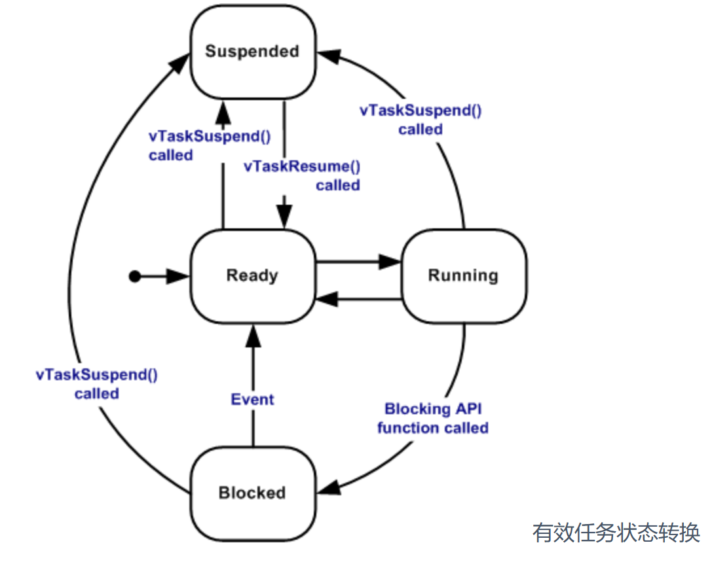
>
>也就是说,我们可以通过如下方式, 操作任务挂起和解除挂起状态.
>
>**vTaskSuspend()函数:**
>
>```C
>// vTaskSuspend是FreeRTOS提供的任务挂起(Suspended)的API, 用于暂停指定任务的执行. 被挂起的任务不会被调度运行, 直到调用vTaskResume()恢复.
>// 需要注意的是, 挂起任务的本质就是把任务从其原列表中, 移动到挂起列表中.(参考: tasks.c  3121)
>// 同时, 无论一个任务被执行多少次挂起(多次挂起,列表项信息始终在挂起列表中), 它都可以通过一次vTaskResume()函数恢复.
>
>// 注意: 如果要使用vTaskSuspend函数需要启用配置:
>//		#define INCLUDE_vTaskSuspend 1   (默认已配置)
>
>void vTaskSuspend(
>    TaskHandle_t xTaskToSuspend// 要挂起的任务句柄, NULL表示挂起当前运行的任务
>);
>```
>
>**vTaskResume()函数:**
>
>```C
>// vTaskResume()函数可以用于恢复被提挂起(Suspended)的任务.
>// 被恢复的任务放入就绪列表中. (参考: tasks.c  3353  3386)
>// 无论一个任务被执行多少次挂起(多次挂起,列表项信息始终在挂起列表中), 它都可以通过一次vTaskResume()函数恢复.
>// 挂起的任务必须被vTaskResume()函数或者同类函数恢复.
>
>// 注意: 如果要使用vTaskResume函数需要启用配置:
>//		#define INCLUDE_vTaskSuspend 1   (默认已配置)
>
>void vTaskResume( 
>    TaskHandle_t xTaskToResume // 处于挂起任务的任务句柄
>)
>```
>
>Eg:
>
>```C
>#include "stm32f10x.h"    
>#include "freertos.h"
>#include "task.h"
>#include "UART1.h"
>#include <string.h>
>
>void task1 ( void * arg ){	
>	int flag = 0;
>	while(1){
>        vTaskDelay(1000);
>        if (flag == 0){
>            vTaskSuspend(NULL);
>            flag = 1;
>        }
>        printf1("task1 \r\n");
>	}
>}
>void task2 ( void * arg ){	
>	while(1){
>		vTaskDelay(1000);
>		printf1("task2 \r\n");
>	}
>}
>void beginTask(void *arg){
>	
>	TaskHandle_t hand1, hand2; 
>	xTaskCreate(task1,"Task1",configMINIMAL_STACK_SIZE, NULL,4,&hand1);
>	xTaskCreate(task2,"Task2",configMINIMAL_STACK_SIZE, NULL,4,&hand2);
>	
>	while(1){
>
>		vTaskDelay(5000);
>		vTaskResume(hand1);
>		vTaskDelay(5000);
>		vTaskSuspend(hand1);
>	}
>}
>
>int main(void){
>	
>	USART1_Init();
>	xTaskCreate(beginTask,"beginTask",configMINIMAL_STACK_SIZE,NULL,3,NULL);
>	vTaskStartScheduler();
>	while(1){
>	}
>}
>
>```
>
>**vTaskSuspendAll() 和 xTaskResumeAll() 函数:**
>
>```C
>// vTaskSuspendAll()和xTaskResumeAll()函数的作用看上去好像是把所有任务都挂起和恢复, 但实际上这两个函数的作用实现的本质是挂起和恢复"任务调度器"; 这和挂起任务和恢复任务是有所差别的. 也就是说当我们通过vTaskSuspendAll()函数调用, 是要求任务调度器不再切换任务, 保持在当前任务一直执行, 直到遇到xTaskResumeAll()函数, 再恢复任务调度器的功能, 继续调度任务.
>
>void vTaskSuspendAll( void );
>BaseType_t xTaskResumeAll( void );
>
>// 需要注意的是: 一旦xTaskResumeAll()函数执行, 即恢复任务调度的时候, 有可能有更高优先级的任务(比当前调用恢复调度器任务优先级更高并且等待执行的任务)等待执行, 那么必然会发生任务切换, 去执行更高优先级的任务. 如果这种情况发生返回值为pdTRUE, 表示恢复调度器导致了任务切换. 否则返回值为pdFALSE.
>
>// 同时在使用挂起调度器函数的时候, vTaskSuspendAll()和xTaskResumeAll()函数应该要成对使用, 这样处于两个函数中间的代码就会被保护起来, 不会被任务切换打断.
>
>// 但是和'临界区函数taskENTER_CRITICAL()'不同的是, 临界区函数taskENTER_CRITICAL()在进入临界区的时候, 不仅会禁止任务调度还会会禁止中断, 而通过vTaskSuspendAll()函数挂起调度器, 只会禁止任务调度, 而不会禁止中断触发(也就是在执行被vTaskSuspendAll()和xTaskResumeAll()函数'保护'起来的代码的时候,不会屏蔽中断).
>
>// 注意: 不要在vTaskSuspendAll()和xTaskResumeAll()函数中间使用vTaskDelay函数, 在vTaskSuspendAll()和xTaskResumeAll()函数中间使用vTaskDelay()函数并不能让程序陷入阻塞状态.(反而等代码运行的时候出了vTaskSuspendAll()和xTaskResumeAll()函数区间之后, 会重新陷入在前面'保护'区间设置Delay延时.)
>```
>
>Eg:
>
>```C
>#include "stm32f10x.h"    
>#include "freertos.h"
>#include "task.h"
>#include "UART1.h"
>#include <string.h>
>
>void task1 ( void * arg ){	
>	while(1){
>			vTaskDelay(1000);
>			printf1("task1 \r\n");
>	}
>}
>void task2 ( void * arg ){	
>	while(1){
>		vTaskDelay(1000);
>		printf1("task2 \r\n");
>	}
>}
>void beginTask(void *arg){
>	
>	TaskHandle_t hand1, hand2; 
>	xTaskCreate(task1,"Task1",configMINIMAL_STACK_SIZE, NULL,3,&hand1);
>	xTaskCreate(task2,"Task2",configMINIMAL_STACK_SIZE, NULL,3,&hand2);
>	
>	while(1){
>		vTaskDelay(3000);
>		vTaskSuspendAll();
>		printf1("vTaskSuspendAll_1 \r\n");
>		int num = 20000000;
>		while(num>0){
>			num--;
>		}
>		printf1("vTaskSuspendAll_2 \r\n");
>		xTaskResumeAll();
>	}
>}
>
>int main(void){
>	
>	USART1_Init();
>	xTaskCreate(beginTask,"beginTask",configMINIMAL_STACK_SIZE,NULL,4,NULL);
>	vTaskStartScheduler();
>	while(1){
>	}
>}
>
>```
>
>**vTaskResumeFromISR()函数:**   了解
>
>```C
>// 需要注意的是, 在FreeRTOS中, 如果产生中断, 在中断服务程序大多数普通的FreeRTOS的API不能在中断处理函数中被使用, 必须使用带有FromISR或者以ISR结尾的API.
>// 这是因为有些FreeRTOS中函数的执行, 要默认在具有任务环境中运行, 而中断函数的执行环境不能满足某些API的调用. 而为了解决这一问题, FreeRTOS提供了多种适配中断环境执行的FreeRTOS的API函数. 这些函数基本上都是以FromISR或者以ISR结尾.
>
>// 以vTaskResumeFromISR()函数为例, 它的作用等价于vTaskResume()函数, 只不过这个函数专门提供给中断函数使用, 在中断函数执行的时候, 调用vTaskResumeFromISR()函数, 会把要恢复的函数从挂起列表中移除, 插入到就绪列表中, 等待被后续调用.(tasks.c  3414 3474)
>BaseType_t vTaskResumeFromISR( 
>    TaskHandle_t xTaskToResume // 要恢复的任务句柄
>);
>```

### 1.3.6 临界区问题

##### 挂起

>我们在上一个小节中谈到我们可以通过vTaskSuspendAll()和xTaskResumeAll()函数'保护'某些代码, 保护这些代码在执行的过程中不被任务调度所打断. 而这种通过某些方式把某些代码''保护''起来的行为, 或者我们把这块被'保护' 的代码, 成为`临界区`.

>**临界区**
>
>```C
>// 从标准定义上, 所谓临界区(Critical Section)是指一段需要访问共享资源的代码, 在这段代码执行期间, 不允许其他任务或中断访问相同的资源, 以防止数据竞争或数据不一致. 
>```
>
>那么在FreeRTOS运行的时候, 我们也确实可能在某些逻辑执行的时候, 希望某些代码逻辑被设置成临界区, 用以保证程序的正常执行.
>
>Eg:
>
>```C
>#include "stm32f10x.h"    
>#include "freertos.h"
>#include "task.h"
>#include "UART1.h"
>#include <string.h>
>
>void task1 ( void * arg ){	
>	while(1){
>        printf1("task1 \r\n");
>	}
>}
>void task2 ( void * arg ){	
>	while(1){
>		printf1("task2 \r\n");
>	}
>}
>void beginTask(void *arg){
>	
>	TaskHandle_t hand1, hand2; 
>	xTaskCreate(task1,"Task1",configMINIMAL_STACK_SIZE, NULL,3,&hand1);
>	xTaskCreate(task2,"Task2",configMINIMAL_STACK_SIZE, NULL,3,&hand2);
>	
>	while(1){
>		printf1("beginTask \r\n");
>	}
>}
>
>int main(void){
>	
>	USART1_Init();
>	xTaskCreate(beginTask,"beginTask",configMINIMAL_STACK_SIZE,NULL,2,NULL);
>	vTaskStartScheduler();
>	while(1){
>	}
>}
>
>```
>
>我们发现上面代码在启动执行之后, 好像只会打印"task1". (这个问题产生的根本原因由于优先级任务抢占问题造成的)
>
>当然我们可以对上面代码, 通过vTaskSuspendAll()和xTaskResumeAll()保护beginTask的执行, 直到Task2被创建出来.
>
>Eg:
>
>```C
>#include "stm32f10x.h"    
>#include "freertos.h"
>#include "task.h"
>#include "UART1.h"
>#include <string.h>
>
>void task1 ( void * arg ){	
>	while(1){
>			printf1("task1 \r\n");
>	}
>}
>void task2 ( void * arg ){	
>	while(1){
>		printf1("task2 \r\n");
>	}
>}
>void beginTask(void *arg){
>	
>	vTaskSuspendAll();
>	TaskHandle_t hand1, hand2; 
>	xTaskCreate(task1,"Task1",configMINIMAL_STACK_SIZE, NULL,3,&hand1);
>	xTaskCreate(task2,"Task2",configMINIMAL_STACK_SIZE, NULL,3,&hand2);
>	xTaskResumeAll();
>	
>	while(1){
>		printf1("xTaskResumeAll \r\n");
>	}
>}
>
>int main(void){
>	
>	USART1_Init();
>	xTaskCreate(beginTask,"beginTask",configMINIMAL_STACK_SIZE,NULL,2,NULL);
>	vTaskStartScheduler();
>	while(1){
>	}
>}
>
>```
>
>那么除了挂起调度器的方式, 在FreeRTOS中还有别的常见的方式实现`临界区`机制吗?

##### taskENTER_CRITICAL

>在FreeRTOS中我们也可以使用taskENTER_CRITICAL()函数来构建临界区.
>
>```C
>// taskENTER_CRITICAL()函数是FreeRTOS中提供的一个专门用于临界资源保护的函数. 在FreeRTOS我们可以通过调用taskENTER_CRITICAL()函数, 让程序执行进入临界区, 当需要被'保护'的程序/代码/数据执行结束之后, 我们可以通过taskEXIT_CRITICAL()函数退出临界区. 
>
>// 在FreeRTOS中taskENTER_CRITICAL()函数和taskEXIT_CRITICAL()函数是一对函数, 用于构建出一个被'包裹'的临界区.
>// 当我们通过taskENTER_CRITICAL()函数进入临界区, 直到通过taskEXIT_CRITICAL()函数退出临界区之前, 都可以禁止任务调度发生, 保证当前任务中临界区的代码执行不会被任务调度打断(不会发生任务调度).
>```
>
>Eg:
>
>```C
>#include "stm32f10x.h"    
>#include "freertos.h"
>#include "task.h"
>#include "UART1.h"
>#include <string.h>
>
>void task1 ( void * arg ){	
>	while(1){
>        printf1("task1 \r\n");
>	}
>}
>void task2 ( void * arg ){	
>	while(1){
>		printf1("task2 \r\n");
>	}
>}
>void beginTask(void *arg){
>	
>	taskENTER_CRITICAL();
>	TaskHandle_t hand1, hand2; 
>	xTaskCreate(task1,"Task1",configMINIMAL_STACK_SIZE, NULL,3,&hand1);
>	xTaskCreate(task2,"Task2",configMINIMAL_STACK_SIZE, NULL,3,&hand2);
>	taskEXIT_CRITICAL();
>	
>	while(1){
>		printf1("xTaskResumeAll \r\n");
>	}
>}
>
>int main(void){
>	
>	USART1_Init();
>	xTaskCreate(beginTask,"beginTask",configMINIMAL_STACK_SIZE,NULL,2,NULL);
>	vTaskStartScheduler();
>	while(1){
>	}
>}
>
>```

>**值得注意的是,** 虽然挂起调度器方式 和 taskENTER_CRITICAL()函数都可以构建临界区, 但是它们在细节上还是有所区别的.
>
>```C
>// vTaskSuspendAll()函数和xTaskResumeAll()函数, 通过挂起调度器来阻止任务调度, 但是当通过挂起调度器, 进入临界区代码执行的时候, 如果此时如果有"中断"产生, 中断是会打断当前任务的执行, 转而去执行中断处理函数, 当中断处理函数执行结束之后, 再回到当前任务的临界区继续执行. (甚至, 如果我们在中断处理函数中, 通过某些API调用把一个更高优先级的任务放入就绪队列, 等中断返回之后, 有可能不是返回原来的任务执行, 而是返回这个新的更高优先级的任务执行, 当然具体情况取决于在中断函数中具体怎么调用的, 以及调用的那个函数)
>
>// 而taskENTER_CRITICAL()函数则不同, 如果我们通过taskENTER_CRITICAL()函数进入临界区, 那么在临界区代码执行的时候, 除了会禁止FreeRTOS进行任务调度, 它还会屏蔽"部分"中断的触发和执行.
>// 这个屏蔽的具体部分, 取决于configMAX_SYSCALL_INTERRUPT_PRIORITY这个宏.
>// 在FreeRTOSConfig.h中: (192 -> 0xb0, 但是NVIC中断优先级寄存器使用高4位作为有效优先级, 即0xb = 11)
>#define configMAX_SYSCALL_INTERRUPT_PRIORITY 	191 /* equivalent to 0xb0, or priority 11. */
>
>// 也就是说, 当我们使用taskENTER_CRITICAL()函数进入临界区的时候, 在退出临界区之前, 会屏蔽优先级低于 configMAX_SYSCALL_INTERRUPT_PRIORITY的中断, (因为中断的优先级值越低, 优先级越高), 即屏蔽优先级值为11~15的中断, 不屏蔽优先级值为0~10的中断.
>```
>
>```C
>// 也就是说: 我们可以做如下总结/仅参考 (要总和性能/效率/影响考虑)
>//			如果我们想'保护短时间关键代码'的运行, 可以考虑使用taskENTER_CRITICAL()/taskEXIT_CRITICAL()
>//			如果我们想'允许中断但不允许任务切换'的运行,可以考虑vTaskSuspendAll()/xTaskResumeAll()
>```

##### portDISABLE_INTERRUPTS

>在FreeRTOS中, 除了taskENTER_CRITICAL()函数可以屏蔽某些中断的执行, portDISABLE_INTERRUPTS()函数也可以屏蔽某些中断的执行.
>
>```C
>// portDISABLE_INTERRUPTS()函数, 是FreeRTOS中专门用来屏蔽中断触发的函数.
>// portDISABLE_INTERRUPTS()函数禁用所有可屏蔽中断 和 portENABLE_INTERRUPTS()函数重新启用中断可以配合使用, 用来屏蔽中断.
>
>// 实际上taskENTER_CRITICAL()函数的底层就是依赖于portDISABLE_INTERRUPTS()函数所实现的.
>
>// 注意注意: 要在FreeRTOS中慎用portDISABLE_INTERRUPTS()函数 和 taskENTER_CRITICAL()函数. 任何需要稍长时间执行的代码, 都不能使用该函数. (经验之谈)
>// 注意: 另外需要注意portDISABLE_INTERRUPTS()函数不禁止主动切换任务(禁用中断, 依旧可以主动切换任务)
>```
>
>Eg:
>
>```C
>portDISABLE_INTERRUPTS();  // 禁用所有可屏蔽中断
>
>// 关键代码，确保不会被中断影响, 比如向Flash写入操作期间, 必须禁用所有中断, 防止中断访问Flash导致写入失败
>...
>    
>portENABLE_INTERRUPTS();  // 重新启用中断
>```

##### 中断和任务间的屏蔽问题

>我们在`中断和任务的打断关系中`, 有这么一段话
>
>```C
>// 在FreeRTOS中, 中断(ISR)优先级默认高于所有任务(如果没有做特殊设置), 因此ISR中断可以随时打断任何任务(无关任务的优先级)的执行.
>```
>
>而在上面taskENTER_CRITICAL()函数和portDISABLE_INTERRUPTS()函数中, 我们又发现可以在FreeRTOS的任务中设置去屏蔽某些中断的执行.
>
>这两个说法看上去有些自我矛盾, 或者说我们可以推测出, 无论是FreeRTOS对taskENTER_CRITICAL()函数的具体实现, 还是FreeRTOS对portDISABLE_INTERRUPTS()函数的具体实现可能不仅仅只是停留在中间层的逻辑层级.
>
>那么它们是怎么实现的那? 

>在介绍上面内容的具体实现之前, 我们可以回顾一下中断相关的知识.
>
>```C
>// 在STM32中, 有多个可以用来设置屏蔽中断的寄存器, 其中以三个寄存器为典型: BASEPRI,PRIMASK,FAULTMASK
>
>// BASEPRI寄存器: 用来屏蔽低优先级中断, 当我们在该寄存器中设置一个为X的值, 那么就可以屏蔽'优先级值'>=X值的中断.
>// PRIMASK寄存器: 
>//			当PRIMASK=1:屏蔽所有普通IRQ中断(1~15), 但是NMI(优先级值0)和HardFault中断仍然可以触发
>//			当PRIMASK=0:允许所有普通IRQ中断(1~15)执行.
>// FAULTMASK寄存器:
>//			FAULTMASK=1:屏蔽所有可屏蔽的普通中断(1~15)以及HardFault中断,不屏蔽NMI中断(0) 
>//			FAULTMASK=0:允许所有中断恢复正常运行
>```
>
>```C
>// HardFault中断是系统运行时遇到严重异常时触发的中断,例如:
>//			访问非法内存地址(如NULL指针)
>//			访问未对齐的数据(Cortex-M3及以上不强制对齐,但某些操作仍要求)
>//			执行了非法指令(如跳转到错误的代码地址)
>//			发生总线错误(Bus Fault)但Bus Fault处理被关闭
>//			发生Usage Fault,但未启用Usage Fault处理
>
>// 如果发生HardFault,处理器会进入HardFault_Handler(): (stm32f10x_it.c  56)
>void HardFault_Handler(void)
>{
>  /* Go to infinite loop when Hard Fault exception occurs */
>  while (1)
>  {
>  }
>}
>// 默认HardFault只会停留在while(1)里,不会进行自动恢复
>```
>
>```C
>// NMI(Non-Maskable Interrupt)是最高优先级的中断:
>//			NMI这个特殊的高优先级中断的特点是,无法被屏蔽,也无法被其他中断抢占
>// 			即使PRIMASK、BASEPRI、FAULTMASK屏蔽了所有中断, NMI中断仍然会触发
>//			NMI中断不能通过NVIC配置,只能通过硬件触发
>
>// 常见的触发原因:
>//			当看门狗超时但未复位, 触发NMI
>//			STM32中PPL锁相环失效, 触发NMI
>//			...
>
>(stm32f10x_it.c  47)
>/**
>  * @brief  This function handles NMI exception.
>  * @param  None
>  * @retval None
>  */
>void NMI_Handler(void)
>{
>}
>```

>通过上面我们对STM32中中断屏蔽的解释, 我们就可以进一步了解taskENTER_CRITICAL()函数和portDISABLE_INTERRUPTS()函数了:
>
>```C
>// 当portDISABLE_INTERRUPTS()函数执行的时候:
>//		它会先保存当前中断状态(BASEPRI寄存器的值)
>//		设置BASEPRI寄存器, 把BASEPRI寄存器的值设置为configMAX_SYSCALL_INTERRUPT_PRIORITY, 去屏蔽优先级低于这个值的中断.
>
>// 当portENABLE_INTERRUPTS()函数执行的时候:
>//		它会取出之前保存的BASEPRI的值.(在调用portENABLE_INTERRUPTS()函数时保存的原BASEPRI寄存器的值)
>//		把取出的值,放回原BASEPRI寄存器.
>
>// 这样, portDISABLE_INTERRUPTS()函数和portENABLE_INTERRUPTS()的配合只用, 就可以在其包裹的临界区中, 屏蔽某些优先级的中断了.
>```
>

##### 补充:临界区嵌套

>在FreeRTOS中当使用taskENTER_CRITICAL()函数开辟临界区时, FreeRTOS支持其`嵌套调用`, 这种嵌套调用的本质是通过内部计数器值来维护嵌套深度: 
>
>- taskENTER_CRITICAL():计数器递增
>- taskEXIT_CRITICAL():计数器递减，仅当计数器归零时恢复中断
>
>```C
>// 举例:嵌套临界区
>taskENTER_CRITICAL();  // 屏蔽中断,计数器=1
>// ... 临界区代码1 ...
>taskENTER_CRITICAL();  // 计数器=2(中断保持屏蔽)
>// ... 临界区代码2 ...
>taskEXIT_CRITICAL();   // 计数器=1(中断仍屏蔽)
>taskEXIT_CRITICAL();   // 计数器=0,恢复中断
>```

### 1.3.7 中断和任务的打断关系

>我们在前面的的优先级问题上说明了任务的调度关系, 在FreeRTOS中默认的调度机制就是高任务的优先级打断低优先级的任务执行,虽然这种打断不是`立即抢占式`, 但是这种高优先级抢占低优先级别任务运行的情况, 在任务调度时是必然发生的.
>
>```C
>// 所谓不是立即抢占式: 即当一个更高优先级的任务就绪, TCB列表项被移动到就绪列表, 它不会立即抢占当前任务的执行(除非是当前任务主动让出CPU, 比如进入vTaskDelay(), 或者主动挂起等), 而是等到当前任务时间片用尽, 或者当前任务执行过程中主动触发了任务调度, 执行权限才被更高优先级抢占, 让更高优先级任务执行.(但是在人的时间感受尺度上, 这个过程是非常快的)
>```
>
>而且在学习FreeRTOS之前, 我们在STM32学习的时候, 也有一个类似的打断关系的存在, 即'中断'打断问题. 在STM32中, 中断的打断关系也总是高优先级打断低优先级.
>
>```C
>// 在STM32中, 如果我们的程序在执行的过程中, 一个优先级为3的中断被触发, 以及正在执行, 此时一个优先级为2的中断突然发生,系统将会把优先级为3的中断挂起, 转而去执行中断优先级为2的中断, 形成中断嵌套, 当优先级为2的中断被处理/执行完毕之后, 再继续回复优先级3的中断继续执行.
>
>// 只不过需要注意的是: 在中断中优先级值越小优先级越高(0-15), 而FreeRTOS中优先级值越大优先级越高(从0直到configMAX_PRIORITIES-1,  注意虽然FreeRTOS对任务优先级别的上限没有具体要求, 即对configMAX_PRIORITIES参数的大小没有具体要求, 默认为5, 但是建议不要过大,  一般情况下如果RAM比较小, 比如10kb以下, 不建议优先级别超过10, 如果RAM在100Kb以下, 不建议超过20).
>```

>我们前面回顾了中断和中断的打断问题, 以及任务和任务间的打断问题, 那么在FreeRTOS中, 中断和任务间的打断关系又是怎么样的?
>
>```C
>// 在FreeRTOS中, 中断(ISR)优先级默认高于所有任务(如果没有做特殊设置), 因此ISR中断可以随时打断任何任务(无关任务的优先级)的执行.
>// Eg: 
>//		假设一个任务Task1(优先级 4)正在运行, 而此时突然发生UART1中断, 那么A任务要立即被暂停, 转为让CPU处理UART1的ISR中断, 当这个中断处理完毕之后, 再继续让CPU加载任务A继续执行.
>
>// 其实这种中断能打断所有优先级的任务执行的本质, 是因为任务的程序逻辑和我们运行的主栈逻辑本质上没有什么不同.
>
>// 注意: 当某个任务因为中断被打断, 转而先执行中断处理程序, 如果我们在中断处理程序中, 通过某些API调用把一个更高优先级的任务放入就绪队列, 等中断返回之后, 有可能不是返回原来的任务执行, 而是返回这个新的更高优先级的任务执行.(具体情况取决于在中断函数中具体怎么调用的, 以及调用的那个函数)
>```
>

### 1.3.8 任务的删除

>在FreeRTOS中一个任务执行过程中, 退出方式问题:
>
>- 在任务的入口函数中通过调用return退出任务, 不允许.
>
>```C
>// 在我们之前Linux的进程和线程的学习中, 我们可以通过这种方式, 即在入口函数中通过return退出, 但是在FreeRTOS中不允许这么做
>// 在FreeRTOS中任务不允许以任何方式从入口函数中return, 也不允许执行到入口函数末尾.
>```
>
>- 通过调用vTaskDelete函数删除自己, 或者删除别的任务
>
>```C
>// 注意: 如果要使用vTaskList函数需要启用配置:
>	#define INCLUDE_vTaskDelete				1
>
>
>void vTaskDelete(
>    TaskHandle_t xTaskToDelete//任务句柄(要删除的任务), 如果为NULL表示删除当前任务
>);
>```
>
>- 如果我们不准备让任务退出, 那么应该给任务提供一个可以无限运行的循环, 避免任务结束.

>```C
>// 当通过vTaskDelete函数删除任务的时候, 被删除的任务将从所有就绪、 阻塞、挂起和事件列表中移除.并且放入删除列表.
>// 等到空闲任务执行的时候, 将有空闲任务负责释放由FreeRTOS内核分配给已删除任务的内存, 这也就意味着我们在设计一个项目的时候, 如果存在任务删除行为, 应该要确保空闲任务具有获得执行的机会,以及获得足够的CPU运行时间
>// 以上是官方文档的说法
>
>(tasks.c 2247  2313) 
>
>// 实际上: 当删除任务是自己的时候, 也就是vTaskDelete(NULL), 确实如上面所说一样.
>// 			但是当删除的不是自己时, 实际上在最新版本中是直接释放被删除任务的内存.
>// 可参考上述源码.
>```

>Eg:
>
>```C
>#include "stm32f10x.h"    
>#include "freertos.h"
>#include "task.h"
>#include "UART1.h"
>#include <string.h>
>
>void task1 ( void * arg ){	
>	while(1){
>		vTaskDelay(1000);
>		printf1("task1 \r\n");
>	}
>}
>void task2 ( void * arg ){	
>	while(1){
>		vTaskDelay(1000);
>		printf1("task2 \r\n");
>	}
>}
>void beginTask(void *arg){
>	vTaskDelay(5000);
>	TaskHandle_t hand1, hand2; 
>	xTaskCreate(task1,"Task1",configMINIMAL_STACK_SIZE, NULL,3,&hand1);
>	xTaskCreate(task2,"Task2",configMINIMAL_STACK_SIZE, NULL,3,&hand2);
>
>	while(1){
>		vTaskDelay(5000);
>		vTaskDelete(hand1);
>		eTaskState state = eTaskGetState(hand1);
>		if(state == eRunning){
>			printf1("eRunning \r\n");
>		}else if(state == eReady){
>			printf1("eReady \r\n");
>		}else if(state == eBlocked){
>			printf1("eBlocked \r\n");
>		}else if(state == eSuspended){
>			printf1("eSuspended \r\n");
>		}else if(state == eDeleted){
>			printf1("eDeleted \r\n");
>		}
>        
>        // 标准写法
>        // if(hand1 != NULL){
>        //    vTaskDelete(hand1);
>        //    hand1 = NULL;
>		//}
>	}
>}
>
>int main(void){
>	
>	USART1_Init();
>	xTaskCreate(beginTask,"beginTask",configMINIMAL_STACK_SIZE,NULL,4,NULL);
>	vTaskStartScheduler();
>	while(1){
>	}
>}
>
>```
>
>```C
>#include "stm32f10x.h"    
>#include "freertos.h"
>#include "task.h"
>#include "UART1.h"
>#include <string.h>
>
>void task1 ( void * arg ){	
>	while(1){
>		vTaskDelay(1000);
>		
>		printf1("task1 \r\n");
>		vTaskDelete(NULL);
>	}
>}
>void task2 ( void * arg ){	
>	while(1){
>		vTaskDelay(1000);
>		printf1("task2 \r\n");
>	}
>}
>void beginTask(void *arg){
>	vTaskDelay(5000);
>	TaskHandle_t hand1, hand2; 
>	xTaskCreate(task1,"Task1",configMINIMAL_STACK_SIZE, NULL,3,&hand1);
>	xTaskCreate(task2,"Task2",configMINIMAL_STACK_SIZE, NULL,3,&hand2);
>
>	while(1){
>		vTaskDelay(5000);
>		
>		eTaskState state = eTaskGetState(hand1);
>		if(state == eRunning){
>			printf1("eRunning \r\n");
>		}else if(state == eReady){
>			printf1("eReady \r\n");
>		}else if(state == eBlocked){
>			printf1("eBlocked \r\n");
>		}else if(state == eSuspended){
>			printf1("eSuspended \r\n");
>		}else if(state == eDeleted){
>			printf1("eDeleted \r\n");
>		}
>	}
>}
>
>int main(void){
>	
>	USART1_Init();
>	xTaskCreate(beginTask,"beginTask",configMINIMAL_STACK_SIZE,NULL,4,NULL);
>	vTaskStartScheduler();
>	while(1){
>	}
>}
>
>```