## 1.1 时钟树和定时器

### 1.3.1 STM32时钟树

##### 时钟的概念

>在STM32微控制器中, 时钟信号是整个系统运行的核心, 它为处理器、外设以及各种功能模块提供必要的同步和驱动信号.  几乎所有的功能模块都依赖于时钟,  包括中央处理器(CPU)、存储器、总线接口、定时器、串行通信外设(如UART、SPI、I2C、CAN)、模拟外设(如ADC、DAC)、看门狗定时器(IWDG、WWDG)以及各种低功耗管理机制. 
>
>时钟的作用主要体现在提供系统运行的**基本节奏**、确保数据传输的正确性、协调不同模块之间的操作以及优化功耗管理. 
>
>STM32的时钟系统通常由多个时钟源组成, 如高精度内部时钟(HSI)、低功耗内部时钟(LSI)、高精度外部晶振(HSE)、低功耗外部晶振(LSE)等.  (甚至我们可以通过可编程的时钟树进行灵活分配时钟的依赖).
>
>Eg:举个例子
>
>```C
>// 比如我们之前,在做某些GPIO操作的时候(不仅仅只是这个), 我们需要先开启对应的时钟.
>RCC_APB2PeriphClockCmd(RCC_APB2Periph_GPIOA, ENABLE); // 时钟使能
>// 而上面这个所谓时钟使能的本质, 就是是去修改STM32的RCC(Reset and Clock Control)寄存器. 比如上面的代码底层就在修改RCC->APB2ENR这个控制APB2外设时钟使能寄存器. 这个寄存器负责如GPIOA、GPIOB、ADC1、USART1等外设的时钟开启关闭.
>
>// 所谓时钟的开启和关闭的本质, 就是要不要给某个物理硬件设备提供"周期性的脉冲信号", 如果不开启时钟, 就是不给某些硬件提供脉冲信号, 而这个脉冲信号的本质是高低电平. 
>// 物理硬件的运行逻辑内部, 需要依赖高低电平的变化提供的电平驱动, 来做出对应的实际硬件逻辑工作. 关闭时钟, 就是停止提供给它这种周期性的电平高低变化, 硬件无法得以驱动.
>// 具体来说, 就是某些外设没有时钟信号, 就没法控制电源导通, 就是断电状态(只是相当于断电), 会进一步节省功耗.
>(比如8MHz时钟: 意味着每秒钟有8,000,000次高低电平变化)
>
>// 所以在STM32中, 很多东西都是默认没有开启时钟的, 比如大部分片上外设. 所以我们在STM32开发过程中, 如果要使用片上外设的功能首先就要给它提供时钟(开启时钟).
>
>```
>
>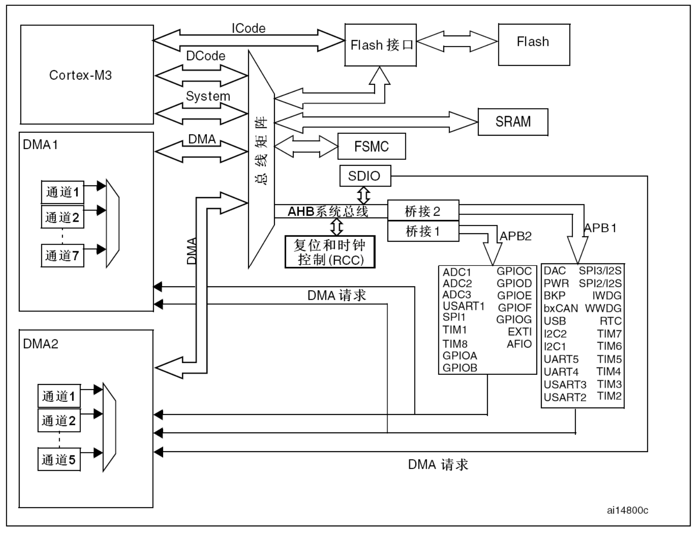

##### 时钟树

>我们说, 在STM32中无论是片上外设, 还是总线数据传输, 哪怕是**CPU逻辑计算单元**运行, 都需要时钟. 那个时钟的来源是由谁提供的那? 不同的时钟来源是怎么传导给不同的物理硬件区域的那? 
>
>Eg: 而下图中的**STM32F10x时钟树**, 就在阐述这些问题(**时钟来源/哪些硬件使用的是那个来源/时钟怎么传导到某些硬件**)
>
>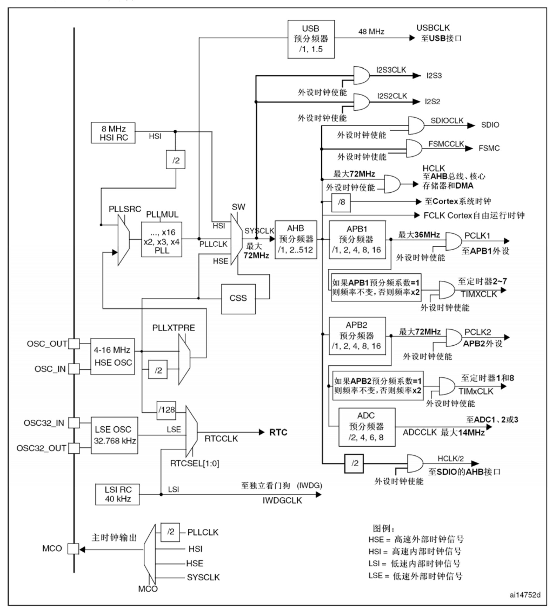
>
>当然上面的图乍一看是极其复杂的, 不过我们可以简单的将上面的STM32时钟树, 拆分成三段来看.
>
>

##### 时钟源

>**HSI(High-Speed Internal)**   
>
>```C
>// HSI是高速内部时钟, 工作频率为8MHz
>// HSI是由RC振荡器产生, 而在我们当前使用的芯片中, RC震荡期是直接集成在STM32F103芯片内部, 无需外部晶振即可提供即可提供8MHz的时钟频率.
>// RC震荡器是一种利用电阻(R)和电容(C)组成的振荡电路, 通过RC网络的充放电特性来产生周期性振荡信号(即时钟信号), 但是这种方式提供的时钟频率并不精准, 即使是经过校准之后精度也不尽如人意(精度的典型差值是1%, 最差值是2.5%).比较适合使用在对时钟频率要求不高的场景.
>// HSI时钟可以直接供给系统时钟, 而且该行为是默认开启, 即STM32F103上电复位时MCU默认使用HSI作为系统时钟(SYSCLK)
>// HSI也可以在2分频之后供给给锁相环时钟
>```
>
>```C
>// 什么是2分频:
>//		简单来说, 就是让时钟的频率变成原来的一半, 因为在STM32中有很多时钟源可以提供时钟信号, 而这些时钟信号往往需要被调整成适合不同外设或CPU使用的频率, 即调成合适的频率才能使用.
>//		而分频(Prescaler)的作用就是用于降低时钟频率的一种方式.
>//		简单来说, 几分频, 就是把时钟频率除以几.
>```
>
>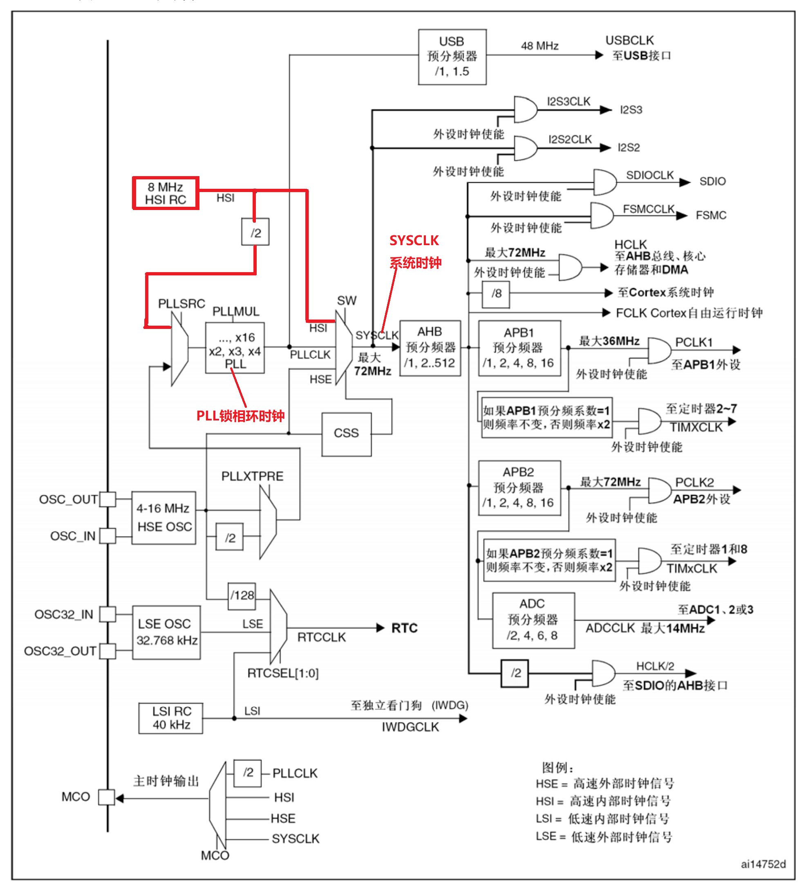

>**HSE(High-Speed External )**
>
>```C
>// HSE是高速外部时钟, 工作频率为2-16MHz (我们当前的芯片外部晶振提供的是8MHz)
>// HSE是由芯片外部的高速外部晶振的石英晶振产生震荡频率提供时钟, 而在我们当前使用的芯片中, HSE是高速外部时钟没有集成在STM32F103芯片内部, 而是通过引脚接入的外设设备(其中使用的引脚为OSC_IN和OSC_OUT) 
>// 石英晶振是一块压电材料(石英晶体), 当给它施加电压时, 它会发生机械振动, 并且这种振动具有固定的共振频率.
>// HSE所提供的高速外部时钟的特点是高速和稳定(主要是稳定, 误差小). 适用于对时钟要求严格的应用, 比如USB、CAN、定时器、高速通信等.
>// HSE和HSI一样也有多种输出, 但是在我们的这个芯片上主要是作为为PLL锁相环时钟提供输入.
>// 同时HSE也是我们的系统稳定之后, 系统的时钟来源.
>```
>
>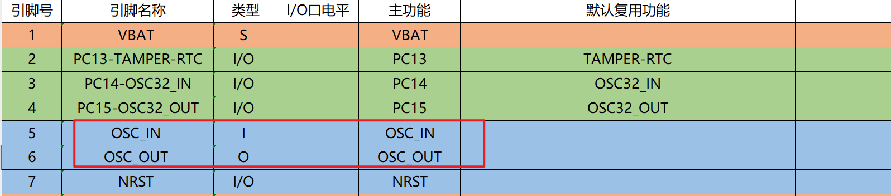
>
>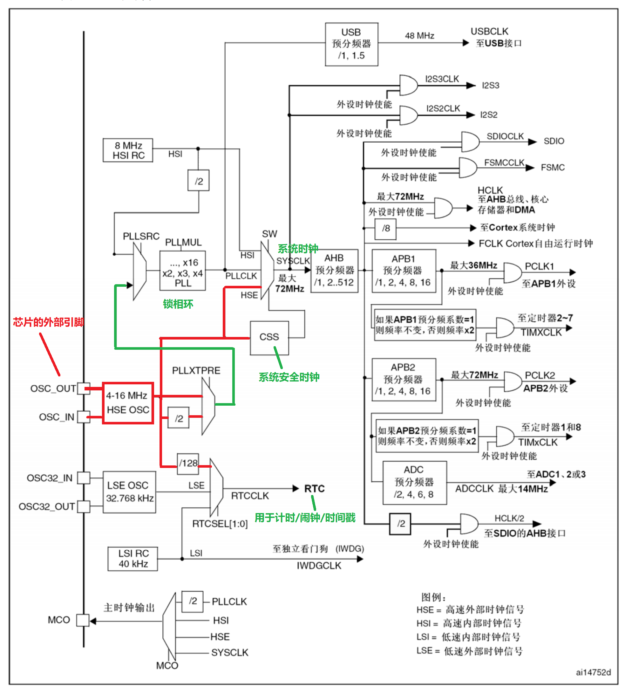

>**LSI(Low-Speed Internal)**
>
>```c
>// LSI是低速内部时钟, 工作频率为40KHz
>// LSI也是由RC振荡器产生, 这个RC震荡期也是直接集成在STM32F103芯片内部, 无需外部晶振即可提供即可提供40KHz的时钟频率.
>// LSI时钟一般是提供给独立看门狗或者RTC时钟使用(大多数情况下RTC其实还是默认使用LSE情况居多)(而独立看门狗必须使用LSI)
>// LSI同样存才精度问题(有精度误差), 典型值是40KHz(实际可能30~50kHz波动)
>```
>
>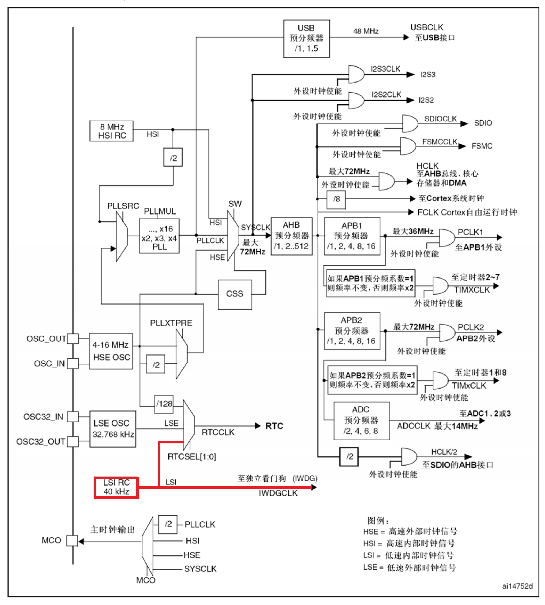

>**LSE(Low-Speed External)**
>
>```C
>// LSE是低速外部时钟, 工作频率为32.768KHz
>// 		值得注意的是这个值不是乱选的, 32.768KHz=2的15次方Hz, 在计算机中比较好处理, 除此之外, 这个时钟经过15次2分频之后正好是1Hz(即1秒钟1Hz), 比较方便控制
>// 同样LSE也是由芯片外部的高速外部晶振的石英晶振或者陶瓷谐振器产生震荡频率提供时钟, 而在我们当前使用的芯片中, LSE是低速外部时钟也没有集成在STM32F103芯片内部, 而是通过引脚接入的外设设备(其中使用的引脚为OSC32_IN和OSC32_OUT) 
>// LSE低速外部时钟只能提供给RTC使用
>```
>
>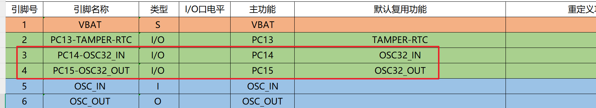
>
>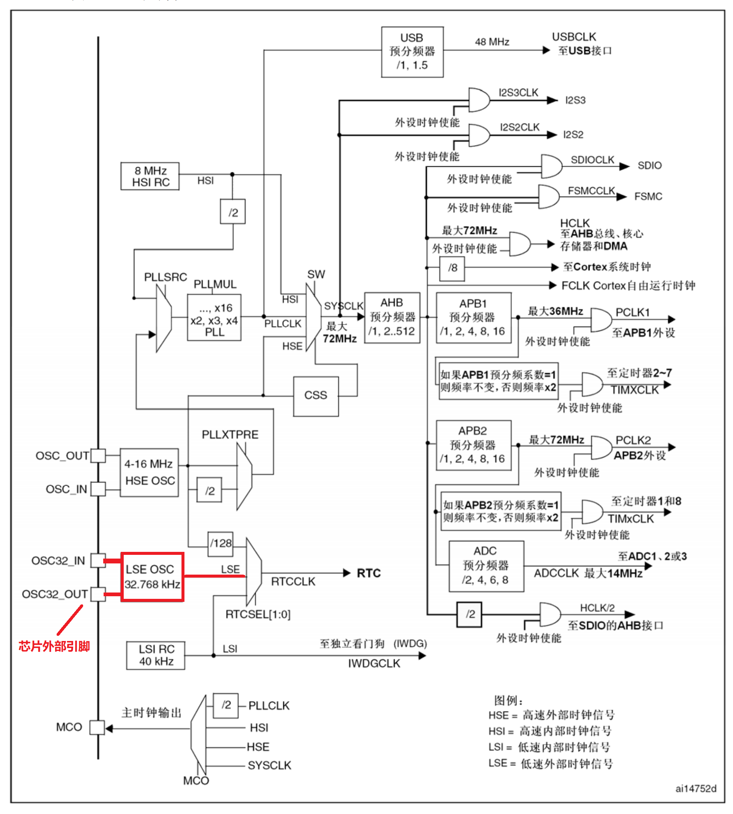

##### 系统默认时钟

>以我们当前使用的芯片STM32F103C8T6为例, 我们可以通过修改RCC寄存器, 控制我们的芯片的系统时钟频率(也就是SYSCLK时钟频率). 也就是时钟源选择是可以修改的.
>
>但是大多数情况下, 如果我们没有修改默认的时钟源, 那么我们的芯片的时钟源又是一种什么状态那. 我们可以通过参考下面的代码研究这个问题(前提背景: 以我们当前使用的STM32F103C8T6为例).
>
>```c
>// (startup_stm32f10x_md.s  129)
>
>// Reset_Handler    PROC
>//                  EXPORT  Reset_Handler             [WEAK]
>//      IMPORT  __main
>//      IMPORT  SystemInit
>//                  LDR     R0, =SystemInit
>//                  BLX     R0
>//                  LDR     R0, =__main
>//                  BX      R0
>//                  ENDP
>```
>
>````C
>// (system_stm32f10x.c 212)
>
>void SystemInit (void)
>{
>    /* Reset the RCC clock configuration to the default reset state(for debug purpose) */
>    /* Set HSION bit */
>    RCC->CR |= (uint32_t)0x00000001;
>
>	// .......(省略)
>
>    /* Configure the System clock frequency, HCLK, PCLK2 and PCLK1 prescalers */
>    /* Configure the Flash Latency cycles and enable prefetch buffer */
>    SetSysClock();
>
>	// .......(省略)
>}
>````
>
>```C
>// (system_stm32f10x.c 419)
>
>static void SetSysClock(void)
>{
>    #ifdef SYSCLK_FREQ_HSE
>    SetSysClockToHSE();
>    #elif defined SYSCLK_FREQ_24MHz
>    SetSysClockTo24();
>    #elif defined SYSCLK_FREQ_36MHz
>    SetSysClockTo36();
>    #elif defined SYSCLK_FREQ_48MHz
>    SetSysClockTo48();
>    #elif defined SYSCLK_FREQ_56MHz
>    SetSysClockTo56();  
>    #elif defined SYSCLK_FREQ_72MHz
>    SetSysClockTo72();
>    #endif
>
>    /* If none of the define above is enabled, the HSI is used as System clock
>            source (default after reset) */ 
>}
>```
>
>````C
>// (system_stm32f10x.c 106)
>
>#if defined (STM32F10X_LD_VL) || (defined STM32F10X_MD_VL) || (defined STM32F10X_HD_VL)
>/* #define SYSCLK_FREQ_HSE    HSE_VALUE */
> #define SYSCLK_FREQ_24MHz  24000000
>#else
>/* #define SYSCLK_FREQ_HSE    HSE_VALUE */
>/* #define SYSCLK_FREQ_24MHz  24000000 */ 
>/* #define SYSCLK_FREQ_36MHz  36000000 */
>/* #define SYSCLK_FREQ_48MHz  48000000 */
>/* #define SYSCLK_FREQ_56MHz  56000000 */
>#define SYSCLK_FREQ_72MHz  72000000
>#endif
>````
>
>```C
>// (system_stm32f10x.c 987)
>
>static void SetSysClockTo72(void)
>{
>    __IO uint32_t StartUpCounter = 0, HSEStatus = 0;
>
>    /* SYSCLK, HCLK, PCLK2 and PCLK1 configuration ---------------------------*/    
>    /* Enable HSE */    
>    RCC->CR |= ((uint32_t)RCC_CR_HSEON);
>
>    /* Wait till HSE is ready and if Time out is reached exit */
>    do
>    {
>        HSEStatus = RCC->CR & RCC_CR_HSERDY;
>        StartUpCounter++;  
>    } while((HSEStatus == 0) && (StartUpCounter != HSE_STARTUP_TIMEOUT));
>
>	// .......(省略)
>}
>
>```
>
>通过对上面的源代码的研究我们可以发现一些结论:
>
>```C
>// 当我们的芯片上电之后, 默认使用的时钟是HSI内部时钟(高速内部时钟)
>// 等上电一段时间之后, 芯片运行稳定和外部晶振运行稳定之后, 我们会把时钟切换为HSE, 即高速外部时钟.
>// 这么做的原因是因为HSI内部时钟(高速内部时钟), 是集成在芯片内部的RC震荡器, 不依赖于外部元件, 启动不仅快速, 而且由于直接集成到芯片内部, 可以立即提供时钟, 但是当上电系统稳定之后, HSI的缺点开始显现, 那就是精度不高. 而当上电系统稳定之后, HSE(外部高速时钟)也开始稳定运行, 并且也已经开始提供稳定的时钟频率到芯片内部(已经稳定提供给锁相环时钟), 我们只需要简单的修改RCC寄存器, 就可以让时钟源产生切换, 换为更稳定的外部时钟.
>```
>
>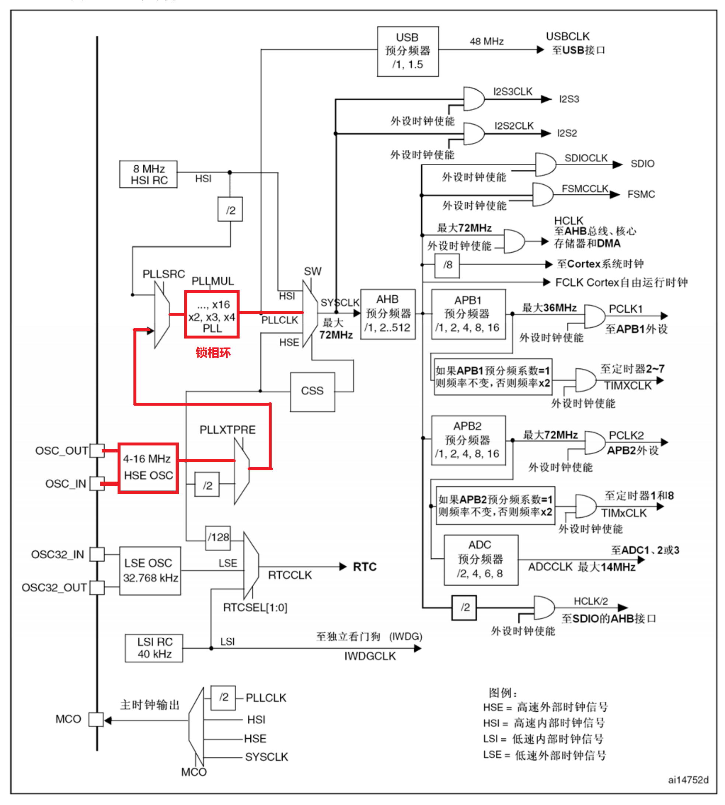

##### 锁相环

>**锁相环时钟(Phase-Locked Loop, PLL)**
>
>```C
>// 锁相环(PLL,Phase-Locked Loop)是STM32用于"时钟倍频"的模块,它可以将一个较低频率的输入时钟放大成更高频率的时钟,供MCU和外设使用.
>// 相当于分频的反作用-> 倍频.
>// 比如以我们当前使用的芯片为例: 我们的HSI(8MHz)或HSE(8MHz)作为输入, 可以经过PLL倍频之后, 把频率提升到72MHz.
>
>// 当然如果我们不希望其倍频到72MHz, 也可以通过修改RCC的CFGR寄存器调节倍频因子, 可选的倍频系数有2~16倍(STM32F103前提).
>// 而默认倍频系数为9倍频(RCC_CFGR_PLLMULL9), 8MHz*9 = 72MHz.
>```

##### SYSCLK

>我们前面介绍了时钟来源, 但是我们通过研究可以发现, 除了某些特殊硬件以外(比如看门狗/RTC/USB接口等硬件), 时钟最终汇聚到SYSCLK, 也就是系统时钟这个位置.
>
>而**SYSCLK(System Clock,系统时钟)**是STM32 MCU最主要的时钟源, 几乎所有模块的时钟信号都基于SYSCLK进行扩散和分频之后**派生**。它决定了**CPU、总线(AHB/APB)、外设的运行时钟**.
>
>也就是说SYSCLK为STM32的单片机内部大部分功能单元提供工作时钟.
>
>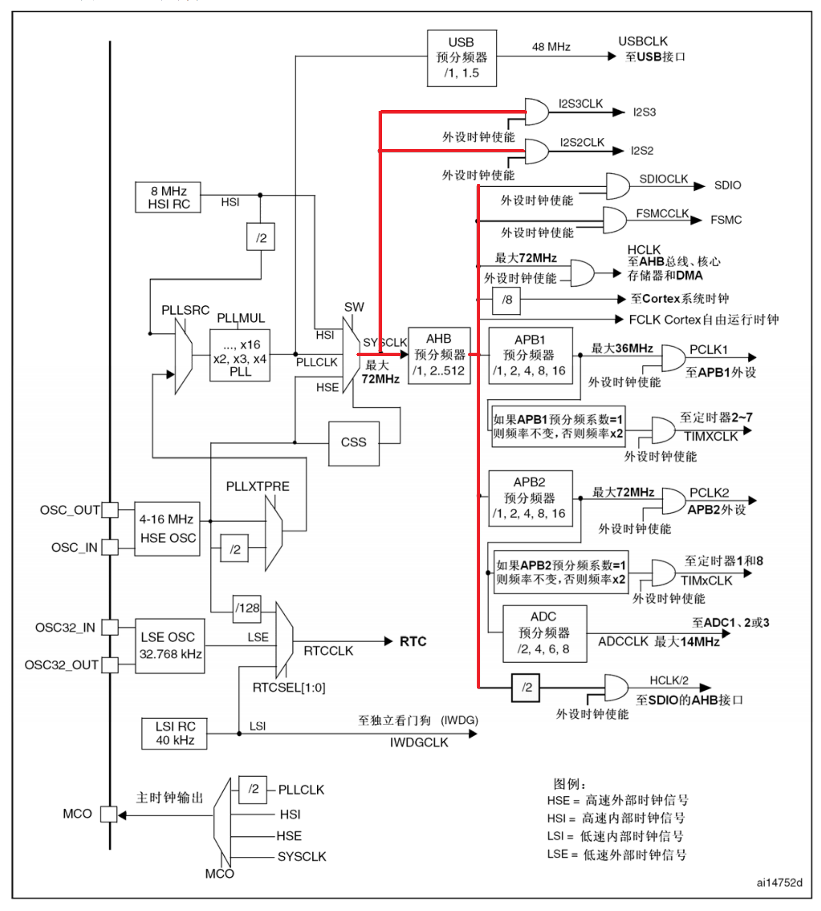

##### CSS

>CSS我们又称之为时钟安全系统, 在实际应用中, 晶体震荡器是有可能在运行的过程中失去作用(原因很多), 也就是说我们的系统中像高速外部时钟是有可能在运行的过程中出现问题, 而高速外部之中在我们的系统重是直接连接CSS时钟安全系统的, 当CSS时钟安全系统发现高速外部时钟失效或者异常, CSS安全选择器为了保证系统能够正常运行, 会立即修改RCC寄存器, 通过控制SW选择器, 把系统时钟的生成来源由外部高速时钟经过锁相环倍频器, 直接改为HSI, 即直接切换为高速系统内部时钟.

##### 时钟输出

>我们前面谈到的无论是时钟源还是系统时钟, 还是刚刚提到的时钟安全系统CSS, 它们研究的问题都是研究的问题, 都是选择哪个时钟源, 以及怎么选择时钟源为系统正常运行提供驱动. 也就是说时钟怎么产生, 从哪里来的问题.
>
>而假设我们屏蔽上面这个细节, 我们可能会思考一个问题, 我们系统无论是通过内部还是外部时钟源或者最终汇总到的系统时钟,难道只能给系统内部硬件/芯片内部硬件, 或者说出了芯片内部硬件以外, 只能给芯片内部的片上外设使用吗?
>
>当然不是, 我们也可以把我们芯片产生的内部时钟, 给除了芯片本身的外设使用 (如果某个外设需要时钟, 但是自己又没有办法产生时钟, 比如:外部MCU), 这个就是时钟输出.
>
>这种可以提供给芯片外部时钟的方式, 实际上是通过芯片引脚提供给外界, 在STM32F103C8T6我们使用的这个芯片, 我们可以通过MCO引脚给外设提供时钟(在STM32F103C8T6中是PA8引脚).
>
>```C
>// 在MCO提供给外界时钟的时候, 我们也可以通过控制RCC寄存器, 来选择提供给MCO外界输出的时钟源.
>//		修改RCC->CFGR寄存器
>
>// 而MCO可以备选的时钟源有: 
>//		1, PLLCLK/2: 经过锁相环倍频之后, 再2分频的时钟
>//		2, HSI: 高速内部时钟
>//		3, HSE: 高速外部时钟
>//		4, SYSCLK: 系统时钟
>```
>
>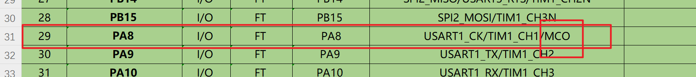
>
>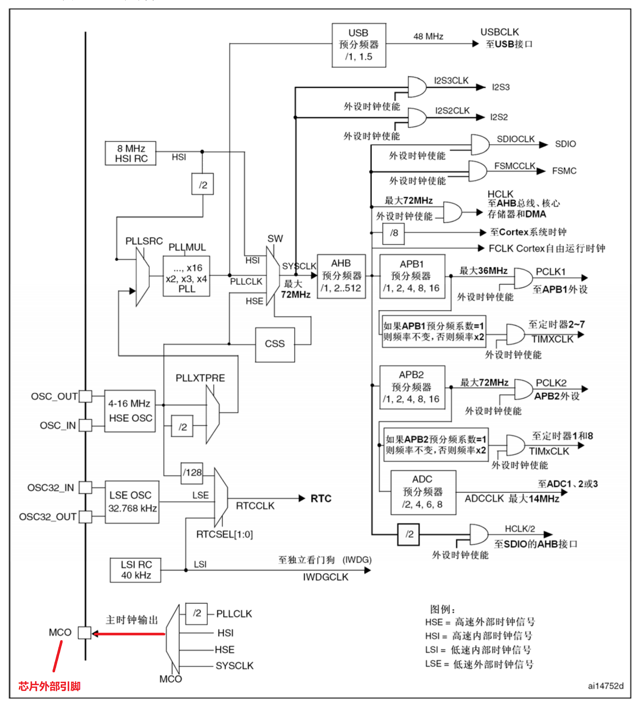

### 1.1.2 SysTick

>在STM32系统中,**SysTick**我们也称之为**系统定时器**是计数定时器,  它是挂载在AHB总线上的一个硬件电路(也就是我们时钟树图上的`Cortex系统定时钟`), 我们可以给SysTick这个片上外设设置一个数值(我们可以称之为`初始计数值`), 当发生固定的时钟周期变化之后,  这个值会不断递减计数, 当递减到计数值为0的时候, 就通知系统触发中断; 并且继续重装(重新加载)初始值, 继续递减, 循环往复.  
>
>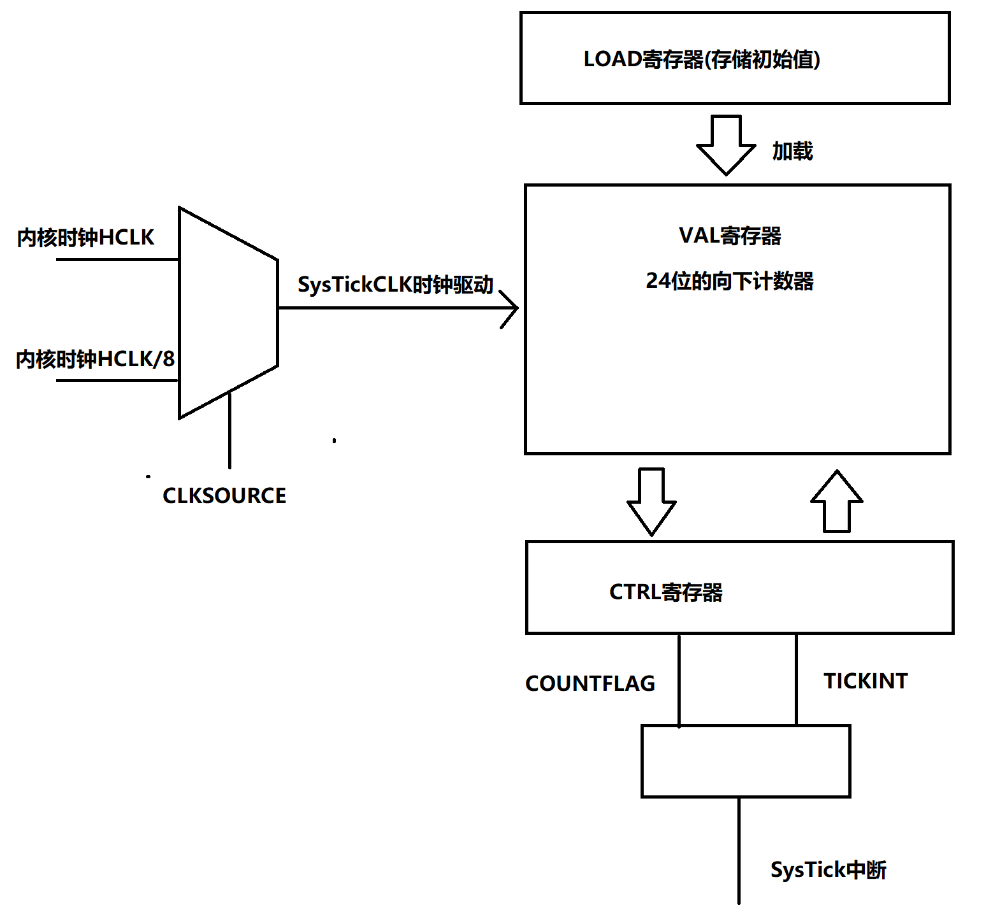
>
>```C
>// 我们可以在core_cm3.h文件发现一个如下的关于SysTick寄存器配置的结构体
>
> (core_cm3.h 365 )
>typedef struct
>{
>  __IO uint32_t CTRL;  /*!< Offset: 0x00  SysTick Control and Status Register */
>  __IO uint32_t LOAD;  /*!< Offset: 0x04  SysTick Reload Value Register       */
>  __IO uint32_t VAL;   /*!< Offset: 0x08  SysTick Current Value Register      */
>  __I  uint32_t CALIB; /*!< Offset: 0x0C  SysTick Calibration Register        */
>} SysTick_Type;
>
> (core_cm3.h 742 )
>#define SysTick             ((SysTick_Type *)       SysTick_BASE)  
>
> (core_cm3.h 718 )
>#define SysTick_BASE        (SCS_BASE +  0x0010) 
>
> (core_cm3.h 715 )
>#define SCS_BASE            (0xE000E000)  /*!< System Control Space Base Address */
>
>( stm32f0x_it.c  135)
>void SysTick_Handler(void)
>{
>}
>
>// 也就是我们可以通过SysTick_BASE这个控制SysTick内部寄存器的地址, 直接给SysTick内部的寄存器设置值
>// 可以被设置的值有: CTRL, LOAD, VAL, CALIB
>// 		1, CTRL寄存器: 使能SysTick、设置中断、查询计数状态
>//				0bit位->使能SysTick (0关闭, 1使能)
>//				1bit位->中断控制(0关闭 1使能)
>//				2bit位->时钟源选择CLKSOURCE (0表示默认HCLK/8, 1表示HCLK)
>//				16bit位->COUNTGLAG标记位 
>//					对于COUNTGLAG标记位,当SysTick计数值VAL减为0的时候,该位为1
>//					当COUNTGLAG标记位为1, 如果读取了这个标志位, 读完之后自动置为0
>
>// 		2, LOAD寄存器: 设定SysTick的重装值(初始值)
>// 		3, VAL寄存器: 当前计数值
>// 		4, CALIB寄存器: 参考时钟校准，用来指示时钟频率
>
>// 同时: 在默认情况下SysTick的时钟源为"内核时钟HCLK/8", 也就是说默认SysTick的时钟为9MHz, 即每秒9,000,000次时钟变化
>// 注意: SysTick计数器(VAL寄存器)是完全由硬件逻辑自动递减的,不需要逻辑计算单元参与.
>```
>
>那么根据上面的这个设计, 我们就可以回头研究我们之前使用过的Delay函数了.
>
>我们之间在库函数开发的时候Delay函数的实现就是基于SysTick的.
>
>```C
>void Delay_us(uint32_t xus)
>{
>	SysTick->LOAD = 72 * xus;
>	SysTick->VAL = 0x00;
>	SysTick->CTRL = 0x00000005; // 00000101
>	while(!(SysTick->CTRL & 0x00010000));
>	SysTick->CTRL = 0x00000004;
>}
>void Delay_ms(uint32_t xms){
>	while(xms--){
>		Delay_us(1000);
>	}
>}
>void Delay_s(uint32_t xs){
>	while(xs--){
>		Delay_ms(1000);
>	}
>} 
>// 以上述代码为例, 假设背景是我们想Delay为1s: 等价于Delay_us(1*1000*1000)=Delay_us(1,000,000)
>
>// 假设我们设置了: Delay_us(1,000,000)
>// 	SysTick->LOAD:重装值=72,000,000 = 72M
>//  在这种情况下, 如果我们的SysTick使用的时钟为72MHz, 那么减完72,000,000正好需要花费1秒时间
>//	所以紧接着:SysTick->VAL = 0x00;我们清空了当前计数值
>//	SysTick->CTRL = 0x00000005; 等价于设置 0000000000000101
>//				0bit位->使能SysTick (0关闭, 1使能)  -> 使能
>//				1bit位->中断控制(0关闭 1使能) -> 不触发中断
>//				2bit位->时钟源选择CLKSOURCE (0表示默认HCLK/8, 1表示HCLK) -> 选择时钟为HCLK也就是72MHz
>//				16bit位->COUNTGLAG标记位 
>//					对于COUNTGLAG标记位,当SysTick计数值VAL减为0的时候,该位为1
>//					当COUNTGLAG标记位为1, 如果读取了这个标志位, 读完之后自动置为0
>//	这样我们就完成了, 计数值每次重装, 当减为0,表示需要1秒时间
>
>//	而当SysTick每次计数值减为0, 也就是花费1S时间之后, 就可以触发COUNTGLAG标记位置为1, 就不再满足如下判断, 则while循环就会跳出, 程序继续向下执行.
>	while(!(SysTick->CTRL & 0x00010000));
>```

### 1.3.1 TIM定时器

>我们前面通过对时钟树和SysTick系统定时器的研究, 我们实现了一个Delay函数.那么还有没有别的定时器可以让我们实现相同的功能那? 当然是有的, 那就是TIM定时器( 有时候又称为Timer定时器, 或者TIMx).
>
>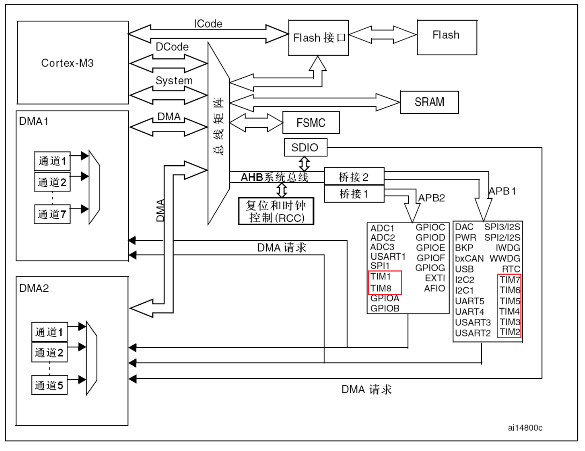
>
>而在STM32中TIM定时器又分为`基本定时器`, `通用定时器`和`高级定时器`三种, 不过TIM和SysTick完全不同的是, TIM定时器属于片上外设, 被挂载在APB1和APB2总线上.
>
>```C
>// 需要注意的是, TIM定时器有非常丰富和强大的功能, 除了可以用于定时以外, 还可以用于计数、PWM波形生成、以及输入捕获等功能. 但是, 我们今天暂时只使用它设计一个定时器, 重写Delay函数(用以淘汰掉旧的Delay函数).
>
>// 所谓PWM波形生成, 也称之为是脉宽调制, 是通过让TIM定时器控制引脚电平变化, 生成特定波形的技术, 这个技术的本质是,我们可以通过在一个固定时间周期内, 控制高低电平的所维持时常的比率, 又称之为占空比, 来调节信号输出, 占空比的大小变化直接影响输出的平均电压. 其可以用于LED调光、电机调速、DAC模拟输出等.
>
>// 所谓输入捕获, 是STM32定时器把某些引脚类似当做输入时钟, 通过接收某些引脚上的信号(高低电平变化, 电平的上升沿/下降沿), 来测量信号(高低电平)的周期/频率/脉宽等参数.
>```
>
>虽然我们上面说在STM32中定时器有三种类型, `基本定时器`, `通用定时器`和`高级定时器`三种, 但是在STM32F103C8T6中定时器仅有4个.
>
>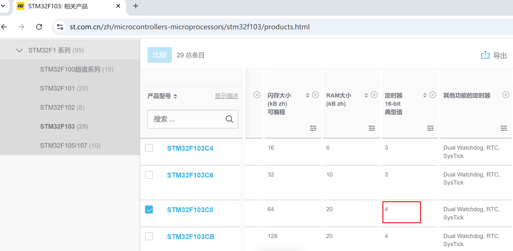
>
>在这4个定时器中, 又分为一个高级控制定时器、三个通用定时器, 没有基本定时器.
>
>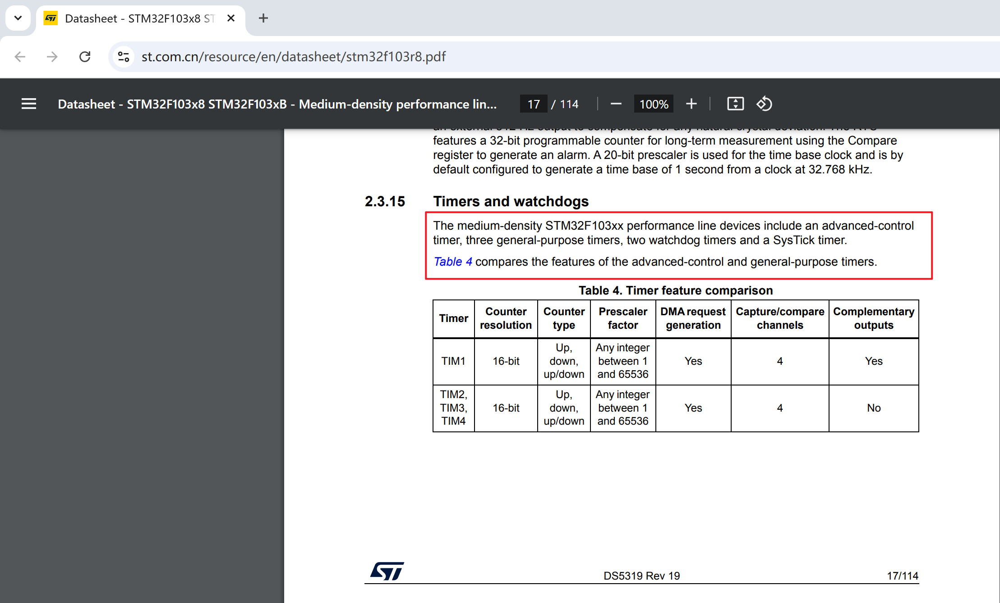
>
>```C
>// The medium-density STM32F103xx performance line devices include an advanced-control timer, three general-purpose timers, two watchdog timers and a SysTick timer.
>// 中密度STM32F103xx高性能系列设备包括一个高级控制定时器、三个通用定时器、两个看门狗定时器和一个SysTick定时器。
>```
>
>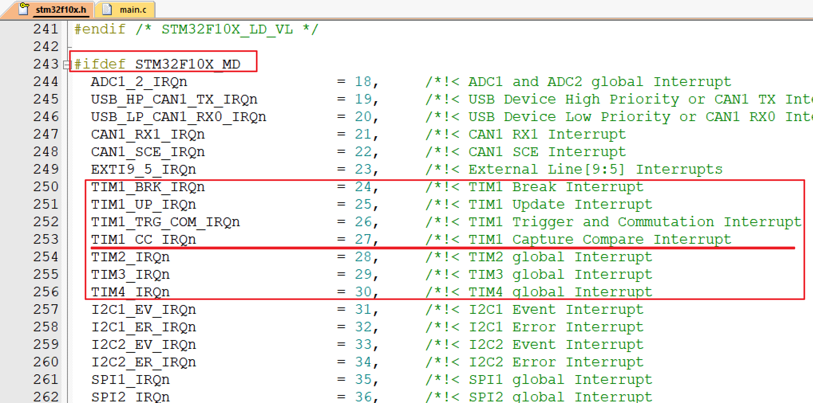
>
>但是在STM32中,  高级定时器包含通用定时器的功能,  通用定时器包含基本定时器的功能. 也就是说在基本定时器中具有的基本特性, 在通用定时器中和高级定时器中都是有的. (可以当做功能的不断增强)

##### 基本定时器

>首先我们可以先看一下`基本定时器`, `通用定时器`和`高级定时器`这三者之间的设计框图.
>
>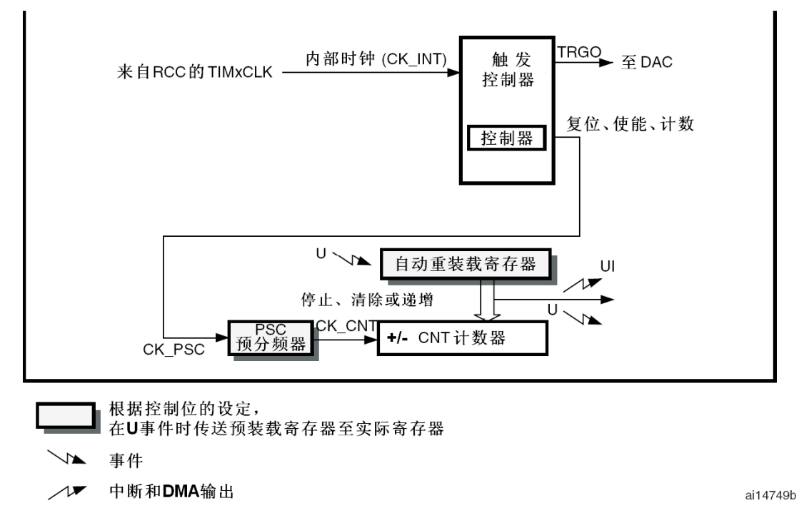
>
>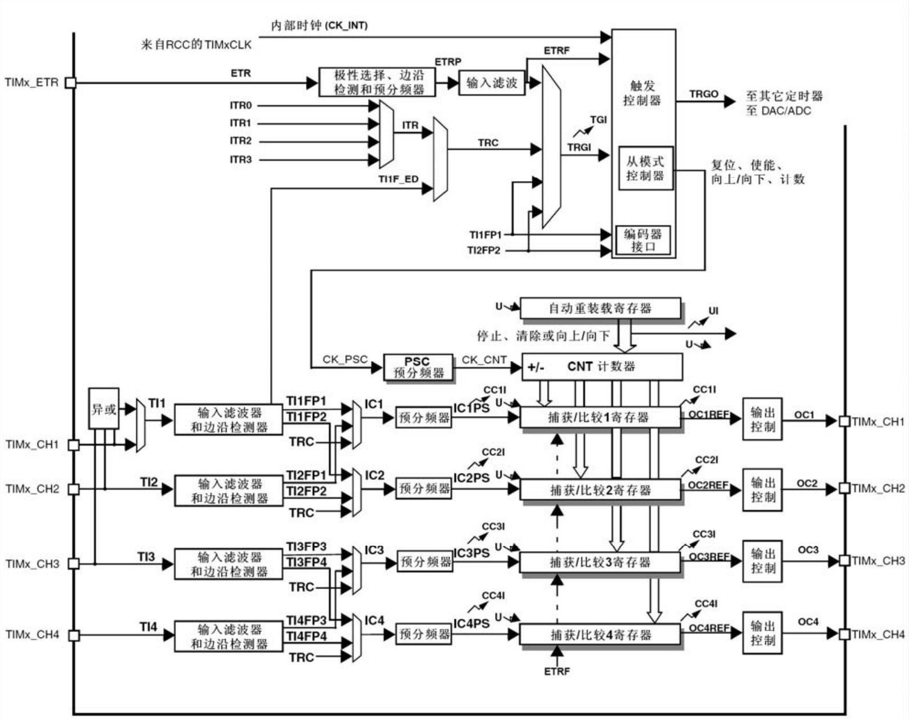
>
>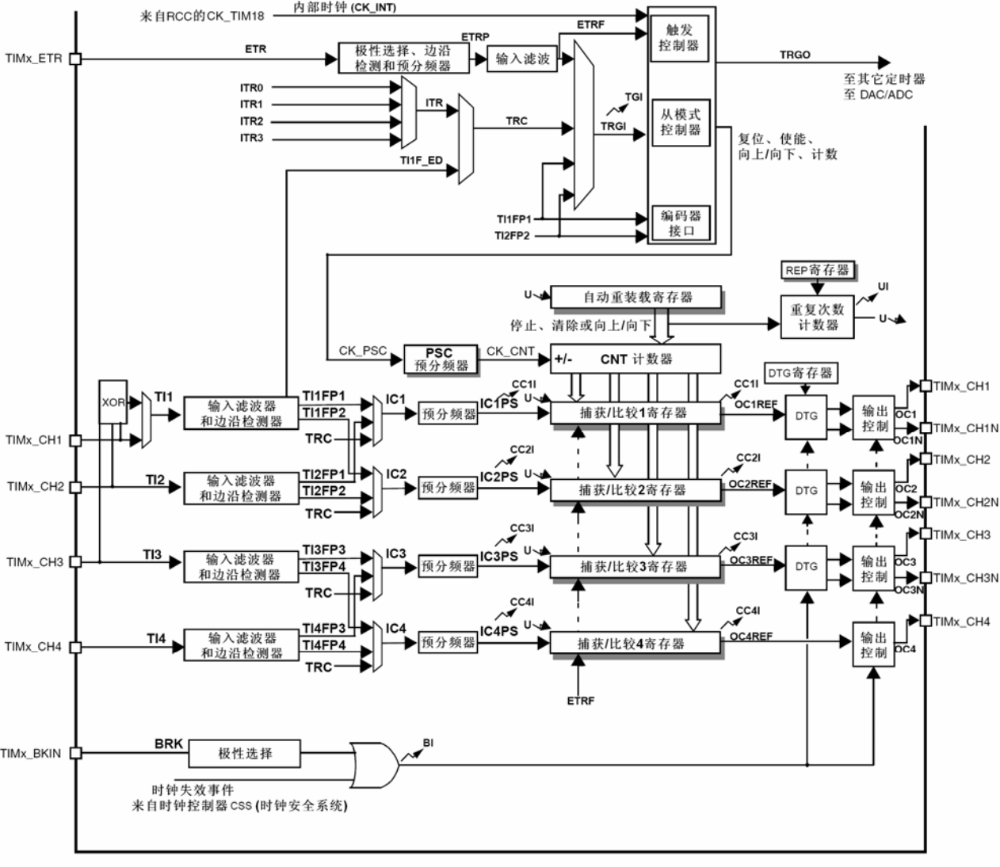
>
>我们发现通过对上面设计框图的简单对比, 三者都具有一个基本的时基控制单元.
>
>
>
>```C
>// 这个时基控制单元如图所示:
>// 1, 首先是计时单元的时钟提供者, CK_INT, 也就是内部时钟. 当前定时器挂载在APB1的时候, 在默认情况下APB1的预分频器会进行2分频, 这是因为挂载在APB1上的外设最大时钟频率为36MHz( 72/2 )(也就是说挂载在APB1上的外设,如UART、I2C、SPI等,运行在 36MHz时钟下), 所以在这种默认情况下定时器TIM2,TIM3,TIM4,TIM5,TIM6,TIM7(2~5是通用定时器, 6-7是基本定时器), 因为APB1的预分频系数为2, 所以提供给这些TIM的时钟频率要再乘以2 = 72MHz
>// 2, 如果当前定时器挂载在APB2的时候, 在默认情况下APB2是不分频的, 也就是提供72MHz的时钟频率, 而挂载在APB2上的TIM1和TIM8属于高级定时器, 也就不需要乘以2, 也就是时钟频率依旧维持在72MHz
>//	所以综上所述我们可以认为在STM32F103中所有定时器的默认时钟频率为72MHz
>
>// 3, 在STM32定时器中PSC与预分频器的作用是对TIM的计数时钟CK_INT进行进一步分频, 以获得合适的计数速率. 
>//		假设设置PSC为71, 那个经过PSC预分频器之后, 时钟频率CK_CNT=72MHz/(71+1) = 1MHz
>
>// 4, 当每次CK_CNT时钟节拍, 都会导致CNT计数器的值+1,  当CNT的值在不断的+1过程中, 值的大小和自动重装寄存器ARR相同, 则触发中断, 并且清空计数器, 重新开始计数
>//		触发的中断为TIMx_IRQn (TIM2_IRQn, TIM3_IRQn ...) (stm32f10x.h  254)
>
>// 注意: 无论是自动重装寄存器还是, 还是计数器, 还是PSC预分频器都是16bit位的, 也就是说锁设置的值最大为65535
>```
>
>```C
>// 假设我们设置: 
>//		PSC = 72 - 1 = 71
>//		ARR = 1000 - 1 = 999
>
>// 那么首先72MHz经过PSC变为 72MHz/(71+1) = 1MHZ
>// 1MHz 也就意味着1个时钟节拍为 1/1MHz 秒 = 1/1000 000  秒= 1µs(微秒)
>// 也就是意味着1微妙, CNT技术值+1, 要从0加到999触发中断, 需要加1000微妙 = 1毫秒
>// 也就是说, 我们可以通过设置如上参数, 让TIM中断在1毫秒触发一次
>```
>
>
>
>EG: 通过上面定时器的了解, 我们就设计出一个基于TIM的延时函数
>
>```C
>#include "Delay.h"
>
>void Delay_Init(void)
>{
>    RCC_APB1PeriphClockCmd(RCC_APB1Periph_TIM2, ENABLE);  // 使能TIM2时钟
>
>    TIM_TimeBaseInitTypeDef TIM_TimeBaseStructure;// 定义结构体
>	
>    TIM_TimeBaseStructure.TIM_Period = 0xFFFF;   // 设定自动重装值(最大 65535)
>    TIM_TimeBaseStructure.TIM_Prescaler = 71;    // 72MHz / (71+1) = 1MHz (1µs 计数增加一次)
>    TIM_TimeBaseStructure.TIM_ClockDivision = TIM_CKD_DIV1;// TIM_CKD_DIV1标示定时器使用CK_CNT作为时钟
>    TIM_TimeBaseStructure.TIM_CounterMode = TIM_CounterMode_Up; // 向上计数
>	
>    TIM_TimeBaseInit(TIM2, &TIM_TimeBaseStructure);// 使用上面配置的参数, 初始化TIM2
>	
>    TIM_Cmd(TIM2, ENABLE);  // 使能TIM2
>}
>
>void Delay_us(uint16_t us)
>{
>    TIM_SetCounter(TIM2, 0);  // 计数器清零
>    
>    // TIM_GetCounter()函数用于获取指定TIM定时器的当前计数值
>    while (TIM_GetCounter(TIM2) < us);  // 等待计数器达到 us 值
>}
>
>void Delay_ms(uint16_t ms)
>{
>    for (uint16_t i = 0; i < ms; i++){
>        // 延时1ms = 1000us
>        Delay_us(1000);
>    }
>}
>
>```
>
>```C
>#ifndef __Delay_H__
>#define __Delay_H__
>
>#include "stm32f10x.h"  
>
>void Delay_Init(void);
>void Delay_ms(uint16_t ms);  
>
>#endif
>
>```

## 1.2 FreeRTOS

### 1.2.1 任务切换

>我们知道在FreeRTOS中任务的是存在时间片切换这一问题.
>
>```C
>// 假设在FreeRTOS中有如图所示的三个任务, 并且优先级相同, 那么它们之间是使用时间片轮转策略来调度任务的交替执行.
>// 也就是说, 当Task1被执行一段时间之后, 要让出CPU的执行权限,并且保存上下文(把上下文信息保存到自己的任务堆栈中,更新任务控制块), 使得Task2获得CPU执行权限, 加载Task2的上下文(通过Task2的任务控制块找到Task2的任务堆栈, 把任务堆栈中记录的Task2的上下文信息回复到CPU的寄存器)
>// 同样的当Task2时间片用尽, 将会以同样的方式保存上下文, 然后加载Task3, 循环往复.
>
>// 那么, 以我们FreeRTOS为例, 假如一切都在默认配置下, 在三个任务, 每个任务每次获得的执行时间是多久那? 这个时间又由谁控制那?
>```
>
>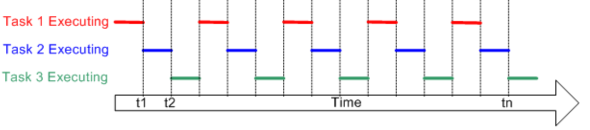
>
>在谈上面的这个问题之前, 我们必须知道在FreeRTOS中, 到低谁在做任务切换的具体实现, 这就不得不提到一个中断函数`xPortPendSVHandler`函数.
>
>- 首先我们可以说明: xPortPendSVHandler函数是我们FreeRTOS任务切换的核心函数.也就是说一切任务切换都是有这个函数实现的.
>
>````C
>// 那么这个函数什么情况下被调用?
>// 		我们前面在配置FreeRTOS的配置文件的时候, 也就是FreeRTOSConfig.h
>//		我们在这个文件中额外定义了三个配置, 也就是如下所示:
>
>/* 在官方提供的配置的基础上增加了三个配置  */
>#define xPortPendSVHandler PendSV_Handler
>#define vPortSVCHandler SVC_Handler
>#define xPortSysTickHandler SysTick_Handler
>
>// 通过上面的配置我们发现, 所谓xPortPendSVHandler函数的本质其实就是PendSV_Handler函数, 也就是说只要有PendSV_Handler中断函数触发, 就会被重置到xPortPendSVHandler函数执行.
>// 而PendSV_Handler中断函数的触发, 取决于其Cortex_M3内核的SCB->ICSR(系统控制块的中断控制和状态寄存器)中的 PENDSVSET标志位.
>// 也就是说我们只要把这个标志位置为1, 也就是说NVIC硬件逻辑会自动触发PendSV_Handler中断(前提没有更高优先级的中断), 进而要求xPortPendSVHandler函数执行.
>````
>
>```C
>// 那么在FreeRTOS中, 怎么? 或者什么情况下会把SCB->ICSR(系统控制块的中断控制和状态寄存器)中的PENDSVSET标志位置为1那?
>
>// (portmacro.h   100 )
>#define portNVIC_INT_CTRL_REG     ( *( ( volatile uint32_t * ) 0xe000ed04 ) )
>// 在STM32F103中这个地址0xE000ed04对应的是NVIC的ICSR寄存器, 也就是中断控制及状态寄存器的地址.
>// 其中在这个寄存器中, 第28个bit位就是PENDSVSET标志位
>
>// (portmacro.h   101 )
>#define portNVIC_PENDSVSET_BIT    ( 1UL << 28UL )
>
>// 通过上面两个宏定义的研究, 我们可知, 如果存在这个依据代码:
>portNVIC_INT_CTRL_REG = portNVIC_PENDSVSET_BIT;
>// 那么这个代码存在的意义, 就是要求产生PendSV_Handler中断, 或者说要求进行任务切换.
>
>// 那么什么情况下, 又有哪些函数会执行这句话那?
>```
>
>**portYIELD()函数被调用**: 了解
>
>```C
>// 在portmacro.h文件中有一个函数叫portYIELD()函数, 这个宏函数存在的意义就是给一些FreeRTOS的系统调用在某些合适的时候调用该函数, 进而触发PendSV_Handler中断, 要求任务切换.
>// 比如: 
>//	1, 由任务执行过程中(应用逻辑中)直接调用
>//	2, 任务阻塞、挂起、删除被触发执行的时候
>//	3, 任务优先级变化的时候(比如vTaskPrioritySet函数被调用等)
>//	4, 任务间通信(消息队列、信号量等)
>
>// (portmacro.h   88 )
>#define portYIELD()                                     
>{                                                   
>    // ...
>    portNVIC_INT_CTRL_REG = portNVIC_PENDSVSET_BIT; 
>    // ...
>}
>```
>
>**xPortSysTickHandler函数执行**
>
>```C
>// 在port.c文件中有一个xPortSysTickHandler函数, 其实就是我们之前的SysTick_Handler中断函数.也就是所谓的SysTick中断函数.
>// 也就是说SysTick中断函数的触发, 也会导致任务发生切换. 
>// 我们也知道SysTick中断依赖于SysTick定时器, 它是一个具有周期性的, 并且循环往复产生的中断函数.
>// 如果我们把两次SysTick中断触发的时间间隔一个固定的时间, 也就是说在FreeRTOS中每隔一个固定的时间, 就会发生任务切换, 而这正是任务按照"时间片切换"
>
>// (port.c  444)
>void xPortSysTickHandler( void )
>{
>    // ...
>    portNVIC_INT_CTRL_REG = portNVIC_PENDSVSET_BIT;
>    // ...
>}
>```

### 1.2.2 时间片

>通过上面的描述我们知道在FreeRTOS中`时间片`的来源, 来自于SysTick函数的中断. 那么我们可以得到几个比较显然的结论:
>
>- SysTick系统定时器, 是控制FreeRTOS任务执行切换时钟来源, 是任务切换的心脏.
>- 所以我们之前基于SysTick设计的Delay函数, 在FreeRTOS中就不适合被使用.
>
>```C
>// 因为之前基于SysTick实现的Delay一直在重装计数值, 它设计的目的(Delay)不是为了触发中断.
>```
>
>在FreeRTOS中, 我们又称这种方式, 或者, 我们又称SysTick系统定时器为`系统嘀嗒定时器`.

>那么在FreeRTOS中SysTick系统定时器, 它多久触发一次? 它又是怎么被配置的那?
>
>
>
>```C
>
>// (FreeRTOSCOnfig.h  46)
>#define configTICK_RATE_HZ			( ( TickType_t ) 1000 )
>
>// (tasks.c 3665)
>void vTaskStartScheduler( void )
>{
>	// ...
>	xPortStartScheduler();
>	// ...
>}
>
>// (port.c 262)
>BaseType_t xPortStartScheduler( void )
>{
>	// ...
>vPortSetupTimerInterrupt();
>	// ...
>prvStartFirstTask();
>	// ...
>}
>
>// (port.c 699)
>#if ( configOVERRIDE_DEFAULT_TICK_CONFIGURATION == 0 )
>__weak void vPortSetupTimerInterrupt( void )
>{
>   // ...
>
>   /* Stop and clear the SysTick. */
>   portNVIC_SYSTICK_CTRL_REG = 0UL;
>   portNVIC_SYSTICK_CURRENT_VALUE_REG = 0UL;
>
>   /* Configure SysTick to interrupt at the requested rate. */
>   portNVIC_SYSTICK_LOAD_REG = ( configSYSTICK_CLOCK_HZ / configTICK_RATE_HZ ) - 1UL;
>   portNVIC_SYSTICK_CTRL_REG = ( portNVIC_SYSTICK_CLK_BIT_CONFIG | portNVIC_SYSTICK_INT_BIT | portNVIC_SYSTICK_ENABLE_BIT );
>}
>#endif
>```
>
>```C
>// (FreeRTOSConfig.h 45)
>#define configCPU_CLOCK_HZ			( ( unsigned long ) 72000000 )	
>
>// (port.c 99)
>#ifndef configSYSTICK_CLOCK_HZ
>    #define configSYSTICK_CLOCK_HZ             ( configCPU_CLOCK_HZ )
> 	/* Ensure the SysTick is clocked at the same frequency as the core. */
>    #define portNVIC_SYSTICK_CLK_BIT_CONFIG    ( portNVIC_SYSTICK_CLK_BIT )
>#else
>
>// (FreeRTOSConfig.h 46)
>#define configTICK_RATE_HZ			( ( TickType_t ) 1000 )
>
>// 所以SysTick的计数重装值: portNVIC_SYSTICK_LOAD_REG = 72000 - 1
>```
>
>```C
>// (port.c 56)
>#define portNVIC_SYSTICK_CLK_BIT              ( 1UL << 2UL )
>
>// 		1, CTRL寄存器: 使能SysTick、设置中断、查询计数状态
>//				0bit位->使能SysTick (0关闭, 1使能)
>//				1bit位->中断控制(0关闭 1使能)
>//				2bit位->时钟源选择CLKSOURCE (0表示默认HCLK/8, 1表示HCLK)
>
>// 也就是说, 我们通过给portNVIC_SYSTICK_CTRL_REG也就是CTRL的第三个bit位(2下标bit位)设置为1, 要求时钟源频率为HCLK, 即72Mhz = 72000000/秒
>```
>
>```C
>// 也就是说, SysTick计时器, 时钟来源72000000, 即计数值加一, 需要(1/72000000)秒, 加到重装值72000-1, 需要:
>//   (1/72000000) *72000 = 1/1000秒 = 1毫妙
>```
>
>**也就是说SysTick每1ms触发一次, 也就是说在FreeRTOS中默认的任务时间片(执行和下次切换时间)为1ms**

**补充**

>当然, 同过之前的分析, 我们也可以知道, 我们可以通过修改一些配置, 来改变重装值, 进而调大或者调小时间片大小.(但是意义不大, 自行选择)
>
>```C
>// (FreeRTOSConfig.h 46)
>#define configTICK_RATE_HZ			( ( TickType_t ) 1000 )
>```
>
>除此之外, 我们在最开始孩子啊FreeRTOS中定义了另外一个中断.
>
>```C
>/* 在官方提供的配置的基础上增加了三个配置  */
>#define xPortPendSVHandler PendSV_Handler
>#define vPortSVCHandler SVC_Handler
>#define xPortSysTickHandler SysTick_Handler
>
>// 其中SVC_Handler或者vPortSVCHandler的作用, 是用来初始化第一个任务相关处理的, (作用是启动第一个任务, 进入任务调度模式), 不用记忆.
>```

### 1.2.2 FreeRTOS中引入新的Delay函数

>**参考我们前面的基于TIM实现的Delay函数**
>
>```C
>// 注意:
>// 		虽然我们不能继续使用基于SysTick的Delay函数了, 但是在FreeRTOS中也提供了时延函数, 即vTaskDelay函数.
>//		但是vTaskDelay函数的调用是让任务进入阻塞, 会主动让出CPU.
>//		如果我们即想实现时延功能, 又不想在分配给当前任务的时间片内让出CPU, 就需要另外定义时延函数. 比如我们前面实现的基于TIM的时延函数.
>```

### 1.2.3 vTaskDelay的实现

>在FreeRTOS中, FreeRTOS提供了两个以供延时的延时函数: vTaskDelay函数和vTaskDelayUntil函数.
>
>```C
>// 相对延时, 和别的逻辑无关, 仅仅是个延时函数
>void vTaskDelay(
>    const TickType_t xTicksToDelay // 延时时间, 单位ms
>);
>```
>
>```C
>// 绝对延时
>void vTaskDelayUntil(
>    TickType_t *pxPreviousWakeTime, // 起始时间
>    TickType_t xTimeIncrement // 绝对延时时间
>);
>```
>
>```C
>// 假设有如下代码
>
>TickType_t xLastWakeTime = xTaskGetTickCount(); 
>
>if(flag == 1){
>    // 执行20ms
>}else{
>    // 执行50ms
>}
>
>vTaskDelayUntil(&xLastWakeTime, 1000);
>
>// 假如以这份代码为例, 也就是说无论逻辑走到if中还是else中, 从xTaskGetTickCount返回开始, 到时延函数结束, 都是花费1000ms
>
>// 注意:vTaskDelayUntil函数会在每次调用后修改xLastWakeTime的时间, 更新方式为:
>// 		xLastWakeTime  =  xLastWakeTime  +   vTaskDelayUntil第二个参数值
>```


