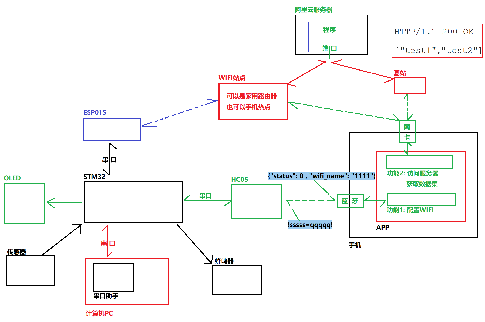
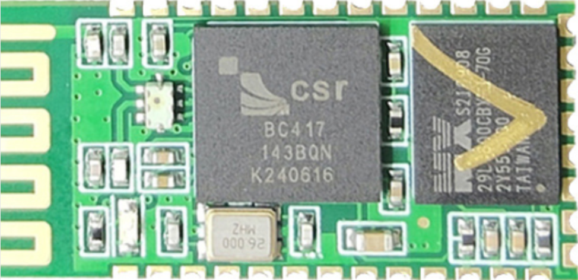
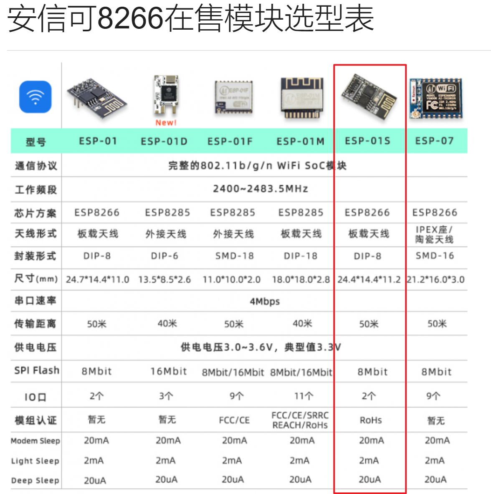
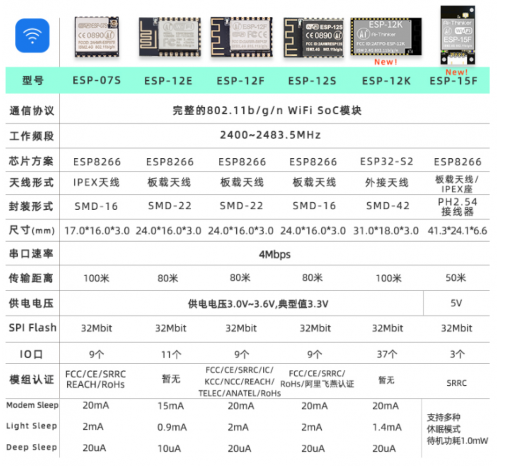
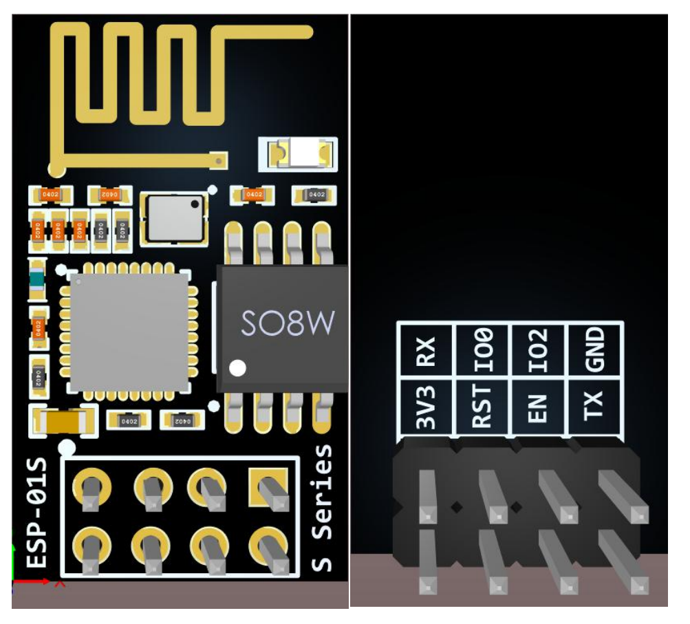

# 1, 第一期

## 1.1 项目架构

>

## 1.2 HC05

>
>
>HC-05是一款比较经典的蓝牙(Bluetooth 2.0+EDR)的串行通信模块, 广泛用于无线串口通信, 支持主从模式切换, 可用于MCU、电脑、手机等设备之间的无线数据传输.
>
>```C
>// 模块: 所谓模块, 就是把芯片和外围电路、电源管理模块、外部晶振、电压保护电路(稳压电路)、复位按键、外接接口等等各种硬件, 和设计好的电路板集成到一起, 以供用户使用.
>// 比如一般HC_05使用的芯片都是CSR BC417芯片, 他不能被单独使用, 因为这个芯片甚至本身连天线都不带. 更不用说电源稳压,电路保护等硬件功能电路.
>
>// CSR BC417芯片:
>// 该芯片是英国Cambridge Silicon Radio(CSR)公司推出的一款经典蓝牙(Bluetooth 2.0+EDR)芯片, 广泛用于无线串口通信、蓝牙音频设备和嵌入式蓝牙模块.
>```
>
>Bluetooth 2.0+EDR
>
>```C
>// Bluetooth2.0+EDR(Enhanced Data Rate)是一种蓝牙协议标准(蓝牙技术联盟Bluetooth SIG在2004年发布的第二代蓝牙标准), 属于经典蓝牙(BR/EDR，Basic Rate/Enhanced Data Rate)技术, 用于无线短距离数据通信.
>// 该技术标准所支持的通信速率最高为3Mbps, 但在实际使用中通常为2.1Mbps
>
>// 注意现在的智能手机普遍采用蓝牙5.0及以上版本的标准(蓝牙5.0于2016年发布, 最高支持2Mbps, 但是功耗超低, 抗干扰能力一般, 但是比较适合Wi-Fi共存环境, 因为做了共存优化), 甚至在蓝牙技术联盟在2024年9月发布了蓝牙6.0标准(现在处于推广阶段)
>```
>
>HC05的一些参数:
>
>```C
>// 蓝牙协议: Bluetooth 2.0+EDR(Enhanced Data Rate)
>// 工作频率: 2.4GHz频段
>// 通讯方式: 串口(UART)
>// 波特率: 默认9600
>// 引脚电压: 3.3V
>// 模块供电: 3.6~6V
>```
>
>引脚定义
>
>```c
>// VCC: 模块供电, 建议5V
>// GND: 接地
>// TXD: 串口发送
>// RXD: 串口接收
>// EN: 使能(可悬空 OR 高电平)
>// STATE: 指示连接状态(可悬空 OR 高电平)
>```
>
>工作模式
>
>````C
>// 支持主从模式: 支持主机(Master)和从机(Slave)模式
>// 支持AT指令: 可用于配置设备名称、波特率、主从模式等
>
>// 数据传输模式:  (有蓝牙连接自动进入数据传输模式)
>//		用于普通串口通信
>//		配对成功后, 可以直接像普通串口一样收发数据
>
>// AT指令模式:   (没有蓝牙连接自动进入AT指令模式)
>//		通过AT指令配置HC-05的参数(如主从模式、波特率、设备名称等)
>
>
>// 注意: 在蓝牙中
>// 主模式(Master)设备负责主动搜索和建立连接
>// 从模式(Slave)设备等待主机搜索、配对和连接, 它自身不能主动连接其他设备
>````
>
>常用AT指令: (HC05蓝牙模块AT指令集.pdf) 
>
>```c
>// 注意: 使用AT指令的时候, 记得断开主从两个蓝牙之间的连接
>//		AT指令一般需要换行标识
>
>// -----------------示例---------------------------
>// AT : 测试指令, 返回OK
>// AT+NAME? : 获取设备名称
>// AT+NAME=snow : 把蓝牙模块设备名改为snow
>// AT+ROLE? : 获取HC05的模式
>// AT+ROLE=0 : 把模式修改为主模式
>// AT+UART? : 查看串口"波特率,停止位,检验位"
>// AT+UART=115200,1,2 : 修改串口的"波特率,停止位,检验位"
>// ....
>
>
>// -----------------必须要执行的命令---------------------------
>AT+ROLE=0 : 把模式修改为主模式
>AT+NAME=snow  : 给蓝牙模块该名字
>
>```

## 1.3 ESP01S

>
>
>
>
>
>
>ESP01S是一款基于ESP8266芯片的Wi-Fi模块(属于ESP8266芯片家族), 是由乐鑫(Espressif)公司推出的一款小型、低功耗的无线网络连接模块(基于无线局域网技术), 比较广泛用于物联网(IoT)、智能家居、远程控制等应用.  其中该模块支持标准的IEEE802.11 b/g/n协议, 并且芯片内置完整的 TCP/IP协议栈.
>
>```C
>// IEEE802.11 b/g/n协议:
>//		IEEE802.11是无线局域网(Wi-Fi)的标准, 由IEEE(美国电气电子工程师学会)制定. 不同的Wi-Fi标准以IEEE802.11开头,后面带有不同的字母后缀(如:b/g/n/ac/ax), 表示不同的技术规格.
>
>// ESP01S芯片核心: Tensilica L106超低功耗32位微型MCU
>//		Tensilica L106是一款低功耗、基于Xtensa处理器架构的32位RISC处理器, 由Cadence(腾思电子,Tensilica现为Cadence旗下品牌)设计.
>```
>
>| **标准**    | **发布年份** | **工作频段**        | **最大速率** | **带宽**  | **调制方式**       | **适用场景**        |
>| ----------- | ------------ | ------------------- | ------------ | --------- | ------------------ | ------------------- |
>| **802.11b** | 1999         | **2.4 GHz**         | **11 Mbps**  | 20 MHz    | DSSS(直接序列扩频) | 早期Wi-Fi设备       |
>| **802.11g** | 2003         | **2.4 GHz**         | **54 Mbps**  | 20 MHz    | OFDM(正交频分复用) | 早期无线路由/笔记本 |
>| **802.11n** | 2009         | **2.4 GHz / 5 GHz** | **600 Mbps** | 20/40 MHz | OFDM、MIMO         | 现代主流Wi-Fi设备   |
>
>ESP01S的一些参数:
>
>```C
>// Wi-Fi标准: 802.11 b/g/n (2.4GHz)
>// 工作电压: 3.3V (不可以接5V)
>// 工作电流: 80mA~300mA(峰值)
>// GPIO引脚: 2个
>// 波特率: 默认115200
>// 通信接口: UART通信
>// ...
>```
>
>引脚定义
>
>````C
>// VCC: 3.3V(不可以接5V, 可能会烧掉)
>// GND: 接地
>// TX: 串口发送
>// RX: 串口接收
>// GPIO0: 通用I/O, 如果要重新烧录固件需要接地  (可以悬空)
>// GPIO2: 通用I/O  (可以悬空)
>// RST: 复位(低电平复位, 尽量不要悬空, 接高电平3.3v)
>// EN:  使能(尽量不要悬空, 接高电平3.3v)
>````
>
>工作模式
>
>```C
>// STA模式(Station, 户端模式)
>// 		作为客户端连接路由器
>
>// AP模式(Access Point,热点模式)
>//		作为Wi-Fi端点(类似于路由器), 以供联网设备连接上网
>
>// AP+STA模式(混合模式)
>//		同时作为AP和STA, 常用于局域网通信
>```
>
>常用AT指令: (  esp8266_at_指令集.pdf) 
>
>```C
>// 注意: AT指令一般需要换行标识
>
>// AT : 测试指令, 返回OK
>// AT+CWMODE_DEF? : 查询模块模式(1=Station模式; 2=SoftAP模式; 3=Station模式+SoftAP模式)
>//					我们需要使用1=Station模式
>// AT+CWMODE_DEF=1 : 把模式设置为Station模式
>// AT+CWLAP : 查找可用的AP站点列表 (查找可以连接的网络)
>// AT+CWLAP="snow" : 查找站点名为snow的AP站点
>// AT+CWJAP_DEF? : 查看已经连接的AP信息
>
>
>// AT+CWJAP_DEF="snow","12345678" : 配置网络连接, 连接到snow网络, 密码是12345678
>
>// AT+CIPSTART="TCP","47.115.220.165",8000 : 建立TCP连接, 连接到47.115.220.165的8000端口
>//											需要服务器监听这个端口, 接收请求, 可回传信息
>// AT+CIPMODE=1 : 开启透传模式(准备收发TCP数据)
>// AT+CIPSEND : 开始准备发送数据
>
>// 发送数据
>// +++ : 退出透传模式(发送了不带换行的+++给ESP01S, 他可能需要略微反应一下)
>
>// AT+CIPMODE=0 : 关闭透传模式
>// AT+CIPCLOSE : 关闭TCP连接
>// ....
>
>
>// ----------------------必须的指令--------------------------
>AT+CWMODE_DEF=1 : 把模式设置为Station模式(只需要执行一次, 断电再上电也不需要再执行)
>    
>AT+CWJAP_DEF="snow","12345678"  : 链接网络 (网络名, 网络的密码)
>
>AT+CIPSTART="TCP","47.115.220.165",8000 : 建立TCP连接
>
>// AT+CIPMODE=1 : 开启透传模式(准备收发TCP数据)
>// AT+CIPSEND : 开始准备发送数据
>
>// +++ : 退出透传模式(不能有换行)
>
>// AT+CIPMODE=0 : 关闭透传模式
>// AT+CIPCLOSE : 关闭TCP连接
>```


