# 第一章 C++与C

> 本章主要讲解C++相较于C一些独有的比较重要的知识点。
>
> C++源文件后缀名.cc/.cpp，头文件后缀名.h/.hpp
>
> 安装g++命令：<font color=red>**sudo apt install g++**</font>
>
> <span style=color:red;background:yellow>**编译命令 g++ 文件名.cc/.cpp [-o name]**</span>，其中-o表示输出文件的名称为name
>
> 
>
> 可以按如下方式设置代码预设片段，减少一点重复性的工作
>
> cd  ~/.vim/plugged/prepare-code/snippet
>
> 
>
> 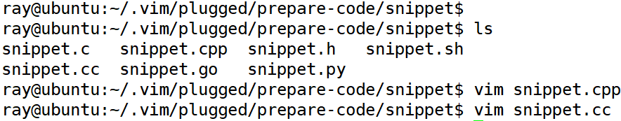
>
> snippet.cpp模板
>
> ```c++
> #include <iostream>
> using std::cout;
> using std::endl;
> 
> void test(){
> 
> }
> 
> int main()
> {
>     test();
>     return 0;
> }
> ```
>
> snippet.h
>
> ```c++
> #ifndef 
> #define 
> 
> #endif
> ```
>
> 


首先从我们最常见到C++的hello,world代码入手，来认识一下C++语言

```C++
//C++的头文件,默认位置在/usr/include/c++目录
#include <iostream>
//命名空间
using namespace std;

int main(int argc, char * argv[]){
    //这行代码的作用类似于printf("hello,world\n");C语言中和C++中使用不同的表述形式
 	cout << "hello,world" << endl;
	return 0;
}
```


可能大家会产生这样的一些疑问

（1）iostream是C++标准库头文件，为什么没有后缀？

​	—— 模板阶段再作讲解

（2）using namespace std/using std::cout是什么含义？

​	—— 命名空间的使用

（3） cout << "hello,world" << endl; 实现了输出hello,world的功能，如何理解这行代码？

​	—— C++输出流的使用

## 命名空间

###  为什么要使用命名空间

一个大型的工程往往是由若干个人独立完成的，不同的人分别完成不同的部分，最后再组合成一个完整的程序。由于各个头文件是由不同的人设计的，有可能在不同的头文件中用了相同的名字来命名所定义的类或函数，这样在程序中就会出现名字冲突。

名字冲突就是在同一个作用域中有两个或多个同名的实体，C语言中避免名字冲突，只能进行起名约定。

```C
int hw_cpp_tom_num = 100;
int wd_cpp_bob_num = 200;
```

C++为了解决命名冲突 ，引入了**命名空间**，所谓命名空间就是一个可以由用户自己定义的作用域，在不同的作用域中可以定义相同名字的变量，互不干扰，系统能够区分它们。

###  什么是命名空间

命名空间又称为名字空间，是程序员命名的内存区域，程序员根据需要指定一些有名字的空间域，把一些全局实体分别存放到各个命名空间中，从而与其他全局实体分隔开。通俗的说，每个名字空间都是一个名字空间域，存放在名字空间域中的全局实体只在本空间域内有效。名字空间对全局实体加以域的限制，从而合理的解决命名冲突。

C++中定义命名空间的基本格式如下：

```C++
namespace wd
{
int val1 = 0;
char val2;
}// end of namespace wd
```

在声明一个命名空间时，大括号内不仅可以存放变量，还可以存放以下类型：

变量、常量、函数、结构体、引用、类、对象、模板、命名空间等，它们都称为**实体**

```c++
#include <iostream>
using std::cout;
using std::endl;
namespace wd{
//定义变量
int number = 10;
//定义常量
const int daysOfWeek = 7;

//定义函数
void m1(){
    cout << "wd::m1" << endl;
}
//等等......
}


int main()
{
    cout << "Hello world" << endl;
    return 0;
}
```


那么命名空间中的实体如何使用呢？

### 命名空间的使用方式

命名空间一共有三种使用方式，分别是using编译指令、作用域限定符、using声明机制。

#### 作用域限定符

> 每次要使用某个命名空间中的实体时，都直接加上<span style=color:red;background:yellow>**作用域限定符::**</span>
>
> 例如：
>
> ```C++
> namespace wd
> {
> int number = 10;
> void display()
> {
> 	//cout,endl都是std空间中的实体，所以都加上'std::'命名空间
> 	std::cout << "wd::display()" << std::endl;
> }
> }//end of namespace wd
> 
> void test0()
> {
> 	std::cout << "wd::number = " << wd::number << endl;
> 	wd::display();
> }
> ```
>
> 
>
>  以helloworld程序为例，可能在很多地方的范例长这个样子，也是没有问题的
>
>    ``` c++
>   #include <iostream>
> 
>    int main(int argc, char * argv[]){
>        	std::cout << "hello,world" << std::endl;
>    		return 0;
>    }
>    ```
>
>    好处：准确，只要命名空间中确实有这个实体，就能够准确调用（访问）
>
>    坏处：繁琐，如果某个命名空间中定义了非常多的实体，每次使用当前命名空间内的实体时，都需要使用这种方式才可以访问


#### using编译指令

> 如helloworld程序中的写法，其中std代表的是标准命名空间。
>
> cout和endl都是std中的实体，使用了using编译指令后，这两个实体就可以直接使用了。但是这种方式的缺陷便是会将std命名空间中的全部实体引入，如果在开发过程中编写的变量或者函数和该命名空间中的实体重名，则会出现问题。
>
> ```C++
> #include <iostream>
> using namespace std; //using编译指令
> 
> int main(int argc, char * argv[]){
>     cout << "hello,world" << endl;
>     return 0;
> }
> ```
>


> <span style=color:red;background:yellow>**注意1：**</span>using编译指令尽量写在局部作用域。如下所示，test1和test2函数内分别使用了不同命名空间里面的实体，互不影响。
>
> 
>
> ``` c++
> #include <iostream>
> using namespace std;
> 
> namespace wd{
> 
>     int number = 10;
> }
> 
> namespace wh{
>     int number = 20;
> }
> 
> void test1(){
>     //此处希望使用wd里面的number
>     using namespace wd;
>     
>     cout << number << endl;
> }
> 
> void test2(){
>     //此处希望使用wd里面的number
>     using namespace wh;
>     
>     cout << number << endl;
> }
> 
> int main()
> {
>     test1();
>     test2();
>     return 0;
> }
> ```
>
> <font color=red>**建议：**</font>
>
> **将using编译指令写在局部作用域**，这样using编译指令的效果也会在其作用域结束时结束。
>
> 当然如果需要在同一个作用域下使用两个命名空间中同名的实体，这种方法就不可行了，可以采用第一种方式加上命名空间的作用域限定。


> <span style=color:red;background:yellow>**注意2：**</span>这种方式使用命名空间中的实体时，要注意避免命名空间中实体与全局位置实体同名。
>
> 
>
> ``` c++
> int number = 100;
> 
> namespace wd
> {
> int number = 10;
> void display()
> {
> 	cout << "wd::display()" << endl;
> }
> }//end of namespace wd
> 
> 
> void test0()
> {
>     using namespace wd;
> 	cout << number << endl; //error,有冲突
> }
> ```


> <span style=color:red;background:yellow>**注意3：**</span> 在不清楚命名空间中实体的具体情况时，尽量不使用using编译指令
>
> 
>
> 如果一个名称空间中有多个实体，使用using编译指令，就会把该空间中的所有实体一次性引入到程序之中。
>
> 对于初学者来说，如果对一个命名空间中的实体并不熟悉时，直接使用这种方式，有可能还是会造成名字冲突的问题，而且出现错误之后，还不好查找错误的原因
>
> 
>
> ```C++
> #include <iostream>
> using namespace std;
> 
> //如果不知道std中有cout这个实体，
> //可能回去定义一个cout函数
> double cout()
> {
> 	return 1.1;
> }
> 
> int main(void)
> {
> 	cout();
> 	return 0;
> }
> ```
>


#### using声明机制

**在初学C++的阶段，我们推荐使用的using声明机制。**—— 需要什么就声明什么

> using声明机制的作用域是从using语句开始，到using所在的作用域结束。
>
> 同样的，建议将using声明语句写在局部作用域中。此时即使命名空间中实体与全局位置实体重名，在局部位置也遵循“就近原则”形成屏蔽
>
> 
>
> ```C++
> #include <iostream>
> using std::cout;
> using std::endl;
> 
> int number = 100;
> 
> namespace wd
> {
> int number = 10;
> void display()
> {
> 	cout << "wd::display()" << endl;
> }
> }//end of namespace wd
> 
> 
> int main(void)
> {
>  	using wd::number;
> 	using wd::display;//只写函数名
>  	cout << "wd::number = " << number << endl;   //ok，访问到wd::number
> 	display();
>  	return 0；
> }
> ```
>
> 
>
> <span style=color:red;background:yellow>**注意**</span>
>
> 在同一作用域内用using声明的不同的命名空间的实体，不能是同名的，否则会发生冲突。
>
> ``` c++
> namespace wd
> {
> int number = 10;
> void display()
> {
> 	cout << "wd::display()" << endl;
> }
> }//end of namespace wd
> 
> namespace wd2
> {
> void display()
> {
> 	cout << "wd2::display()" << endl;
> }
> }//end of namespace wd2
> 
> void test0(){
>  	using wd::display;
> 	using wd2::display; 
>  	display(); //冲突
>     	wd::display();
>     	wd2::display();
> }
> ```
>
> 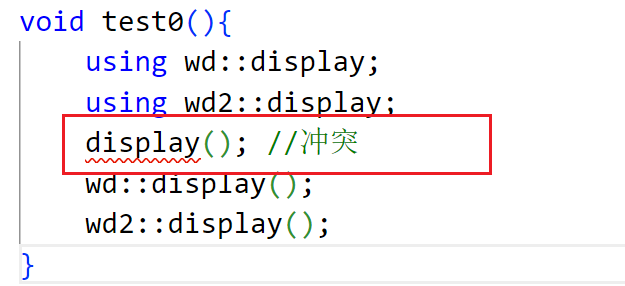
>
> **using声明机制的特点是：需要哪个实体的时候就引入到程序中，不需要的实体就不引入，尽可能减小犯错误的概率。**


### 命名空间的扩展使用

现在定义两个namespace wd和wh，二者的函数之间进行相互调用，关系如下：

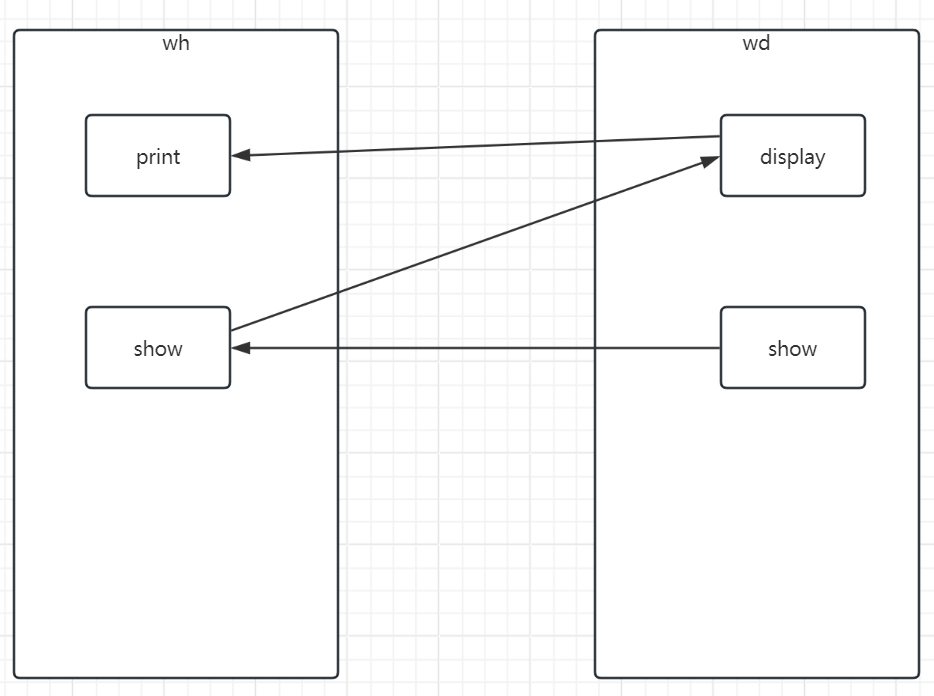

此时会出现namespace未声明，无法解析的问题，此时可以将被调用的namespace里面的函数实体预先声明

```c++
#include <iostream>
using std::cout;
using std::endl;
//先提前声明
namespace wd{
    void show();
    void display();
}

namespace wh{
    
void print(){
    cout << "wh:print" << endl;
}
void show(){
    cout << "wh:show"<< endl;
    wd::display();
}
}

namespace wd{
void display(){
    cout << "wd::display" << endl;
    wh::print();
}

void show(){
    cout << "wd:show"<< endl;
    wh::show();
}
}

int main()
{
    wd::show();
    cout << "Hello world" << endl;
    return 0;
}
```

这种方式也称之为带命名空间的函数声明。通过上述案例，我们可以得出一个结论，命名空间是可以支持进行扩展的。

###  命名空间的嵌套使用

类似于文件夹下还可以建立文件夹，命名空间中还可以定义命名空间。那么内层命名空间中的实体如何访问呢？


``` c++
namespace wd
{
int num = 100;

void func(){
    cout << "func" << endl;
}

namespace cpp
{
int num = 200;

void func(){
    cout << "cpp::func" << endl;
}
}//end of namespace cpp

}//end of namespace wd

//方式一，使用作用域限定精确访问实体
void test0(){
    cout << wd::cpp::num << endl;
    wd::cpp::func();
}

//方式二，using编译指令一次性引入cpp的实体
void test1(){
    using namespace wd::cpp;
    cout << num << endl;
    func();
}

//方式三，using声明语句
void test2(){
    using wd::cpp::num;
    using wd::cpp::func;
    cout << num << endl;
    func();
}
```

### 全局命名空间VS匿名命名空间

> 全局命名空间:全局命名空间是C++程序中默认的顶层命名空间,其中的名称没有域限定,直接使用名称即可访问。它的作用域范围是整个程序。在所有函数外部定义的名字自动属于全局命名空间。
>
> 匿名命名空间:匿名命名空间是一个没有名字的命名空间，它用于封装不希望暴露给外部的实体，如函数、变量和类等。定义的实体只在当前文件中可见，不会被其他文件访问到，从而避免了与其他文件中相同名称的变量或函数发生冲突。
>
> ```c++
> #include <iostream>
> using std::cout;
> using std::endl;
> 
> //全局命名空间
> int number = 10;
> 
> //匿名命名空间
> namespace{
>     int digit = 20;
> }
> //当前函数也是属于全局命名空间
> void test1(){
>     //打印全局命名空间的number
>     cout << "访问全局命名空间number=" << number << endl;
>     cout << "访问全局命名空间number=" << ::number << endl;
>     //访问匿名命名空间的digit
>     cout << "访问匿名命名空间digit=" << digit << endl;
>     cout << "访问匿名命名空间digit=" << ::digit << endl;
> 
> }
> int main()
> {
>     test1();
>     cout << "Hello world" << endl;
>     return 0;
> }
> ```
>
> 二者的访问方式基本一致，只是匿名命名空间的变量作用域限于定义所在文件内。

### 使用命名空间的规则


> 在命名空间中可以声明实体、定义实体，但是不能使用实体。**命名空间中的实体一定在命名空间之外使用**，可以理解为命名空间只是用来存放实体。
>
> 
>
> ```` c++
> namespace wd
> {
>  void func();
>  void func2(){
>      cout << "func2()" << endl;
>  }
>  func2();//error
> 
>  int num = 10;
>  num = 100;//error
> }
> 
> void test1(){
>  	wd::func2(); 
>  	wd::num = 100;
>  	cout << wd::num << endl;
> }
> ````


### 总结

**命名空间的作用：**

1. 避免命名冲突：命名空间提供了一种将全局作用域划分成更小的作用域的机制，用于避免不同的代码中可能发生的命名冲突问题；

2. 组织代码：将相关的实体放到同一个命名空间；

3. 版本控制：不同版本的代码放到不同的命名空间中；

   总之，需要用到代码分隔的情况就可以考虑使用命名空间。

还有一个隐藏的好处：声明主权。


> 下面引用当前流行的命名空间使用<font color=red>**指导原则**</font>：
>
> 1. 提倡在已命名的名称空间中定义变量，而不是直接定义外部全局变量或者静态全局变量。
>
> 2. 如果开发了一个函数库或者类库，提倡将其放在一个命名空间中。
>
> 3. **对于using 声明，首先将其作用域设置为局部而不是全局（*）。**
>
> 4. 不要在头文件中使用using编译指令，这样，使得可用名称变得模糊，容易出现二义性。
>
> 5. 包含头文件的顺序可能会影响程序的行为，如果非要使用using编译指令，建议放在所有#include预编译指令后。

规范补充：include多个头文件，首先放自定义的头文件，再放C的头文件，再放C++的头文件，最后放第三方库的头文件。

## const关键字

###  修饰内置类型*

const修饰的变量称为const常量，之后不能修改其值。(本质还是变量，使用时也是当成变量使用，只是被赋予只读属性)

整型、浮点型数据都可以修饰，它们被称为const常量。<span style=color:red;background:yellow>**const常量在定义时必须初始化。**</span>

```C++
const int number1 = 10;
int const number2 = 20;


const int val;//error 常量必须要进行初始化，这种方式不被允许
```


除了这种方式可以创建常量外，还可以使用宏定义的方式创建常量

```C++
#define NUMBER 1024
```


> 由此引出一个**面试常考题**：
>
> <span style=color:red;background:yellow>**const常量和宏定义常量的区别**</span>
>
> 1. <font color=red>**发生的时机不同**</font>：C语言中的宏定义发生时机在预处理时，做字符串的替换，如果出现了bug，则需要到运行阶段才可以发现；而const常量是在编译时（const常量本质还是一个变量，只是用const关键字限定之后，赋予只读属性，使用时依然是以变量的形式去使用）
>
> 2. <font color=red>**类型和安全检查不同**</font>：宏定义没有类型，不做任何类型检查；**const常量有具体的类型**，在编译期会执行类型检查。
>
>    在使用中，应尽量以const替换宏定义常量，可以减小犯错误的概率。
>
> ```c++
> #include <iostream>
> using std::cout;
> using std::endl;
> #define MAX 100
> #define MULTIPLY(x,y) x * y
> 
> int main()
> {
>     int a = 1, b = 2, c = 3, d = 4;
>     //期望的运行结果和实际的运行结果相差较大
>     int result = MULTIPLY(a + b, c + d);
>     cout << result << endl;
>     cout << MAX << endl;
>     //const int a;
>     //下面的表述方法便是错误的
> //    a = 20
>     cout << "Hello world" << endl;
>     return 0;
> }
> ```
>
> 

###  修饰指针类型*

以int指针为例，用const修饰有三种形式：

`const int * p`      `int const * p1`     ` int * const p2`


> 可能有些资料上将其归类为指针常量和常量指针。我们采取C++之父的说法，参考《C++程序设计语言》给出定义，分别是指向常量的指针(pointer to const)和常量指针(const pointer)。
>
> ```C++
> int number1 = 10;
> int number2 = 20;
> 
> const int * p1 = &number1;//指向常量的指针
> *p1 = 100;//error 通过p1指针无法修改其所指内容的值
> p1 = &numbers;//ok 可以改变p1指针的指向
> ```
>
> 例子中p1称为指向常量的指针（pointer to const），尽管number1本身并不是一个int常量，但定义指针p1的方式决定了无法通过p1修改其指向的值。但值得注意的是，修改p1的指向是允许的。
>
> 
>
> 补充：如果有一个const常量，那么普通的指针也无法指向这个常量，只有指向常量的指针才可以。
>
> ```` c++
> const int x = 20;
> int * p = &x; //error
> const int * cp = &x; //ok
> ````
>


> 指向常量的指针还有第二种写法，各种特点同上，一般较少采用
>
> ``` c++
> int const * p2 = &number1; //常量指针的第二种写法
> ```
> 
> **总结：const在*左边，即为指向常量的指针，不能通过指针改变其指向的值，但是可以改变这个指针的指向。**


> 另一种方式定义的指针称为常量指针，从右往左读，先const后*，即常量指针（const pointer）
>
> ``` c++
> int * const p3 = &number1;//常量指针
> *p3 = 100;//ok 通过p3指针可以修改其所指内容的值
> p3 = &number2;//error 不可以改变p1指针的指向
> ```
>
> **总结：const在*右边，即为常量指针，不能改变这个指针的指向，但是可以通过指针改变其指向的值。**


> 双重const限定的指针
>
> ``` c++
> const int * const p4 = &number1;//指向和指向的值皆不能进行修改
> ```


与这组概念相似的，再补充两组对比，也应该理解其含义，尝试写代码，分辨一下：

数组指针/指针数组

**问题：arr是一个数组，那么arr和&arr之间有什么区别？？？？？**

- **arr表示的是数组首元素，类型是int*类型**

- **&arr表示的是整个数组的地址，类型是int(*)[5]**

- **arr+1会指向数组中下一个元素,&arr+1会跳过整个数组**

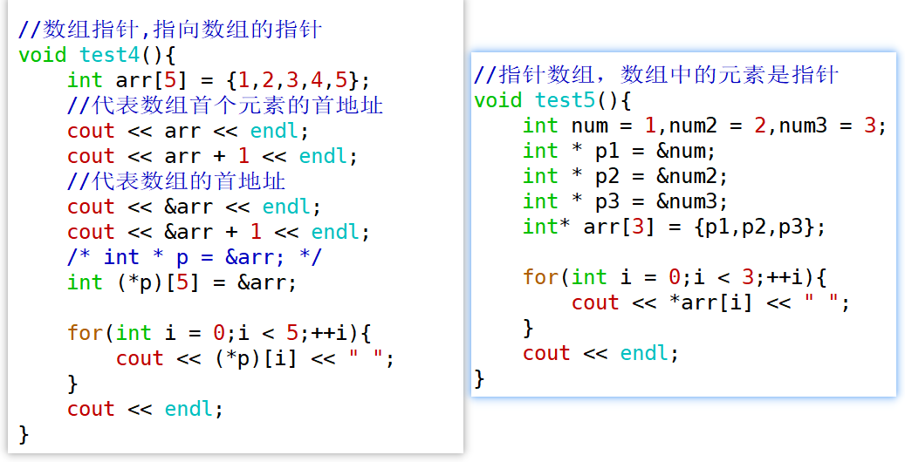


函数指针/指针函数

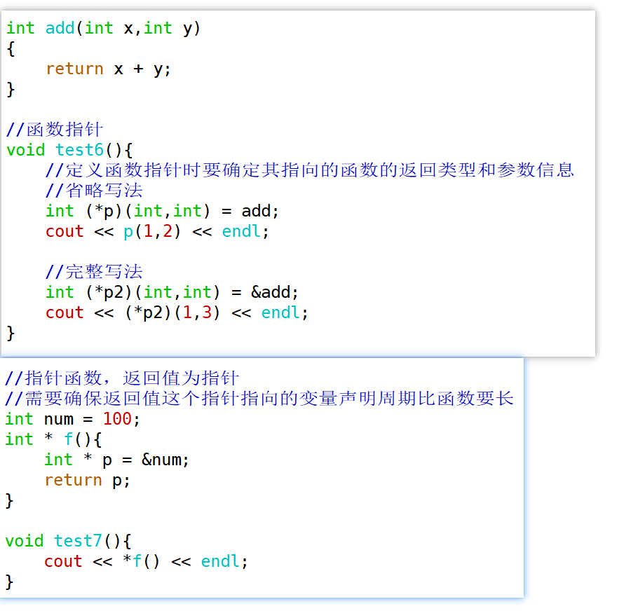

使用函数指针来实现一个简易的计算器功能

```c++
#include <iostream>
using namespace std;

int add(int a, int b){
    return a + b;
}

int sub(int a, int b){
    return a - b;
}

int multiply(int a, int b){
    return a * b;
}

int divide(int a, int b){
    return a / b;
}

void test(int a, const char * operation, int b){
    int (*pFunc)(int,int);
    if(operation == "+"){
        pFunc = add;
    }else if(operation == "-"){
        pFunc = sub;
    }else if(operation == "*"){
        pFunc = multiply;
    }else if(operation == "/"){
        pFunc = divide;
    }else{
        cout << "operation error" << endl;
        return;
    }
    cout << a << operation << b << "=";
    cout << pFunc(a,b) << endl;
}

int main() {

    test(10, "+", 20);
    test(10, "-", 20);
    test(10, "*", 20);
    test(10, "/", 20);
    return 0;
}
```

## new/delete表达式

### C/C++申请、释放堆空间的方式对比

**C语言中使用malloc/free函数，C++使用new/delete表达式**

```c++
#include <iostream>
#include <string.h>
using std::cout;
using std::endl;

int main()
{
    //1.申请空间
    int *pInt = (int*)malloc(sizeof(int));
    //2.初始化（清零）
    memset(pInt, 0, sizeof(int));
    //3.操作 赋值
    *pInt = 10;
    //4.回收空间
    free(pInt);
    pInt = NULL;
    cout << "Hello world" << endl;
    return 0;
}
```

new语句中可以不加参数，初始化为各类型默认值；也可加参数，参数代表要初始化的值

```C++
int * p1 = new int();//初始化为该类型的默认值
cout << *p1 << endl;

*p1 = 200;

int * p2 = new int(1);
cout << *p2 << endl;


```

### valgrind工具集*

valgrind是一种开源工具集，它提供了一系列用于调试和分析程序的工具。其中最为常用和强大的工具就是memcheck。它是valgrind中的一个内存错误检查器，它能够对C/C++程序进行内存泄漏检测、非法内存访问检测等工作。

- <font color=red>**sudo apt install valgrind**</font>

安装完成后即可通过memcheck工具查看内存泄漏情况，编译后输入如下指令

```C++
valgrind --tool=memcheck ./a.out
```

如果想要更详细的泄漏情况，如造成泄漏的代码定位，编译时加上-g

```C++
valgrind --tool=memcheck --leak-check=full ./a.out
```

但是这么长的指令使用起来不方便，每查一次就得输入一次，可以设置一下。


- 在home目录下编辑.bashrc文件，改别名

  cd ~

  vim .bashrc

  ```C++
  alias memcheck='valgrind --tool=memcheck --leak-check=full --show-reachable=yes'
  ```

- 重新加载 source .bashrc

- 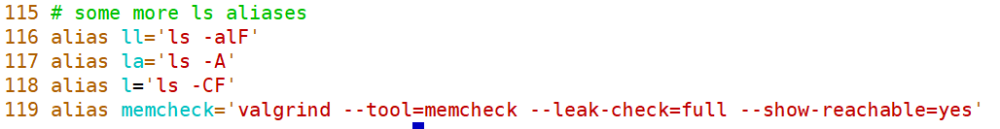

改写之后，就可以直接使用memcheck指令查看内存泄漏情况     ——  memcheck ./a.out

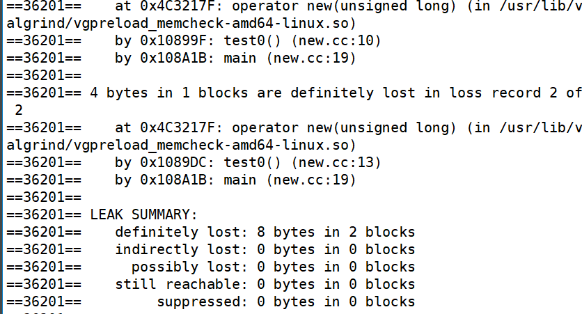

（1）绝对泄漏了；（2）间接泄漏了；（3）可能泄漏了，基本不会出现；（4）没有被回收，但是不确定要不要回收；（5）被编译器自动回收了，不用管


如上发生了两处泄漏，一共泄漏了8个字节，此时需要对new表达式申请的空间进行回收

``` c++
int * p1 = new int();
cout << *p1 << endl;
delete p1;

int * p2 = new int(4);
cout << *p2 << endl;
delete p2;
```


> 通过new表达式的使用，引申出**常考面试题**
>
> <span style=color:red;background:yellow>**malloc/free 和 new/delete 的区别**</span>
>
> 1. malloc/free是C语言中的库函数；new/delete是C++语言中的表达式；
> 2. new表达式的返回值是相应类型的指针，malloc返回值是void*；
> 3. malloc申请的空间不会进行初始化，获取到的空间是有脏数据的，但new表达式申请空间时可以直接初始化；
> 4. malloc的参数是字节数，new表达式不需要传递字节数，会根据相应类型自动获取空间大小。


###  new表达式申请数组空间

new表达式还可以申请数组空间 

```C++
int * p3 = new int[10]();
for(int idx = 0; idx < 10; ++idx)
{
	p3[idx] = idx;
}

for(int idx = 0; idx < 10; ++idx){
    cout << p3[idx] << endl;
}

delete [] p3;
```

其中申请字符数组空间(也就是字符串)的相关知识点，会放在后续的章节中进行专门的介绍。

还可采用大括号的形式

``` c++
int * p4 = new int[3]{1,2,3};
for(int idx = 0; idx < 3; ++idx){
    cout << p4[idx] << endl;
}
delete [] p4;
```

**使用new语句申请数组空间需要使用delete [] p的形式回收堆空间**

### 回收空间时的注意事项 

（1）三组申请空间和回收空间的匹配组合

```
malloc            free
    
new               delete
    
new int[5]()      delete[]
```

如果没有匹配，memcheck会报出错误匹配的信息.


（2）安全回收

 delete只是回收了指针指向的空间，但这个指针变量依然还在，指向了不确定的内容（野指针），容易造成错误。所以需要进行安全回收，将这个指针设为空指针。C++11之后使用<span style=color:red;background:yellow>**nullptr**</span>表示空指针。

``` c++
    int * p1 = new int();//初始化为该类型的默认值
    cout << *p1 << endl;
    delete p1;
    p1 = nullptr;//安全回收

	int * p3 = new int[10]();
    for(int i = 0; i < 10; ++i){
        p3[i] = i;
    }

    delete [] p3;
    p3 = nullptr;
```

## 引用（最重点）

### 引用的概念

在C++中，在逻辑层面上（在使用时），<span style=color:red;background:yellow>**引用是一个已定义变量的别名**</span>。

其语法是：

```C++
//定义方式：    类型 & ref = 变量；
int number = 2；
int & ref = number;
```

在使用引用的过程中，要注意以下几点：

1. &在这里不再是取地址符号，而是引用符号

2. 引用的类型需要和其绑定的变量的类型相同（目前这样使用，学习继承后这一条有所不同）
3. <font color=red>**声明引用的同时，必须对引用进行初始化，否则编译时报错**</font>
4. <span style=color:red;background:yellow>**引用一经绑定，无法更改绑定**</span>

``` c++
void test0(){
    int num = 100;
    int num2 = 20;
    int & ref = num;//声明ref时进行了初始化（绑定）
    //int & ref2; //error
    cout << num << endl;
    cout << ref << endl;
    cout << &num << endl;
    cout << &ref << endl;
    
    ref = 1;
    //修改ref的值，num的值也会随之修改
    cout << num << endl;
	//这是一个赋值操作，并不是更改绑定
    ref = num2;
    cout << &num2 << endl;
    cout << &num << endl;
    cout << &ref << endl;
}
```

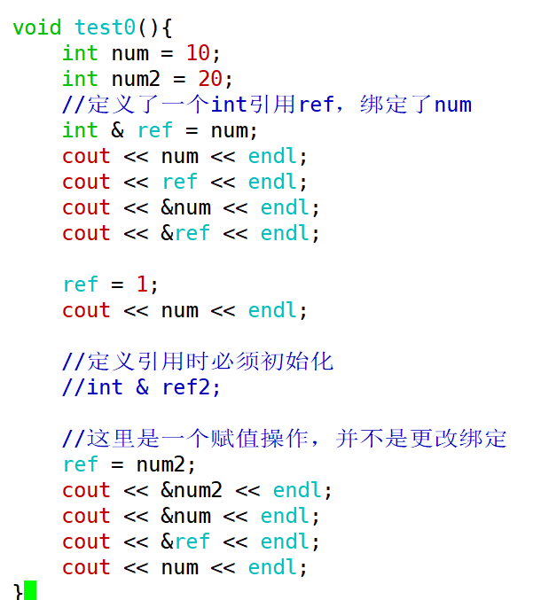

### 引用与指针的联系与区别*

这是一道非常经典的面试题，请尝试着回答一下：

联系：

1. 引用和指针都有地址的概念，都是用来间接访问变量。指针指向一块内存，它的内容是所指内存的地址；引用是某块内存的别名；

2. 引用的底层还是指针来完成，可以把引用视为一个受限制的指针。

区别：

1. 引用是一个别名，而指针是一个实体
2. 引用使用时无需解引用，而指针使用时需要解引用
3. 引用只能够在定义的时候初始化一次，之后不可变；指针可变
4. **sizeof引用得到的是所指向的变量的大小；而sizeof指针得到的是指针本身的大小**
5. 指针和引用的自增运算含义不一样

###  引用的使用场景

#### 引用作为函数的参数（重点）

在没有引用之前，如果我们想通过形参改变实参的值，只有使用指针才能到达目的。但使用指针的过程中，不好操作，很容易犯错。 而引用既然可以作为其他变量的别名而存在，那在很多场合下就可以用引用代替指针，因而也具有更好的可读性和实用性。这就是引用存在的意义。

一个经典的例子就是交换两个变量的值，请实现一个函数，能够交换两个int型变量的值：

```` c++
void swap(int x, int y){//值传递，发生数值的复制
    int temp = x;
    x = y;
    y = temp;
}

void swap2(int * px, int * py){//地址传递，发生地址值的复制
    int temp = *px;
    *px = *py;
    *py = temp;
}

//在实参传给swap3时，
//其实就是发生了初始化int & x = a;
//int & y = b;
void swap3(int & x, int & y){//引用传递，不复制
    int temp = x;
    x = y;
    y = temp;
}
````

补充：之后，如果一个函数的功能不需要改变实参本身的值，而且参数类型是内置类型，可以依然使用值传递；

引用传递作为函数参数，会初始化引用，因为引用的底层是指针实现，所以也会有额外开销（比较小），如果函数参数是较大的对象或数据，那么使用引用作为函数参数可以避免复制实参，这样做可以减少开销。

当然，如果函数中需要改变实参本身的内容，值传递就无法实现了，需要引用传递（或者地址传递）。


参数传递的方式包括值传递、指针传递和引用传递。

> 采用值传递时，系统会在内存中开辟空间用来存储形参变量，并将实参变量的值拷贝给形参变量。
>
> 也就是说形参变量只是实参变量的副本而已；如果函数传递的是类对象，而该对象占据的存储空间比较大，那发生复制就会造成较大的不必要开销。
>
> 这种情况下，强烈建议使用引用作为函数的形参，这样会大大提高函数的时空效率。

> 当用引用作为函数的参数时，其效果和用指针作为函数参数的效果相当。当调用函数时，函数中的形参就会被当成实参变量或对象的一个别名来使用，也就是说此时**函数中对形参的各种操作实际上是对实参本身进行操作**，而非简单的将实参变量或对象的值拷贝给形参。

> 使用指针作为函数的形参虽然达到的效果和使用引用一样，但当调用函数时仍需要为形参指针变量在内存中分配空间，也由于指针的灵活更可能导致问题的产生，故在C++中推荐使用引用而非指针作为函数的参数。


如果不希望函数体中通过引用改变传入的变量，那么可以使用<span style=color:red;background:yellow>**常引用作为函数参数**</span>

（1）不会修改值        （2）不会复制（不会造成不必要的开销）


``` c++
void test1(){
    int num = 18;
    //const引用绑定变量，既不能修改指向
    //也不能通过这个引用改变变量的值
    const int & ref = num;
    //ref = 20; //error
    num = 10;
    cout << ref << endl;
}

void func(const int & x){
    x = 100; //error
}
```

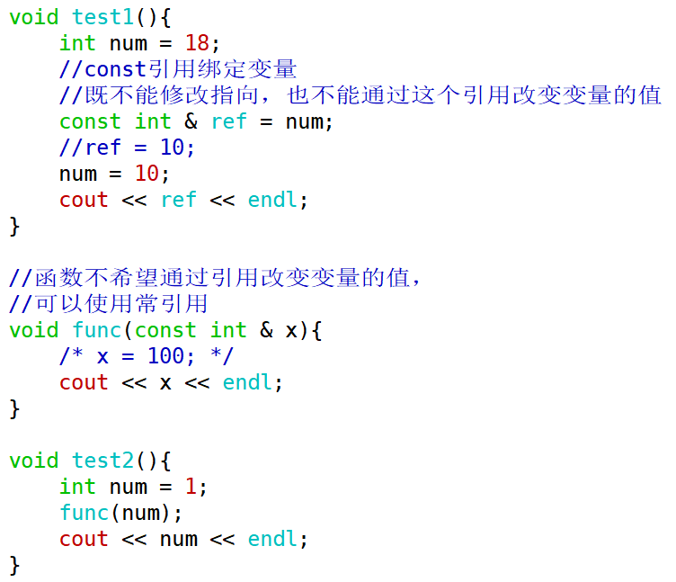

#### 引用作为函数的返回值

要求：当以引用作为函数的返回值时，<span style=color:red;background:yellow>**返回的变量其生命周期一定是要大于函数的生命周期**</span>的，即当函数执行完毕时，返回的变量还存在。

目的： 避免复制，节省开销

```C++
int a = 100;
int func(){
    //func函数返回的是a的一个副本（临时变量）
    return a;   //在函数内部，当执行return语句时，会发生复制 
}   

int b = 200;//要注意返回的引用绑定的变量生命周期要比函数更长
int & func2(){
     //返回的实际是一个绑定到b的引用
    return b;   //在函数内部，当执行return语句时，不会发生复制
}  

void test(){
    cout << func() << endl;
    //&func(); error 编译器不允许对临时变量取地址
    cout << &a << endl;
    cout << &func2() << endl;
    cout << &b << endl;
}
```


**注意事项**

1. **不要返回局部变量的引用**。因为局部变量会在函数返回后被销毁，被返回的引用就成为了"无所指"的引用，程序会进入未知状态。

```C++
int & func()
{
	int number = 1;
    return number;
}
```


2. <span style=color:red;background:yellow>**不要轻易**</span>返回一个堆空间变量的引用，非常容易造成内存泄漏。

```C++
int & func()
{
	int * pint = new int(1);
	return *pint;
}

void test()
{
	int a = 2, b = 4;
	int c = a + func() + b;//内存泄漏
}
```

如果函数返回的是一个堆空间变量的引用，那么这个函数调用一次就会new一次，非常容易造成内存泄露。所以谨慎使用这种写法，并且要有完善的回收机制。

### 总结

引用总结：

1. 在引用的使用中，单纯给某个变量取个别名没有什么意义，引用的目的主要用于在函数参数传递中，解决大块数据或对象的传递效率和空间不理想的问题。
2. 用引用传递函数的参数，能保证参数传递中不产生副本，提高传递的效率，还可以通过const的使用，保证了引用传递的安全性。
3. 引用与指针的区别是，指针通过某个指针变量指向一个变量后，对它所指向的变量间接操作。程序中使用指针，程序的可读性差；引用底层仍然是指针，但是编译器不允许访问到这个底层的指针，逻辑上简单理解为——对引用的操作就是对目标变量的操作。<font color=red>**可以用指针或引用解决的问题，更推荐使用引用**</font>。

## 强制转换

C语言中的强制转换在C++代码中依然可以使用，这种C风格的转换格式非常简单

```C++
TYPE a = （TYPE）EXPRESSION;
```

但是c风格的类型转换有不少的缺点，有的时候用c风格的转换是不合适的，因为它可以在任意类型之间转换，比如你可以把一个指向const对象的指针转换成指向非const对象的指针，把一个指向基类对象的指针转换成指向一个派生类对象的指针，这两种转换之间的差别是巨大的，但是传统的c语言风格的类型转换没有区分这些。

另一个缺点就是，c风格的转换不容易查找，它由一个括号加上一个标识符组成，而这样的东西在c++程序里一大堆。c++为了克服这些缺点，引进了4个新的类型转换操作符，他们是static_cast，const_cast，dynamic_cast，reinterpret_cast.不过后三个使用的其实并不算特别多，所以，重点给大家介绍一下第一个的使用。

### static_cast  

最常用的类型转换符，在正常状况下的类型转换, 用于将一种数据类型转换成另一种数据类型，如把int转换为float

使用形式  

``` c++
目标类型 转换后的变量 = static_cast<目标类型>(要转换的变量)
```

好处：不允许非法的转换发生；方便查找


```C++
int iNumber = 100；
float fNumber = 0；
fNumber = (float) iNumber；//C风格
fNumber = static_cast<float>(iNumber);
```

也可以完成指针之间的转换，例如可以将void*指针转换成其他类型的指针

```C++
void * pVoid = malloc(sizeof(int));
int * pInt = static_cast<int*>(pVoid);
*pInt = 1;
```

但<span style=color:red;background:yellow>**不能完成任意两个指针类型间的转换**</span>

```C++
int iNumber = 1;
int * pInt = &iNumber;
float * pFloat = static_cast<float *>(pInt);//error
```


总结，static_cast的用法主要有以下几种：

1）用于基本数据类型之间的转换，如把int转换成char，把int转换成enum。这种转换的安全性需要开发人员来保证；

2）把void指针转换成目标类型的指针，但不安全；

3）把任何类型的表达式转换成void类型；

4）用于类层次结构中基类和子类之间指针或引用的转换（后面学）。

## 函数重载

在实际开发中，有时候需要实现几个功能类似的函数，只是细节有所不同。 如交换两个变量的值，但这两种变量可以有多种类型，short, int, float等。在C语言中，必须要设计出不同名的函数，其原型类似于：

```C
void swap1(short *, short *);
void swap2(int *, int *);
void swap3(float *, float *);
```

但在C++中，这完全没有必要。C++ 允许多个函数拥有相同的名字，只要它们的参数列表不同就可以，这就是函数重载（Function Overloading）。借助重载，一个函数名可以有多种用途。

<font color=red>**在同一作用域内，可以有一组具有相同函数名，不同参数列表的函数，这组函数被称为重载函数。**</font>重载函数通常用来命名一组功能相似的函数，这样做减少了函数名的数量，对于程序的可读性有很大的好处。

注意：C 语言中不支持函数重载，C++才支持函数重载。

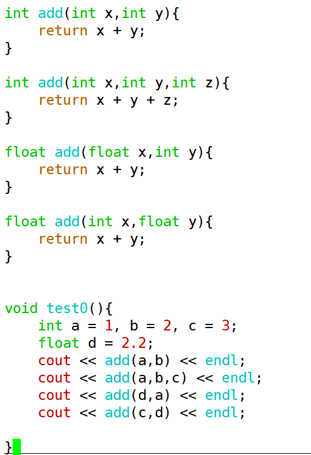

```c++
int add(int x, int y){
    return x + y;
}

int add(int x ,int y, int z){
    return x + y + z;
}

float add(float x, int y){
    return x + y;
}

float add(int x, float y){
    return x + y;
}

void test(){
    int a = 1, b = 2, c = 3;
    float d = 2.2;
    cout << add(a, b) << endl;
    cout << add(a, b, c) << endl;
    cout << add(d, a) << endl;
    cout << add(c, b) << endl;
}
```

###  实现函数重载的条件

**函数参数的数量、类型、顺序任一不同则可以构成重载。**

只有返回类型不同，参数完全相同，是不能构成重载的

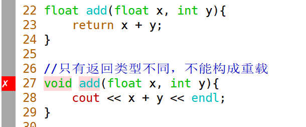


### 函数重载的实现原理

实现原理：  名字改编(name mangling)——当函数名称相同时 ，会根据参数的类型、顺序、个数进行改编

- g++ -c Overload.cc
- nm Overload.o

其中-c选项表示仅进行编译成目标文件(.o)，但是不会生成可执行文件(预处理、编译、汇编、链接、执行)。nm指令是一个在 Unix/Linux 系统中常用的命令行工具，用于显示目标文件（如 `.o` 文件或可执行文件）中的符号表信息。符号表包含了函数、变量等符号的名称、类型和地址信息。

查看目标文件，可以发现原本的函数名都被改编成与参数相关的函数名。

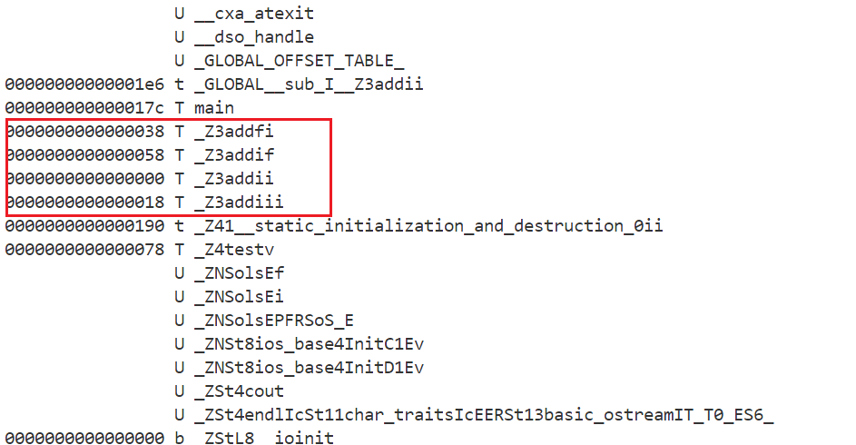

而C语言没有名字改编机制。

分析：C++的函数重载提供了一个便利，以前C语言要想实现各种不同类型参数的计算需要定义多个不同名字的函数，在调用函数时要注意参数的信息和函数名匹配。

C++有了函数重载，想要对不同类型的参数进行计算时，就可以使用同一个函数名字（代码层面的同名，编译器会处理成不同的函数名）。

缺点在于，C++编译器进行编译时比C的编译器多了一个步骤，效率有所降低。

### extern "C"

如果大家仔细分析的话，你会发现，当我们调用C语言中的函数，比如malloc、free等时，我们发现在目标文件中这些函数并没有进行改名操作，因为C语言不支持函数重载，所以肯定不会发生改名操作，但是问题在于在代码中，编译器是如何识别出哪些代码属于C程序代码，哪些代码属于C++程序代码的呢？利用extern "C"来区分C风格代码。

在C/C++混合编程的场景下，如果在C++代码中想要对部分内容按照C的方式编译，应该怎么办？

```C++
extern "C" void func() //用 extern"C"修饰单个函数
{

}

//如果是多个函数都希望用C的方式编译
//或是需要使用C语言的库文件
//都可以放到如下{}中
extern "C"
{
//……
}

```

## 默认参数

### 默认参数的目的

C++可以给函数定义默认参数值。通常，调用函数时，要为函数的每个参数给定对应的实参。

```C++
void func(int x, int y)
{
	cout << "x = " << x << endl;
	cout << "y = " << y << endl;
}
```

无论何时调用func1函数，都必须要给其传递两个参数。

但C++可以给参数定义默认值，如果将func1函数参数中的x定义成默认值0， y定义成默认值0

```C++
void func(int x = 0, int y = 0){
    cout << "x = " << x << endl;
	cout << "y = " << y << endl;
}

void test0(){
    func(24,30);
    func(100);
    func();
}
```

这样调用时，若不给参数传递实参，则func1函数会按指定的默认值进行工作，即缺省调用。

给函数参数赋默认值后就可以进行缺省调用，但是<span style=color:red;background:yellow>**传入的参数优先级高于默认参数。**</span>

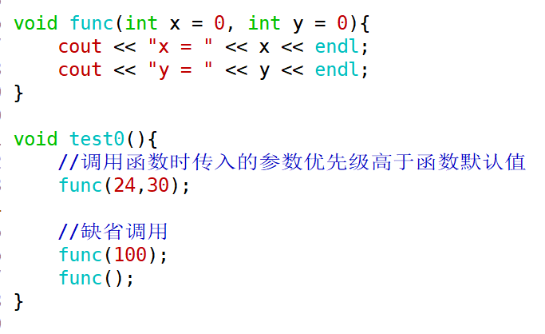

### 默认参数的声明

**一般默认参数在函数声明中提供。**当一个函数既有声明又有定义时，只需要在其中一个中设置默认值即可。若在定义时而不是在声明时置默认值，那么函数定义一定要在函数的调用之前。因为声明时已经给编译器一个该函数的向导，在定义时设默认值时，编译器只有检查到定义时才知道函数使用了默认值。

```C++
//这样可以编译通过
void func(int x,int y);//声明

void test0(){
   func(1,2);
}
//定义
void func(int x,int y){
    cout << x + y << endl;                                              
}
```

```C++
//这样无法缺省调用
void func(int x,int y);

void test0(){
   func();//error
}

void func(int x = 0,int y = 0){
    cout << x + y << endl;                                              
}
```

若先调用后定义，在调用时编译器并不知道哪个参数设了默认值。所以我们<span style=color:red;background:yellow>**通常是将默认值的设置放在声明中而不是定义**</span>中。

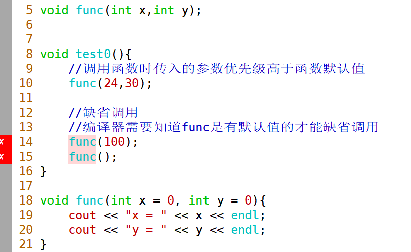

如果在声明中和定义中都传了默认值，会报错

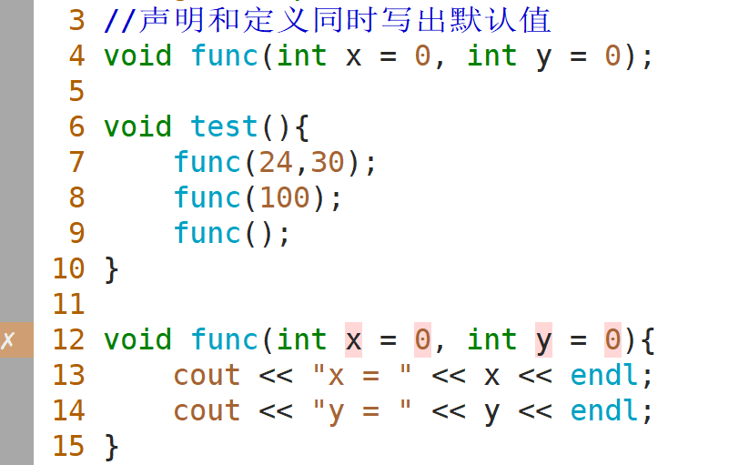

### 默认参数的顺序规定

如果一个函数中有多个默认参数，则形参分布中，默认参数应从右至左逐渐定义。当调用函数时，只能从左向右匹配参数。如：

```C++
void func2(int a = 1, int b, int c = 0, int d);//error
void func2(int a, int b, int c = 0, int d = 0);//ok
```

若给某一参数设置了默认值，那么在参数表中其后所有的参数都必须也设置默认值，否则，由于函数调用时可不列出已设置默认值的参数，编译器无法判断在调用时是否有参数遗漏。

完成函数默认参数的设置后，该函数就可以按照相应的缺省形式进行调用。

<span style=color:red;background:yellow>**总结：函数参数赋默认值从右向左（严格）**</span>

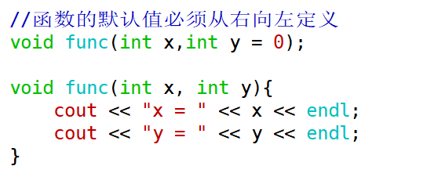

有了这样严格的要求，才能在缺省调用时完成准确的匹配。


### 默认参数与函数重载

默认参数可将一系列简单的重载函数合成为一个。例如：

```C++
void func3();
void func3(int x);
void func3(int x, int y);
//上面三个函数可以合成下面这一个
void func3(int x = 0, int y = 0);
```


如果一组重载函数（可能带有默认参数）都允许相同实参个数的调用，将会引起调用的二义性。

```C++
void func4(int x);
void func4(int x, int y = 0);

func4(1);//error,无法确定调用的是哪种形式的func4
```

<span style=color:red;background:yellow>**所以在函数重载时，要谨慎使用默认参数。**</span>

重载是允许的，但是缺省调用时会产生冲突。

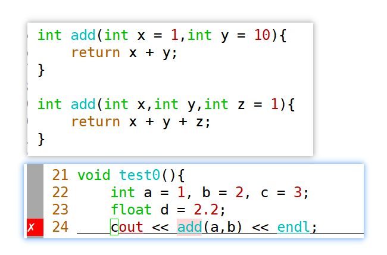

## bool类型

bool类型是在C++中一种基本类型，用来表示true和false。true和false是字面值，可以通过转换变为int类型，<font color=red>**true为1，false为0.**</font>

```C++
int x = true;// 1
int y = false;// 0
```

任何数字或指针值都可以隐式转换为bool值。

任何非零值都将转换为true，而零值转换为false（<span style=color:red;background:yellow>**注意：-1也是代表true**</span>）

```C++
#include <iostream>
using std::cout;
using std::endl;

void bool_func(bool b){
    if(b){
        cout <<"true" << endl;
    }else {
        cout <<"false" << endl;
    }
}

void test(){
    bool b1 = -100;
    bool b2 = 100;
    bool b3 = 0;
    bool b4 = 1;
    bool b5 = true;
    bool b6 = false;
    bool_func(b1);
    bool_func(b2);
    bool_func(b3);
    bool_func(b4);
    bool_func(b5);
    bool_func(b6);
}

void test2(){
    cout << sizeof(bool) << endl; //1
}

int main()
{
    test();
    test2();
    return 0;
}
```

bool变量占1个字节的空间。

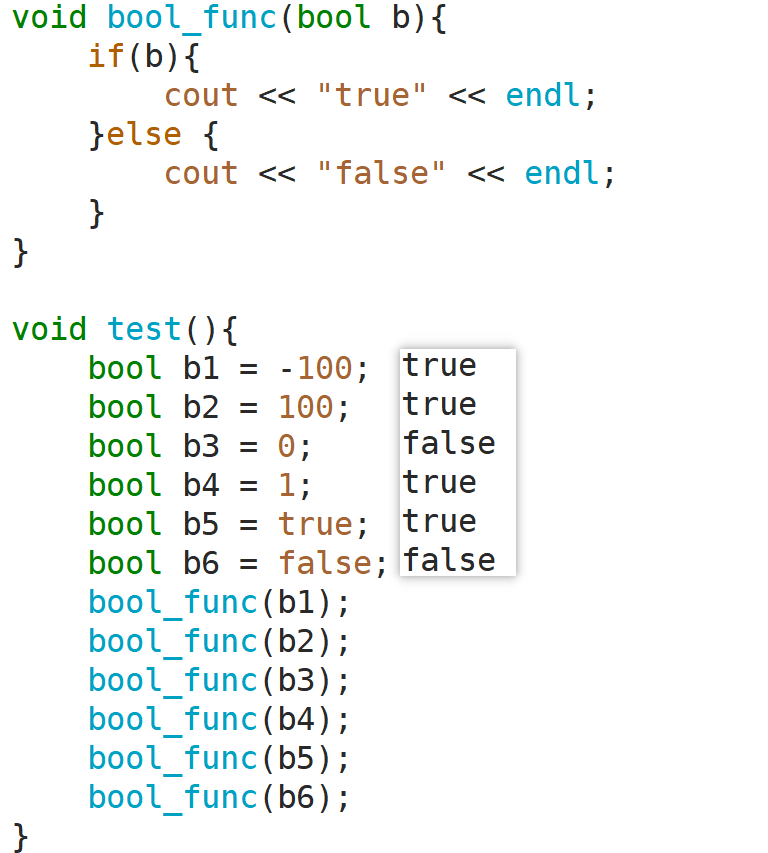

## inline函数

在C++中，通常定义以下函数来求取两个整数的最大值

```C++
int max(int x, int y)
{
	return x > y ? x : y;
}
```

为这么一个小的操作定义一个函数的好处有：

(1)阅读和理解函数 max 的调用，要比读一条等价的条件表达式并解释它的含义要容易得多;

(2)如果需要做任何修改，修改函数要比找出并修改每一处等价表达式容易得多;

(3)使用函数可以确保统一的行为，每个测试都保证以相同的方式实现;

(4)函数可以重用，不必为其他应用程序重写代码。

虽然有这么多好处，但是写成函数有一个潜在的缺点：调用函数比求解等价表达式要慢得多。在大多数的机器上，调用函数都要做很多工作：调用前要先保存寄存器，并在返回时恢复，复制实参，程序还必须转向一个新位置执行。即对于这种简短的语句使用函数开销太大。

在C语言中，我们使用带参数的宏定义这种借助编译器的优化技术来减少程序的执行时间，请定义一个宏完成以上的max函数的功能


那么在C++中有没有相同的技术或者更好的实现方法呢？答案是有的，那就是内联(inline)函数。内联函数作为编译器优化手段的一种技术，在降低运行时间上非常有用。

### 什么是内联函数

内联函数是C++的增强特性之一，用来降低程序的运行时间。

在代码中在一个函数的定义之前加上inline关键字，就是对编译器提出了<span style=color:red;background:yellow>**内联的建议**</span>。如果建议通过，就会进行内联展开。

当内联函数收到编译器的指示时，即可发生内联：编译器将使用函数的定义体来**替代**函数调用语句，**这种替代行为发生在编译阶段而非程序运行阶段。**

定义函数时，在函数的最前面以关键字“inline”声明函数，该函数即可称为内联函数（内联声明函数）。

```C++
inline int max(int x, int y)
{
	return x > y ? x : y;
}
```

### 宏函数与内联函数

在C程序中，可以用宏代码提高执行效率。宏代码本身不是函数，但是看起来像函数。编译预处理器用拷贝宏代码的方式取代函数调用，省去了参数压栈、生成汇编语言的CALL调用、返回参数、执行return等过程，从而提高了速度。

使用宏代码最大的缺点是容易出错，预处理器在拷贝宏代码时常常产生意向不到的边际效应。例如：

```C++
#define MAX(a, b) (a) > (b) ? (a) : (b) 

int result = MAX(20,10) + 20;//result的值是多少？
    
int result2 = MAX(10,20) + 20;//result2的值是多少？
    
//result = MAX(i, j) + 20; 将被预处理器扩展为: result = (i) > (j) ?(i):(j)+20
```

可以修改宏代码为

```C++
#define MAX(a, b) ((a) > (b) ? (a) : (b))
```

可以解决上面的错误了，但也不是万无一失的，例如：

``` c++
int i = 4,j = 3;
result = MAX(i++,j);
cout << result << endl; //result = 5；
cout << i << endl; //i = 6;

//使用MAX的代码段经过预处理器扩展后，result = ((i++) > (j) ? (i++):(j));
```

但是使用inline函数没有问题

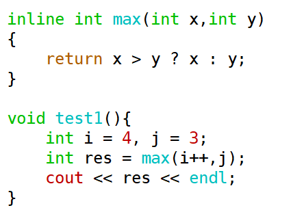

<font color=red>**—— 内联函数就是在普通函数定义之前加上inline关键字**</font>

（1）inline是一个建议，并不是强制性的，后面会学到inline失效的情况

（2）inline的建议如果有效，就会在<span style=color:red;background:yellow>**编译时**</span>展开，**可以理解为是一种更高级的代码替换机制**（类似于宏——预处理）

（3）函数体内容如果太长或者有循环之类的结构，不建议inline，以免造成代码膨胀；**比较短小并且比较常用的代码适合用inline。**

比如函数体中有循环结构，那么执行函数体的开销比调用函数的开销大得多，设为内联函数只能减少函数调用的开销，没有太大意义。


C++的**函数内联机制**既具备宏代码的效率，又增加了安全性，而且可以自由操作类的数据成员，<font color=red>**所以在C++中应尽可能的用内联函数取代宏函数。**</font>


<span style=color:red;background:yellow>**对比总结：**</span>

宏函数 	    优点：只是进行字符串的替换，并没有函数的开销，对于比较短小的代码适合使用；

​			缺点：没有类型检查，存在安全隐患，而且比较容易写错。

如果使用普通函数的方式又会增加开销，所以一些时候可以采用内联函数（结合了宏函数和普通函数的优点）。

inline函数本质也是字符串替换（编译时），所以不会增加开销，但是有类型检查，比较安全。

### 内联函数注意事项


1.<font color=red>**如果要把inline函数声明在头文件中，则必须把函数定义也写在头文件中。**</font>若头文件中只有声明没有实现，被认为是没有定义替换规则。换句话说，如果内联函数的声明和定义分别位于头文件和实现文件中，则会出现问题。

如下，foo函数不能成为内联函数：

``` c++
inline void foo(int x, int y);//该语句在头文件中

void foo(int x, int y)//实现在.cpp文件中
{ //... }
```

因为编译器在调用内联展开函数的代码时，必须能够找到 inline函数的定义才能将调用函数替换为函数代码，而对于在头文件中仅有函数声明是不够的。

2.**谨慎使用内联**

内联能提高函数的执行效率，为什么不把所有的函数都定义成内联函数？事实上，内联不是万灵丹，它以代码膨胀（拷贝）为代价，仅仅省去了函数调用的开销，从而提高程序的执行效率。（注意：这里的“函数调用开销”是指参数压栈、跳转、退栈和返回等操作）

如果执行函数体内代码的时间比函数调用的开销大得多，那么 inline 的效率收益会很小。另外，每一处内联函数的调用都要拷贝代码，将使程序的总代码量增大，消耗更多的内存空间。以下情况不宜使用内联：

- 如果函数体内的代码比较长，使用内联将导致可执行代码膨胀过大。

- 如果函数体内出现循环或其他复杂的控制结构，那么执行函数体内代码的时间将比函数调用开销大得多，因此内联的意义并不大。


实际上，inline 在实现的时候就是对编译器的一种请求，因此编译器完全有权利取消一个函数的内联请求。一个好的编译器能够根据函数的定义体，自动取消不值得的内联，或自动地内联一些没有inline 请求的函数。因此编译器往往选择那些短小而简单的函数来内联。

## 异常处理（了解）

异常是程序在执行期间产生的问题。C++ 异常是指在程序运行时发生的特殊情况，比如尝试除以零的操作。异常提供了一种转移程序控制权的方式。C++ 异常处理涉及到三个关键字：try、catch、throw.


抛出异常即检测是否产生异常，在 C++ 中，其采用 **throw 语句**来实现，如果检测到产生异常，则抛出异常。该语句的格式为：

``` c++
throw 表达式;
```

- 先定义抛出异常的规则（throw）,异常是一个表达式，它的值可以是基本类型，也可以是类；

```C++
double division(double x, double y)
{
	if(y == 0)
		throw "Division by zero condition!";
	return x / y;
}
```


**try-catch语句块**的语法如下：

``` c++
try {
//语句块
} catch(异常类型) {
//具体的异常处理...
} ...
catch(异常类型) {
//具体的异常处理...
}
```

 try-catch语句块的catch可以有多个，至少要有一个，否则会报错。

- 执行 try 块中的语句，如果执行的过程中没有异常拋出，那么执行完后就执行最后一个 catch块后面的语句，所有 catch 块中的语句都不会被执行；
- 如果 try 块执行的过程中拋出了异常，那么拋出异常后立即跳转到第一个“异常类型”和拋出的异常类型匹配的 catch 块中执行（称作异常被该 catch 块“捕获”），执行完后再跳转到最后一个catch 块后面继续执行。

注意：<font color=red>**catch的是类型，不是具体信息**</font>。


``` c++
double division(double x,double y){
    if(y == 0){
        throw "Deivision by zero";
    }
    if(x == 0){
        throw 4.8;
    }
    return x/y;
}

void test0(){
    try{
        cout << division(9,0) << endl;
        cout << division(0,100) << endl;
        cout << division(1000,100) << endl;
    }catch(const char * msg){ //catch的小括号里是类型
        cout << "hello," << msg << endl;
    }catch(double x){
        cout << x << endl;
        cout << "please change a num!" << endl;
    }
    cout << "over" << endl;
}
```

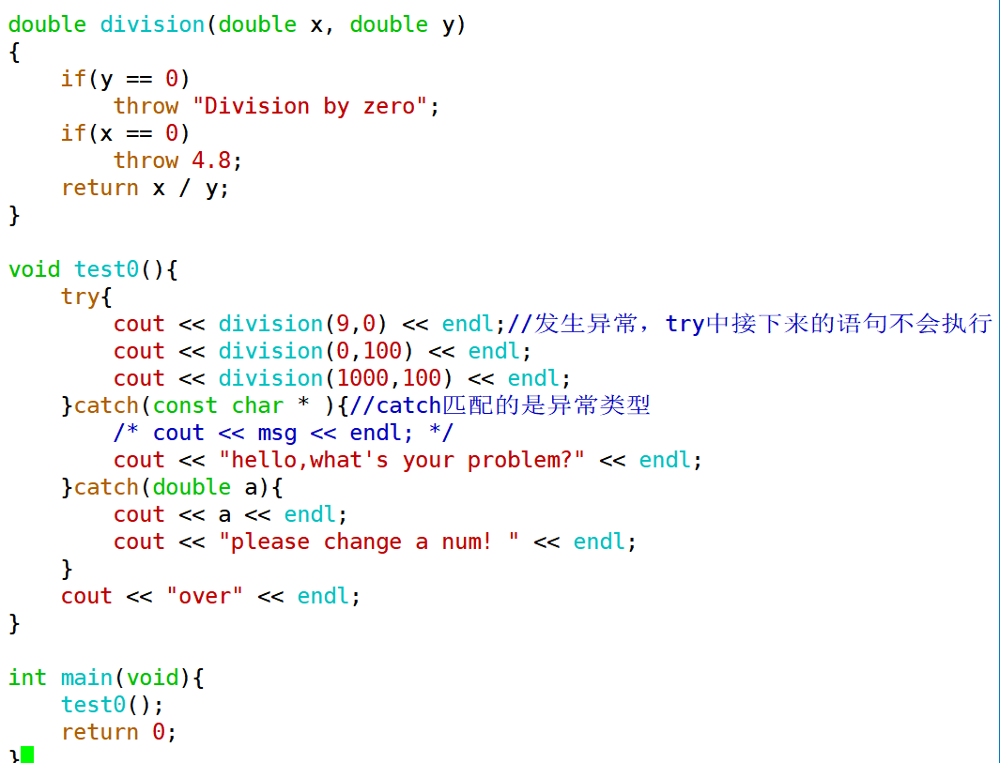

## 内存布局（重要）

64位系统，理论空间达到16EB（2^64）,但是受硬件限制，并不会达到这么多；

以32位系统为例，一个进程在执行时，能够访问的空间是**虚拟地址空间**。理论上为2^32，即4G，有1G左右的空间是内核态，剩下的3G左右的空间是用户态。从高地址到低地址可以分为五个区域：

- 栈区：操作系统控制，由高地址向低地址生长，编译器做了优化，显示地址时栈区和其他区域保持一致的方向。(同一个区域，先定义的内容在较低的地址),存放栈变量、栈对象。局部变量、函数的参数等，编译器会进行自动分配与释放。

- 堆区：程序员分配，由低地址向高地址生长，堆区与栈区没有明确的界限。malloc/new等操作申请的空间。

- 全局/静态区：读写段（数据段），存放全局变量、静态变量。

- 文字常量区：只读段，存放程序中直接使用的文字常量和全局的常量，如const char * p = "hello";  hello这个内容就存在文字常量区。

- 程序代码区：只读段，存放函数体的二进制代码。

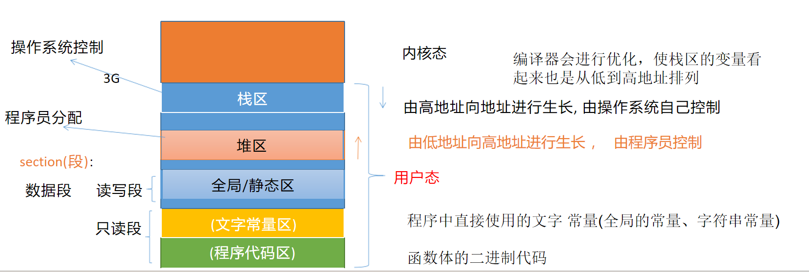

```c++
#include <iostream>
using namespace std;

int globalNumber = 20;
int * globalPointer;
const int constNumber = 30;
static int staticNumber1 = 40;
void test(){
    static int staticNumber2 = 50;
    int localNumber = 1;
    //局部变量标注const修饰，不会存储在全局常量区
    const int localNumber2 = 2;
    cout << "localNumber地址=" << &localNumber << endl;
    cout << "localNumber2地址=" << &localNumber2 << endl;

    int * heapNumber = new int(3);
    delete heapNumber;

    cout << "heapNumber地址=" << heapNumber << endl;

    const char * pstr = "hello";
    cout << "pstr地址=" << (void *)pstr << endl;

    cout << "test()地址=" << (void *)&test << endl;

    cout << "globalNumber地址=" << &globalNumber << endl;
    cout << "globalPointer地址=" << &globalPointer << endl;
    cout << "constNumber地址=" << &constNumber << endl;
    cout << "staticNumber1地址=" << &staticNumber1 << endl;
    cout << "staticNumber2地址=" << &staticNumber2 << endl;
}

int main() {
    test();

    return 0;
}
```

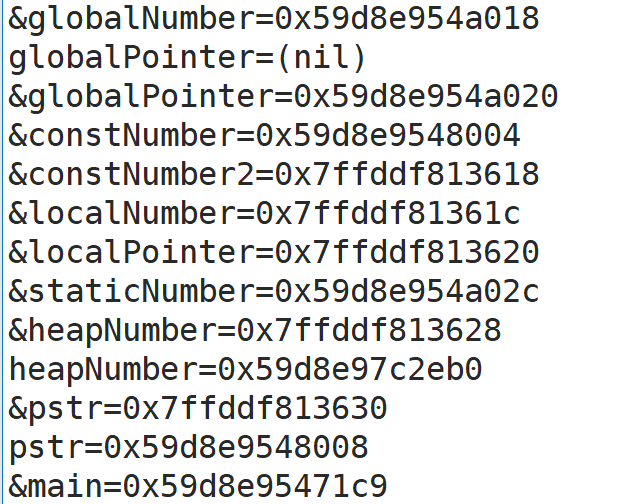

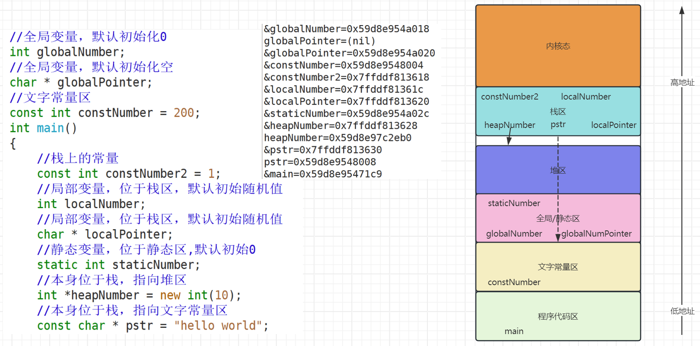

## 字符串

### C风格字符串

#### 字符数组、字符指针

在C语言中，C风格字符串的两种表示形式分别为**字符数组**和**字符指针**，C风格字符串的结尾需要以'\0'结尾。

```c++
#include <iostream>
using std::cout;
using std::endl;

void test1(){
    //c风格字符串
    //字符数组
    //如果是下面str这种表述方式，那么需要注意在末尾留出一位来填充\0
    char str[] = {'h','e','l','l','o'};
    char str2[] = "hello";
    
    char str3[] = "world";
    cout << str << endl;
    cout << str2 << endl;
    cout << str3 << endl;
    
    //字符指针
    char *pstring = "hello**(*)";
    cout << pstring << endl;
}

int main()
{
    test1();
    return 0;
}
```

**如果用数组形式，需要注意留出一位给终止符；**

```c++
#include <iostream>
using std::cout;
using std::endl;

void test1(){
    //字符数组
    //char[6]
    char str[] = "hello";
    str[0] = 'H';
    //字符数组不可以指向其他地址，可以修改字符串的值
    //str = "world";
    //字符指针
    char *pstring = "world";
    cout << "=======" << endl;
    //字符指针不可以修改字符串的值，但可以变更指向
    //pstring[0] = 'W';
    cout << "---------" << endl;
    pstring = "worldc++";
}

int main()
{
    test1();
    cout << "Hello world" << endl;
    return 0;
}
```

其中字符数组不可以指向其他地址，可以修改字符串的值；而字符指针不可以修改字符串的值，但可以变更指向。

如果用指针形式，**建议直接定义为const char *** 。

输出流运算符默认重载，cout利用输出流运算符接char型数组名、指针名时，输出的是内容，而不是地址。

#### 字符串常用操作

长度

```c++
#include <iostream>
#include <string.h>
using std::cout;
using std::endl;

void test1(){
    char str[] = "hello";
    char *pstring = "world";

    //求字符串长度
    //会包含\0的长度
    cout << sizeof(str) << endl;
    //获取的是指针的长度，不是字符的长度
    cout << sizeof(pstring) << endl;
    //下面方式获取的便是字符串本身的长度
    cout << strlen(str) << endl;
    cout << strlen(pstring) << endl;
}

int main()
{
    test1();
    cout << "Hello world" << endl;
    return 0;
}
```

字符串拼接

```c++
#include <iostream>
#include <string.h>
using std::cout;
using std::endl;

void test1(){
    char str1[] = "hello";
    char str2[] = "world";
    //字符串拼接
    int len3 = strlen(str1) + strlen(str2) + 1;
    char str3[len3];
    strcpy(str3, str1);
    strcat(str3, str2);
    cout << str3 << endl;
}
void test2(){
    char str1[] = "hello";
    char str2[] = "world";
    //字符串拼接
    int len3 = strlen(str1) + strlen(str2) + 1;
    char *pstr = (char *) malloc(len3);
    strcpy(pstr, str1);
    strcat(pstr, str2);
    cout << pstr << endl;
    free(pstr);
    pstr = nullptr;
}

int main()
{
    test1();
    test2();
    cout << "Hello world" << endl;
    return 0;
}
```


### C++风格字符串

在C++中重新定义了一种新的字符串形式string，操作起来非常简便。屏蔽了很多C语言字符串操作过程中的内存细节。

1.头文件中引入#include <string>

2.引入using std::string;

```c++
#include <iostream>
#include <string>
using std::cout;
using std::endl;
using std::string;

void test1(){
    //C++风格字符串
    string str1 = "hello";
    string str2 = "world";
    string str3 = str1 + str2;
    cout << str3 << endl;
    //将C++风格字符串转换成c风格字符串
    const char * cstring = str3.c_str();
    cout << cstring << endl;
}

int main()
{
    test1();
    cout << "Hello world" << endl;
    return 0;
}
```

#### 常用操作

长度

```c++
#include <iostream>
#include <string>
using std::cout;
using std::endl;
using std::string;

void test1(){
    string str = "hello world";
    //求字符串长度
    int len = str.length();
    int len2 = str.size();
    cout << len << endl;
    cout << len2 << endl;
}

int main()
{
    test1();
    cout << "Hello world" << endl;
    return 0;
}
```

字符串拼接

```c++
#include <iostream>
#include <string>
using std::cout;
using std::endl;
using std::string;

void test1(){
    string str = "hello world";
    //字符串的拼接
    str = str + " hello cpp";
    cout << str << endl;
    str += 'A';
    cout << str << endl;
    str.append("hello linux");
    cout << str << endl;
}

int main()
{
    test1();
    cout << "Hello world" << endl;
    return 0;
}
```
