# 嵌入式4期STL部分

## Day19

### 一、STL的六大组件

```C++
int add(int x, int y)
{
    return x + y;
}

double add(double x, double y)
{
    return x + y;
}

string add(string x, string y)
{
    return x + y;
}

template <typename T>
T add(T x, T y)
{
    return x + y;
}

const char *pstr1 = "hello";
const char *pstr2 = "world";

add(pstr1, pstr2);
```

1、容器：就是用来存储数据的，也就是数据结构。（<span style=color:red;background:yellow;font-size:20px>**最重要**</span>）

- 序列式容器：vector、list；
- 关联式容器：set、map；
- 无序关联式容器：unordered_set、unordered_map;

2、迭代器：具备指针的功能，可以访问容器中的元素，迭代器是一种泛型指针。

3、算法：对容器中的元素进行相应的操作。

4、适配器：起到适配作用的。

- 容器的适配器  stack、queue、priority_queue；
- 迭代器的适配器 back_insert_iterator；
- 函数适配器   bind1st、bind2nd、bind、mem_fn;

5、函数对象：起到定制化的操作。

6、空间配置器：管理内存的，也就是管理空间的申请与释放。（使用 + 原理 + 源码）

程序 = 数据结构 + 算法。

### 二、序列式容器

#### 1、迭代器的概念

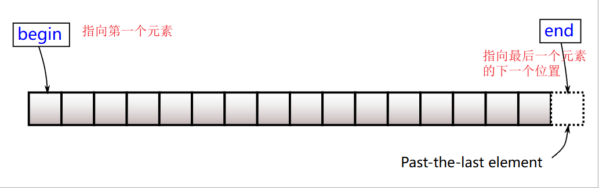

#### 2、初始化（熟练使用）

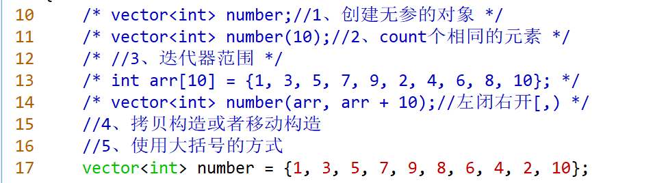

<span style=color:red;background:yellow;font-size:20px>总结：三种序列式容器vector、deque、list都支持五种初始化的方式，包括：无参、count个相同元素、迭代器范围、拷贝或者移动、大括号。</span>

#### 3、遍历（熟练使用）

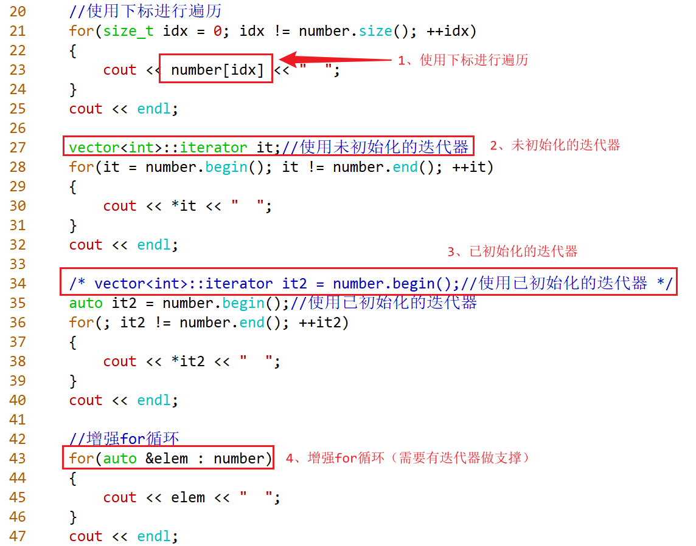

<span style=color:red;background:yellow;font-size:20px>总结：三种序列式容器vector、deque、list都支持使用未初始化的迭代、已初始化的迭代器、增加for循环的方式进行遍历，特别的vector与deque还支持使用下标进行遍历</span>

<span style=color:red;background:yellow;font-size:20px>特别注意：list是不支持下标的，所以不能使用下标操作list。</span>

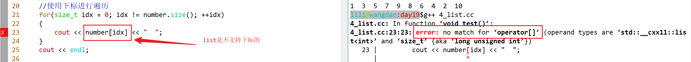

#### 4、在尾部进行插入与删除

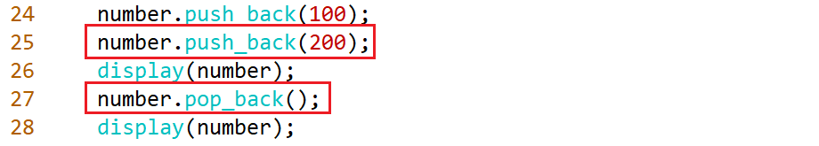

<span style=color:red;background:yellow;font-size:20px>总结：三种序列式容器vector、deque、list都支持在尾部使用push_back插入元素以及pop_back删除最尾部的元素</span>

#### 5、在头部进行插入与删除

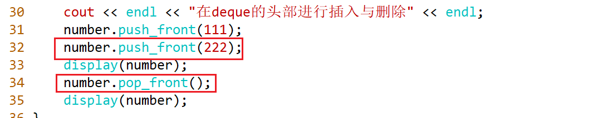

<span style=color:red;background:yellow;font-size:20px>总结:序列式容器deque与list支持使用push_front在头部插入以及pop_front在头部删除，但是vector没有提供这样的函数</span>

#### 6、为什么vector不支持在头部进行插入与删除

因为vector是一段开口的，如果在头部插入一个元素，那么后面的所有元素都需要后移，然后空出第一个位置，那么时间复杂度会比较高；同样的道理，如果在头部删除一个元素，后面的元素都会前移，这样也会导致时间复杂度比较高，所以从效率来看，STL中没有给vector提供直接在首尾插入元素与删除元素的接口。

#### 7、<span style=color:red;background:yellow;font-size:30px>vector的原理(重要)</span>

##### 7.1、原理图

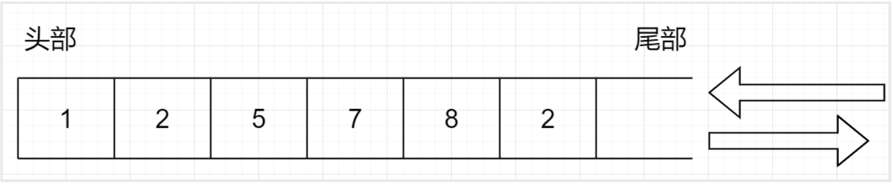

##### 7.2、继承图

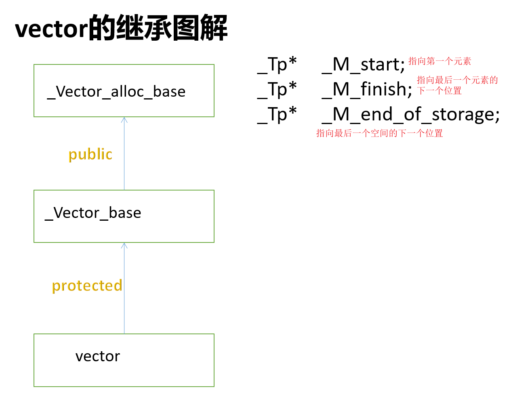

##### 7.3、源码

```C++
template <class _Tp, class _Alloc = __STL_DEFAULT_ALLOCATOR(_Tp) >
class vector 
{
public:
  typedef _Tp value_type;
  typedef value_type* pointer;
  typedef const value_type* const_pointer;
  typedef value_type* iterator;//迭代器typedef _Tp* iterator;
  typedef const value_type* const_iterator;
  typedef value_type& reference;
  typedef const value_type& const_reference;
  typedef size_t size_type;
  typedef ptrdiff_t difference_type;
};

typedef int A;
using A = int;

using iterator = value_type* ;

```

<span style=color:red;background:yellow;font-size:20px>在vector中at与operator[]一样，都可以进行随机访问，可以使用下标，但是at有范围检查，所以比下标更加安全一些。</span>

#### 8、deque的原理（重要）

##### 8.1、原理图

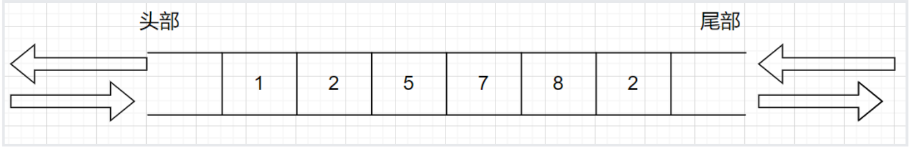

##### 8.2、继承图

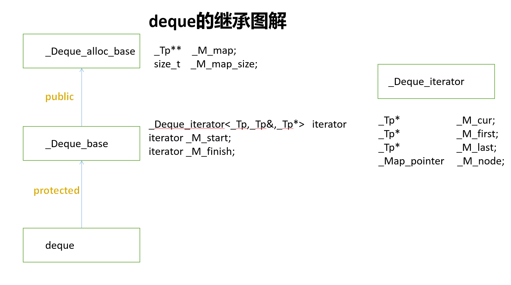

<span style=color:red;background:yellow;font-size:20px>总结：对于vector而言，其迭代器就是一个普通类型的指针，但是对于deque而言，其迭代器不是一个普通类型的指针，是一个类，但是这个类中重载了指针的功能。</span>

##### 8.3、底层的实际原理图

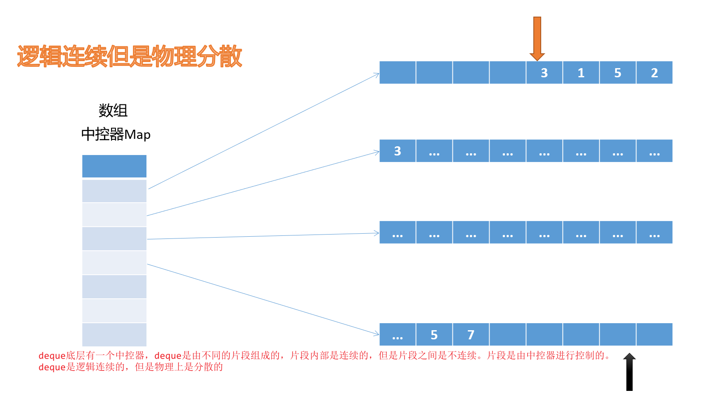

#### 9、list的原理

##### 1、原理图

list是一个双向循环链表，但是在第一个节点与最后一个节点之间会有一个空节点。

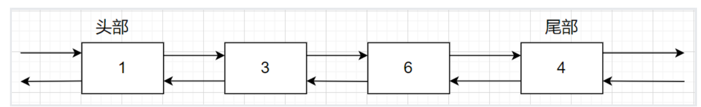

#### 10、如何获取vector第一个元素首地址

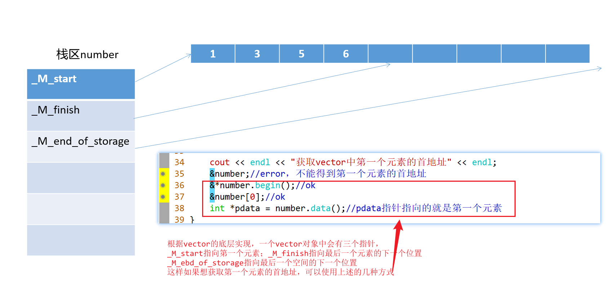

#### 11、序列式容器的insert操作

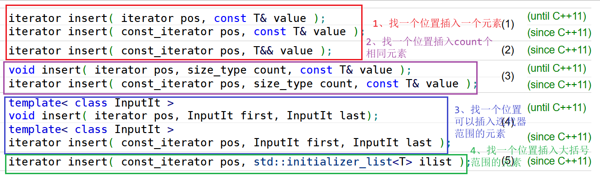

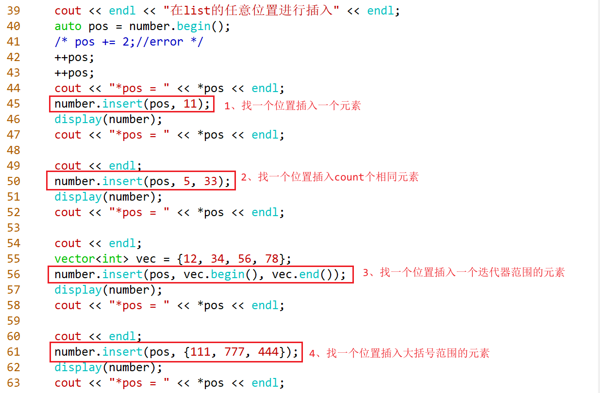

<span style=color:red;background:yellow;font-size:20px>总结：三种序列式容器vector、deque、list都支持四种插入方式：插入一个元素、插入count个相同元素、插入迭代器范围元素、插入大括号范围的元素</span>

## Day20

### 一、问题回顾

1、三种序列式容器的初始化、遍历、在尾部插入与删除、在头部插入与删除的函数是什么样的？

```C++
初始化：无参、count个相同的元素、迭代器范围、拷贝或者移动、大括号；
遍历：下标（vector、deque）、迭代器；
尾插与尾删：push_back、pop_back；
头插与头删 ：push_front、pop_front；例外：vector是没有这两个函数；
```

2、vector中的元素是连续的吗？deque中的元素是连续的吗？list中的元素是连续的吗？


### 二、序列式容器

#### 1、<span style=color:red;background:yellow;font-size:30px>vector的insert导致的迭代器失效(大坑，面试常考)</span>

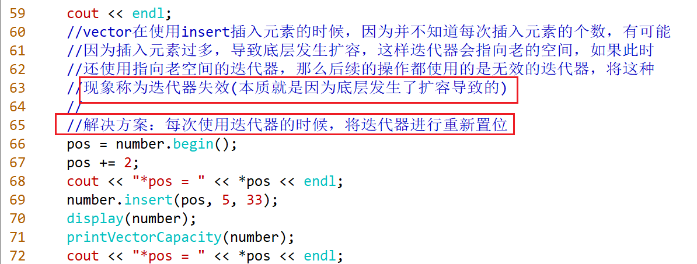

#### 2、<span style=color:red;background:yellow;font-size:30px>删除连续重复元素(非常重要)</span>

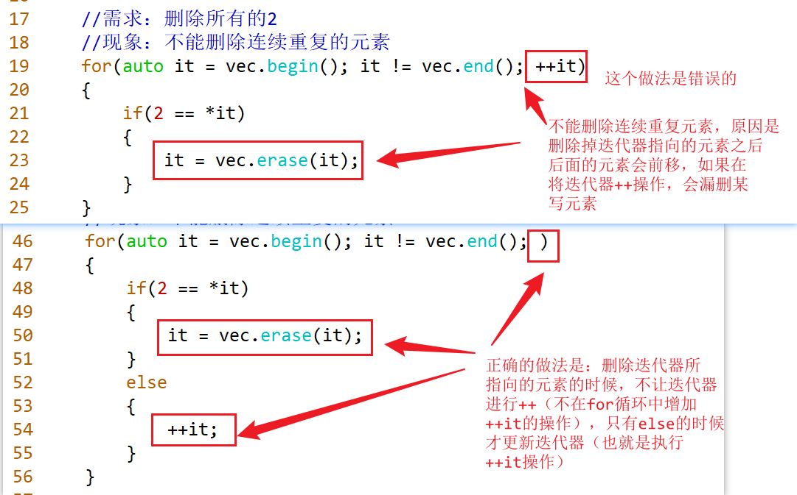

<span style=color:red;background:yellow;font-size:20px>特别注意：三种序列式容器vector、deque、list在删除连续重复元素的时候，一定要注意，不能漏删连续重复元素。</span>

#### 3、元素的清空

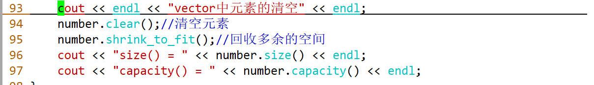

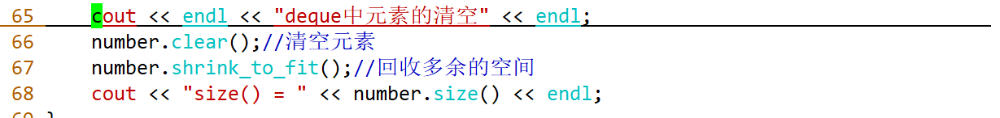

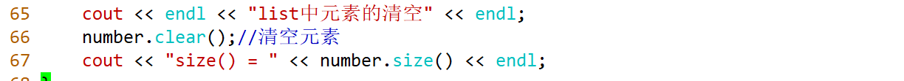

<span style=color:red;background:yellow;font-size:20px>总结：三种序列式容器vector、deque、list都支持元素的清空clear函数以及获取元素个数的函数size；对于vector与deque而言，还有回收多余空间的函数shrink_to_fit，特别的，对于vector而言，还有记录空间的函数capacity</span>

#### 4、其他操作

##### 4.1、重置元素的个数

```C++
void resize( size_type count, T value = T() );

void resize( size_type count );

void resize( size_type count, const value_type& value );
```

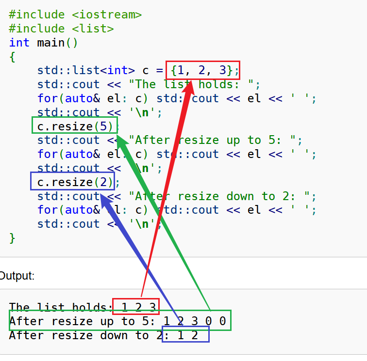

<span style=color:red;background:yellow;font-size:20px>总结：三种序列式容器vector、deque、list都支持重置元素的个数，当重置元素的个数比上一次多，那么多的元素用默认值替代；当重置元素的个数比上一次少，那么多的元素会被删除</span>

##### 4.2、交换两个同种容器的内容

<span style=color:red;background:yellow;font-size:20px>总结：三种序列式容器vector、deque、list都支持swap操作，可以在两个同类型的容器之间进行交换</span>

##### 4.3、获取首尾元素

<span style=color:red;background:yellow;font-size:20px>总结：三种序列式容器vector、deque、list都可以使用front/back获取第一个元素或者最后一个元素</span>

##### 4.4、emplace系列函数

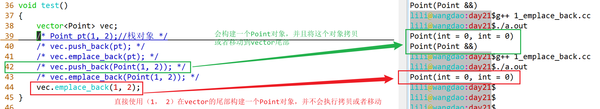

## Day21

### 一、问题回顾

1、vector的insert操作可能会导致什么情况？如何解决这个问题

2、vector、deque、list在删除连续重复元素的时候需要注意什么？

3、三种序列式容器的基本操作有哪些：初始化、遍历、在尾部插入与删除、在头部插入与删除、在任意位置插入、删除、清空元素、获取元素个数、回收多余空间、交换两个容器的内容、重置容器中的元素个数、获取第一个元素、获取最后一个元素、随机访问？

### 二、<span style=color:red;background:yellow;font-size:30px>list的特殊操作(重要)</span>

#### 1、reverse函数

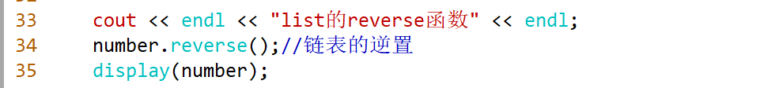

#### <span style=color:red;background:yellow;font-size:20px>2、sort函数(重要)</span>

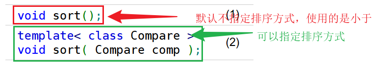

如果采用第一种方式，可以不用指定排序方式，那么默认会使用小于；但是对于第二种方式而言，可以执行排序方式，指定方式有三种：std::less(使用小于符号进行排序)、std::greater(使用大于符号进行排序)、自定义排序方式。

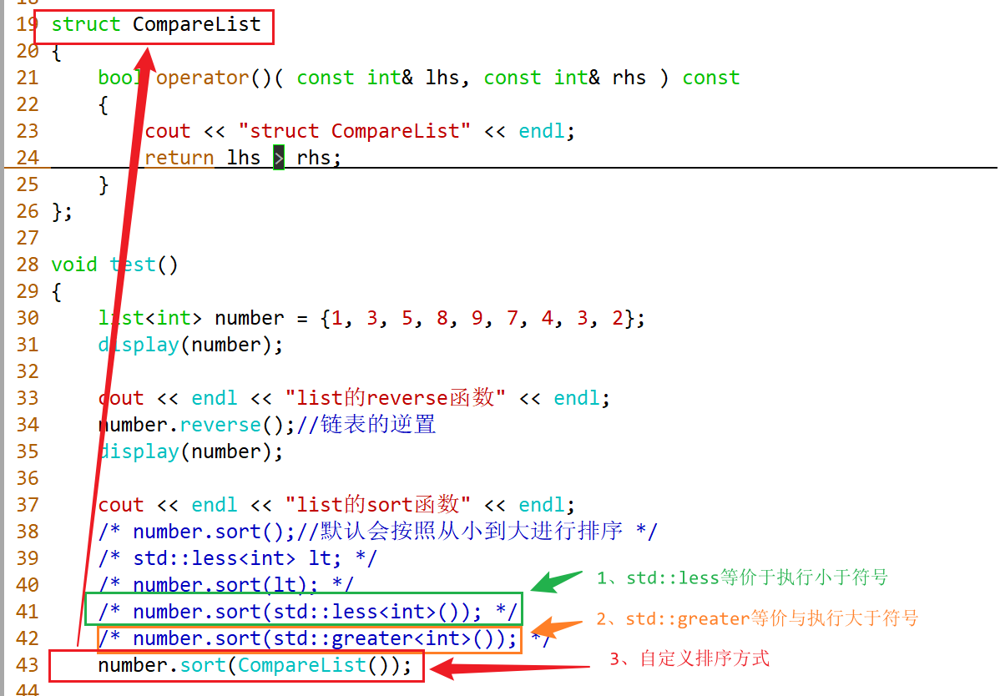

#### 3、unique函数

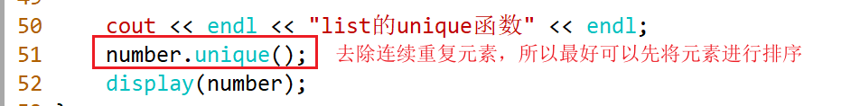

#### 4、merge函数

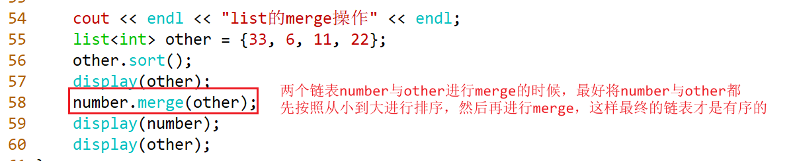

#### 5、<span style=color:red;background:yellow;font-size:20px>splice函数(重要)</span>

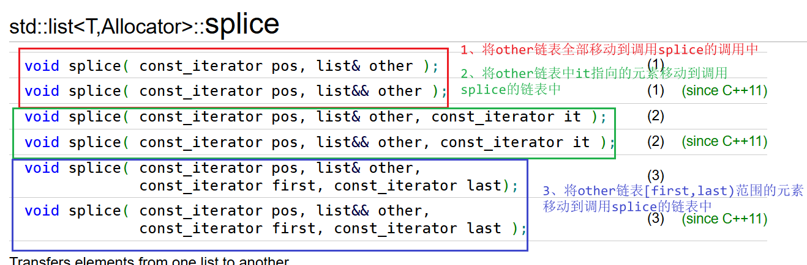

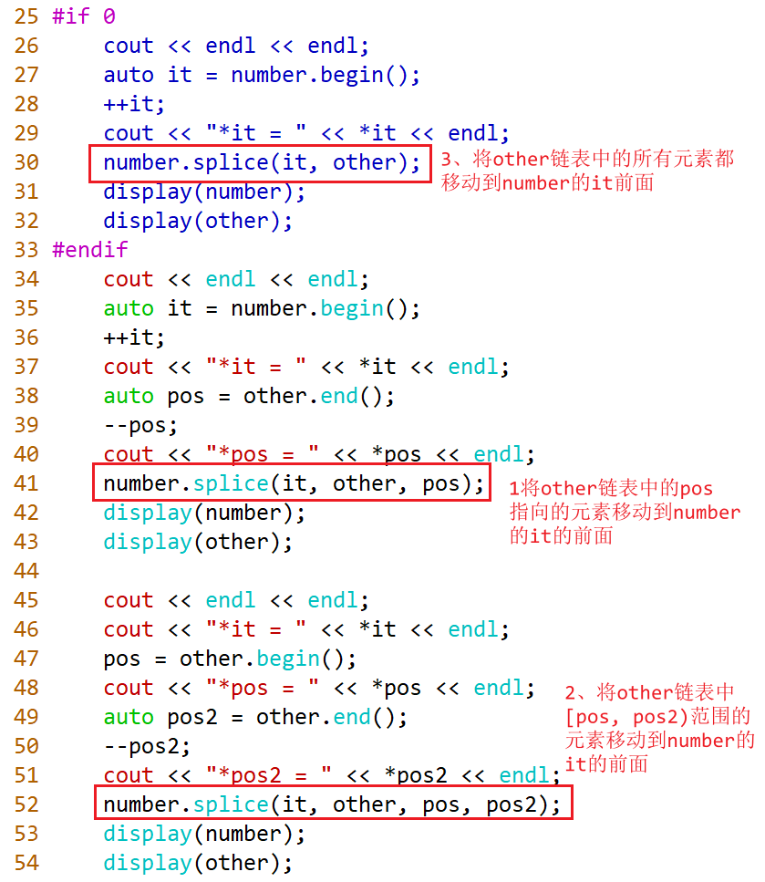

```C++
LRU算法：最近最少使用算法。
    
最多只能存3个元素，老的元素在后面，新的元素在前面
10；
20 10；
30 20 10；
20 30 10；
40 20 30；//读
30 40 20；//存50
50 30 40；
20 50 30;//
    
//如果新插入元素50，首先需要查看50是否存在
//1、如果不存在。
//如果不满的话，直接将50放在最前面
//如果是满的，需要将最后一个元素删除，然后将50放在最前面
number.pop_back();
number.push_front(50);
    
//2、存在
//需要将50置换到最前面即可
number.spilce(number.begin(), number, it);
```

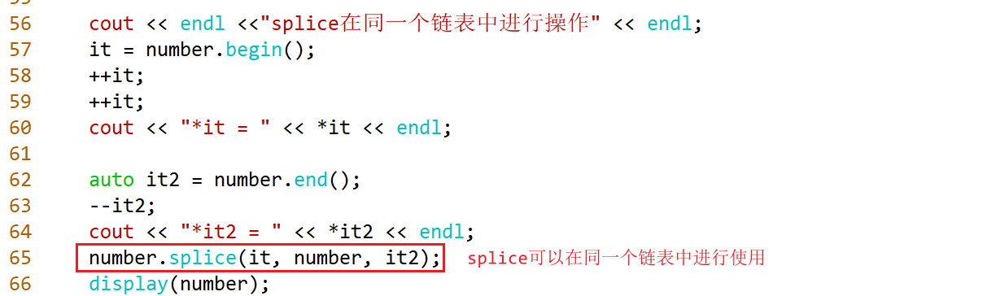

### 三、vector的insert扩容（了解）

以为vector的insert进行扩容的时候，每次新增的元素不是固定的，所以扩容的方式也是不固定的，而push_back可以按照2倍扩容，是因为每次插入的元素是固定的。

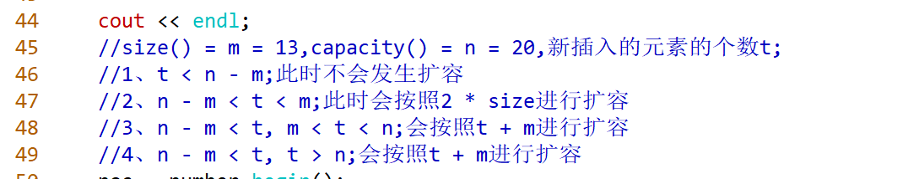


### 四、set的使用

#### 1、基本特征

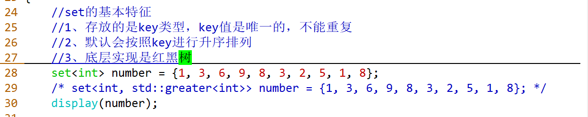

#### 2、查找

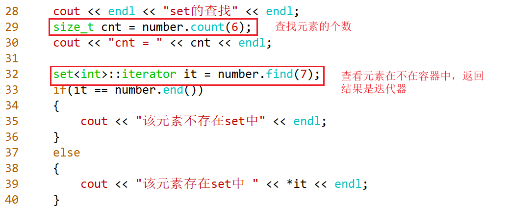

#### 3、插入

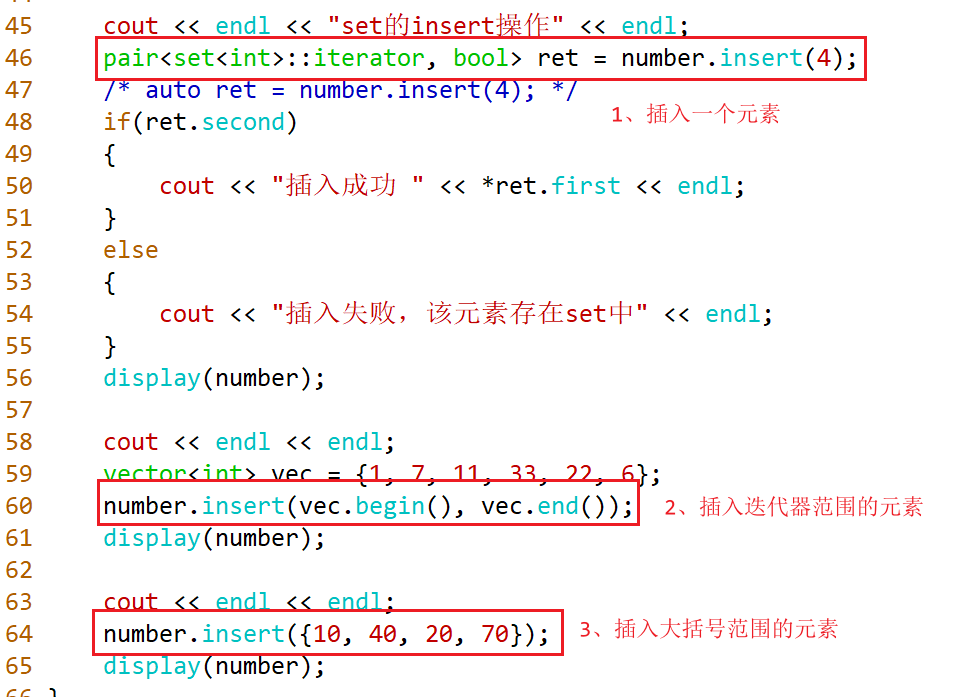

#### 4、删除

##### 4.1、函数接口

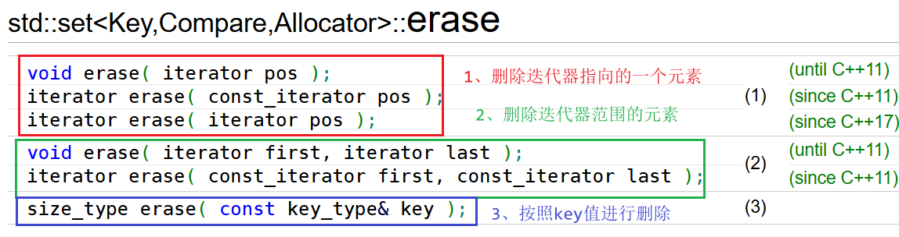

##### 4.2、<span style=color:red;background:yellow;font-size:25px>删除连续奇数（重要）</span>

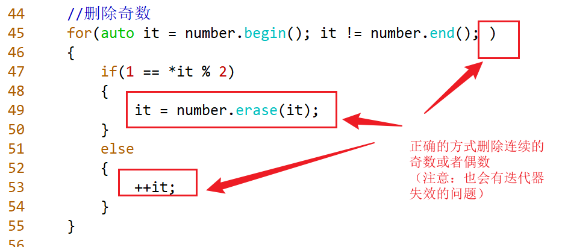

#### 5、<span style=color:red;background:yellow;font-size:30px>针对于自定义类型的写法（非常重要，重难点）</span>

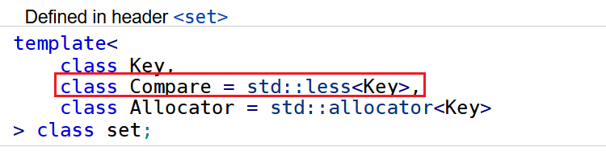

对于set而言，如果模板参数中的Key类型是内置类型，那么可以不用管第二个模板参数Compare，但是如果Key类型是自定义类型或者类类型，那么就需要改写第二个模板参数Compare，原因是自定义类型不能比较大小，所以改写的方式有三种：模板的特化、运算符重载、函数对象的写法。

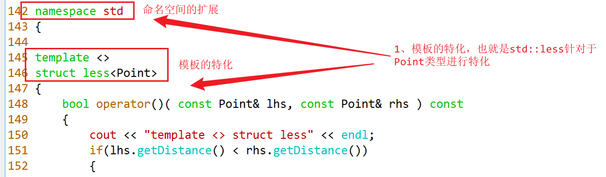

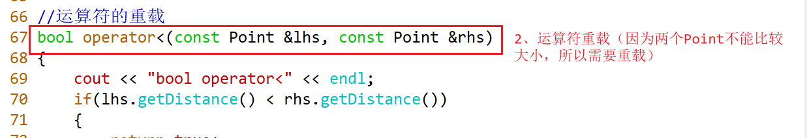

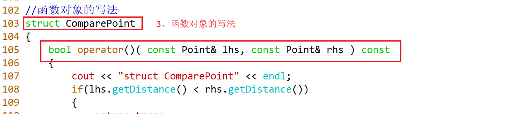

## Day22

### 一、问题回顾

1、list的特殊操作有哪些？sort函数？merge函数有什么需要注意的？splice有什么特点？

2、set的基本操作有：初始化、遍历、查找、插入、删除、清空、交换？

3、set针对于自定义类型有那几个模板参数需要改写？改写方式有哪几种？(<span style=color:red;background:yellow;font-size:20px>重点</span>）

```C++
运算符的重载；模板的特化；函数对象；
```

### 二、multiset的使用

#### 1、基本特征

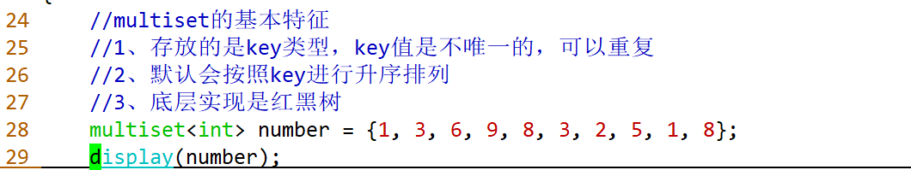

#### 2、其他操作

multiset的查找（count、find）、插入（insert）、删除（erase）基本与set是一样的。

#### 3、bound系列函数

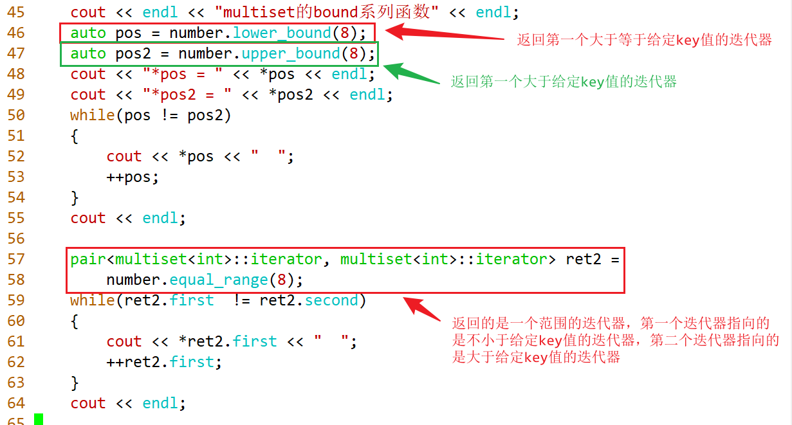

#### 4、针对于自定义类型的写法

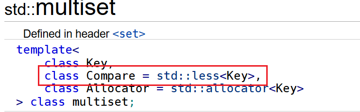

对于multiset而言，如果模板参数中的Key类型是内置类型，那么可以不用管第二个模板参数Compare，但是如果Key类型是自定义类型或者类类型，那么就需要改写第二个模板参数Compare，原因是自定义类型不能比较大小，所以改写的方式有三种：模板的特化、运算符重载、函数对象的写法。


### 三、map的使用

#### 1、基本特征

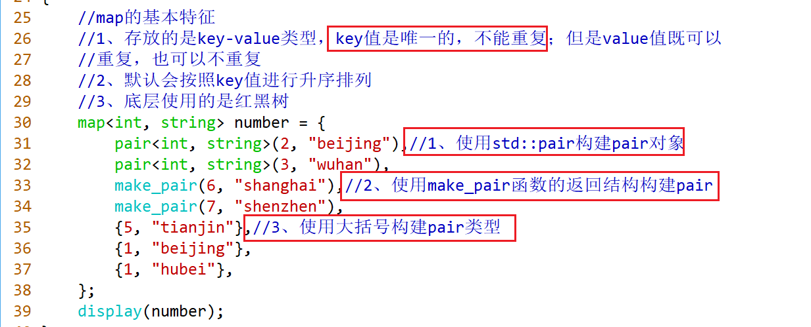

#### 2、查找

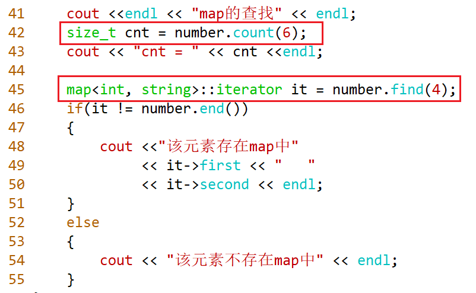

#### 3、插入

map可以插入一个元素、迭代器范围的元素、大括号范围的元素。

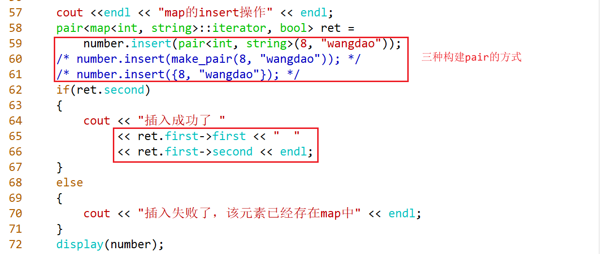

#### 4、删除

map可以删除迭代器指向的一个元素、迭代器范围的元素、按照key值进行删除。

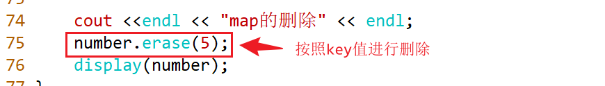

#### 5、<span style=color:red;background:yellow;font-size:25px>下标操作（非常重要）</span>

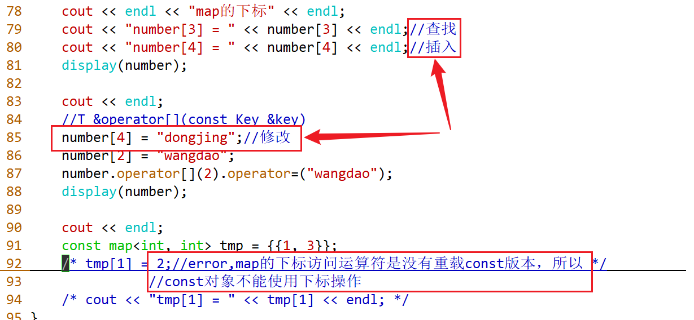

<span style=color:red;background:yellow;font-size:20px>总结：map的下标传递的是key类型，map的下标具备查找、插入、修改的功能，所以功能比较丰富，但是需要注意：下标访问运算符重载的时候，没有const版本的</span>

#### 6、针对于自定义类型

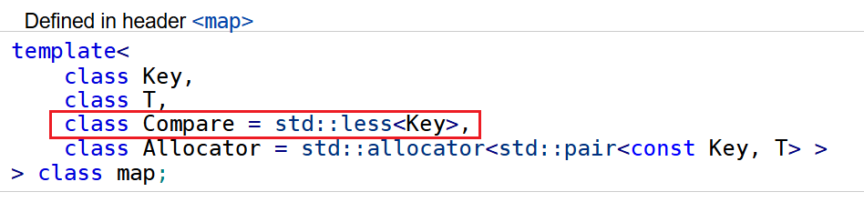

map针对于自定义类型的时候，<span style=color:red;background:yellow;font-size:20px>**注意：这里只管Key与T类型是没有关系的**</span>。如果模板参数中的Key类型是内置类型，那么可以不用管第三个模板参数Compare，但是如果Key类型是自定义类型或者类类型，那么就需要改写第三个模板参数Compare，原因是自定义类型不能比较大小，所以改写的方式有三种：模板的特化、运算符重载、函数对象的写法。

### 四、multimap的使用

#### 1、基本特征

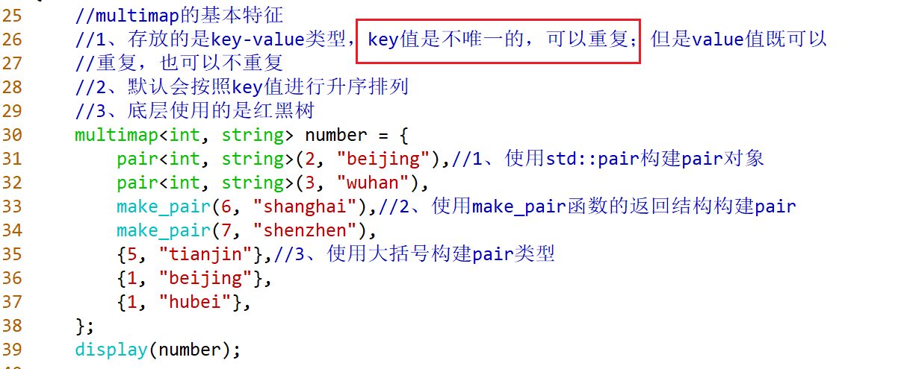

#### 2、其他操作

multimap的查找（count、find）、插入（insert）、删除（erase）与map基本一样。

#### 3、不支持下标


#### 4、针对于自定义类型


multimap针对于自定义类型的时候，<span style=color:red;background:yellow;font-size:20px>**注意：这里只管Key与T类型是没有关系的**</span>。如果模板参数中的Key类型是内置类型，那么可以不用管第三个模板参数Compare，但是如果Key类型是自定义类型或者类类型，那么就需要改写第三个模板参数Compare，原因是自定义类型不能比较大小，所以改写的方式有三种：模板的特化、运算符重载、函数对象的写法。

### 五、关联式容器的使用总结

1、元素是有序的；

2、底层实现都是红黑树；

3、只要带了multi开头的，key值都是可以重复的，否则key值是唯一的；

4、只有map具备下标，其他的三种关联式容器不具备下标；

5、针对于自定义类型而言，都需要考虑模板参数Compare，特别注意：Compare只只关注Key类型。

### 六、哈希相关的概念

#### 1、哈希函数

```C++
index = H(Key)
```

通过哈希函数，可以找到Key值在哈希表中的位置值。

#### 2、哈希函数的设置

- 直接定址法： H(key) = a * key + b；
- 平方取中法： key^2 = 1234^2 = 1522756 ------>227；
- 数字分析法：H(key) = key % 10000；
- 除留取余法：H(key) = key mod p (p <= m, m为表长)

#### 3、哈希冲突

```C++
H(key1) = H(key2)  key1 != key2
```

不同的key值通过哈希函数进行运算之后，在哈希表中的位置值是一样的，将这种情况称为哈希冲突。

#### 4、解决哈希冲突

- 开放定址法；
- 链地址法 (推荐使用这种，这也是STL中使用的方法)；
- 再散列法；
- 建立公共溢出区


#### 5、装载因子

a = 元素的个数/表的长度  (元素的个数往往都会小于表的长度)，如果a的大小比较大，那么哈希冲突的概率会比较高，空间的利用率也会比较高；如果a的大小比较小，那么哈希冲突的概率比较低，但是空间的利用率也会比较低；大概在0.5~0.75之间。

### 七、unordered_set的使用

#### 1、基本特征


#### 2、其他操作

unordered_set的查找（count、find）、插入（insert）、删除（erase）在使用上与set是完全一样的。

#### 3、<span style=color:red;background:yellow;font-size:30px>针对于自定义类型(非常重要)</span>


unordered_set针对于自定义类型的时候，有两个模板参数Hash与KeyEqual，如果Key类型是内置类型，此时无需改写，因为常见的内置类型都已经针对hash做了特化，或者可以直接比较是否相等。<span style=color:red;background:yellow;font-size:20px>如果Key类型是自定义类型或者类类型，那么需要改写Hash与KeyEqual，原因是自定义类型不能设置哈希函数以及比较是否相等。</span>对于Hash而言，可以改写的方式有两种：模板的特化、函数对象的写法。


对于KeyEqual而言，可以改写的方式有三种：模板的特化、运算符重载、函数对象的写法。


### 八、unordered_multiset的使用

#### 1、基本特征


#### 2、其他操作

unordered_multiset的查找（count、find）、插入（insert）、删除（erase）在使用上与multiset是完全一样的。

#### 3、针对于自定义类型

unordered_multiset针对于自定义类型的时候，有两个模板参数Hash与KeyEqual，如果Key类型是内置类型，此时无需改写，因为常见的内置类型都已经针对hash做了特化，或者可以直接比较是否相等。<span style=color:red;background:yellow;font-size:20px>如果Key类型是自定义类型或者类类型，那么需要改写Hash与KeyEqual，原因是自定义类型不能设置哈希函数以及比较是否相等。</span>改写的方式与unordered_set是完全一样。

### 九、unordered_map的使用

#### 1、基本特征


#### 2、其他操作

unordered_map的查找（count、find）、插入（insert）、删除（erase）在使用上与map是完全一样的。

#### 3、支持下标操作


<span style=color:red;background:yellow;font-size:20px>总结：unordered_map的下标传递的是key类型，unordered_map的下标具备查找、插入、修改的功能，所以功能比较丰富，但是需要注意：下标访问运算符重载的时候，没有const版本的</span>

#### 4、针对于自定义类型

unordered_map针对于自定义类型的时候，有两个模板参数Hash与KeyEqual，如果Key类型是内置类型，此时无需改写，因为常见的内置类型都已经针对hash做了特化，或者可以直接比较是否相等。<span style=color:red;background:yellow;font-size:20px>如果Key类型是自定义类型或者类类型，那么需要改写Hash与KeyEqual，原因是自定义类型不能设置哈希函数以及比较是否相等。</span>改写的方式与unordered_set是完全一样。

### 十、unordered_multimap的使用

#### 1、基本特征


#### 2、其他操作

unordered_multimap的查找（count、find）、插入（insert）、删除（erase）在使用上与multimap是完全一样的

#### 3、针对于自定义类型

unordered_multimap针对于自定义类型的时候，有两个模板参数Hash与KeyEqual，如果Key类型是内置类型，此时无需改写，因为常见的内置类型都已经针对hash做了特化，或者可以直接比较是否相等。<span style=color:red;background:yellow;font-size:20px>如果Key类型是自定义类型或者类类型，那么需要改写Hash与KeyEqual，原因是自定义类型不能设置哈希函数以及比较是否相等。</span>改写的方式与unordered_set是完全一样。


### 十一、无关关联式容器的使用总结

1、元素是没有顺序的；

2、底层实现都是哈希；

3、只要带了multi开头的，key值都是可以重复的，否则key值是唯一的；

4、只有unordered_map具备下标，其他的三种无序关联式容器不具备下标；

5、针对于自定义类型而言，都需要考虑模板参数Hash与KeyEqual，特别注意：Hash与KeyEqual只关注Key类型。

### 十二、<span style=color:red;background:yellow;font-size:30px>容器的选择（重要）</span>

#### 1、元素是否有顺序

- 首先选择的是关联式容器；

- 不应该选择的是无序关联式容器；
- 其次选择的是序列式容器，因为list有sort函数进行排序，vector与deque可以使用算法库中的sort函数进行排序。

#### 2、容器是否支持下标

序列式容器：vector、deque；

关联式容器：map；

无序关联式容器：unordered_map;

#### 3、查找的时间复杂度

序列式容器：O(N);

关联式容器：O(logN);

无序关联式容器：O(1);

#### 4、迭代器的类型

随机访问迭代器：vector、deque；

双向迭代器：list与关联式容器；

前向迭代器：无序关联式容器；


```C++
//查询单词与词频
map<string, int> ;   unordered_map<string, int> ; 
//单词以及单词所在的行号
map<string, set<int>>;  unordered_map<string, unordered_set<int>>;
//将单词所对应的这一行的内容显示出来
vector/deque<string>;
```

## Day23

### 一、问题回顾

1、关联式容器有哪些？基本操作有：初始化、遍历、查找、插入、删除、清空、交换？

2、关联式容器针对于自定义类型有那几个模板参数需要改写？改写方式有哪几种？(<span style=color:red;background:yellow;font-size:20px>重点</span>）

```C++
template <typename Key
         , typename Compare = std::less<Key>//特化、函数对象、运算符的重载
         , typename Allocator = std::allocator<Key>>
class set;
```

3、关联式容器有什么共同的特点？

```C++
有序；红黑树
```

4、无序关联式容器有哪些？基本操作有：初始化、遍历、查找、插入、删除、清空、交换？

5、无序关联式容器针对于自定义类型有那几个模板参数需要改写？改写方式有哪几种？(<span style=color:red;background:yellow;font-size:20px>重点</span>）

```C++
template <typename Key
         , typename Hash = std::hash<Key>        //特化、函数对象
         , typename KeyEqual = std::equal_to<Key>//特化、函数对象、运算符的重载
         , typename Allocator = std::allocator<Key>>
class unordered_set;
```

6、无序关联式容器有什么共同的特点？

```C++
无序；哈希
```

7、选择容器的参考维度有哪些？

```C++
有序；查找时间复杂度；下标；迭代器的类型;
```

### 二、优先级队列

#### 1、模板参数


#### 2、底层原理


#### 3、常用函数

```C++
插入push；
获取元素top;
删除元素pop;
查看元素的个数size;
判空函数empty；
交换元素swap；
优先级队列中没有迭代器的概念，所以不能使用迭代器进行遍历。
```


#### 4、针对于自定义类型

对于priority_queue而言，如果模板参数中的Key类型是内置类型，那么可以不用管第三个模板参数Compare，但是如果Key类型是自定义类型或者类类型，那么就需要改写第三个模板参数Compare，原因是自定义类型不能比较大小，所以改写的方式有三种：模板的特化、运算符重载、函数对象的写法。


### 三、迭代器

#### 1、基本概念

迭代器(iterator)模式又称为游标(Cursor)模式，用于提供一种方法顺序访问一个聚合对象中各个元素, 而又不需暴露该对象的内部表示。就是使用迭代器访问容器中的元素。

#### 2、分类

  

#### 3、ostream_iterator的源码

流迭代器可以放容器进行看待，因为流具备缓冲区，而缓冲区是可以用来存数据的。

```C++
template <class _Tp>
class ostream_iterator 
{
protected:
  ostream* _M_stream;
  const char* _M_string;
public:
    //ostream_iterator<int> osi(cout, "\n");
    //__s = cout;
    //__c = "\n"
    //_M_stream = &cout;
    //_M_string = "\n"
    ostream_iterator(ostream& __s, const char* __c) 
    : _M_stream(&__s)
    , _M_string(__c) 
    {}
    
    ostream_iterator<_Tp>& operator=(const _Tp& __value)
    { 
        *_M_stream << __value;//cout << 4
        if (_M_string) *_M_stream << _M_string;//cout << "\n"
        return *this;
  }
    
   ostream_iterator<_Tp>& operator*() { return *this; }
  ostream_iterator<_Tp>& operator++() { return *this; } 
  ostream_iterator<_Tp>& operator++(int) { return *this; }

};


template<class InputIt, class OutputIt>
OutputIt copy(InputIt first, InputIt last,  OutputIt d_first)
{
    while (first != last) {
        *d_first++ = *first++;
    }
    return d_first;
}

copy(vec.begin(), vec.end(), osi);
//first = vec.begin()
//last = vec.end()
//d_first = osi
OutputIt copy(InputIt first, InputIt last,  OutputIt d_first)
{
    while (first != last) {
        *d_first++ = *first++;
           osi   = 4;
    }
    return d_first;
}
              last
1, 4, 8, 3, 5
             first
                  
```

#### 4、istream_iterator的源码

```C++
template <class _Tp, 
          class _CharT = char, class _Traits = char_traits<_CharT>,
          class _Dist = ptrdiff_t> 
class istream_iterator {
public:
    istream_iterator() 
    : _M_stream(0)
    , _M_ok(false) {}
    
    //istream_iterator<int> isi(cin)
    //__s = cin
    //_M_stream = &cin
    istream_iterator(istream_type& __s) 
    : _M_stream(&__s) 
    { 
        _M_read(); 
    }
    
    void _M_read()
    {
        _M_ok = (_M_stream && *_M_stream) ? true : false;
        if (_M_ok) 
        {
            *_M_stream >> _M_value;//cin >> _M_value   _M_value =2
            _M_ok = *_M_stream ? true : false;//cin ? true : false
        }
    }
    
    bool _M_equal(const istream_iterator& __y) const
    { 
        //isi的数据成员_M_ok false
         return (_M_ok == __y._M_ok) && (!_M_ok || _M_stream == __y._M_stream); 
    }
    
    reference operator*() const 
    { 
        return _M_value; 
    }
    
    istream_iterator& operator++()
    { 
        _M_read(); 
        return *this;
    }
    
    istream_iterator operator++(int) 
    {
        istream_iterator __tmp = *this;
        _M_read();
        return __tmp;
    }
private:
  istream_type* _M_stream;
  _Tp _M_value;
  bool _M_ok;
   
};


inline bool operator!=(const istream_iterator& __x, const istream_iterator& __y) 
{
    return !__x._M_equal(__y);
}

 
//copy(isi, istream_iterator<int>(), std::back_inserter(vec));
//first = isi
//last = istream_iterator<int>()
//d_first = std::back_inserter(vec)
OutputIt copy(InputIt first, InputIt last,  OutputIt d_first)
{
    while (first != last) {
        *d_first++ = *first++;
           d_first   = 2;
    }
    return d_first;
}


```

##### back_inert_iterator的源码

```C++
template <class _Container>
inline back_insert_iterator<_Container> back_inserter(_Container& __x) {
  return back_insert_iterator<_Container>(__x);
}

template <class _Container>
class back_insert_iterator {
protected:
  _Container* container;
public:
  typedef _Container          container_type;
  typedef output_iterator_tag iterator_category;
  typedef void                value_type;
  typedef void                difference_type;
  typedef void                pointer;
  typedef void                reference;

  explicit back_insert_iterator(_Container& __x) : container(&__x) {}
    
  back_insert_iterator<_Container>& operator=(const typename _Container::value_type& __value) 
  { 
    container->push_back(__value);
    return *this;
  }
  back_insert_iterator<_Container>& operator*() { return *this; }
  back_insert_iterator<_Container>& operator++() { return *this; }
  back_insert_iterator<_Container>& operator++(int) { return *this; }
};

```


## Day24

### 一、问题回顾

1、优先级队列的底层使用的是什么？优先级队列的常用函数有哪些？


```C++

void put(int key, int value)
int get(int key);


对于LRU知道是什么？原理是什么？
最近最少使用算法


容量含义
int _capacity;

//使用list存储key与value
list<pair<key, value>>

//通过key找到key在list中的位置值
unordered_map<key, list<pair<key, value>>::iterator>

unordered_map<key, value>;

put/get key = 2

(3, 30), (2, 20)  (1, 10)


vector/deque/list<pair<key, value>>

deque/list<pair<key, value>>

list<pair<key, value>>

list.splice(list.begin(), list, it)；

unordered_map<key, it>
```

### 二、三组插入迭代器

back_inserter是函数模板，该函数模板的返回结果是类模板back_insert_iterator，而类模板的底层重载赋值运算符函数，该函数的实现是调用容器的push_back函数；

front_inserter是函数模板，该函数模板的返回结果是类模板front_insert_iterator，而类模板的底层重载赋值运算符函数，该函数的实现是调用容器的push_front函数；

inserter是函数模板，该函数模板的返回结果是类模板insert_iterator，而类模板的底层重载赋值运算符函数，该函数的实现是调用容器的insert函数；


### 三、反向迭代器


### 四、算法

#### 1、基本概念

在STL中，算法库中的算法都是属于普通函数，也就是非成员函数。

#### 2、分类

- 非修改式的序列操作   **for_each**、count、find；
- 修改式的序列操作  copy、remove、**remove_if**、swap；
- 排序操作   **sort**；
- 二分搜索  lower_bound、upper_bound；
- 集合操作  set_intersection、set_union；
- 堆相关的操作  make_heap、push_heap；
- 求最值  min、max；
- 数值操作  accumulate；
- 未初始化的内存操作 **uninitialized_copy**；

#### 3、for_each算法

一元函数：函数的参数只有一个；二元函数：函数的参数只有两个；

一元断言/谓词：函数的参数只有一个，并且函数的返回类型是bool；二元断言/谓词：函数的参数只有两个，并且函数的返回类型是bool；

```C++
template<class InputIt, class UnaryFunction>
constexpr UnaryFunction for_each(InputIt first, InputIt last, UnaryFunction f)
{
    for (; first != last; ++first) {
        f(*first);
    }
    return f; // implicit move since C++11
}
```


### <span style=color:red;background:yellow;font-size:30px>五、lambda表达式(重要语法)</span>

#### 1、基本语法规则

```C++
//[]是捕获列表, 在lambda表达式的函数体中，不能直接访问外部局部变量，除非在捕获列表中进行捕获
//()函数的参数列表
//{}函数的函数体
[](){};
```

#### 2、<span style=color:red;background:yellow;font-size:25px>两种捕获方式（重点）</span>


#### 3、混合捕获

- 如果外部局部变量，全部是值捕获，可以使用=;
- 如果外部局部变量，全部是引用捕获，可以使用&;
- 如果外部局部变量，只有一个是值捕获，其他全部是引用捕获，可以使用[&, num];
- 如果外部局部变量，只有一个是引用捕获，其他全部是值捕获，可以使用[=, &num];

<span style=color:red;background:yellow;font-size:25px>特别注意：对于全局变量或者静态变量，可以直接在lambda表达式的函数体中进行使用，而无需捕获</span>

<span style=color:red;background:yellow;font-size:25px>[this] 捕获当前类中的this指针。让lambda表达式拥有和当前类成员函数同样的访问权限；可以修改类的成员变量，使用类的成员函数。如果已经使用了 & 或者 =, 默认添加此选项.  </span>

#### 4、lambda的本质

<span style=color:red;background:yellow;font-size:20px>lambda表达式的类型在C++11中会被看做是一个带operator()的类，即函数对象</span>。按照C++标准，lambda表达式的operator()默认是const的，一个const成员函数是无法修改成员变量值的。mutable选项的作用就在于取消operator()的const属性 。

小网站：`https://cppinsights.io/`

```C++
//小文件传输的命令安装：
sudo apt install lrzsz
sz + 文件名  //将该文件从Linux发送到windows
rz   //从windows上将文件传输到Linux下
```

#### 5、<span style=color:red;background:yellow;font-size:30px>lambda表达式的误用（大坑，重要）</span>


## Day25

### 一、问题回顾

1、三组插入迭代器是什么？底层分别调用的是什么？

2、什么是一元函数？什么是一元断言/谓词？

3、lambda表达式的语法规则是怎样的？什么是值捕获？有什么特点？什么是引用捕获？有什么特点？本质是什么？

```C++
[]()opt->returnType{   
};
```

### 二、remove_if算法

```C++
template<class ForwardIt, class UnaryPredicate>
ForwardIt remove_if(ForwardIt first, ForwardIt last, UnaryPredicate p)
{
    first = std::find_if(first, last, p);
    if (first != last)
        for(ForwardIt i = first; ++i != last; )
            if (!p(*i))
                *first++ = std::move(*i);
    return first;
}

template<class InputIt, class UnaryPredicate>
constexpr InputIt find_if(InputIt first, InputIt last, UnaryPredicate p)
{
    for (; first != last; ++first) {
        if (p(*first)) {
            return first;
        }
    }
    return last;
}

remove_if(vec.begin(), vec.end(), func);

原始值：1, 3, 7, 9, 5, 6, 3, 6
                    first        last
新的结果：1, 3, 5, 3, 5, 6, 3, 6
                                 i 
    
//first = vec.begin()
//last = vec.end()
//p = func
ForwardIt remove_if(ForwardIt first, ForwardIt last, UnaryPredicate p)
{
    first = std::find_if(first, last, p);
    if (first != last)
        for(ForwardIt i = first; ++i != last; )
            if (!p(*i))
                *first++ = std::move(*i);
    return first;
}

//first = vec.begin()
//last = vec.end()
//p = func 
                       last
1, 3, 7, 9, 5, 6, 3, 6
      f
constexpr InputIt find_if(InputIt first, InputIt last, UnaryPredicate p)
{
    for (; first != last; ++first) {
        if (p(*first)) {
            return first;
        }
    }
    return last;
}
```


### 三、bind1st与bind2nd

#### 1、模板形式


#### 2、分析


### <span style=color:red;background:yellow;font-size:30px>四、bind的使用(重要)</span>

#### 1、绑定函数的形式


#### 2、函数指针（重要）


#### 3、占位符

bind绑定函数的时候，并不需要将所有的参数固定，因为可以使用占位符占据函数的参数。


#### 4、引用折叠

```C++
& &&------>&;
&& &&----->&&;
& &------->&;
&& &------>&;
```

只要有左值引用参与，那么最终的结果就是左值引用，只有同时都是右值引用的之后，最终折叠的结果才是右值引用。

#### 5、bind绑定数据成员（了解）


#### 6、bind绑定成员函数的传参


<span style=color:red;background:yellow;font-size:20px>注意：两种传递参数的方式，值传递与地址传递。</span>

### <span style=color:red;background:yellow;font-size:30px>五、function的使用(重要)</span>

#### 1、模板形式


#### 2、函数类型


#### 3、function接受函数类型


### <span style=color:red;background:yellow;font-size:30px>六、bind与function的结合使用（非常重要）</span>


接下来就是绑定对应的函数给Figure中的数据成员。


两种思想：


## Day26

### 一、问题回顾

1、bind的作用是什么？bind可以绑定哪些内容？什么是占位符？并且有什么特点？bind的传递方式是什么？如何使用引用传递？

```C++
int add(int x, int y)
{
    return  x + y;
}

class Example
{
public:
    int add(int x, int y)
    {
        return  x + y;
    }
}

//add的形态：int(int, int)
//f的形态:int(int)
function<int(int)> f = bind(&add, 1, _1);
f(10);

默认采用的是值传递，如果想使用引用传递，需要使用std::ref/std::cref;

Example ex;
bind(&Example::add, &ex, 1, 2)
```

2、引用折叠的规则是什么？

```C++
template <typename T>
T func(T &&x)
{   
}

func(3);//int&& &&---->int &&;
int a = 10;
func(a);//int& &&----->int &

int& &-------------->int &;
int&& &------------->int &;
```

3、如何定义函数指针？什么是回调函数？回调函数的使用包括哪两个步骤？C语言使用什么调用回调函数？

```C++
//返回类型：int *  参数列表是void *    pFunc;
int*  (*pFunc)(void *);

int func()
{
    return 10;
}

int (*ptmp)();

//延迟调用的思想
ptmp = func;//注册
//...
//...
ptmp();//执行

```

4、什么是函数类型或者函数标签？

5、bind的返回类型可以使用什么进行接收？

6、lambda表达式的返回类型可以使用什么进行接收？

```C++
function;
```

7、lambda表达式在使用的时候，需要注意哪些坑？

```C++
//尽量的不要捕获生命周期可能提前结束的局部变量的引用
```

8、bind与function结合使用的例子体现出来的是什么编程思想？


```C++
class String
{
 public:
    String(const char *pstr)
    : _pstr(new char[strlen(pstr) +1]())
    {
        strcpy(_pstr, pstr);
    }
    String(const String &rhs)
    : _pstr(new char[strlen(rhs._pstr) + 1]())
    {
        strcpy(_pstr, rhs._pstr);
    }
    
    String(String &&rhs)
    : _pstr(rhs._pstr)
    {
        rhs._pstr = nullptr;
    }
private:
    char *_pstr;
};

void test()
{
    String s1 = String("hello");
}
```


### 二、成员函数适配器

#### 1、作用

当成员函数在使用的过程中，给成员函数起适配作用。

#### 2、mem_fn的使用


### 三、函数对象

只要是可以与小括号进行结合，并且展示出函数含义的，统称为函数对象。

- 重载了函数调用运算符的类创建的对象；
- 函数名；
- lambda表达式；
- function；
- bind的返回结果；
- 函数指针；

## Day27

### 一、空间配置器

#### 1、模板形式

```C++
#include <memory>

template< class T >
struct allocator;
```

#### 2、四大函数

```C++
//申请空间（申请原始的未初始化的空间）
T* allocate( std::size_t n )；
    
//释放空间
void deallocate( T* p, std::size_t n ); 

//构建对象
void construct( pointer p, const_reference val );

//销毁对象
void destroy( pointer p );
```

空间配置器提供了四个函数，空间申请与释放，对象构建与销毁。也就是将空间的申请与对象的构建严格分开了。

#### 3、为何要将空间的申请与对象的构建分开

在STL中，可能会大量的创建对象（构建对象），那么如果还是创建一个对象申请一块空间，那么空间的申请会非常的频繁，所以为了提升效率，并没有采用创建一个对象申请一块空间的方式，而是采用一次性申请一大段空间，然后再到该空间上构建对象。

#### 4、原理图


#### 5、函数之间的调用关系


