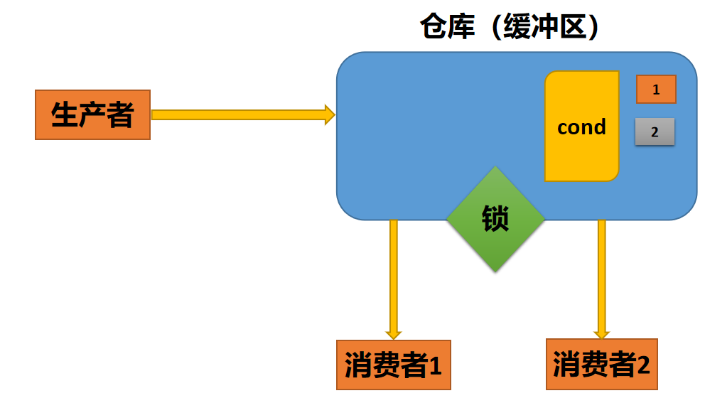
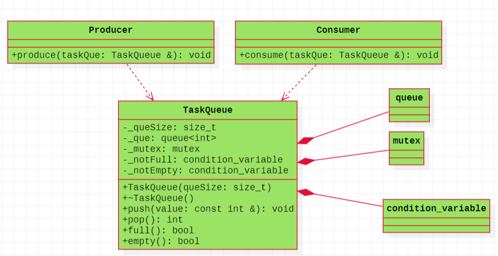
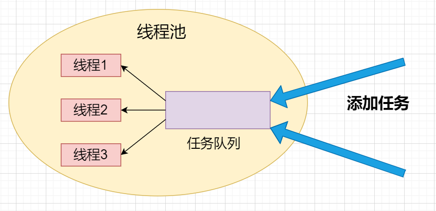
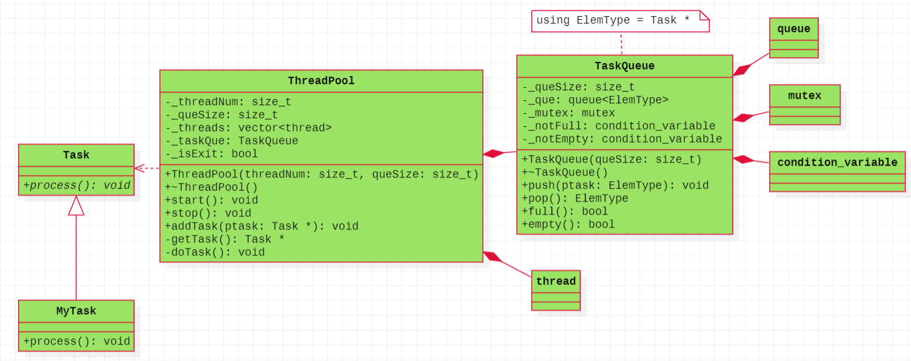
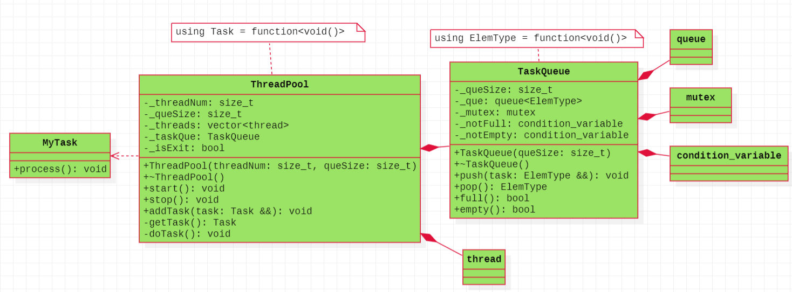

# C++11线程库

## 一、线程

### 1、C++11线程库概述

对于早期的C++语言而言，如果想使用线程，我们需要根据不同的平台使用不用的接口，比如：在Linux平台上，我们需要借助POSIX标准的线程库，在windows上需要借助windows线程库，因为C++自己没有独立的线程库。为了解决这个问题，在C++11标准中，做了完善，C++自己引入了与平台无关的线程库，这个库是语言层面的库，这就是C++11线程库，接下来我们就来学习一下C++11线程库的知识点。

### 2、线程头文件

```C++
#include <thread>
```

### 3、函数接口

在C++11中，将线程封装成了类的概念，下面就是线程类的构造函数形式。

```C++
thread() noexcept; //(1)

thread( thread&& other ) noexcept; //(2)

template< class Function, class... Args >
explicit thread( Function&& f, Args&&... args ); //(3)

thread(const thread&) = delete;//(4)
```

从上面的几种形式可以看出，第一种形式，可以创建一个空的线程对象，但是线程创建出来之后，需要做任务，单独使用这种形式没有意义；第二种形式，可以从另外一个线程对象转移过来；第三种形式，传递任何**可调用对象**的形式，这种形式使用的最为通用；第四种形式，表明线程对象不能进行复制。

### 4、线程启动

线程的启动，也就是线程入口函数的传递方式。虽然函数接口中有多种形式，可以创建无参对象（线程没有入口函数，也就是线程不做任务），但是这种没有什么意义，一般不使用；可以将两外一个线程对象移动过来，但是移动之后，另外一个线程对象就没有了，这种一般用的也不多，接下来我们重点研究第三种接口形式。

#### 4.1、传递普通函数

```C++
void func()
{
    cout << "void func()" << endl;
}

void test()
{
    thread th1(func);
}
```

#### 4.2、传递函数指针(引用)

```C++
void func()
{
    cout << "void func()" << endl;
}

void test()
{
    void (*pFunc)() = func;
    thread th1(pFunc);
}

void test2()
{
    void (&rFunc)() = func;
    thread th1(rFunc);
}
```

#### 4.3、传递函数对象

```C++
class Example
{
public:
    void operator()(int x)
    {
        cout << "void operator()()" << endl;
        cout << "x = " << x << endl;
    }
};

void test()
{
    Example ex;
    thread th1(ex, 10);
}
```

#### 4.4、传递lambda表达式

```C++
void test()
{
    int a = 10;
    thread th1([&a](){
                a = 100;
                cout << "a = " << a << endl;
               });
}
```

#### 4.5、传递function对象

```C++
void func()
{
    cout << "void func()" << endl;
}

void test()
{
    function<void()> f = bind(&func);
    thread th1(f);
}
```

#### 4.6、传递bind的返回结果

```C++
void func()
{
    cout << "void func()" << endl;
}

void test()
{
    thread th1(bind(&func));
}
```


### 5、线程终止

我们使用std::thread创建的线程对象是进程中的子线程，一般进程中还有主线程，在程序中就是main线程，那么当我们创建线程后至少是有两个线程的，那么两个线程谁先执行完毕谁后执行完毕，这是随机的，但是当进程执行结束之后，主线程与子线程都会执行完毕，进程会回收线程拥有的资源。并且，主线程main执行完毕，其实整个进程也就执行完毕了。一般我们有两种方式让子线程结束，一种是主线程等待子线程执行完毕，我们使用join函数，让主线程回收子线程的资源；另外一种是子线程与主线程分离，我们使用detach函数，此时子线程驻留在后台运行，这个子线程就相当于被<span style=color:red;background:yellow>**C++运行时库**</span>接管，子线程执行完毕后，由运行时库负责清理该线程相关的资源。使用detach之后，表明就失去了对子线程的控制。

#### 5.1、join函数

```C++
void func()
{
    cout << "void func()" << endl;
    cout << "I'm child thread" << endl;
}

void test()
{
    cout << "I'm main thread" << endl;
    thread th1(func);
    th1.join();//主线程等待子线程
}
```

这种等待子线程结束的方式是最常见的，也是最容易理解的，类似POSIX标准线程库中的pthread_join函数。

#### 5.2、detach函数（了解即可）

```C++
void threadFunc()
{
	cout << "I'm child thread 1" << endl;
	cout << "I'm child thread 2" << endl;
	cout << "I'm child thread 3" << endl;
	cout << "I'm child thread 4" << endl;
	cout << "I'm child thread 5" << endl;
}
 
int main(void)
{
	thread th1(threadFunc);
	th1.detach();
    
	cout << "I'm main thread 1" << endl;
	cout << "I'm main thread 2" << endl;
	cout << "I'm main thread 3" << endl;
	cout << "I'm main thread 4" << endl;
	cout << "I'm main thread 5" << endl;

	return 0;
}
```

执行上述代码，会发现并不是执行完子线程，再接着执行完主线程后面的代码，如果将detach()函数换成join()函数，就是先执行完子线程，然后执行子线程。

使用deatch可以让主线程与子线程分离，主线程不必回收子线程，但是有可能主线程在子线程之前结束，如果子线程使用了主线程中的局部变量，那么就会出现很多问题。

##### 5.2.1、传递局部变量(对象)

```C++
void threadFunc(const int &value, char *pstr)
{
	cout << "I'm child thread" << endl;
    printf("&value = %p\n", &value);//value的地址与num的地址不一致
    printf("pstr = %p\n", pstr);//与str指向变量的地址一样，如果主线程先执行完，pstr指向为空
}

int main(void)
{
	//传递局部(变量)对象作为参数详解
	int  num = 10;
	char str[] = "hello";
    printf("&num = %p\n", &num);
    printf("str = %p\n", str);
	
	thread th1(threadFunc, num, str);//num与str使用的值传递	
	/* th1.join(); */	
	th1.detach();
	cout << "I'm main thread" << endl;

 	return 0;
}
```

##### 5.2.2、隐式类型转换

```C++
void threadFunc(int value, const string &s)
{
	cout << "I'm child thread" << endl;
    printf("&value = %p\n", &value);
    printf("s.c_str() = %p\n", s.c_str());
    printf("s.c_str() = %s\n", s.c_str());
}

int main(void)
{
	int  num = 10;
	char str[] = "hello";
    printf("&num = %p\n", &num);
    printf("str = %p\n", str);
	
	thread th1(threadFunc, num, str);//(1) str会隐式转换为string(str)	
	th1.detach();
	cout << "I'm main thread" << endl;

 	return 0;
}
```

疑问：在(1)处，因为str的类型与threadFunc中s的类型不匹配，那么就需要从str隐式转换为string(str)，但是有没有这种情况呢，这个隐式转换的时机比较晚，在main执行完成后，str都已经回收了，才进行了隐式转换。那这样不就是有问题的吗？可以思考一下怎么处理这个问题呢？

解决方案：将(1)处的str隐式转换的过程显示写出来即可。

```C++
thread th1(threadFunc, num, string(str));
```

**所以，可见使用detach函数会有很多坑，如果没有必要，可以直接使用join函数即可。**

### 6、线程的状态

线程类中有一成员函数joinable，可以用来检查线程的状态。如果该函数为true，表示可以使用join()或者detach()函数来管理线程生命周期。

```C++
void test()
{
    thread t([]{
        cout << "Hello, world!" << endl;
    });
 
    if (t.joinable()) {
        t.detach();
    }
}

void test2()
{
    thread th1([]{
        cout << "Hello, world!" << endl;
    });
 
    if (t.joinable()) {
        t.join();
    }
}
```

### 7、线程id

为了唯一标识每个线程，可以给每个线程一个id，类型为std::thread::id，可以使用成员函数get_id()进行获取。

```C++
void test()
{
    thread th1([](){
        cout << "子线程ID:" << std::this_thread::get_id() << endl;
    });
    th1.join();
}
```

## 二、互斥锁mutex

### 1、什么是互斥锁

互斥锁是一种同步原语，用于协调多个线程对共享资源的访问。互斥锁的作用是保证同一时刻只有一个线程可以访问共享资源，其他线程需要等待互斥锁释放后才能访问。在多线程编程中，多个线程可能同时访问同一个共享资源，如果没有互斥锁的保护，就可能出现数据竞争等问题。

然而，互斥锁的概念并不陌生，在Linux下，POSIX标准中也有互斥锁的概念，这里我们说的互斥锁是C++11语法层面提出来的概念，是C++语言自身的互斥锁std::mutex，互斥锁只有两种状态：上锁与解锁。

### 2、头文件

```C++
#include <mutex>
class mutex;
```

### 3、常用函数接口

#### 3.1、构造函数

```C++
constexpr mutex() noexcept;
mutex( const mutex& ) = delete;
```

#### 3.2、上锁

```C++
void lock();
```

#### 3.3、尝试上锁

```C++
bool try_lock();
```

#### 3.4、解锁

```C++
void unlock();
```

#### 3.5、使用示例

```C++
int gCount = 0;
mutex mtx;//初始化互斥锁

void threadFunc()
{
    for(int idx = 0; idx < 1000000; ++idx)
    {
        mtx.lock();//上锁
        ++gCount;
        mtx.unlock();//解锁
    }
}

int main(int argc, char *argv[])
{
    thread th1(threadFunc);
    thread th2(threadFunc);

    th1.join();
    th2.join();
    cout << "gCount = " << gCount << endl;
    
    return 0;
}
```

## 三、lock_guard与unique_lock

### 1、两种锁的引出

对于std::mutex互斥锁而言，必须手动上锁与解锁且必须成对出现，如果上锁了，但是由于某些原因没有解锁，就会导致程序一直处于锁定状态而无法解锁，所以C++11中使用的C++之父提出来的思想RAII设计了两种锁std::lock_guard与std::unique_lock，下面就来看看这两种锁的使用

### 2、lock_guard

#### 2.1、头文件

```C++
#include <mutex>

template< class Mutex >
class lock_guard;
```

#### 2.2、构造函数

```C++
explicit lock_guard( mutex_type& m );

lock_guard(mutex_type &m, std::adopt_lock_t t );

lock_guard( const lock_guard &) = delete;
```

#### 2.3、特殊说明

该类没有提供其他的成员函数，不能像std::mutex一样，进行手动上锁与解锁。

#### 2.4、使用示例

```C++
int gCount = 0;
mutex mtx;//初始化互斥锁

void threadFunc()
{
    for(int idx = 0; idx < 1000000; ++idx)
    {
        lock_guard<mutex> autoLock(mtx);
        ++gCount;
    }
}

int main(int argc, char *argv[])
{
    thread th1(threadFunc);
    thread th2(threadFunc);

    th1.join();
    th2.join();
    cout << "gCount = " << gCount << endl;
    
    return 0;
}
```

### 3、unique_lock

利用了RAII思想，相比较lock_guard而言，更加灵活，可以手动的加锁与解锁，可以配合条件变量进行使用。但是耗费资源。

#### 3.1、头文件

```C++
#include <mutex>
template< class Mutex >
class unique_lock;
```

#### 3.2、构造函数

```C++
unique_lock() noexcept;//(1)

unique_lock( unique_lock&& other ) noexcept; //(2)

explicit unique_lock( mutex_type& m );//(3)

unique_lock( mutex_type& m, std::defer_lock_t t ) noexcept;//(4)

unique_lock( mutex_type& m, std::try_to_lock_t t );//(5)

unique_lock( mutex_type& m, std::adopt_lock_t t );//(6)

template< class Rep, class Period >
unique_lock( mutex_type& m,
             const std::chrono::duration<Rep,Period>& timeout_duration );//(7)

template< class Clock, class Duration >
unique_lock( mutex_type& m,
             const std::chrono::time_point<Clock,Duration>& timeout_time );//(8)
```

#### 3.3、上锁

```C++
void lock();
```

#### 3.4、尝试上锁

```C++
bool try_lock();
```

#### 3.5、解锁

```C++
void unlock();
```

##### 3.5.1、示例

```C++
mutex mtx;
int gCount = 0;
void use_unique() 
{
	//lock可自动解锁，也可手动解锁
	unique_lock<mutex> ulk(mtx);
	gCount++;
	ulk.unlock();//这句话不写，那么就在离开作用域的时候自动解锁
}
```

#### 3.6、与时间相关锁（了解即可）

```C++
template< class Rep, class Period >
bool try_lock_for( const std::chrono::duration<Rep,Period>& timeout_duration );

template< class Clock, class Duration >
bool try_lock_until( const std::chrono::time_point<Clock,Duration>& timeout_time );
```

#### 3.7、返回关联锁的指针

```C++
mutex_type* mutex() const noexcept;
```

#### 3.8、释放锁

```C++
mutex_type* release() noexcept;
```

返回它所管理的mutex对象指针，并释放所有权；也就是说，这个unique_lock和mutex不再有关系。严格区分unlock()与release()的区别，不要混淆。如果原来mutex对像处于加锁状态，你有责任接管过来并负责解锁。（release返回的是原始mutex的指针）。

```C++
void test()
{
    unique_lock<mutex> ulk(my_mutex);
    mutex *ptx = ulk.release(); //现在你有责任自己解锁了
        
    //....
    ptx->unlock(); //自己负责mutex的unlock了 
}
```

#### 3.9、锁的占有

```C++
bool owns_lock() const noexcept;
```

检查锁是否被占用。

```C++
int gCount = 0;
//可判断是否占有锁
void test() 
{
	//lock可自动解锁，也可手动解锁
	unique_lock<mutex> ulk(mtx);
	++gCount++;
	if (ulk.owns_lock()) //此时返回true，锁被占用
    {
		cout << "owns lock" << endl;
	}
	else 
    {
		cout << "Doesn't own lock" << endl;
	}

	ulk.unlock();
	if (ulk.owns_lock()) //因为刚刚已经解锁了，先占不占有锁，所以在此处返回false
    {
		cout << "owns lock" << endl;
	}
	else 
    {
		cout << "Doesn't own lock" << endl;
	}
}
```

#### 3.10、针对构造函数的三种锁（了解即可）

##### 3.10.1、延迟加锁

这个参数表示暂时先不lock，之后手动去lock，但是使用之前也是不允许去lock。一般用来搭配unique_lock的成员函数去使用。当使用了defer_lock参数时，在创建了unique_lock的对象时就不会自动加锁，那么就需要借助lock这个成员函数来进行手动加锁，当然也有unlock来手动解锁。

```C++
//可以延迟加锁
void deferLock() 
{
	//延迟加锁,在构造函数中不加锁，延迟到自己手动加锁，不使用defer_lock，就会导致在构造函数加锁了
	unique_lock<mutex> ulk(mtx, std::defer_lock);
	//可以加锁
	lock.lock();
	//可以自动析构解锁，也可以手动解锁
	lock.unlock();
}
```

##### 3.10.2、领养锁

unique_lock可以加std::adopt_lock参数，表示互斥量已经被lock，不需要再重复lock。该互斥量之前必须已经lock，提前加锁，才可以使用该参数。

```C++
mutex mtx;

//同样支持领养操作
void useAdopt() 
{
	mtx.lock();//这里要加锁，使用adopt_lock之前需要先进行lock，否则会执行abort终止程序
    
	unique_lock<mutex> ulk(mtx, std::adopt_lock);//这里是领养锁
	if (ulk.owns_lock()) //如果上面的mtx不加锁，此处还是没有问题，还是true，但是后面不能解锁
    {
		cout << "owns lock" << endl;
	}
	else 
    {
		cout << "does not have the lock" << endl;
	}
	ulk.unlock();//此处可以不写，lock在构造的时候，mtx已经上锁，此处可以借助lock析构解锁
}
```

##### 3.10.3、尝试锁

可以避免一些不必要的等待，会判断当前mutex能否被lock，如果不能被lock，可以先去执行其他代码。这个和adopt不同，不需要自己提前加锁。举个例子来说就是如果有一个线程被lock，而且执行时间很长，那么另一个线程一般会被阻塞在那里，反而会造成时间的浪费。那么使用了try_to_lock后，如果被锁住了，它不会在那里阻塞等待，它可以先去执行其他没有被锁的代码。

```C++
#include <iostream>
#include <mutex>
#include <thread>

using std::cout;
using std::endl;
using std::mutex;
using std::unique_lock;
using std::thread;
 
mutex mtx;
 
void threadFunc1(int &value) 
{
	for (int idx = 1; idx <= 5000; idx++) 
    {
		unique_lock<mutex> ulk(mtx, std::try_to_lock);
		if (ulk.owns_lock() == true) 
        {
			value += idx;
		}
		else 
        {
			// 执行一些没有共享内存的代码
		}
	}
}
 
void threadFunc2(int &value) 
{
	for (int idx = 5001; idx <= 10000; idx++) 
    {
		unique_lock<std::mutex> ulk(mtx, std::try_to_lock);
		if (ulk.owns_lock() == true) 
        {
			value += idx;
		}
		else 
        {
			// 执行一些没有共享内存的代码
		}
	}
}
 
int main()
{
	int num = 0;
	thread t1(threadFunc1, std::ref(num));
	thread t2(threadFunc2, std::ref(num));
	t1.join();
	t2.join();

    cout << "num = " << num << endl;//不一定得到50005000
	return 0;
}
```

## 四、条件变量condition_variable

### 1、条件变量的引入

条件变量类是一个同步原语，它可以在同一时间阻塞一个线程或者多个线程，直到其他线程改变了共享变量（条件）并通知。它必须跟互斥锁一起配合使用，条件变量之所以要和互斥锁一起使用，主要是因为互斥锁的一个明显的特点就是它只有两种状态：锁定和非锁定，而条件变量可以通过允许线程阻塞和等待另一个线程发送信号来弥补互斥锁的不足，所以互斥锁和条件变量通常一起使用。条件变量本身不是锁，但它也可以造成线程阻塞，通常与互斥锁配合使用，给多线程提供一个会合的场所。

### 2、头文件

```C++
#include <condition_variable>
class condition_variable;
```

### 3、成员函数

#### 3.1、构造函数

```C++
condition_variable();

condition_variable(const condition_variable&) = delete;
```

#### 3.2、条件变量的等待

```C++
template< class Predicate >
void wait( std::unique_lock<std::mutex>& lock, Predicate pred);

void wait( std::unique_lock<std::mutex>& lock );
```

如果第二个参数lambda表达式返回值是true，那wait()直接返回；如果第二个参数lambda表达式返回值是false，那wait()将解锁互斥量，并堵塞到本行，那堵塞到什么时候为止呢？堵塞到其他线程调用notify_one()或者notify_all()成员函数为止。

如果wait()函数没有第二个参数，那么就跟第二个参数lambda表达式返回false效果一样，wait()将解锁互斥量，并堵塞到本行，堵塞到其他线程调用notify_one()或者notify_all()成员函数为止。当其它线程用notify_one()或者notify_all()将本wait（原来是睡着/堵塞）的状态唤醒后，wait()就开始恢复干活了，恢复wait干什么活呢？

- wait()不断的尝试重新获取互斥量锁，如果获取不到，那么流程就卡在wait这里等着获取，如果获取到了，那么wait()就继续执行下面一步。
- 如果wait有第二个参数（lambda），就判断这个lambda表达式，如果lambda表达式为false，那wait又对互斥量解锁，然后又休眠这里等待再次被notify_one()或者notify_all()唤醒；如果lambda表达式为true，则wait返回，流程走下去（此时互斥锁被锁着）；如果wait没有第二个参数，则wait直接返回，流程走下来。

```C++
template< class Rep, class Period >
std::cv_status wait_for( std::unique_lock<std::mutex>& lock,
                         const std::chrono::duration<Rep, Period>& rel_time);

template< class Rep, class Period, class Predicate >
bool wait_for( std::unique_lock<std::mutex>& lock,
               const std::chrono::duration<Rep, Period>& rel_time,
               Predicate pred);
```

```C++
template< class Clock, class Duration >
std::cv_status wait_until( std::unique_lock<std::mutex>& lock,
                const std::chrono::time_point<Clock, Duration>& timeout_time );

template< class Clock, class Duration, class Pred >
bool wait_until( std::unique_lock<std::mutex>& lock,
                 const std::chrono::time_point<Clock, Duration>& timeout_time,
                 Pred pred );
```

#### 3.3、条件变量的通知

```C++
//通知一个等待线程
void notify_one() noexcept;

//通知所有等待线程
void notify_all() noexcept;
```

## 五、生产者与消费者

### 1、概述

生产者与消费者问题，是一个经典的常规问题，其实也是线程问题。可以把生产者看成是一类线程，消费者看成是另一类线程，也就是C++11线程库中的std::thread。因为生产者与消费者需要从共享的仓库中存数据或者取数据，涉及到对仓库的互斥访问，所以需要加锁，也就是std::mutex。这里我们把仓库用一个任务队列TaskQueue进行封装，提供互斥锁、条件变量的基本数据成员，当然任务队列里面也就是基本操作，队列是不是满的，是不是空的，存数据与取数据等基本操作。   

### 2、原理图



### 3、类图



### 4、部分重要代码

```C++
TaskQueue::TaskQueue(size_t queSize)
: _queSize(queSize)
, _que()
, _mutex()
, _notEmpty()
, _notFull()
{
}

TaskQueue::~TaskQueue()
{
}

//添加任务与获取任务
void TaskQueue::push(const int &value)
{
    unique_lock<mutex> ul(_mutex);
    while(full())
    {
        _notFull.wait(ul);
    }
    _que.push(value);
    _notEmpty.notify_one();//唤醒消费者
}

int TaskQueue::pop()
{
    unique_lock<mutex> ul(_mutex);
    while(empty())
    {
        _notEmpty.wait(ul);
    }

    int tmp = _que.front();
    _que.pop();
    _notFull.notify_one();//唤醒生产者

    return tmp;
}

//判断空还是满
bool TaskQueue::empty() const
{
    return 0 == _que.size();
}

bool TaskQueue::full() const
{
    return _que.size() == _queSize;
}
```

## 六、线程池

### 1、线程池基础概述

为什么要有线程池？假设没有使用线程池时，一个请求用一个子线程来处理。每来一个请求，都得创建子线程，子线程执行请求，关闭子线程。当请求量（并发）比较大的时候，频繁地创建和关闭子线程，也是有开销的。因此提出线程池，提前开辟好N个子线程，当有任务过来的时候，先放到任务队列中，之后N个子线程从任务队列中获取任务，并执行，这样能大大提高程序的执行效率。其实当任务数大于线程池中子线程的数目的时候，就需要将任务放到缓冲区（队列）里面，所以本质上还是一个生产者消费者模型。

查看线程的状态的命令

```C++
ps -elLf | grep xxx
```

### 2、线程池的原理图



### 3、面向对象线程池类图



使用面向对象的思想封装线程池，在线程池类中需要有工作线程，用来处理任务，也需要有存放任务的数据结构，我们称之为任务队列，这样线程池中的工作线程只要空闲之后就可以从任务队列中获取数据。那么需要有一个变量记录线程的数目，我们设置为`size_t _threadNum`以及存放这么多线程的数据结构vector，用来存放线程，`vector<thread> _threads`;对于任务队列而言，多个线程可能并发访问任务队列，获取其中的任务，所以任务队列就是一个共享资源，所以需要给其上锁，避免数据的污染，所以在此处就可以直接使用之前封装的TaskQueue对象，并且为了给其进行初始化，还设置了一个任务队列大小的数据成员`size_t _queSize` 以及任务队列`TaskQueue _taskQue`，最后为了标识线程池是否退出设置了标志位`bool _isExit`.
对于线程池中需要设置的成员函数包括：线程池的启动start与停止stop，用来将工作线程启动起来等待执行任务，以及线程池结束前回收工作线程；然后就是向任务队列中添加任务的addTask函数以及获取任务的getTask函数；再就是线程池交给线程做的任务doTask函数，其中就是工作线程执行的操作。最后就是任务是什么，以什么形式存在，这里我们将其设置为一个类，称之为Task。任务怎么执行我们封装了一个纯虚函数process，这样任何具体的任务只需要继承这个Task并实现其中的process函数就可以了。这就是面向对象的线程池的设计思想。

核心代码

```C++
ThreadPool::ThreadPool(size_t threadNum, size_t queSize)
: _threadNum(threadNum)
, _queSize(queSize)
, _taskQue(_queSize)
, _isExit(false)
{
}

ThreadPool::~ThreadPool()
{
}

void ThreadPool::start()
{
    //创建出线程，存放在vector，同时还要将线程运行起来
    for(size_t idx = 0; idx < _threadNum; ++idx)
    {
        /* thread th(&ThreadPool::doTask, this); */
        /* _threads.push_back(std::move(th)); */
        _threads.push_back(thread(&ThreadPool::doTask, this));
    }
}

void ThreadPool::stop()
{
    _isExit = true;

    for(auto &th : _threads)
    {
        th.join();
    }
}

void ThreadPool::addTask(Task *ptask)
{
    if(ptask)
    {
        _taskQue.push(ptask);
    }
}

Task *ThreadPool::getTask()
{
    return _taskQue.pop();
}

void ThreadPool::doTask()
{
    //只要线程池不退出，只要有任务就一直执行任务
    while(!_isExit)
    {
        Task *ptask = getTask();//获取任务
        if(ptask)
        {
            ptask->process();//肯定会有多态
        }
        else
        {
            cout << "nullptr == ptask" << endl;
        }
    }
}
```

测试代码

```C++
class MyTask
: public Task
{
public:
    void process() override
    {
        ::srand(::clock());//种随机种子
        int number = ::rand()%100;//产生随机数
        cout << "MyTask number = " << number << endl;
    }
};

void test()
{
    unique_ptr<Task> ptask(new MyTask());
    ThreadPool pool(4, 10);
    pool.start();

    //线程池启动之后，需要添加任务
    int cnt = 20;
    while(cnt--)
    {
        pool.addTask(ptask.get());
        cout << "cnt = " << cnt << endl;
    }
    pool.stop();
}

int main(int argc, char *argv[])
{
    test();
    return 0;
}

```

<span style=color:red;background:yellow>**思考题：上述测试代码会不会有什么问题？第一，线程池中的任务可以执行完毕吗？第二，线程池可以完美退出吗？如何解决**</span>

### 4、基于对象线程池类图



所有的数据成员的设计与上述面向对象的完全一致，但是基于对象线程池的区别是，任务的形式有所区别。对于基于对象而言，是不存在继承的，所以我们将任务的形式发生了转变。利用之前使用的function可以接受函数类型，将任务中的函数通过bind进行绑定之后变成被function接受的函数类型，这就是基于对象的思想，所以所有的Task可以修改为`using  Task = function<void()>`，所以添加任务就是添加函数类型、处理任务就是处理函数类型。