# 面向对象的设计

## 一、三个概念的关系

面向对象的四大基本特征是：抽象、封装、继承、多态。四大基本特征是我们在进行面向对象编程的准则，但是我们在进行面向对象编程之前还需要进行<span style=color:red;background:yellow;font-size:20px>面向对象分析（Object-Oriented Analysis）：通过分析业务，确定需求，知道我们要干什么；然后进行面向对象的设计（Object-Oriented Design）：根据需求设计出类以及成员、类之间的关系、遵循的原则，知道我们如何干；最后才是面向对象的编程（Object-Oriented Program）：具体的代码实现阶段。</span>

## 二、为什么要面向对象设计（OOD）

不论是面向过程的思维方式，还是面向对象的思维方式，最终都是为了能更好的进行软件开发，而软件开发的唯一真理是<span style=color:red;>"**软件一定会变化**"</span>，而一个好的设计是应该能够轻松的应对变化，能被扩展，并且能够被复用。应该最好是<span style=color:red;>**能以最小的代价满足变化，不用改变现有代码架构来满足扩展**，</span>这样的设计才是一个优秀的设计，所以我们需要进行面向对象的设计。

## 三、UML语言

为了能够更好的进行面向对象的设计，所以需要引用专门的设计语言，也就是我们的UML语言，Unifed Modeling Language， <span style=color:red;background:yellow;font-size:20px>又称统一建模语言或标准建模语言</span>，是始于1997年一个OMG(Object Management Group)标准，它是一个模型化和软件系统开发的图形化语言。UML为软件开发提供了一些标准的图例(10种)，统一开发思想，从而<span style=color:red;background:yellow;>**促进团队协作**</span>。这10中图例如下：

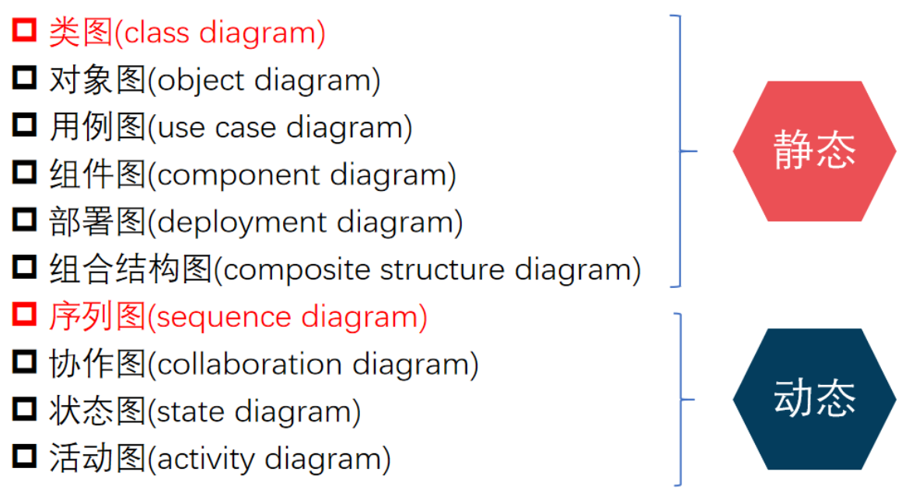

这里我们主要的来看红色的两种图例，第一种是类图，描述的是类与类之间的关系；第二种是一种动态图，可以看到一个动态的过程，后面对序列图我们在进一步了解，现在先来学习类图。

## 四、类与类之间的关系

我们知道UML中有10中图例，第一种就是类图，也就是描述类与类之间的关系，那类与类之间具备哪些关系呢？在此我们来看看他们之间的五种关系，继承（泛化）、关联、聚合、组合、依赖。

### 1、继承（泛化）

继承关系又名泛化关系，描述的是两个类之间一种很强的关系，基类部分会成为派生类的一部分，在语义上是表现为A is B的特点。例如经理是个员工、软件开发工程师是个员工、销售也是一个员工，所以可以设计下面的图例：

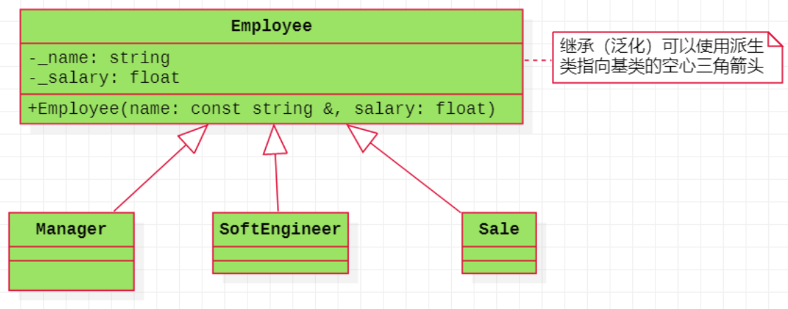

此例中，派生类经理、软件工程师、销售都是一个职员，体现出了is的关系。如果使用UML语言的话，使用<span style=color:red;>**空心三角箭头从派生类指向基类**</span>，这种关系其实是一种垂直的关系。

<span style=color:red;>**继承与泛化的区别**：</span>继承是先有基类，然后从基类产生新的类，也就是派生类；而泛化是先有派生类，然后多个派生类抽出基类，也就是先有派生类，然后才有基类。二者考虑的方向不一样，其实泛化更符合面向对象的思想。

### 2、关联

关联关系，是两个类之间最简单、最单纯的关系，表明两个类之间是有关系的，试想，如果两个类之间没有关系，那就不能满足面向对象的特点：对象与对象之间进行交互，使得彼此之间的状态发生变化的特点。而关联关系包括两种：双向的关联关系与单向的关联关系。但是不论哪种关联关系，<span style=color:red>**两个类之间彼此并不负责对方的生命周期**</span>。注意在语义上是A has B的关系，一种固定的关系。在代码上的表现形式是：使用引用或者指针。两种关联关系的例子：

双向的关联关系（使用直线），客户与订单之间的关系。

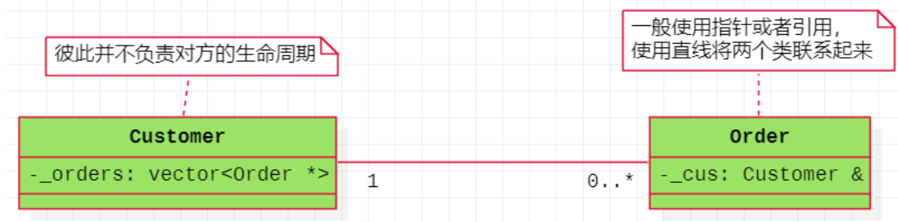

单向的关联关系，条件变量与互斥锁（Condition知道MutexLock的存在，但是MutexLock不知道Condition的存在，使用实线箭头从Condition指向MutexLock）

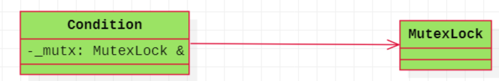

### 3、聚合

聚合关系是一种比较强的关联关系。对象之间的关系表现为整体和局部，<span style=color:red>**整体部分并不负责局部对象的销毁**</span>；语义上表现为A has B的关系；代码上表现为：数据成员以指针或者引用形式存在；类图画法上<span style=color:red>**使用空心菱形箭头从局部指向整体**。</span>

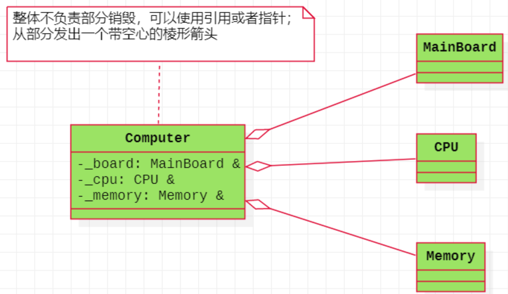

### 4、组合

组合关系是更强的一种关联关系。对象之间的关系表现为整体和局部，<span style=color:red>**整体部分负责局部对象的销毁**；</span>语义上表现为A has B的关系；代码上表现为，数据成员以子对象成员形式存在；类图画法上<span style=color:red>**使用实心菱形箭头从局部指向整体。**</span>

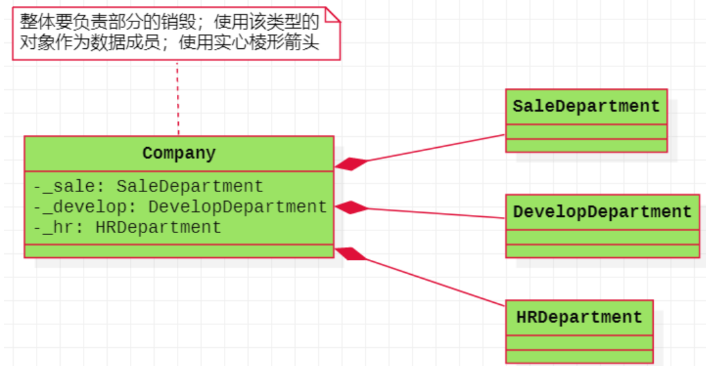

### 5、依赖

依赖关系是两个类之间的一种不确定的关系，语义上是一种A use B的关系，这种关系是<span style=color:red>**偶然的，临时的，并非固定的**</span>。在代码上表现为三种形式：

- B作为A的成员<span style=color:red>**函数参数**</span>；
- B作为A的成员函数的<span style=color:red>**局部变量或者B作为A的成员函数的返回值**</span>；
- A的成员函数调用B的<span style=color:red>**静态方法**</span>。

类图的画法上<span style=color:red>**使用虚线的箭头从A指向B。**</span>

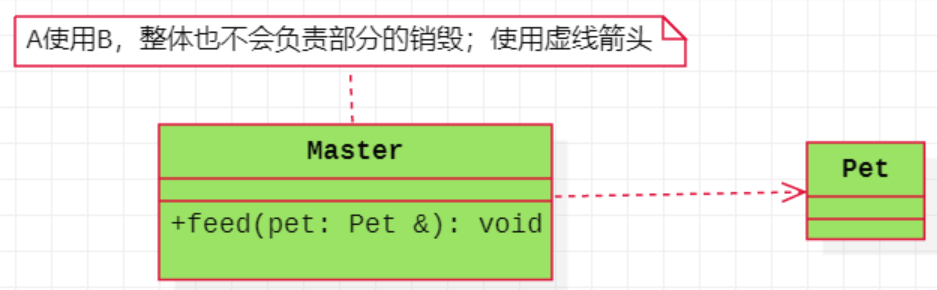

### 6、五种关系的总结

类与类之间的这五种关系，是类和类之间的一种普遍关系。这五种关系，可以从不同角度来区分：

- 从<span style=color:red>**耦合程度**</span>来看的话是：依赖 < 关联 < 聚合 < 组合 < 继承；
- 从<span style=color:red>**语义**</span>上来看，继承是A is B；关联、聚合、组合是A has B；依赖是A use B的关系；
- 从<span style=color:red>**方向**</span>上来看，继承是类与类之间的<span style=color:red>**纵向**</span>关系，而其他四种是类与类之间的<span style=color:red>**横向**</span>关系；
- 从<span style=color:red>**代码层面**</span>来看，依赖关系关注的是成员函数；关联、聚合、组合关注的是数据成员（子对象或者指针）；继承既有数据成员也有成员函数。

之前我们实现多态使用的是继承与虚函数这种面向对象的方法，现在知道了类与类之间的其他关系后，可以使用组合与依赖这种基于对象的方法实现。

## 五、面向对象的设计原则

在进行面向对象设计的时候，需要考虑类与类之间的关系，这样可以让类之间的关系更加明确。但是，除此之外，在进行面向对象设计的时候，还需要注意满足一定的设计要求，也就是面向对象的设计原则，只有遵循一定的原则，才能更好的满足软件的设计需求，更好的满足变化。而一个优良的系统设计，强调要保持<span style=color:red;background:yellow;font-size:20px>**低耦合、高内聚**</span>的要求，为了满足这个要求，面向对象的设计原则设计了七种， 包括：

单一职责原则 (Single Responsibility Principle)、开闭原则(Open Closed Principle)、里氏替换原则  (Liscov Substitution Principle)、接口分离原则  (Interface Segregation Principle)、依赖倒置原则  (Dependency Inversion Principle)、迪米特法则（Law of Demeter -> Least Knowledge Principle）、组合复用原则  (Composite/Aggregate Reuse Principle)

### 1、单一职责原则

​        定义：一个对象应该只包含单一的职责，并且该职责被完整地封装在一个类中。单一职责原则的另一种定义方式：就一个类而言，应该仅有一个引起它变化的原因。单一职责原则是最简单的面向对象设计原则，它用于控制类的粒度大小。<span style=color:red;background:yellow;font-size:20px>核心思想：一个类，最好只做一件事，只有一个引起它变化的原因</span>。核心是：解耦与增加内聚性。
​       在软件系统中，一个类（大到模块，小到方法）承担的职责越多，它被复用的可能性就越小，而且一个类承担的职责过多，相当于将这些职责耦合在一起，当其中一个职责变化时可能会影响其他职责的运作，因此要将这些职责进行分离，将不同的职责封装在不同的类中，即将不同的变化原因封装在不同的类中，如果多个职责总是同时发生改变则可将它们封装在同一类中。
​		单一职责原则是实现高内聚、低耦合的指导方针，它是最简单但又最难运用的原则，需要设计人员发现类的不同职责并将其分离，而发现类的多重职责需要设计人员具有较强的分析设计能力和相关实践经验。


例子：将长方形类的画图与计算面积功能分开，这样的话，计算面积就是计算面积，画图就是画图。

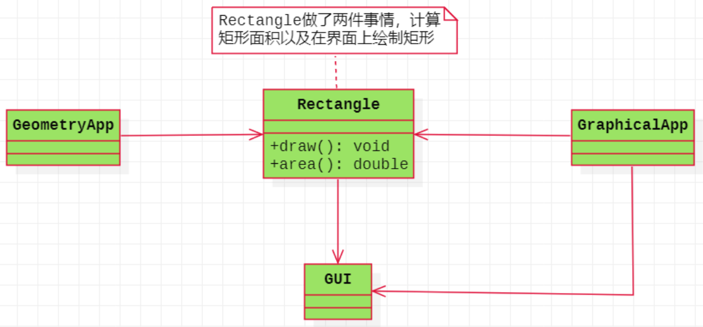

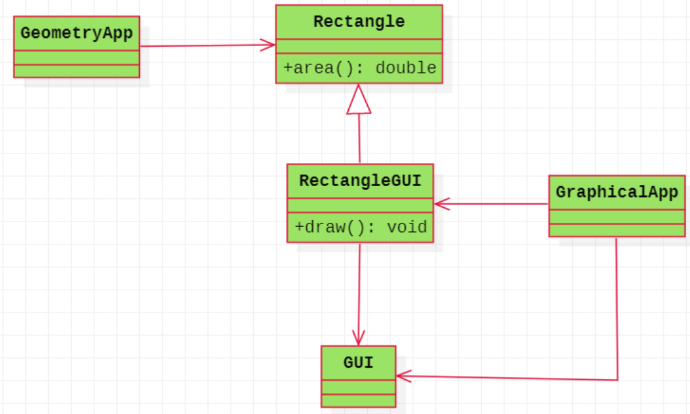

### 2、开闭原则

​		定义：软件实体应当对扩展开放，对修改关闭。开闭原则是面向对象的可复用性设计的第一块基石，它是最重要的面向对象设计原则。<span style=color:red;background:yellow;font-size:20px>核心思想：对抽象编程，而不对具体编程，因为抽象相对稳定。</span>在开闭原则的定义中，软件实体可以指一个软件模块、一个由多个类组成的局部结构或一个独立的类。开闭原则就是指软件实体应尽量在不修改原有代码的情况下进行扩展。任何软件都需要面临一个很重要的问题，即它们的需求会随时间的推移而发生变化。当软件系统需要面对新的需求时应该尽量保证系统的设计框架是稳定的。如果一个软件设计符合开闭原则，那么可以非常方便地对系统进行扩展，而且在扩展时无须修改现有代码，使得软件系统在拥有适应性和灵活性的同时具备较好的稳定性和延续性。随着软件规模越来越大， 软件寿命越来越长，软件维护成本越来越高，设计满足开闭原则的软件系统也变得越来越重要。
​		为了满足开闭原则，需要对系统进行抽象化设计，抽象化是开闭原则的关键。在C++中，可以为系统定义一个相对稳定的抽象层，而将不同的实现行为移至具体的实现层中完成。在C++语言中提供了抽象类的机制，可以通过它定义系统的抽象层，再通过具体类来进行扩展。如果需要修改系统的行为，无须对抽象层进行任何改动，只需要增加新的具体类来实现新的业务功能即可，实现在不修改已有代码的基础上扩展系统的功能，达到开闭原则的要求。

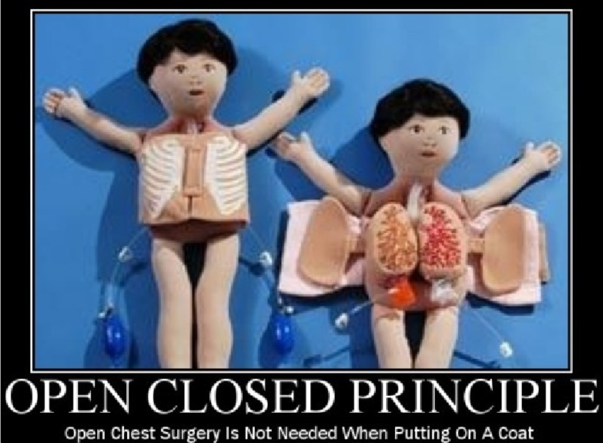

例子：版本升级，不改源代码，原来的功能就是可以使用的。计算器代码的实现：分别设计加减乘除，不如直接使用继承，实现虚方法。

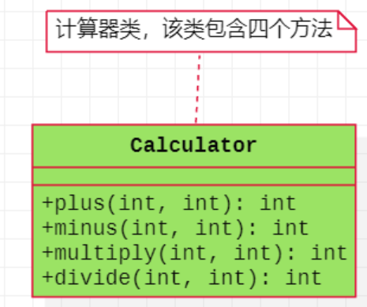

```C++
class Calculator
{
public:
    int plus(int x, int y)
    {
        return x + y;
    }

    int minus(int x, int y)
    {
        return x - y;
    }

    int multiply(int x, int y)
    {
        return x * y;
    }

    int divide(int x, int y)
    {
        if(0 != y)
        {
            return x/y;
        }
        else
        {
            cout << "除数不能为0" << endl;
            return 1 << 31;
        }
    }
};
```

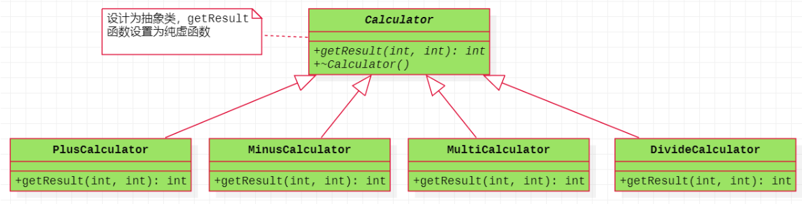

```C++
class Calculator
{
public:
    virtual int getResult(int x, int y) = 0;
    virtual ~Calculator() {}
};

class PlusCalculator
: public Calculator
{
public:
    virtual int getResult(int x, int y)
    {
        return x + y;
    }

    ~PlusCalculator() 
    {
    }
};

class MinusCalculator
: public Calculator
{
public:
    virtual int getResult(int x, int y)
    {
        return x - y;
    }

    ~MinusCalculator() 
    {
    }
};

class MultiplyCalculator
: public Calculator
{
public:
    virtual int getResult(int x, int y)
    {
        return x * y;
    }

    ~MultiplyCalculator() 
    {
    }
};

class DivideCalculator
: public Calculator
{
public:
    virtual int getResult(int x, int y)
    {
        if(0 != y)
        {
            return x/y;
        }
        else
        {
            cout << "除数不能为0" << endl;
            return 1 << 31;
        }
    }

    ~DivideCalculator() 
    {
    }
};
```

### 3、里氏替换原则

​		定义：所有引用基类（父类）的地方必须能透明地使用其派生类（子类）的对象。里氏代换原则表明，在软件中将一个基类对象替换成它的派生类对象，程序将不会产生任何错误和异常，反过来则不成立，如果一个软件实体使用的是一个派生类对象，那么它不一定能够使用基类对象。<span style=color:red;background:yellow;font-size:20px>核心思想：派生类必须能够替换其基类。</span>派生类可以扩展基类的功能，但不能改变基类原有的功能。表现形式为：

- 派生类（子类）可以实现基类（父类）的抽象方法，表现多态；
- 但不能覆盖基类（父类）的非抽象方法；
- 当然派生类（子类）可以有自己的个性。

例如我喜欢动物，那我一定喜欢狗，因为狗是动物的派生类（子类）；但是我喜欢狗，不能据此断定我喜欢所有的动物。里氏代换原则是实现开闭原则的重要方式之一，由于在使用基类（父类）对象的地方都可以使用派生类（子类）对象，因此在程序中尽量使用基类类型来对对象进行定义，而在运行时再确定其派生类（子类）类型，用派生类（子类）对象来替换基类（父类）对象。在运用里氏代换原则时应该将基类（父类）设计为抽象类或者接口，让派生类（子类）继承基类（父类）或实现父接口，并实现在基类（父类）中声明的方法，在运行时派生类（子类）实例替换基类（父类）实例，可以很方便地扩展系统的功能，无须修改原有派生类（子类）的代码，增加新的功能可以通过增加一个新的派生类（子类）来实现。

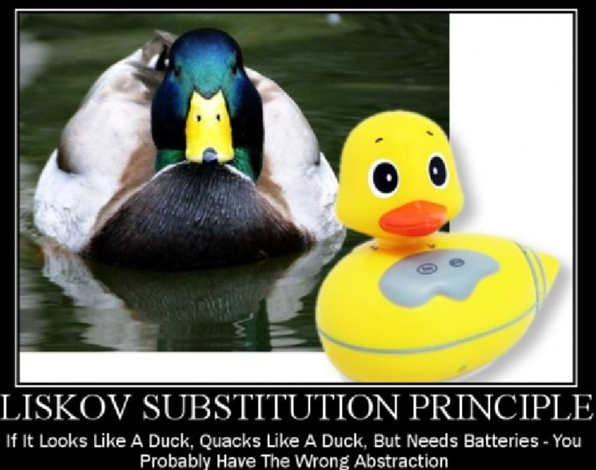

有代码的实现：（注意接口的概念，功能服务，普通函数、自由函数，类的public成员函数，虚函数，纯虚函数），注意与隐藏做区分，派生类要保有原来的功能，然后在此基础上扩展该功能。

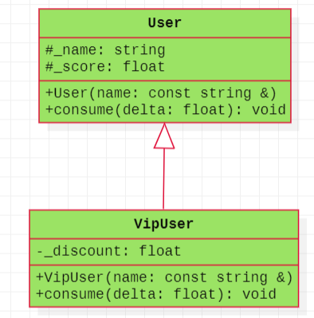

```C++
class User
{
public:
    User(const string &name)
    : _name(name)
    , _score(0)
    {
    }

    void consume(float delta)
    {
        cout << "User::consume()" << endl;
        _score += delta;
        cout << ">> " << _name << " consume " << delta << endl;
    }

protected:
    string _name;
    float _score;
};

class VipUser
: public User
{
public:
    VipUser(const string &name)
    : User(name)
    , _discount(1)
    {
    }

    void consume(float delta)
    {
        cout << "VipUser::consume(float)" << endl;

        float tmp = delta * _discount;
        _score += tmp;

        if(_score > 1000)
        {
            _discount = 0.9;
        }

        cout << ">> " << _name << " consume " << tmp << endl;
    }
private:
    float _discount;
};

void test()
{
    User user("刘德华");
    user.consume(2000);
    user.consume(2000);

    cout << endl;
    VipUser vip("张学友");
    vip.consume(2000);
    vip.consume(2000);//改变了基类的方法，隐藏
}
```

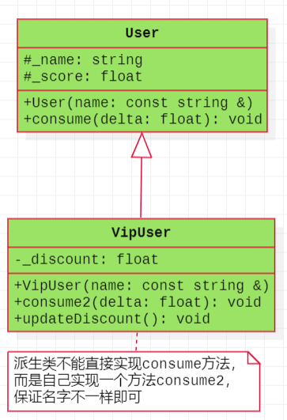

```C++
class User
{
public:
    User(const string &name)
    : _name(name)
    , _score(0)
    {
    }

    void consume(float delta)
    {
        _score += delta;

        cout << ">> " << _name << " consume " << delta << endl;
    }

protected:
    string _name;
    float _score;
};

class VipUser
: public User
{
public:
    VipUser(const string &name)
    : User(name)
    , _discount(1)
    {
    }

    void consume2(float delta)
    {
        float realDelta = delta * _discount;
        _score += realDelta;
        updateDiscount();
        cout << ">> " << _name << " consume " << realDelta << endl;
    }

    void updateDiscount()
    {
        if(_score > 10000)
        {
            _discount = 0.7;
        }
        else if(_score > 5000)
        {
            _discount = 0.8;
        }
        else if(_score > 1000)
        {
            _discount = 0.9;
        }
        else
        {
            _discount = 1;
        }
    }
private:
    float _discount;
};

void test()
{
    User user("lili");
    user.consume(2000);
    user.consume(2000);

    cout << endl;
    VipUser vip("lucy");
    vip.consume2(2000);
    vip.consume2(20000);//添加自己的个性
    vip.consume(20000);//基类的方法还是保留在,

}
```

### 4、接口分离原则

​		定义：客户端不应该依赖那些它不需要的接口。<span style=color:red;background:yellow;font-size:20px>核心思想：使用多个小的专门的接口，而不要使用一个大的总接口。</span>
​		根据接口隔离原则，当一个接口太大时需要将它分割成一些更细小的接口，使用该接口的客户端仅需知道与之相关的方法即可。每一个接口应该承担一种相对独立的角色，不干不该干的事，该干的事都要干。这里的“接口”往往有两种不同的含义：一种是指一个类型所具有的方法特征的集合，仅仅是一种逻辑上的抽象；另外一种是指C++语言中声明纯虚函数的抽象类。对于这两种不同的含义，接口隔离原则的表达方式以及含义也有所不同。（1）当把“接口”理解成一个类型所提供的所有方法特征的集合的时候，这就是一种逻辑上的概念，接口的划分将直接带来类型的划分。可以把接口理解成角色，一个接口只能代表一个角色，每个角色都有它特定的一个接口，此时这个原则可以叫“角色隔离原则”。
（2）如果把“接口”理解成狭义的C++语言的抽象类，那么接口隔离原则表达的意思是指接口仅仅提供客户端需要的行为，客户端不需要的行为则隐藏起来，应当为客户端提供尽可能小的单独的接口，而不要提供大的总接口。在C++语言中，实现一个接口需要实现该接口中定义的所有方法，因此大的总接口使用起来不一定很方便，为了使接口的职责单一，需要将大接口中的方法根据其职责不同分别放在不同的小接口中，以确保每个接口使用起来都较为方便，并都承担某一单一角色。接口应该尽量细化，同时接口中的方法应该尽量少，每个接口只包含一个客户端（如子模块或业务逻辑类）所需的方法即可，这种机制也称为“定制服务”，即为不同的客户端提供宽窄不同的接口。

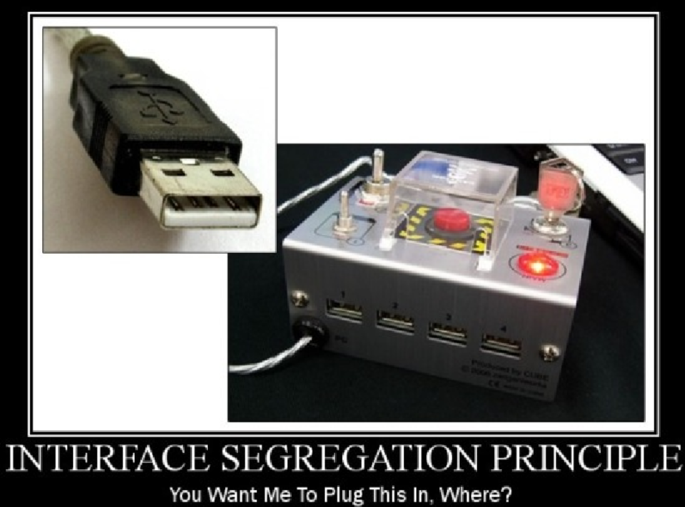

例子：鸟与鸵鸟

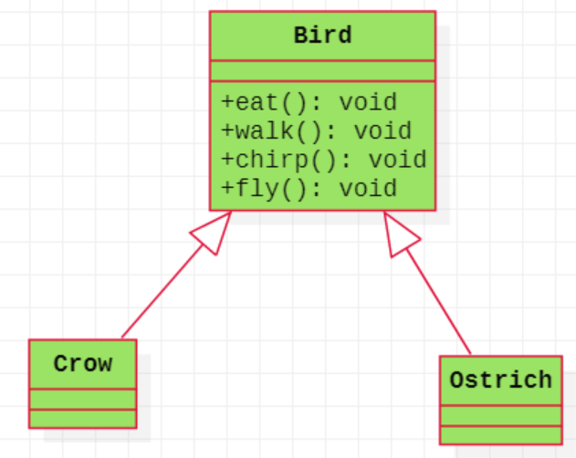

```C++
class Bird
{
public:
    virtual void eat() = 0;
    virtual void walk() = 0;
    virtual void chirp() = 0;
    virtual void fly() = 0;
    virtual ~Bird() {}
};

class Crow
: public Bird
{
public:
    void eat() override
    {
        cout << "乌鸦喝水" << endl;
    }

    void walk() override
    {
        cout << "乌鸦散步" << endl;
    }

    void chirp() override
    {
        cout << "乌鸦蹦蹦跳跳" << endl;
    }

    void fly() override
    {
        cout << "乌鸦飞翔" << endl;
    }
};

class Ostrich
: public Bird
{
public:
    void eat() override
    {
        cout << "鸵鸟吃东西" << endl;
    }

    void walk() override
    {
        cout << "鸵鸟散步" << endl;
    }

    void chirp() override
    {
        cout << "鸵鸟蹦蹦跳跳" << endl;
    }

    void fly() override
    {
        cout << "鸵鸟不会飞翔" << endl;
    }
};
```

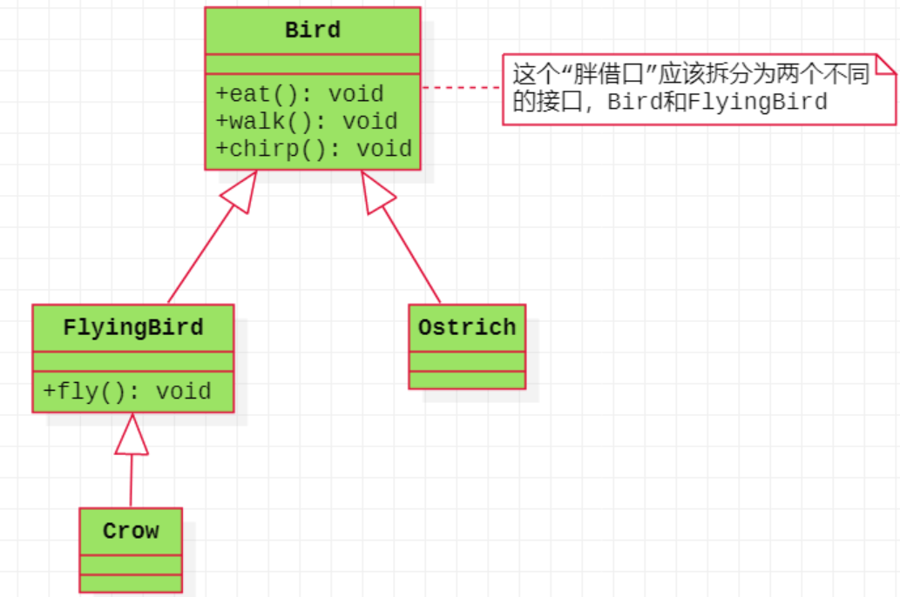

```C++
class Bird
{
public:
    virtual void eat() = 0;
    virtual void walk() = 0;
    virtual void chirp() = 0;
    virtual ~Bird() {}
};

class FlyingBird
: public Bird
{
public:
    virtual void fly() = 0;
    ~FlyingBird() {}
};

class Crow
: public FlyingBird
{
public:
    void eat() override
    {
        cout << "乌鸦喝水" << endl;
    }

    void walk() override
    {
        cout << "乌鸦散步" << endl;
    }

    void chirp() override
    {
        cout << "乌鸦蹦蹦跳跳" << endl;
    }

    void fly() override
    {
        cout << "乌鸦飞翔" << endl;
    }
};

class Ostrich
: public Bird
{
public:
    void eat() override
    {
        cout << "鸵鸟吃东西" << endl;
    }

    void walk() override
    {
        cout << "鸵鸟散步" << endl;
    }

    void chirp() override
    {
        cout << "鸵鸟蹦蹦跳跳" << endl;
    }
};
```

### 5、依赖倒置原则

​		定义：高层模块不应该依赖低层模块，它们都应该依赖抽象。抽象不应该依赖于细节，细节应该依赖于抽象。简单来说，依赖倒置原则要求针对接口编程，不要针对实现编程。<span style=color:red;background:yellow;font-size:20px>核心思想：面向接口编程，依赖于抽象。</span>
​		如果说开闭原则是面向对象设计的目标，那么依赖倒置原则就是面向对象设计的主要实现机制之一。依赖倒置原则要求在程序代码中传递参数时或在关联关系中尽量引用层次高的抽象层类，即使用接口和抽象类进行变量类型声明、参数类型声明、方法返回类型声明，以及数据类型的转换等，而不要用具体类来做这些事情。为了确保该原则的应用，一个具体类应当只实现接口或抽象类中声明过的方法，而不要给出多余的方法，否则将无法调用到在子类中增加的新方法。
​		在引入抽象层后，系统将具有很好的灵活性，在程序中尽量使用抽象层进行编程，而将具体类写在配置文件中，这样如果系统行为发生变化，只需要对抽象层进行扩展，并修改配置文件，而无须修改原有系统的源代码，在不修改的情况下来扩展系统的功能，满足开闭原则的要求。
​		在实现依赖倒置原则时需要针对抽象层编程，而将具体类的对象通过依赖注入（Dependence Injection，DI）的方式注入到其他对象中，依赖注入是指当一个对象要与其他对象发生依赖关系时采用抽象的形式来注入所依赖的对象。常用的注入方式有3种，分别是构造注入、设值注入和接口注入。构造注入是指通过构造函数来传入具体类的对象，设值注入是指通过Setter方法来传入具体类的对象，而接口注入是指通过在接口中声明的业务方法来传入具体类的对象。这些方法在定义时使用的是抽象类型，在运行时再传入具体类型的对象，由子类对象来覆盖父类对象。
​		<span style=color:red;background:yellow;font-size:20px>**在大多数情况下，开闭原则、里氏替换原则、依赖倒置原则会同时出现，开闭原则是目标，里氏替换原则是基础，依赖倒置原则是手段**。</span>

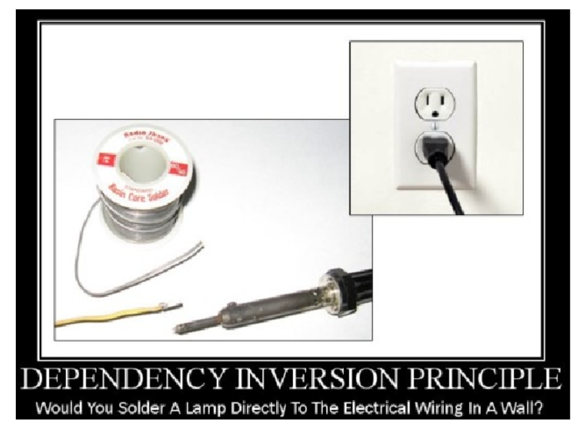

例子：银行业务类。

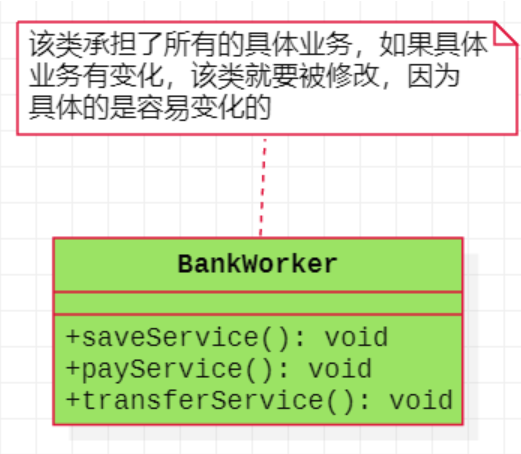

```C++
class BankWorker
{
public:
    void saveService()
    {
        cout << "办理存款业务" << endl;
    }

    void payService()
    {
        cout << "办理支付业务" << endl;
    }

    void transferService()
    {
        cout << "办理转账业务" << endl;
    }

};

void doSaveBusiness(BankWorker *worker)
{
    worker->saveService();
}

void doPayBusiness(BankWorker *worker)
{
    worker->payService();
}

void doTransferBusiness(BankWorker *worker)
{
    worker->transferService();
}

void test()
{
    unique_ptr<BankWorker> worker(new BankWorker());
    doSaveBusiness(worker.get());
    doPayBusiness(worker.get());
    doTransferBusiness(worker.get());
}
```

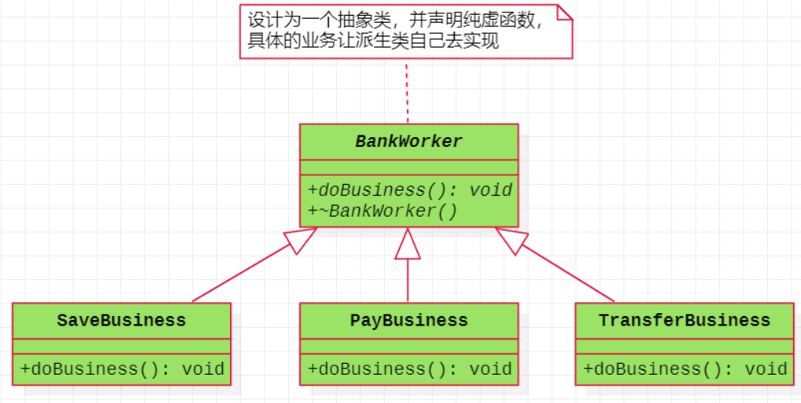

```C++
class BankWorker
{
public:
    virtual void doBusiness() = 0;
    virtual ~BankWorker() {}
};

class SaveBankWorker
: public BankWorker
{
public:
    void doBusiness() override
    {
        cout << "办理存款业务" << endl;
    }
};

class PayBankWorker
: public BankWorker
{
public:
    void doBusiness() override
    {
        cout << "办理支付业务" << endl;
    }
};

class TransferBankWorker
: public BankWorker
{
public:
    void doBusiness() override
    {
        cout << "办理转账业务" << endl;
    }
};

void doBusiness(BankWorker *worker)
{
    worker->doBusiness();
}

void test()
{
    unique_ptr<BankWorker> saveWorker(new SaveBankWorker());
    unique_ptr<BankWorker> payWorker(new PayBankWorker());
    unique_ptr<BankWorker> transferWorker(new TransferBankWorker());

    doBusiness(saveWorker.get());
    doBusiness(payWorker.get());
    doBusiness(transferWorker.get());
}
```

### 6、迪米特法则

​		定义：每一个软件单位对其他单位都只有最少的知识，而且局限于那些与本单位密切相关的软件单位。迪米特法则要求一个软件实体应当尽可能少地与其他实体发生相互作用。如果一个系统符合迪米特法则，那么当其中的某一个模块发生修改时就会尽量少地影响其他模块，扩展会相对容易，这是对软件实体之间通信的限制，迪米特法则要求限制软件实体之间通信的宽度和深度。应用迪米特法则可降低系统的耦合度，使类与类之间保持松散的耦合关系。当两个类之间直接通信的时候，会造成高度依赖的后果（高耦合）。解决此问题的办法，尽量避免两个类直接接触（低耦合），通过一个第三者做转发。<span style=color:red;background:yellow;font-size:20px>核心思想：降低耦合程度。</span>
在迪米特法则中，对于一个对象，其朋友包括以下几个类：

- 当前对象本身（this）；
- 以参数形式传入到当前对象方法中的对象；
- 当前对象的成员对象；
- 如果当前对象的成员对象是一个集合，那么集合中的元素也都是朋友；
- 当前对象所创建的对象。

​		任何一个对象如果满足上面的条件之一，就是当前对象的“朋友”，否则就是“陌生人”。在应用迪米特法则时，一个对象只能与直接朋友发生交互，不要与“陌生人”发生直接交互，这样做可以降低系统的耦合度，一个对象的改变不会给太多其他对象带来影响。
​		迪米特法则要求在设计系统时应该尽量减少对象之间的交互，如果两个对象之间不必彼此直接通信，那么这两个对象就不应当发生任何直接的相互作用，如果其中一个对象需要调用另一个对象的方法，可以通过“第三者”转发这个调用。简而言之，就是通过引入一个合理的“第三者”来降低现有对象之间的耦合度。
​		在将迪米特法则运用到系统设计时要注意下面几点：<span style=color:red;>**在类的划分上应当尽量创建松耦合的类，类之间的耦合度越低，就越有利于复用**</span>，一个处在松耦合中的类一旦被修改不会对关联的类造成太大影响；在类的结构设计上，每一个类都应当尽量降低其成员变量和成员函数的访问权限；在类的设计上，只要有可能，一个类型应当设计成不变类；在对其他类的引用上，一个对象对其他对象的引用应当降到最低。

例如：使用买房者购房的一个例子。

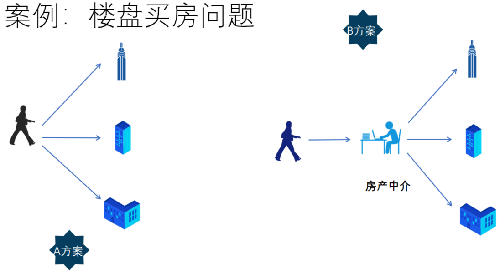

A方案，购房者需要挨个楼盘的去知道确切的消息，需要对每个楼盘都有详细的了解，而B方案是购房者可以不用知道每个楼盘的具体信息，直接找个中介，告诉中介自己的需求，让中介进行推荐，这样购房者与楼盘之间的关系就不是那么强相关。方案A的代码实现：

```C++
class Building
{
public:
    virtual void sale() = 0;
    virtual string getQuality() = 0;
    virtual ~Building(){}
};

class WankeBuilding
: public Building
{
public:
    WankeBuilding()
    : _quality("高品质")
    {

    }

    void sale() override
    {
        cout << "万科楼盘" << _quality << "的房子被出售" << endl;
    }

    string getQuality() override
    {
        return _quality;
    }
private:
    string _quality;
};

class HengdaBuilding
: public Building
{
public:
    HengdaBuilding()
    : _quality("低品质")
    {
    }

    void sale() override
    {
        cout << "恒大楼盘" << _quality << "的房子被出售" << endl;
    }

    string getQuality() override
    {
        return _quality;
    }
private:
    string _quality;
};

void test()
{
    Building *pbuidingA = new WankeBuilding();
    Building *pbuidingB = new HengdaBuilding();

    string demand = "低品质";

    if(pbuidingA->getQuality() == demand)
    {
        pbuidingA->sale();
    }

    if(pbuidingB->getQuality() == demand)
    {
        pbuidingB->sale();
    }
}
```

方案B的代码实现：

```C++
class Mediator
{
public:
    Mediator()
    {
        Building *pbuildingA = new WankeBuilding();
        Building *pbuildingB = new HengdaBuilding();
        _buildings.push_back(pbuildingA);
        _buildings.push_back(pbuildingB);
    }

    Building *findBuilding(const string &quality)
    {
        for(auto &building : _buildings)
        {
            if(building->getQuality() == quality)
            {
                return building;
            }
        }

        return nullptr;
    }

    ~Mediator()
    {
        for(auto &building : _buildings)
        {
            if(building)
            {
                delete building;
            }
        }
    }
private:
    vector<Building *> _buildings;
};

void test()
{
    string demand = "低品质";
    Mediator mediator;

    Building *pbuilding = mediator.findBuilding(demand);
    if(pbuilding)
    {
        pbuilding->sale();
    }
    else
    {
        cout << "没有符合要求的楼盘" << endl;
    }
}
```

### 7、组合复用原则

​		定义：优先使用对象组合，而不是通过继承来达到复用的目的。合成复用原则就是在一个新的对象里通过关联关系（包括组合关系和聚合关系）来使用一些已有的对象，使之成为新对象的一部分，新对象通过委派调用已有对象的方法达到复用功能的目的。<span style=color:red;background:yellow;font-size:20px>简言之，在复用时要尽量使用组合/聚合关系（关联关系），少用继承。</span>
​		在面向对象设计中可以通过两种方法在不同的环境中复用已有的设计和实现，即通过组合/聚合关系或通过继承，但首先应该考虑使用组合/聚合，组合/聚合可以使系统更加灵活，降低类与类之间的耦合度，一个类的变化对其他类造成的影响相对较少；其次才考虑继承，在使用继承时需要严格遵循里氏代换原则，有效使用继承会有助于对问题的理解，降低复杂度，而滥用继承反而会增加系统构建和维护的难度以及系统的复杂度，因此需要慎重使用继承复用。
​		通过继承来进行复用的主要问题在于继承复用会破坏系统的封装性，因为继承会将基类的实现细节暴露给子类，由于基类的某些内部细节对子类来说是可见的，所以这种复用又称“白箱”复用，如果基类发生改变，那么子类的实现也不得不发生改变；从基类继承而来的实现是静态的，不可能在运行时发生改变，没有足够的灵活性；而且继承只能在有限的环境中使用（如类没有声明为不能被继承）。
​		由于组合/聚合关系可以将已有的对象纳入到新对象中，使之成为新对象的一部分，因此新对象可以调用已有对象的功能，这样做可以使成员对象的内部实现细节对于新对象不可见，所以这种复用又称为“黑箱”复用，相对继承关系而言，其耦合度相对较低，成员对象的变化对新对象的影响不大，可以在新对象中根据实际需要有选择性地调用成员对象的操作；合成复用可以在运行时动态进行，新对象可以动态地引用与成员对象类型相同的其他对象。		一般而言，如果两个类之间是“Has-A”的关系应使用组合/聚合，如果是“Is-A”的关系可以使用继承。“Is-A”是严格的分类学意义上的定义，意思是一个类是另一个类的“一种”；而“Has-A”则不同，它表示某一个角色具有某一项责任。

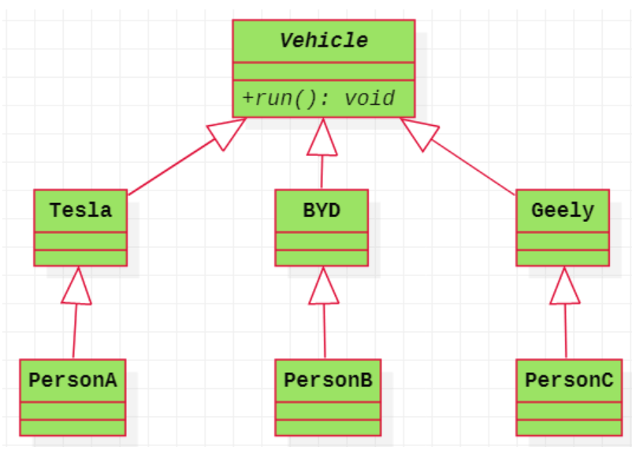

```C++
class Vehicle
{
public:
    virtual void run() = 0;
    virtual ~Vehicle() {}
};

class Tesla
: public Vehicle
{
public:
    void run() override
    {
        cout << "Model Y start..." << endl;
    }
};

class BYD
: public Vehicle
{
public:
    void run() override
    {
        cout << "汉EV start..." << endl;
    }
};

class Geely
: public Vehicle
{
public:
    void run() override
    {
        cout << "Geely LYNK03 start..." << endl;
    }
};

class PersonA
: public Tesla
{

};

class PersonB
: public BYD
{

};

class PersonC
: public Geely
{

};

void test()
{
    PersonA pa;
    pa.run();

    PersonB pb;
    pb.run();

    PersonC pc;
    pc.run();
}
```

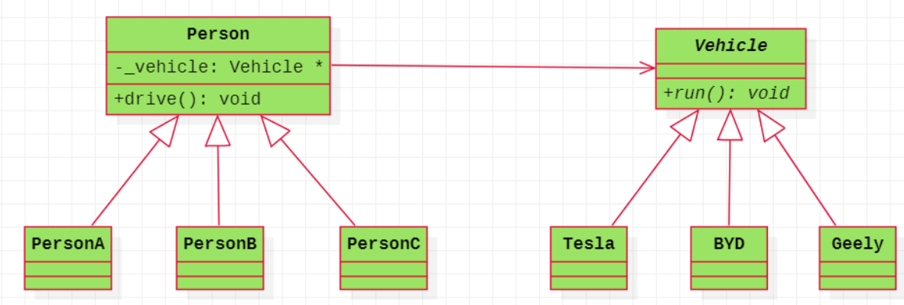

```C++
class Vehicle
{
public:
    virtual void run() = 0;
    virtual ~Vehicle() {}
};

class Tesla
: public Vehicle
{
public:
    void run() override
    {
        cout << "Model Y start..." << endl;
    }
};

class BYD
: public Vehicle
{
public:
    void run() override
    {
        cout << "汉EV start..." << endl;
    }
};

class Geely
: public Vehicle
{
public:
    void run() override
    {
        cout << "Geely LYNK03 start..." << endl;
    }
};

class Person
{
public:
    void getVehicle(Vehicle *vehicle)
    {
        _vehicle = vehicle;
    }

    void drive()
    {
        _vehicle->run();
    }
private:
    Vehicle *_vehicle;
};

void test()
{
    Person person;
    unique_ptr<Vehicle> tesla(new Tesla());
    unique_ptr<Vehicle> han(new BYD());
    unique_ptr<Vehicle> geely(new Geely());

    person.getVehicle(tesla.get());
    person.drive();

    person.getVehicle(han.get());
    person.drive();

    person.getVehicle(geely.get());
    person.drive();
}
```

### 8、七大设计原则的总结

原则的目的只有一个：降低对象之间的耦合，增加程序的可复用性、可扩展性和可维护性。

| 设计原则名称 | 设计原则简介                                 | 重要性 |
|---------------- | :----------------------------------------- |------ |
| 单一职责原则 | 类的职责要单一，不能将太多的职责放在一个类中                 | 四颗星 |
| 开闭原则     | 软件实体对扩展是开放的，但对修改是关闭的，即在不修改一个软件的基础上去扩展其功能 | 五颗星 |
| 里氏替换原则 | 在软件系统中，一个可以接受基类对象的地方必然可以接收一个派生类对象 | 四颗星 |
| 依赖倒置原则 | 要针对抽象编程，而不是针对具体编程                           | 五颗星 |
| 接口隔离原则 | 使用多个专门的接口来取代一个统一的接口                       | 二颗星 |
| 迪米特法则   | 一个软件实体对其他实体的引用越少越好，或者说如果两个类彼此直接通信，那么这两个类就不应当发生直接相互作用，而是通过引入一个第三者发生间接交互 | 三颗星 |
| 合成复用原则 | 在系统中应该尽量多使用组合和聚合关联关系，尽量少使用甚至不使用继承关系 | 四颗星 |

## 六、设计模式

### 1、概述

设计模式的由来，1977 年有位美国著名建筑大师提出，他叫Christopher Alexander（克里斯托弗.亚历山大）。他拥有剑桥大学数学硕士学位和建筑学学士学位，以及哈佛大学建筑学博士学位，有“模式它爹”的称号。1990 年，软件工程界开始研讨设计模式的话题。1994 年，艾瑞克·伽马（ErichGamma）、理査德·海尔姆（Richard Helm）、拉尔夫·约翰森（Ralph Johnson）、约翰·威利斯迪斯（John Vlissides）等 4 位作者合作出版了《设计模式：可复用面向对象软件的基础》（Design Patterns: Elements of Reusable Object-Oriented Software）一书。

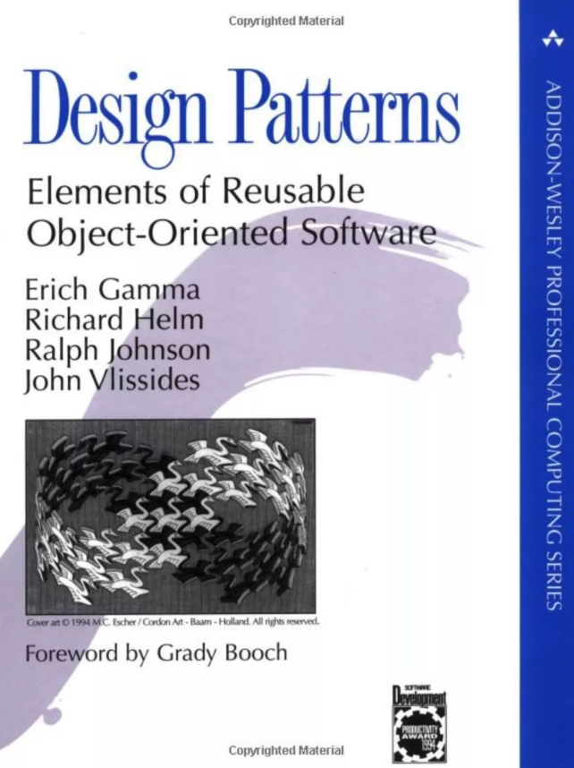

在本教程中收录了23个设计模式，这是设计模式领域里程碑的事件，导致了软件设计模式的突破。


这4位作者在软件开发领域里也以他们的“四人组”（Gang of Four，GoF）匿名著称。

### 2、什么是设计模式

什么是设计模式？简单来说就是一本编程界的如来神掌。


<span style=color:red;background:yellow;font-size:20px>**设计模式是解决特定问题的一系列套路，有一定的普遍性**。</span>它是一套被反复使用、多数人知晓的、代码设计经验的总结；它能提高程序员的思维能力、编程能力和设计能力；它可以提高代码的可重用性、代码的可读性和代码的可靠性以及可扩展性；它能使程序设计更加标准化，使软件开发效率提高，从而缩短软件的开发周期。是它是它就是它，编程界的武林秘籍，绝世高手都练过它！

### 3、设计模式分类

设计模式的分类，模式分为三种不同类型的模式。

**创建型模式（Creational patterns）5种**：主要用于创建对象；提供对象创建机制，增加现有代码的灵活性和重用。

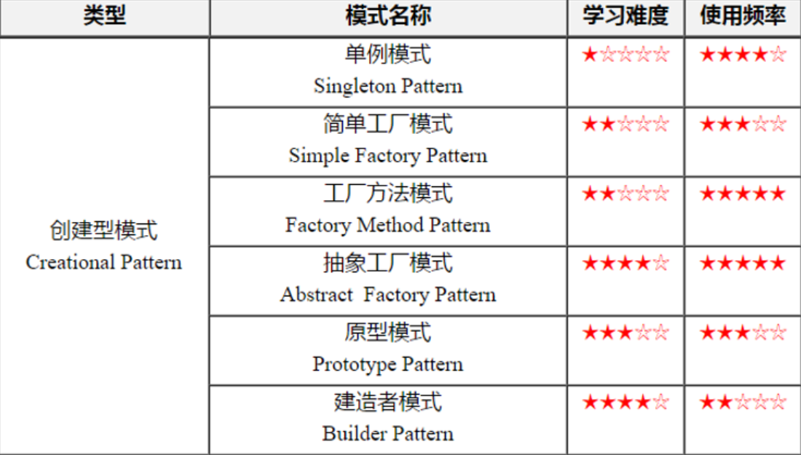

**结构型模式（Structural patterns）7种**：主要用于处理类或对象的组合；解释如何将对象和类组装成更大的结构，同时保持结构的灵活性和高效性。

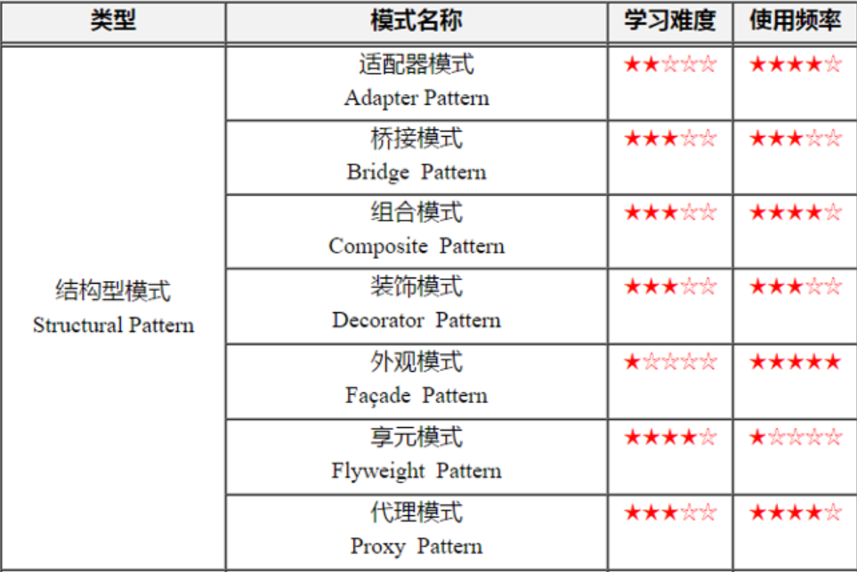

**行为型模式（Behavioral patterns）11种**：主要用于描述对类或对象怎样交互和怎样分配职责；负责有效的沟通和对象之间的责任分配。

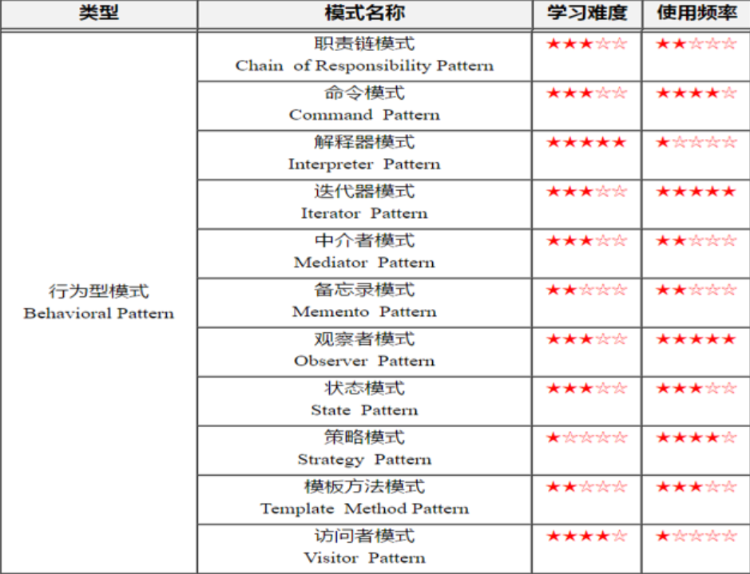

## 七、常见设计模式

下面对几种常见的设计模式进行学习。

### 1、简单工厂

#### 1.1、概述

简单工厂模式又叫静态工厂方法模式，提供一个工厂类，在工厂类中做判断，根据传入的类型创造相应的产品，当增加新的产品时，就需要修改工厂类。简单工厂模式提供了专门的工厂类用于创建对象，<span style=color:red;background:yellow;font-size:20px>将对象的创建和对象的使用分离开</span>，它作为一种最简单的工厂模式在软件开发中得到了较为广泛的应用。

#### 1.2、类图

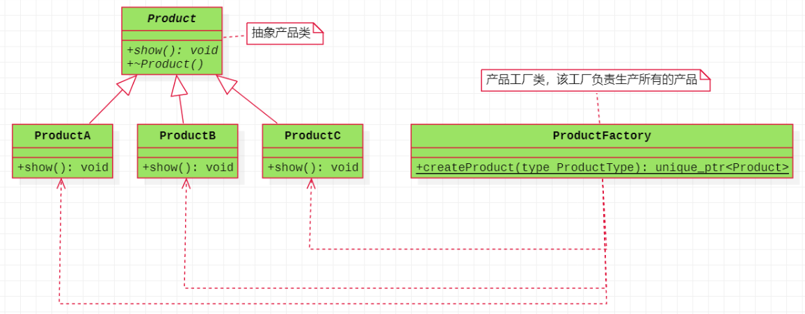

#### 1.3、代码

```C++
enum ProductType
{ 
    TypeA, 
    TypeB, 
    TypeC 
};

//抽象产品类
class Product
{
public:
    virtual void show() = 0;
    //抽象类的析构函数设置为虚函数
    virtual ~Product() {}
};

class ProductA 
: public Product
{
public:
    ProductA()
    {
        cout << "ProductA()" << endl;
    }

    void show() override
    {
        cout << "void ProductA::show()" << endl;
    }

    ~ProductA()
    {
        cout << "~ProductA()" << endl;
    }
};

class ProductB 
: public Product
{
public:
    ProductB()
    {
        cout << "ProductB()" << endl;
    }

    void show() override
    {
        cout << "void ProductB::show()" << endl;
    }

    ~ProductB()
    {
        cout << "~ProductB()" << endl;
    }
};

class ProductC 
: public Product
{
public:
    ProductC()
    {
        cout << "ProductC()" << endl;
    }

    void show() override
    {
        cout << "void ProductC::show()" << endl;
    }

    ~ProductC()
    {
        cout << "~ProductC()" << endl;
    }
};

class ProductFactory
{
public:
    static unique_ptr<Product> createProduct(ProductType type)
    {
        switch (type)
        {
        case TypeA: 
            return unique_ptr<Product>(new ProductA());
        case TypeB: 
            return unique_ptr<Product>(new ProductB());
        case TypeC: 
            return unique_ptr<Product>(new ProductC());
        default: return unique_ptr<Product>(nullptr);
        }
    }
};


void test()
{
    unique_ptr<Product> pa = ProductFactory::createProduct(TypeA);
    unique_ptr<Product> pb = ProductFactory::createProduct(TypeB);
    unique_ptr<Product> pc = ProductFactory::createProduct(TypeC);
    pa->show();
    pb->show();
    pc->show();
}
```

#### 1.4、优点

- 工厂类包含必要的判断逻辑，可以决定在什么时候创建哪一个产品类的实例，客户端可以免除直接创建产品对象的职责，而仅仅“消费”产品，简单工厂模式实现了对象创建和使用的分离；
- 客户端无须知道所创建的具体产品类的类名，只需要知道具体产品类所对应的参数即可，对于一些复杂的类名，通过简单工厂模式可以在一定程度减少使用者的记忆量；
- 通过引入配置文件，可以在不修改任何客户端代码的情况下更换和增加新的具体产品类，在一定程度上提高了系统的灵活性。

#### 1.5、缺点

- 由于工厂类集中了所有产品的创建逻辑，职责过重，一旦不能正常工作，整个系统都要受到影响；
- 使用简单工厂模式势必会增加系统中类的个数（引入新的工程类），增加了系统的复杂度和理解难度；
- 系统拓展困难，一旦添加了新的产品就不得不修改工厂逻辑，在产品类型较多时，有可能造成工厂逻辑过于复杂，不利于系统的拓展和维护；
- 简单工厂模式由于使用了静态工厂方法，造成工厂角色无法形成基于继承的等级结构。

#### 1.6、使用场景

- 工厂类负责创建的对象比较少，由于创建的对象较少，不会造成工厂方法中的业务逻辑太过复杂；
- 客户端只知道传入工厂类的参数，对于如何创建对象并不关心。

### 2、工厂方法

#### 2.1、概述

在软件开发及运行过程中，经常需要创建对象，但常出现由于需求的变更，需要创建的对象的具体类型也要经常变化。工厂方法通过采取虚函数的方法，<span style=color:red;background:yellow;font-size:20px>实现了使用者和具体类型之间的解耦</span>，可以用来解决这个问题。工厂方法模式对简单工厂模式中的工厂类进一步抽象。核心工厂类不再负责产品的创建，而是演变为一个抽象工厂角色，仅负责定义具体工厂子类必须实现的接口，同时，针对不同的产品提供不同的工厂，即每个产品都有一个与之对应的工厂。这样，系统在增加新产品时就不会修改工厂类逻辑而是添加新的工厂子类，从而弥补简单工厂模式对修改开放的缺陷。定义一个创建对象的接口，让子类决定实例化哪个类，该模式使类对象的创建延迟到子类。

#### 2.2、类图

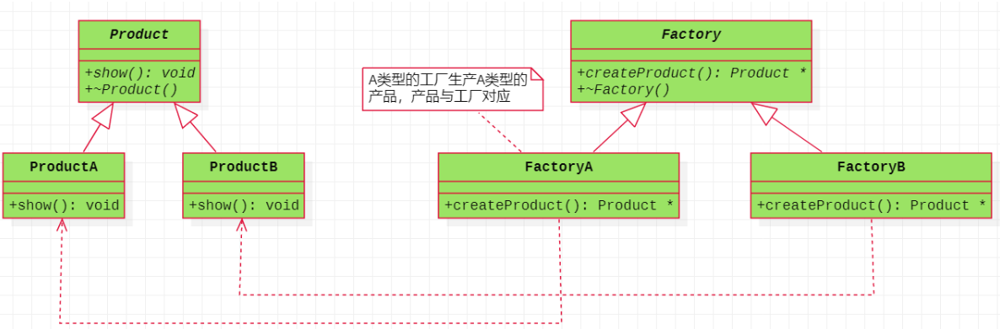

#### 2.3、代码

```C++
//产品抽象类
class Product 
{
public:
	virtual void show() = 0;
	virtual ~Product() {}
};
 
class ProductA 
: public Product 
{
public:
	ProductA() 
    {
        cout << "ProductA()" << endl;
    }

	void show() override
    { 
        cout << "void ProductA::show()" << endl;
    }

	~ProductA() 
    {
        cout << "~ProductA()" << endl;
    }
 
};
 
class ProductB 
: public Product 
{
public:
	ProductB()
    {
        cout << "ProductB()" << endl;
    }

	void show() override 
    { 
        cout << "void ProductB::show()" << endl;
    }

    ~ProductB()
    {
        cout << "~ProductB()" << endl;
    }
 
};
 
class Factory
{
public:
	virtual Product* createProduct() = 0;
	virtual ~Factory() {}
};
 
class FactoryA 
: public Factory 
{
public:
	FactoryA() 
    {
        cout << "FactoryA()" << endl;
    }

	Product* createProduct() override
    {	
        return new ProductA();
    }

	~FactoryA() 
    {
        cout << "~FactoryA()" << endl;
    }
};
 
class FactoryB 
: public Factory 
{
public:
	FactoryB() 
    {
        cout << "FactoryB()" << endl;
    }

	Product* createProduct() override
    {	
        return new ProductB();
    }

	~FactoryB() 
    {
        cout << "~FactoryB()" << endl;
    }
 
};
 
void test()
{
	//生产产品A
    unique_ptr<Factory> factoryA(new FactoryA());
	unique_ptr<Product> productA(factoryA->createProduct());
	productA->show();
 
	//生产产品B
    cout << endl << endl;
    unique_ptr<Factory> factoryB(new FactoryB());
	unique_ptr<Product> productB(factoryB->createProduct());
	productB->show();
}
```


#### 2.4、优点

- 用户只需要知道具体工厂的名称就可得到所要的产品，无须知道产品的具体创建过程；
- 灵活性增强，对于新产品的创建，只需多写一个相应的工厂类；
- 典型的解耦框架。高层模块只需要知道产品的抽象类，无须关心其他实现类，满足迪米特法则、依赖倒置原则和里氏替换原则；
- 对扩展开放对修改关闭；解决了简单工厂的缺点问题。

#### 2.5、缺点

- 类的个数容易过多，增加复杂度；
- 增加了系统的抽象性和理解难度；
- 接口的传入参数类型需要一致，且只能对单一变化量接口使用；
- 抽象产品只能生产一种产品，此弊端可使用抽象工厂模式解决。

#### 2.6、应用场景

- 客户只知道创建产品的工厂名，而不知道具体的产品名；
- 创建对象的任务由多个具体子工厂中的某一个完成，而抽象工厂只提供创建产品的接口；
- 客户不关心创建产品的细节，只关心产品的品牌。

### 3、抽象工厂

#### 3.1、概述

在软件开发及运行过程中，经常面临着<span style=color:red;background:yellow;font-size:20px>"一系列相互依赖的对象"的创建工作</span>；而由于需求的变化，常常存在更多系列对象的创建问题。定义提供一个接口，该接口负责创建一系列"相关或者相互依赖的对象"，无需指定它们具体的类。这里有两个概念，产品等级结构与产品族的概念，对于理解抽象工厂很重要。

- 产品等级结构：<span style=color:red>**产品等级结构即产品的继承结构**</span>，如一个抽象类是电视机，其子类有海尔电视机、海信电视机、TCL电视机，则抽象电视机与具体品牌的电视机之间构成了一个产品等级结构，抽象电视机是父类，而具体品牌的电视机是其子类。（都是同一类产品，都是电视机）。
- 产品族：<span style=color:red>**指由同一个工厂生产的，位于不同产品等级结构中的一组产品**</span>，如海尔电器工厂生产的海尔电视机、海尔电冰箱，海尔电视机位于电视机产品等级结构中，海尔电冰箱位于电冰箱产品等级结构中，海尔电视机、海尔电冰箱构成了一个产品族。（不同类的产品，但是属于同一家公司）

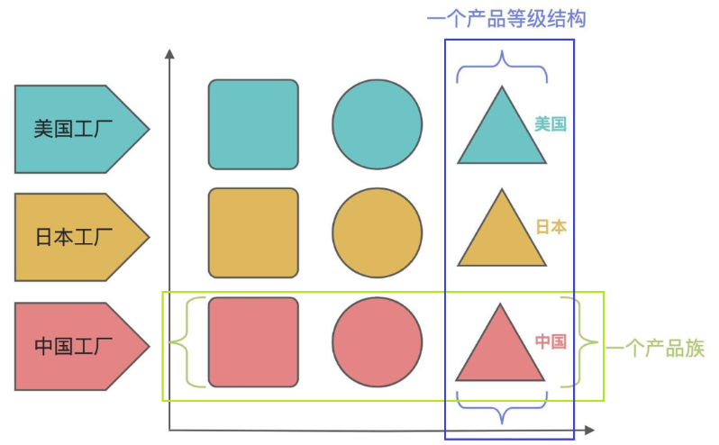

#### 3.2、类图

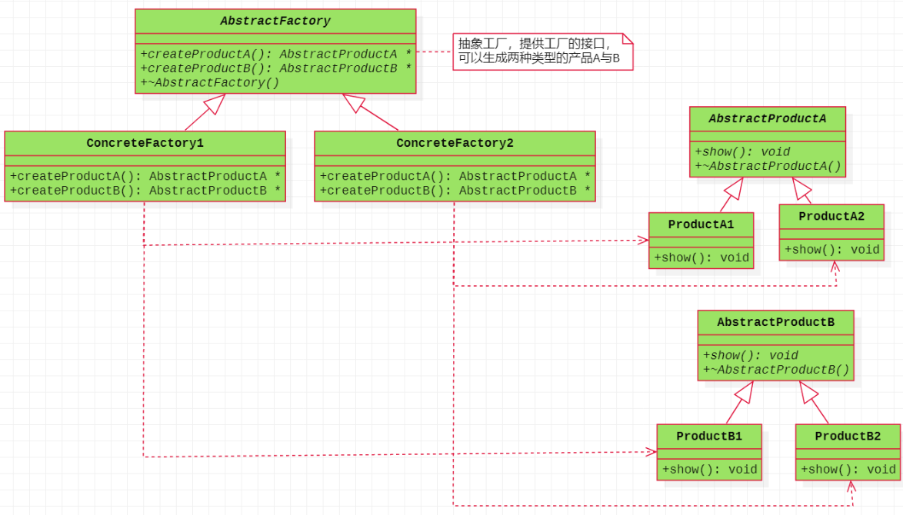

#### 3.3、代码

```C++
//A类型的抽象产品
class AbstractProductA
{
public:
    virtual void show() = 0;
    ~AbstractProductA(){}
};

//B类型的抽象产品
class AbstractProductB
{
public:
    virtual void show() = 0;
    ~AbstractProductB(){}
};

class ProductA1
: public AbstractProductA
{
public:
    virtual void show() override
    {
        cout << "void ProductA1::show()" << endl;
    }
};

class ProductA2
: public AbstractProductA
{
public:
    virtual void show() override
    {
        cout << "void ProductA2::show()" << endl;
    }
};

class ProductB1
: public AbstractProductB
{
public:
    virtual void show() override
    {
        cout << "void ProductB1::show()" << endl;
    }
};

class ProductB2
: public AbstractProductB
{
public:
    virtual void show() override
    {
        cout << "void ProductB2::show()" << endl;
    }
};

class AbstractFactory
{
public:
    virtual AbstractProductA *createProductA() = 0;
    virtual AbstractProductB *createProductB() = 0;
    ~AbstractFactory() {}
};

class ConcreteFactory1
: public AbstractFactory
{
public:
    AbstractProductA *createProductA() override
    {
        return new ProductA1();
    }

    AbstractProductB *createProductB() override
    {
        return new ProductB1();
    }

};

class ConcreteFactory2
: public AbstractFactory
{
public:
    AbstractProductA *createProductA() override
    {
        return new ProductA2();
    }

    AbstractProductB *createProductB() override
    {
        return new ProductB2();
    }

};

void test()
{
    AbstractFactory *factory1 = new ConcreteFactory1();
    AbstractProductA *productA = factory1->createProductA();
    AbstractProductB *productB = factory1->createProductB();
    productA->show();
    productB->show();

    cout << endl;
    AbstractFactory *factory2 = new ConcreteFactory2();
    productA = factory2->createProductA();
    productB = factory2->createProductB();
    productA->show();
    productB->show();
}

```

#### 3.4、优点

- 抽象工厂模式隔离了具体类的生成，使得客户端并不需要知道什么被创建；
- 当一个产品族中的多个对象被设计成一起工作时，它能够保证客户端始终只使用同一产品族中的对象；
- 增加新的产品族很方便（生成新的具体工厂），无需修改已有系统代码，符合开闭原则；

#### 3.5、缺点

增加新的产品等级结构很复杂，需要修改抽象工厂和所有的具体工厂类，对“开闭原则”的支持呈现倾斜性。

#### 3.6、应用场景

- 用户无需关心对象的创建过程，将对象的创建和使用解耦；
- 产品等级结构稳定，在设计完成之后不会向系统中增加新的产品等级结构或者删除已有的产品等级结构；
- 系统中有多于一个的产品族，而每次只使用其中某一产品族。可以通过配置文件等方式来使用户能够动态改变产品族，也可以很方便的增加新的产品族。

### 4、观察者模式

#### 4.1、概述

在GOF的《设计模式：可复用面向对象软件的基础》一书中对观察者模式是这样定义的：<span style=color:red;background:yellow;font-size:20px>定义对象的一种一对多的依赖关系，当一个对象的状态发生改变时，所有依赖于它的对象都得到通知并被自动更新。</span>当一个对象发生了变化，关注它的对象就会得到通知；这种交互也成为发布-订阅（publish-subscribe）。

#### 4.2、类图

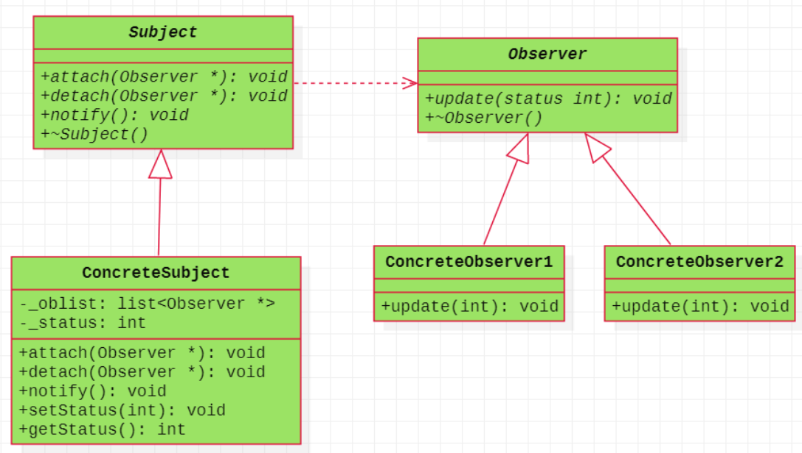

#### 4.3、代码

```C++
#include <iostream>
#include <list>
#include <algorithm>
#include <string>

using std::cout;
using std::endl;
using std::list;
using std::find;
using std::string;

class Observer;

class Subject
{
public:
    virtual void attach(Observer *pObserver) = 0;
    virtual void detach(Observer *pObserver) = 0;
    virtual void notify() = 0;

    virtual ~Subject() {}
};

class ConcreteSubject
: public Subject
{
public:
    void attach(Observer *pObserver) override;
    void detach(Observer *pObserver) override; 
    void notify() override;

    void setStatus(int status)
    {
        _status = status;
    }

    int getStatus() const
    {
        return _status;
    }

private:
    list<Observer *> _obList;
    int _status;

};

class Observer
{
public:
    virtual void update(int) = 0;
    virtual ~Observer() {  }
};

class ConcreteObserver
: public Observer
{
public:
    ConcreteObserver(const string &name)
    : _name(name)
    {

    }
    void update(int value) 
    {
        cout << "ConcreteObserver " << _name << ", value = " << value << endl;
    }

private:
    string _name;
};

class ConcreteObserver2
: public Observer
{
public:
    ConcreteObserver2(const string &name)
    : _name(name)
    {

    }
    void update(int value) 
    {
        cout << "ConcreteObserver2 " << _name << ", value = " << value << endl;
    }

private:
    string _name;
};

void ConcreteSubject::attach(Observer *pObserver) 
{
    if(pObserver)
    {
        _obList.push_back(pObserver);
    }  
}

void ConcreteSubject::detach(Observer *pObserver) 
{
    if(pObserver)
    {
        _obList.remove(pObserver);  
    }
}

void ConcreteSubject::notify() 
{
    for(auto &ob : _obList)
    {
        ob->update(_status);
    }
}

void test()
{
    unique_ptr<ConcreteSubject> pSubject(new ConcreteSubject());
    unique_ptr<Observer> pObserver(new ConcreteObserver("lili"));
    unique_ptr<Observer> pObserver2(new ConcreteObserver2("lucy"));

    pSubject->setStatus(2);

    pSubject->attach(pObserver.get());
    pSubject->attach(pObserver2.get());

    pSubject->notify();

    pSubject->detach(pObserver2.get());
    pSubject->setStatus(3);
    pSubject->notify();
}
```

#### 4.4、优点

- 观察者和被观察者是抽象耦合的；
- 建立一套触发机制。

#### 4.5、缺点

- 如果一个被观察者对象有很多的直接和间接的观察者的话，将所有的观察者都通知到会花费很多时间；
- 如果在观察者和观察目标之间有循环依赖的话，观察目标会触发它们之间进行循环调用，可能导致系统崩溃；
- 观察者模式没有相应的机制让观察者知道所观察的目标对象是怎么发生变化的，而仅仅只是知道观察目标发生了变化。

#### 4.6、应用场景

- 一个抽象模型有两个方面，其中一个方面发依赖于另外一个方面。将这些方面封装在独立的对象中使它们可以各自独立地改变和复用；
- 一个对象的改变将导致其它一个或多个对象发生改变，而不知道具体有多少对象将发生改变，可以降低对象之间的耦合度；
- 一个对象必须通知其他对象，而并不知道这些对象是谁；
- 需要在系统中创建一个触发链，A对象的行为将影响B对象，B对象的行为将影响C对象……，可以使用观察者模式创建一种链式触发机制。

### 5、策略模式

#### 5.1、概述

策略模式是一种行为型设计模式，策略模式在软件开发场景中定义了一系列的算法，并将每个算法单独封装在可替换的对象中，使应用程序在运行时可以根据具体的上下文来动态地选择和切换算法，同时保持原有的代码架构不被修改。策略模式的设计使得<span style=color:red;background:yellow;font-size:20px>**算法的实现与调用被分离**</span>，让算法可以独立于外部客户端进行开发和改动，使用独立的类来封装特定的算法，也避免了不同算法策略之间的互相影响。

#### 5.2、类图

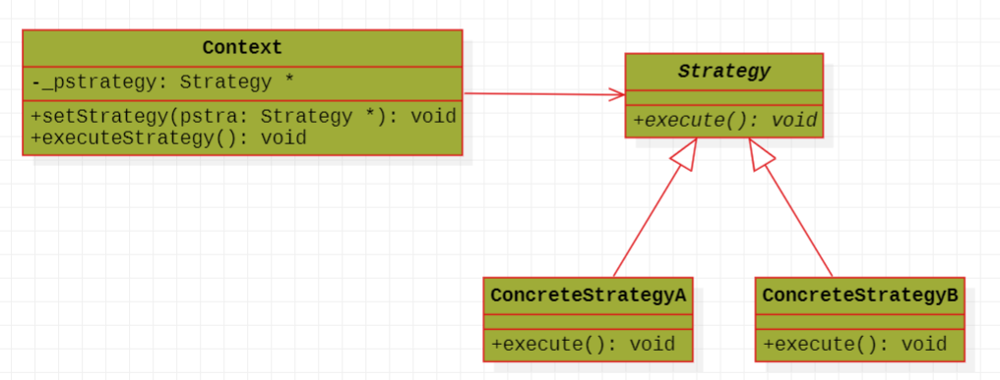

#### 5.3、代码

```C++
#include <iostream>
#include <memory>

using std::cout;
using std::endl;
using std::unique_ptr;

class Strategy
{
public:
    virtual void execute() = 0;
    virtual ~Strategy() {}
};

class ConcreteStrategyA
: public Strategy
{
public:
    virtual void execute() override
    {
        cout << "ConcreteStrategyA::execute()" << endl;
    }
};

class ConcreteStrategyB
: public Strategy
{
public:
    virtual void execute() override
    {
        cout << "ConcreteStrategyB::execute()" << endl;
    }
};

class Context
{
public:
    Context(Strategy *pstra)
    : _pstrategy(pstra)
    {
    }

    void setStrategy(Strategy *ps)
    {
        _pstrategy = ps;
    }

    void executeStragety()
    {
        if(_pstrategy)
        {
            _pstrategy->execute();
        }
    }

    ~Context()
    {
    }
private:
    Strategy *_pstrategy;
};

void test()
{
    unique_ptr<Strategy> pa(new ConcreteStrategyA());
    unique_ptr<Strategy> pb(new ConcreteStrategyB());

    Context ctx(pa.get());
    ctx.executeStragety();

    //更换策略
    ctx.setStrategy(pb.get());
    ctx.executeStragety();
}
```

#### 5.4、优点

- 对"开闭原则"提供完美支持;
- 基于上下文和算法类的封装，方便管理和调度一系列算法策略;
- 支持灵活的替换算法策略，代码的可读性和扩展性很强;
- 算法被封装以后，可以独立地被多个客户端和上下文复用;
- 避免了if-else条件语句的大量使用;

#### 5.5、缺点

- 使类和对象的数量变得更多，增加了系统的复杂性;
- 如果策略被划分得过于细化，会导致过度设计，不易于代码理解;
- 代码涉及多个对象的创建和销毁，性能开销增大，大量使用会引起性能问题。

#### 5.6、使用场景

- 算法的多样性和可切换行，比如：排序算法，将不同的排序算法（冒泡排序、快速排序、插入排序）封装成具体的策略类。再比如：支付方式：电商系统中，用户可以选择不同的支付方式，如：支付宝、微信、银行卡，将每一种支付方式封装成一个具体的策略类；
- 行为的变化和扩展，比如游戏角色行为，游戏开发中，角色可能有多种行为，如：攻击、防御、移动等，不同的角色可能有不同的行为策略。

### 6、装饰器模式

#### 6.1、概述

装饰器模式是一种结构型设计模式，<span style=color:red;background:yellow;font-size:20px>它允许你在不改变已有对象代码的情况下，动态地给对象添加新的行为和责任</span>。这种模式通过创建一系列装饰器类，每个装饰器类都包装了一个具体组件对象，并提供了与组件相同的接口，以便能够递归地将多个装饰器叠加到一个对象上，从而达到动态扩展对象功能的目的，既保持了类的封装性，又提高了代码的灵活性。

#### 6.2、类图

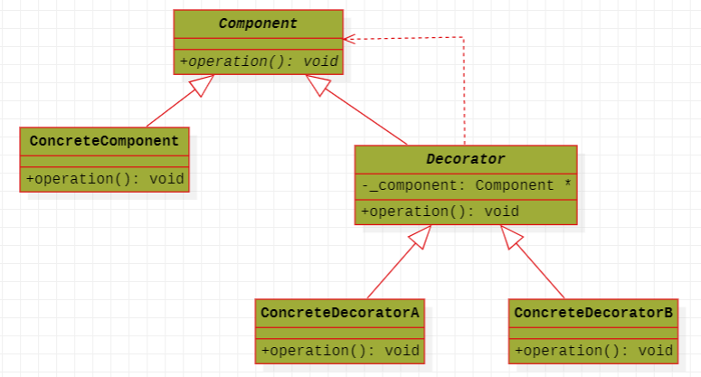

#### 6.3、代码

```C++
#include <iostream>
#include <memory>

using std::cout;
using std::endl;
using std::unique_ptr;

//抽象类作为接口
class Component 
{
public:
    Component()
    {
        cout << "Component()" << endl;
    }

    virtual ~Component()
    {
        cout << "~Component()" << endl;
    }

    virtual void operation() = 0;
};

//具体组件
class ConcreteComponent 
: public Component 
{
public:
    ConcreteComponent()
    {
        cout << "ConcreteComponent()" << endl;
    }

    virtual void operation() 
    {
        cout << "具体对象的操作" << endl;
    }

    ~ConcreteComponent()
    {
        cout << "~ConcreteComponent()" << endl;
    }
};

//装饰器
class Decorator 
: public Component 
{
public:
    Decorator()
    {
        cout << "Decorator()" << endl;
    }

    //设置组件，在该函数的参数中设置不同的组件对象
    void setComponent(Component* pComponent) 
    {
        _pComponent = pComponent;
    }

    virtual void operation() 
    {
        if (_pComponent != nullptr) 
        {
            _pComponent->operation();//基类的指针调用虚函数会有多态（运行时、动态的）
        }
    }

    ~Decorator()
    {
        cout << "~Decorator()" << endl;
    }
private:
    Component* _pComponent;
};

//具体装饰器A
class ConcreteDecoratorA 
: public Decorator 
{
public:
    ConcreteDecoratorA()
    {
        cout << "ConcreteDecoratorA()" << endl;
    }

    virtual void operation() 
    {
        Decorator::operation(); // 调用父类的operation
        addBehavior();
    }

    void addBehavior() //非虚函数，添加新功能
    {
        cout << "为具体构件A扩展的操作" << endl;
    }

    ~ConcreteDecoratorA()
    {
        cout << "~ConcreteDecoratorA()" << endl;
    }
};

//具体装饰器B
class ConcreteDecoratorB 
: public Decorator 
{
public:
    ConcreteDecoratorB()
    {
        cout << "ConcreteDecoratorB()" << endl;
    }

    virtual void operation() 
    {
        Decorator::operation(); // 调用父类的operation
        addBehavior();
    }

    void addBehavior()//非虚函数，添加新功能
    {
        cout << "为具体构件B扩展的操作" << endl;
    }

    ~ConcreteDecoratorB()
    {
        cout << "~ConcreteDecoratorB()" << endl;
    }
};

void test()
{
    unique_ptr<Component> pcom(new ConcreteComponent());
    unique_ptr<Decorator> pdA(new ConcreteDecoratorA());
    unique_ptr<Decorator> pdB(new ConcreteDecoratorB());

    pdA->setComponent(pcom.get());
    pdB->setComponent(pdA.get());
    pdB->operation();
}
```

#### 6.4、优点

- 可以动态地添加或删除对象的功能，无需修改原有的代码；
- 不影响现有对象的结构，符合开闭原则；
- 可以灵活地扩展原有对象的功能；
- 可以使用多个装饰器对象来组合多种功能；
- 使得代码可以根据需要轻松地添加或移除功能。

#### 6.5、缺点

- 使系统中增加额外的类变量；
- 装饰器对象与原始对象之间的关系过于复杂，降低代码可读性。

#### 6.6、使用场景

装饰器模式的核心是功能扩展，使用装饰器模式可以透明且动态地扩展类的功能。在不改变原有类结构的基础上，扩展新的功能

- 需要扩展对象的功能：在不修改现有代码的情况下，动态地为对象添加功能，例如UI组件的动态样式修改；
- 减少类的数量：相比通过继承扩展功能，装饰器模式避免了创建大量子类的情况，减少了类的数量；
- 动态组合行为：可以通过多个装饰器叠加的方式组合多个功能，使对象具有不同的功能组合。

例如：图形用户界面：在UI框架中，装饰器可以为组件添加滚动条、边框、阴影等装饰效果；日志系统：日志系统中可以使用装饰器来为日志添加时间戳、格式化输出等功能。

### 7、模板方法模式

#### 7.1、概述

模板方法模式是一种行为型设计模式，<span style=color:red;background:yellow;font-size:20px>它定义了一个算法的骨架，而将一些步骤延迟到子类中，从而达到在整体稳定的情况下产生一些变化的目的</span>。通过这种方式，模板方法允许子类在不改变算法结构的情况下重新定义算法的某些特定步骤。

#### 7.2、类图

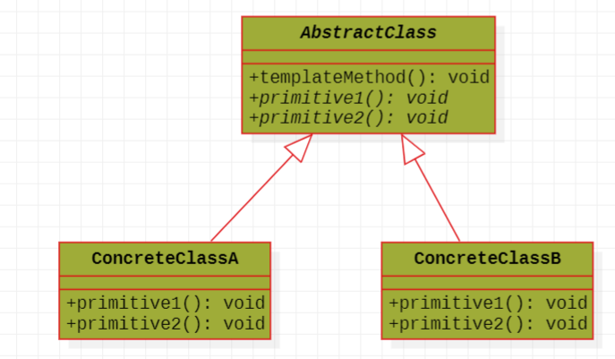

#### 7.3、代码

```C++
#include <iostream>  

using std::cout;
using std::endl;

//抽象报告生成器(抽象类)
class ReportGenerator 
{  
public:  
    virtual ~ReportGenerator() = default;  

    // 模板方法（固定流程）  
    void generateReport() 
    {  
        collectData();  
        processData(); //抽象步骤，留给派生类实现
        formatReport();  
        saveReport();  
    }  

protected:  
    // 通用步骤（已实现）  
    void collectData() 
    {  
        cout << "收集数据..." << endl;  
    }  

    virtual void processData() = 0;  //抽象步骤  

    void formatReport() 
    {  
        cout << "格式化报告为PDF..." << endl;
    }  

    void saveReport() 
    {  
        cout << "保存报告到服务器" << endl;  
    }  
};  

//销售报告生成器
class SalesReport 
: public ReportGenerator 
{
protected:
    void processData() override 
    {
        cout << "处理销售数据：计算总销售额和增长率" << endl;
    }
};

//库存报告生成器
class InventoryReport 
: public ReportGenerator 
{
protected:
    void processData() override
    {
        cout << "处理库存数据：分析缺货商品和周转率" << endl;
    }

    //扩展:改写非抽象步骤
    void saveReport() 
    { 
        cout << "保存报告到本地数据库" << endl;
    }
};

void test()
{
    //销售报告对象
    SalesReport salesReport;
    salesReport.generateReport();

    cout << endl << endl;
    //库存报告对象
    InventoryReport inventoryReport;
    inventoryReport.generateReport();
}
```

#### 7.4、优点

- 代码复用：通过将公共的算法步骤放在基类中，子类可以重用这些步骤，减少代码重复；
- 控制反转：基类控制算法的流程，子类只需实现特定的步骤，增强了代码的灵活性；
- 易于扩展：添加新算法或修改现有算法只需创建新的子类，不影响其他部分；
- 清晰的算法结构：将算法的结构和步骤明确分开，提升代码的可读性和可维护性。

#### 7.5、缺点

- 类的数量增加：每个具体算法都需要一个子类，可能导致类的数量迅速增加，增加管理复杂性；
- 灵活性不足：由于算法的结构在基类中固定，子类无法改变算法的整体结构，只能修改特定步骤；
- 调试困难：当算法步骤较多时，调试可能变得复杂，尤其是在多个子类之间切换时；
- 不适合所有场景：在一些简单的场景中，使用模板方法模式可能显得过于复杂，增加了不必要的开销。

#### 7.6、使用场景

- 固定流程，可变实现：当算法的整体流程是固定的，但某些步骤的具体实现可能不同时；
- 代码复用：当多个类有相似的算法结构，但某些步骤的实现不同时，可以通过模板方法模式避免代码重复；
- 框架设计：在框架设计中，模板方法模式常用于定义框架的核心流程，同时允许用户自定义某些步骤。

### 8、职责链模式

#### 8.1、概述

职责链(Chain Of Responsibility)模式也叫责任链模式，是一种行为型模式，<span style=color:red;background:yellow;font-size:20px>用于将一个请求传递给一个链中的若干对象，哪个对象适合处理这个请求就让哪个对象来处理</span>。职责链看起来与传统数据结构中的"链表"非常类似。引人职责链设计模式的定义(实现意图)：使多个对象都有机会处理请求，从而<span style=color:red;background:yellow;font-size:20px>避免请求的发送者和接收者之间的耦合关系</span>。将这些对象连成一条链(构成对象链)，并沿着这条链传递该请求，直到有一个对象处理它为止。

#### 8.2、类图

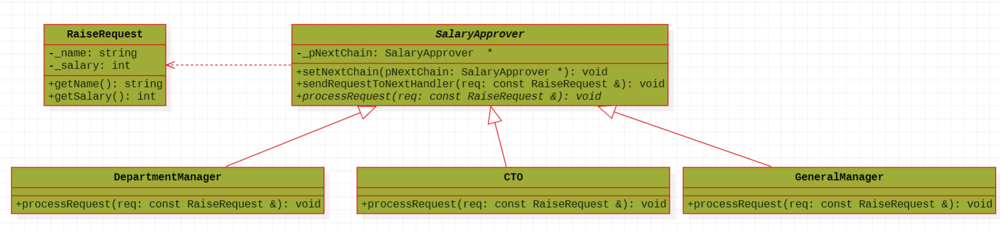

#### 8.3、代码

```C++
#include <iostream>
#include <string>
#include <memory>

using std::cout;
using std::endl;
using std::string;
using std::unique_ptr;

//加薪请求类
class RaiseRequest
{
public:
    //构造函数
    RaiseRequest(const string &name, int salary) 
    : _name(name)
    , _salary(salary) 
    {
        cout << "RaiseRequest(const string &, int)" << endl;
    }

    //获取请求加薪的人员名字
    const string &getName() const
    {
        return _name;
    }

    //获取请求加薪的数字
    int getSalary() const
    {
        return _salary;
    }

    ~RaiseRequest() 
    {
        cout << "~RaiseRequest()" << endl;
    }
private:
    string _name;//请求加薪的人员名字
    int _salary;//请求加薪的数字
};

//薪水审批者父类
class SalaryApprover
{
public:
    SalaryApprover() 
    : _nextChain(nullptr) 
    {
        cout << "SalaryApprover()" << endl;
    }

    //设置指向的职责链中的下个审批者
    void setNextChain(SalaryApprover *nextChain)
    {
        _nextChain = nextChain;
    }

    //抽象类作为基类，需要将析构函数设置为虚函数
    virtual ~SalaryApprover() 
    {
        cout << "virtual ~SalaryApprover()" << endl;
    } 

    //处理加薪请求
    virtual void processRequest(const RaiseRequest &req) = 0;

protected:
    //找链中的下个对象并把请求投递给下个链中的对象
    void sendRequestToNextHandler(const RaiseRequest& req)
    {
        //找链中的下个对象
        if (_nextChain != nullptr)
        {
            //把请求投递给链中的下个对象
            _nextChain->processRequest(req);
        }
        else
        {
            //没找到链中的下个对象，程序流程执行这里似乎不应该
            cout << req.getName() << "的加薪要求为：" 
                << req.getSalary() << "元，但无人能够审批！" << endl;
        }
    }

private:
    //指向下一个审批者（对象）的多态指针（指向自身类型），
    //每个都指向下一个，就会构成一个职责链（链表）
    SalaryApprover *_nextChain; 
};

//部门经理子类
class DepartmentManager 
:public SalaryApprover
{
public:
    DepartmentManager()
    {
        cout << "DepartmentManager()" << endl;
    }

    //处理加薪请求
    virtual void processRequest(const RaiseRequest& req)
    {
        int salary = req.getSalary();
        if (salary <= 1000)
        {
            //如果自己能处理，则自己处理
            cout << req.getName() << "的加薪要求为：" 
                 << salary << "元，部门经理审批通过！" << endl;
        }
        else
        {
            //自己不能处理，尝试找链中的下个对象来处理
            sendRequestToNextHandler(req);
        }
    }

    ~DepartmentManager()
    {
        cout << "~DepartmentManager()" << endl;
    }
};

//技术总监子类
class CTO 
: public SalaryApprover
{
public:
    CTO()
    {
        cout << "CTO()" << endl;
    }

    //处理加薪请求
    virtual void processRequest(const RaiseRequest& req)
    {
        int salary = req.getSalary();
        if (salary > 1000 && salary <= 5000)
        {
            //如果自己能处理，则自己处理
            cout << req.getName() << "的加薪要求为：" 
                 << salary << "元，技术总监审批通过！" << endl;
        }
        else
        {
            sendRequestToNextHandler(req);//自己不能处理，尝试找链中的下个对象来处理
        }
    }

    ~CTO()
    {
        cout << "~CTO()" << endl;
    }
};

//总经理子类
class GeneralManager
: public SalaryApprover
{
public:
    GeneralManager()
    {
        cout << "GeneralManager()" << endl;
    }

    //处理加薪请求
    virtual void processRequest(const RaiseRequest& req)
    {
        int salary = req.getSalary();
        if (salary > 5000)
        {
            //如果自己能处理，则自己处理
            cout << req.getName() << "的加薪要求为：" 
                 << salary << "元，总经理审批通过！" << endl;
        }
        else
        {
            sendRequestToNextHandler(req);//自己不能处理，尝试找链中的下个对象来处理
        }
    }

    ~GeneralManager()
    {
        cout << "~GeneralManager()" << endl;
    }
};

void test()
{
    //(1)创建出职责链中包含的各个对象（部门经理、技术总监、总经理）
    unique_ptr<SalaryApprover> pdm(new DepartmentManager());
    unique_ptr<SalaryApprover> pcto(new CTO());
    unique_ptr<SalaryApprover> pgm(new GeneralManager());

    //(2)将这些对象串在一起构成职责链（链表），
    //现在职责链中pdm排在最前面，pgm排在最后面
    pdm->setNextChain(pcto.get());
    pcto->setNextChain(pgm.get());
    //可以不写此行，因为ParSalApprover构造函数中设置了_nextChain为nullptr
    pgm->setNextChain(nullptr); 

    //(3)创建几位员工关于加薪的请求（对象）
    RaiseRequest zhangsan("张三", 15000); //张三要求加薪15000
    RaiseRequest lisi("李四", 3500);      //李四要求加薪3500
    RaiseRequest wangwu("王五", 800);     //王五要求加薪800
    
    //看看每位员工的加薪请求由职责链中的哪个对象
    //（部门经理、技术总监、总经理）来处理，从
    //职责链中排在最前面的接收者（pdm）开始
    pdm->processRequest(zhangsan);
    pdm->processRequest(lisi);
    pdm->processRequest(wangwu);
}
```

#### 8.4、优点

- 解耦性，可以实现发送者和接收者的解耦；
- 灵活性强，可以修改职责链中的结构和顺序；
- 扩展性，可以在最小改动的情况下添加新的处理器；
- 处理器可以在不同的职责链中重复使用。

#### 8.5、缺点

- 对请求的处理可能覆盖不全，导致bug的产生；
- 请求的处理过程十分冗长，请求传递涉及多个对象，性能开销大；
- 责任链需要被一直维护和管理。

#### 8.6、使用场景

- 命令处理器：比如在游戏或GUI应用中，用户可以发送各种操作命令，如“播放音乐”、“关闭窗口”，而具体执行过程由一系列处理器完成；
- 日志记录器：将不同严重等级的日志交给不同的处理器去打印；
- Web服务开发：在Web服务中，对请求进行校验和过滤，如权限验证、数据校验等；
- 权限控制：在用户权限管理中，可以根据角色的不同职责分配不同的权限验证步骤；
- 消息路由：在网络通信中，将不同类型的消息分别发送给不同的处理程序；

### 9、命令模式

#### 9.1、概述

命令模式定义了抽象命令接口和具体命令类，每个具体命令类都实现了抽象命令接口。命令对象包含了执行操作的方法，<span style=color:red;background:yellow;font-size:20px>将请求的发送者（Invoker）和接收者（Receiver）解耦，使得请求的发送者不需要知道请求的处理细节</span>。请求的发送者只需要通过调用命令对象的执行方法来触发请求的处理。

#### 9.2、类图

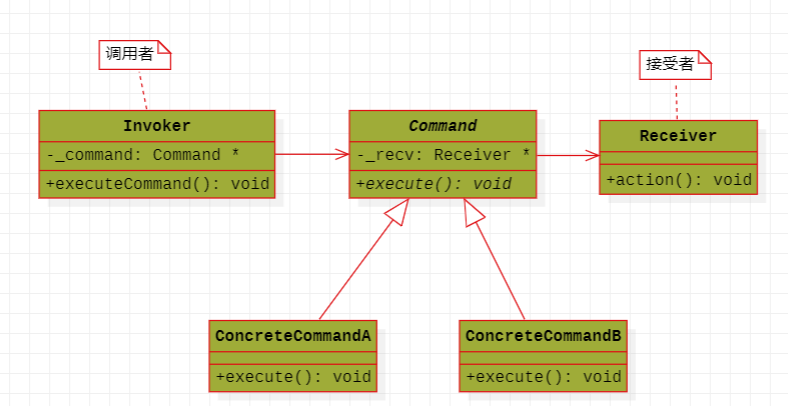

#### 9.3、代码

```C++
#include <iostream>
#include <list>
#include <memory>

using std::cout;
using std::endl;
using std::list;
using std::unique_ptr;

//接受者（Receiver）
class Cook
{
public:
    Cook()
    {
        cout << "Cook()" << endl;
    }

    void cookFish()
    {
        cout << "做一盘红烧鱼菜品" << endl;
    }

    void cookMeat()
    {
        cout << "做一盘锅包肉菜品" << endl;
    }

    ~Cook()
    {
        cout << "~Cook()" << endl;
    }
};

class Command
{
public:
    Command(Cook* pcook) 
    : _pcook(pcook) 
    {
        cout << "Command(Cook *)" << endl;
    }

    virtual ~Command() 
    { 
        cout << "virtual ~Command()" << endl;
    }

    //执行处理操作
    virtual void execute() = 0;

protected:
    Cook *_pcook; //接收者
};

class CommandFish 
: public Command
{
public:
    CommandFish(Cook *pcook) 
    : Command(pcook) 
    {
        cout << "CommandFish(Cook *)" << endl;
    }

    void execute() override
    {
        _pcook->cookFish(); //调用接收者的方法
    }

    ~CommandFish()
    {
        cout << "~CommandFish()" << endl;
    }
};

class CommandMeat 
: public Command
{
public:
    CommandMeat(Cook *pcook) 
    : Command(pcook) 
    {
        cout << "CommandMeat(Cook *)" << endl;
    }

    void execute() override
    {
        _pcook->cookMeat(); //调用接收者的方法
    }

    ~CommandMeat()
    {
        cout << "~CommandMeat()" << endl;
    }
};

//调用中（Invoker）
class Waiter
{
public:
    Waiter()
    {
        cout << "Waiter()" << endl;
    }

    void addCommand(Command* pcommand)
    {
        _commList.push_back(pcommand);
    }

    void notify()
    {
        for(auto &iter: _commList)
        {
            iter->execute();
        }
    }

    ~Waiter()
    {
        cout << "~Waiter()" << endl;
    }

private:
    list<Command *> _commList; //命令列表
};

void test()
{
    //1.创建接收者：厨师
    unique_ptr<Cook> cook1(new Cook());
    unique_ptr<Cook> cook2(new Cook());

    //2.创建具体命令对象并设置接收者：订单列表
    unique_ptr<Command> pcmd1(new CommandFish(cook1.get()));
    unique_ptr<Command> pcmd2(new CommandMeat(cook2.get()));

    //3.将命令对象传递给调用者：服务员
    unique_ptr<Waiter> pwaiter(new Waiter());
    pwaiter->addCommand(pcmd1.get());
    pwaiter->addCommand(pcmd2.get());

    //4.调用者请求执行操作：服务员通知厨师
    pwaiter->notify();
}
```

#### 9.4、优点

- 命令模式将发送者和接收者解耦，使得两者可以分别独立变化；
- 扩展性好，新的命令可以很容易地添加和维护，不影响现有系统；
- 使用对象来存储命令，很适用于开发回滚和撤销操作；
- 可以使用队列将命令进行缓存，实现延迟执行或者异步处理。

#### 9.5、缺点

- 增加了一些额外的抽象层次，使代码结构变得复杂；
- 命令的具体操作包含了对象的动态创建和销毁，性能开销大；
- 对象之间存在着多层次的依赖，维护变得困难，不易于bug定位和调试。

#### 9.6、使用场景

- 当需要将请求发送者和接收者解耦时，采用命令模式可以实现对象之间的松耦合；
- 当需要对请求进行参数化时，可以使用命令模式将请求封装为一个对象，并将特定的请求参数传递给该对象；
- 当需要支持撤销操作时，可以使用命令模式来保存请求的历史记录，方便撤销和重做操作；
- 当需要将一些操作封装成一系列的高级操作时，可以使用命令模式来组合这些操作。

