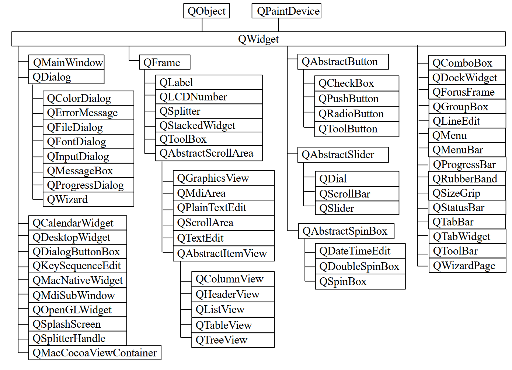
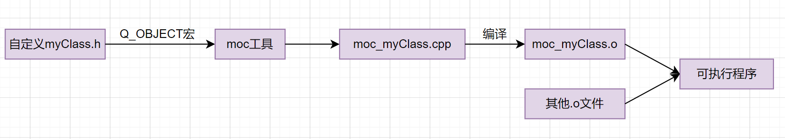
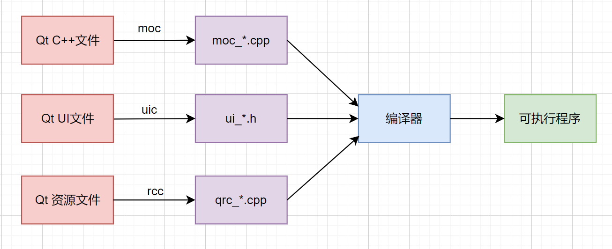
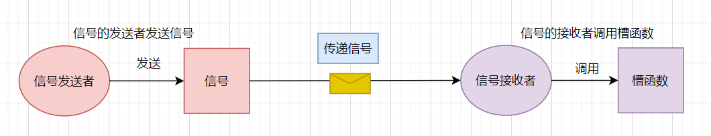
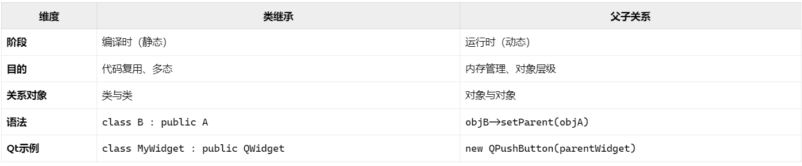
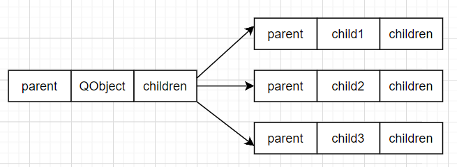

# Qt元对象系统

## 一、元对象系统基本概念

###  1、"元对象"中的"元"的含义

"元"（Meta）在计算机科学中通常表示 "关于自身的信息"或 "更高层次的抽象"。元对象是指能够操纵、创建、描述或执行其它对象的对象，被元对象描述的对象称为基对象。元对象可能包含的信息包括基础对象的类型、接口、类、方法、属性、变量和控制结构等。在Qt中，元对象（Meta-Object）是描述对象自身的结构信息（如类名、方法列表、属性等），相当于对象的"蓝图"。


### 2、什么是元对象系统

元对象系统（Meta-Object System，MOS） 是<span style=color:red;background:yellow;font-size:20px>Qt框架在C++基础上扩展的一套运行时动态特性机制</span>。管理这些元信息的机制，使程序能在运行时动态操作对象。<span style=color:red;background:yellow;font-size:20px>它的核心是通过预编译（moc工具）生成额外的元信息代码，使得原本静态的C++类具备动态能力</span>，元对象系统具备以下功能：

- 运行时查询类名、方法、属性（反射）；
- 支持信号（signal）与槽（slot）的跨对象通信；
- 动态添加、修改属性（Q_PROPERTY）。

如果对象是一本书，元对象就是这本书的目录（记录章节、页码等元信息），元对象系统是存储和查询目录的规则（如通过目录快速翻到某一页）。

### 3、设计元对象系统的目的

核心目的不仅是通信，而是扩展C++的运行时能力，具体解决以下问题：

- 对象间通信（主要但非唯一）
  提供信号槽机制，替代传统的回调函数或观察者模式，实现线程安全、松耦合的通信。
- 弥补C++的动态缺陷
  C++原生缺乏反射（运行时获取类信息）、动态属性等能力，Qt 通过MOS 实现这些功能。
- 框架需求
  支持 Qt Designer（动态 UI 生成）、QML 绑定、国际化（tr()）、插件系统等高级特性。

简言之：通信是信号槽的主要应用场景，但MOS的范畴更广（反射、属性、对象树管理等）。

## 二、元对象系统的三大核心组件

元对象系统的三大核心组件分别是QObject类、Q_OBJECT宏、以及元对象编译器moc

### 1、QObject类

QObject类是Qt框架中最基础的类之一，几乎所有Qt类都直接或间接继承自QObject类，QObject具有以下关键特性：

- 对象树和父子关系管理；
- 信号与槽通信机制；
- 属性系统支持、运行时类型信息；
- 事件处理框架。



### 2、Q_OBJECT宏

Q_OBJECT宏，其实就是宏定义，该宏必须出现在类定义的私有部分，以启用信号与槽、动态属性系统以及Qt元对象系统提供的其它服务。该宏在编译时由moc处理，以生成相应的元对象代码。

```C++
#define Q_OBJECT \
public: \
    // 编译器警告控制：压入当前警告状态
    QT_WARNING_PUSH \
    
    // 禁止重写警告
    Q_OBJECT_NO_OVERRIDE_WARNING \
    
    // 静态元对象，存储类的元信息
    static const QMetaObject staticMetaObject; \
    
    // 虚函数：返回对象的元对象指针
    virtual const QMetaObject *metaObject() const; \
    
    // 虚函数：运行时类型转换
    virtual void *qt_metacast(const char *); \
    
    // 虚函数：处理元对象调用（信号、槽、属性）
    virtual int qt_metacall(QMetaObject::Call, int, void **); \
    
    // 国际化相关的函数宏
    QT_TR_FUNCTIONS \
    
private: \
    // 属性警告控制
    Q_OBJECT_NO_ATTRIBUTES_WARNING \
    
    // 隐藏的静态元对象调用函数
    Q_DECL_HIDDEN_STATIC_METACALL static void qt_static_metacall(QObject *, QMetaObject::Call, int, void **); \
    
    // 恢复之前的警告状态
    QT_WARNING_POP \
    
    // 私有信号标记结构体
    struct QPrivateSignal {}; \
    
    // 类注解宏
    QT_ANNOTATE_CLASS(qt_qobject, "")
```

### 3、元对象编译器

MOC（Meta-Object Compiler，元对象编译器）是Qt特有的<span style=color:red;background:yellow;font-size:20px>**预处理器**</span>工具，用于处理包含Q_OBJECT宏的C++头文件，生成额外的元对象代码（moc_*.cpp文件），实现Qt的核心特性，它的主要职责包括：

- 为使用Q_OBJECT宏的类生成额外的元对象代码；
- 实现信号与槽的底层机制；
- 生成运行时类型信息；
- 支持动态属性和方法调用。

因为Qt不是使用标准C++语言， 因此Qt在将源码交给标准C++编译器(如gcc)之前， 需要先把扩展的语法去除掉，完成这一操作的就是 moc。

<span style=color:red;background:yellow;font-size:20px>**moc的执行步骤**</span>：

Qt程序编译之前，先使用moc分析C++源文件，若在头文件中包含了宏 Q_OBJECT，则会生成另外一个包含了Q_OBJECT宏实现代码的C++源文件， 这个新文件的名字是在原文件名之前加上 `moc_` 构成。这个新文件同样会进入编译系统，最终被链接到二进制代码中去，因此我们在Qt构建后的文件夹中，见到 `moc_*.o` 和 `moc_*.cpp` 的文件，就是由 moc 生成的。 注意： 新文件不会“替换”掉旧的文件，而是与原文件一起编译，注意，moc的执行是在预处理器之前。使用图例解释如下：





## 三、<span style=color:red;background:yellow>信号与槽（重难点、核心）</span>

### 1、基本概念

C++虽然是面象对象的语言，但程序的具体实现代码仍然是由函数来实现的，因此所谓的对象之间的通信，从程序设计语言语法角度来看就是<span style=color:red>**函数调用**</span>的问题，只不过是某个对象的成员函数调用另一个对象的成员函数而已。在Qt中也涉及到对象之间的通信，这种通信机制就可以使用信号与槽。信号与槽是Qt框架的核心通信机制，本质上是一种解耦的观察者模式。在Qt中，当特定事件发生时，对象会发出信号，这一过程类似于广播，如果其它对象对该信号感兴趣，就可以将该信号与自己的处理函数（槽）绑定，实现事件的自动相应。比如：窗口对象收到按钮点击信号后就关闭整个窗口。那么可以将窗口对象的处理函数与按钮信号提前连接，当按钮被点击后，就会发出点击信号，窗口收到信号后就响应信号，执行关闭操作，关闭整个窗口。



### 2、信号与槽的连接与断开

信号是某个对象发出的事件通知，槽是用于对信号的响应。信号和槽与函数相似，所以通常把信号称为信号函数，槽称为槽函数。信号与槽绑定使用QObject::connent()函数实现，其基本格式如下：

```C++
//字符串形参
[static] QMetaObject::Connection QObject::connect(
    const QObject *sender
    , const char *signal, const QObject *receiver
    , const char *method
    , Qt::ConnectionType type = Qt::AutoConnection);
// 没有接收者的版本
[static] QMetaObject::Connection QObject::connect(
    const QObject *sender
    , PointerToMemberFunction signal
    , Functor functor);
// 函数指针形参
[static] QMetaObject::Connection QObject::connect(
    const QObject *sender
    , PointerToMemberFunction signal
    , const QObject *receiver
    , PointerToMemberFunction method
    , Qt::ConnectionType type);
```

> sender：信号发送者，必须是QObject类或其子类的对象;
> signal：发出的具体信号;
> receiver：信号接受者，必须是QObject类或其子类的对象;
> method：信号接收者处理信号的动作；
> type：信号与槽的连接类型，默认值是Qt::AutoConnection
>
> 对于连接方式的进一步说明，有五种方式：
>
> - Qt::AutoConnection（自动方式）：Qt的默认连接方式，如果信号的发出和接收这个信号的对象同属一个线程，那个工作方式与直连方式相同；否则工作方式与排队方式相同。
> - Qt::DirectConnection（直连方式）：当信号被发射时，槽函数会立即被调用，没有任何延迟（同步执行）槽函数不会切换到其他线程，而是在信号所在的线程中运行。
> - Qt::QueuedConnection（排队方式）：当信号发出后，排队到信号队列中，需等到接收对象所属线程的事件循环取得控制权时才取得该信号，调用相应的槽函数。（此时信号被塞到信号队列里了，信号与槽函数关系类似于消息通信，异步执行）
> - Qt::BlockingQueuedConnection（阻塞队列方式）：与Qt::QueuedConnection类似，但信号发送线程会阻塞，直到槽函数执行完毕。如果接收者对象与信号发送线程在同一个线程中，则绝对不要使用这种连接方式，否则程序会死锁。(信号和槽必须在不同的线程中，否则就产生死锁)这个是完全同步队列只有槽线程执行完成才会返回，否则发送线程也会一直等待，相当于是不同的线程可以同步起来执行。
> - Qt::UniqueConnection（唯一连接）：这是一个可以与上述任意一种连接类型通过位或（|）操作组合使用的标志。当设置Qt::UniqueConnection时，如果连接已存在（即相同的信号已经连接到相同对象的同一个槽），则 QObject::connect()会失败。该标志从 Qt4.6版本开始引入。

在调用connect函数连接信号与槽时，sender对象的信号并不会立即产生，因此receiver对象的method也不会被调用，<span style=color:red;background:yellow;font-size:20px>**实际的调用时机是在信号被触发之后**</span>，调用槽函数的操作由Qt框架负责的。

当然信号与槽连接后，可以使用disconnect函数断开连接，断开后信号触发时，槽函数将不再被调用。注意，断开连接时的参数必须与连接时完全一致。

```C++
bool disconnect(const QObject *sender, const QMetaMethod &signal, 
                const QObject *receiver, const QMetaMethod &method);

//当然，也可以使用connect的返回值来断开连接
bool disconnect(const QMetaObject::Connection &connection);
```

### 3、信号与槽的本质

信号与槽其实都是独立的函数，但是可以通过connect将信号与槽连接在一起，但是连接之后并不能调用槽函数，<span style=color:red;background:yellow;font-size:20px>**只有当信号被触发时，连接的槽函数才会自动调用，并将信号中的参数传递到连接的槽函数中**</span>。

### 4、标准信号与槽

Qt提供了许多类来检测用户触发的特定事件。当这些事件被触发时，便会产生对应的信号，这些信号都是Qt类内部自带的，因此称之为标准信号。同样，Qt的许多类内部还提供了多个功能函数，这些函数可以作为信号触发后的处理动作，称为标准槽函数。

```C++
#include <QApplication>
#include <QPushButton>
#include <QMainWindow>

class MyMainWindow : public QMainWindow 
{
    Q_OBJECT

public:
    MyMainWindow(QWidget *parent = nullptr) 
    : QMainWindow(parent)
    {
        QPushButton *btn = new QPushButton("命令按钮", this);
        //点击信号
        connect(btn, &QPushButton::clicked, this, &MainWindow::close);
        btn->setGeometry(100, 100, 100, 30);
    }
};

int main(int argc, char *argv[]) 
{
    QApplication app(argc, argv);
    MyMainWindow window;
    window.resize(300, 200);
    window.show();
    return app.exec();
}

#include "main.moc" // 如果在单文件中编写，需要包含此行
```

<span style=color:red;background:yellow;font-size:20px>注意：如果是单文件编写的，还需要在代码的最下面加上#include "name.moc"，其中name是指原文件的名称</span>

### 5、自定义信号

Qt框架提供的信号在某些特定场景下可能无法满足项目需求，因此可以设计自定义信号。要使用自定义信号和槽，首先需要编写一个新的类，并让其继承Qt的某些标准类。<span style=color:red;background:yellow;font-size:20px>如果您想在Qt中使用信号槽机制，必须满足以下条件</span>：

- 该类必须从QObject类或其子类派生。
- 在定义类的第一行头文件中加入Q_OBJECT宏

```C++
// 在头文件中派生类时，首先像下面这样引入Q_OBJECT宏：
class MyWidget : public QWidget
{
    Q_OBJECT
public:
    ......
};
```

**<span style=color:red;background:yellow;font-size:20px>自定义信号的规则：</span>**

- 信号使用signals关键字声明，在其后面有一个冒号":"，在其前面不能有 public、private、protected 访问控制符，信号默认是public 的;

- 信号只需像函数那样声明即可，其中可以有参数，参数的主要作用是用于和槽的通信，这就像普通函数的参数传递规则一样；
- 信号只需声明，不能对其进行定义，信号是由moc自动生成的；
- 信号的返回值只能是void 类型的。

<span style=color:red;background:yellow;font-size:20px>**发射信号需符合以下规则**：</span>

- 发射信号需要使用emit关键字，注意，在emit后面不需要冒号；
- emit发射的信号使用的语法与调用普通函数相同，比如有一个信号为 void f(int)，则发送的语法为： emit f(3);
- 当信号被发射时，与其相关联的槽函数会被调用(注意：信号和槽需要使用QObject::connect 函数进行关联之后，发射信号后才会调用相关联的槽函数)。

<span style=color:red;background:yellow>注意：因为信号位于类之中，因此发射信号的位置需要位于该类的成员函数中或该类能见到信号的标识符的位置。</span>

```C++
emit mySignals();//发送信号
```

<span style=color:red;>emit是一个空宏，没有特殊含义，仅用来表示这个语句是发射一个信号。</span>

### 6、自定义槽

槽函数是信号的处理动作，自定义槽函数与普通函数的写法相同。

<span style=color:red;background:yellow;font-size:20px>声明槽函数必须遵守以下规则：</span>

- 声明槽需要使用slots关键字， 在其后面有一个冒号“:”，且槽需使用 public、 private、protected 访问控制符之一，但是在Qt5及以后的版本中，其实可以不再强制要求写slots关键字；
- 槽就是一个普通的函数，可以像使用普通函数一样进行使用，槽与普通函数的主要区别是，槽可以与信号关联;

- 槽函数的返回类型必须是void，不能是其它类型；
- 槽函数的参数数量必须小于或等于信号的参数数量。

槽函数类型：

- 成员函数（普通成员函数、静态成员函数）；
- 全局函数；
- 匿名函数（lambda表达式）。

```C++
#include "widget.h"
#include "ui_widget.h"

#include <QPushButton>
#include <QDebug>

//声明全局函数
void globalFunc();

Widget::Widget(QWidget *parent)
: QWidget(parent)
, ui(new Ui::Widget)
{
    ui->setupUi(this);

    QPushButton *btn = new QPushButton(this);

    //连接标准槽函数
    connect(btn, &QPushButton::clicked, this, &Widget::close);

    //连接普通成员函数
    connect(btn, &QPushButton::clicked, this, &Widget::memberFunc);

    //连接静态成员函数
    connect(btn, &QPushButton::clicked, this, &Widget::staticFunc);

    //连接全局函数
    connect(btn, &QPushButton::clicked, this, globalFunc);

    //连接lambda表达式
    connect(btn, &QPushButton::clicked, this, [=](){
        qDebug() << "lambda表达式";
        close();
    });
}

//普通成员函数
void Widget::memberFunc()
{
    qDebug()<< "memberFunc";
    close();
}

//静态成员函数
void Widget::staticFunc(bool checked)
{
    qDebug()<< "staticFunc " << checked;
}

//全局函数
void globalFunc()
{
    qDebug() << "globalFunc";
}
```

### 7、信号和槽的关系

在连接信号与槽的时候，必须满足一定的要求，否则连接的信号与槽就会出错，所以需要注意以下几点：

- 槽的<span style=color:red>参数类型</span>需要与信号参数类型相对应；
- 如果信号的<span style=color:red>参数个数</span>多于槽的参数个数，则多于的参数将被忽略；
- 槽的参数个数不能多于信号的参数个数，如果槽的参数更多，则多余的参数不能接收到信号传递过来的值，如果在槽中使用了这些多余的无值的参数，就会产生错误；
- <span style=color:red>一个信号可以与多个槽关联，多个信号也可以与同一个槽关联，信号也可以关联到另一个信号上</span>；
- 如果一个信号关联到多个槽时，则发射信号时，<span style=color:red>槽函数按照关联的顺序依次执行</span>；
- 如果信号连接到另一个信号，<span style=color:red>则当第一个信号发射时，会立即发射第二个信号</span>。


### 8、信号和槽连接方式

#### 8.1、Qt4的连接方式

在Qt4中信号的指定必须使用宏SIGNAL和槽指定必须使用宏SLOT，这两个宏能把括号中的内容转换为与形参相对应的 const char*形式。在指定函数时，只能指定函数参数的类型，不能有参数名，也不能指定函数的返回类型。比如SLOT(func(int x))，是错误的，因为指定了参数名x，正确形式为SLOT(func(int))

```C++
class MyWidget : public QWidget
{
    Q_OBJECT
signals:
    void funcSignal();
    void funcSignal(int a);
private slots:
    void funcSlot();
    void funcSlot(int a);
};

MyWidget widget;
// Qt4的连接方式 注意不要把信号和槽的名称写错，因为是转为字符串的，写错了不会报错，但连接会失败
connect(&widget, SIGNAL(func()), &widget, SLOT(hungury()));
connect(&widget, SIGNAL(eat(int)), &widget, SLOT(hungury(int)));
```

注意：这种旧的信号槽连接方式在Qt5中仍支持，但不推荐使用，因为这种方式在进行信号槽连接时，信号和槽函数通过宏SIGNAL和SLOT转换为字符串类型。由于信号槽函数的转换是通过宏进行的，因此传递到宏函数内部的数据不会被检查。如果使用者传错了数据，编译器不会报错，但实际上信号槽的连接已失败，只有在程序运行时才能发现问题，并且问题往往难以定位。

#### 8.2、使用函数指针

```C++
// 定义无参信号的函数指针
void (MyWidget::*signalWithoutArgs)() = &MyWidget::funcSignal;
// 定义有参信号的函数指针
void (MyWidget::*signalWithInt)(int) = &MyWidget::funcSignal;

// 定义无参槽的函数指针
void (MyWidget::*slotWithoutArgs)() = &MyWidget::funcSlot;
// 定义有参槽的函数指针
void (MyWidget::*slotWithInt)(int) = &MyWidget::funcSlot;

// 连接有参信号和槽
connect(&MyWidget, signalWithInt, &MyWidget, slotWithInt);
// 连接无参信号和槽
connect(&MyWidget, signalWithoutArgs, &MyWidget, slotWithoutArgs);
```

#### 8.3、通过Qt提供的重载类（QOverload）解决

QOverload类是在C++11中提供的。

```C++
// 连接有参信号和槽
connect(&MyWidget, QOverload<int>::of(&MyWidget::funcSignal), 
        &MyWidget, QOverload<int>::of(&MyWidget::funcSlot));

// 连接无参信号和槽
connect(&MyWidget, QOverload<>::of(&MyWidget::funcSignal), 
        &MyWidget, QOverload<>::of(&MyWidget::funcSlot));
```

#### 8.4、通过Qt提供的重载类（qOverload）解决

qOverload类是在C++14中提供的。

```C++
// 连接有参信号和槽
connect(&MyWidget, qOverload<int>(&MyWidget::funcSignal), 
        &MyWidget, qOverload<int>(&MyWidget::funcSlot));

// 连接无参信号和槽
connect(&MyWidget, qOverload<>(&MyWidget::funcSignal), 
        &MyWidget, qOverload<>(&MyWidget::funcSlot));
```

#### 8.5、lambda表达式的方式

对于槽函数而言，我们可以直接使用lambda表达式即可，这样更加简单直接一些。

```C++
connect(&MyWidget, qOverload<int>(&MyWidget::funcSignal), [=](int x){
    //函数的函数体
});
```

#### 8.6、信号与槽连接方式总结：

- Qt4的信号槽连接方式由于使用了宏函数，宏函数对用户传递的信号槽不会做错误检测，容易产生bug；但是当信号槽函数被重载之后，Qt4的信号槽连接方式不受影响；
- Qt5的信号槽连接方式传递的是信号和槽函数的地址，编译器会进行错误检测，从而减少bug的产生；但是当信号槽函数被重载之后，需要为被重载的信号或槽定义函数指针；
- C++11以及以后语法解决函数重载用重载类的形式。

### 9、信号与槽的优缺点

信号和槽的关键特征

- 松耦合：发送者和接收者相互独立，无需直接依赖；
- 灵活性：支持一对多、多对一的信号与槽关联；
- 类型安全：编译期进行严格的类型检查，确保参数匹配。
- 线程安全：根据连接方式（Qt::AutoConnection/QueuedConnection）自动决定是否跨线程调用槽；

信号与槽机制能增强对象之间通信的灵活性，但是也会损失一些性能，原因：

- 多线程的时候，信号可能需要排队等待；
- 编组/解组传递的参数；
- 安全的遍历所有的关联；
- 需要定位接收信号的对象。

一般来说，发射与某些槽连接的信号，大约比直接调用接收者要<span style=color:red;background:yellow;font-size:20px>慢十倍</span>，而且这是非虚函数调用的情况。


## 四、<span style=color:red;background:yellow>对象树(重点)</span>

在C++中，new和delete必须配对使用，否则可能会导致内存泄漏。但是在Qt中虽然使用了new，但是很少手动delete，这是因为Qt中实现了独特的内存管理机制：对象树。在Qt 中，对对象的管理，使用的是树形结构，也就是对象树。QObject以对象树的形式组织起来，当为一个对象创建子对象时，子对象会自动添加到父对象的children()列表中。父对象拥有子对象的所有权，父对象可以在自己的析构函数中删除其子对象。也可以使用findChild()或findChildren()通过名称和类型查询子对象。注意：这里是指的类的对象而不是类。父子关系是Qt特有的，与类的继承关系无关。传递的参数与parent有关（基类、派生类），这是对于继承体系来说的，与parent无关。



<span style=color:red;background:yellow;font-size:20px>重要：类继承是类与类的静态关系，父子关系是对象与对象的动态关系。即使存在类继承，如果不显式指定父子关系，对象间也不存在Qt的父子关系。类继承是类型关系，但是父子关系是内存管理关系。</span>

### 1、关联图

在Qt中，最基础和核心的类是QObject。QObject内部有一个名为children的QObjectList列表，用于保存所有子对象，还有一个指针parent，用来指向父对象。当自身析构时，会先将自己从父对象的列表中删除，并析构所有的子对象。



### 2、对象的创建方式

#### 2.1、对象创建在栈上

栈对象具有自动生命周期管理，推荐使用

```C++
#include "widget.h"
#include <QApplication>
#include <QDebug>

int main(int argc,char*argv[])
{
    QApplication a(argc,argv);
    QObject obj;

    QDebug() << "栈上对象自动销毁";
    
    return a.exec();
}
```

#### 2.2、对象创建在堆上

当把对象分配到堆上时，如果忘记delete，内存就不会释放，所以可以使用delete或者Qt提供的成员函数QObject::deleteLater()释放内存。

```C++
int main(int argc,char*argv[])
{
    QApplication a(argc,argv);

    QObject *obj = new QObject;
    
    //显示delete 释放内存
    delete obj;	
    //或者调用成员函数deleteLater，二者选其一，问题是必须手动
    obj->deleteLater();		

    qDebug() << "手动释放堆对象内存";
    
    return a.exec();
}
```

使用指定父对象的方式自动管理内存

```C++
#include<QApplication>
#include<QDebug>

class MyObject : public QObject
{
public:
    MyObject(QObject* parent = nullptr)
    :QObject(parent)
    {
        qDebug() << "构造函数中，MyObject created!";
    }
    ~MyObject()
    {
        qDebug() << "析构函数中，MyObject destory!";
    }
};

int main(int argc,char*argv[])
{
    QApplication a(argc,argv);  
    {
        MyObject parent;
        {
            //如果不指定obj的父对象，就需要显示调用删除操作或者将obj设定为栈对象，
            //但是设置了obj的父对象为parent后，就可以使用对象树删除obj指向的对象   
            MyObject *obj = new MyObject(&parent);
            
            //obj->deleteLater();
            //MyObject obj;
        }
    }
    
    qDebug() << "!";
    return a.exec();
}
```

## 五、属性系统

Qt提供了一个复杂而强大的属性系统，它也是Qt的核心特性之一。属性系统是一种<span style=color:red;background:yellow;font-size:20px>**运行时动态扩展对象属性的机制**</span>，允许在不修改类定义的前提下，访问、添加、和修改对象的属性，目的在于简化对象属性的管理和访问。属性的行为类似于类的数据成员，但它具有通过元对象系统进行访问的附加特性。

### 1、动态访问、添加、修改属性

可以通过QObject::property()和 QObject::setProperty()动态访问、添加、修改属性。

```C++
//获取或访问属性
QVariant property(const char *name) const;

//添加或者修改属性
bool setProperty(const char *name, const QVariant &value);
```

在Qt中，可以轻松地获取和设置对象的属性。

```C++
MyObject obj;
//QObject类具有一个名为objectName的属性，可以通过以下方式获取其值
qDebug() << obj.property("objectName").toString();

//设置objectName属性的值为"OBJ"
obj.setProperty("objectName","OBJ");
```

QObject::setProperty()方法不仅可以用于修改已存在的属性，还可以在运行时向类的实例添加新属性。当调用该方法时，如果QObject中已存在具有指定名称的属性，并且提供的值与该属性的类型兼容，则该值将被存储到属性中，并返回true。如果值与属性类型不兼容，则不会更改属性的值，并返回false。如果QObject中不存在具有指定名称的属性（即未使用Q_PROPERTY()声明），则会自动将新属性添加到QObject中，尽管返回值仍然为false。这意味着仅凭返回值无法确定特定属性是否实际被设置，除非事先确认该属性已存在于QObject中。

动态属性是在每个实例基础上添加的，即它们是添加到QObject而不是QMetaObject中的。通过将属性名称和一个无效的QVariant值传递给QObject::setProperty()，可以从实例中删除属性。QVariant的默认构造函数构造一个无效的QVariant。

### 2、显示声明属性

由于基于元对象系统，该类必须继承自QObject类，还应使用Q_OBJECT 宏，然后使用QObject::Q_PROPERTY宏声明属性，语法如下  

```C++
Q_PROPERTY(type name 
           (READ getFunction [WRITE setFunction] |
           MEMBER memberName [(READ getFunction | WRITE setFunction)])
           [RESET resetFunction]
           [NOTIFY notifySignal]
           [REVISION int ]
           [DESIGNABLE bool]
           [SCRIPTABLE bool]
           [STORED bool]
           [USER bool]
           [CONSTANT]
           [FINAL])
```

属性声明参数详解

> - 方括号中的是可选项，各选项之间使用空格隔开；
> - type：指定属性的类型，可以是QVariant支持的类型或用户自定义类型，若是枚举类型，还需使用Q_ENUMS宏对枚举进行注册，若是自定义类型，需要使用Q_DECLARE_METATYPE( Type )宏进行注册；
> - name：属性的名称;
> - READ：指定用于读取属性值的访问器函数。此函数应返回属性的类型或对该类型的const引用。若没有指定 MEMBER变量，则必须指定READ函数
> - WRITE：可选项，用于设置属性值的访问器函数。该函数必须返回void并只接受一个参数，该参数可以是属性的类型或指向该类型的指针或引用;
> - MEMBER：可选项，指定直接关联的成员变量，使其可读可写，而无需显式定义READ和WRITE函数。
> - RESET：可选项，指定将属性重置为其特定于上下文的默认值的函数;
> - NOTIFY：可选项，指定信号，该信号在属性值更改时发出。该信号必须与属性类型匹配;
> - REVISION：可选项，用于定义API中特定修订版中使用的属性;
> - DESIGNABLE：指示属性是否应在GUI设计工具（如Qt Designer）的属性编辑器中可见。默认为true;
> - SCRIPTABLE：指示脚本引擎是否可以访问该属性。默认为true;
> - STORED：指示该属性是否应被视为独立属性，默认为true;
> - USER：指示该属性是否为面向用户的属性，默认值为false;
> - CONSTANT：指示该属性的值是常量;
> - FINAL：指示该属性不会被派生类覆盖;

例如：

```C++
class MyObject : public QObject
{
    Q_OBJECT  //必须启用元对象系统
    Q_PROPERTY(QString name READ getName WRITE setName RESET unsetName NOTIFY nameChanged)

public:
    MyObject(QObject *parent = nullptr) 
    : QObject(parent) 
    {}

    QString getName() const 
    {
        qDebug() << __FUNCTION__;
        return _name;
    }

    void setName(const QString &name) 
    {
        if (_name != name) 
        {
            _name = name;
            emit nameChanged(_name); //发射信号以通知属性变化
        }
    }

    void unsetName() 
    {
        _name = "unknown";
    }

signals:
    void nameChanged(const QString &);

private:
    QString _name;
};

int main(int argc, char *argv[])
{
    QApplication a(argc, argv);
    MyObject obj;

    QObject::connect(&obj, &MyObject::nameChanged, [](const QString &name) {
        qDebug() << "name: " << name;
    });

    obj.setName("lili");
    qDebug() << obj.getName(); //输出"lili"
    
    obj.unsetName(); //将name重置为"unknown"

    obj.setProperty("name", "lucy");
    qDebug() << obj.property("name").toString(); //输出"lucy"
    
    obj.setProperty("name", QVariant()); //将name重置为"unknown"

    return a.exec();
}
```

解析：通过属性name访问和设置值，相当于直接操作成员变量`_name`。当使用setName方法更改名称时，程序手动发射信号以通知属性变化。

属性关联成员变量

```C++
class MyObject : public QObject
{
    Q_OBJECT
    Q_PROPERTY(QString name MEMBER _name NOTIFY nameChanged)

public:
    MyObject(QObject *parent = nullptr) 
    : QObject(parent) {}

signals:
    void nameChanged(const QString &name);

private:
    QString _name;
};

int main(int argc, char *argv[])
{
    QApplication a(argc, argv);
    
    MyObject obj;

    QObject::connect(&obj, &MyObject::nameChanged, [](const QString &name) {
        qDebug() << "name:" << name;
    });

    obj.setProperty("name", "lili"); // 修改属性，会自动触发nameChanged信号
    qDebug() << obj.property("name").toString(); // 输出 "lili"

    return a.exec();
}

```

解析：使用属性name直接修改了成员变量`_name`，通过属性接口访问或设置属性值时，不需要显式的读写函数。如果指定了NOTIFY信号，则通过属性接口改变name的值时，信号会自动触发。

### 3、附加信息

属性系统还有一个宏Q_CLASSINFO()，可以为类的对象定义"名称——值"信息，例如：

```C++
Q_CLASSINFO("Version", "3.0.0")
```

下面示例展示了如何使用QMetaObject类和Q_CLASSINFO()宏来获取类的元信息。

```C++
class MyObject : public QObject
{
    Q_OBJECT
    Q_CLASSINFO("version", "1.0")
    Q_CLASSINFO("author", "lili")
public:
};

class MyObject1 : public MyObject
{
    Q_OBJECT
    Q_CLASSINFO("version", "2.0")
    Q_CLASSINFO("name", "lucy")
public:
};

int main(int argc, char* argv[])
{
    QApplication a(argc, argv);

    MyObject1 obj;
    const QMetaObject* metaObj = obj.metaObject();
    int cnt = metaObj->classInfoCount();
    for (int i = 0; i < cnt; i++)
    {
        qDebug() << metaObj->classInfo(i).name() 
                 << metaObj->classInfo(i).value();
    }
    qDebug() << metaObj->classInfoOffset();
    qDebug() << metaObj->className();

    return a.exec();
}
```

输出结果

```C++
//输出结果
version 1.0
author lili
version 2.0
name lucy
2
MyObject1
```

### 4、属性系统的底层实现

Qt 属性系统依赖于：

- 元对象系统：moc 工具生成的 metaObject() 提供属性元信息。
- QVariant类型：属性值以QVariant 形式存储（支持多种数据类型）。
- 动态属性表：动态属性存储在QObject 内部的哈希表中。

## 六、运行时类型信息

在Qt的元对象系统中，运行时类型信息提供了一种在程序运行时动态查询和操作类类型、属性、方法等元数据的能力。它的核心实现依赖于元对象编译器moc生成的代码和QMetaObject类。

### 1、内省

<span style=color:red;background:yellow;font-size:20px>内省</span>是面向对象编程语言的一种特性，它允许在运行时查询对象的信息。Qt中的内省是指在运行时动态获取对象的结构信息（如类名、属性、方法、信号槽等）。这种能力使得能够检查对象的类型，从而实现多态性。在Qt中，可以通过QObject::metaObject() 方法获取对象的元对象，然后利用元对象可以获取到对象的属性、方法和信号等信息。 

```C++
const QMetaObject *QObject::metaObject() const;
```

### 2、反射

<span style=color:red;background:yellow;font-size:20px>反射</span>也是面向对象编程语言的一种特性，允许程序在运行时查询和修操作对象的类型、属性、方法等信息。由此可见反射是更高级的自省。通过反射，开发者可以动态地访问和修改对象的状态，而不需要在编译时确定这些信息。Qt使用了一系列的类来实现反射机制，这些类对对象的各个方面进行了描述，其中QMetaObject类描述了QObject 及其派生类对象的所有元信息，该类是Qt元对象系统的核心类，通过该类的成员函数可以获取 QObject 及其派生类对象的所有元信息，因此可以说QMetaObject类的对象是 Qt 中的元对象。注意：要调用QMetaObject 类中的成员函数需要使用QMetaObject类型的对象。

#### 2.1、使用Qt反射机制的条件

- 需要继承自QObject类或其派生类，并需要在类之中加入Q_OBJECT宏；
- 注册成员函数：若希望普通成员函数能够被反射，需要在函数声明之前加入QObject::Q_INVOKABLE宏；
- 注册成员变量：若希望成员变量能被反射，需要使用Q_PROPERTY宏；
- 注册枚举变量：若希望枚举能被反射，需要使用Q_ENUM或者Q_FLAGS宏。

#### 2.2、Qt反射机制实现原理

- Q_OBJECT宏展开之后有一个虚拟成员函数meteObject()，该函数会返回一个指向QMetaObject类型的指针，其原型为

```C++
const QMetaObject *QObject::metaObject() const;
```

因为启动了元对象系统的类都包含 Q_OBJECT 宏，所以这些类都有含有 metaObject()虚拟成员函数，通过该函数返回的指针调用QMetaObject 类中的成员函数，便可查询到 QObject 及其派生类对象的各种信息。

- Qt的moc会完成以下工作：为Q_OBJECT宏展开后所声明的成员函数的成生实现代码以及识别Qt中特殊的关键字及宏，比如识别出 Q_PROPERTY 宏、Q_INVOKABLE宏、slot、signals等。

#### 2.3、反射机制获取类对象的成员函数的信息  

##### 2.3.1、QMetaMethod类  

用于描述对象的成员函数，可使用该类的成员函数获取对象成员函数的信息，该类拥有如下成员： 

```C++
//此枚举用于描述函数的类型，即：普通成员函数(Method)、信号(Signal)、槽(Slot)、构造函数(Constructor)。
enum MethodType{Method, Signal, Slot, Constructor}

//此枚举主要用于描述函数的访问级别(私有的、受保护的、公有的)
enum Access{Private, Protected, Public}

//返回函数的签名(qt5.0)
QByteArray methodSignature() const; 

//返回函数的类型(信号、槽、成员函数、构造函数)
MethodType methodType() const; 

//返回函数的名称(qt5.0)
QByteArray name() const; 

//返回函数的参数数量(qt5.0)
int parameterCount() const; 

//返回函数参数名称的列表。
QList<QByteArray> parameterNames() const; 

//返回指定索引处的参数类型。返回值是使用 QMetaType 注册的类型，若类型未注册，则返回值为 QMetaType::UnknownType
int parameterType(int index) const;

//返回函数参数类型的列表
QList<QByteArray> parameterTypes() const; 

//返回函数的返回类型。返回值是使用 QMetaType 注册的类型，若类型未注册，则返回值为 QMetaType::UnknownType
int returnType() const;

//返回函数的返回类型的名称
const char * typeName() const; 

//返回函数的访问级别(私有的、受保护的、公有的)
Access access() const; 
```

##### 2.3.2、QMetaObject类

- 获取类对象成员函数的函数有

```C++
//返回名为f的函数的索引号，否则返回-1。此处应输入正确的函数签名，比如函数形式为 void f(int i,int j);则正确的形式为 xx.indexOfMethod("f(int,int"); 以下形式都不是正确的形式，"f(int i, int j)"、"void f(int, int)"、"f"、"void f"等。
int indexOfMethod(const char* f) const;

//返回信号s的索引号，否则返回-1，若指定的函数存在，但不是信号，仍返回-1。
int indexOfSignal(const char * s) const;

//返回构造函数c的索引号，否则返回-1
int indexOfConstructor(const char *c) const; 

//返回构造函数的数量
int constructorCount() const ; 

//返回指定索引i处的构造函数的元数据
QMetaMethod constructor(int i)const; 

//返回函数的数量，包括基类中的函数、信号、槽和普通成员函数
int methodCount() const;

//返回父类中的所有函数的总和，也就是说返回的值是该类中的第一个成员函数的索引位置
int methodOffset() const;

//返回指定索引 i 处的函数的元数据
QMetaMethod method(int i) const; 
```

- 获取与类相关的信息的成员函数

```C++
//获取类的名称，注意，若某个QObject的子类未启动元对象系统(即未使用 Q_OBJECT宏)，则该函数将获取与该类最接近的启动了元对象系统的父类的名称，而不再返回该类的名称，因此建议所有的QObject子类都使用Q_OBJECT宏
const char* className() const;

//返回父类的元对象，若没有这样的对象则返回0
const QMetaObject* superClass() const;

//若该类继承自mo描述的类型，则返回true，否则返回false。类被认为继承自身
bool inherits(const QMetaObject* mo) const; //(Qt5.7)
```

##### 2.3.3、代码示例1

```C++
#include <QObject>
#include <QDebug>

class MyClass : public QObject 
{
    Q_OBJECT
    Q_PROPERTY(int value READ getValue WRITE setValue NOTIFY valueChanged)
public:
    MyClass(QObject *parent = nullptr) 
    : QObject(parent)
    {}
    
    int getValue() const 
    { 
        return _value; 
    }
    
    void setValue(int val) 
    { 
        if (_value != val) 
        {
            _value = val;
            emit valueChanged();
        }
    }
signals:
    void valueChanged();
private:
    int _value = 0;
};

int main() 
{
    MyClass obj;

    //获取元对象
    const QMetaObject *meta = obj.metaObject();

    //打印类名
    qDebug() << "Class Name:" << meta->className(); // 输出 "MyClass"

    //遍历属性
    for (int i = 0; i < meta->propertyCount(); ++i) 
    {
        QMetaProperty prop = meta->property(i);
        qDebug() << "Property:" << prop.name() 
                 << "Type:" << prop.typeName(); // "value", "int"
    }

    //遍历方法（信号、槽、普通方法）
    for (int i = 0; i < meta->methodCount(); ++i) 
    {
        QMetaMethod method = meta->method(i);
        // "valueChanged()", "setValue(int)"
        qDebug() << "Method:" << method.methodSignature(); 
    }

    return 0;
}
```

##### 2.3.4、代码示例2

```C++
//TestObject.h
#include <QObject>
#include <QDebug>

class TestObject : public QObject 
{
    Q_OBJECT
    // 声明一个可读写的属性
    Q_PROPERTY(QString text READ text WRITE setText NOTIFY textChanged)

public:
    explicit TestObject(QObject *parent = nullptr) 
    : QObject(parent)
    , m_text("Default") 
    {}

    // 普通方法（通过 Q_INVOKABLE 使其可被动态调用）
    Q_INVOKABLE void print(const QString &message) 
    {
        qDebug() << "TestObject::print():" << message;
    }

    // 槽函数（可通过反射调用）
public slots:
    void setText(const QString &text)
    {
        if (m_text != text) 
        {
            m_text = text;
            emit textChanged(text);
        }
    }

    QString text() const 
    { 
        return m_text; 
    }

signals:
    void textChanged(const QString &text);

private:
    QString m_text;
};


#include "TestObject.h"  // 包含上面的类头文件
#include <QCoreApplication>
#include <QMetaObject>
#include <QMetaProperty>

int main(int argc, char *argv[]) 
{
    QCoreApplication app(argc, argv);

    TestObject obj;

    //动态访问属性，使用QObject::property()/setProperty()
    qDebug() << "Current text:" << obj.property("text");  // "Default"
    obj.setProperty("text", "Hello, Reflection!");       // 修改属性值
    qDebug() << "New text:" << obj.property("text");     // "Hello, Reflection!"

    //使用QMetaProperty（更灵活的元信息访问）
    const QMetaObject *metaObj = obj.metaObject();
    int propIndex = metaObj->indexOfProperty("text");
    if (propIndex != -1) 
    {
        QMetaProperty prop = metaObj->property(propIndex);
        if (prop.isWritable()) 
        {
            prop.write(&obj, "Modified via QMetaProperty");
            qDebug() << "After QMetaProperty::write():" << obj.text();
        }
    }

    //动态调用方法，调用Q_INVOKABLE方法
    QMetaObject::invokeMethod(&obj, "print", Q_ARG(QString, "Dynamic call!"));

    //调用槽函数
    QMetaObject::invokeMethod(&obj, "setText", Q_ARG(QString, "From invokeMethod"));

    //动态连接信号与槽
    QObject::connect(&obj, &TestObject::textChanged, &obj, &TestObject::print);

    //触发信号（会调用 print()）
    obj.setText("Signal-Slot Connected!");

    return app.exec();
}
```
