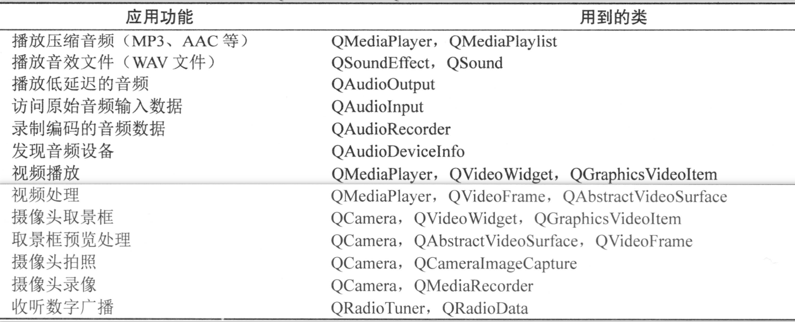
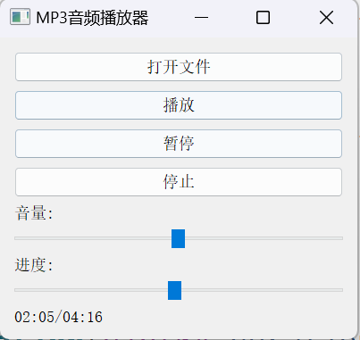
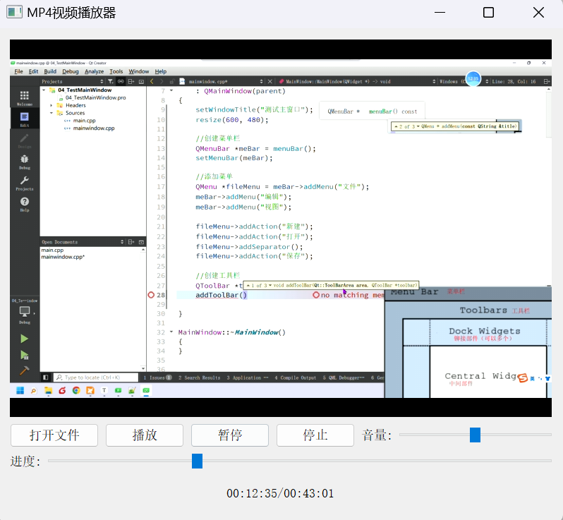

# Qt多媒体

<span style=color:red;background:yellow>多媒体功能指的主要是计算机的音频和视频的输入、输出、显示和播放等功能</span>，Qt的多媒体模块为音频和视频播放、录音、摄像头拍照和录像等提供支持，甚至还提供数字收音机的支持。

## 一、Qt多媒体模块概述

Qt多媒体模块提供了很多类，可以实现如下的一些功能：

> - 访问原始音频设备进行输入或输出；
> - 低延迟播放音效文件，如WAV文件；
> - 使用播放列表播放压缩的音频和视频文件，如：mp3、wmv等；
> - 录制声音并且压制文件；
> - 使用摄像头进行预览、拍照、视频录制；
> - 视频文件解码到内存进行处理；
> - 录制音频或视频时，访问其视频帧或音频缓冲区；
> - 数字广播调谐和收听；

要在Qt项目中使用Qt多媒体模块，需要在项目配置文件中添加如下语句：`Qt += multimedia`，如果在项目中使用视频播放功能，还需要添加，`Qt += multimediawidgets`来使用QVideoWidget或QGraphicsVideoItem进行视频播放。

Qt多媒体模块包含多个类，下面是需要用到的主要类：



利用Qt多媒体模块提供的各种类，可以实现一般的音频、视频的输入和输出。本章将介绍音频与视频的播放。

## 二、音频

### 1、相关的类

音频播放会使用如下两个类：

- QMediaPlayer类：媒体播放器，主要用于播放歌曲、网络收音机等功能；
- QMediaPlaylist类：专用于播放媒体内容的列表。

### 2、QMediaPlayer类介绍

用于播放音频和视频的类。支持多种格式的音频文件（如 .mp3、.wav 等）

#### 2.1、常用函数

```C++
//构造函数
QMediaPlayer(QObject *parent = nullptr);

//设置播放媒体文件
void setMedia(const QMediaContent &media, QIODevice *stream = nullptr);
//QMediaContent类型构造方式
QMediaContent(QMediaPlaylist *playlist, const QUrl &contentUrl = QUrl(), bool takeOwnership = false);
QMediaContent(const QMediaContent &other);
QMediaContent(const QNetworkRequest &request);
QMediaContent(const QUrl &url);
    
//设置播放媒体文件列表
void setPlaylist(QMediaPlaylist *playlist);

//开始播放
void play();

//暂停播放
void pause();

//停止播放
void stop();

//设置播放音量,volume范围是0到100
void setVolume(int volume); 

//设置是否静音
void setMuted(bool muted);

//设置播放速度，默认为1，表示正常速度
void setPlaybackRate(qreal rate);

//设置播放列表
void setPlaylist(QMediaPlaylist *playlist);

//设置当前文件播放位置，单位是ms
void setPosition(qint64 position);

//获取当前播放状态
QMediaPlayer::State state() const;
//返回值：
//QMediaPlayer::PlayingState  正在播放
//QMediaPlayer::PausedState   暂停
//QMediaPlayer::StoppedState  停止

//此属性保存当前媒体的持续时间，即：当前媒体的总播放时间（毫秒）
qint64 duration() const;

//此属性保存当前媒体的播放位置。该值是当前播放位置，以自媒体开始以来的毫秒表示
qint64 position() const;

//信号
//信号在文件的时间长度变化时触发，一般在切换播放文件时触发
[signal] void QMediaPlayer::durationChanged(qint64 duration);

//当前文件播放位置变化会触发信号，可以反映文件播放进度
[signal] void QMediaPlayer::positionChanged(qint64 position);

//信号在调用play、pause、stop函数时触发，反应播放器当前的状态
[signal] void QMediaPlayer::stateChanged(QMediaPlayer::State state);
//QMediaPlayer::State枚举类型
//QMediaPlayer::StoppedState     停止状态
//QMediaPlayer::PlayingState     正在播放
//QMediaPlayer::PausedState      暂停播放状态
```

### 3、QMediaPlaylist类介绍

用于管理播放列表的类。可以添加多个音频/视频文件，支持顺序播放、循环播放等。

#### 3.1、常用函数

```C++
QMediaPlaylist(QObject *parent = nullptr);

//添加流媒体文件
void addMedia(const QMediaContent &content);
bool addMedia(const QList<QMediaContent> &items);

//移除流媒体文件
bool removeMedia(int pos);
bool removeMedia(int start, int end);

//设置当前播放索引
void setCurrentIndex(int playlistPosition);

//设置播放模式
void setPlaybackMode(QMediaPlaylist::PlaybackMode mode);
//QMediaPlaylist::CurrentItemOnce    单次播放
//QMediaPlaylist::CurrentItemInLoop  单曲循环
//QMediaPlaylist::Sequential         顺序播放
//QMediaPlaylist::Loop               循环播放
//QMediaPlaylist::Random             随机播放
```

### 4、使用举例

```C++
#include "widget.h"
#include "ui_widget.h"

#include <QMediaPlayer>

Widget::Widget(QWidget *parent)
    : QWidget(parent)
    , ui(new Ui::Widget)
{
    ui->setupUi(this);
       
    //媒体播放器类对象的创建
    QMediaPlayer *player = new QMediaPlayer(this);
    player->setMedia(QUrl::fromLocalFile("C:/Users/lili/Desktop/mp3/死了都要爱.mp3"));
    //设置音量
    player->setVolume(30);
    //播放
    player->play();
}
```

### 5、小项目

实现一个简易MP3播放器，功能如下：

- 可以选择本地本地mp3格式文件；
- 可以对设置播放、停止、暂停播放；
- 调节音量大小、调整播放进度；
- 显示播放时长以及总时长;

```C++
QT       += core gui multimedia
```

```C++
#ifndef WIDGET_H
#define WIDGET_H

#include <QWidget>

//前向声明
class QMediaPlayer;
class QSlider;
class QLabel;

class Widget : public QWidget
{
    Q_OBJECT

public:
    Widget(QWidget *parent = nullptr);
    ~Widget();

private slots:
    //打开文件
    void openFile();
    //设置音量
    void setVolume(int value);
    //更新进度条的位置
    void updatePosition();
    //更新进度条的范围
    void updateDuration(qint64 duration);
    //设置进度条的位置
    void seekPosition();
private:
    QMediaPlayer *m_player;//媒体播放器
    QSlider *m_volumeSlider;//声音滑动条
    QSlider *m_positionSlider;//进度滑动条
    QLabel *m_timeLabel;//时间标签
};
#endif // WIDGET_H
```

```C++
#include "widget.h"
#include <QMediaPlayer>
#include <QSlider>
#include <QLabel>
#include <QPushButton>
#include <QVBoxLayout>
#include <QFileDialog>
#include <QTimer>
#include <QTime>

Widget::Widget(QWidget *parent)
    : QWidget(parent)
{
    setWindowTitle("MP3音频播放器");
    resize(400, 300);

    //初始化播放器
    m_player = new QMediaPlayer(this);

    //创建四个按钮分别显示"打开文件"、"播放"、"暂停"，"停止"
    QPushButton *openButton = new QPushButton("打开文件");
    QPushButton *playButton = new QPushButton("播放");
    QPushButton *pauseButton = new QPushButton("暂停");
    QPushButton *stopButton = new QPushButton("停止");

    //声音滑动条
    m_volumeSlider = new QSlider(Qt::Horizontal);
    //进度滑动条
    m_positionSlider = new QSlider(Qt::Horizontal);
    //时间标签(当前播放时长/总时长)
    m_timeLabel = new QLabel("00:00/00:00");

    // 设置音量滑动条范围和初始值
    m_volumeSlider->setRange(0, 100);
    m_volumeSlider->setValue(50);

    //设置播放音量
    m_player->setVolume(30);

    //启用播放进度条
    m_positionSlider->setEnabled(true);
    //设置播放进度的范围
    m_positionSlider->setRange(0, 100);

    // 布局
    QVBoxLayout *layout = new QVBoxLayout;
    layout->addWidget(openButton);
    layout->addWidget(playButton);
    layout->addWidget(pauseButton);
    layout->addWidget(stopButton);
    layout->addWidget(new QLabel("音量:"));
    layout->addWidget(m_volumeSlider);
    layout->addWidget(new QLabel("进度:"));
    layout->addWidget(m_positionSlider);
    layout->addWidget(m_timeLabel);
    setLayout(layout);

    // 连接信号与槽
    connect(openButton, &QPushButton::clicked, this, &Widget::openFile);
    connect(playButton, &QPushButton::clicked, m_player, &QMediaPlayer::play);
    connect(pauseButton, &QPushButton::clicked, m_player, &QMediaPlayer::pause);
    connect(stopButton, &QPushButton::clicked, m_player, &QMediaPlayer::stop);
    connect(m_volumeSlider, &QSlider::valueChanged, this, &Widget::setVolume);
    connect(m_player, &QMediaPlayer::positionChanged, this, &Widget::updatePosition);
    connect(m_player, &QMediaPlayer::durationChanged, this, &Widget::updateDuration);
    //连接进度条拖动信号
    connect(m_positionSlider, &QSlider::sliderReleased, this, &Widget::seekPosition);


    //定时器用于更新进度条
    QTimer *timer = new QTimer(this);
    connect(timer, &QTimer::timeout, this, &Widget::updatePosition);
    //每1秒更新一次
    timer->start(1000);
}

Widget::~Widget()
{
}

void Widget::openFile()
{
    QString filePath =
            QFileDialog::getOpenFileName(this, "打开mp3文件",
                                         "", "MP3文件(*.mp3)");
    if(!filePath.isEmpty())
    {
        m_player->setMedia(QUrl::fromLocalFile(filePath));
        //打开即播放
        m_player->play();
    }
}

void Widget::setVolume(int value)
{
    m_player->setVolume(value);
}

void Widget::updatePosition()
{
    // 如果用户正在拖动进度条，则跳过自动更新
    if(m_positionSlider->isSliderDown())
        return;

    if(m_player->duration() > 0)
    {
        //将播放进度转换为百分比形式,这是乘以100的作用，不然就是小数
        int position = (m_player->position() * 100)/m_player->duration();
        m_positionSlider->setValue(position);

        // 更新时间显示
        //当前时间，使用position获取
        QTime currentTime(0, 0);
        currentTime = currentTime.addMSecs(m_player->position());
        //总时间，使用duration获取
        QTime totalTime(0, 0);
        totalTime = totalTime.addMSecs(m_player->duration());
        m_timeLabel->setText(currentTime.toString("mm:ss")
                           + "/" + totalTime.toString("mm:ss"));
    }
}

void Widget::updateDuration(qint64 duration)
{
    Q_UNUSED(duration);
    m_positionSlider->setRange(0, 100);
}

void Widget::seekPosition()
{
    if(m_player->duration() > 0)
    {
        //计算目标位置（毫秒）= 进度条百分比 × 总时长/100
        qint64 targetPos =
                (m_positionSlider->value() * m_player->duration())/100;

        //设置播放位置
        m_player->setPosition(targetPos);
    }
}
```



## 三、视频

### 1、相关的类

视频播放会使用如下两个类：

- QMediaPlayer类：高级视频播放器综合应用；
- QVideoWidget类：用于媒体对象生成的视频。

### 2、QMediaPlayer类介绍

不仅可以播放mp3音频文件，也可以播放视频文件（如 .mp4、.avi 等），但需要与QVideoWidget 配合使用以显示视频画面。

### 3、QVideoWidget类介绍

用于显示视频的类。需要与QMediaPlayer配合使用。

```C++
QVideoWidget(QWidget *parent = nullptr);

//函数作用是：将QMediaPlayer与视频输出组件关联起来，以便在界面上显示视频内容。
void QMediaPlayer::setVideoOutput(QVideoWidget *output);
void QMediaPlayer::setVideoOutput(QGraphicsVideoItem *output);
void QMediaPlayer::setVideoOutput(QAbstractVideoSurface *surface);
```

### 4、使用举例

```C++
#include "widget.h"
#include "ui_widget.h"

#include <QMediaPlayer>
#include <QVideoWidget>
#include <QMediaPlaylist>

Widget::Widget(QWidget *parent)
    : QWidget(parent)
    , ui(new Ui::Widget)
{
    ui->setupUi(this);

    QMediaPlayer *player = new QMediaPlayer(this);
    QMediaPlaylist *playlist = new QMediaPlaylist(this);
    QVideoWidget *videoWidget = new QVideoWidget(this);

    //将视频输出到QVideoWidget
    player->setVideoOutput(videoWidget);
    playlist->addMedia(QUrl::fromLocalFile("F:/ev录屏/嵌入式1期/"
                                           "CppDay00_1复习C++类和对象_继承.mp4"));
    playlist->addMedia(QUrl::fromLocalFile("F:/ev录屏/嵌入式1期/"
                                           "CppDay00_2复习多态_C++的IO流.mp4"));
    //设置当前播放的索引
    playlist->setCurrentIndex(0);
    //将播放列表关联到播放器
    player->setPlaylist(playlist);

    //设置音量
    player->setVolume(30);
    //显示视频窗口
    videoWidget->show();
    //播放
    player->play();
}
```

<span style=color:red;background:yellow>**注意：部分同学使用上述代码后看不到视频播放，这里需要安装解码工具LAV Filters(lav解码器），不然看不到视频的播放功能，软件名lavfilters_0.73.1.exe，已经上传到服务器上了。**</span>

### 5、小项目

```C++
QT       += core gui multimedia multimediawidgets
```

```C++
#ifndef WIDGET_H
#define WIDGET_H

#include <QWidget>
#include <QMediaPlayer>
#include <QVideoWidget>

class QPushButton;
class QSlider;
class QLabel;

class Widget : public QWidget
{
    Q_OBJECT

public:
    explicit Widget(QWidget *parent = nullptr);

private slots:
    //打开文件
    void openFile();
    //更新进度条的位置
    void updatePosition(qint64 position);
    //更新进度条范围
    void updateDuration(qint64 duration);
    //设置进度条的位置
    void setPosition(int position);

private:
    QMediaPlayer *m_player;//视频播放器
    QVideoWidget *m_videoWidget;//视频输出组件
    QPushButton  *m_openButton;//打开文件按钮
    QPushButton  *m_playButton;//播放按钮
    QPushButton  *m_pauseButton;//暂停按钮
    QPushButton  *m_stopButton;//停止按钮
    QSlider      *m_positionSlider;//进度条
    QSlider      *m_volumeSlider;//声音条
    QLabel       *m_timeLabel;//进度时间标签
};

#endif // WIDGET_H
```

```C++
#include "widget.h"

#include <QPushButton>
#include <QSlider>
#include <QLabel>
#include <QFileDialog>
#include <QVBoxLayout>
#include <QHBoxLayout>
#include <QGridLayout>
#include <QTime>
#include <QMessageBox>

Widget::Widget(QWidget *parent)
    : QWidget(parent)
{
    setWindowTitle("MP4视频播放器");
    resize(800, 700);

    //初始化播放器组件
    m_player = new QMediaPlayer(this);
    m_videoWidget = new QVideoWidget(this);

    //设置视频输出
    m_player->setVideoOutput(m_videoWidget);

    // 创建控制按钮
    m_openButton = new QPushButton("打开文件");
    m_playButton = new QPushButton("播放");
    m_pauseButton = new QPushButton("暂停");
    m_stopButton = new QPushButton("停止");

    //进度条和音量控制
    m_positionSlider = new QSlider(Qt::Horizontal);
    m_volumeSlider = new QSlider(Qt::Horizontal);
    m_volumeSlider->setRange(0, 100);
    m_volumeSlider->setValue(50);
    m_timeLabel = new QLabel("00:00/00:00");

    //主布局
    QVBoxLayout *mainLayout = new QVBoxLayout;
    mainLayout->addWidget(m_videoWidget);

    //控制按钮布局
    QGridLayout *gridLayout = new QGridLayout;
    gridLayout->addWidget(m_openButton, 0, 0, 1, 3);
    gridLayout->addWidget(m_playButton, 0, 3, 1, 3);
    gridLayout->addWidget(m_pauseButton, 0, 6, 1, 3);
    gridLayout->addWidget(m_stopButton, 0, 9, 1, 3);
    gridLayout->addWidget(new QLabel("音量:"), 0, 12);
    gridLayout->addWidget(m_volumeSlider, 0, 13, 1, 6);
    gridLayout->addWidget(new QLabel("进度:"), 1, 0);
    gridLayout->addWidget(m_positionSlider, 1, 1, 1, 18);
    gridLayout->addWidget(m_timeLabel, 2, 0, 1, 19);
    mainLayout->addLayout(gridLayout);

    m_timeLabel->setFixedHeight(50);
    m_timeLabel->setAlignment(Qt::AlignCenter); //保持文字居中

    setLayout(mainLayout);

    //信号槽连接
    connect(m_openButton, &QPushButton::clicked, this, &Widget::openFile);
    connect(m_playButton, &QPushButton::clicked, m_player, &QMediaPlayer::play);
    connect(m_pauseButton, &QPushButton::clicked, m_player, &QMediaPlayer::pause);
    connect(m_stopButton, &QPushButton::clicked, m_player, &QMediaPlayer::stop);
    connect(m_volumeSlider, &QSlider::valueChanged, m_player, &QMediaPlayer::setVolume);
    connect(m_positionSlider, &QSlider::sliderMoved, this, &Widget::setPosition);
    connect(m_player, &QMediaPlayer::positionChanged, this, &Widget::updatePosition);
    connect(m_player, &QMediaPlayer::durationChanged, this, &Widget::updateDuration);
}

// 打开视频文件
void Widget::openFile()
{
    QString fileName =
            QFileDialog::getOpenFileName(this
                                         , "选择视频文件"
                                         , QDir::homePath()
                                         , "视频文件 (*.mp4 *.avi *.mkv *.mov)");
    if (!fileName.isEmpty())
    {
        m_player->setMedia(QUrl::fromLocalFile(fileName));
        m_player->play();
    }
}

//更新播放进度显示
void Widget::updatePosition(qint64 position)
{
    m_positionSlider->setValue(position);

    // 更新时间标签
    QTime currentTime(0, 0, 0);
    currentTime = currentTime.addMSecs(position);
    QTime totalTime(0, 0, 0);
    totalTime = totalTime.addMSecs(m_player->duration());
    m_timeLabel->setText(currentTime.toString("hh:mm:ss")
                         + "/" + totalTime.toString("hh:mm:ss"));
}

// 更新总时长
void Widget::updateDuration(qint64 duration)
{
    m_positionSlider->setRange(0, duration);
}

//手动设置播放位置
void Widget::setPosition(int position)
{
    m_player->setPosition(position);
}
```


