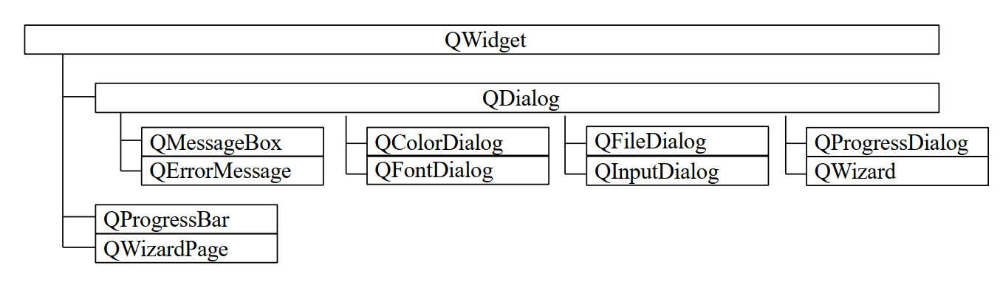
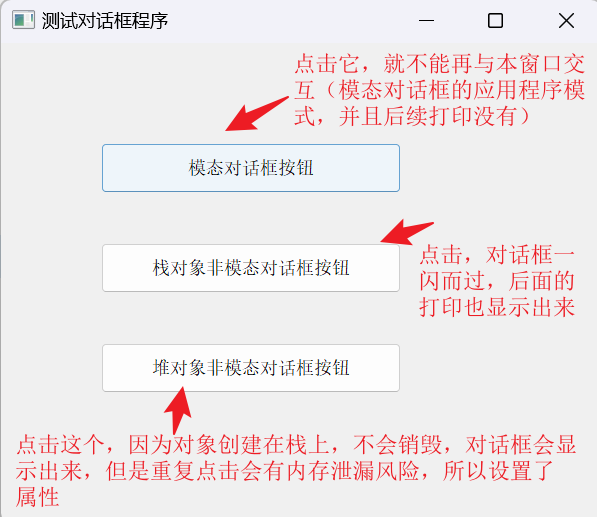
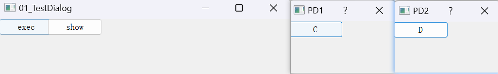
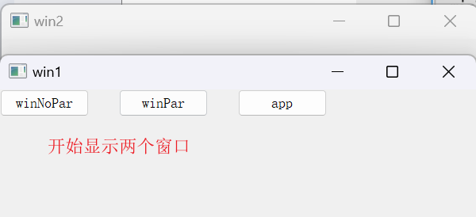
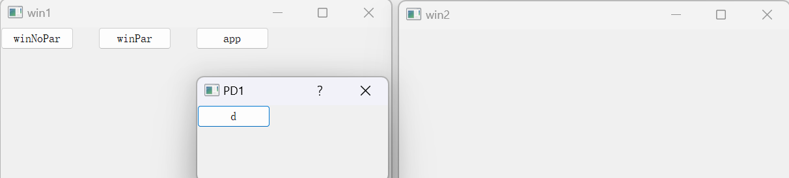
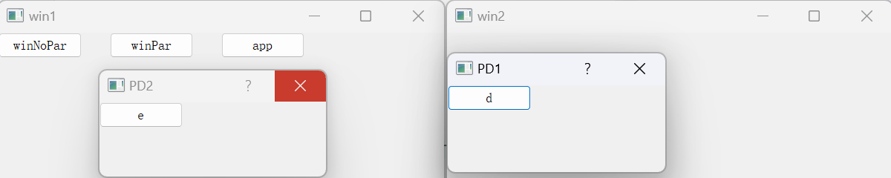
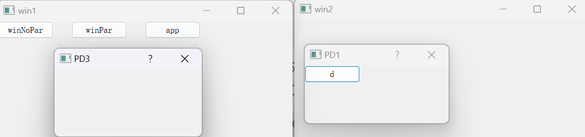

# Qt对话框

## 一、对话框的基本概念

Qt中使用QDialog类实现对话框。QDialog类继承自QWidget类，该类是对话框的基类。对话框是GUI程序中不可或缺的组成部分，很多不能或者不适合放入主窗口的功能组件都必须放在对话框中设置。<span style=color:red;background:yellow;font-size:20px>对话框通常会是一个顶层窗口，出现在程序最上层，用于实现短期任务或者简洁的用户交互</span>。我们通常会设计一个类继承QDialog，QDialog类及其子类，以及所有Qt::Dialog类型的类对于其parent指针都有额外的解释： 如果 parent为空，则该对话框会作为一个顶层窗口，否则则作为其父组件的子对话框（此时，其默认出现的位置是parent的中心）。 顶层窗口与非顶层窗口的区别在于，顶层窗口在任务栏会有自己的位置，而非顶层窗口则会共享其父组件的位置。<span style=color:red;background:yellow;font-size:20px>对话框与窗口的明显区别在于对话框通常没有最大最小化按钮</span>。  对话框的继承图如下：



## 二、对话框的分类

对话框分为两种，模态与非模态对话框。

### 1、模态对话框

<span style=color:red;background:yellow;font-size:20px>在同一个程序中，模态对话框会阻止用户与其它可见窗口的交互</span>，模态对话框通常用于需要返回值的情形，比如获取用户按下的是Ok还是Cancel键等。
模态对话框有两种模式，<span style=color:red;background:yellow;font-size:20px>application modal应用程序模式(默认)和window modal窗口模式</span>

- 应用程序模式对话框： 该模式会阻止用户与应用程序中的所有窗口的交互，直到完成与对话框的交互，并关闭该对话框，然后才能访问程序中的其他窗口。
- 窗口模式对话框：只阻止与对话框相关联的窗口的访问，允许用户在程序中继续使用其他窗口。该模式会阻止与对话框的父窗口、所有祖先窗口及父窗口和祖先窗口的所有兄弟姐妹窗口的交互，除这些窗口外，该模式仍可与其他窗口交互。

<span style=color:red;background:yellow;font-size:20px>注意：模态对话框不会阻止与其子窗口的交互。</span>

设置模态对话框的方法：

- 使用 QDialog::exec()函数，这是常用的方法。调用 QDialog::exec()函数后不会立即返回，需结束对话框才会返回该函数；
- 使用QDialog::setModal()或 QWidget::setWindowModality()，然后使用show()函数。与QDialog::exec()不同的是 show()会立即把控制权返回给调用方.

### 2、非模态对话框

与此相反的是非模态对话框，<span style=color:red;background:yellow;font-size:20px>非模态对话框会允许用户与其它可见窗口的交互</span>。例如查找对话框，我们可以在显示着查找对话框的同时，继续对记事本的内容进行编辑。

### 3、模态对与非模态对话框比较

```C++
#include "widget.h"

#include <QPushButton>
#include <QDialog>
#include <QDebug>

Widget::Widget(QWidget *parent)
    : QWidget(parent)
{
    setWindowTitle("测试对话框程序");
    resize(600, 480);

    QPushButton *btn1 = new QPushButton("模态对话框按钮", this);
    QPushButton *btn2 = new QPushButton("栈对象非模态对话框按钮", this);
    QPushButton *btn3 = new QPushButton("堆对象非模态对话框按钮", this);
    btn1->move(100, 100);
    btn2->move(100, 200);
    btn3->move(100, 300);
    btn1->resize(300, 50);
    btn2->resize(300, 50);
    btn3->resize(300, 50);

    connect(btn1, &QPushButton::clicked, [=]{
        QDialog dlg(this);
        dlg.setWindowTitle("模态对话框");
        dlg.resize(300, 200);

        dlg.exec();//对话框阻塞在此处，并且不能与父窗口交互
        qDebug() << "模态对话框";
    });

    connect(btn2, &QPushButton::clicked, [=]{
        QDialog dlg(this);
        dlg.setWindowTitle("栈非模态对话框");
        dlg.resize(300, 200);

        dlg.show();//对话框闪一下就没有了，dlg用完就销毁了
        qDebug() << "非模态模态对话框";
    });

    connect(btn3, &QPushButton::clicked, [=]{
        QDialog *pdlg = new QDialog(this);
        pdlg->setWindowTitle("堆非模态对话框");
        pdlg->resize(300, 200);
        //设置对话框属性
        pdlg->setAttribute(Qt::WA_DeleteOnClose);//关闭的时候释放内存
        pdlg->show();//对话框闪一下就没有了，dlg2用完就销毁了
        qDebug() << "非模态模态对话框";
    });
}
```



### 4、exec与show的区别

```C++
Widget::Widget(QWidget *parent)
    : QWidget(parent)
{
    resize(600, 480);

    QDialog *pd1 = new QDialog;
    QDialog *pd2 = new QDialog;
    pd1->setWindowTitle("PD1");
    pd2->setWindowTitle("PD2");
    pd1->resize(222,111);
    pd2->resize(222,111);

    QPushButton *a=new QPushButton("exec", this);
    QPushButton *b=new QPushButton("show", this);
    b->move(100,0);
    QPushButton *c = new QPushButton("C",pd1);
    QPushButton *d=new QPushButton("D",pd2);

    connect(a,&QPushButton::clicked,[=]{
        pd1->exec(); //调用该函数后需关闭对话框，才会返回该函数，然后才会执行之后的语句。
        pd2->show();
    });
    connect(b,&QPushButton::clicked,[=]{
        pd1->show();
        pd2->show();
    });
}
```



点击 exec 按钮会立即显示对话框 PD1，但 PD2 不会被显示，当把 PD1 关闭后，才会显示 PD2。而点击 show 按钮，则 PD1 和 PD2 会同时显示出来  

### 5、应用程序模式与窗口模式的区别  

```C++
//widget.h
#include "widget.h"

#include <QDialog>
#include <QPushButton>

Widget::Widget(QWidget *parent)
    : QWidget(parent)
{

}

Widget::~Widget()
{
}

void Widget::test()
{
    QDialog *pd1=new QDialog;       //窗口模式
    QDialog *pd2=new QDialog(this); //窗口模式
    QDialog *pd3=new QDialog;       //应用程序模式
    pd1->setWindowTitle("PD1");
    pd2->setWindowTitle("PD2");
    pd3->setWindowTitle("PD3");

    QPushButton *a=new QPushButton("winNoPar",this);
    QPushButton *b=new QPushButton("winPar",this);
    b->move(150,0);
    QPushButton *c=new QPushButton("app",this);
    c->move(300,0);
    QPushButton *d=new QPushButton("d",pd1);
    QPushButton *e=new QPushButton("e",pd2);
    pd1->resize(200, 100);
    pd2->resize(200, 100);
    pd3->resize(200, 100);

    connect(a,&QPushButton::clicked,[=]{
        pd1->setWindowModality(Qt::WindowModal);
        pd1->show();
    });
    connect(b,&QPushButton::clicked,[=]{
        pd2->setWindowModality(Qt::WindowModal);
        pd2->show();
    });
    connect(c,&QPushButton::clicked,[=]{
        pd3->setWindowModality(Qt::ApplicationModal);
        pd3->show();
    });
}

//main.cpp
#include "widget.h"

#include <QApplication>

int main(int argc, char *argv[])
{
    QApplication a(argc, argv);
    Widget w, w2;
    w.test();
    w.resize(600, 480);
    w.show();
    w.setWindowTitle("win1");
    w2.setWindowTitle("win2");
    w2.resize(600, 480);
    w2.show();

    return a.exec();
}

```



点击按钮 winNoPar 会弹出对话框 PD1，该对话框模态类型为窗口模式，但无父窗口，因此该对话框阻止不了对窗口 win1 和 win2 的交互  



接着点击按钮 winPar 会弹出对话框 PD2，该对话框模态类型为窗口模式，父窗口为 win1，因此该对话框阻止不了对窗口 win2、 对话框 PD1 的交互，但能阻止与窗口 win1 的交互  



关闭 PD2，点击按钮 app 会弹出对话框 PD3，该对话框模态类型为应用程序模式，无父窗口，该对话框会阻止与应用程序的所有窗口进行交互，因此 win1， win2， PD1 都不能在关闭 PD3 之前被激活。  




## 三、标准对话框

<span style=color:red;background:yellow;font-size:20px>所谓标准对话框，是Qt内置的一系列对话框，用于简化开发</span>。事实上，有很多对话框都是通用的，比如打开文件、设置颜色、打印设置等。这些对话框在所有程序中几乎相同，因此没有必要在每一个程序中都自己实现这么一个对话框。Qt 的内置对话框大致分为以下几类：  

- QMessageBox：模态对话框，用于显示信息、询问问题等；
- QErrorMessage：错误消息对话框；
- QColorDialog：颜色对话框，用于选择颜色；

- QFontDialog：字体对话框，用于选择字体；
- QFileDialog：文件对话框，用于选择文件或者目录；
- QInputDialog：属于对话框，允许用户输入一个值，并将其值返回；
- QProgressDialog：进度对话框，用于显示操作过程；
- QPageSetupDialog：页面设置对话框，为打印机提供纸张相关的选项；
- QPrintDialog： 打印对话框，用于打印机配置；
- QPrintPreviewDialog：打印预览对话框，用于打印预览。

### 1、消息对话框

Qt中使用QMessageBox类表示消息对话框，是Qt内部预定义的一种对话框，该类继承自QDialog。消息对话框用于向用户显示一些信息，或者接收用户的答案。

```C++
#include <QDebug>
#include <QMessageBox>

Widget::Widget(QWidget *parent)
    : QWidget(parent)
{
    setWindowTitle("测试QMessageBox对话框");
    resize(600, 480);

    QPushButton *btn = new QPushButton("QMessageBox按钮", this);
    btn->move(100, 100);
    btn->resize(200, 100);

    connect(btn, &QPushButton::clicked, [=]{
        QMessageBox::question(this, "question"
                              , "问题"
                              , QMessageBox::Save|QMessageBox::Cancel
                              , QMessageBox::Cancel);
    });
}
```

### 2、颜色对话框

```C++
#include <QPushButton>
#include <QDebug>
#include <QColorDialog>
#include <QColor>

Widget::Widget(QWidget *parent)
    : QWidget(parent)
{
    setWindowTitle("测试QMessageBox对话框");
       resize(600, 480);

       QPushButton *btn = new QPushButton("QMessageBox按钮", this);
       btn->move(100, 100);
       btn->resize(200, 100);

       connect(btn, &QPushButton::clicked, [=]{
           QColor col = QColorDialog::getColor(QColor(255, 0, 0));
                   qDebug() << "r = " << col.red()
                            << "g = " << col.green()
                            << "b = " << col.blue();
       });
}
```

### 3、字体对话框

```C++
#include <QPushButton>
#include <QDebug>
#include <QFontDialog>

Widget::Widget(QWidget *parent)
    : QWidget(parent)
{
    setWindowTitle("测试QFontDialog对话框");
    resize(600, 480);

    QPushButton *btn = new QPushButton("QFontDialog按钮", this);
    btn->move(100, 100);
    btn->resize(200, 100);

    connect(btn, &QPushButton::clicked, [=]{
        bool flag = false;
        QFont qf = QFontDialog::getFont(&flag, QFont("仿宋"));
        qDebug() << "字体:" << qf.family().toUtf8().data() << endl //去掉了双引号
                 << "字号:" << qf.pointSize() << Qt::endl
                 << "是否加粗:" << qf.bold() << Qt::endl
                 << "是否斜体:" << qf.italic()<< Qt::endl
                 << "是否下划线:" << qf.underline()<< Qt::endl
                 << "是否删除线: " << qf.strikeOut()<< Qt::endl
                 << "字体风格:" << qf.style() << Qt::endl
                 << "字重:" << qf.weight() << Qt::endl
                 << "字母间距:" << qf.letterSpacing() << Qt::endl
                 << "单词间距:" << qf.wordSpacing() << Qt::endl
                 << "样式策略:" << qf.styleStrategy() <<Qt:: endl;
    });
}
```

### 4、文件对话框

#### 4.1、函数接口

```C++
//函数的作用是：返回用户选择的文件名（路径），但是当用户选择文件时，若选择取消，则返回一个空串。
[static] QString QFileDialog::getOpenFileName(QWidget *parent = nullptr
                 , const QString &caption = QString()
                 , const QString &dir = QString()
                 , const QString &filter = QString()
                 , QString *selectedFilter = nullptr
                 , QFileDialog::Options options = Options());
//parent:标准文件对话框的父窗口;
//caption:标准文件对话框的标题名;
//dir:指定了默认的目录，若参数带有文件名，则文件将是默认选中的文件;
//filter:对文件类型进行过滤，只有匹配的文件类型才会显示，如果指定多种过滤方式，使用";;"隔开;
//selectedFilter:用户选择多的过滤器通过此参数返回;
//options:选择显示文件名的格式，默认是同时显示目录与文件名.
    
//指定读取文件的格式name
[static] QTextCodec *QTextCodec::codecForName(const char *name)

//将此编解码器的编码转换为Unicode，并以QString形式返回结果。
QString QTextCodec::toUnicode(const QByteArray &a) const
```

#### 4.2、代码示例

```C++
#include <QPushButton>
#include <QDebug>
#include <QFileDialog>

Widget::Widget(QWidget *parent)
    : QWidget(parent)
{
    setWindowTitle("测试QFileDialog对话框");
    resize(600, 480);

    QPushButton *btn = new QPushButton("QFileDialog按钮", this);
    btn->move(100, 100);
    btn->resize(200, 100);

    connect(btn, &QPushButton::clicked, [=]{
        QString str =
        QFileDialog::getOpenFileName(this, "打开文件",
                                     "C:/Users/lili/Desktop",
                                     "(*.*)");
                                     // "(*.xmind)");
        qDebug() << str;
    });
}
```

#### 4.3、结合文件读写

```C++
#include "widget.h"
#include "ui_widget.h"

#include <QFileDialog>
#include <QFile>

Widget::Widget(QWidget *parent)
    : QWidget(parent)
    , ui(new Ui::Widget)
{
    ui->setupUi(this);

    setWindowTitle("测试QFileDialog对话框");
    resize(600, 480);

    connect(ui->pushButton, &QPushButton::clicked, [=](){
        //返回结果就是打开的文件路径
        QString path =
        QFileDialog::getOpenFileName(this, "打开文件",
                                     "C:/Users/lili/Desktop",
                                      //注意:多个过滤使用;;
                                      "(*.png);;(*.txt)");
        //将路径放在lineEdit中
        ui->lineEdit->setText(path);

        //创建文件对象与文件关联
        QFile fl(path);
        //设置打开方式
        fl.open(QIODevice::ReadOnly);

        QByteArray arr = fl.readAll();

        //将读取到的数据写入到textEdit中
        ui->textEdit->setText(arr);
        //关闭文件
        fl.close();

        //重新以追加的方式打开文件
        fl.open(QIODevice::Append);
        //向文件尾部追加文件内容
        fl.write("王道训练营");
        //关闭文件
        fl.close();
    });
}

Widget::~Widget()
{
    delete ui;
}
```


