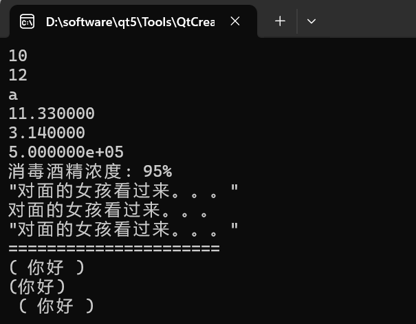
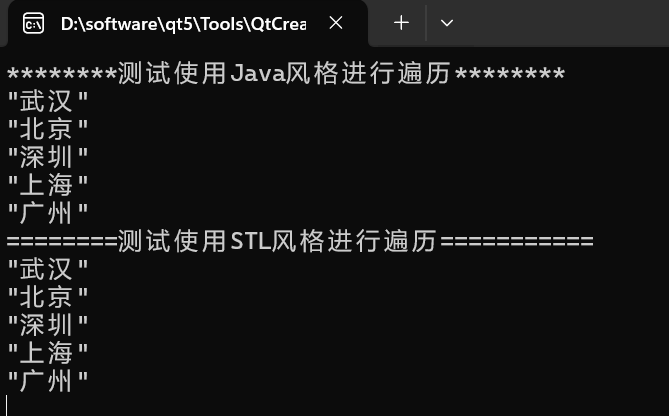
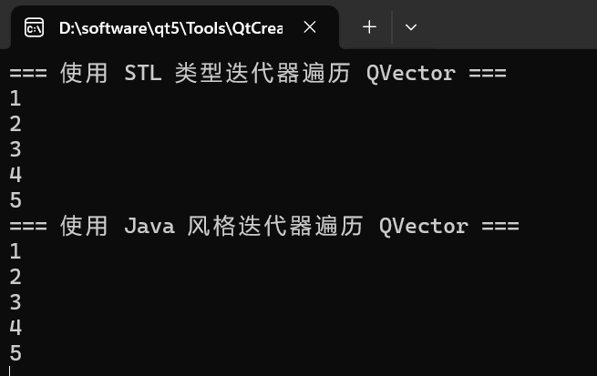
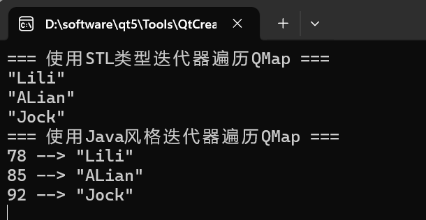
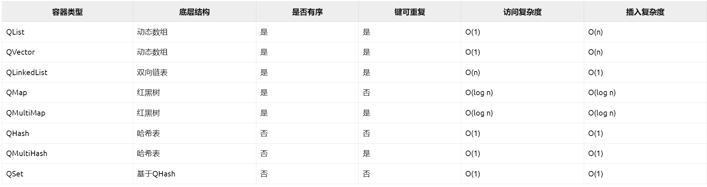
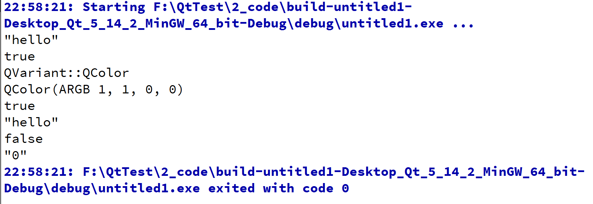

# Qt数据类型

## 一、数值类型

整数类型：Qt提供了不同大小的整数类型，包括：bool、char、short、int、long、qint8、qint16、qint32、qint64等。其中，qintX类型是Qt自定义的整数类型，其大小会根据平台的不同而变化。

浮点数类型：Qt提供了不同精度的浮点数类型，包括：float、double、qreal等。其中，qreal类型是Qt自定义的浮点数类型，其精度会根据平台的不同而变化。

```C++
#include <QtGlobal>
```


## 二、字符串数据类型

### 1、字符串类型介绍

QString类：用于存储和操作Unicode字符串。它支持字符串的连接、截取、替换、查找等操作，并提供了丰富的转换函数用于不同编码之间的转换。QString是Qt中的字符串类，与C/C++不同的是，不再使用ASCII编码，而使用Unicode编码。因此一个字符不是8位的char，而是16位的QChar，这就是为什么之前一个汉字占用一个字符的原因。

QByteArray类：<span style=color:red;background:yellow>**处理原始字节数据**</span>，用于存储和操作字节数组，本质是一个动态字节数组。它可以用于处理二进制数据或者文本数据的字节表示。

```C++
void test()
{
    QString name = "Mary";
    qint32 age = 18;
    QString job = "打螺丝";

    qDebug() << name + QString::number(age) + job;

    //C风格的打印方法
    qDebug() << QString::asprintf("我是%s, 今年%d岁，我的工作是%s",
                                  name.toStdString().data(), age,
                                  job.toStdString().data());
    
    //Qt推荐使用QString::arg()替代C风格的sprintf，因为它更安全、易读
    qDebug() << QString("我是%1,今年%2岁，我的工作是%3")
                .arg(name).arg(age).arg(job);


    //将QString类型转换为QByteArry类型
    QByteArray ba = job.toUtf8();
    //将QString类型转换为char *类型, 这样显示就没有双引号
    char *ca = job.toUtf8().data();
    //qDebug() << "ba = " << ba;
    qDebug() << "ca = " << ca;
}
```

<span style=color:red;background:yellow;font-size:20px>注意：在Qt中使用qDebug而不是cout或printf有几个重要原因</span>

>1、类型安全：qDebug提供了更好的类型安全，能够自动处理多种数据类型，包括自定义类型，这减少了格式化错误的风险；
>
>2、灵活性：qDebug允许使用流式操作符，可以方便地输出多个值；
>
>3、日志级别：qDebug是Qt日志系统的一部分，支持不同的日志级别（如 qWarning, qCritical, qFatal）这样可以根据需要过滤信息；
>
>4、调试信息：qDebug允许在输出中包含文件名、行号和函数名，方便调试。例如：`qDebug()  << __FILE__ << __LINE__`;
>
>5、输出重定向：可以通过Qt的日志系统配置输出目的地，比如将调试信息输出到文件、控制台或其他地方；
>
>6、 国际化支持：qDebug可以与Qt的国际化机制更好地集成，方便在不同语言环境中输出信息

### 2、测试qDebug()的用法

```C++
void test()
{
    int num = 10;
    qDebug("%d", num);//打印十进制
    qDebug("%o", num);//打印八进制
    qDebug("%x", num);//打印十六进制

    float fnum = 11.33;
    qDebug("%f", fnum);//浮点数据输出

    qreal PI = 3.14;
    qDebug("%f", PI);//浮点数据输出
    
    qreal price = 500000;
    qDebug("%e", price);//科学计数法方式输出

    int rate = 95;
    qDebug("消毒酒精浓度: %d%%", rate);//%%打印%，%%是对%进行的转义
    //完全可以换成下面的做法,转换为char *
    //qDebug() << QString("消毒酒精浓度: %1%").arg(rate).toUtf8().data();

    QString ss("对面的女孩看过来。。。");
    qDebug() << ss;
    qDebug().noquote() << ss;
    qDebug().quote() << ss;

    qDebug() << "======================";

    qDebug() << "(" << "你好" << ")";
    qDebug().nospace() << "(" << "你好" << ")";

    qDebug().space() << "(" << "你好" << ")";
}
```

#### 2.1、显示效果



## 三、容器类型

Qt基于C++的容器，重新提供了更轻巧、更安全和更易于使用的新容器类。这些新的容器类可以使程序最终的可执行文件体积减小，同时这些容器类可以被多个线程直接读取，也兼容C++绝大多数API。

### 1、顺序容器

Qt的顺序容器类有QList、QLinkedList、QVector、QStack和QQueue。

QList是Qt中的容器类，<span style=color:red;background:yellow;font-size:20px>用于存储和管理元素的动态数组，底层实现基于动态数组</span>，与标准C++容器 std::vector类似。QList是Qt框架中的一个重要的泛型容器类，它是动态数组的实现，但是它的内部实现并不是简单的连续内存区域，而是根据元素大小和数量选择最优的存储策略（可能是数组或者链表）。这意味着QList能够灵活地应对不同场景下的需求，尤其是在元素较小或者大量元素已预先分配空间的情况下，它会尽可能地利用连续内存来加速随机访问。

QVector它是动态数组，用于存储和管理元素。与QLinkedList不同，<span style=color:red;background:yellow;font-size:20px>QVector在内部使用连续的内存块来存储元素</span>，因此对于需要频繁随机访问元素的情况，QVector是一个更合适的选择。

QLinkedList是Qt中的容器类，它是双向链表，用于存储和管理元素的动态数据结构。Qt6中建议使用QList或QVector替代。

QStack是栈(LIFO)容器以及QQueue是队列(FIFO)容器，二者都基于QList。

### 2、关联容器

Qt提供的关联容器有QSet、QMap、QMultiMap、QHash、QMultiHash，其中QMultiMap和QMultiHash支持一个键关联多个值，QHash和QMultiHash类使用散列(Hash)函数进行查找，查找速度更快。

QSet是<span style=color:red;background:yellow;font-size:20px>基于散列表的集合模板类</span>，它存储数据的顺序是不定的，查找值的速度非常快，`QSet<T>`内部就是用QHash实现的。它仅存不重复的元素，因此不允许重复值的存在。

QMap提供一个字典(关联数组)，一个键映射到一个值，QMap存储数据是按照键的顺序，它提供了键值对的存储和管理，其中键唯一，每个键应对一个值，如果不在乎存储顺序，使用QHash会更快。<span style=color:red;background:yellow;font-size:20px>底层采用红黑树数据结构。</span>

QHash是<span style=color:red;background:yellow;font-size:20px>基于散列来实现字典功能的模板</span>，QHash<QKey, T>存储的键值对具有非常快的查找速度，QHash与QMap的功能和用法相似，但是QHash比QMap的查找速度快；在QMap上遍历，数据项是按照键排序的，而QHash的数据项是任意顺序的。

<span style=color:red;background:yellow;font-size:30px>**Qt中的容器类是隐式共享和可重入的**。</span>

>隐式共享：Qt容器大多使用写时拷贝(Copy-On-Write)技术，传递容器副本不会立即复制内存。
>
>一个函数或代码模块如果满足以下条件，就是**可重入**的：
>
>- 在**执行过程中被中断**（如切换到另一个线程、信号处理、递归调用）后，**能够再次被安全调用**，且不会破坏数据一致性。
>- **不依赖全局或静态变量**，所有数据仅通过参数或局部变量传递。
>
>特点：
>
>- 线程安全（前提是没有共享数据竞争）；
>- 可被递归调用（如递归函数）；
>- 可被信号处理函数调用（避免死锁或数据错乱）。
>
>
>
>一个函数或代码模块**依赖全局变量、静态数据或外部状态**，且在并发环境下可能导致数据错误，它就是**不可重入**的。
>
>- 当执行中被中断并重新进入时，**可能修改共享数据**，导致逻辑错误或崩溃。
>
>特点：
>
>- 非线程安全（除非显式加锁）；
>- 不可递归调用（除非能保证状态独立）；
>- 禁止在信号处理函数中使用（可能导致死锁）
>
>注意：可重入函数是线程安全的，但是线程安全的函数可能不是可重入的，可以通过同步手段。

QStringList就是`QList<QString>`的别名

<span style=color:red;background:yellow;font-size:20px>注意：在Qt中容器的使用方式类似C++中的STL，使用时多查查官方文档即可，这里查一查帮助手册即可。需要注意的是，在Qt中对容器的遍历有两种风格，分别是Java风格迭代器（使用方便，但是效率低一些）和STL风格迭代器（使用麻烦，但是效率高一些）</span>

### 3、测试QList容器中的遍历

```C++
#include <QCoreApplication>
#include <QList>
#include <QDebug>

void test()
{
    QList<QString> lst;
    lst << "武汉" << "北京" << "深圳" << "上海" << "广州";

    qDebug() << "********测试使用Java风格进行遍历********";
    QListIterator<QString> i(lst);
    while (i.hasNext())
    {
        qDebug() << i.next();
    }

    qDebug() << "========测试使用STL风格进行遍历===========";
    for (auto it = lst.begin(); it != lst.end(); ++it)
    {
        qDebug() << *it;
    }
}

int main(int argc, char *argv[])
{
    QCoreApplication a(argc, argv);

    test();
    
    return a.exec();
}
```

#### 3.1、显示效果



### 4、测试QVector容器中的遍历

```C++
#include <QCoreApplication>
#include <QVector>
#include <QDebug>

void test()
{
    QVector<int> number;
    number << 1 << 2 << 3 << 4 << 5;

    qDebug() << "===使用STL类型迭代器遍历QVector===";
    for (QVector<int>::iterator it = number.begin(); it != number.end(); ++it) 
    {
        qDebug() << *it;
    }

    qDebug() << "===使用Java风格迭代器遍历QVector===";
    QVectorIterator<int> it(number);  //Java风格迭代器是只读的
    while (it.hasNext()) 
    {
        qDebug() << it.next();
    }
}

int main(int argc, char *argv[])
{
    QCoreApplication a(argc, argv); 
    test();
  
    return a.exec();
}
```

#### 4.1、显示效果



### 5、测试QMap容器中的遍历

```C++
#include <QCoreApplication>
#include <QMap>
#include <QDebug>

void test()
{
    QMap<int, QString> number;
    number[85] = "ALian";
    number[92] = "Jock";
    number.insert(78, "Lili");

    qDebug() << "=== 使用STL类型迭代器遍历QMap ===";
    for (QMap<int, QString>::iterator it = number.begin(); it != number.end(); ++it)
    {
        qDebug() << *it;
    }

    qDebug() << "=== 使用Java风格迭代器遍历QMap ===";
    QMapIterator<int, QString> it(number);//Java风格迭代器是只读的
    while (it.hasNext())
    {
        it.next();
        qDebug() << it.key() << "-->" << it.value();
    }
}

int main(int argc, char *argv[])
{
    QCoreApplication a(argc, argv);

    test();

    return a.exec();
}
```

#### 5.1、显示效果




### 6、容器的特点总结



<span style=color:red;background:yellow;font-size:20px>注意：此处的第三列"是否有序"指的是元素是不是可以做到有顺序，而不是默认是不是有序，当然QList这些会按照插入的顺序进行排列，插入是什么顺序就是什么顺序，除非调用排序函数，但是QMap底层使用就是红黑树，元素会自动排序</span>

## 四、特殊类型QVariant

QVariant类是Qt常见数据类型的统一类型，可以完成与常见类型的相互转换。QVariant类是Qt的共用体union数据类型，不仅可以保存很多Qt类型的值，包括：QColor、QBrush、QFont、QRect、QString及QSize等等，还能存放Qt的容器类型值。

### 1、使用示例

```C++
void test()
{
    QVariant vStr("hello");
    qDebug() << vStr.toString();

    QVariant vb(true);
    qDebug() << vb.toBool();

    QColor c = QColor(Qt::red);
    QVariant vc = c;
    qDebug() << vc.type();
    qDebug() << vc.value<QColor>();

    QVariant vss = vStr;
    //返回数据类型转换的能力
    qDebug() << vss.canConvert(QVariant::Int);
    qDebug() << vss.toString();

    //转换成功的条件：有转换能力、数据类型匹配
    qDebug() << vss.convert(QVariant::Int);
    qDebug() << vss.toString();
}
```

### 2、显示效果




## 五、时间类型

QDate：用于存储和操作日期。它支持日期的计算、格式化、比较等操作，并提供了丰富的转换函数用于和字符串之间的转换。

QTime：用于存储和操作时间。它支持时间的计算、格式化、比较等操作，并提供了丰富的转换函数用于和字符串之间的转换。

QDateTime：用于存储和操作日期和时间。它继承自QDate和QTime，支持日期和时间的组合操作，并提供了丰富的转换函数用于和字符串之间的转换。


除了以上基本数据类型，Qt还提供了许多其他类型，如：QUrl用于处理URL地址、QColor用于表示颜色、QImage用于表示图像等。这些类型都为Qt应用程序提供了丰富的数据操作能力，方便开发者进行数据处理和展示。