# Qt概述

## 一、Qt简介

### 1、什么是Qt

​       Qt(名称源自“Quaint Toolkit”或“Quick Toolkit”)是一个<span style=color:red>**跨平台的C++图形用户界面应用程序框架，Qt的本质就是一个 C++类库**</span>。它为应用程序开发者提供建立艺术级图形界面所需的所有功能；它是完全面向对象的，很容易扩展，并且允许真正的组件编程 。Qt是跨平台的，也就是说，<span style=color:red>**使用一个Qt 开发框架就可以开发出能在桌面、嵌入式、移动等多个平台运行的应用程序， 因此一套代码可以运行在各个不同的平台上**</span>。从QT5.6开始实现了对 Andriod、iOS、winRt等移动平台的完整支持，目前Qt支持Windows、Linux、macOS、Android、iOS、WinRT等平台，将现有的QT程序移植到这些平台，只需重新编译一次源代码即可。Qt虽然是使用的C++语言，但不是使用的标准 C++语法，Qt进行了一定程度的“扩展”。虽然如此，但C++仍然是基础，所以前面的C++基础是学好Qt的前提条件。

### 2、Qt的历史

Qt最早是<span style=color:red>1991年由挪威的Eirik Chambe-Eng和Haavard Nord</span>开发的，他们随后于<span style=color:red>1994年3月4号正式成立奇趣科技公司（Trolltech）</span>。Qt原本是商业授权的跨平台开发库， 1997年，Qt被用来开发Linux桌面环境KDE，大获成功，使Qt成为Linux环境下开发C++ GUI程序的事实标准。KDE是Linux 操作系统的桌面环境，与GNOME桌面是类似的，作为开源桌面它们竞争的情况更为多见。KDE 是采用GPL许可证发布的开源软件，而最初Qt是商业授权的，存在商业侵权风险，GNOME则是基于开源GTK库的，没有什么商业风险，这一度是GNOME优越于KDE的特性。由于Qt的商业授权，KDE社区一度混乱纠结，与此同时GNOME则如火如荼发展起来了。奇趣科技公司为了赢得开发者的支持，为Qt增加了GPL的开源授权。在2000年奇趣科技公司为开源社区发布了遵循GPL（GNU General Public License）许可证的开源版本。对于开源社区而言，遵循GPL使用Qt就不需要付费，这为KDE解决了燃眉之急。之后KDE桌面和GNOME 都发展壮大起来，都做得越来越好了。

在2008年，<span style=color:red>诺基亚公司收购了奇趣科技公司，并增加了LGPL（GNU Lesser General Public License的授权模式</span>。诺基亚联合英特尔利用 Qt开发了全新的智能手机系统 MeeGo，可惜遭遇了微软木马屠城，诺基亚被迫放弃了 MeeGo，而Qt商业授权业务也于<span style=color:red>2011年3月出售给了芬兰IT服务公司Digia</span>。当然好消息是Digia于2014年9月宣布成立Qt Company全资子公司，独立运营Qt商业授权业务。目前Qt公司大力推广移动平台开发和商业应用，总的来说Qt历经曲折，现在算是步入正轨了。

经过20多年的发展，Qt已经成为最优秀的跨平台开发框架之一，在各行各业的项目开发中得到广泛应用。许多大型软件都是用Qt开发的，下面的程序都使用Qt开发： <span style=color:red>WPS、 YY语音、 Skype、豆瓣电台、虾米音乐、淘宝助理、千牛、暴雪的战网客户端、VirtualBox、 Opera、咪咕音乐、Google地图、Adobe Photoshop Album</span>等。 Qt也是<span style=color:red>嵌入式的主力军，广泛应用于消费类电子、工业控制、军工电子、电信/网络/通讯、航空航天、汽车电子、医疗设备、仪器仪表等相关行业</span>。
除了商业授权，目前Qt的开源授权有两种，一种是GPL授权，另一种是LGPL授权（诺基亚收购后新增）。对这两种开源授权，简单来说，使用GPL版本的软件一定还是GPL的开源软件，无论是使用了Qt的程序代码还是修改了Qt库代码，都必须按照GPL来发布，这是 GPL的传染性。GPL是什么都要开源，这对商业软件应用是不利的，所以诺基亚增加了LGPL授权 （第一个L可以叫Lesser 宽松版或Library开发库版）。使用LGPL授权就可以利用Qt官方动态链接库，而不必开放商业代码。只要不修改和定制Qt库，仅使用Qt官方发布的动态链接库就可以不开源，这是商业友好的授权模式。

## 二、Qt的安装

### 1、安装步骤

Qt官方网站是<span style=color:red;font-size:20px>`https://www.qt.io/`</span>，要想安装Qt可以从其官网下载对应的软件包，但是在我们的课程中选用的是Qt5.14.2，这是官方提供的最后一个离线安装包的版本。

- 首先，可以从官网下载Qt5.14.2的离线安装包（这里建议直接从王道的服务器上下载即可）。软件名字是：qt-opensource-windows-x86-5.14.2.exe；
- 然后，注册一个Qt账号用于登录（当然也可以跳过，<span style=color:red;background:yellow>**直接拔掉网线跳过这一步**</span>）；

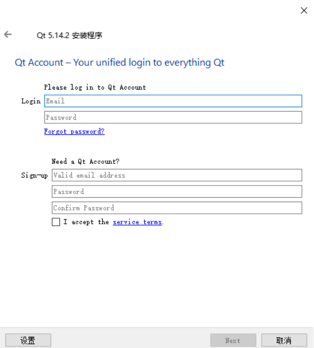

- 接着继续点击下一步即可，直到这里更改存储路径，默认C盘（建议安装到其他盘，如E盘，注意：<span style=color:red;background:yellow>**不要有中文与空格**</span>）；

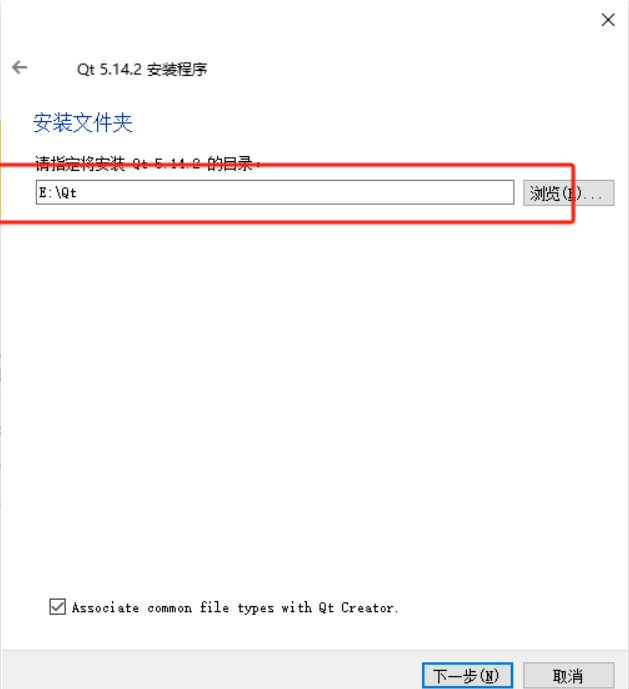

- 继续下一步，当走到如下步骤的时候，建议按照图片上的进行勾选；

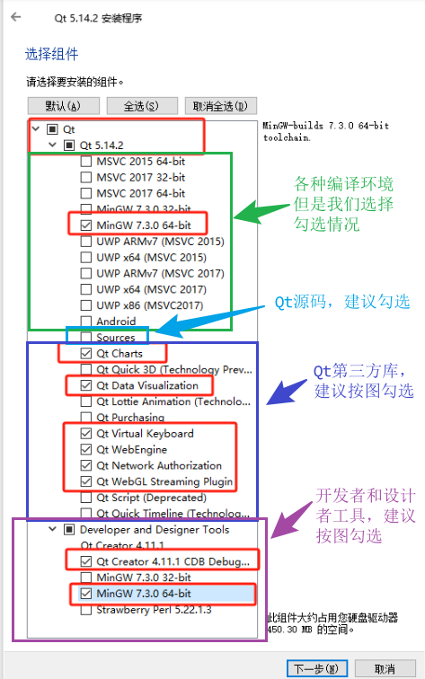

- 然后继续下一步即可，直到安装结束。

### 2、测试安装结果

> 进入到目录/Tools/QtCreator/bin(我的目录是D:\software\qt5\Tools\QtCreator\bin)文件夹，选择qtcreator.exe右键，发送到桌面快捷方式，返回桌面，双击打开软件。

- 首先新建项目，按照如图步骤点击即可；

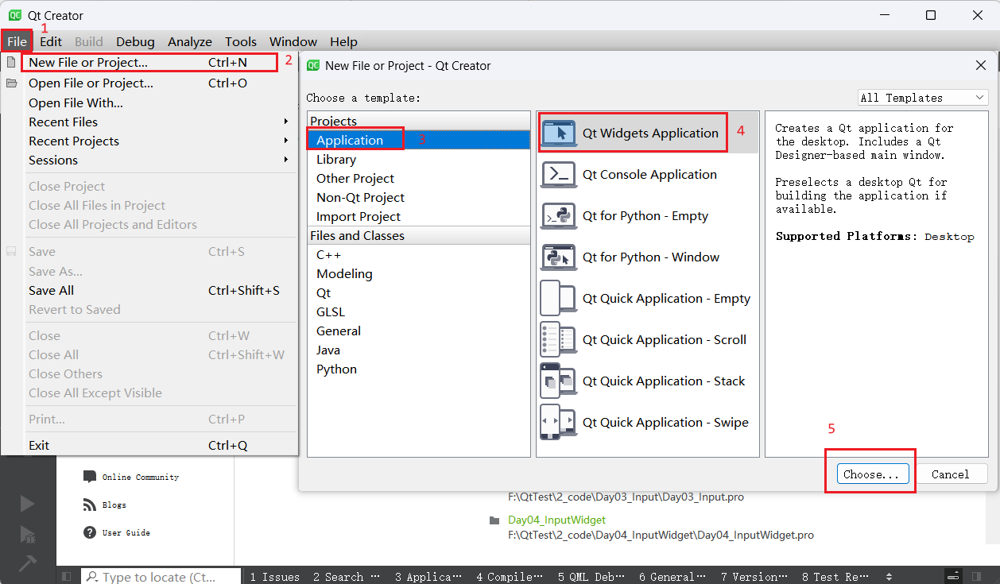

- 按照如图设置项目的名称以及存放的路径，便于后续找到项目；

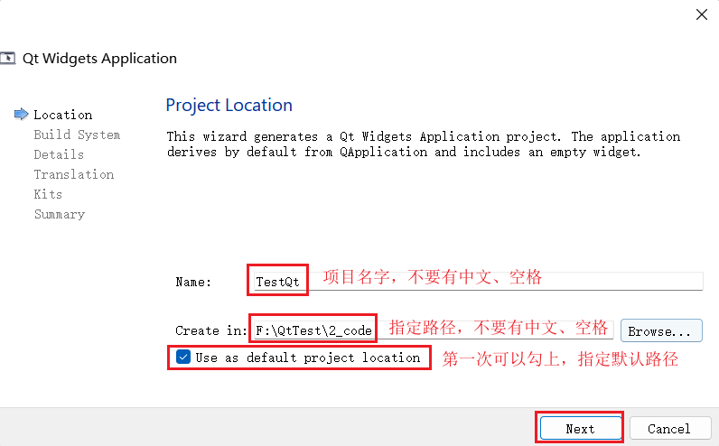

- 继续点击下一步（后续都保持默认即可），直到点击完成为止；
- 最后点击运行，看是否会出现如下图窗口。

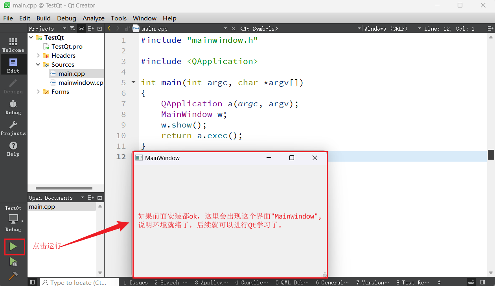

## 三、Qt Creator介绍

### 1、Qt Creator是什么

Qt Creator是Qt的集成开发环境(IDE)， Qt 5.14.2是Qt类库的版本， Qt Creator 4.11.1 是Qt Creator的版本，类似C++11是C++语言的版本， Visual Studio 2022是IDE的版本。

### 2、Qt Creator的界面介绍  

#### 2.1、欢迎模式的窗口界面

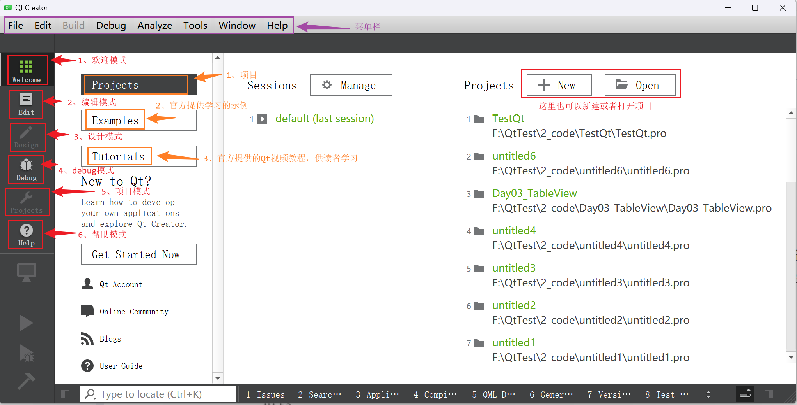

#### 2.2、编辑界面的窗口

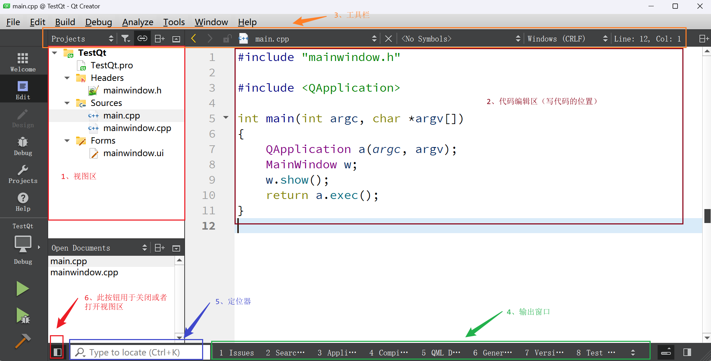

#### 2.3、工具栏中各个按钮作用

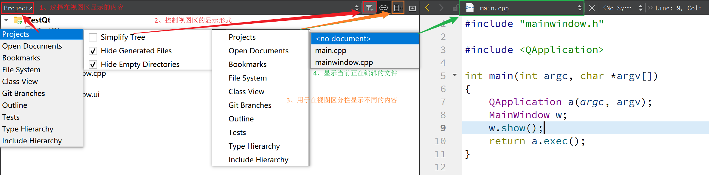

#### 2.4、编辑模式下视图区介绍

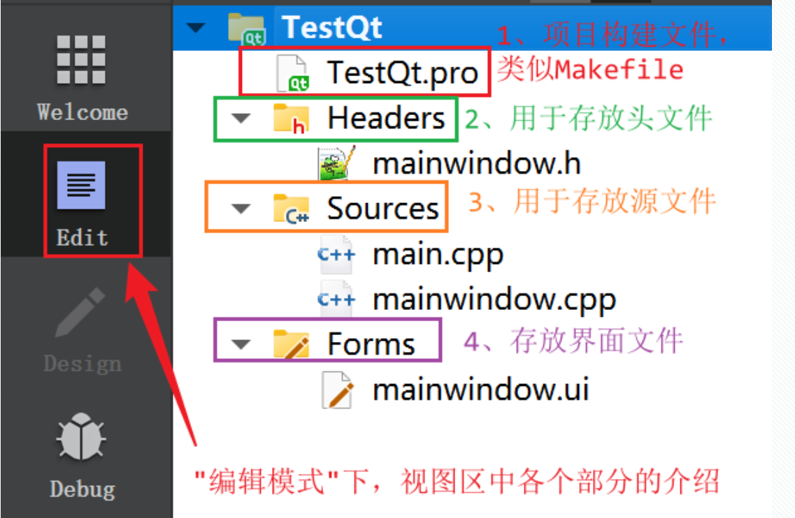


#### 2.5、设计模式下窗口界面介绍

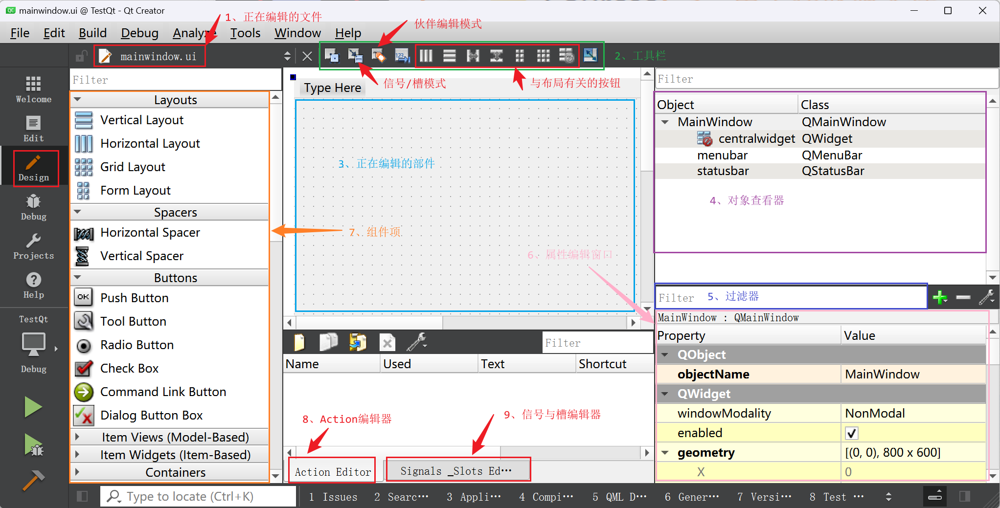

## 四、使用Qt Creator编写Qt程序

1、首先双击Qt Creator软件，然后进入欢迎界面，然后点击"File"->"New File or Project"，然后点击"Application"->"Qt Widgets Application"->"choose"，如下图所示：

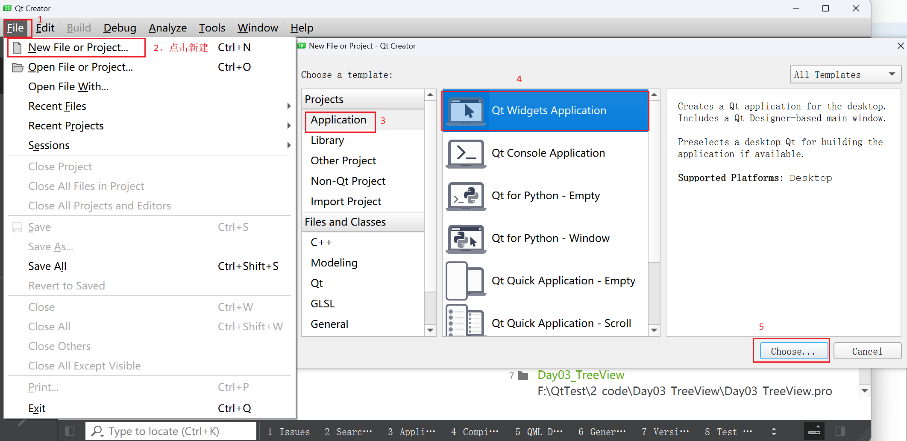

2、设置项目的名字、路径（<span style=color:red;background:yellow>**注意：一定不要有中文以及空格**</span>），然后点击"Next";

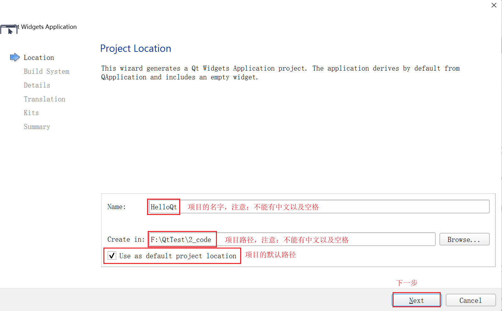

3、选择默认的"qmake"，然后继续点击"Next"，来到类信息窗口，默认可以不修改，直接点击"Next";

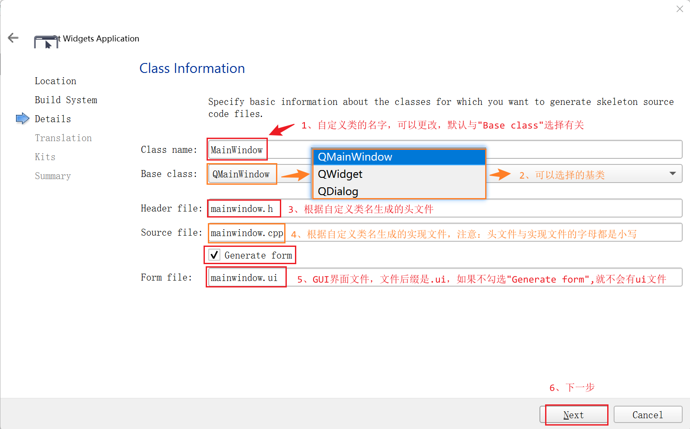

<span style=color:red;background:yellow;font-size:20px>**注意：这里三个基类的名字与作用：**</span>

- QMainWindow：表示主窗口类，它里面会自带菜单栏、工具栏、状态栏、中心部件等元素；
- QWidget：表示最朴素的没有任何额外内容的窗口类；
- QDialog：表示对话框类，它里面会自带一个中心部件，一般用来实现简单的提示信息和用户输入。

4、继续点击"Next"来到"Kits"界面，然后如下图，继续点击"Next";

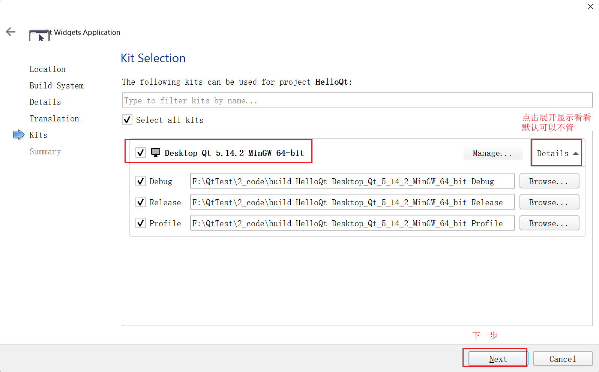

5、来到最后窗口，点击"Finish"完成项目创建；

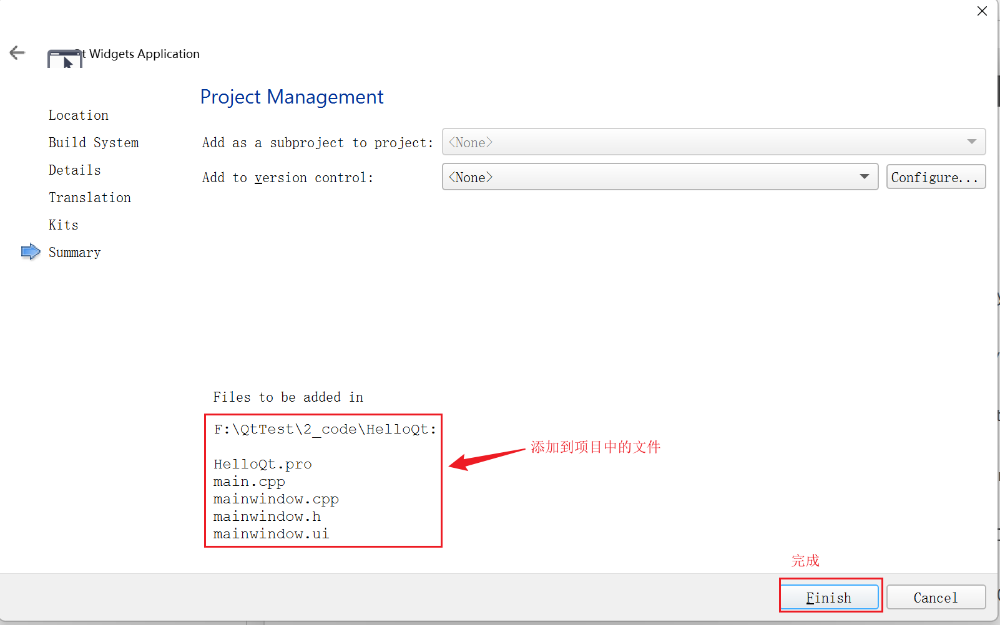

6、运行创建出来的"HelloQt"项目，会出现一个窗口，如下图：

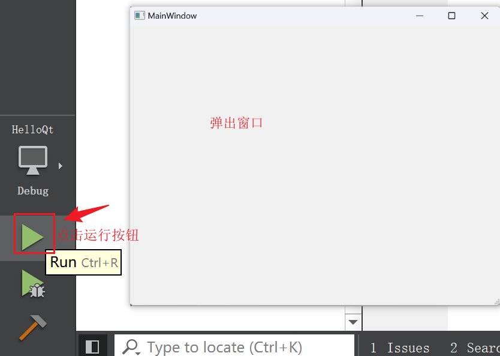

7、视图区几个文件的作用如下（前面介绍过，这里在文字说明一下）：

> - pro文件是项目构建文件，类似于Makefile；
> - Headers目录用来存放所写的头文件；
> - Sources目录用来存放所写的源代码文件；
> - Forms目录存放生成的界面文件，即：ui 文件；

## 五、项目文件pro

<span style=color:red>qmake是Qt提供的一个跨平台的构建工具</span>，在构建项目时，IDE会根据.pro 文件和所在的操作系统生成相应的构建脚本，如Makefile或 Visual Studio项目文件，这样用户就可以进行项目的实际编译和链接。<span style=color:red;background:yellow;font-size:20px>.pro 文件是qmake工具的输入文件，用于描述项目的结构、依赖关系以及构建过程，这个文件包含了源代码文件、头文件、资源文件、库文件等各种构建所需的元素，以及构建选项和配置</span>。我们先来观察一下系统自动生成的 .pro 文件：  

```C++
QT       += core gui

greaterThan(QT_MAJOR_VERSION, 4): QT += widgets

CONFIG += c++11

# The following define makes your compiler emit warnings if you use
# any Qt feature that has been marked deprecated (the exact warnings
# depend on your compiler). Please consult the documentation of the
# deprecated API in order to know how to port your code away from it.
DEFINES += QT_DEPRECATED_WARNINGS

# You can also make your code fail to compile if it uses deprecated APIs.
# In order to do so, uncomment the following line.
# You can also select to disable deprecated APIs only up to a certain version of Qt.
#DEFINES += QT_DISABLE_DEPRECATED_BEFORE=0x060000    # disables all the APIs deprecated before Qt 6.0.0

SOURCES += \
    main.cpp \
    mainwindow.cpp

HEADERS += \
    mainwindow.h

FORMS += \
    mainwindow.ui

# Default rules for deployment.
qnx: target.path = /tmp/$${TARGET}/bin
else: unix:!android: target.path = /opt/$${TARGET}/bin
!isEmpty(target.path): INSTALLS += target
```

从上述文件内容可以看到，pro文件的语法形式为："变量 操作符 值"，比如 QT += widgets，多个值之间使用空格分开； pro 文件的注释从“#”开始，直至本行结束 ，下面对pro语法进行解析。

### 1、操作符如下表

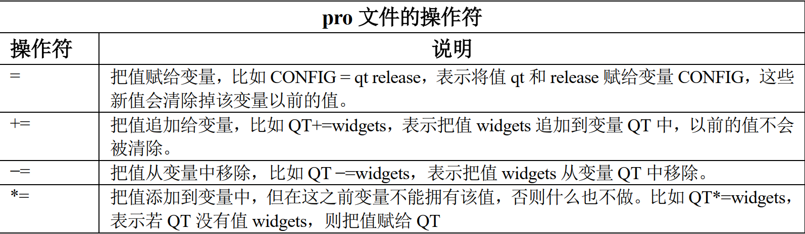

### 2、常见变量如下表

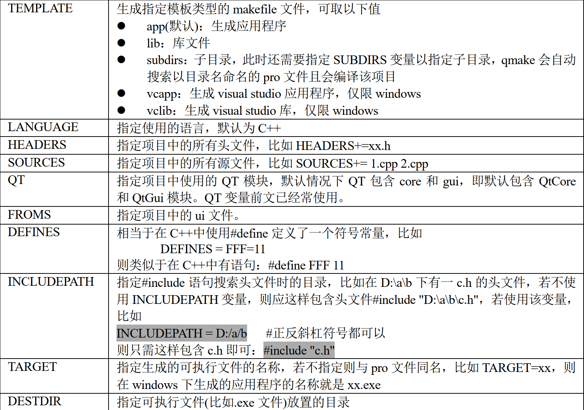

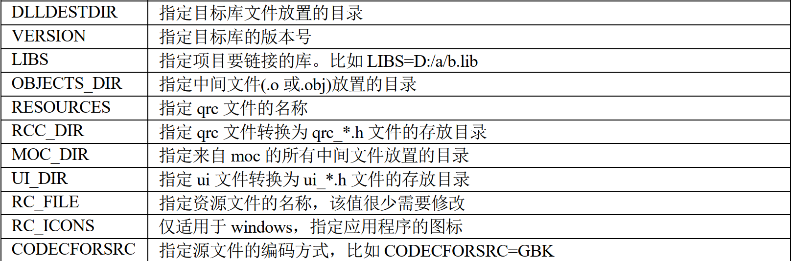

### 3、CONFIG变量

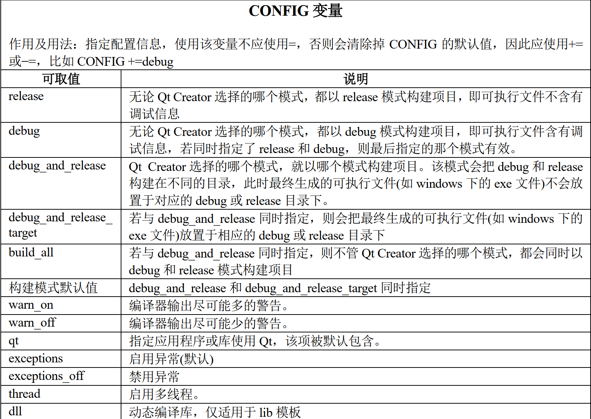

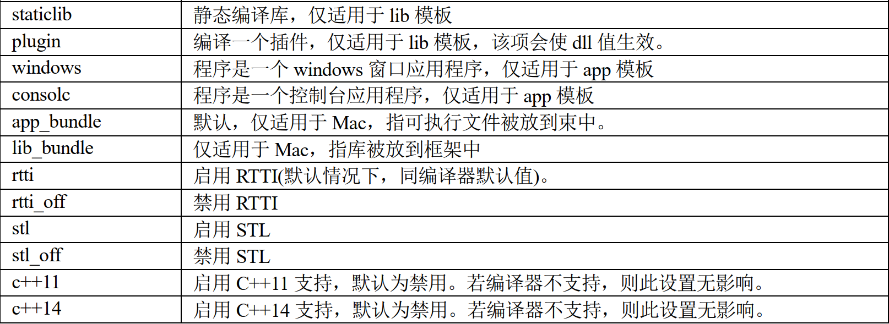

<span style=color:red;background:yellow;font-size:20px>**附加：对pro文件的详细解析如下**</span>

```C++
QT       += core gui  //核心模块、gui图形用户界面模块
#Qt Core:提供了Qt的基本功能（如事件循环、信号槽机制、字符串处理等）
#Qt GUI:提供了与图形相关的功能（如窗口、绘图、图像处理等）

greaterThan(QT_MAJOR_VERSION, 4): QT += widgets
#如果Qt的主版本号大于4，则自动添加Qt Widgets模块的依赖,该模块提供了丰富的GUI控件（如按钮、文本框、对话框等）。
#在Qt5和Qt6中，Widgets模块被从gui模块中分离出来，因此需要显式添加。

CONFIG += c++11
#启用对 C++11 标准的支持；确保编译器使用C++11的语法和特性。

# The following define makes your compiler emit warnings if you use
# any Qt feature that has been marked deprecated (the exact warnings
# depend on your compiler). Please consult the documentation of the
# deprecated API in order to know how to port your code away from it.
DEFINES += QT_DEPRECATED_WARNINGS
#启用对Qt已弃用API的编译警告

# You can also make your code fail to compile if it uses deprecated APIs.
# In order to do so, uncomment the following line.
# You can also select to disable deprecated APIs only up to a certain version of Qt.
#DEFINES += QT_DISABLE_DEPRECATED_BEFORE=0x060000    # disables all the APIs deprecated before Qt 6.0.0
#这是一个被注释掉的选项，表示禁用Qt6.0.0之前的所有已弃用API。如果取消注释，编译器会直接报错，而不是仅仅发出警告，从而强制开发者避免使用这些弃用API。

SOURCES += \
    main.cpp \
    widget.cpp
#列出了项目中的源文件
    
HEADERS += \
    widget.h
#列出了项目中的头文件

# Default rules for deployment.
#如果目标平台是 QNX（嵌入式操作系统），可执行文件将被部署到 /tmp/$${TARGET}/bin
qnx: target.path = /tmp/$${TARGET}/bin 
#如果目标平台是 Unix 系统（不包括 Android），可执行文件将被部署到 /opt/$${TARGET}/bin
else: unix:!android: target.path = /opt/$${TARGET}/bin
#如果target.path不为空，则将target添加到INSTALLS中。
!isEmpty(target.path): INSTALLS += target
```

## 六、Qt5模块架构

### 1、模块分类与介绍

在Qt5中将模块分为3个部分：Qt Essentials(Qt基本模块)、Qt Add-Ons(Qt扩展模块)、Qt Tools(Qt开发工具) 。其中<span style=color:red;background:yellow;font-size:20px>**基本模块**是核心模块，定义了适用于所有平台的基础功能，在Qt5中，它们将保持源代码和二进制兼容</span>，因此所有程序都需要使用基本模块提供的功能(不一定需要使用所有的功能)。其中，基本模块中的QtCore模块是基础，所有其他的Qt模块都要依赖于这个模块。Qt 的基本模块见下面的表格：

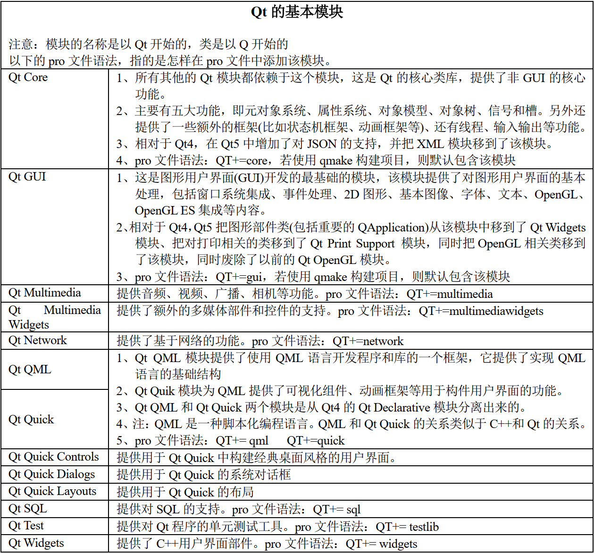

而<span style=color:red;background:yellow;font-size:20px>**扩展模块**是针对某种特定目的的模块，扩展模块可在某个特定平台上使用，或者所有平台上都可使用(但不一定通用)。 </span>

Qt把功能划分为模块，模块中包含众多实现该功能的类，而有些模块又是在某些模块的基础上实现的(即需要使用该模块提供的一部分类)， 由此根据模块之间的相互依赖关系可以绘出Qt模块的框架图。

### 2、各模块间依赖关系简介

- 所有模块都依赖于 Qt Core；
- Qt Test、Qt SQL、Qt Network、Qt GUI 直接依赖于 Qt Core；
- Qt QML 依赖于 Qt Network，而 Qt Quick 又依赖于Qt GUI模块中的OpenGL功能；
- 根据以上依赖关系，可画出如下图所示的 Qt 模块框架图，以下图只是一个简图，主要是为了说明怎样理解模块之间的依赖关系

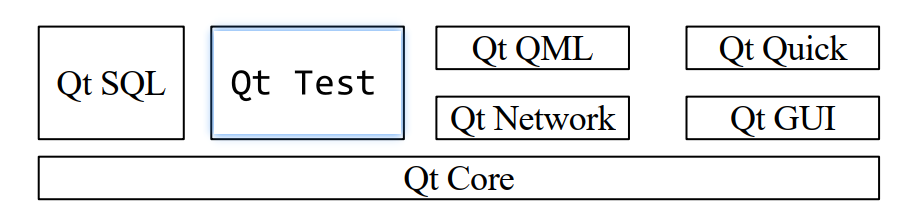
