# Qt部件

## 一、几个常用概念

Qt是跨平台的C++图形用户界面应用程序开发框架，其中一个功能是开发图形用户界面（GUI），而GUI本质就是一堆部件的叠加。我们创建一个窗口，然后将各个部件按照指定的顺序放在窗口上进行布局，这样就形成了一个界面。那么什么是部件、什么是窗口、如何布局部件呢？

### 1、部件和窗口

Qt把建立用户界面的元素称为窗口部件，简称部件，比如：主窗口、对话框、按钮、标签等都称为部件。Qt中部件就是由QWidget 类及其子类创建的对象。

把没有嵌入到其它部件中的部件被称为窗口，通常来说窗口是没有父部件的部件(也可以有父部件，比如一个部件设置了父部件，但是设置 Qt::Window标志，那么该部件也是窗口），因此窗口又被称为顶级部件，与其相对的非窗口部件，称为子部件。 窗口通常含有边框和标题栏(当然也可以没有这些) 。Qt中QDialog和QMainWindow部件，默认为窗口，即使在构造函数中为其指定父部件，仍是窗口。窗口通常会显示在任务栏上。

注意：Qt 中大部分部件都是用作子部件的，比如标签、按钮等。经常被用作窗口的部件是QMainWindow和QDialog的各个子类。下面是窗口的组成：  

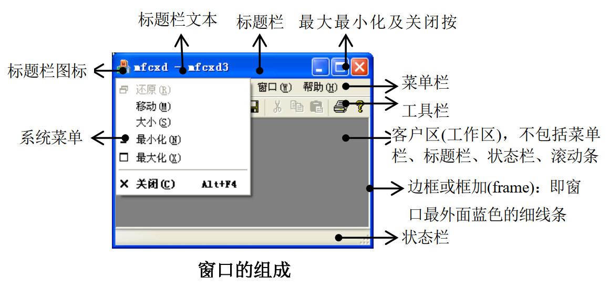

### 2、布局管理器

<span style=color:red>Qt的存局管理类或由这些类创建的对象称为布局管理器，简称布局</span>。在进行GUI设计的时候，会将部件放在窗口中，那么<span style=color:red;background:yellow;font-size:20px>部件到底设置多大、部件放在窗口的哪个位置，两个部件的相对位置、间隔，当向窗口中添加或移除一个部件时，该如何调整，这就需要使用布局管理器进行管理，也就是需要布局</span>


## 二、布局管理器

按照学习的规律，本来应该先学习每个部件是什么，如何使用，最后在来看如何进行布局，但是Qt中的部件太多了，所以我们先以命令按钮部件QPushButton为例，将其进行各种布局，这样在学习其他部件的时候就可以进行布局设置完美的GUI了。Qt中的布局可以使用UI设计器进行布局（也就是创建项目的时候，生成ui文件，然后在ui文件中进行手动设计），比如：

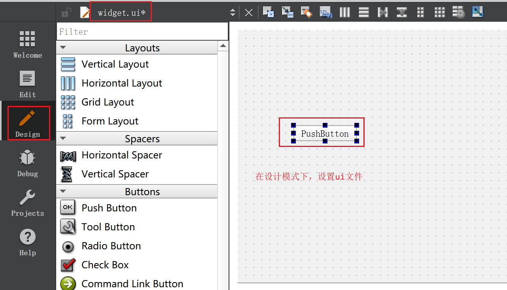


也可以使用代码进行布局（也就是使用代码创建各个部件，然后使用代码将各个部件按照自己的意愿布局）。

### 1、UI设计器进行布局

这种方式非常的简单，就是需要什么部件，就将部件添加到"正在编辑的部件"框中，然后使用"Layouts"下面的各种布局方式进行布局即可，这种方式最大的好处就是简单，快捷，对于设置静态的布局形式非常有利。

比如：现在我们要设置一个静态的登录界面如下图，涉及到的就是标签Label、单行文本框Line Edit、命令按钮Push Button三种部件，每个部件的名字、大小，相对位置，包括窗口标题都可以手动设计。

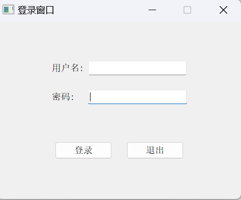

但是如果需要动态增减部件，需要精细控制布局逻辑，那么选择此种方式是非常友好的。

### 2、代码布局

顾名思义，就是使用代码进行部件的创建、设置、布局，这种方式适合比较复杂、精细的、动态的布局形式，当然这种方式是一种比较复杂的方式，我们的课程选择代码布局的形式进行，注意：两种布局形式是可以结合使用的。

#### 2.1、布局管理的继承图

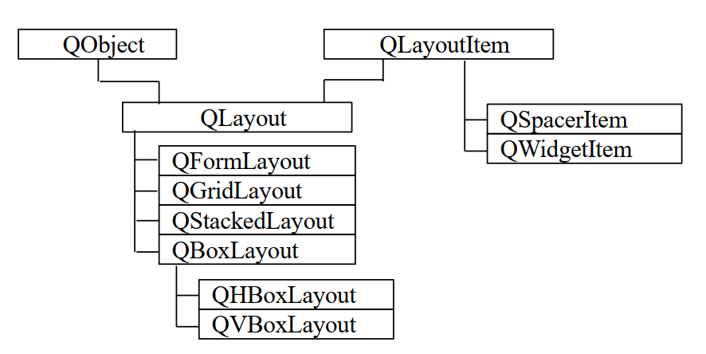

QLayout和QLayoutItem这两个类是抽象类，当设计自定义的布局管理器时才会使用到，通常使用的是由Qt实现的QLayout 的几个子类。由 QHBoxLayout类实现的水平布局、由QVBoxLayout 类实现的垂直布局、由QGridLayout类实现的网格布局 、由QFormLayou 实现的两列表格布局，布局效果如下： 

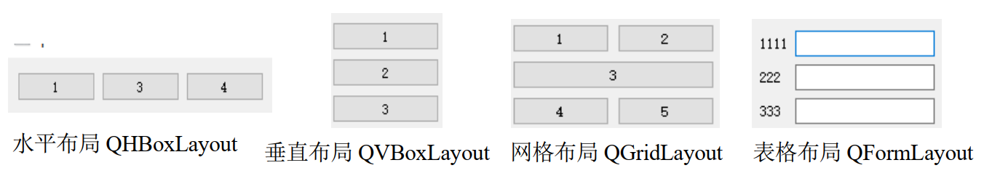

#### 2.2、布局管理器的使用步骤

<span style=color:red;background:yellow;font-size:20px>使用布局管理器的目的就是为了更好的管理部件，而布局管理器的使用步骤如下：</span>

- 首先创建一个布局管理器类的对象;
- 然后使用该布局管理器类中的addWidget()函数，把需要由布局管理器管理的部件添加进来.还可使用addLayout()函数把其他布局管理器添加进来；
- 最后使用QWidget::setLayout()函数为窗口设置布局管理器。

<span style=color:red;background:yellow;font-size:20px>需要注意如下两点</span>

- 若为布局指定了父部件，则可以不使用QWidget::setLayout()函数，反之，调用QWidget::setLayout()函数安装布局，则可以不为该布局指定父部件；
- 不需要为添加到布局中的部件指定父部件，布局中的部件会自动成为安装布局的部件的子部件(使用 QWidget::setParent())。注意：子部件的父部件不是布局，而是安装布局的部件。

#### 2.2、QHBoxLayout类之水平布局

顾名思义，部件按照水平方向进行布局。

```C++
int main(int argc, char *argv[])
{
    QApplication a(argc, argv);
    Widget w;

    //未指定父部件，因为使用了setLayout 函数，该布局是按水平方向排列的部件
    QHBoxLayout *ph = new QHBoxLayout; 
    
    //以下按钮会添加到布局中，所以都未设置父部件。
    QPushButton *pb1 = new QPushButton("按钮1");
    QPushButton *pb2 = new QPushButton("按钮2");
    QPushButton *pb3 = new QPushButton("按钮3");
    QPushButton *pb4 = new QPushButton("按钮4");
    
    ph->addWidget(pb1); //把按钮添加到布局中
    ph->addWidget(pb2);
    ph->addWidget(pb3);
    ph->addWidget(pb4);
    
    w.setLayout(ph); //为窗口 w 安装布局

    w.show();
    return a.exec();
}
```

结果如下

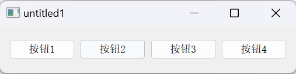

#### 2.3、QVBoxLayout类之垂直布局

顾名思义，部件按照垂直方向进行布局。

```C++
int main(int argc, char *argv[])
{
    QApplication a(argc, argv);
    Widget w;

    //未指定父部件，因为使用了 setLayout 函数，该布局是按垂直方向排列的部件
    QVBoxLayout *pv = new QVBoxLayout; 
    
    //以下按钮会添加到布局中，所以都未设置父部件。
    QPushButton *pb1 = new QPushButton("按钮1");
    QPushButton *pb2 = new QPushButton("按钮2");
    QPushButton *pb3 = new QPushButton("按钮3");
    QPushButton *pb4 = new QPushButton("按钮4");
   
    pv->addWidget(pb1); //把按钮添加到布局中
    pv->addWidget(pb2);
    pv->addWidget(pb3);
    pv->addWidget(pb4);
    
    w.setLayout(ph); //为窗口w安装布局

    w.show();
    return a.exec();
}
```

结果如下：

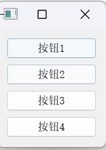


#### 2.4、QGridLayout类之网格布局

也称栅格布局，由行和列组成，能够将部件放入网格的单元格，每个单元格由行和列的索引来定位，每一个部件占一格或多行多列。(将布局格式看成是一个矩阵即可)

##### 2.4.1、常用函数

```C++
//三个添加部件到布局的函数
void QLayout::addWidget(QWidget *w);
//widget:要插入的子布局对象

void QGridLayout::addWidget(QWidget *widget, int row, int column,
                            Qt::Alignment alignment = Qt::Alignment());
//widget:要插入的子布局对象
//row:插入的开始行
//column:插入的开始列
//Qt::Alignment:指定对齐方式
//Qt::AlignLeft  Qt::AlignRight Qt::AlignHCenter Qt::AlignJustify
//Qt::AlignTop  Qt::AlignBottom Qt::AlignVCenter Qt::AlignBaseline

void QGridLayout::addWidget(QWidget *widget, int fromRow, int fromColumn, int rowSpan, int columnSpan,
                            Qt::Alignment alignment = Qt::Alignment());
//widget:要插入的子布局对象
//fromRow:插入的开始行
//fromColumn:插入的开始列
//rowSpan:占用的行数
//columnSpan:占用的列数
//Qt::Alignment:指定对齐方式
//Qt::AlignLeft  Qt::AlignRight Qt::AlignHCenter Qt::AlignJustify
//Qt::AlignTop  Qt::AlignBottom Qt::AlignVCenter Qt::AlignBaseline

//设置行和列的最小尺寸
void QGridLayout::setRowMinimumHeight(int row, int minSize);
void QGridLayout::setColumnMinimumWidth(int column, int minSize);
//row和column: 行和列的索引。
//minSize: 最小尺寸。

//设置行和列的拉伸因子
void QGridLayout::setRowStretch(int row, int stretch);
void QGridLayout::setColumnStretch(int column, int stretch)
//row和column: 行和列的索引。
//stretch: 拉伸因子，值越大，该行或列在窗口调整大小时会优先拉伸

//用于分别设置布局或部件的左、上、右、下四个方向的外边距，可以为不同方向设置不同的边距值。
//可以在布局对象或部件上调用该方法，传入四个参数分别表示左、上、右、下的边距值，单位为像素
void QLayout::setContentsMargins(int left, int top, int right, int bottom);

//设置布局中各个部件之间的间距，即相邻两个部件之间的距离。
//调用时先创建布局对象，然后调用setSpacing方法设置部件间距值，单位为像素。
void QGridLayout::setSpacing(int spacing)

//设置布局
void QWidget::setLayout(QLayout *layout);
```

##### 2.4.2、使用示例

```C++
Widget::Widget(QWidget *parent)
    : QWidget(parent)
{
    QGridLayout *gridLayout = new QGridLayout;
    //通过此函数设置左侧 顶部 右侧 底部边距 主要方便布局周围进行使用
    gridLayout->setContentsMargins(0, 0, 0, 0);
    gridLayout->setSpacing(0);

    QPushButton *btn1 = new QPushButton;
    btn1->setText("第一区：顶部菜单栏选项");
    btn1->setFixedHeight(50);//设置固定高度
    btn1->setSizePolicy(QSizePolicy::Expanding, QSizePolicy::Expanding);//设置大小策略

    QPushButton *btn2 = new QPushButton;
    btn2->setText("第二区：左侧边栏选项");
    btn2->setFixedWidth(200);//设置固定宽度
    btn2->setSizePolicy(QSizePolicy::Expanding, QSizePolicy::Expanding);//设置大小策略

    QPushButton *btn3 = new QPushButton;
    btn3->setText("第三区：底部选项");
    btn3->setFixedHeight(100);//设置固定高度
    btn3->setSizePolicy(QSizePolicy::Expanding, QSizePolicy::Expanding);//设置大小策略

    QPushButton *btn4 = new QPushButton;
    btn4->setText("第四区：中间选项");
    btn4->setFixedHeight(100);//设置固定高度
    btn4->setSizePolicy(QSizePolicy::Expanding, QSizePolicy::Expanding);//设置大小策略

    gridLayout->addWidget(btn1, 0, 1);
    gridLayout->addWidget(btn2, 0, 0, 3, 1);
    gridLayout->addWidget(btn3, 2, 1);
    gridLayout->addWidget(btn4, 1, 2);
        
    setLayout(gridLayout);//设置布局
}
```

##### 2.4.3、运行结果

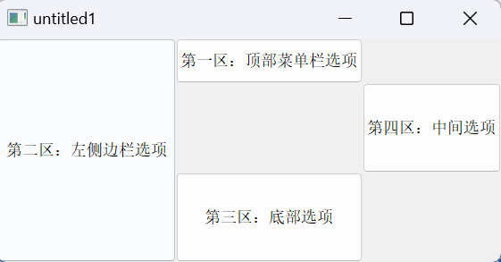

#### 2.5、QFormLayou类之两列表格布局

管理输入型控件和关联的标签组成的Form表单。它是一个方便的布局类，其中的控件以两列的形式被布局在表单中。左列包括标签，右列包含输入控件，例如：QLineEdit、QSpinBox等.

##### 2.5.1、常用函数

```C++
//创建一个带有给定文本的QLabel及QWidget控件行，它们可以自动的设置为伙伴关系。
void QFormLayout::addRow(const QString &labelText, QWidget *field);

//设置换行策略
void QFormLayout::setRowWrapPolicy(QFormLayout::RowWrapPolicy policy);
//policy:参数可以取下述值
//QFormLayout::DontWrapRows 输入框始终在标签旁边
//QFormLayout::WrapLongRows 标签有足够的空间适应，如果最小大小比可用空间大，输入框会被换到下一行
//QFormLayout::WrapAllRows 输入框始终在标签下边

//设置行row所对应的控件，如果role为LabelRole时，设置的为标签所对应的控件;
//如果role为FieldRole时，设置的为输入框所对应的控件。
void QFormLayout::setWidget(int row, QFormLayout::ItemRole role, QWidget *widget);
//QFormLayout::LabelRole		标签
//QFormLayout::FieldRole		输入框
//QFormLayout::SpanningRole   	跨越标签和输入框的控件

//设置间距/水平间距/垂直间距
void QFormLayout::setSpacing(int spacing);
void QFormLayout::setHorizontalSpacing(int spacing);
void QFormLayout::setVerticalSpacing(int spacing);

//设置标签对齐方式
void QFormLayout::setLabelAlignment(Qt::Alignment alignment);
```

##### 2.5.2、使用示例

```C++
Widget::Widget(QWidget *parent)
: QWidget(parent)
{
    //setFixedSize(640, 480);
    setWindowTitle("表单布局测试");

    QFormLayout *formLayout = new QFormLayout(this);
#if 0
    QLineEdit *sid = new QLineEdit(this);
    QLineEdit *name = new QLineEdit(this);
    QLineEdit *school = new QLineEdit(this);
#endif
    QLineEdit *sid = new QLineEdit;
    QLineEdit *name = new QLineEdit;
    QLineEdit *school = new QLineEdit;

    formLayout->addRow("学号", sid);
    formLayout->addRow("姓名", name);
    formLayout->addRow("学校", school);

    formLayout->setSpacing(8);
    //WrapAllRows(上下)/DontWrapRows(左右)/WrapLongRows(自动换行)
    formLayout->setRowWrapPolicy(QFormLayout::DontWrapRows);
    formLayout->setLabelAlignment(Qt::AlignLeft);
}
```

##### 2.5.3、运行结果

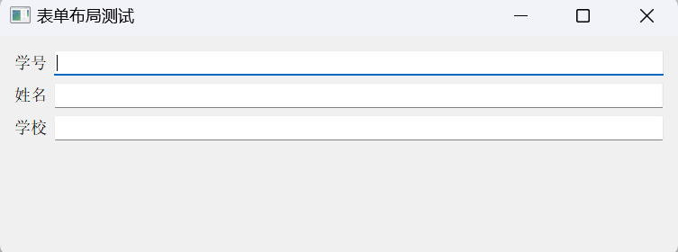

<span style=color:red;background:yellow;font-size:20px>注意：当界面元素为两列和若干行组成的形式时，使用QFormLayout（表格布局）；当界面元素较为复杂时（多行多列），使用栅格布局。</span>


## 三、常用部件

### 1、按钮

Qt中按钮有多种形式，但是按钮都有共同的抽象基类QAbstractButton，该类提供了按钮的通用功能。按钮的继承图如下：

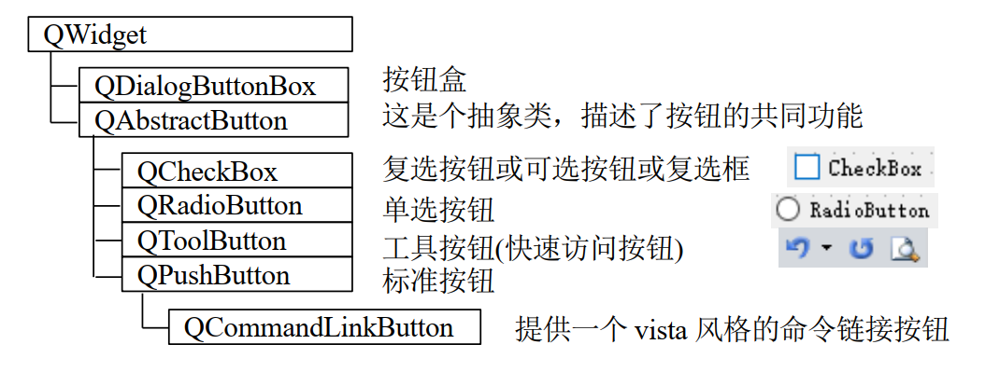

抽象按钮提供如下常用函数

```C++
//按钮是否被选中(即是否处于选中状态)，只有可选中按钮才能被选中。默认未被选中
bool isChecked() const; 
//设置按钮是否选中
void setChecked(bool);

//按钮是否被按下(即是否处于按下状态)。若此属性为true，则按钮被按下。若把此属性设置为true，则不会发送pressed()和 clicked()信号(经测试，仍会发送这些信号)。默认为 false。    
bool isDown()const;
void setDown(bool);

//按钮上显示的图标，
QIcon icon() const; 
void setIcon(const QIcon &);

//按钮上显示的图标的大小。默认大小由GUI样式定义。这是图标的最大大小，较小的图标不会被放大。
QSize iconSize() const; 
void setIconSize(const QSize);

//此方法用于设置按钮的文本内容
void setText(const QString &text);
//此方法用于获取按钮当前的文本内容
QString text() const;
```

抽象按钮提供如下信号

```C++
//鼠标点击按钮然后释放时会发送此信号，注意：按钮释放时才会发送。
//若按钮是可选中的，当按钮被选中时，参数checked为true，若按钮未被选中，则为false。
[signals] void clicked(bool checked = false);

//按下按钮时发送此信号
[signals] void pressed();
//释放按钮时发送此信号
[signals] void released();

//每当可选中按钮切换状态时，都会发送此信号。若按钮被选中，则参数checked为true，若按钮被取消选中，则为false。
[signals] void toggled(bool checked);
```

#### 1.1、QPushButton命令按钮

是最基础的按钮，该按钮可以被鼠标点击，是可点击按钮的核心控件，它是用户界面中最常用的交互元素之一。

##### 1.1.1、常用函数

```C++
//这是构造函数，用于创建一个带有图标、指定文本和父对象的按钮
QPushButton(const QIcon &icon, const QString &text, QWidget *parent = nullptr);

//这是构造函数，用于创建一个带有指定文本和父对象的按钮。
QPushButton(const QString &text, QWidget *parent = nullptr);

//这是构造函数，用于创建一个带有父对象的按钮。
QPushButton(QWidget *parent = nullptr);

//设置按钮是否为平面样式
void setFlat(bool flat)

//检查按钮当前是否为平面样式
bool isFlat() const

//显示按钮，使其可见。
[slot] void QWidget::show();
```

##### 1.1.2、常用辅助函数

| move(int x, int y)                      | 手动指定按钮位于父窗口中的位置。                             |
| :-------------------------------------- | ------------------------------------------------------------ |
| setGeometry(int x, int y, int w, int h) | 同时指定按钮的尺寸和位置                                     |
| adjustSize()                            | 根据按钮上要显示的内容，自动调整按钮的大小                   |
| setDisabled(bool disable)               | 指定按钮是否可以被按下。当 disable 值为 true 时，表示按钮不能被按下，即禁用按钮的功能 |

##### 1.1.3、使用示例

```C++
#include "widget.h"

#include <QPushButton>
#include <QDebug>

Widget::Widget(QWidget *parent)
: QWidget(parent)
{
    //创建普通按钮(命令按钮)
    QPushButton *btn1 = new QPushButton;
    //设置父亲(这样可以显示出来，也可以靠对象树回收)
    btn1->setParent(this);
    //设置按钮的显示文本
    btn1->setText("测试按钮1");
    //移动按钮显示的位置
    btn1->move(100, 100);
    //设置按钮的大小（宽、高）
    btn1->resize(200, 100);
    //添加资源图表
    btn1->setIcon(QIcon(":/Image/wangdao.png"));
    
    //添加菜单
    QMenu *menu = new QMenu(this);
    menu->addAction("选项1");
    menu->addAction("选项2");
    btn1->setMenu(menu);  //点击按钮右侧箭头显示菜单

    //添加信号与槽
    connect(btn1, &QPushButton::clicked, [=](){
        qDebug() << btn1->text();
        qDebug() << "按钮1的横坐标:" << btn1->x()
                 << ",纵坐标:" << btn1->y();
    });

    //创建普通按钮(命令按钮),并执行文本与父亲
    QPushButton *btn2 = new QPushButton("测试按钮2", this);
    //移动按钮显示的位置
    btn2->move(350, 100);
    //设置按钮的大小（宽、高）
    btn2->resize(200, 100);
    //设置扁平
    btn2->setFlat(true);

}
```

##### 1.1.4、显示结果

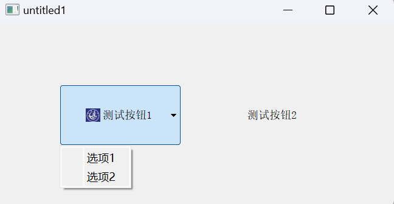

##### 1.1.5、添加资源文件

在Qt项目中经常会使用资源文件，所以就需要添加资源文件，以图片为例，**<span style=color:red;background:yellow;font-size:30px>添加的步骤如下：</span>**

- 右键项目-> Add New(添加新文件)->Qt->Qt Resource File(Qt资源文件)，然后给资源文件取名，如果文件名叫res，就会生成res.qrc；
- 点击项目下的任何一个文件，右键，然后选择"Show in Explorer"打开项目路径，将事先图片文件夹拷贝到项目路径下；
- 点击Resources下的res.qrc，右键"Open in Edit"，点击"Add Prefix"添加前缀（可以修改默认前缀），点击"Add Files"添加资源文件到项目，点击"Build"(左下角的锤子图标)，这样就可以在项目"Resources"资源文件夹下看到新添加的所有图片，资源文件添加成功；
- 后续代码中使用资源文件就可以使用 “冒号 + 前缀名 + 文件名”形式即可。

#### 1.2、QToolButton工具按钮 

QToolButton类提供了用于命令或选项可以快速访问的按钮，通常可以用在QToolBar里面。QToolButton通常只显示一个图标而不显示文本标签（尽管也可以显示文本），并且通常没有边框，在鼠标悬停和按下时的视觉反馈较轻。

##### 1.2.1、常用函数

```C++
//使用指定的父窗口创建一个默认的QToolButton实例
QToolButton(QWidget *parent = nullptr);
    
//设置是否在鼠标指向按钮时自动凸起
void setAutoRaise(bool enable);

//检查按钮是否在鼠标指向时自动凸起
bool autoRaise() const;

//获取工具按钮的弹出菜单模式。
QToolButton::ToolButtonPopupMode popupMode() const;
//枚举：
//ToolButtonPopupMode：枚举类型，定义了工具按钮的弹出菜单模式：
//QToolButton::DelayedPopup：默认模式，长按按钮后延迟弹出菜单。
//QToolButton::MenuButtonPopup：点击按钮箭头图标后立即弹出菜单。
//QToolButton::InstantPopup：点击按钮后立即弹出菜单。

//设置弹出菜单的显示模式，包括延迟弹出（DelayedPopup）、点击箭头立即弹出（MenuButtonPopup）和点击按钮立即弹出（InstantPopup）
void setPopupMode(ToolButtonPopupMode mode)：

//设置按钮的样式
//包括仅显示图标（ToolButtonIconOnly）
//仅显示文本（ToolButtonTextOnly）
//文本在图标右侧（ToolButtonTextBesideIcon）
//文本在图标下方（ToolButtonTextUnderIcon）。
void setToolButtonStyle(Qt::ToolButtonStyle style);

//设置按钮是否显示一个箭头，而不是一个正常的图标  
//type的选择：Qt::NoArrow/Qt::UpArrow/Qt::DownArrow/Qt::LeftArrow/Qt::RightArrow
void setArrowType(Qt::ArrowType type);

//设置按钮的弹出菜单。
void QToolButton::setMenu(QMenu *menu)
```

##### 1.2.2、使用示例

widget.h

```C++
#ifndef WIDGET_H
#define WIDGET_H

#include <QWidget>

class Widget : public QWidget
{
    Q_OBJECT

public:
    Widget(QWidget *parent = nullptr);
    ~Widget();
private slots:
    void onClick();
    void openTest();
    void newTest();
    void onAutoRaiseButtonClicked();
};
#endif // WIDGET_H

```

widget.cc

```C++
#include "widget.h"

#include <QToolBar>
#include <QToolButton>
#include <QDebug>
#include <QMenu>

Widget::Widget(QWidget *parent)
    : QWidget(parent)
{
    setWindowTitle("测试工具按钮");
    resize(640, 480);

    //创建基本工具按钮
    QToolButton *toolButton = new QToolButton(this);
    toolButton->move(100, 50);
    toolButton->resize(150, 40);
    toolButton->setText("工具按钮");
    toolButton->setIcon(QIcon(":/Image/wangdao.png"));
    toolButton->setToolButtonStyle(Qt::ToolButtonTextBesideIcon);

    connect(toolButton, &QToolButton::clicked, this, &Widget::onClick);

    //创建带菜单栏的工具按钮
    QToolButton *menuBtn = new QToolButton(this);
    menuBtn->move(300, 50);
    menuBtn->resize(150, 40);
    menuBtn->setText("菜单按钮");
    menuBtn->setIcon(QIcon(":/Image/wangdao.png"));
    menuBtn->setToolButtonStyle(Qt::ToolButtonTextBesideIcon);

    QMenu *menu = new QMenu(this);
    menu->addAction("打开", this, &Widget::openTest);
    menu->addAction("新建", this, &Widget::newTest);
    menu->addSeparator();
    menu->addAction("退出", this, &Widget::close);

    menuBtn->setMenu(menu);
    menuBtn->setPopupMode(QToolButton::MenuButtonPopup);

    // 创建自动浮起的工具按钮
    QToolButton *autoRaiseBtn = new QToolButton(this);
    autoRaiseBtn->move(100, 200);
    autoRaiseBtn->resize(150, 80);
    autoRaiseBtn->setText("自动浮起按钮");
    autoRaiseBtn->setIcon(QIcon(":/Image/wangdao.png"));
    autoRaiseBtn->setAutoRaise(true);
    autoRaiseBtn->setToolButtonStyle(Qt::ToolButtonTextUnderIcon);
    connect(autoRaiseBtn, &QToolButton::clicked, this, &Widget::onAutoRaiseButtonClicked);
}

Widget::~Widget()
{
}

void Widget::onClick()
{
    qDebug() << "测试点击操作";
}

void Widget::openTest()
{
    qDebug() << "测试打开操作";
}

void Widget::newTest()
{
    qDebug() << "测试新建操作";
}

void Widget::onAutoRaiseButtonClicked()
{
    qDebug() << "自动浮起按钮被点击";
}
```

##### 1.2.3、显示结果

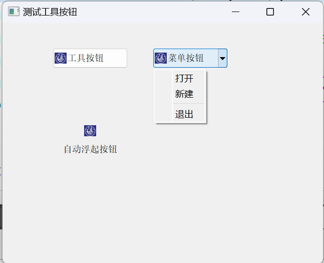


#### 1.3、QRadioButton单选按钮  

QRadioButton部件提供了一个带有文本标签的单选框（单选按钮）。可以切换选中（checked）或未选中（unchecked）状态的选项按钮。单选框通常呈现给用户一个“多选一”的选择。也就是说，在一组单选框中，一次只能选中一个单选框。单选框默认开启自动互斥。

```C++
//每当一个按钮切换选中或未选中状态时，会发出的toggled()信号
[signal] void QAbstractButton::toggled(bool checked);
```

##### 1.3.1、使用示例

```C++
#include "widget.h"

#include <QRadioButton>
#include <QDebug>

Widget::Widget(QWidget *parent)
    : QWidget(parent)
{
    QRadioButton *radio1 = new QRadioButton(this);
    QRadioButton *radio2 = new QRadioButton(this);

    radio1->move(100, 50);
    radio2->move(100, 100);

    radio1->setText("第一个单选按钮");
    radio2->setText("第二个单选按钮");

    radio1->setChecked(true);
    radio2->setChecked(false);

    connect(radio1, &QRadioButton::toggled, [=](){
        qDebug() << "radio1被选中 = " << radio1->isChecked();//查看radio1状态是不是选中
    });
}

Widget::~Widget()
{
}
```

##### 1.3.2、显示结果

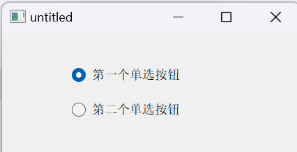

#### 1.4、QCheckBox复选框

##### 1.4.1、常用函数

```C++
//设置复选框的状态是否为三态（tristate），即选中、未选中和其他状态,默认只有两态。
void setTristate(bool y = true);

//当复选框的状态发生改变的时候，会触发该信号
[signal] void QCheckBox::stateChanged(int state)
//state可以取下述值：
//Qt::Unchecked  未选中
//Qt::PartiallyChecked 部分选中
//Qt::Checked  选中
```

##### 1.4.2、使用示例

```C++
//widget.h
#ifndef WIDGET_H
#define WIDGET_H

#include <QWidget>
#include <QCheckBox>

class Widget : public QWidget
{
    Q_OBJECT

public:
    Widget(QWidget *parent = nullptr);
    ~Widget();
public slots:
    void checkBoxState(int state);
private:
    QCheckBox *m_checkBox;

};
#endif // WIDGET_H

//widget.cpp
#include "widget.h"

Widget::Widget(QWidget *parent)
    : QWidget(parent)
{
    m_checkBox = new QCheckBox(this);
    m_checkBox->setText("初始化状态为：Checked状态");

    m_checkBox->move(100, 50);
    //_checkBox->resize(300, 50);
    m_checkBox->setFixedWidth(m_checkBox->sizeHint().width());

    //开启三态模式，必须开启，否则只有两态
    m_checkBox->setTristate();

    connect(m_checkBox, &QCheckBox::stateChanged, this, &Widget::checkBoxState);

}

Widget::~Widget()
{

}

void Widget::checkBoxState(int state)
{
    switch(state)
    {
    case Qt::Checked:
        m_checkBox->setText("按钮被选中");
        break;
    case Qt::Unchecked:
        m_checkBox->setText("按钮没有被选中");
        break;
    case Qt::PartiallyChecked:
        m_checkBox->setText("按钮待选中状态");
        break;
    default:
        break;
    }
}
```

##### 1.4.3、显示结果

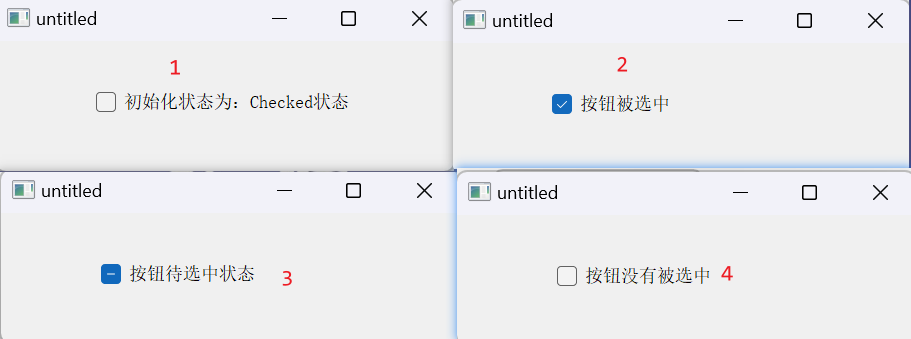

#### 1.5、QCommandLinkButton命令链接按钮  

用于创建命令链接按钮的控件，它结合了文本标签和按钮的功能，非常适合用于需要较大点击区域或视觉上更加引人注目的操作。通过设置描述文本、命令文本、图标和样式表，可以轻松定制按钮的外观和行为。

##### 1.5.1、常用函数

```C++
//构造函数,/构造函数，构造QCommandLinkButton对象，并且显示文本、描述信息以及指定父窗口
QCommandLinkButton(const QString &text, const QString &description, QWidget *parent = nullptr);
//构造函数，构造QCommandLinkButton对象，并且显示文本以及指定父窗口
QCommandLinkButton(const QString &text, QWidget *parent = nullptr);
//使用指定的父窗口创建一个默认的QCommandLinkButton实例
QCommandLinkButton(QWidget *parent = nullptr)

//获取描述信息
QString description() const;
//设置描述信息
void setDescription(const QString &description);
```

##### 1.5.2、使用示例

```C++
#include "widget.h"

#include <QCommandLinkButton>
#include <QUrl>
#include <QDesktopServices>

Widget::Widget(QWidget *parent)
: QWidget(parent)
{
    QCommandLinkButton *clb =
            new QCommandLinkButton("测试命令链接按钮", "点击按钮", this);
    clb->setDescription("用于链接到指定网站");

    clb->move(100, 50);
    clb->resize(300, 100);

    connect(clb, &QCommandLinkButton::clicked, [=](){
        QDesktopServices::openUrl(QUrl("www.baidu.com"));
    });
}
```

##### 1.5.3、显示结果

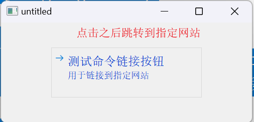

#### 1.6、QDialogButtonBox对话框按钮

QDialogButtonBox是一个放置按钮的盒子，它允许用户添加按钮，并自动按照当前的桌面环境来选择合适的布局。该类包含很多按钮控件，在窗体(widget)或者对话框(dialog)有多个按钮的时候，为方便管理就可以使用该类成组进行管理。当然也可以自行将按钮添加进QDialogButtonBox，它会会自动为用户的桌面环境使用适当的布局。

##### 1.6.1、常用函数

```C++
//添加按钮到具有指定角色的按钮框中
void addButton(QAbstractButton *button, QDialogButtonBox::ButtonRole role);
QPushButton *addButton(const QString &text, QDialogButtonBox::ButtonRole role);
//QDialogButtonBox::ButtonRole的枚举值如下：
//QDialogButtonBox::InvalidRole  无效的角色
//QDialogButtonBox::AcceptRole   表示接受或者确认操作的按钮
//QDialogButtonBox::RejectRole   表示拒绝或者取消操作的按钮
//QDialogButtonBox::DestructiveRole  表示有破坏性操作的按钮，如删除
//QDialogButtonBox::ActionRole   表示具有自定义操作的按钮(非标准按钮，非Yes/Cancel这种)
//QDialogButtonBox::HelpRole    表示具有帮助操作的按钮
//QDialogButtonBox::YesRole     表示具有是操作按钮
//QDialogButtonBox::NoRole      表示具有是否操作按钮
//QDialogButtonBox::ApplyRole   表示具有应用操作按钮
//QDialogButtonBox::ResetRole   表示具有重置操作按钮

QPushButton *addButton(QDialogButtonBox::StandardButton button);
//QDialogButtonBox::StandardButton的枚举值
//QDialogButtonBox::Ok
//QDialogButtonBox::Open
//QDialogButtonBox::Save
//QDialogButtonBox::Cancel
//QDialogButtonBox::Close
//QDialogButtonBox::Discard
//QDialogButtonBox::Apply
//QDialogButtonBox::Reset
//QDialogButtonBox::RestoreDefaults
//QDialogButtonBox::Help
//QDialogButtonBox::SaveAll
//QDialogButtonBox::Yes
//QDialogButtonBox::YesToAll
//QDialogButtonBox::No
//QDialogButtonBox::NoToAll
//QDialogButtonBox::Abort
//QDialogButtonBox::Retry
//QDialogButtonBox::Ignore
//QDialogButtonBox::NoButton

//移除按钮
void removeButton(QAbstractButton *button);
//清除按钮
void clear();

//为按钮框添加标准按钮，入参为StandardButton枚举，可多个（使用|拼接）
void setStandardButtons(StandardButtons buttons);	
//返回该按钮框已添加的标准按钮
StandardButtons standardButtons() const;	
//返回与给定按钮对应的标准按钮枚举值，如果给定按钮不是标准按钮，则返回 NoButton。
StandardButton standardButton(QAbstractButton *button) const;	

//返回一个标准按钮类型的QPushButton按钮对象指针
QPushButton *button(QDialogButtonBox::StandardButton which) const;

//返回指定按钮的按钮角色
QDialogButtonBox::ButtonRole buttonRole(QAbstractButton *button) const;

//返回已添加到按钮框中的所有按钮的对象列表
QList<QAbstractButton *> buttons() const;

//设置按钮框中的按钮居中
void setCenterButtons(bool center);	
//返回钮框中的按钮是否设置了居中
bool centerButtons() const;	

//设置按钮排列方式，Qt::Orientation为枚举:Qt::Horizontal(水平)/Qt::Vertical(垂直)
void setOrientation(Qt::Orientation orientation);	
//获取按钮排列方式
Qt::Orientation orientation() const;	

//信号：
//点击接受按钮时触发
[signal] void QDialogButtonBox::accepted();
//点击请求按钮时触发
[signal] void QDialogButtonBox::helpRequested();
//点击拒绝按钮时触发
[signal] void QDialogButtonBox::rejected();

//点击任意按钮时触发
//点击内部的按钮时会触发，并且信号的参数是点击的按钮。连接这个信号，可以实现不同的功能。
[signal] void QDialogButtonBox::clicked(QAbstractButton *button);
//当按钮的ButtonRole为AcceptRole或者YesRole时，会触发void QDialogButtonBox::accepted()
//当按钮的ButtonRole为RejectRole或者NoRole时，会触发void QDialogButtonBox::rejected()
//当按钮的ButtonRole为HelpRole时，会触发void QDialogButtonBox::helpRequested()
```

##### 1.6.2、使用示例

```C++
//widget.h
#ifndef WIDGET_H
#define WIDGET_H

#include <QWidget>
#include <QDialogButtonBox>
#include <QPushButton>

class Widget : public QWidget
{
    Q_OBJECT

public:
    Widget(QWidget *parent = nullptr);
    ~Widget();
public slots:
    void ondbbppClicked(QAbstractButton *btn);
private:
    QDialogButtonBox *m_dbb;
    QPushButton *m_btn;
};
#endif // WIDGET_H

//widget.cpp
#include "widget.h"

#include <QDebug>

Widget::Widget(QWidget *parent)
    : QWidget(parent)
{
    m_dbb = new QDialogButtonBox(this);
    m_dbb->addButton(QDialogButtonBox::Cancel);
    m_dbb->button(QDialogButtonBox::Cancel)->setText("取消");

    m_dbb->move(100, 50);
    m_dbb->resize(200, 50);

    m_btn = new QPushButton(this);
    m_btn->setText("自定义");
    m_btn->move(250, 50);
    m_btn->resize(100, 50);

    //将m_btn添加到m_dbb中，并且设定ButtonRole为ActionRole
    m_dbb->addButton(m_btn, QDialogButtonBox::ActionRole);

    connect(m_dbb, &QDialogButtonBox::clicked, this, &Widget::ondbbppClicked);
}

Widget::~Widget()
{
}

void Widget::ondbbppClicked(QAbstractButton *btn)
{
    if(btn == m_dbb->button(QDialogButtonBox::Cancel))
    {
        qDebug() << "你已经点击 【取消】 按钮";
    }
    else if(m_btn == btn)
    {
        qDebug() << "你已经点击 【自定义】 按钮";
    }
}
```

##### 1.6.3、显示结果

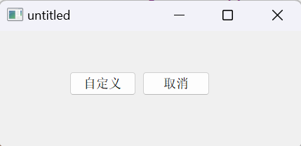

### 2、容器

#### 2.1、QGroupBox组合框

容器控件，主要用于组织和管理一组相关的控件（如按钮、复选框、文本框等），并为这些控件提供一个框架和标题。

##### 2.1.1、使用示例

```C++
#include "widget.h"

#include <QGroupBox>
#include <QPushButton>
#include <QRadioButton>
#include <QCheckBox>
#include <QGridLayout>
#include <QHBoxLayout>
#include <QVBoxLayout>
#include <QBoxLayout>

Widget::Widget(QWidget *parent)
    : QWidget(parent)
{
    //组合框1
    QGroupBox *groupBox1 = new QGroupBox("单选按钮组");
    //创建三个单选按钮
    QRadioButton *radioBtn1 = new QRadioButton("RadisButton1");
    QRadioButton *radioBtn2 = new QRadioButton("RadisButton2");
    QRadioButton *radioBtn3 = new QRadioButton("RadisButton3");

    //设置QGroupBox为垂直布局格式，并将三个单选按钮添加进来
    QVBoxLayout *vBoxLayout1 = new QVBoxLayout;
    vBoxLayout1->addWidget(radioBtn1);
    vBoxLayout1->addWidget(radioBtn2);
    vBoxLayout1->addWidget(radioBtn3);
    groupBox1->setLayout(vBoxLayout1);

    //组合框2：
    QGroupBox *groupBox2 = new QGroupBox("复选按钮组");
    //创建三个单选按钮
    QCheckBox *checkBox1 = new QCheckBox("CheckBox1");
    QCheckBox *checkBox2 = new QCheckBox("CheckBox2");
    QCheckBox *checkBox3 = new QCheckBox("CheckBox3");

    //设置QGroupBox为垂直布局格式，并将三个单选按钮添加进来
    QVBoxLayout *vBoxLayout2 = new QVBoxLayout;
    vBoxLayout2->addWidget(checkBox1);
    vBoxLayout2->addWidget(checkBox2);
    vBoxLayout2->addWidget(checkBox3);
    groupBox2->setLayout(vBoxLayout2);


    //组合框3：
    QGroupBox *groupBox3 = new QGroupBox("组合按钮组");
    //创建三个单选按钮
    QRadioButton *radioBtn11 = new QRadioButton("RadisButton11");
    QRadioButton *radioBtn21 = new QRadioButton("RadisButton21");
    QRadioButton *radioBtn31 = new QRadioButton("RadisButton31");
    QCheckBox *checkBox11 = new QCheckBox("CheckBox11");


    //设置QGroupBox为垂直布局格式，并将三个单选按钮添加进来
    QVBoxLayout *vBoxLayout3 = new QVBoxLayout;
    vBoxLayout3->addWidget(radioBtn11);
    vBoxLayout3->addWidget(radioBtn21);
    vBoxLayout3->addWidget(radioBtn31);
    vBoxLayout3->addWidget(checkBox11);
    groupBox3->setLayout(vBoxLayout3);

    //设置为默认选中
    radioBtn1->setChecked(true);
    checkBox1->setTristate();
    checkBox1->setChecked(true);
    radioBtn11->setChecked(true);
    checkBox11->setChecked(true);

    //将GroupBox控件添加到栅格布局中（多行多列）
    QGridLayout *pGridLayout = new QGridLayout;
    pGridLayout->addWidget(groupBox1, 0, 0, 1, 1);
    pGridLayout->addWidget(groupBox2, 0, 2, 1, 1);
    pGridLayout->addWidget(groupBox3, 1, 1, 1, 1);

    //设置Widget的布局管理器
    setLayout(pGridLayout);
}
```

##### 2.1.2、显示结果

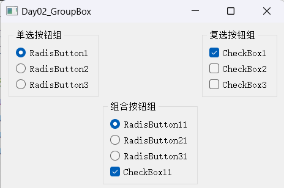

#### 2.2、QScrollArea滚动区域

继承自QAbstractScrollArea类，QScrollArea提供了一个滚动视图的框架，它本身不直接显示内容，而是将内容（通常是一个QWidget或其子类）作为其子项，并通过滚动条来访问这些内容的全部。QScrollArea支持水平和垂直滚动，并且可以根据需要自动调整滚动条的出现。

##### 2.2.1、常用函数

```C++
//获取对齐方式
Qt::Alignment alignment() const;
//Qt::Alignment枚举：
//Qt::AlignLeft       左对齐
//Qt::AlignHCenter    水平居中
//Qt::AlignRight      右对齐
//Qt::AlignTop        顶部对齐
//Qt::AlignVCenter    垂直居中
//Qt::AlignBottom     底部对齐

//设置对齐方式
void setAlignment(Qt::Alignment);

//确保滚动区域中的特定区域（通过x, y坐标指定）是可见的，xmargin和ymargin指定了额外边界以确保区域完全可见
void ensureVisible(int x, int y, int xmargin = 50, int ymargin = 50);

//确保部件可见
void ensureWidgetVisible(QWidget *childWidget, int xmargin = 50, int ymargin = 50);

//设置要显示在滚动区域中的小部件，这个小部件将作为滚动区域的内容。
void setWidget(QWidget *widget);

//设置内部小部件是否可以调整大小以填充滚动区域
void setWidgetResizable(bool resizable);

//删除子控件
QWidget *takeWidget();

//返回当前设置在滚动区域中的小部件。
QWidget *widget() const;

//一个布尔值属性，指示是否允许内部小控件（即内容）的大小随滚动区域的大小变化而调整
bool widgetResizable() const;

//这两个属性控制水平和垂直滚动条的策略
void QAbstractScrollArea::setHorizontalScrollBarPolicy(Qt::ScrollBarPolicy);
void QAbstractScrollArea::setVerticalScrollBarPolicy(Qt::ScrollBarPolicy);
//Qt::ScrollBarPolicy枚举：
//Qt::ScrollBarAlwaysOff     永不显示
//Qt::ScrollBarAlwaysOn      始终显示
//Qt::ScrollBarAsNeeded      根据需要显示
```

##### 2.2.2、使用示例

```C++
#include "widget.h"

#include <QLabel>
#include <QScrollArea>
#include <QGridLayout>
#include <QImage>

Widget::Widget(QWidget *parent)
: QWidget(parent)
{
    QLabel *label = new QLabel;
    //填充比例
    label->setScaledContents(true);

    QImage imag(":/Image/wangdao.png");
    label->setPixmap(QPixmap::fromImage(imag));

    QScrollArea *scrollArea = new QScrollArea;

    scrollArea->setAlignment(Qt::AlignCenter);
   // scrollArea->setWidgetResizable(true);
    scrollArea->setHorizontalScrollBarPolicy(Qt::ScrollBarAlwaysOn);
    scrollArea->setVerticalScrollBarPolicy(Qt::ScrollBarAlwaysOff);

    scrollArea->setWidget(label);

    QGridLayout *gl = new QGridLayout;
    gl->addWidget(scrollArea);

    setLayout(gl);
}
```

##### 2.2.3、显示结果


#### 2.3、QTabWidget标签小控件

它提供了一个**选项卡式**的界面，允许用户通过点击不同的标签页来切换不同的内容区域。它是Qt Widgets 模块的一部分，通常用于创建具有多个页面的应用程序界面。

##### 2.3.1、常用函数

```C++
//添加标签页
int insertTab(int index, QWidget *page, const QString &label);
int insertTab(int index, QWidget *page, const QIcon &icon, const QString &label);
int addTab(QWidget *page, const QString &label);
int addTab(QWidget *page, const QIcon &icon, const QString &label);

//设置标签页的位置：
//QTabWidget::TabPosition枚举：上北下南，左西右东
//QTabWidget::North 默认在上
//QTabWidget::South
//QTabWidget::West
//QTabWidget::East
void setTabPosition(QTabWidget::TabPosition);

//设置标签页位置
//QTabWidget::TabShape是枚举
//QTabWidget::Rounded  原型（默认）
//QTabWidget::Triangular  三角形
void setTabShape(QTabWidget::TabShape s);

//设置标签可关闭
void setTabsClosable(bool closeable);

//设置标签页可移动
void setMovable(bool movable);

//移除标签页
void removeTab(int index);

//信号
//这个信号在当前显示的标签页改变时发出
[signal] void currentChanged(int index);
//当用户点击标签栏中的标签时，这个信号会被发出
[signal] void tabBarClicked(int index);
//当用户双击标签栏中的标签时，这个信号会被发出。
[signal] void tabBarDoubleClicked(int index);
//当用户请求关闭一个标签页时（例如，如果启用了可关闭的标签页），这个信号会被发出
[signal] void tabCloseRequested(int index);
```

##### 2.3.2、使用示例

```C++
#include "widget.h"

#include <QTabWidget>
#include <QGridLayout>
#include <QPushButton>
#include <QLabel>
#include <QLineEdit>
#include <QMessageBox>
#include <QDebug>

Widget::Widget(QWidget *parent)
    : QWidget(parent)
{
    setWindowTitle("Tab Widget测试");
    resize(640, 480);

    QTabWidget *tabWidget1 = new QTabWidget(this);
    tabWidget1->setTabsClosable(true);//显示标签是否关闭
    tabWidget1->setTabPosition(QTabWidget::North);//设置标签页位置
    tabWidget1->setTabShape(QTabWidget::Triangular);//设置标签页形状
    tabWidget1->setMovable(true);//设置标签页可以移动

    tabWidget1->move(100, 50);
    tabWidget1->resize(400, 300);

    bool flag1 = true;
    bool flag2 = true;

    if(flag1)
    {
        QWidget *widget1 = new QWidget;
        tabWidget1->addTab(widget1, "进程");
        //tabWidget1->insertTab(0, widget1, "进程");

        QGridLayout *pgl = new QGridLayout;

        //这两个部件(控件)不会用没有关系，就是很简单的使用
        QLabel *label = new QLabel("请选择文件或者文件夹");
        QLineEdit *lineEdit = new QLineEdit;

        QPushButton *pb = new QPushButton("消息框");
        connect(pb, &QPushButton::clicked, [=]{
            QMessageBox::information(this, "提示", "点击按钮的结果", QMessageBox::Cancel);
        });

        pgl->addWidget(label, 0, 0);
        pgl->addWidget(lineEdit, 0, 1);
        pgl->addWidget(pb, 0, 2);

        widget1->setLayout(pgl);
    }

    if(flag2)
    {
        QWidget *widget2 = new QWidget;
        tabWidget1->addTab(widget2, "性能");

        QGridLayout *pgl = new QGridLayout;
        QPushButton *pb = new QPushButton("消息框按钮");
        pgl->addWidget(pb, 0, 0);
        widget2->setLayout(pgl);
    }

    connect(tabWidget1, &QTabWidget::tabBarDoubleClicked, [=](int idx){
        qDebug() << "idx = " << idx;
    });

    connect(tabWidget1, &QTabWidget::tabCloseRequested, [=](int index){
            tabWidget1->removeTab(index);
    });
}
```

##### 2.3.3、显示结果

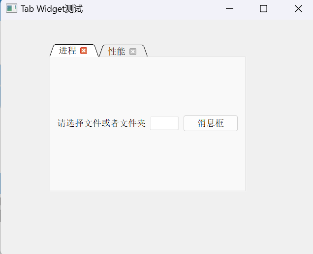

#### 2.4、QFrame框架

重要的控件类，继承自QWidget，是许多基础控件的基类，主要用于在图形用户界面中创建具有边框的框架。它不仅提供了丰富的边框样式、阴影效果和线宽设置，还允许开发者通过子类化来创建自定义的框架样式。

##### 2.4.1、常用函数

```C++
//设置框架矩形
void setFrameRect(const QRect &);

//设置边框形状
void setFrameShape(QFrame::Shape);
//QFrame::Shape枚举类型
//QFrame::NoFrame	  无边框
//QFrame::Box	      标准的矩形边框
//QFrame::Panel	      面板边框，常用于区分界面元素
//QFrame::StyledPanel 使用当前GUI风格的面板边框
//QFrame::WinPanel	  Windows风格的面板边框，建议使用StyledPanel
//QFrame::HLine	      水平线
//QFrame::VLine	      垂直线

//设置边框的阴影效果
void setFrameShadow(QFrame::Shadow);
//QFrame::Shadow枚举值：
//QFrame::Plain	    无阴影，边框和内容在同一平面上(平面)
//QFrame::Raised	边框相对于内容向上凸起
//QFrame::Sunken	边框相对于内容向下凹陷

//同时设置边框的形状和阴影，通过位或操作符(|)连接形状和阴影
void setFrameStyle(int style);

//设置边框的线条宽度，以像素为单位。默认线宽通常为1像素
void setLineWidth(int);

//设置中间线的宽度，仅对Raised或者Sunken的Box、HLine和VLine边框样式有
void setMidLineWidth(int);

//边框的总宽度
int frameWidth() const;
```

样例视图

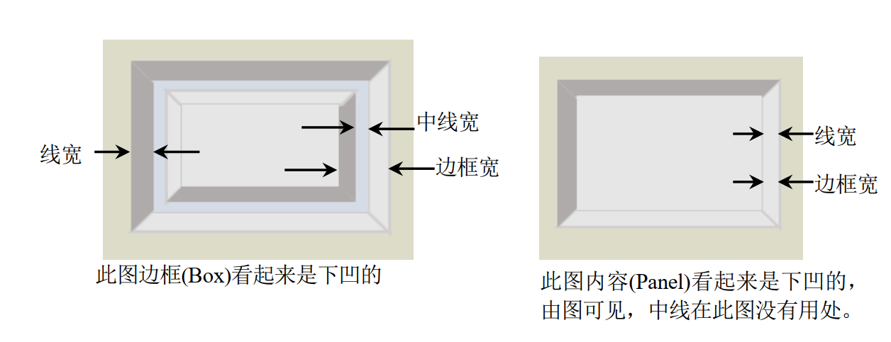

组合效果图

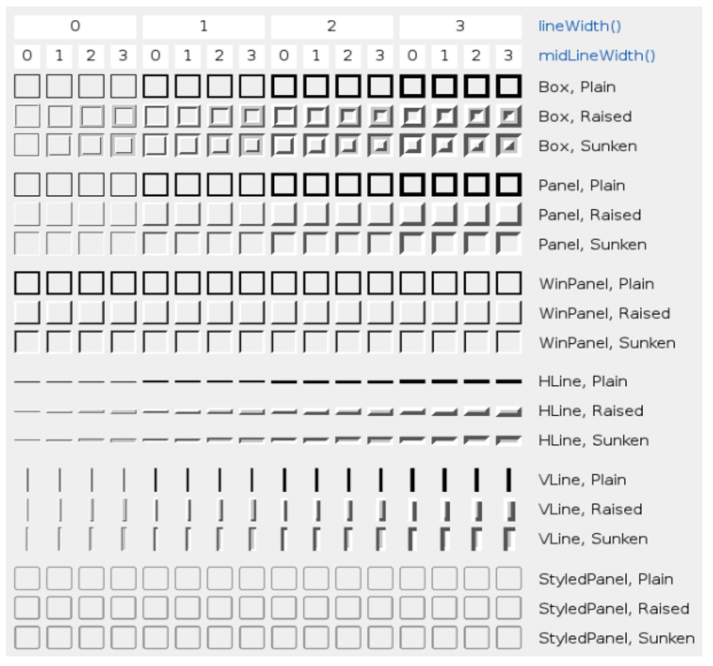

##### 2.4.2、使用示例

```C++
#include "widget.h"

#include <QFrame>

Widget::Widget(QWidget *parent)
    : QWidget(parent)
{
    setWindowTitle("测试frame框架");
    resize(640, 480);

    QFrame *frame1 = new QFrame(this);
    QFrame *frame2 = new QFrame(this);

    frame1->move(100, 50);
    frame1->resize(200, 200);
    //设置样式，当然此处使用这个语法设置背景，目的是看出效果，不然看不出线宽与中线宽
    frame1->setStyleSheet("background-color:yellow");
    //线宽是10
    frame1->setLineWidth(10);
    //中线宽是5
    frame1->setMidLineWidth(5);
    //线框为Box
    frame1->setFrameShape(QFrame::Box);
    //相对于内容是凸起
    frame1->setFrameShadow(QFrame::Raised);

    frame2->move(350, 50);
    frame2->resize(200, 200);
    frame2->setStyleSheet("background-color:green");
    frame2->setLineWidth(10);
    frame2->setMidLineWidth(5);
    frame2->setFrameShape(QFrame::Box);
    frame2->setFrameShadow(QFrame::Sunken);
}
```

##### 2.4.3、显示结果

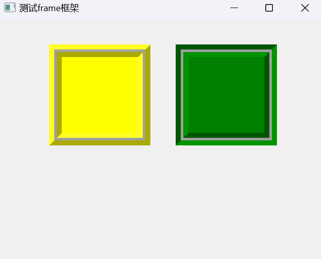


#### 2.5、QDockWidget停靠窗体部件

也叫作浮动窗口或者铆接部件，放置在QMainWindow中央小控件周围的停靠小控件区域中的次要窗口。

##### 2.5.1、常用函数

```C++
//设置QDockWidget可以停靠的区域
void setAllowedAreas(Qt::DockWidgetAreas areas);
//Qt::DockWidgetAreas枚举值：
//Qt::LeftDockWidgetArea
//Qt::RightDockWidgetArea
//Qt::TopDockWidgetArea
//Qt::BottomDockWidgetArea
//Qt::AllDockWidgetAreas
//Qt::NoDockWidgetArea

//设置QDockWidget的功能标志
void setFeatures(QDockWidget::DockWidgetFeatures features);
//QDockWidget::DockWidgetFeatures枚举值
//QDockWidget::DockWidgetClosable          可关闭
//QDockWidget::DockWidgetMovable           可移动
//QDockWidget::DockWidgetFloatable         可漂浮
//QDockWidget::DockWidgetVerticalTitleBar  在左边显示垂直的标签栏
//QDockWidget::AllDockWidgetFeatures       同时具备关闭、移动、漂浮功能
//QDockWidget::NoDockWidgetFeatures        不具备关闭、移动、漂浮功能

//设置QDockWidget是否被浮动（未停靠）
void setFloating(bool floating);

//将给定的QWidget对象设置为QDockWidget的标题栏
void setTitleBarWidget(QWidget *widget);

//将给定的QWidget对象设置为QDockWidget的子部件
void setWidget(QWidget *widget);
```

##### 2.5.2、使用示例

```C++
#include "mainwindow.h"

#include <QDockWidget>
#include <QTextEdit>

MainWindow::MainWindow(QWidget *parent)
: QMainWindow(parent)
{
    //设置浮动窗口或者铆接部件(只有QMainWindow才有这些)
    QDockWidget *dw = new QDockWidget("浮动窗口", this);
    //设置允许停靠的区域
    dw->setAllowedAreas(Qt::AllDockWidgetAreas);
    //设置是否可浮动
    dw->setFloating(true);
    //设置铆接部件（浮动窗口）的特性,可关闭、可移动、可浮动
    dw->setFeatures(QDockWidget::AllDockWidgetFeatures);
    //添加铆接部件到MainWindow窗口
    addDockWidget(Qt::TopDockWidgetArea, dw);

    //设置中心部件
    QTextEdit *cw = new QTextEdit(this);
    cw->setText("中心部件TextEdit");
    setCentralWidget(cw);
}
```

##### 2.5.3、显示结果

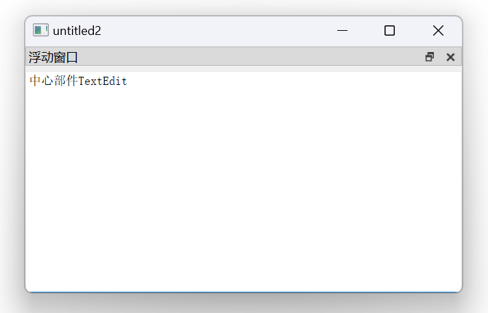

### 3、模型视图架构

在Qt中，模型/视图架构（Model/View Architecture） 是一种用于**分离数据和用户界面的设计模式**。它将数据的存储（模型）与数据的显示（视图）分开，从而提高了代码的可维护性和灵活性。模型/视图架构广泛应用于Qt的GUI开发中，尤其是在处理表格、列表、树等复杂数据结构时。

Qt 的模型/视图框架通过将数据管理、数据显示和用户交互分离，提供了一种灵活、可扩展的设计模式。它的核心原理是**基于信号和槽机制的通用接口设计**，通过模型、视图和委托的协作，实现高效的数据显示和管理。

#### 3.1、模型/视图架构的核心概念

##### 3.1.1 模型（Model）

- 模型负责管理数据，并提供接口供视图和委托（Delegate）访问数据；
- 模型通过信号和槽机制通知视图数据的变化；
- Qt 提供了多种内置模型，如 QStandardItemModel、QStringListModel、QSqlTableModel 等。

##### 3.1.2 视图（View）

- 视图负责显示模型中的数据，并提供用户交互功能（如选择、排序等）；
- 视图从模型中获取数据，并将其显示在用户界面上；
- Qt 提供了多种内置视图，如 QListView、QTableView、QTreeView 等。

##### 3.1.3 委托（Delegate）

- 委托负责数据的编辑和显示样式；
- 委托可以自定义单元格的显示方式和编辑行为；
- Qt 提供了默认的委托QStyledItemDelegate，也可以自定义委托。


#### 3.2、模型/视图架构的类层次结构

##### 3.2.1 模型类

QAbstractItemModel：所有模型的基类；
QStandardItemModel：通用的模型，适合存储任意结构的数据；
QStringListModel：用于存储字符串列表的简单模型；
QFileSystemModel：用于显示文件系统的模型；
QSqlTableModel：用于与数据库交互的模型；

##### 3.2.2 视图类

QAbstractItemView：所有视图的基类；
QListView：用于显示列表数据的视图；
QTableView：用于显示表格数据的视图；
QTreeView：用于显示树形数据的视图；

##### 3.2.3 委托类

QAbstractItemDelegate：所有委托的基类；
QStyledItemDelegate：默认的委托，支持样式化和编辑；
QItemDelegate：功能与 QStyledItemDelegate 类似，但更轻量级；

#### 3.3、模型/视图架构的信号

模型/视图架构通过信号和槽机制实现数据变化的通知和响应。

##### 3.3.1、模型信号

```C++
//当模型数据发生变化时发出
[signal] void QAbstractItemModel::dataChanged(
    const QModelIndex &topLeft
    , const QModelIndex &bottomRight
    , const QVector<int> &roles = ...);
//当插入新行时发出
[signal] void QAbstractItemModel::rowsInserted(
    const QModelIndex &parent
    ,int first, int last);
//当删除行时发出
[signal] void QAbstractItemModel::rowsRemoved(
    const QModelIndex &parent
    , int first, int last)
```

##### 3.3.2、视图信号

```C++
//当用户点击视图中的项时发出
[signal] void QAbstractItemView::clicked(
    const QModelIndex &index);

//当用户双击视图中的项时发出
[signal] void QAbstractItemView::doubleClicked(
    const QModelIndex &index);

//当用户激活视图中的项时发出（例如按下回车键）
[signal] void QAbstractItemView::activated(
    const QModelIndex &index);
```

```C++
void QAbstractItemView::setModel(QAbstractItemModel *model);
//model: 要设置的数据模型，必须是继承自QAbstractItemModel类的实例;同时可以使用类似listWidget->model()作为参数

void QAbstractItemModel::setView(QAbstractItemView *view);
//view: 要设置的视图组件，必须是继承自QAbstractItemView的类的实例。
```

#### 3.4、模型类的使用

##### 3.4.1、QStandardItemModel类

QStandardItemModel是QAbstractItemModel的派生类，用于在Model/View架构中**存储自定义数据的通用模型**，可以用于在任何支持QAbstractItemModel接口的view（例如QListView、QTableView和QTreeView，以及自定义视图）中作为数据存储。

QStandardItemModel可以用作标准Qt数据类型的数据存储Model。QStandardItemModel提供了一种经典的基于项的方法来处理模型中的数据。QStandardItemModel模型中的项对应类型必须为QStandardItem。

```C++
//定义方式
//未指定行数和列数，实际上构造的是一个空的QStandardItemModel对象，后续可以使用appendRow（）、insertRow（）在添加数据项。
QStandardItemModel(parent: QObject = None);
//指定行数和列数的QStandardItemModel对象，但具体数据项同样未初始化，可以通过setItem方法进行初始化。
QStandardItemModel(int rows, int columns, parent: QObject = None);

//数据添加
//使用appendRow、insertRow时，数据项必须是QStandardItem类型，QStandardItem创建时存储的真正数据必须是文本字符串型，其他类型必须先进行类型转换
// 同一个QStandardItem数据项不能在一个视图中添加两次，否则后面一次的调用实际上是没有添加数据项
void appendColumn(const QList<QStandardItem *> &items);
void appendRow(const QList<QStandardItem *> &items);
void appendRow(QStandardItem *item);

void insertColumn(int column, const QList<QStandardItem *> &items);
bool insertColumn(int column, const QModelIndex &parent = QModelIndex());
void insertRow(int row, const QList<QStandardItem *> &items);
void insertRow(int row, QStandardItem *item);
bool insertRow(int row, const QModelIndex &parent = QModelIndex());

//可以使用setItem（）将数据指定到对应的行和列的位置
//该方法将QStandardItemModel对象中对应行和列位置的数据项设置为新的参数item对应项，如果原来未指定项，则相当于数据项初始化，否则就是替换原有数据项
void setItem(int row, int column, QStandardItem *item);
void setItem(int row, QStandardItem *item);

//删除QStandardItemModel对象中对应的数据
//参数row指明要删除的数据行，parent表示要删数据的父节点，对于树形视图来说需要使用，对于链表视图和表格视图用缺省值即可。
bool removeRow(int row, const QModelIndex &parent = QModelIndex());

//信号：
//当项的数据发生变化时发射此信号
[signal] void itemChanged(QStandardItem *item);
//当在指定父项下插入行时发射此信号
[signal] void rowsInserted(const QModelIndex &parent
                           , int first, int last);
//当从指定父项下移除行时发射此信号。
[signal] void rowsRemoved(const QModelIndex &parent
                          , int first, int last);
//当模型的布局发生变化时发射此信号，例如添加、删除或移动项   
[signal] void layoutChanged(
    const QList<QPersistentModelIndex> &parents = ...
    , QAbstractItemModel::LayoutChangeHint hint = ...);
```

##### 3.4.2、QStandardItem类

QStandardItem是Qt框架中QStandardItemModel的一个基础元素，用于在基于项的模型（如QStandardItemModel）中表示单个数据项。QStandardItem可以存储文本、图标、工具提示等丰富的信息，并且支持数据的编辑和自定义显示。通过组织多个QStandardItem，可以构建出复杂的数据结构，如表格或树形结构，这些结构可以通过QTableView、QTreeView等视图控件进行展示。QStandardItem的一个关键特性是它可以包含子项，从而形成一个层次结构。这使得QStandardItem不仅适用于平面表格数据，还适用于需要表示层次关系的数据，如文件系统、组织结构等。

```C++
//设置项是否可以被选中（打勾）
void setCheckable(bool checkable);

//检查项是否可以被选中
bool isCheckable() const;

//设置项的选中状态（Qt::Unchecked、Qt::PartiallyChecked、Qt::Checked）。
void setCheckState(Qt::CheckState state);

//返回项的选中状态。
Qt::CheckState checkState() const

//设置项是否可编辑
void setEditable(bool editable);

//检查项是否可编辑
bool isEditable() const;

//向项的子项列表中添加一行
void appendRow(const QList<QStandardItem *> &items);
void appendRow(QStandardItem *item);

//在指定位置向项的子项列表中插入一行。
void insertRow(int row, const QList<QStandardItem *> &items);
void insertRow(int row, QStandardItem *item);

//从项的子项列表中移除指定行。
void removeRow(int row);

//返回项的子项行数。
int rowCount() const;

//返回项的子项列数（对于顶层项，这通常没有意义，因为顶层项不包含列信息，而是行信息，但子项可以有列）。
int columnCount() const：
```


### 4、项目视图

#### 4.1、List view清单视图

继承自QAbstractItemView，用于以列表形式展示数据模型；支持单列或多列显示、图标视图、流视图等不同的显示模式；适用于需要呈现线性结构的数据列表的情况。

##### 4.1.1、使用示例

```C++
#include "widget.h"
#include "ui_widget.h"

#include <QListView>
#include <QStringListModel>
#include <QMessageBox>

Widget::Widget(QWidget *parent)
    : QWidget(parent)
    , ui(new Ui::Widget)
{
    ui->setupUi(this);

    setWindowTitle("list view 测试");

    QListView *listView = new QListView(this);
    listView->move(100, 100);
    listView->resize(400, 300);

    QStringList qlist;
    qlist << "运动类：篮球、足球"
          << "娱乐类：看电影、写小说、听音乐"
          << "游戏类：五子棋、扑克牌、中国象棋"
          << "旅游类：国外旅游、国内旅游";
    QStringListModel *listMode = new QStringListModel(qlist);
    listView->setModel(listMode);

    connect(listView, &QListView::clicked, [&](const QModelIndex &idx){
        QMessageBox::information(this, "提示", "展示内容" + idx.data().toString());
    });
}
```

##### 4.1.2、显示结果

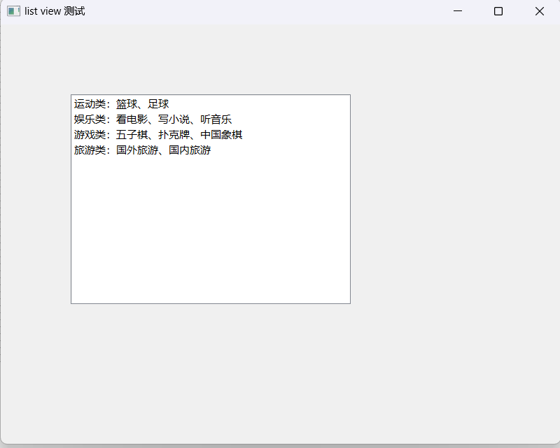

#### 4.2、Tree view树视图

继承自 QAbstractItemView，用于以树状结构展示数据模型；支持展开和折叠节点、排序、多列显示等功能；适用于需要呈现层次化数据结构的情况。

##### 4.2.1、使用示例

```C++
#include "widget.h"

#include <QFrame>
#include <QStandardItemModel>
#include <QTreeView>
#include <QBoxLayout>

Widget::Widget(QWidget *parent)
    : QWidget(parent)
{
    setWindowTitle("测试TreeView");
    resize(600, 500);

    //1、初始化model
    QStandardItemModel *itemMode = new QStandardItemModel(this);

    //2、使用model设置Tree View表头
    itemMode->setHorizontalHeaderLabels(
        QStringList() << QStringLiteral("编号")
        << QStringLiteral("初中部|高中部"));
        
    //3、将TreeView控件载入model
    QTreeView *treeView = new QTreeView(this);
    treeView->setModel(itemMode);

    //创建一级节点，将它加入到itemMode中
    QList<QStandardItem *> itemRoot1;

    QStandardItem *itemNum1 = new QStandardItem(QString::number(1));
    QStandardItem *itemMiddleScholl = new QStandardItem("初中部");
    itemRoot1.append(itemNum1);
    itemRoot1.append(itemMiddleScholl);
    itemMode->appendRow(itemRoot1);

    //添加二级节点，添加到第一个一级节点
    QList<QStandardItem *> itemChild1;
    QStandardItem *itemNum11 = new QStandardItem(QString::number(11));
    QStandardItem *itemFirstGrade = new QStandardItem("一年级");

    itemChild1.append(itemNum11);
    itemChild1.append(itemFirstGrade);
    itemNum1->appendRow(itemChild1);

    //添加三级节点，添加到第一个一级节点下的二级节点
    QList<QStandardItem *> itemGrandson1;
    QStandardItem *itemNum111 = new QStandardItem(QString::number(111));
    QStandardItem *itemClassOne = new QStandardItem("一班");

    itemGrandson1.append(itemNum111);
    itemGrandson1.append(itemClassOne);
    itemNum11->appendRow(itemGrandson1);

    QList<QStandardItem *> itemGrandson2;
    QStandardItem *itemNum122 = new QStandardItem(QString::number(122));
    QStandardItem *itemClassTwo = new QStandardItem("二班");

    itemGrandson2.append(itemNum122);
    itemGrandson2.append(itemClassTwo);
    itemNum11->appendRow(itemGrandson2);

    //创建一级节点，将它加入到itemMode中
    QList<QStandardItem *> itemRoot2;

    QStandardItem *sitem21 = new QStandardItem(QString::number(2));
    QStandardItem *sitem22 = new QStandardItem("高中部");
    itemRoot2.append(sitem21);
    itemRoot2.append(sitem22);
    itemMode->appendRow(itemRoot2);

    //默认展开所有数据
    treeView->expandAll();

    //创建布局管理器对象
    QHBoxLayout *hboxLayout = new QHBoxLayout;
    //将部件添加到布局管理器中
    hboxLayout->addWidget(treeView);
    //设置布局
    setLayout(hboxLayout);
}
```

##### 4.2.2、显示结果

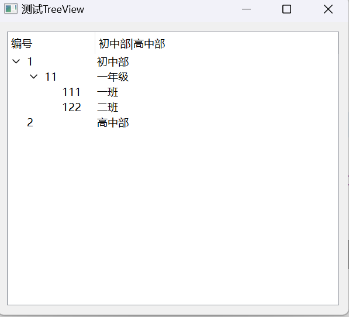

#### 4.3、Table View表视图

继承自 QAbstractItemView，用于以表格形式展示数据模型；支持表格视图的交互操作，如编辑、选择、排序、过滤等；适用于需要呈现二维表格数据的情况

##### 4.3.1、使用示例

```C++
#include "widget.h"

#include <QStandardItemModel>
#include <QVBoxLayout>
#include <QTableView>

Widget::Widget(QWidget *parent)
    : QWidget(parent)
{
    setWindowTitle("Table view测试");
    resize(640, 480);

    QStandardItemModel *mode = new QStandardItemModel;
    //QStandardItemModel *mode = new QStandardItemModel(this);

    QTableView *tableView = new QTableView;
    tableView->setModel(mode);

    //1、添加表头
    mode->setHorizontalHeaderItem(0, new QStandardItem("学号"));
    mode->setHorizontalHeaderItem(1, new QStandardItem("姓名"));
    mode->setHorizontalHeaderItem(2, new QStandardItem("性别"));
    mode->setHorizontalHeaderItem(3, new QStandardItem("分数"));

    //2、 添加数据
    mode->setItem(0, 0, new QStandardItem("191101"));
    mode->setItem(0, 1, new QStandardItem("张三丰"));
    mode->setItem(0, 2, new QStandardItem("男"));
    mode->setItem(0, 3, new QStandardItem("700"));

    mode->setItem(1, 0, new QStandardItem("191103"));
    mode->setItem(1, 1, new QStandardItem("赵敏"));
    mode->setItem(1, 2, new QStandardItem("女"));
    mode->setItem(1, 3, new QStandardItem("748"));

    mode->setItem(2, 0, new QStandardItem("191102"));
    mode->setItem(2, 1, new QStandardItem("杨逍"));
    mode->setItem(2, 2, new QStandardItem("男"));
    mode->setItem(2, 3, new QStandardItem("680"));

    tableView->setEditTriggers(QAbstractItemView::NoEditTriggers);
    mode->sort(3, Qt::AscendingOrder);

    //创建布局管理器对象
    QVBoxLayout *vboxLayout = new QVBoxLayout;
    //添加部件到布局管理器中
    vboxLayout->addWidget(tableView);
    //设置布局
    setLayout(vboxLayout);
}
```

##### 4.3.2、显示结果

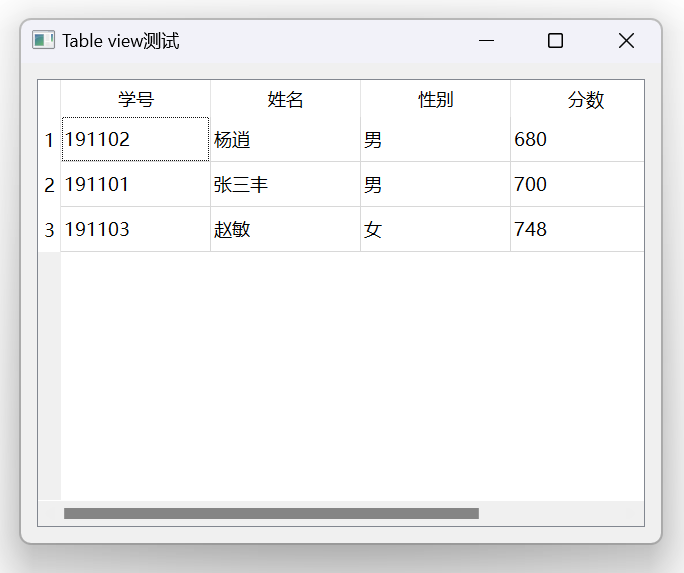

Column View列视图与Undo View撤销命令视图暂时不讲，但是学习方法是一样的。其中QColumnView继承自 QAbstractItemView，用于以列形式展示数据模型，支持多列显示、列间拖拽、排序等功能，适用于需要以列形式展示数据的情况，QTableView和QTreeView 的衍生类。QUndoView继承自QListView，用于提供一个用户界面，让用户能够查看和操作撤销/重做堆栈中的命令，每个命令都被视为树中的一个节点，通常是一个简单的列表（因为大多数撤销/重做堆栈是线性的），但也可以支持更复杂的命令结构（如复合命令）。


### 5、项目部件

用于显示和处理数据的常用部件。适用于表格数据、树形数据和列表数据的展示与交互。

#### 5.1、List Widget列表部件

提供了一个基于项的列表部件，QListWidgetItem是列表中的项。是一个用于显示列表数据的控件，适合展示一维数据（如文件列表、选项列表）。QListWidget是一个便利类，它提供了一个类似于QListView提供的列表视图，但具有用于添加和删除项的经典基于项的接口。QListWidget使用一个内部模型管理列表中的每个QListWidgetItem。

##### 5.1.1、常用函数

```C++
//添加项
void addItem(const QString &label);
void addItem(QListWidgetItem *item);
//添加集合项
void addItems(const QStringList &labels);

//插入项
void insertItem(int row, QListWidgetItem *item);
void insertItem(int row, const QString &label);
//插入集合项
void insertItems(int row, const QStringList &labels);

//当前项
QListWidgetItem *currentItem() const;
//当前行
int currentRow() const;

//如果列表中给定行的元素被设置，则返回对应的元素;否则返回null；
QListWidgetItem *item(int row) const;

//返回包含给定项的行
int row(const QListWidgetItem *item) const;

//返回列表的数量
int count() const;

//移除项
QListWidgetItem *takeItem(int row);

//信号
//每当当前选中项发生变化时，就会发出这个信号
[signal] void currentItemChanged(QListWidgetItem *current, QListWidgetItem *previous);

//每当当前行发生变化时，就会发出这个信号；
[signal] void currentRowChanged(int currentRow);

//每当当前元素发生变化时，就会发出这个信号
[signal] void currentTextChanged(const QString &currentText);

//当项目被激活时，这个信号就会发出。根据系统配置，当用户单击或双击该项目时，该项目将被激活
[signal] void itemActivated(QListWidgetItem *item);

//每当item的数据发生变化时，就会发出这个信号
[signal] void itemChanged(QListWidgetItem *item);

//当鼠标按钮单击部件中的某个项目时，该信号由指定的项目发出
[signal] void itemClicked(QListWidgetItem *item);

//当鼠标按钮双击部件中的某个项目时，该信号由指定的项目发出
[signal] void itemDoubleClicked(QListWidgetItem *item);

//当鼠标光标进入某个元素时，就会发出这个信号。项目就是输入的项目。这个信号只有在mouseTracking被打开，或者鼠标移动到某个元素时按下了鼠标按钮时才会发出
[signal] void itemEntered(QListWidgetItem *item);

//当在部件中的某个项目上按下鼠标按钮时，该信号由指定的项目发出
[signal] void itemPressed(QListWidgetItem *item);

//每当选择发生变化时，就会发出这个信号
[signal] void itemSelectionChanged();
```

##### 5.1.2、QListWidgetItem类

QListWidgetItem表示QListWidget中的单个项目。每个项目都可以包含若干信息，并将适当地显示它们。item view便利类使用经典的基于item的接口，而不是纯粹的model/view方法。要获得更灵活的列表视图部件，请考虑使用标准模型的QListView类。

##### 5.1.3、常用函数

```C++
//返回指定角色的项目数据   
virtual QVariant data(int role) const;

//返回列表项的选中状态
Qt::CheckState checkState() const;
//Qt::CheckState是个枚举
//Qt::Unchecked         未选中
//Qt::PartiallyChecked  部分选中
//Qt::Checked           选中

//返回该项的项标志
Qt::ItemFlags flags() const;

//返回用于显示列表项文本的字体
QFont font() const;

//返回包含项目的列表小部件；
QListWidget *listWidget() const;

//将列表项的检查状态设置为state；
void setCheckState(Qt::CheckState state);

//将给定角色的数据设置为给定的值
virtual void setData(int role, const QVariant &value);

//将列表项的项标志设置为flags
void setFlags(Qt::ItemFlags flags);

//将绘制项目时使用的字体设置为给定的字体
void setFont(const QFont &font);

//将项的选中状态设置为选中
void setSelected(bool select);

//将列表项的状态提示设置为statusTip指定的文本；
void setStatusTip(const QString &statusTip);

//将列表部件项的文本设置为给定的文本
void setText(const QString &text);

//设置列表项的文本对齐方式为alignment
void setTextAlignment(int alignment);

//返回列表项的文本
QString text() const;

//返回传递给QListWidgetItem构造函数的类型
int type() const;

//从流中读取项目
virtual void read(QDataStream &in);

//将项写入流输出
virtual void write(QDataStream &out) const;
```

##### 5.1.4、使用示例

```C++
#include "widget.h"

#include <QListWidgetItem>
#include <QListWidget>
#include <QDebug>
#include <QBoxLayout>

Widget::Widget(QWidget *parent)
: QWidget(parent)
{
    setWindowTitle(" 测试list Widget部件");
    resize(400, 300);

    //第一种方式：使用QListWidgetItem
    //QListWidget中添加的是一个个的项目
    QListWidgetItem *plw = new QListWidgetItem("锄禾日当午");

    //将一个个的小项目添加到控件中
    QListWidget *listWidget = new QListWidget(this);
    listWidget->addItem(plw);
    //设置水平居中
    plw->setTextAlignment(Qt::AlignHCenter);

    //第二种方式：使用addIteams，一次添加多个项目
    QStringList lst;
    lst << "锄禾日当午" << "汗滴禾下土" << "谁知盘中餐" << "粒粒皆辛苦";
    listWidget->addItems(lst);

    //第三种方式：使用addItem一次添加一个字符串(简单直接，但是最low)
    listWidget->addItem("锄禾日当午");
    listWidget->addItem("汗滴禾下土");
    listWidget->addItem("谁知盘中餐");
    listWidget->addItem("粒粒皆辛苦");

    //创建列表小控件项
    QListWidgetItem *item = new QListWidgetItem("Item with icon");
    item->setIcon(QIcon(":/Image/Sunny.jpg"));//显示图标
    item->setFont(QFont("黑体"));//设置字体为黑体
    item->setBackground(Qt::red);//背景色为红色
    listWidget->addItem(item);//控件项添加到ListWidget中

    //点击控件中的条目（每一行）会返回该行的内容
    connect(listWidget, &QListWidget::itemClicked, [](QListWidgetItem *item) {
        qDebug() << "Clicked Item:" << item->text();
        qDebug() << item->font().family().toUtf8().data()
                 << item->font().bold();
    });

    QHBoxLayout *hboxLayout = new QHBoxLayout;
    hboxLayout->addWidget(listWidget);
    setLayout(hboxLayout);
}
```

##### 5.1.5、显示结果

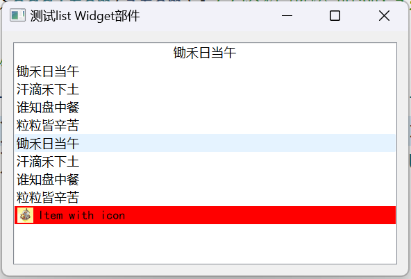

#### 5.2、Tree Widget

提供了一个基于项的树形结构的部件，QTreeWidgetItem是树形列表中的项。QTreeWidget是一个用于显示树形结构的部件，用于展示树形列表项。适合展示层次化数据（如文件目录、组织结构）。支持多列显示，但通常第一列用于显示节点文本，其他列用于显示附加信息。

##### 5.2.1、常用函数

```C++
//用于设置表头标签（列标题）
void setHeaderLabels(const QStringList &labels);

//可以使用addTopLevelItem()函数添加顶层节点。
void addTopLevelItem(QTreeWidgetItem *item);

//使用addChild()函数为节点添加子节点。
void addChild(QTreeWidgetItem *child);

//topLevelItem()函数获取顶层节点，
QTreeWidgetItem *topLevelItem(int index) const;

//通过child()函数获取子节点
inline QTreeWidgetItem *child(int index) const;
    
//获取第一个顶层节点
QTreeWidgetItem *tmp = ui->treeWidget->topLevelItem(0);
//获取第一个顶层节点的第一个子节点
qDebug() << tmp->child(0)->text(0);
//获取第一个顶层节点的第二个子节点
qDebug() << tmp->child(0)->text(1);
```

##### 5.2.2、QTreeWidgetItem类

QTreeWidgetItem是QTreeWidget中用于表示单个节点的类。每个QTreeWidgetItem可以包含多个文本项（对应于列），并且可以有任意数量的子节点。

##### 5.2.3、使用示例

```C++
#include "widget.h"

#include <QTreeWidget>
#include <QTreeWidgetItem>
#include <QDebug>
#include <QBoxLayout>

Widget::Widget(QWidget *parent)
: QWidget(parent)
{
    setWindowTitle(" 测试list Widget部件");
    resize(400, 300);

    //设置水平头
    QTreeWidget *treeWidget = new QTreeWidget;
    treeWidget->setHeaderLabels(QStringList() << "将帅名" << "将帅介绍");

    //设置树形部件项目
    QTreeWidgetItem *weaponryItem = new QTreeWidgetItem(QStringList() << "兵器");
    QTreeWidgetItem *fightItem = new QTreeWidgetItem(QStringList() << "战斗力");
    QTreeWidgetItem *warRecordItem = new QTreeWidgetItem(QStringList() << "战绩");

    //加载顶层的节点
    treeWidget->addTopLevelItem(weaponryItem);
    treeWidget->addTopLevelItem(fightItem);
    treeWidget->addTopLevelItem(warRecordItem);

    //追加子结点
    QStringList heroL1;
    heroL1 << "关羽" << "关二爷，过五关斩六将";
    QTreeWidgetItem *l1 = new QTreeWidgetItem(heroL1);
    weaponryItem->addChild(l1);

    QStringList heroL2;
    heroL2 << "张飞" << "涿郡屠夫，长坂坡一声吼吓退曹操七十万大军";
    QTreeWidgetItem *l2 = new QTreeWidgetItem(heroL2);
    weaponryItem->addChild(l2);

    QStringList heroL3;
    heroL3 << "赵云" << "常山赵子龙，七进七出救阿斗";
    QTreeWidgetItem *l3 = new QTreeWidgetItem(heroL3);
    weaponryItem->addChild(l3);

    QStringList fight1;
    fight1 << "刀斧手" << "战斗力99";
    QTreeWidgetItem *f1 = new QTreeWidgetItem(fight1);
    fightItem->addChild(f1);

    QStringList fight2;
    fight2 << "嘴王" << "战斗力90";
    QTreeWidgetItem *f2 = new QTreeWidgetItem(fight2);
    fightItem->addChild(f2);

    QStringList fight3;
    fight3 << "侍卫" << "战斗力100";
    QTreeWidgetItem *f3 = new QTreeWidgetItem(fight3);
    fightItem->addChild(f3);

    QStringList record1;
    record1 << "站位" << "砍杀华雄";
    QTreeWidgetItem *r1 = new QTreeWidgetItem(record1);
    warRecordItem->addChild(r1);

    QStringList record2;
    record2 << "嘴位" << "死磕吕布";
    QTreeWidgetItem *r2 = new QTreeWidgetItem(record2);
    warRecordItem->addChild(r2);

    QStringList record3;
    record3 << "冲位" << "入曹营如探囊取物";
    QTreeWidgetItem *r3 = new QTreeWidgetItem(record3);
    warRecordItem->addChild(r3);

    //展开所有数据
    treeWidget->expandAll();

    QHBoxLayout *hboxLayout = new QHBoxLayout;
    hboxLayout->addWidget(treeWidget);
    setLayout(hboxLayout);
}

```

##### 5.2.3、显示结果

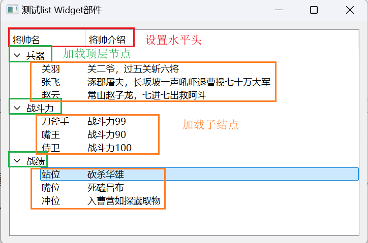

#### 5.3、Table Widget

QTableWidget是Qt框架中的一个重要控件，用于展示和编辑**二维表格数据**。QTableWidget以行和列的形式组织数据，每个单元格由一个QTableWidgetItem对象表示，可以包含文本、图标或其他数据类型。

##### 5.3.1、常用函数

```C++
//设置表格的列数
void setColumnCount(int columns);
//设置表格的行数
void setRowCount(int rows);

//设置单元格，在第row行，第column列设置表格控件内容item
void setItem(int row, int column, QTableWidgetItem *item);

//设置垂直表头标签（行表头）
void setVerticalHeaderLabels(const QStringList &labels);
//设置水平表头标签（列表头）
void setHorizontalHeaderLabels(const QStringList &labels);
```

##### 5.3.2、使用示例

```C++
#include "widget.h"

#include <QTableWidget>
#include <QBoxLayout>

Widget::Widget(QWidget *parent)
: QWidget(parent)
{
    setWindowTitle("测试Table Widget部件");
    resize(640, 480);

    //设置列数
    QTableWidget *tableWidget = new QTableWidget;
    tableWidget->setColumnCount(3);
    //设置水平表头
    tableWidget->setHorizontalHeaderLabels(QStringList() << "姓名" << "性别"<< "年龄");
    //设置行数
    tableWidget->setRowCount(5);

    //设置正文
    QStringList nameList;
    nameList << "刘备" << "关于" << "张飞" << "小乔" << "赵云";

    QStringList sexList;
    sexList << "男" << "男" << "男" << "女" << "男";

    for(int i = 0; i < 5; ++i)
    {
        int col = 0;
        tableWidget->setItem(i, col++, new QTableWidgetItem(nameList[i]));
        tableWidget->setItem(i, col++, new QTableWidgetItem(sexList.at(i)));
        tableWidget->setItem(i, col++, new QTableWidgetItem(QString::number(i+18)));
    }

    QHBoxLayout *hboxLayout = new QHBoxLayout;
    hboxLayout->addWidget(tableWidget);
    setLayout(hboxLayout);
}

```

##### 5.3.3、显示结果

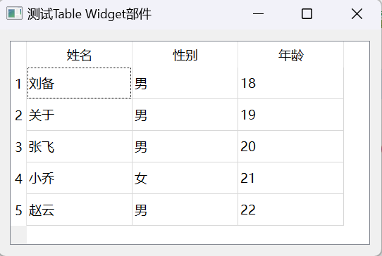

### 6、输入部件

#### 6.1、Combo Box组合框/下拉框

下拉列表框部件，常用于让用户从多个选项中选择一个。它既可以展示文本选项，也可以展示图像和自定义的内容。

##### 6.1.1、常用函数

```C++
//设置大小自动调整策略
void setSizeAdjustPolicy(QComboBox::SizeAdjustPolicy policy);
//QComboBox::SizeAdjustPolicy枚举类型
//QComboBox::AdjustToContents                        根据内容进行调整
//QComboBox::AdjustToContentsOnFirstShow             第一次显示时调整其内容
//QComboBox::AdjustToMinimumContentsLength           请改用AdjustToContent或AdjustToContentsOnFirstShow。
//QComboBox::AdjustToMinimumContentsLengthWithIcon   组合框将调整为最小内容长度加上图标空间。出于性能原因，请在大型模型上使用此策略。

//添加项目
void addItem(const QString &text
             , const QVariant &userData = QVariant());
void addItem(const QIcon &icon, const QString &text
             , const QVariant &userData = QVariant());
void addItems(const QStringList &texts);

//插入条目
void insertItem(int index, const QString &text
                , const QVariant &userData = QVariant());
void insertItem(int index, const QIcon &icon, const QString &text, 
                const QVariant &userData = QVariant());
void insertItems(int index, const QStringList &list);

//删除项
void removeItem(int index);

//获取当前索引和文本
int currentIndex() const;
QString currentText() const;

//设置当前索引项（默认索引项）
void setCurrentIndex(int index);
//设置当前文本项（默认文本项）
void setCurrentText(const QString &text);

//只要组合框中的currentIndex通过用户交互或编程方式发生变化，就会发送此信号
[signal] void QComboBox::currentIndexChanged(int index);
```

##### 6.1.2、使用示例

```C++
#include "widget.h"

#include <QComboBox>
#include <QDebug>

Widget::Widget(QWidget *parent)
: QWidget(parent)
{
    setWindowTitle("测试Combox Box部件");
    resize(640, 480);

    QComboBox *com = new QComboBox(this);
    //自动调整宽度
    com->setSizeAdjustPolicy(QComboBox::AdjustToContents);
    com->move(100, 0);
    com->addItem("北京市");
    com->addItem("上海市");
    com->addItem("天津市");
    com->addItem("重庆市");
    com->addItem("香港特别行政区");
    com->addItem("澳门特别行政区");
    com->addItem("台湾省");
    com->addItem("湖北省");
    com->addItem("江苏省");

    //设置默认索引项，否则选择第0个
    //com->setCurrentIndex(4);

    connect(com, QOverload<int>::of(&QComboBox::currentIndexChanged), 
            [=](int index){
                qDebug() << com->itemText(index).toUtf8().data();
                qDebug() << "index = " << index;
            });
}
```

##### 6.1.3、显示结果

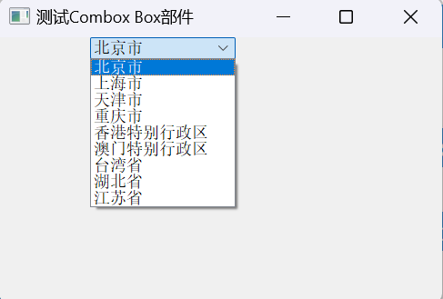

#### 6.2、Font Combo Box字体组合框

QFontComboBox是Qt框架中的一个字体选择类，它提供了一个下拉列表框，用于选择字体。

##### 6.2.1、常用函数

```C++
//当前字体发生变化，就会发送此信号
[signal] void QFontComboBox::currentFontChanged(const QFont &font);
```

##### 6.2.2、使用示例

```C++
#include "widget.h"

#include <QFontComboBox>
#include <QDebug>

Widget::Widget(QWidget *parent)
    : QWidget(parent)
{
    setWindowTitle("测试Font Combo Box部件");
    resize(400, 300);

    QFontComboBox *fontCom = new QFontComboBox(this);
    fontCom->move(100, 0);
    fontCom->setSizeAdjustPolicy(QComboBox::AdjustToContents);

    connect(fontCom, &QFontComboBox::currentFontChanged,
            [=](const QFont &font){
        qDebug() << "字体: " << font.family().toUtf8().data() << endl
                 << "是否加粗: " << font.bold() << endl
                 << "字体大小: " << font.pointSize() << endl
                 << "是否斜体: " << font.italic()<< endl;
    });
}
```

##### 6.2.3、显示结果

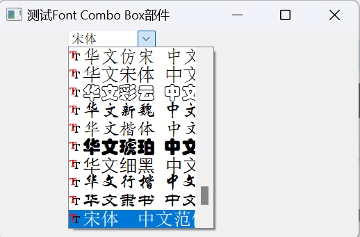

#### 6.3、Line Edit单行编辑框

QLineEdit是Qt框架中的部件，用来表示单行输入框，可以输入一段文本, 但是不能换行，也可以接收和显示单行文本。具有许多功能，包括自动完成、输入限制、密码模式等。它还可以设置最大长度、光标样式、输入校验等。QLineEdit可以被嵌入到其他Qt部件中，如对话框、窗口等。

##### 6.3.1、常用函数

```C++
//返回行编辑框的当前文本内容
QString text() const;

//设置行编辑框的文本内
void setText(const QString &text);

//清空行编辑框的内容
void clear();

//设置文本的回显模式
void setEchoMode(QLineEdit::EchoMode)
//QLineEdit::EchoMode枚举类型
//QLineEdit::Normal               正常显示
//QLineEdit::NoEcho               不要展示任何东西。这可能适用于密码，即使密码的长度也应该保密
//QLineEdit::Password             密码模式，显示占位符字符
//QLineEdit::PasswordEchoOnEdit   编辑时显示实际字符

//设置行编辑框为只读状态，用户无法编辑
void setReadOnly(bool readOnly);

//检查行编辑框是否为只读状态
bool isReadOnly() const;

//设置文本的对齐方式，
void setAlignment(Qt::Alignment flag);
//Qt::Alignment枚举类型
//Qt::AlignLeft
//Qt::AlignRight
//Qt::AlignCenter

//设置占位符文本，当行编辑框为空时显示
void setPlaceholderText(const QString &text);

//设置文本的最大长度
void setMaxLength(int maxLength);

//设置一个验证器来限制用户的输入，例如：QIntValidator、QDoubleValidator或自定义的QValidator
void setValidator(const QValidator &validator);

//设置光标位
void setCursorPosition(int pos);

//返回当前光标位置
int cursorPosition() const;

//选择从start开始的长度为length的文本
void setSelection(int start, int length);

//在光标位置插入文本
void insert(const QString &text);

//获取输入掩码。如果没有设置掩码，inputMask（）将返回一个空字符串。
QString inputMask() const;

//设置输入掩码
void setInputMask(const QString &inputMask)

//信号
//每当光标移动时，就会发出它的信号。旧位置由oldPos给出，新位置由newPos给出
[signal] void QLineEdit::cursorPositionChanged(int old, int new);

//当按返回或者回⻋键时，或者⾏编辑失去焦点时，发出此信号
[signal] void QLineEdit::editingFinished();

//当用户按下不被认为是可接受的输入键时，会发出此信号
[signal] void QLineEdit::inputRejected()；

//当返回或回⻋键按下时发出此信号.如果设置了验证器, 必须要验证通过, 才能触发
[signal] void QLineEdit::returnPressed();

//当选中的⽂本改变时，发出此信号
[signal] void QLineEdit::selectionChanged();

//每当文本发生变化时，都会发出此信号。text参数是新文本。
[signal] void QLineEdit::textChanged(const QString &text);

//每当编辑文本时，都会发出此信号。text参数是新文本
[signal] void QLineEdit::textEdited(const QString &text);
```

##### 6.3.2、使用示例

```C++
#include "widget.h"

#include <QLineEdit>
#include <QPushButton>
#include <QLabel>
#include <QDebug>

Widget::Widget(QWidget *parent)
    : QWidget(parent)
{
    setWindowTitle("测试Line Edit部件");
    resize(640, 480);

    QLineEdit *lineEdit = new QLineEdit(this);
    lineEdit->move(30, 0);
    lineEdit->resize(250, 30);
        
    //设置占位符文本，当行编辑框为空时显示"你的姓名"字样
    lineEdit->setPlaceholderText("你的姓名");

    //设置文本的回显模式
    //QLineEdit::Normal、QLineEdit::Password
    lineEdit->setEchoMode(QLineEdit::Normal);
    //如果设置这行就不允许在文本框中进行输入
    //lineEdit->setReadOnly(true);

    QPushButton *pushBtn = new QPushButton("点击我", this);
    pushBtn->move(300, 0);

    QLabel *label = new QLabel("这是一个很长的文本，用于展示QLabel如何自适应大小。",this);
    label->move(30, 50);
    label->setFrameShape(QFrame::Box);
    //启用文本换行
    label->setWordWrap(true);
    //设置大小策略
    label->setSizePolicy(QSizePolicy::Expanding, QSizePolicy::Expanding);

    connect(pushBtn, &QPushButton::clicked, [=](){
        label->setText("输入的内容是:" + lineEdit->text());
        //调整QLabel的大小以适应文本
        label->adjustSize();
        lineEdit->clear();
    });

    connect(lineEdit, &QLineEdit::cursorPositionChanged,
            [=](int old, int newp){
       qDebug() << "old = " << old;
       qDebug() << "newp = " << newp;
    });

    connect(lineEdit, &QLineEdit::returnPressed, [=]{
       qDebug() << "回车键被按下" ;
    });

    connect(lineEdit, &QLineEdit::textChanged, 
            [=](const QString &text){
       qDebug() << "text = " << text;
    });  
}
```

##### 6.3.3、显示结果

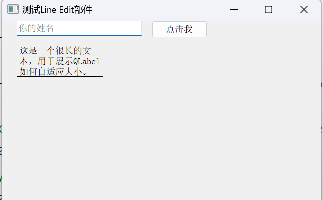

#### 6.4、Text Edit文本编辑框

QTextEdit是Qt提供的一个功能强大的富文本编辑部件，它允许用户输入和编辑包含多种格式的文本，如字体、字号、颜色、段落样式、列表、图片等。它基于 QAbstractScrollArea 类，具备自动换行、滚动条等基本功能，适用于需要复杂文本排版的场景，比如撰写文档、邮件客户端的邮件正文编辑等。

> 富文本（Rich Text）是一种支持格式化和结构化内容的文本。格式化指：粗体、斜体、下划线、删除线、字体、字号、颜色、背景色；结构化内容：段落、列表、表格、对齐方式、缩进。纯文本只能存储字符，富文本还能存储样式。富文本的格式如：html，纯文本格式：txt。

> QTextEdit能够显示的最大字符数实际上是由操作系统的限制决定的，不是由QTextEdit类本身决定的。在Windows中，文本框的最大字符数是由控制台窗口的缓冲区大小决定的，默认情况下是30000个字符，可以通过修改窗口属性来增加缓冲区大小。在Linux和macOS中，控制台窗口的最大字符数取决于系统设置和终端的属性。
>
> 在Qt中，QTextEdit类的文本存储在QTextDocument对象中，QTextDocument对象没有明确的字符数限制，因此可以将任意数量的文本插入到QTextEdit中。但是，当插入大量文本时，可能会导致QTextEdit的性能下降，这可能会影响用户体验。为了避免这种情况，可以使用QPlainTextEdit代替QTextEdit来处理大量纯文本，或者对QTextEdit的文本进行分页或滚动处理，以减少一次性处理大量文本所带来的负担。

##### 6.4.1、常用函数

```C++
//设置文本
void setText(const QString &text);
void insertPlainText(const QString &text);
void setPlainText(const QString &text);

//获取文本
QString toPlainText() const;

//获取光标对象（光标相关概念后面有专栏）
QTextCursor textCursor() const;

//移动光标
void moveCursor(QTextCursor::MoveOperation op
                , QTextCursor::MoveMode mode);

//确保光标可见
void ensureCursorVisible();

//设置光标可见
void setTextCursor(const QTextCursor &cursor);

//插入超链接
[slot] void QTextEdit::insertHtml(const QString &text);
[slot] void setHtml(const QString &text);
//等价于textEdit->textCursor().insertHtml(const QString &text);

//设置文本编辑器是否只读
void setReadOnly(bool ro);

//设置光标的宽度
void setCursorWidth(int width);

//设置文本的对齐方式
[slot] void QTextEdit::setAlignment(Qt::Alignment a);
//Qt::Alignment的枚举
//Qt::AlignLeft
//Qt::AlignRight
//Qt::AlignHCenter
//Qt::AlignJustify

//设置文本的字体
[slot] void QTextEdit::setFontFamily(const QString &fontFamily);

//设置是否斜体
[slot] void QTextEdit::setFontItalic(bool italic);

//设置文本的字号
[slot] void QTextEdit::setFontPointSize(qreal s);

//设置文本的颜色。
[slot] void QTextEdit::setTextColor(const QColor &c);

//设置是否接收用户的富文本插入（默认为true）
void setAcceptRichText(bool accept);

//设置换行模式
void setLineWrapMode(QTextEdit::LineWrapMode mode);
//QTextEdit::LineWrapMode枚举:
//QTextEdit::NoWrap              不换行（默认值），当文本超长时会显示水平滚动条
//QTextEdit::WidgetWidth         按部件宽度换行。在单词边界处自动折行
//QTextEdit::FixedPixelWidth     按固定像素宽度换行，需配合setLineWrapColumnOrWidth指定像素值
//QTextEdit::FixedColumnWidth    按固定字符列数换行，需配合setLineWrapColumnOrWidth指定列数

//该属性表示文本换行的位置，配合文本换行策略lineWrapMode。
int lineWrapColumnOrWidth() const;
//如果换行模式为FixedPixelWidth，则该值是距离文本编辑的左边缘的像素数，文本应该在该位置换行。
//如果换行模式为FixedColumnWidth，则该值是从文本编辑的左边缘开始的列号(以字符列为单位)，文本应该在该列上换行。

//设置固定换行宽度或列数 
void setLineWrapColumnOrWidth(int w)

//保存换行模式，默认模式是WidgetWidth,它导致文字被包装在文本编辑的右边缘。换行发生在空白处，保持整个单词完整。如果你想在单词内换行，使用setWordWrapMode()。如果你设置了FixedPixelWidth或FixedColumnWidth的换行模式，你也应该调用setLineWrapColumnOrWidth()来设置你想要的宽度。
QTextEdit::LineWrapMode LineWrapMode();

//此属性保存QTextEdit在用单词包装文本时将使用的模式,默认情况下，
//此属性设置为QTextOption::WrapAtWordBoundaryOrAnywhere
QTextOption::WrapMode wordWrapMode() const;

//设置单词包装文本模式
void setWordWrapMode(QTextOption::WrapMode policy);
//QTextOption::WrapMode是枚举
//QTextOption::NoWrap
//QTextOption::WordWrap
//QTextOption::ManualWrap
//QTextOption::WrapAnywhere
//QTextOption::WrapAtWordBoundaryOrAnywhere

//信号
//可复制触发信号
[signal] void copyAvailable(bool yes);

//文本格式改变触发信号
[signal] void currentCharFormatChanged(const QTextCharFormat &f);

//光标位置改变触发信号
[signal] void cursorPositionChanged();

//可重做触发信号
[signal] void redoAvailable(bool available);

//选择内容改变触发信号
[signal] void selectionChanged();

//文本改变触发信号
[signal] void textChanged();

//可撤销触发信号
[signal] void undoAvailable(bool available);
```

##### 6.4.2、**QTextCursor类**

是Qt中用于处理文本的类，它提供了一种灵活且强大的方式来操作文本内容，可以轻松地插入、删除、移动和格式化文本，使得文本处理变得更加简单和高效。

```C++
//移动光标的位置
bool QTextCursor::movePosition(QTextCursor::MoveOperation operation, 
                               QTextCursor::MoveMode mode = MoveAnchor,
                               int n = 1);
//参数1:operation：指定光标的移动操作类型，
//QTextCursor::MoveOperation常用的枚举值如下:
//QTextCursor::NoMove	不执行任何移动。
//QTextCursor::Start	移动到文档的开头。
//QTextCursor::StartOfLine	移动到当前行的开头。
//QTextCursor::StartOfBlock	移动到当前块的开头。
//QTextCursor::PreviousBlock	移动到前一个块。
//QTextCursor::NextBlock	移动到下一个块。
//QTextCursor::Up	在上方移动光标。
//QTextCursor::Down	在下方移动光标。
//QTextCursor::Left	向左移动光标。
//QTextCursor::Right	向右移动光标。
//QTextCursor::WordLeft	向左移动到前一个单词的开头。
//QTextCursor::WordRight	向右移动到下一个单词的开头。
//QTextCursor::End	移动到文档的末尾。
//QTextCursor::EndOfLine	移动到当前行的末尾。
//QTextCursor::EndOfBlock	移动到当前块的末尾。
//QTextCursor::NextWord	移动到下一个单词。
//QTextCursor::PreviousWord	移动到前一个单词。
//QTextCursor::NextCell	移动到下一个单元格（在表格中）。
//QTextCursor::PreviousCell	移动到前一个单元格（在表格中）。
//QTextCursor::NextRow	移动到下一行（在表格中）。
//QTextCursor::PreviousRow	移动到前一行（在表格中）。
//QTextCursor::NextTable	移动到下一个表格。
//QTextCursor::PreviousTable	移动到前一个表格。
//QTextCursor::NextSection	移动到下一节（在大纲视图模式下）。
//QTextCursor::PreviousSection	移动到前一节（在大纲视图模式下）。
//QTextCursor::StartOfDocument	移动到文档的开始。
//QTextCursor::StartOfHistory	移动到历史记录的开始。
//QTextCursor::EndOfSelectableContent	移动到可选内容的末尾。
//QTextCursor::StartOfSelectableContent	移动到可选内容的开始。

//参数2:mode：指定光标的移动模式。
//QTextCursor::MoveMode可选值为：
//QTextCursor::MoveAnchor：仅移动光标位置，不改变选区。
//QTextCursor::KeepAnchor：移动光标时保留锚点，从而创建或扩展选区。默认值为MoveAnchor。

//参数3:n：指定移动的次数（默认为 1）。
    
//将现有文本的格式与新的格式进行合并    
void QTextCursor::mergeCharFormat(const QTextCharFormat &format);
//format：指定要合并的字符格式，类型为QTextCharFormat.
//QTextCharFormat是一个用于描述字符格式的类，支持以下常见属性：
//字体（setFont()、setFontFamily()、setFontPointSize() 等）;
//颜色（setForeground()、setBackground()）;
//样式（setFontWeight()、setFontItalic()、setFontUnderline() 等）。
//其他属性（如文本背景色、下划线颜色等）

//返回光标位置之前的字符格式
QTextCharFormat charFormat() const;
```

##### 6.4.3、QTextCharFormat类

字体格式类，继承自QTextFormat类，用来存储字体、字号、加粗、倾斜、下划线、颜色等属性的类 ，它通常用于QTextDocument或QTextCursor中，以设置或修改文本的格式。如设置文本的字符格式，如字体、颜色、对齐方式、段落样式等。

```C++
//构造函数
QTextCharFormat(); 

//返回文本格式的超链接
QString QTextCharFormat::anchorHref() const;

//返回锚点名称（命名锚点是HTML文档中的一个标记点（定位标识），允许用户通过超链接直接跳转到页面内的特定位置（类似于书签））
//锚点:指向当前页面内的特定位置（通过id或name标记）,如下：“top"与"section1"就是锚点
//<a name="top"></a>
//<h1>Document Title</h1>
//<p>Scroll down to <a href="#section1">Section 1</a></p>
//<h2 id="section1">Section 1</h2>
QStringList QTextCharFormat::anchorNames() const;
 
//返回此字符格式的字体
QFont QTextCharFormat::font() const;

//设置字体
void setFont(const QFont &font);

//设置字体家族
void setFontFamily(const QString &family); 

//设置字体大小。
void setFontSize(int size);

//设置字体粗细
void setFontWeight(int weight);

//设置字体是否倾斜。
void setFontItalic(bool italic);

//字体是否带下划线
void setFontUnderline(bool underline);

//字体是否带删除线
void setFontStrikeOut(bool strikeOut);

//设置前景色（文本颜色）。
void setForeground(const QBrush &brush);

//设置背景色
void setBackground(const QBrush &brush);

//设置文本描边样式
void setTextOutline(const QPen &pen);

//设置下划线颜色
void setTextUnderlineColor(const QColor &color);

//设置文本垂直对齐方式。
void setTextVerticalAlignment(Qt::Alignment alignment);
 
//设置是否为锚点。
void setAnchor(bool anchor);

//设置锚点链接
void setAnchorHref(const QString &href);

//设置锚点名称。
void setAnchorNames(const QStringList &names);

//设置工具提示
void setToolTip(const QString &toolTip);

//设置字母大小写
void setFontCapitalization(QFont::Capitalization caps);
//QFont::Capitalization枚举类型如下
//QFont::MixedCase     正常显示
//QFont::AllUppercase  全大写展示
//QFont::AllLowercase  全小写展示
//QFont::SmallCaps     小写展示
//QFont::Capitalize    每个单词的第一个字符都是大写字符

//设置字母间距
void setFontLetterSpacing(qreal spacing);

//设置单词间距
void setFontWordSpacing(qreal spacing);
```

##### 6.4.4、使用示例

```C++
#include "widget.h"

#include <QTextEdit>
#include <QDebug>
#include <QPixmap>
#include <QImage>
#include <QDesktopServices>

Widget::Widget(QWidget *parent)
    : QWidget(parent)
{
    setWindowTitle("测试Text Edit部件");

    //创建QTextEdit对象，并设置大小
    QTextEdit *textEdit = new QTextEdit(this);
    textEdit->resize(700, 500);

    //设置文本内容
    textEdit->setText("This is a text editor.");
    //textEdit->insertPlainText("This is a text editor.");

    //获取文本内容
    QString txt = textEdit->toPlainText();
    qDebug() << "txt = " << txt;

    //格式化文本
    QTextCursor cursor = textEdit->textCursor();
    //将光标移动到文档的开头
    cursor.movePosition(QTextCursor::Start);
    //将光标向右移动到下一个单词的开头并保留锚点
    cursor.movePosition(QTextCursor::WordRight, QTextCursor::KeepAnchor);

    //设置文本格式
    QTextCharFormat format;
    //设置字体粗细
    format.setFontWeight(QFont::Bold);
    //将现有文本的格式与新的格式进行合并
    cursor.mergeCharFormat(format);

    //创建图片对象并插入
    QPixmap pixmap(":/Image/duck.gif");
    textEdit->textCursor().insertImage(pixmap.toImage());
    //QImage ima(":/Image/wangdao.png");
   // textEdit->textCursor().insertImage(ima);
}
```

##### 6.4.5、显示结果

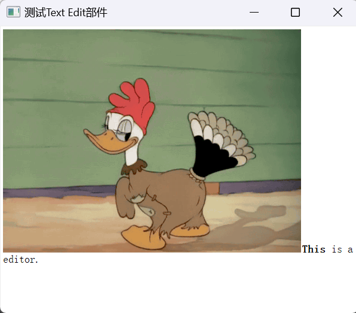

注意：对于QTextEdit类而言，默认不处理超链接交互，所以要处理超链接，要么使用QTextBrowser类（后面会讲），要么手动监听点击事件并调用浏览器打开链接（这个事件系统相关的概念，在事件系统章节会学习其原理）。

##### 6.4.6、使用示例

```C++
//widget.h
#ifndef WIDGET_H
#define WIDGET_H

#include <QWidget>

class Widget : public QWidget
{
    Q_OBJECT

public:
    Widget(QWidget *parent = nullptr);
    ~Widget();
    //重写事件过滤器
    bool eventFilter(QObject *obj, QEvent *event) override;
};
#endif // WIDGET_H

//widget.cpp
#include "widget.h"

#include <QTextEdit>
#include <QDesktopServices>
#include <QMouseEvent>

Widget::Widget(QWidget *parent)
    : QWidget(parent)
{
    //创建QTextEdit对象，并设置大小
    QTextEdit *textEdit = new QTextEdit(this);
    textEdit->resize(700, 500);

    //插入超链接
    textEdit->setReadOnly(true);
    textEdit->insertHtml("<a href='https://www.baidu.com/'>Click here</a> to visit our website.");
    //textEdit->setHtml("<a href='https://www.baidu.com/'>Click here</a> to visit our website.");

    textEdit->viewport()->installEventFilter(this);
}

//QTextEdit需要安装事件过滤器，QTextEdit默认不处理超链接交互，
//需手动监听点击事件并调用浏览器打开链接
bool Widget::eventFilter(QObject *obj, QEvent *event)
{
    if(event->type() == QEvent::MouseButtonPress)
    {
        QTextEdit *textEdit = qobject_cast<QTextEdit*>(obj->parent());
        if(textEdit)
        {
            QMouseEvent *mouseEvent = dynamic_cast<QMouseEvent*>(event);
            QTextCursor cursor = textEdit->cursorForPosition(mouseEvent->pos());
            if (cursor.charFormat().isAnchor())
            {
                QDesktopServices::openUrl(QUrl(cursor.charFormat().anchorHref()));
                return true;
            }
        }
    }
    return QWidget::eventFilter(obj, event);
}
```

##### 6.4.7、显示结果

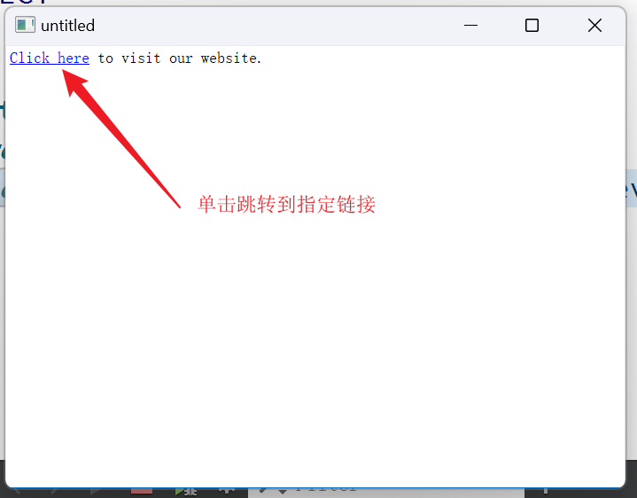

#### 6.5、Plain Text Edit多行文本编辑器 

QPlainTextEdit是Qt中的一个轻量级的文本编辑部件，它专注于纯文本的输入和编辑，不支持QTextEdit 中的复杂富文本格式，如字体样式、段落对齐之外的高级排版、图片插入等。但正因为其简洁性，它在性能上更具优势，适用于处理大量纯文本的场景，如代码编辑器、日志查看器、简单的文本输入框等。

##### 6.5.1、常用函数

```C++
//设置文本内容
[slot] void setPlainText(const QString &text);

//获取当前文本内容
QString toPlainText() const;

//在文本末尾插入文本
[slot] void appendPlainText(const QString &text);

//在当前光标位置插入文本
[slot] void insertPlainText(const QString &text);

//复制选中的文本 
void copy();

//粘贴复制的文本
void paste();

//剪切选中的文本
void cut();

//撤销上一次操作
void undo();

//重做上一次操作
void redo();

//清除编辑器内容
void clear();

//设置QTextEdit是否为只读模式。在只读模式下，用户无法编辑文本内容
void setReadOnly(bool bo);

//设置部件与用户输入的交互方式。例如，可以设置为只允许通过鼠标选择文本，或允许用户输入并编辑文本等。
void setTextInteractionFlags(Qt::TextInteractionFlags flags);
//Qt::TextInteractionFlags是枚举类型：
//Qt::NoTextInteraction           无法与文本进行交互
//Qt::TextSelectableByMouse       文本可以用鼠标选择，并使用上下文菜单或标准键盘快捷键复制到剪贴板
//Qt::TextSelectableByKeyboard    可以用键盘上的光标键选择文本,显示文本光标。
//Qt::LinksAccessibleByMouse      链接可以用鼠标突出显示和激活
//Qt::LinksAccessibleByKeyboard   可以使用选项卡聚焦链接，并使用enter激活链接
//Qt::TextEditable                文本完全可编辑
//Qt::TextEditorInteraction       文本编辑器的默认设置
//Qt::TextBrowserInteraction      QTextBrowser的默认设置

//设置占位符文本(没有输入内容时，本函数设置的文本会被默认显示)
void setPlaceholderText(const QString &placeholderText);

//设置是否按下Tab键切换文本框焦点
void setTabChangesFocus(bool b);

//设置按下Tab键时插入制表符的间隔距离(单位是像素)
void setTabStopDistance(qreal distance);

//设置部件包含的最大块数（即行数）。当文本块的数量超过此限制时，最旧的文本块会被删除，以便为新的文本块腾出空间。
//这在处理大量文本时非常有用，可以防止内存占用过高
void setMaximumBlockCount(int maximum);

//设置换行模式
void setLineWrapMode(QTextOption::WrapMode mode);
//QTextOption::WrapMode枚举类型
//QPlainTextEdit::NoWrap       禁用自动换行，文本会在一行中无限延伸（超出部件宽度时显示水平滚动条）
//QPlainTextEdit::WidgetWidth  根据部件宽度自动换行

//按单词包装文本时使用的模式
void setWordWrapMode(QTextOption::WrapMode policy);
//QTextOption::WrapMode枚举类型
//QTextOption::NoWrap      禁用换行，文本单行显示（需用水平滚动条查看溢出的内容）。
//QTextOption::WordWrap    在单词边界处换行（空格或标点处断开）。
//QTextOption::ManualWrap  仅手动换行（用户按 Enter 时换行，自动换行被禁用）。
//QTextOption::WrapAnywhere   在任意字符处换行（可能截断单词）
//QTextOption::WrapAtWordBoundaryOrAnywhere 优先在单词边界换行，必要时强制在字符处换行（默认值）

//信号  
//当文本块数量改变时触发信号
[signal] void blockCountChanged(int newBlockCount);

//当是否有文本可复制的状态发生改变时触发信号
[signal] void copyAvailable(bool yes);

//当光标位置发生变化时触发信号
[signal] void cursorPositionChanged();

//每当文档内容发生影响修改状态的变化时，就会发出此信号
[signal] void modificationChanged(bool changed);

//当是否可反撤销的状态发生改变时触发信号
[signal] void redoAvailable(bool available);

//当选中的文本发生变化时触发信号
[signal] void selectionChanged();

//当文本内容发生变化时触发信号
[signal] void textChanged();

//当是否可撤销的状态发生改变时触发信号
[signal] void undoAvailable(bool available);

//当文本文档需要更新指定的rect时，会发出此信号。如果滚动文本，rect将覆盖整个视口区域。如果文本垂直滚动，dy将携带视口滚动的像素数。该信号的目的是支持纯文本编辑子类中的额外小部件，例如显示行号、断点或其他额外信息。
[signal] void updateRequest(const QRect &rect, int dy);
```

##### 6.5.2、使用示例

```C++
#include "widget.h"

#include <QPlainTextEdit>
#include <QDebug>

Widget::Widget(QWidget *parent)
: QWidget(parent)
{
    setWindowTitle("测试Plain Text Edit部件");
    resize(640, 480);

    QPlainTextEdit *plainTextEdit = new QPlainTextEdit(this);

    //设置占位符文本(也就是说为空的时候，会显示的内容)
    plainTextEdit->setPlaceholderText("请输入文本内容...");

    //设置文本内容
    plainTextEdit->setPlainText("这是一段测试文本");

    // 设置文本为只读模式
    //plainTextEdit->setReadOnly(true);

    //设置文本交互标志为只允许通过鼠标选择文本(使用键盘选择文本就不行)
    //plainTextEdit->setTextInteractionFlags(Qt::TextSelectableByMouse);

    // 设置按下Tab键时切换文本框焦点（默认为false，即按下Tab键插入制表符）
    plainTextEdit->setTabChangesFocus(false);

    // 设置制表符间隔距离为80像素
    plainTextEdit->setTabStopDistance(100.0);

    // 禁用撤销重做功能(也就是ctrl + Z撤销功能不起作用, 可以单独测试)
    plainTextEdit->setUndoRedoEnabled(false);

    // 限制总段落数为4,超过这个大小就会删除原来老的数据
    plainTextEdit->setMaximumBlockCount(4);

    //设置换行模式为根据窗口宽度自动换行
    //QPlainTextEdit::NoWrap不换行，一直向后延展，如果文本比较长，这样会有滑动条
    //QPlainTextEdit::WidgetWidth 根据窗口大小进行自动换行
    plainTextEdit->setLineWrapMode(QPlainTextEdit::WidgetWidth);
    //plainTextEdit->setLineWrapMode(QPlainTextEdit::NoWrap);

    //信号的测试
    connect(plainTextEdit, &QPlainTextEdit::textChanged,[=](){
        qDebug() << "txt = " << plainTextEdit->toPlainText();
    });
}

Widget::~Widget()
{
}
```

##### 6.5.3、显示结果

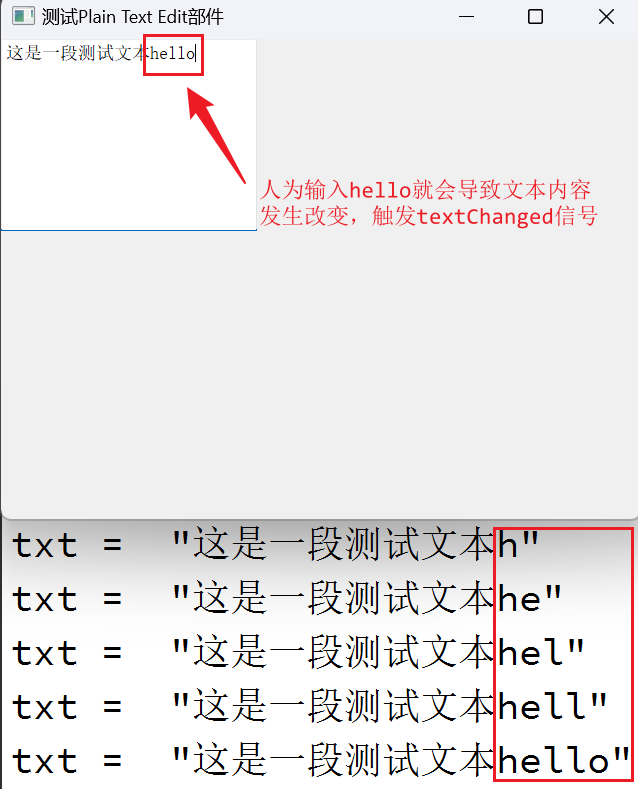

#### 6.6、Spin Box整数旋转框

QSpinBox或者QDoubleSpinBox表示"微调框"。它们是带有按钮的输入框，可以用来输入整数或浮点数或者通过点击按钮来修改数值大小。其中，QSpinBox提供了一个文本框和两个按钮，一个用于增加值，一个用于减小值；用户还可以通过点击按钮或者直接在文本框中输入数值来改变值；部件还可以设置最小值和最大值的范围，并且可以选择逐步增加或逐步减少的步长。

##### 6.6.1、常用函数

```C++
//此属性包含旋转框的文本，不包括任何前缀、后缀或前导或尾随空格
QString cleanText() const;

//设置与获取最值
void setMaximum(int max);
void setMinimum(int min);
int maximum() const;
int minimum() const;

//设置或者获取前缀
void setPrefix(const QString &prefix);
QString prefix() const;

//设置或者获取后缀
void setSuffix(const QString &suffix);
QString suffix() const;

//设置或者获取微调框中的值
[slot] void setValue(int val);
int value() const;

//设置部件中值的范围
void setRange(int minimum, int maximum);

//获取单步变化的值
int singleStep() const;
//设置单步变化的值
void setSingleStep(int val);

//设置或者获取步长类型
QAbstractSpinBox::StepType stepType() const;
void setStepType(QAbstractSpinBox::StepType stepType);
//QAbstractSpinBox::StepType枚举类型
//QAbstractSpinBox::DefaultStepType            默认步长
//QAbstractSpinBox::AdaptiveDecimalStepType    自适应步长

//信号
//当文本内容发生变化时触发信号
[signal] void QSpinBox::textChanged(const QString &text)

//当部件中值发生改变时触发信号
[signal] void QSpinBox::valueChanged(int i);
```

##### 6.6.2、使用示例

```C++
#include "widget.h"

#include <QSpinBox>
#include <QDebug>

Widget::Widget(QWidget *parent)
: QWidget(parent)
{
    setWindowTitle("测试Spin Box部件");
    resize(640, 480);

    //创建QSpinBox对象
    QSpinBox *spinBox = new QSpinBox(this);
    //移动部件的显示位置以及部件的大小（长150，宽40）
    spinBox->move(50, 100);
    spinBox->resize(150, 40);

    //设置前缀或者后缀
   //spinBox->setPrefix("0x");
   //spinBox->setSuffix("%");

    //设置部件的默认值为40
    spinBox->setValue(40);

    //设置范围
    spinBox->setRange(-100, 100);

    //设置单步变化的值，比如：开始是40，那么增加值就+10，减少值就变为-10
    spinBox->setSingleStep(10);

    connect(spinBox, QOverload<int>::of(&QSpinBox::valueChanged), [=](int value){
        qDebug() << "value = " << value;//通过信号传递到槽函数
        qDebug() << "spinBox->value() = " << spinBox->value();//直接通过value函数获取
    });
}
```

##### 6.6.3、显示结果

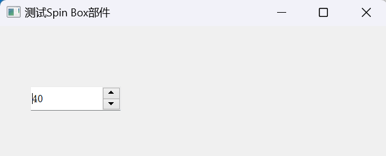

#### 6.7、Date Edit/Time Edit/DateTime Edit日期编辑/时间编辑/日期时间编辑

允许用户输入日期和时间，并提供了可视化的日历和时钟部件，方便用户选择日期和时间。它可以显示日期、时间或日期时间，具体取决于设置的格式。QTimeEdit是编辑和显示时间的部件；QDateEdit是编辑和显示日期的部件；QDateTimeEdit是编辑和显示日期时间的部件；既然谈到了时间，那么那我们顺便讲解日历，QCalendarWidget是一个用日历形式选择日期的组件。

##### 6.7.1、常用函数

以下函数都是QDateTimeEdit类中的函数，另外两个类QDateEdit与QTimeEdit是都继承自QDateTimeEdit的。

```C++
//添加日历控件
void setCalendarWidget(QCalendarWidget *calendarWidget);
//获取日历控件
QCalendarWidget *calendarWidget() const;

//获取日历弹出
bool calendarPopup() const;
//启用日历弹出（默认已启用）
void setCalendarPopup(bool enable);

//获取时间、日期、时间日期   
QTime time() const;
QDate date() const;
QDateTime dateTime() const;

//设置时间、日期、时间日期  
[slot] void setTime(const QTime &time);
[slot] void setDate(const QDate &date);
[slot] void setDateTime(const QDateTime &dateTime);

//设置时间、日期、日期时间的最值
void setMaximumTime(const QTime &max);
void setMinimumTime(const QTime &min);
void setMaximumDate(const QDate &max);
void setMinimumDate(const QDate &min);
void setMaximumDateTime(const QDateTime &dt);
void setMinimumDateTime(const QDateTime &dt);

//获取时间、日期、日期时间的最值
QTime maximumTime() const;
QTime minimumTime() const;
QDate maximumDate() const;
QDate minimumDate() const;
QDateTime maximumDateTime() const;
QDateTime minimumDateTime() const;

//清除时间、日期、日期时间的最值
void clearMaximumTime();
void clearMaximumDate();
void clearMaximumDateTime();
void clearMinimumTime();
void clearMinimumDate();
void clearMinimumDateTime();

//设置时间、日期、日期时间的范围
void setTimeRange(const QTime &min, const QTime &max);
void setDateRange(const QDate &min, const QDate &max);
void setDateTimeRange(const QDateTime &min, const QDateTime &max);

//设置或者获取当前输入的部分或者索引
void setCurrentSection(QDateTimeEdit::Section section);
QDateTimeEdit::Section currentSection() const;
int currentSectionIndex() const;
void setCurrentSectionIndex(int index);
//QDateTimeEdit::Section枚举类型
//QDateTimeEdit::NoSection
//QDateTimeEdit::AmPmSection
//QDateTimeEdit::MSecSection
//QDateTimeEdit::SecondSection
//QDateTimeEdit::MinuteSection
//QDateTimeEdit::HourSection
//QDateTimeEdit::DaySection
//QDateTimeEdit::MonthSection
//QDateTimeEdit::YearSection

//获取当前部件中正在显示的时间部分（枚举值与上述一样）
QDateTimeEdit::Sections displayedSections() const;

//设置或者获取显示格式
void setDisplayFormat(const QString &format);
QString displayFormat() const;
//例如：setDisplayFormat("dd/MM/yyyy hh:mm AP");  // 输出：05/07/2023 03:08 PM

//设置或者获取时区信息
void setTimeSpec(Qt::TimeSpec spec);
Qt::TimeSpec timeSpec() const;
//Qt::TimeSpec枚举类型
//Qt::LocalTime       系统当前本地时间
//Qt::UTC             协调世界时间
//Qt::OffsetFromUTC   固定的 UTC 偏移值
//Qt::TimeZone        命名时区（如Asia/Shanghai）

//根据字符位置返回该位置对应的时间部分(比如点击的第index个字符可能是“月”中的1)
QDateTimeEdit::Section sectionAt(int index) const;

//返回当前显示的时间部分的总数,比如:"yyyy-MM-dd hh:mm"，那就有 5 个 section（年、月、日、小时、分钟）
int sectionCount() const;

//返回指定时间部分的文字内容，比如你传入 QDateTimeEdit::MonthSection，它可能返回 "04"（四月）。
QString sectionText(QDateTimeEdit::Section section) const;

//设置当前选中的时间部分，例如你可以让"小时"被选中，这样用户按上下键时修改的是小时
void setSelectedSection(QDateTimeEdit::Section section);

//信号
//日期改变时信号被触发
[signal] void QDateTimeEdit::dateChanged(const QDate &date);

//时间改变时信号被触发
[signal] void QDateTimeEdit::timeChanged(const QTime &time);

//时间日期任意一个改变时信号被触发
[signal] void QDateTimeEdit::dateTimeChanged(const QDateTime &datetime); 
```

另外与时间、日期、时间日期对应的常用函数

```C++
[static] QTime QTime::currentTime()
[static] QDate QDate::currentDate();
[static] QDateTime QDateTime::currentDateTime();
[static] QDateTime QDateTime::currentDateTimeUtc();
```

##### 6.7.2、使用示例

```C++
#include "widget.h"

#include <QCalendarWidget>
#include <QTimeEdit>
#include <QDateEdit>
#include <QDateTimeEdit>
#include <QDebug>

Widget::Widget(QWidget *parent)
: QWidget(parent)
{
    setWindowTitle("测试时间日期部件");
    resize(640, 480);

    QTimeEdit *timeEdit = new QTimeEdit(QTime::currentTime(), this);
    timeEdit->move(50, 0);
    QDateEdit *dateEdit = new QDateEdit(QDate::currentDate(), this);
    dateEdit->move(50, 50);
    QDateTimeEdit *dateTimeEdit =
            new QDateTimeEdit(QDateTime::currentDateTime(), this);
    dateTimeEdit->move(50, 100);

    QCalendarWidget *calendarWidget = new QCalendarWidget(this);
    calendarWidget->move(50, 150);

    connect(dateTimeEdit, &QDateTimeEdit::dateTimeChanged,
            [=](const QDateTime &datetime){
        qDebug() << datetime;
    });
}
```

##### 6.7.3、显示结果

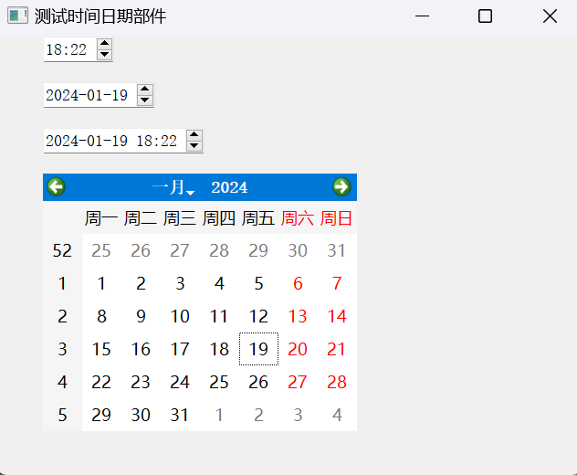

#### 6.8、Horizontal/Vertical Scroll Bar水平/垂直滚动条

QScrollBar是Qt框架中用于提供滚动功能的部件，继承自QAbstractSlider类，QScrollBar允许用户通过拖动滑块或点击滚动箭头来浏览超出显示区域的内容。为用户提供一个直观且易于操作的滚动界面，广泛应用于各种需要滚动支持的GUI应用程序中

##### 6.8.1、常用函数

```C++
QScrollBar(Qt::Orientation orientation, QWidget *parent = nullptr);
//Qt::Orientation是枚举类型
//Qt::Horizontal    水平
//Qt::Vertical      垂直
QScrollBar(QWidget *parent = nullptr);

//以下函数都是QAbstractSlider类中的函数
//设置或者获取当前值
[slot] void setValue(int);
int value() const;

//设置或者获取最大最小值
void setMaximum(int);
int maximum() const;
void setMinimum(int);
int minimum() const;

//设置或者获取方向
[slot] void setOrientation(Qt::Orientation);    
Qt::Orientation orientation() const;

//设置或者获取单步值（键盘上箭头键）
void setSingleStep(int);
int singleStep() const;

//设置或者获取页面步长（键盘上PageUp或者PageDown键）
void setPageStep(int);   
int pageStep() const;

//设置活动范围
[slot] void setRange(int min, int max);

//设置或者获取滑块的位置
void setSliderPosition(int);
int sliderPosition() const;

//设置或者获取是否被追踪
void setTracking(bool enable);
bool hasTracking() const;

//设置或者获取滑块的外观为反转样式
void setInvertedAppearance(bool);
bool invertedAppearance() const;

//设置或者获取滑块的控制方向为反转
bool invertedControls() const
void setInvertedControls(bool)

//设置或者获取滑动条是否被按下
void setSliderDown(bool);
bool isSliderDown() const;

//根据传入的操作类型触发滑块的相应行为
void triggerAction(QAbstractSlider::SliderAction action);
//QAbstractSlider::SliderAction枚举类型
//QAbstractSlider::SliderToMinimum      将滑块移动到最小值
//QAbstractSlider::SliderToMaximum      将滑块移动到最大值
//QAbstractSlider::SliderPageStepUp     向上移动一个页面步长
//QAbstractSlider::SliderPageStepDown   向下移动一个页面步长
//QAbstractSlider::SliderSingleStepUp   向上移动一个单步
//QAbstractSlider::SliderSingleStepDown 向下移动一个单步


//信号
//当滚动条上的某个动作（如点击滚动箭头或拖动滑块）被触发时发出
[signal] void actionTriggered(int action);

//当滚动条的范围发生变化时触发信号
[signal] void rangeChanged(int min, int max);

//当滑块位置发生变化时触发信号
[signal] void sliderMoved(int value);

//当滑块被按下时触发信号
[signal] void sliderPressed();

//当滑块被释放时触发信号
[signal] void sliderReleased();

//当滚动条的当前值发生变化时触发信号
[signal] void valueChanged(int value);
```

##### 6.8.2、使用示例

```C++
#include "widget.h"

#include <QScrollBar>
#include <QDebug>

Widget::Widget(QWidget *parent)
: QWidget(parent)
{
    setWindowTitle("测试Scroll  Bar部件");
    resize(640, 480);

    QScrollBar *hScrollBar = new QScrollBar(Qt::Horizontal, this);
    hScrollBar->move(50, 100);
    hScrollBar->resize(300, 50);
    hScrollBar->setRange(-100, 100);
    hScrollBar->setSingleStep(10);
    hScrollBar->setValue(30);

    connect(hScrollBar, &QScrollBar::valueChanged, [=](int value){
        qDebug() << "hScrollBar value = " << value;
        qDebug() << "hScrollBar->value() = " << hScrollBar->value();
    });

    QScrollBar *vScrollBar = new QScrollBar(Qt::Vertical, this);
    vScrollBar->move(400, 100);
    vScrollBar->resize(50, 300);
    vScrollBar->setRange(-100, 100);
    vScrollBar->setSingleStep(10);
    vScrollBar->setValue(-40);
    connect(vScrollBar, &QScrollBar::valueChanged, [=](int value){
        qDebug() << "vScrollBar value = " << value;
        qDebug() << "vScrollBar->value() =" << vScrollBar->value();
    });
}
```

##### 6.8.3、显示结果

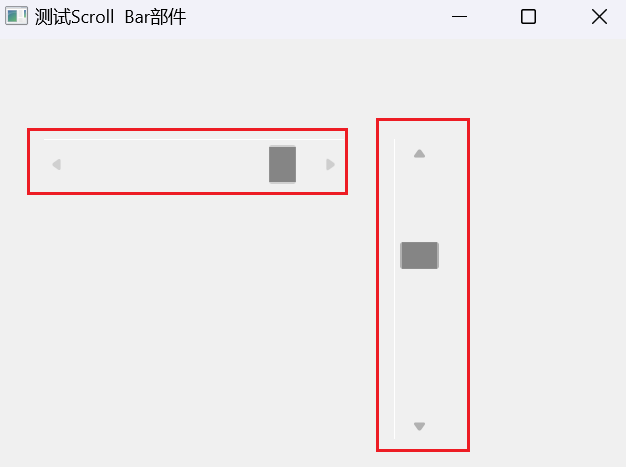


#### 6.9、Horizontal/Vertical Slider水平/垂直滑动条

QSlider部件是Qt库中用于提供一个可拖动滑块以选择数值或范围的界面元素。继承自QAbstractSlider类。QSlider广泛应用于需要用户进行数值调节的场景，如音量控制、亮度调整等。

##### 6.9.1、常用函数

```C++
QSlider(Qt::Orientation orientation, QWidget *parent = nullptr);
//Qt::Orientation orientation枚举类型
//Qt::Horizontal  水平
//Qt::Vertical    垂直

//设置或者获取刻度线间隔
void setTickInterval(int ti);
int tickInterval() const;

//设置或者获取刻度线的位置
void setTickPosition(QSlider::TickPosition position);
QSlider::TickPosition tickPosition() const;
//QSlider::TickPosition枚举类型
//QSlider::NoTicks          不显示任何刻度
//QSlider::TicksBothSides   在滑块的两侧（上方和下方或左侧和右侧）都显示刻度
//QSlider::TicksAbove       在滑块上方显示刻度
//QSlider::TicksBelow       在滑块下方显示刻度
//QSlider::TicksLeft        在滑块左边显示刻度
//QSlider::TicksRight       在滑块右边显示刻度

//因为与滚动条继承的类一致，所以函数可以通用，这里就没有展示出来
```

##### 6.9.2、使用示例

```C++
#include "widget.h"

#include <QSlider>
#include <QDebug>

Widget::Widget(QWidget *parent)
: QWidget(parent)
{
    setWindowTitle("测试Slider部件");
    resize(640, 480);

    //创建滑动条对象
    QSlider *hSlider = new QSlider(Qt::Horizontal, this);
    hSlider->move(50, 100);
    hSlider->resize(300, 50);
    //设置滑动条刻度的位置在上方
    hSlider->setTickPosition(QSlider::TicksAbove);
    //设置滑动条刻度间隔
    hSlider->setTickInterval(5);
    //设置滑动条范围
    hSlider->setRange(-10, 10);
    //设置滑动条单步改变步长
    hSlider->setSingleStep(10);
    //设置滑动条默认值
    hSlider->setValue(30);

    connect(hSlider, &QSlider::valueChanged, [=](int value){
        qDebug() << "hSlider value = " << value;
        qDebug() << "hSlider->value() = " << hSlider->value();
    });

    QSlider *vSlider = new QSlider(Qt::Vertical, this);
    vSlider->move(400, 100);
    vSlider->resize(50, 300);
    //设置滑动条刻度的位置在上方
    vSlider->setTickPosition(QSlider::TicksRight);
    //设置滑动条刻度间隔
    vSlider->setTickInterval(20);
    //设置滑动条范围
    vSlider->setRange(-100, 100);
    //设置滑动条单步改变步长
    vSlider->setSingleStep(10);
    //设置滑动条默认值
    vSlider->setValue(-40);
    connect(vSlider, &QSlider::valueChanged, [=](int value){
        qDebug() << "vSlider value = " << value;
        qDebug() << "vSlider->value() =" << vSlider->value();
    });
}
```

##### 6.9.3、显示结果

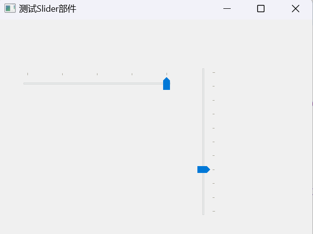


#### 6.10、快捷键输入控件

QKeySequenceEdit是Qt中的一个部件，用于输入和显示键盘快捷键（键序列）。它允许用户方便地设置和修改快捷键组合。

##### 6.10.1、常用函数

```C++
//获取当前输入的QKeySequence
QKeySequence keySequence() const;

//清除当前的键序列
[slot] void clear();

//设置QKeySequenceEdit的当前键序列
[slot] void setKeySequence(const QKeySequence &keySequence);

//信号
//当编辑结束时触发信号
[signal] void editingFinished();

//当键序列发生更改时触发信号
[signal] void keySequenceChanged(const QKeySequence &keySequence);
```

##### 6.10.2、使用示例

```C++
#include "widget.h"

#include <QKeySequenceEdit>
#include <QDebug>

Widget::Widget(QWidget *parent)
: QWidget(parent)
{
    setWindowTitle("测试KeySequence Edit部件");
    resize(640, 480);

    QKeySequenceEdit *keySequenceEdit = new QKeySequenceEdit(this);
    keySequenceEdit->move(100, 100);
    //设置工具提示文本,当用户将鼠标悬停在部件上时，会显示该提示
    keySequenceEdit->setToolTip("Enter a key sequence edit");

    connect(keySequenceEdit, &QKeySequenceEdit::keySequenceChanged,
            [=](const QKeySequence &key){
        if(key == QKeySequence("Ctrl+Q"))//此处的Ctrl+Q之间不能有空格
        {
            close();//关闭窗口
        }
        else
        {
            qDebug() << "窗口关闭失败";
        }
    });
}
```

##### 6.10.3、显示结果

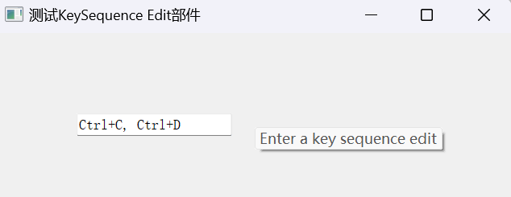

### 7、显示部件

#### 7.1、Label标签

QLabel是Qt中的一个部件，用于在窗口中显示文本或图片，使用频率很高。它继承自QWidget，因此具备QWidget的所有功能，此外QLabel还提供一系列专门的属性和方法，专注于文本和图片的展示。

##### 7.1.1、常用函数

```C++
//设置或者获取文本
[slot] void setText(const QString &);
QString text() const;

//设置数值
[slot] void setNum(double num);
[slot] void setNum(int num);

//检查或者获取标签中是否有选中的文本
bool hasSelectedText() const;
QString selectedText() const;

//设置选中文本的起始位置和长度
void setSelection(int start, int length);
//获取选中文本的起始位置
int selectionStart() const;

//清空label框内所有内容
[slot] void clear();

//设置或者获取对齐格式
void setAlignment(Qt::Alignment);
Qt::Alignment alignment() const;
//Qt::Alignment枚举类型
//Qt::AlignLeft       左对齐
//Qt::AlignRight	  右对齐
//Qt::AlignTop	      上对齐
//Qt::AlignBottom	  下对齐
//Qt::AlignHCenter	  水平居中对齐
//Qt::AlignVCenter	  垂直方向居中对齐
//Qt::AlignBaseline	  垂直与基线对齐
//Qt::AlignJustify	  水平方向调整间距两端对齐

//设置或者获取伙伴关系
void setBuddy(QWidget *buddy);
QWidget *buddy() const;

//设置或者获取动画，例如gif格式
[slot] void setMovie(QMovie *movie);
QMovie *movie() const;

//设置或者获取图片
[slot] void setPicture(const QPicture &picture);
const QPicture *picture() const;
[slot] void setPixmap(const QPixmap &);
const QPixmap *pixmap() const;

//设置或者获取外部链接
void setOpenExternalLinks(bool open);
bool openExternalLinks() const;

//设置或者获取换行
void setWordWrap(bool on);
bool wordWrap() const;

//设置或者获取文本格式
void setTextFormat(Qt::TextFormat);
Qt::TextFormat textFormat() const;
//Qt::TextFormat枚举类型
//Qt::PlainText       纯文本
//Qt::RichText        富文本
//Qt::AutoText        根据内容自动决定文本格式
//Qt::MarkdownText    Markdown格式的文本

//设置或者获取标签的边距，即标签内容与标签边框之间的空间，单位是像素
void setMargin(int);
int margin() const;

//设置或者获取文本的缩进量。
void setIndent(int);
int indent() const;

//设置或者获取标签是否缩放其内容以适应标签的尺寸
void setScaledContents(bool);
bool hasScaledContents() const;

//设置或者获取文本交互标志，控制用户如何与标签中的文本进行交互
void setTextInteractionFlags(Qt::TextInteractionFlags flags);
Qt::TextInteractionFlags textInteractionFlags() const;
//Qt::TextInteractionFlags枚举类型
//Qt::NoTextInteraction              不允许任何文本交互
//Qt::TextSelectableByMouse          允许用户使用鼠标选择文本
//Qt::TextSelectableByKeyboard       允许用户使用键盘选择文本
//Qt::LinksAccessibleByMouse         允许用户使用鼠标点击文本中的链接
//Qt::LinksAccessibleByKeyboard      允许用户使用键盘访问文本中的链接
//Qt::TextEditable                   允许用户编辑文本
//Qt::TextEditorInteraction          允许用户以文本编辑器的方式与文本进行交互
//Qt::TextBrowserInteraction         允许用户以浏览器的方式与文本进行交互，支持链接和基本的文本选择


//信号
//当用户点击标签中的链接时触发信号
[signal] void linkActivated(const QString &link);

//当用户将鼠标悬停在标签中的链接上时触发信号
[signal] void linkHovered(const QString &link);
```

##### 7.1.2、使用示例

```C++
#include "widget.h"

#include <QLabel>
#include <QMovie>
#include <QDebug>

Widget::Widget(QWidget *parent)
: QWidget(parent)
{
    setWindowTitle("测试label部件");
    resize(600, 480);

    //创建QLabel对象
    QLabel *label = new QLabel(this);
    //移动Label的显示位置
   label->move(100, 100);
    //设置形状
    label->setFrameShape(QFrame::Box);
    //第一种演示：显示文本
    //设置文本内容
    label->setText("设置文本内容");

    //第二种演示：显示图片
    //添加资源图片,并自动调整大小
    label->setPixmap(QPixmap::fromImage(QImage(":/Image/wangdao.png")));

    //第三种演示：显示动图
    //创建动画对象以及指定动画名
    QMovie *movie = new QMovie(this);
    movie->setFileName(":/Image/zhangyi.gif");
    //将动画添加大了QLabel中
    label->setMovie(movie);
    //启动动画
    movie->start();


    //第四种演示：设置超链接，然后点击链接打印文本
    label->setText("<a href='https://www.baidu.com/'>Click here</a> "
                   "to visit our website.");
    connect(label, &QLabel::linkActivated, [=](){
        qDebug() << label->text();
    });
}
```

##### 7.1.3、显示结果

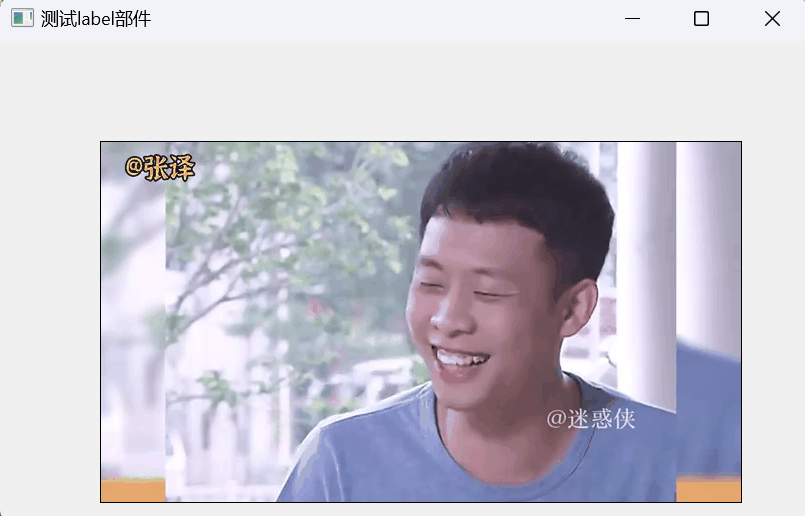

#### 7.2、TextBrowser文本浏览器

QTextBrowser是Qt框架中的部件，继承自QTextEdit类，用于显示和编辑富文本（包括 HTML 格式）。它提供了更多的功能，比如支持超链接、内嵌图片、和简单的格式化文本。

##### 7.2.1、常用函数

```C++
//设置打开外部链接（超链接）或者获取设否打开了外部链接
void setOpenExternalLinks(bool open);
bool openExternalLinks() const;

//获取可以向前或者向后浏览的历史记录条目数量
int forwardHistoryCount() const;
int backwardHistoryCount() const;

//检查是否可以向前或者向后浏览历史记录
bool isBackwardAvailable() const;
bool isForwardAvailable() const;

//清除历史记录
void clearHistory();

//获取指定索引的历史记录条目的标题
QString historyTitle(int i) const;

//获取指定索引的历史记录条目的URL
QUrl historyUrl(int i) const;
//获取当前文档的源URL。
QUrl source() const;

//设置或者获取链接的打开方式
void setOpenLinks(bool open);
bool openLinks() const;

//设置或者获取当前的搜索路径列表
void setSearchPaths(const QStringList &paths);
QStringList searchPaths() const;

//获取当前文档源的类型
QTextDocument::ResourceType sourceType() const;
//QTextDocument::ResourceType枚举类型
//QTextDocument::UnknownResource      表示未知类型的资源
//QTextDocument::HtmlResource         表示 HTML 类型的资源
//QTextDocument::ImageResource        表示图像类型的资源
//QTextDocument::StyleSheetResource   表示样式表类型的资源
//QTextDocument::MarkdownResource     表示Markdown类型的资源
//QTextDocument::UserResource         表示用户定义的资源类型


//信号
//当用户点击文本中的锚链接时触发信号
[signal] void anchorClicked(const QUrl &link);

//当向后浏览历史记录的可用性发生变化时触发信号
[signal] void backwardAvailable(bool available);

//当向前浏览历史记录的可用性发生变化时触发信号
[signal] void forwardAvailable(bool available);

//当用户将鼠标悬停在文本中的链接上时触发信号（使用字符串表示的链接）
[signal] void highlighted(const QString &link);

//当用户将鼠标悬停在文本中的链接上时触发信号（使用URL表示的链接）
[signal] void highlighted(const QUrl &link);

//当历史记录发生变化时触发信号
[signal] void historyChanged();

//当文档的源URL发生变化时触发信号
[signal] void sourceChanged(const QUrl &src);
```

##### 7.2.2、使用示例

```C++
#include "widget.h"

#include <QTextBrowser>
#include <QDebug>

Widget::Widget(QWidget *parent)
: QWidget(parent)
{
    setWindowTitle("测试TextBrowser部件");
    resize(600, 480);

    //创建文本浏览器对象
    QTextBrowser *textBrowser = new QTextBrowser(this);
    textBrowser->move(100, 0);
    //设置文本浏览器的html格式
    textBrowser->setHtml("<a href='https://www.qt.io'>Visit Qt</a>");
    //启用外部链接跳转
    textBrowser->setOpenExternalLinks(true);

    connect(textBrowser, QOverload<const QString &>::of(&QTextBrowser::highlighted),
            [=](const QString &link){
        qDebug() << "link = " << link;
    });
}
```

##### 7.2.3、显示结果

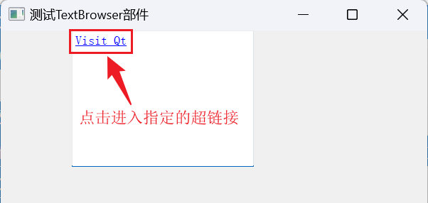

#### 7.3、LCDNumber液晶字体数字部件

QLCDNumber是Qt中一个用于显示数字的控件，它模仿了传统LCD（液晶显示器）的显示方式。它通常用于显示数字信息，如计时器、计数器或其它数值数据。

##### 7.3.1、常用函数

```C++
//构造函数，用于创建一个LCD显示器部件，其中numDigits指定允许显示数字位数
QLCDNumber(uint numDigits, QWidget *parent = nullptr);

//检查传入的类型数字是否超出所能显示的最大和最小值
bool checkOverflow(double num) const;
bool checkOverflow(int num) const;

//设置或者获取显示几位数字
void setDigitCount(int numDigits);
int digitCount() const;

//显示的数字值（int类型或者double类型）
int intValue() const;
double value() const;

//设置或者获取数字显示形式
void setMode(QLCDNumber::Mode);
QLCDNumber::Mode mode() const;
//QLCDNumber::Mode枚举类型
//QLCDNumber::Dec    十进制模式，显示常规的十进制数字，注意只有十进制才显示小数点后的内容   
//QLCDNumber::Hex    十六进制模式，显示常规的十六进制数字
//QLCDNumber::Bin    二进制模式，显示常规的二进制数字
//QLCDNumber::Oct    八进制模式，显示常规的八进制数字

//设置或者获取显示风格
void setSegmentStyle(QLCDNumber::SegmentStyle);
QLCDNumber::SegmentStyle segmentStyle() const;
//QLCDNumber::SegmentStyle枚举类型
//QLCDNumber::Flat      平面显示风格，数字呈现在一个平坦的表面上  
//QLCDNumber::Outline   轮廓显示风格，数字具有清晰的轮廓和阴影效果 
//QLCDNumber::Filled    填充显示风格，数字被填充颜色并与背景区分开

//设置或者获取小数点的显示方式。
[slot] void setSmallDecimalPoint(bool);
bool smallDecimalPoint() const;

//显示结果到部件上(即：设置值到部件上)
[slot] void display(double num);
[slot] void display(int num);
[slot] void display(const QString &s);

//设置显示模式为二进制，数字将以二进制格式显示
[slot] void setBinMode();

//设置显示模式为十进制，数字将以常见的十进制格式显示（默认模式）
[slot] void setDecMode();

//设置显示模式为十六进制。数字将以十六进制格式显示（使用 0-9 和 A-F）
[slot] void setHexMode();

//设置显示模式为八进制，数字将以八进制格式显示
[slot] void setOctMode();

//信号
//当要求显示的数据越界或者字符串太长会触发信号
[signal] void overflow();
```

##### 7.3.2、使用示例

```C++
#include "widget.h"

#include <QLCDNumber>
#include <QDebug>

Widget::Widget(QWidget *parent)
    : QWidget(parent)
{
    setWindowTitle("测试 LCDNumber部件");
    resize(600, 480);

    QLCDNumber *lcdNumber = new QLCDNumber(this);
    lcdNumber->move(100, 100);
    lcdNumber->resize(200, 50);

    //设置显示风格为轮廓显示风格
    lcdNumber->setSegmentStyle(QLCDNumber::Outline);

    //设置显示的位数
    lcdNumber->setDigitCount(8);
    //设置显示的值，超过位数可能需要四舍五入
    lcdNumber->display(12345.678);

    //获取部件中的值
    qDebug() << "value = " << lcdNumber->value();
}
```

##### 7.3.3、显示结果

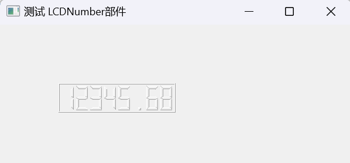

#### 7.4、ProgressBar进度条

QProgressBar是Qt中一个非常有用的部件，用于向用户显示某个任务的进度。它提供了一个直观的图形界面，可以显示任务的完成百分比或进度状态。

##### 7.4.1、常用函数

```C++
//设置或者获取对齐方式
void setAlignment(Qt::Alignment alignment);
Qt::Alignment alignment() const;
//Qt::Alignment枚举类型，这个之前都已经使用过多次
//Qt::AlignLeft
//Qt::AlignRight
//Qt::AlignHCenter
//Qt::AlignJustify

//设置或者获取进度条的值
[slot] void setValue(int value);
int value() const;
//将进度条重置为最小值
[slot] void reset();

//设置进度条的范围
[slot] void setRange(int minimum, int maximum);

//设置或者获取最大值或者最小值
[slot] void setMaximum(int maximum);
int maximum() const;
[slot] void setMinimum(int minimum);
int minimum() const;

//设置或者获取或者重置进度条显示文本的格式
//%p: 百分比,默认显示方式
//%v: 当前值。
//%m: 最大值。
void setFormat(const QString &format);
QString format() const;
void resetFormat();

//设置或者获取进度条是否显示为反向进度，即进度条的增加方向是否从右到左（水平方向）或从下到上（垂直方向）。
void setInvertedAppearance(bool invert);
bool invertedAppearance() const;

//设置或者获取是否显示进度条的文本，文本内容通常为百分比或当前值(垂直进度条默认是不能显示文本的)
void setTextVisible(bool visible);
bool isTextVisible() const;

//设置或者获取文本显示方向
void setTextDirection(QProgressBar::Direction textDirection);
QProgressBar::Direction textDirection() const;
//QProgressBar::Direction枚举类型
//QProgressBar::TopToBottom
//QProgressBar::BottomToTop

//设置或者获取进度条的显示方向
[slot] void setOrientation(Qt::Orientation);
Qt::Orientation orientation() const;
//QProgressBar::Direction枚举类型
//Qt::Horizontal  水平
//Qt::Vertical    垂直

//用于获取进度条的文本表示，本函数允许自定义进度条中显示的文本内容
virtual QString text() const;

//信号
//当进度条中的值发生改变会触发信号
[signal] void valueChanged(int value);
```


##### 7.4.2、使用示例

```C++
#include "widget.h"

#include <QProgressBar>
#include <QPushButton>
#include <QBoxLayout>
#include <QDebug>

Widget::Widget(QWidget *parent)
    : QWidget(parent)
{
    setWindowTitle("测试ProgressBar部件");
    resize(600, 480);

    QProgressBar *progressBar = new QProgressBar(this);
    progressBar->move(20, 20);

    //设置进度条的方向(水平或者垂直，默认是水平的)
    //Qt::Horizontal水平/Qt::Vertical垂直
    //progressBar->setOrientation(Qt::Horizontal);
    //设置进度调是否反向显示（默认从左到右，从下向上）
    progressBar->setInvertedAppearance(true);

    //设置显示进度条文本(默认是显示的)
    progressBar->setTextVisible(true);
    //设置文本格式,默认使用百分比
    progressBar->setFormat("%p%");
    //progressBar->setFormat("Progress: %v/%m");

    //设置进度条的范围
    progressBar->setRange(0, 1000000);
    //设置进度条的初始值(如果初值太小可能没有效果)
    progressBar->setValue(10000);

    QPushButton *pushButton = new QPushButton("测试进度条", this);
    pushButton->move(520, 20);

    connect(pushButton, &QPushButton::clicked, [=](){
        for(int i = 0; i < 1000000; ++i)
        {
            progressBar->setValue(i + 1);
        }
    });

    //设置水平布局
    QHBoxLayout *hBoxLayout = new QHBoxLayout;
    hBoxLayout->addWidget(progressBar);
    hBoxLayout->addWidget(pushButton);
    setLayout(hBoxLayout);
}
```

##### 7.4.3、显示结果

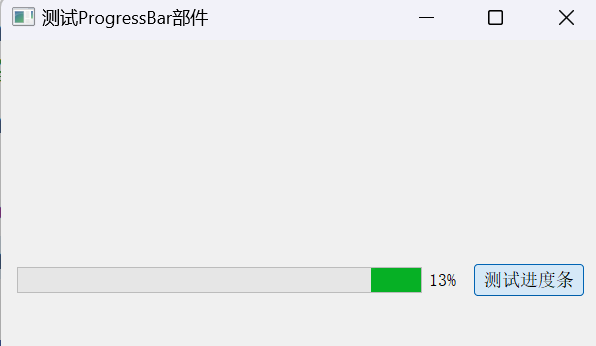

以上就是Qt下常用部件（控件）的使用方法，内容繁多，只有多练，熟联系才能有所体会，不然就跟没有学习是一样的效果，好像都知道但是不会下手，所以一定要一个个的练习。
