# 嵌入式4期Qt部分

## Day01

### 一、基本概念

#### 1、概念

跨平台的C++图形用户界面应用程序框架，Qt的本质就是一个 C++类库 。

#### 2、历史

- 1991年由挪威的Eirik Chambe-Eng和Haavard Nord；
-  1994年3月4号正式成立奇趣科技公司（Trolltech）；
- 2000年奇趣科技公司为开源社区发布了遵循GPL （GNU General Public License）许可证的开源版本 ；
- 2008年，诺基亚公司收购了奇趣科技公司；
- 2011年3月出售给了芬兰IT服务公司Digia ；
- 2014年9月宣布成立Qt Company全资子公司 ；  

#### 3、Qt软件的安装

使用的是Qt的最后一个离线版本5.14.2，安装步骤可以按照pdf进行即可，需要注意几个点

- 尽量的安装到C盘以外的盘中；
- 安装的时候，路径下不要有中文；
- 该安装哪些，可以参考pdf文档；

#### 4、Qt creator的介绍

Qt Creator是Qt的集成开发环境(IDE)， Qt 5.14.2是Qt类库的版本， Qt Creator 4.11.1 是Qt Creator的版本  

#### 5、Qt creator中的几个模式

欢迎模式、编辑模式（写代码的模式）、设计模式（界面设计需要使用的模式）、调试模式（调试代码的模式）、帮助模式（帮助手册，用于查找类、类中函数使用的模式）

#### 6、项目结构

- 项目文件.pro文件；
- 头文件Headers 该文件夹下存放所有的头文件；
- 实现文件Sources 该文件夹下存放所有的实现文件；
- 界面文件夹Forms 存放的是界面文件；

<span style=color:red;background:yellow;font-size:20px>特别的，qmake是Qt提供的一个跨平台的构建工具，在构建项目时，IDE会根据.pro 文件和所在的操作系统生成相应的构建脚本，如Makefile或 Visual Studio项目文件，这样用户就可以进行项目的实际编译和链接。.pro 文件是qmake工具的输入文件，用于描述项目的结构、依赖关系以及构建过程，这个文件包含了源代码文件、头文件、资源文件、库文件等各种构建所需的元素，以及构建选项和配置 </span>

### 二、Qt的第一个程序

<span style=color:red;background:yellow;font-size:20px>在Qt的代码的头文件中，会有一个宏Q_OBJECT，目的就是为了使用Qt自己的语法，比如：启动元对象系统。</span>

```C++
#ifndef MYWIDGET_H
#define MYWIDGET_H

#include <QWidget>

class MyWidget : public QWidget
{
    //Q_OBJECT是Qt的内置宏,使用该宏的目的是为了
    //后续可以使用Qt自己的语法，特别的，使用了该宏
    //之后，就可以使用元对象系统
    Q_OBJECT

public:
    MyWidget(QWidget *parent = nullptr);
    ~MyWidget();
};
#endif // MYWIDGET_H
```


```C++
//自定义类对象的头文件
#include "mywidget.h"

//在Qt中，标准的类都是以字母Q开头的，任何一个类
//都会有与类名一样的头文件，所以在使用该类的时候
//需要将头文件引出来(特别注意：不需要像C++一样
//引出实体)

//Qt是基于C++开发的，所以C++中的语法在QT中是可以
//直接使用的
#include <QApplication>

#include <iostream>

using std::cout;
using std::endl;

int main(int argc, char *argv[])
{
    //QApplication是应用程序类，a是该类创建的对象
    //注意：在一个Qt程序中QApplication只能创建
    //一个对象
    QApplication a(argc, argv);

    //MyWidget是自定义的类，该类继承了QWidget
    //w是MyWidget创建的对象
    MyWidget w;
    //show函数的作用就是将MyWidget对象显示出来（窗口显示出来）
    //默认情况下，如果不调用show，那么窗口是无法显示的
    w.show();
    //exec调用之后，会启动事件循环，目的就是等待事件的到来
    //事件到来之后，会存储到事件队列中
    //exec函数在调用quit函数或者exit函数的时候，会让循环结束
    return a.exec();

    //while(1){}
    //return 0;
}
```

###  三、Qt模块

在Qt5中将模块分为3个部分：Qt Essentials(Qt基本模块)、Qt Add-Ons(Qt扩展模块)、Qt Tools(Qt开发工具) 。<span style=color:red;background:yellow;font-size:20px>其中基本模块是核心模块，定义了适用于所有平台的基础功能，在Qt5中，它们将保持源代码和二进制兼容  </span>

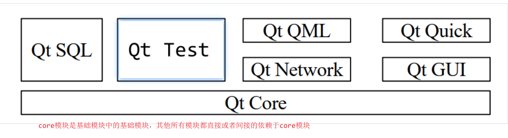

### 四、元对象系统

#### 1、元对象的基本概念

<span style=color:red;background:yellow;font-size:20px>元对象是指能够操纵、创建、描述或执行其它对象的对象，被元对象描述的对象称为基对象。</span>

#### 2、元对象系统的基本概念

<span style=color:red;background:yellow;font-size:20px>元对象系统（Meta-Object System，MOS） 是Qt框架在C++基础上扩展的一套运行时动态特性机制。 </span>  

#### 3、设计元对象系统的目的

- 可以进行对象之间的通信；
- 弥补C++语法本身对运行时支持的缺陷；
- 框架需求；

#### 4、<span style=color:red;background:yellow;font-size:25px>元对象系统的三大组成部分(重要)</span>

- 自定义的类或者库中的类要直接或者间接的继承类QObject;
- 在头文件中还要使用宏Q_OBJECT；
- 使用元对象编译器moc；

#### 5、<span style=color:red;background:yellow;font-size:20px>元对象编译器(重要)</span>

<span style=color:red;background:yellow;font-size:20px>元对象编译器，也就是MOC，作用就是将带有Q_OBJECT宏的头文件进行处理，产生两个文件`moc_*.cpp`与`moc_*.o`文件。在将新的cpp文件以及老的cpp文件一起编译链接，最终生成可执行程序。特别需要注意：moc生成的cpp文件会与项目中的其他cpp文件一起编译链接。</span>

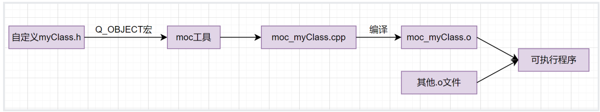

### 五、<span style=color:red;background:yellow;font-size:30px>信号与槽（至关重要）</span>

#### 1、作用

信号与槽的作用就是为了在Qt中让对象之间进行通信。

#### 2、基本原理

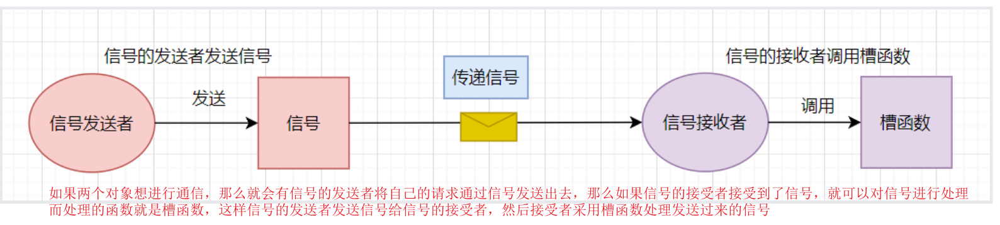

#### 3、连接信号与槽的函数connect

```C++
//字符串形参
[static] QMetaObject::Connection QObject::connect(
const QObject *sender
, const char *signal, const QObject *receiver
, const char *method
, Qt::ConnectionType type = Qt::AutoConnection);

// 没有接收者的版本
[static] QMetaObject::Connection QObject::connect(
const QObject *sender
, PointerToMemberFunction signal
, Functor functor);

// 函数指针形参
[static] QMetaObject::Connection QObject::connect(
const QObject *sender
, PointerToMemberFunction signal
, const QObject *receiver
, PointerToMemberFunction method
, Qt::ConnectionType type);
```

#### 4、标准信号与槽

```C++
#include "widget.h"
#include "ui_widget.h"

Widget::Widget(QWidget *parent)
    : QWidget(parent)
    , ui(new Ui::Widget)
{
    ui->setupUi(this);

    connect(ui->pushButton, &QPushButton::clicked, this, &Widget::close);
}
//信号的发送者：ui->pushButton，通过ui找到的pushButton对象
//发送的信号：按钮中的信号clicked，该函数是标准的信号；
//信号的接受者：this指针指向的是Widget对象，也就是信号的接受者；
//槽函数：是QWidget中的槽函数，关闭窗口;
```

<span style=color:red;background:yellow;font-size:20px>注意：对于标准的信号与槽的查询方式，如果在本类中没有找到信号或槽函数，那么就去该类的基类中进行查找，如果基类中没有就继续找基类的基类，直至找到为止，同时注意，信号的关键字是signals，槽的关键字是slots。</span>

注意：对于标准的信号与槽，只需要连接即可，不需要显示调用emit触发信号。

```C++
void Widget::on_pushButton_2_clicked()
{
    qDebug() << "点击了按钮QPushButton，执行槽函数";
    qDebug("使用的是C的方式进行打印");
    close();
}
```

对于ui界面的方式来使用标准的信号与槽的时候，可以在部件或者控件上右键，选择"Go to slot",然后选择对应的信号，就可以在相应的头文件中声明槽函数，并且在实现文件中实现槽函数，那么后续只需要在槽函数中实现具体的代码逻辑就可以了，并且这种方式是可以不用显示调用connect去连接信号与槽，就会自动连接。此时这个槽函数的命名方式是 "on + _ + 信号发送者的名字 + _ + 信号的名字"

#### 5、自定义信号与槽

##### 5.1、自定义信号的条件

- 自定义的类需要直接或者间接继承自QObject基类；
- 在自定义类的头文件中需要包含宏Q_OBJECT;

##### 5.2、自定义信号的规则

- 自定义信号的关键字是signals，然后后面加上":",后面在声明信号的函数；在signals的前面是不需要加上public/protected/private的，原因是signals默认就是public；
- 信号只需要声明，并不需要实现；
- 信号的返回结果一般是void，信号函数是可以进行传参的；

##### 5.3、信号的触发

信号与槽连接之后，为了让信号执行，所以需要使用emit进行触发信号，当然信号触发的关键字emit是可以省略的；

##### 5.4、自定义槽函数的条件

- 自定义的类需要直接或者间接继承自QObject基类；
- 在自定义类的头文件中需要包含宏Q_OBJECT;

##### 5.5、自定义槽函数的规则

- 槽函数的关键字是slots，然后后面需要加上":",但是槽函数与信号不一样的是，slots的前面可以使用public/protected/private进行修饰；
- 特别的，对于Qt5以上的版本，此处的slots关键字是可以直接省略的（但是目前开始学习，还是建议写出来）；
- 槽函数不仅需要有声明，还必须要有实现；
- <span style=color:red;background:yellow;font-size:20px>槽函数的返回结果一般也是void，但是特别需要注意，槽函数的参数是需要收到信号的参数的影响的。原因是：信号与槽一旦连接之后，信号中的参数是会传递给槽函数的，所以槽函数的参数个数往往都是小于等于信号的参数个数的；</span>

#### 6、信号与槽连接的使用的传递方式

##### 6.1、Qt4的写法

```C++
//Qt4中的写法，该写法会将SIGNAL/SLOT中传递进来的当做字符串
//进行处理，其实，传递任何不存在的都可以让编译通过，但是在运行
//的时候，才能知道有没有出现问题，所以这种写法没有类型检测，
//是不安全，不建议使用
connect(m_ptc, SIGNAL(treat()), m_pst, SLOT(eat()));
connect(m_ptc, SIGNAL(t2222()), m_pst, SLOT(e333()));//t2222即使不存在，编译也会通过
```

##### 6.2、<span style=color:red;background:yellow;font-size:20px>Qt5的写法（推荐）</span>

使用的是成员函数指针的写法。

```C++
connect(m_ptc, &Teacher::treat, m_pst, &Student::eat);
```

特别的，如果信号与槽有重载版本的时候，需要加以调整，方式有三种

##### 6.3、Qt5解决重载版本

```C++
//这三行可以解决treat与eat是无参的版本，使用的是成员函数指针
void (Teacher::*ptcArgVoid)() = &Teacher::treat;
void (Student::*pstArgVoid)() = &Student::eat;
connect(m_ptc, ptcArgVoid, m_pst, pstArgVoid);

//这三行可以解决treat与eat是有参的版本，依旧使用的是成员函数指针
void (Teacher::*ptcWithArg)(QString) = &Teacher::treat;
void (Student::*pstWithArg)(QString) = &Student::eat;
connect(m_ptc, ptcWithArg, m_pst, pstWithArg);
```

这种方式可以解决重载版本，但是使用起来非常的麻烦，所以可以使用C++11或者C++14的方式

##### 6.4、<span style=color:red;background:yellow;font-size:20px>C++11解决重载版本（推荐）</span>

```C++
//在解决信号与槽有重载版本的时候，可以使用C++11的方式QOverload<>::of的方式
connect(m_ptc, QOverload<>::of(&Teacher::treat),
        m_pst, QOverload<>::of(&Student::eat));

connect(m_ptc, QOverload<QString>::of(&Teacher::treat),
        m_pst, QOverload<QString>::of(&Student::eat));
```

##### 6.5、C++14解决重载版本

```C++
//在解决信号与槽有重载版本的时候，可以使用C++14的方式,qOverload<>
connect(m_ptc, qOverload<>(&Teacher::treat),
        m_pst, qOverload<>(&Student::eat));

connect(m_ptc, qOverload<QString>(&Teacher::treat),
        m_pst, qOverload<QString>(&Student::eat));
```

注意，因为Qt5.14.2默认支持是c++11， 所以如果使用的是C++11的语法，需要修改项目文件。

#### 7、信号与槽的关系

- 信号与槽连接的时候，槽函数的参数会受到信号的影响，槽函数的参数个数一定要小于等于连接的信号的参数个数；参数类型也会受到影响；
- 一个信号可以与多个槽关联，多个信号也可以与同一个槽关联，信号也可以关联到另一个信号上；
- 如果信号连接到另一个信号，则当第一个信号发射时，会立即发射第二个信号；
- 如果一个信号关联到多个槽时，则发射信号时，槽函数按照关联的顺序依次执行      

#### 8、优缺点

##### 8.1、优点

- 松耦合：发送者和接收者相互独立，无需直接依赖；
- 灵活性：支持一对多、多对一的信号与槽关联；
- 类型安全：编译期进行严格的类型检查，确保参数匹配。
- 线程安全：根据连接方式（Qt::AutoConnection/QueuedConnection）自动决定是否跨线程调用槽；

##### 8.2、缺点

- 多线程的时候，信号可能需要排队等待；
- 编组/解组传递的参数；
- 安全的遍历所有的关联；
- 需要定位接收信号的对象 ；

<span style=color:red;background:yellow;font-size:20px>注意：信号与槽的调用比普通函数的调用慢10倍。</span>

### 六、<span style=color:red;background:yellow;font-size:30px>对象树</span>

#### 1、作用

在Qt中，经常会使用指针，那么也会经常使用到堆空间，那么为了将堆空间进行更好的回收，所以Qt中有一个概念，叫做对象树，作用就是为了回收堆空间。

#### 2、结构

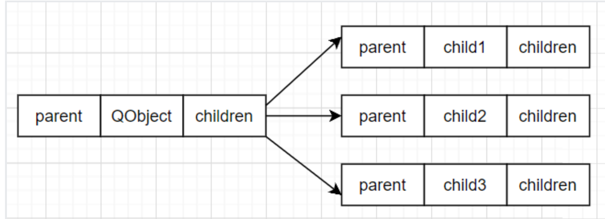

当为一个对象A指定父对象P的时候，就会将对象A挂接在父对象P的对象树上，那么当父对象销毁的时候，也会带着将子对象A销毁。

<span style=color:red;background:yellow;font-size:20px>需要特别注意一点，在Qt中对象之间的父子关系不是C++中的继承关系，而是Qt中对象之间的关系。</span>

帮助手册的位置

```C++
D:\software\qt5\5.14.2\mingw73_64\bin
//在自己软件的安装目录下，有 5.14.2\mingw73_64\bin 在其中有个assistant.exe，也就是帮助手册，可以直接发送到桌面快捷方式。
```

#### 3、代码测试

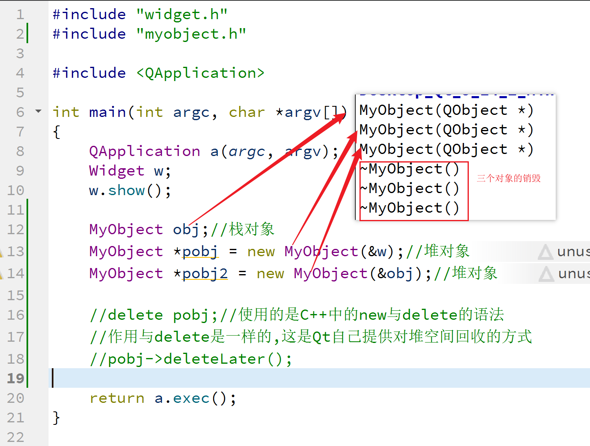

## Day02

### 一、问题回顾

1、Qt Creator有哪几种常见模式？比如：编辑模式。

2、Qt工程有那几个文件或者文件？分别有什么作用？

```C++
.pro:项目文件
Headrs：头文件；
Sources：实现文件;
Forms:ui文件；
```

3、Qt有那三个模块？最核心的模块是哪一个？

```c++
core gui widgets network sql
```

4、Qt第一个程序的理解？

```C++
//QObject、Q_OBJECT
//QApplication a     a.exec();  启动事件循环，  事件队列；
//Widget w;(QWidget)  w.show();   显示部件/部件;
```

5、什么是元对象以及元对象系统？

```C++
//基对象（老板）   元对象（秘书）；
//元对象系统：扩展C++的运行时动态机制;
```

6、元对象系统的三大核心组成部分是什么？

```C++
QObject、Q_OBJECT、MOC；
```

7、元对象编译器的作用是什么？

```C++
Q_OBJECT--->MOC--->moc_*.cpp---->与其他的.cpp文件一起编译运行---->*.o---->可执行程序;
```

8、使用信号与槽需要满足哪些条件？

```C++
QObject、Q_OBJECT
```

9、自定义信号需要遵循哪些规则？自定义槽函数需要遵循哪些规则？

```C++
//自定义信号：
//(1)signals: signals的前面不能有public/protected/private
//(2)信号只需要声明，无需实现
//(3)void 函数可以有参数, 参数是会传递给槽函数

//信号的触发方式  emit  信号函数;

//自定义槽函数
//(1) public/protected/private slots:
//(2)槽函数即需要声明，也需要实现；
//(3)void 槽函数的参数会受到信号的影响
```

10、信号与槽的连接方式有哪些？信号与槽在连接的使用有哪些注意点？信号与槽的优缺点有哪些？

```C++
//Qt4  字符串  不安全
connect(sender, SIGNAL(yyy), receiver, SLOT(xxx));

//Qt5
connect(sender, &Sender::sig, receiver, &Receiver::slt);

//重载的时候
void (Sender::*ps)()   =  &Sender::sig;
void (Receiver::*pr)() = &Receiver::slt;

connect(sender, ps, receiver, pr);

//C++11
connect(sender, QOverload<>::of(&Sender::sig), receiver,QOverload<>::of(&Receiver::slt));

//C++14
connect(sender, qOverload<>(&Sender::sig), receiver,qOverload<>(&Receiver::slt));
```

11、什么是对象树？对象树的作用是什么？如何理解Qt中的父子关系？

```C++
作用：为了解决内存泄漏；  RAII；
    
Qt中的父子关系是对象之间的，并不是继承中的父类与子类的关系；
```

### 二、<span style=color:red;background:yellow;font-size:30px>属性系统(重要)</span>

#### 1、概念

<span style=color:red;background:yellow;font-size:20px>属性系统是一种运行时动态扩展对象属性的机制</span>，允许在不修改类定义的前提下，访问、添加、和修改对象的属性，目的在于简化对象属性的管理和访问  

#### 2、动态属性

可以在运行的时候，动态的给对象设置属性、添加属性以及获取属性。

```C++
//获取或访问属性
QVariant QObjtect::property(const char *name) const;

//添加或者修改属性
bool QObjtect::setProperty(const char *name, const QVariant &value);
```

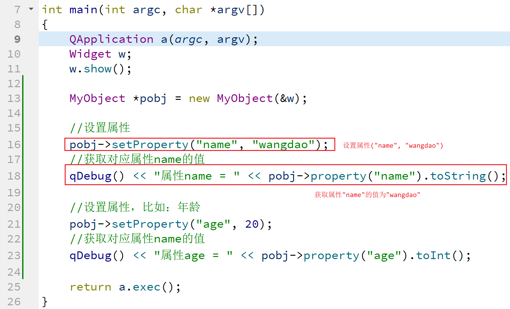

<span style=color:red;background:yellow;font-size:20px>在Qt中，数据成员与属性没有一点关系，不要将二者画等号。</span>

#### 3、显示声明属性

```C++
Q_PROPERTY(type name
           (READ getFunction [WRITE setFunction] |
            MEMBER memberName [(READ getFunction | WRITE setFunction)])
           [RESET resetFunction]
           [NOTIFY notifySignal]
           [REVISION int ]
           [DESIGNABLE bool]
           [SCRIPTABLE bool]
           [STORED bool]
           [USER bool]
           [CONSTANT]
           [FINAL])
```

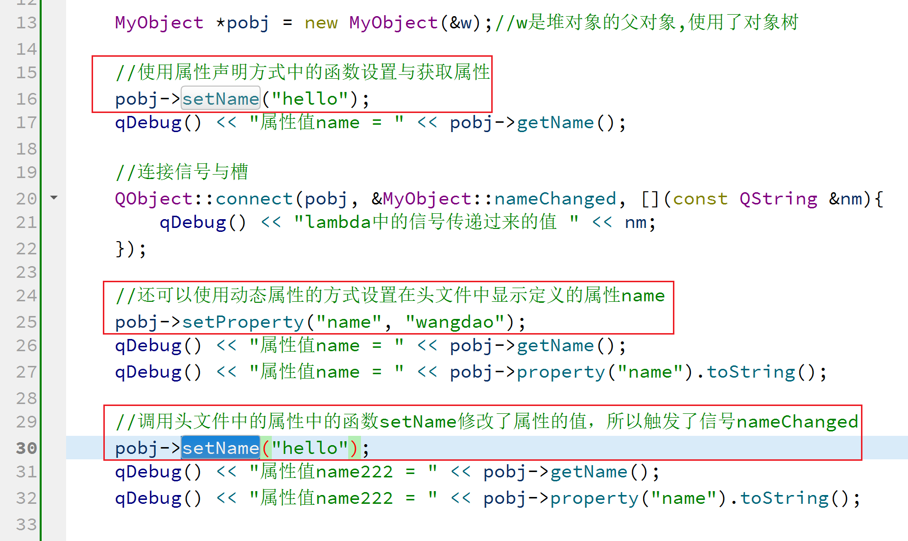

### 三、<span style=color:red;background:yellow;font-size:30px>运行时类型信息（重要）</span>

#### 1、基本概念

在Qt的元对象系统中，运行时类型信息<span style=color:red;background:yellow;font-size:20px>提供了一种在程序运行时动态查询和操作类类型、属性、方法等元数据的能力  </span>

#### 2、两个关键概念

- <span style=color:red;background:yellow;font-size:20px>**内省**</span>是面向对象编程语言的一种特性，它允许在运行时查询对象的信息。Qt中的内省是指在运行时动态获取对象的结构信息（如类名、属性、方法、信号槽等  
- <span style=color:red;background:yellow;font-size:20px>**反射**</span>也是面向对象编程语言的一种特性，允许程序在运行时查询和修操作对象的类型、属性、方法等信息。<span style=color:red;background:yellow;font-size:20px>**由此可见反射是更高级的自省**  </span>

#### 3、<span style=color:red;background:yellow;font-size:20px>使用反射的条件（重要）</span>

- 需要继承自QObject类或其派生类，并需要在类之中加入Q_OBJECT宏；
- 注册成员函数：若希望普通成员函数能够被反射，需要在函数声明之前加入QObject::Q_INVOKABLE宏；
- 注册成员变量：若希望成员变量能被反射，需要使用Q_PROPERTY宏；
- 注册枚举变量：若希望枚举能被反射，需要使用Q_ENUM或者Q_FLAGS宏。

#### 4、如何使用反射

```C++
//可以使用该函数通过基对象获取元对象类型的指针,后续可以使用元对象类型的指针调用相应的成员函数，将基对象的信息获取出来
const QMetaObject *QObject::metaObject() const;
```


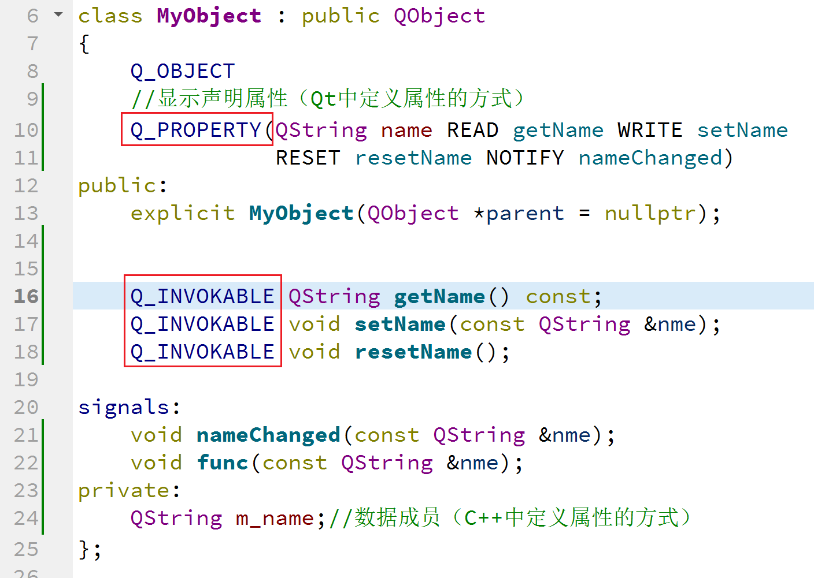

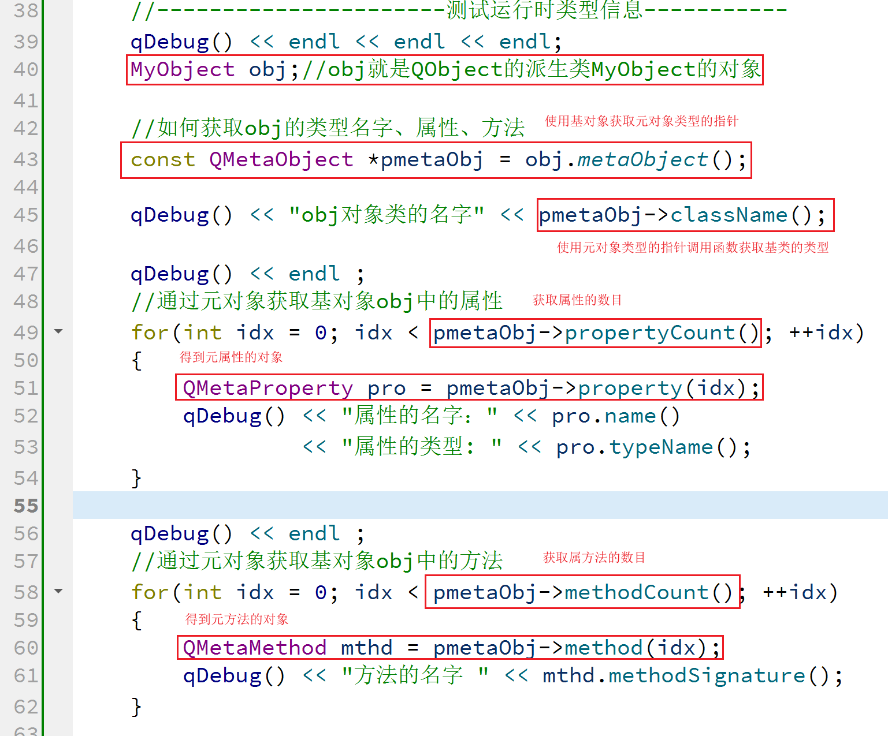

测试结果

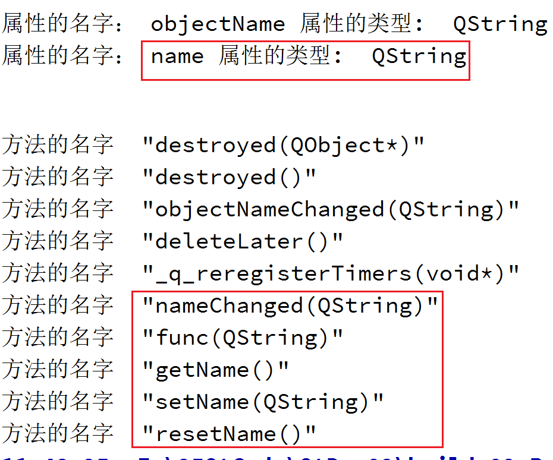


## Day03

### 一、问题回顾

1、如何设置与获取动态属性？

```C++
setProperty/property;
```

2、如何显示设置属性？

```C++
Q_PROPERTY(type name READ getName WRITE setName RESET resetName NITIFY sig)
```

3、运行时类型信息的作用是什么？

4、什么是内省？什么是反射？各自有什么作用？

5、为什么要使用反射？使用反射的条件是什么？使用反射的过程是什么？

```C++
使用反射的条件
(1)QObject  (2)Q_OBJECT  (3)Q_PROPERTY  (4)Q_INVOKABLE
    
使用反射的过程
(1)创建基对象 (2)metaObject函数可以返回QMetaObject  (3)className  
(4)propertyCount  property QMetaProperty name typeName
(5)methodCount  method QMetaMethod methodSi
```


### 二、主窗口

#### 1、基本概念

QMainWindow类继承自QWidget类，因此主窗口就是一个普通的部件，只不过主窗口拥有自已的布局，在主窗口中特定的位置只能添加特定的子部件而已  

#### 2、布局形式

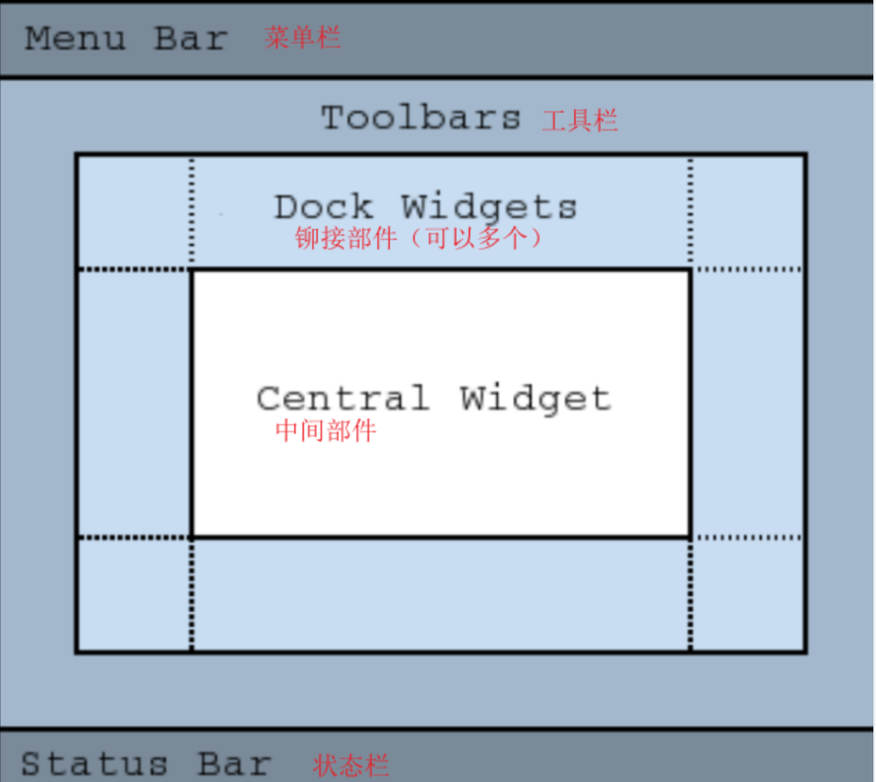

#### 3、菜单栏

<span style=color:red;background:yellow;font-size:20px>QMenuBar类是Qt中用于表示菜单栏的类</span>。Qt菜单栏的主要作用是为用户提供直观、可视化的方式来浏览和选择程序的各种功能和操作。菜单栏通常位于窗口的顶部或顶部附近，包含多个菜单，每个菜单都有一个标题和一系列相关的命令或选项。用户可以通过点击菜单标题或者在菜单栏上的相应按钮来打开菜单，并从中选择需要的操作

```C++
#include <QMenuBar>
#include <QMenu>
#include <QPushButton>

MainWindow::MainWindow(QWidget *parent)
    : QMainWindow(parent)
{
    //set往往表明设置的是有一个，而add开头的函数表明可以设置多个
    setWindowTitle("测试主窗口中的菜单栏");
    //设置窗口的大小
    resize(600, 480);

    //创建菜单栏
    QMenuBar *mbar = new QMenuBar(this);
    mbar->resize(200, 100);
    //添加菜单项
    QMenu *fileMenu = mbar->addMenu("文件");
    QMenu *editMenu = mbar->addMenu("编辑");
    QMenu *saveMenu = mbar->addMenu("保存");

    //在文件菜单下，添加子菜单
    QMenu *newMenu = fileMenu->addMenu("新建");
    QMenu *openMenu = fileMenu->addMenu("打开");
    fileMenu->addSeparator();
    QMenu *closeMenu = fileMenu->addMenu("关闭");
    QAction *printAc = fileMenu->addAction("打印");

    QPushButton *btn = new QPushButton(this);
    btn->setText("按钮");
    btn->move(100, 50);
}
```

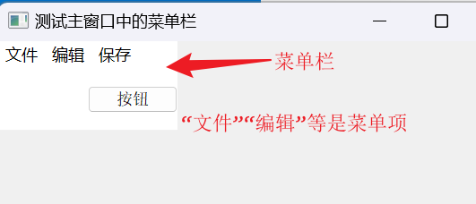

#### 4、工具栏

QToolBar类提供了一个可移动的带有一组部件的面板。默认情况下，该部件中没有任何内容，因此要使QToolBar类有意义，需要向其中添加项目。  

##### 4.1、添加资源文件的方式

- 第一步：在项目上右键，“Add New”,然后选择"Qt"以及"Qt Reource File"，最后选择"Choose"，然后给资源文件添加名字;

- 第二步：在项目中右键点击“Show in Explorer”,可以找到项目的所在目录，然后将资源文件或者文件夹添加到这个文件夹下即可；
- 第三步：添加前缀“Add prefix”，可以修改前缀（一般就建议直接写/即可）；
- 第四步：添加文件，“Add File”将所有的资源文件添加进来即可;
- 第五步：以后使用资源文件的时候，格式是":/" + "路径",例如：":/Image/xx.jpg"

##### 4.2、代码

```C++
#include <QToolBar>
#include <QAction>

MainWindow::MainWindow(QWidget *parent)
    : QMainWindow(parent)
{
    setWindowTitle("测试菜单栏中的工具栏");
    resize(600, 480);

    QToolBar *tbar = new QToolBar(this);
    tbar->resize(300, 50);
    QAction *newAc = tbar->addAction("新建");
    QAction *openAc = tbar->addAction("打开");
    QAction *saveAc = tbar->addAction("保存");
    saveAc->setIcon(QIcon(":/Image/rose.jpeg"));

    tbar->setToolButtonStyle(Qt::ToolButtonTextBesideIcon);
//    tbar->setFloatable(true);//设置是否可以漂浮
//    tbar->setMovable(false);//设置是否可以移动
     
}
```

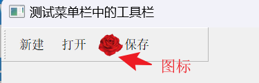

#### 5、主窗口各个部件的设置

```C++
#include "mainwindow.h"
#include <QMenuBar>
#include <QToolBar>
#include <QDockWidget>
#include <QStatusBar>
#include <QPushButton>

MainWindow::MainWindow(QWidget *parent)
    : QMainWindow(parent)
{
    setWindowTitle("测试主窗口");
    resize(600, 480);

    //1、创建菜单栏
    QMenuBar *mbar = menuBar();
    //添加菜单栏到主窗口
    setMenuBar(mbar);

    //添加子菜单
    QMenu *fileMenu = mbar->addMenu("文件");
    QMenu *editMenu = mbar->addMenu("编辑");
    QMenu *toolMenu = mbar->addMenu("工具");

    //在文件子菜单中添加菜单项
    QAction *newAc = fileMenu->addAction("新建");
    QAction *openAc = fileMenu->addAction("打开");
    QAction *saveAc = fileMenu->addAction("保存");

    //2、创建工具栏
    //在QMainWindow中添加菜单栏、状态栏、工具栏等等，如果创建的
    //是堆对象，可以不用指定父对象
    QToolBar *tbar = new QToolBar(this);
    //将工具栏添加到主窗口中
    addToolBar(Qt::TopToolBarArea, tbar);//默认放在顶部
    tbar->setOrientation(Qt::Horizontal);

    //给工具栏添加菜单项
    tbar->addAction(newAc);
    tbar->addAction(openAc);
    tbar->addAction(saveAc);

    //设置停靠范围
    tbar->setAllowedAreas(Qt::LeftToolBarArea | Qt::RightToolBarArea);

    //3、添加铆接部件（浮动窗口）
    QDockWidget *dockWid = new QDockWidget("浮动窗口", this);
    //将浮动窗口添加到主窗口中
    addDockWidget(Qt::TopDockWidgetArea, dockWid);
    //设置可以停靠的范围(要参考中心部件)
    dockWid->setAllowedAreas(Qt::LeftDockWidgetArea | Qt::RightDockWidgetArea);

    //4、设置中心部件
    QPushButton *btn = new QPushButton("按钮", this);
    setCentralWidget(btn);

    //5、状态栏
    QStatusBar *sbar = new QStatusBar(this);
    setStatusBar(sbar);

    QPushButton *btn1 = new QPushButton("按钮1", this);
    QPushButton *btn2 = new QPushButton("按钮2", this);
    QPushButton *btn3 = new QPushButton("按钮3", this);
    QPushButton *btn4 = new QPushButton("按钮4", this);
    sbar->addWidget(btn1);
    sbar->addWidget(btn2);
    sbar->addPermanentWidget(btn3);
    sbar->addPermanentWidget(btn4);
}
```

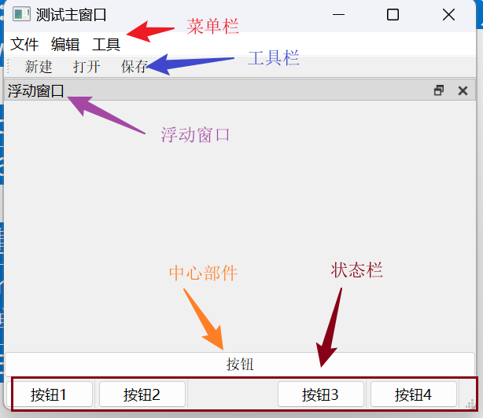

##### 5.1、主窗口总结

- 记住菜单栏、工具栏、浮动窗口、中心部件、状态栏的类的名字；
- 如果只有一个，那么添加的时候，使用set开头的函数，比如：setMenuBar;如果添加的时候，有多个，那么可以使用add开头的函数，比如：addToolBar;
- 对于一些部件部件，有常用的函数，比如：addAction;设置停靠范围setAllowedAreas

### 三、部件

#### 1、基本概念

<span style=color:red;background:yellow;font-size:20px>Qt把建立用户界面的元素称为窗口部件，简称部件</span>，比如：主窗口、对话框、按钮、标签等都称为部件  

<span style=color:red;background:yellow;font-size:20px>把没有嵌入到其它部件中的部件被称为窗口，通常来说窗口是没有父部件的部件</span>(也可以有父部件，比如一个部件设置了父部件，但是设置 Qt::Window标志，那么该部件也是窗口）  

#### 2、布局

<span style=color:red;background:yellow;font-size:20px>Qt的存局管理类或由这些类创建的对象称为布局管理器，简称布局</span> 。需要设置部件的大小、停靠的区域、部件之间的间隔等等。

#### 3、登录窗口的布局

也可以称为设计师模式，对于设置静态界面而言（也就是窗口中的部件不会改变相对位置，不会出现某个部件突然因为某些条件而消失的情况），这种情况下，推荐大家使用UI界面设计的方式设计界面。

##### 3.1、使用UI界面的步骤

- 第一步：首先根据需要选择合适的部件（比如：按钮、标签、行文本）;
- 第二步：各个部件之间的布局，可以将各个部件放在不同的Widget中，然后点击水平、垂直、网格、二维表格布局，如下图：


然后可以根据需求设置弹簧，

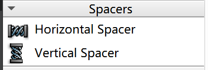

弹簧是可以设置大小的，比如：固定宽度与高度；

- 如果不满足上一次的布局，可以打破布局，使用如下按钮：


然后进行重新布局

- 如果还有资源文件，可以进行资源文件的添加，添加方式一样，但是可以在右下角找到icon关键字进行设置。

##### 3.2、登录窗口的设计过程

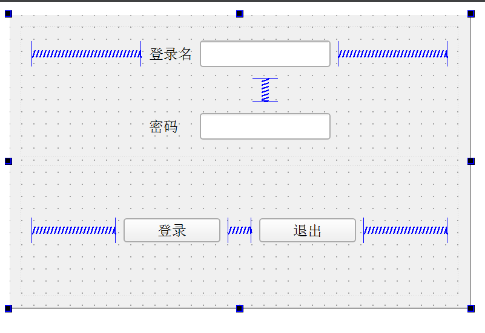

##### 3.3、登录窗口的设计结果

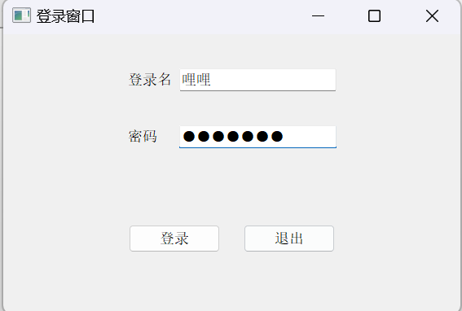

### 四、<span style=color:red;background:yellow;font-size:30px>四种布局管理器(非常重要)</span>

#### 1、水平布局

```C++
#include "widget.h"

#include <QPushButton>
#include <QHBoxLayout>

Widget::Widget(QWidget *parent)
    : QWidget(parent)
{
    resize(600, 480);

    QPushButton *btn1 = new QPushButton("按钮1");
    QPushButton *btn2 = new QPushButton("按钮2");
    QPushButton *btn3 = new QPushButton("按钮3");

    //布局管理器的使用步骤
    //1、创建布局管理器的对象
    //2、使用addWidget将各个需要布局的对象添加到布局管理器中
    //3、调用setLayout将布局管理器对象添加进来
    QHBoxLayout *hlayout = new QHBoxLayout;
    hlayout->addWidget(btn1);
    hlayout->addWidget(btn2);
    hlayout->addWidget(btn3);

    setLayout(hlayout);
}
```

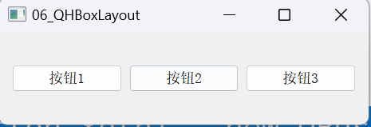

总结：布局管理器的使用步骤

-  第一步：创建布局管理器的对象，并且不需要指定父对象；
- 第二步：使用addWidget将各个需要布局的部件添加到布局管理器中；
- 第三步：调用QWidget::setLayout将布局管理器对象添加进来.

#### 2、垂直布局

```C++
#include "widget.h"

#include <QPushButton>
#include <QVBoxLayout>

Widget::Widget(QWidget *parent)
    : QWidget(parent)
{
    resize(600, 480);

    QPushButton *btn1 = new QPushButton("按钮1");
    QPushButton *btn2 = new QPushButton("按钮2");
    QPushButton *btn3 = new QPushButton("按钮3");

    //布局管理器的使用步骤
    //1、创建布局管理器的对象
    //2、使用addWidget将各个需要布局的部件添加到布局管理器中
    //3、调用setLayout将布局管理器对象添加进来
    QVBoxLayout *vlayout = new QVBoxLayout;

    vlayout->addWidget(btn1);
    vlayout->addWidget(btn2);
    vlayout->addWidget(btn3);

    setLayout(vlayout);
}
```

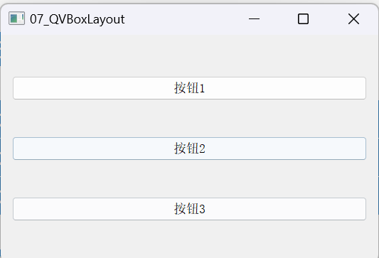

#### 3、网格（栅格）布局

```C++
#include "widget.h"

#include <QPushButton>
#include <QGridLayout>

Widget::Widget(QWidget *parent)
    : QWidget(parent)
{
    resize(600, 480);

    QPushButton *btn1 = new QPushButton("第一个按钮");
    QPushButton *btn2 = new QPushButton("第二个按钮");
    QPushButton *btn3 = new QPushButton("第三个按钮");
    QPushButton *btn4 = new QPushButton("第四个按钮");

    //给btn1设置了大小策略（水平策略，垂直策略）
    btn1->setSizePolicy(QSizePolicy::Fixed, QSizePolicy::Expanding);

    QGridLayout *glayout = new QGridLayout;

    //(部件，起始行，起始列，占据的行数，占据的列数);
    //如果没有指定占据的行数与列数，那么默认占据一行一列
    glayout->addWidget(btn1, 0, 0, 3, 1);
    glayout->addWidget(btn2, 0, 2);
    glayout->addWidget(btn3, 2, 1, 1, 2);
    glayout->addWidget(btn4, 1, 3);

    setLayout(glayout);
}
```

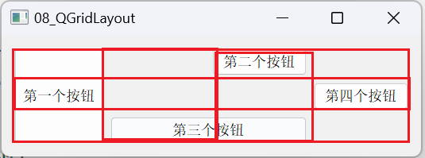

#### 4、二维表格布局

```C++
#include "widget.h"

#include <QLineEdit>
#include <QFormLayout>

Widget::Widget(QWidget *parent)
    : QWidget(parent)
{
    resize(600, 480);

    QLineEdit *lineEdit1 = new QLineEdit;
    QLineEdit *lineEdit2 = new QLineEdit;
    QLineEdit *lineEdit3 = new QLineEdit;

    QFormLayout *flayout = new QFormLayout;

    //flayout->setRowWrapPolicy(QFormLayout::WrapAllRows);
    //每次添加一行
    flayout->addRow("学号", lineEdit1);
    flayout->addRow("姓名", lineEdit2);
    flayout->addRow("学校", lineEdit3);

    setLayout(flayout);
}
```

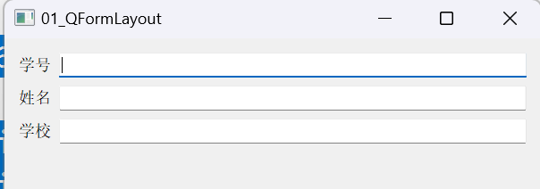

## Day04

### 一、问题回顾

1、主窗口QMainWindow中包含哪些部分？部件之间的布局形式如何？如何创建并添加每个部件？

2、什么是部件？什么是窗口？二者之间有什么联系与区别？

3、布局管理器（布局）的作用什么？可以使用哪些方式对部件进行布局？

4、布局管理器有哪四种？分别是什么？使用布局管理器的步骤如何？


### 二、按钮

#### 0、继承图

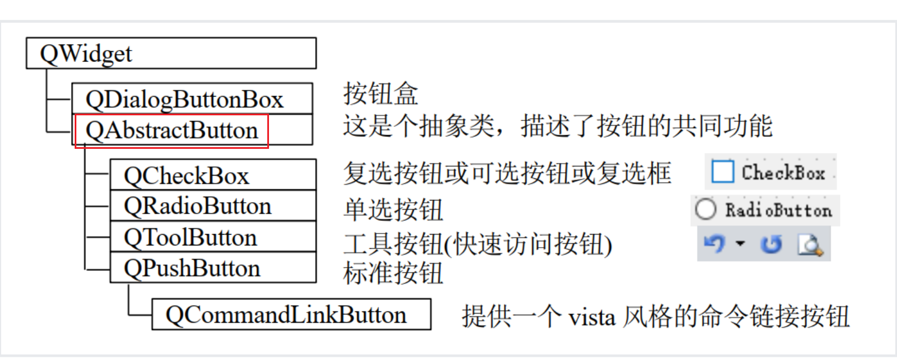

#### 1、普通按钮QPushButton(熟悉)

```C++
#include "widget.h"

#include <QPushButton>
#include <QDebug>
#include <QMenu>

Widget::Widget(QWidget *parent)
    : QWidget(parent)
{
    setWindowTitle("测试普通按钮");

    //重置窗口大小
    resize(600, 480);

    //指定父对象的方式有两种
    //（1）构造函数中传参
    //(2)调用setParent
    QPushButton *btn = new QPushButton;
    btn->setParent(this);

    //移动按钮
    btn->move(100, 100);
    //设置按钮的大小
    btn->resize(300, 200);
    //设置按钮的文本
    btn->setText("测试按钮");
    //这两行代码可以去掉QString中的双引号
    qDebug().noquote() << "=====" << btn->text();
    qDebug() << "=====" << btn->text().toUtf8().constData();

    btn->setFlat(true);//设置扁平

    //按钮中是可以添加菜单的
    QMenu *me = new QMenu("文件", this);
    me->addMenu("新建");
    btn->setMenu(me);
}
```

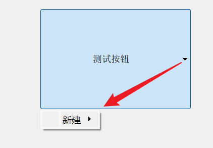

需要注意的几个点：

<span style=color:red;background:yellow;font-size:20px>1、设置父对象的方式</span>

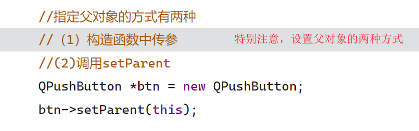

2、对于部件中的函数而言，如果有setXXX函数，往往会有获取XXX的函数，比如：setText、text；

#### 2、命令按钮QToolButton

QToolButton类提供了用于命令或选项可以快速访问的按钮，通常可以用在QToolBar里面。QToolButton通常只显示一个图标而不显示文本标签（尽管也可以显示文本），并且通常没有边框，在鼠标悬停和按下时的视觉反馈较轻  

```C++
#include "widget.h"

#include <QToolButton>

Widget::Widget(QWidget *parent)
    : QWidget(parent)
{
    resize(600, 480);

    QToolButton *toolBtn = new QToolButton(this);
    toolBtn->move(100, 100);
    toolBtn->resize(300, 200);

    toolBtn->setIcon(QIcon(":/Image/linux.png"));
    toolBtn->setText("显示图标");
    toolBtn->setToolButtonStyle(Qt::ToolButtonTextUnderIcon);
}
```

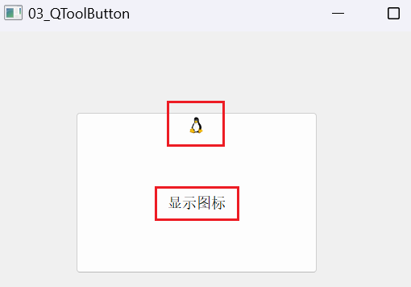

#### 3、单选按钮QRadioButton(熟悉)

QRadioButton部件提供了一个带有文本标签的单选框（单选按钮）。在一组单选框中，一次只能选中一个单选框。单选框默认开启自动互斥。  

```C++

#include <QRadioButton>
#include <QDebug>

Widget::Widget(QWidget *parent)
    : QWidget(parent)
{
    resize(600, 480);

    QRadioButton *radio1 = new QRadioButton("男", this);
    QRadioButton *radio2 = new QRadioButton("女", this);
    radio1->move(100, 100);
    radio2->move(100, 150);

    //默认选中
    radio1->setChecked(true);

    connect(radio1, &QRadioButton::toggled, [=](bool stat){
        if(stat)
        {
            qDebug() << "男生被选中了";
        }
        else
        {
            qDebug() << "女生被选中了";
        }

        if(radio1->isChecked())
        {
            qDebug() << "也是男生选中了";
        }
    });
}
```

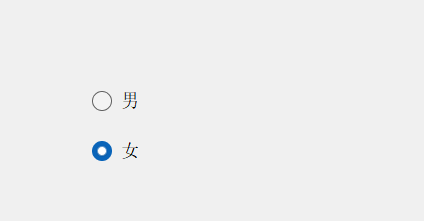

#### 4、复选按钮QCheckBox(熟悉)

```C++
#include "widget.h"

#include <QCheckBox>

Widget::Widget(QWidget *parent)
    : QWidget(parent)
{
    resize(600, 480);

    QCheckBox *box1 = new QCheckBox("味道鲜美",this);
    QCheckBox *box2 = new QCheckBox("环境干净",this);
    QCheckBox *box3 = new QCheckBox("都不行",this);

    box1->move(100, 100);
    box2->move(100, 200);
    box3->move(100, 300);

    //设置三态模式：选中、待选、未选中
    box1->setTristate(true);
    
    connect(box1, &QCheckBox::stateChanged, [](int stat){
        if(stat == Qt::Unchecked)
        {
            qDebug() << "未选中";
        }
        else if(stat == Qt::PartiallyChecked)
        {
            qDebug() << "待选中";
        }
        else
        {
            qDebug() << "选中";
        }
    });     
}
```

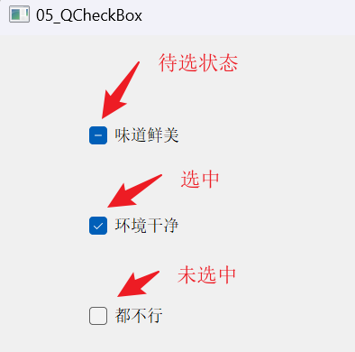

#### 5、命令按钮QCommandLinkButton

```C++
#include <QCommandLinkButton>
#include <QDesktopServices>
#include <QUrl>

Widget::Widget(QWidget *parent)
    : QWidget(parent)
{
    resize(600, 480);

    QCommandLinkButton *clb = new QCommandLinkButton(this);
    clb->move(100, 100);
    clb->resize(300, 200);

    clb->setText("1111");
    clb->setDescription("点击按钮可以跳转到百度");

    connect(clb, &QCommandLinkButton::clicked, []{
        QDesktopServices::openUrl(QUrl("www.baidu.com"));
    });
}
```

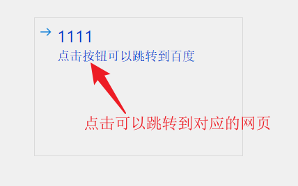

#### 6、按钮盒子QDialogButtonBox

QDialogButtonBox是一个放置按钮的盒子，它允许用户添加按钮，并自动按照当前的桌面环境来选择合适的布局。

```C++
#include <QDialogButtonBox>
#include <QPushButton>

Widget::Widget(QWidget *parent)
    : QWidget(parent)
{
    resize(600, 480);

    QDialogButtonBox *dbb = new QDialogButtonBox(this);
    dbb->move(100, 100);
    dbb->resize(400, 300);

    dbb->addButton(QDialogButtonBox::Ok);
    dbb->addButton(QDialogButtonBox::Cancel);

    QPushButton *btn = new QPushButton("自定义按钮", this);
    dbb->addButton(btn, QDialogButtonBox::AcceptRole);

}
```

  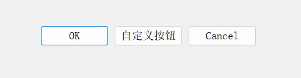

### 三、容器

#### 1、分组框QGroupBox

容器控件，主要用于组织和管理一组相关的控件（如按钮、复选框、文本框等），并为这些控件提供一个框架和标题 .

```C++
#include "widget.h"

#include <QGroupBox>
#include <QRadioButton>
#include <QCheckBox>
#include <QVBoxLayout>
#include <QGridLayout>

Widget::Widget(QWidget *parent)
    : QWidget(parent)
{
    resize(600, 480);

    //------第一个分组框，里面都是单选按钮-----
    QGroupBox *rBox1 = new QGroupBox("性别");

    QRadioButton *man = new QRadioButton("男");
    QRadioButton *woman = new QRadioButton("女");

    QVBoxLayout *vlayout = new QVBoxLayout;

    vlayout->addWidget(man);
    vlayout->addWidget(woman);

    rBox1->setLayout(vlayout);


    //------第二个分组框，里面都是复选按钮-----
    QGroupBox *rBox2 = new QGroupBox("复选按钮组");

    QCheckBox *cbox1 = new QCheckBox("QCheckBox1");
    QCheckBox *cbox2 = new QCheckBox("QCheckBox2");
    QCheckBox *cbox3 = new QCheckBox("QCheckBox3");

    QVBoxLayout *vlayout2 = new QVBoxLayout;

    vlayout2->addWidget(cbox1);
    vlayout2->addWidget(cbox2);
    vlayout2->addWidget(cbox3);

    rBox2->setLayout(vlayout2);

    //------第三个分组框，里面既有单选按钮也有复选按钮-----
    QGroupBox *rBox3 = new QGroupBox("组合按钮组");

    QRadioButton *radio11 = new QRadioButton("QRadioButton11");
    QRadioButton *radio22 = new QRadioButton("QRadioButton22");
    QCheckBox *cbox11 = new QCheckBox("QCheckBox11");
    QCheckBox *cbox22 = new QCheckBox("QCheckBox22");

    QVBoxLayout *vlayout3 = new QVBoxLayout;

    vlayout3->addWidget(radio11);
    vlayout3->addWidget(radio22);
    vlayout3->addWidget(cbox11);
    vlayout3->addWidget(cbox22);

    rBox3->setLayout(vlayout3);


    //----最后对三个分组框进行网格布局
    QGridLayout *glayout = new QGridLayout;
    glayout->addWidget(rBox1, 0, 0, 1, 1);
    glayout->addWidget(rBox2, 0, 2, 1, 1);
    glayout->addWidget(rBox3, 1, 1, 1, 1);

    setLayout(glayout);

    woman->setChecked(true);
    cbox2->setTristate(true);
    cbox2->setCheckState(Qt::PartiallyChecked);
    radio11->setChecked(true);
    cbox22->setChecked(true);
    //cbox22->setCheckState(Qt::Checked);
}
```

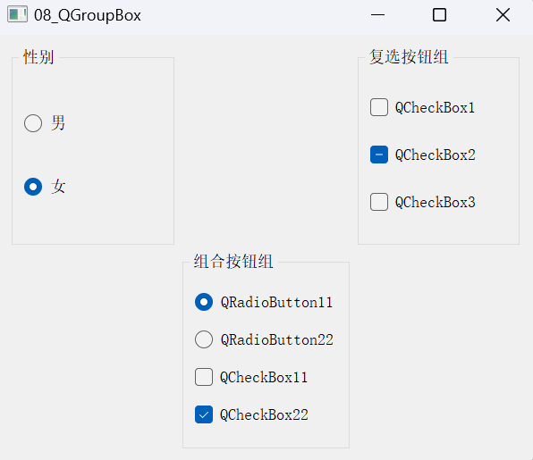

#### 2、滚动区域QScrollArea

继承自QAbstractScrollArea类，QScrollArea提供了一个滚动视图的框架，它本身不直接显示内容，而是将内容（通常是一个QWidget或其子类）作为其子项，并通过滚动条来访问这些内容的全部。QScrollArea支持水平和垂直滚动，并且可以根据需要自动调整滚动条的出现  

```C++
#include <QScrollArea>
#include <QLabel>

Widget::Widget(QWidget *parent)
    : QWidget(parent)
{
    resize(1000, 800);
    QScrollArea *sa = new QScrollArea(this);
    sa->resize(600, 400);

    QLabel *label = new QLabel(this);
    label->setPixmap(QPixmap(":/wangdao.png"));
    sa->setWidget(label);
}
```

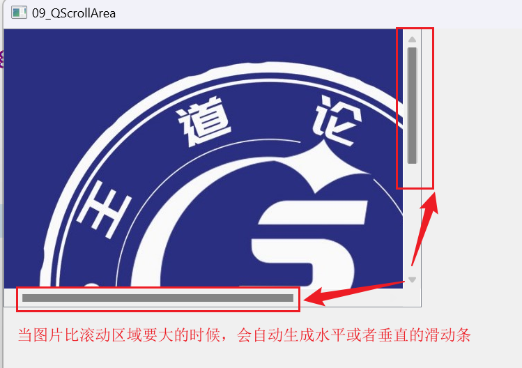

#### 3、标签小部件QTableWidget

它提供了一个选项卡式的界面，允许用户通过点击不同的标签页来切换不同的内容区域。它是Qt Widgets 模块的一部分，通常用于创建具有多个页面的应用程序界面  

```C++
Widget::Widget(QWidget *parent)
    : QWidget(parent)
{
    resize(600, 480);

    QTabWidget *tabWid = new QTabWidget(this);
    tabWid->move(100, 100);
    tabWid->resize(400, 300);

    QWidget *w1 = new QWidget(this);
    QWidget *w2 = new QWidget(this);

    tabWid->addTab(w1, "张三");
    tabWid->addTab(w2, "李四");

    QLabel *label = new QLabel("选择");
    QLineEdit *lineEdit = new QLineEdit;
    QPushButton *btn = new QPushButton("点击按钮");

    QHBoxLayout *hlayout = new QHBoxLayout;

    hlayout->addWidget(label);
    hlayout->addWidget(lineEdit);
    hlayout->addWidget(btn);

    w1->setLayout(hlayout);

    tabWid->setMovable(true);//设置标签项是否可以移动
    tabWid->setTabsClosable(true);//设置标签项是否可以关闭
    tabWid->setTabShape(QTabWidget::Triangular);//设置标签项的形状
    tabWid->setTabPosition(QTabWidget::South);//设置标签项的方位

    connect(btn, &QPushButton::clicked, [=]{
        qDebug() << "打印单行文本框中的内容 :" << lineEdit->text();
    });

    connect(tabWid, &QTabWidget::tabCloseRequested, [=](int idx){
        qDebug() << "idx = " << idx;
        tabWid->removeTab(idx);
    });
}
```

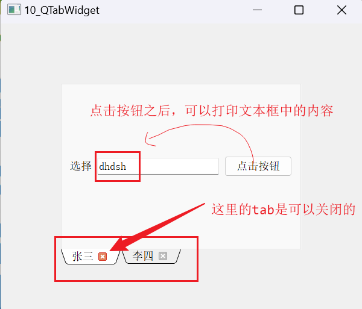

## Day05

### 一、问题回顾

1、按钮部件的基类是那个类？有哪些按钮类？各有什么特点？常见信号有那几个？

2、如果想将一组部件进行分组，可以使用哪个部件？

3、如果想将一个图片显示到窗口，并且图片比窗口大，能有那个部件进行滚动显示？

4、如果想将让用户通过点击不同的标签页来切换不同的内容区域，可以使用哪个部件？


### 二、模型视图

#### 1、基本概念

在Qt中，模型/视图架构（Model/View Architecture） 是一种用于<span style=color:red;background:yellow;font-size:20px>分离数据和用户界面的设计模式</span>。它将数据的存储（模型）与数据的显示（视图）分开，从而提高了代码的可维护性和灵活性  

#### 2、模型

<span style=color:red;background:yellow;font-size:20px>模型负责管理数据</span>，并提供接口供视图和委托（Delegate）访问数据  

#### 3、视图

<span style=color:red;background:yellow;font-size:20px>视图负责显示模型中的数据</span>，并提供用户交互功能（如选择、排序等）  

#### 4、模型对应的类

QAbstractItemModel：所有模型的基类； 

QStandardItemModel：通用的模型，适合存储任意结构的数据； 

QStringListModel：用于存储字符串列表的简单模型； 

QFileSystemModel：用于显示文件系统的模型； 

QSqlTableModel：用于与数据库交互的模型；  

#### 5、视图相关的类

QAbstractItemView：所有视图的基类； 

QListView：用于显示列表数据的视图； 

QTableView：用于显示表格数据的视图；

 QTreeView：用于显示树形数据的视图  

### 三、项目视图

#### 1、列表视图ListView

继承自QAbstractItemView，用于以列表形式展示数据模型；支持单列或多列显示、图标视图、流视图等不同的显示模式；适用于需要呈现线性结构的数据列表的情况  

```C++

#include <QListView>
#include <QStringListModel>
#include <QStringList>

Widget::Widget(QWidget *parent)
    : QWidget(parent)
{
    resize(1000, 800);

    //4、创建真正存储数据的数据结构
    //本质其实就是QList<QString>
    QStringList slist;
    slist << "锄禾日当午" << "汗滴禾下土" << "谁知盘中餐" << "粒粒皆辛苦";

    //3、创建模型对象(存储数据)
    QStringListModel *model = new QStringListModel(slist, this);

    //1、创建视图对象(显示数据)
    QListView *lstView = new QListView(this);
    lstView->resize(600, 500);
    lstView->move(100, 100);

    //2、使用视图对象设置model
    lstView->setModel(model);
}
```

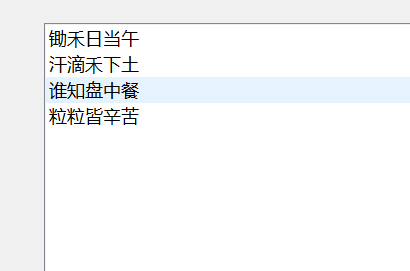

<span style=color:red;background:yellow;font-size:20px>**使用步骤总结**：</span>

1、创建视图对象，也就是使用QLIstView创建对象；

2、使用视图对象调用setModel函数，指定模型对象；

3、创建模型对象，也就是使用QStringListModel创建对象；

4、模型对象真正进行存储数据使用的是QStringList数据结构，所以需要创建QStringList的对象存储数据;

#### 2、树视图QTreeView

```C++
#include "widget.h"

#include <QTreeView>
#include <QStandardItemModel>
#include <QList>
#include <QStandardItem>

Widget::Widget(QWidget *parent)
    : QWidget(parent)
{
    resize(1000, 800);

    //3、创建模型对象
    QStandardItemModel *model = new QStandardItemModel(this);

    //7、设置水平标签
    model->setHorizontalHeaderLabels(QStringList() << "编号"
                                     << "初中部 | 高中部");

    //--------顶层节点------------
    //5、使用QList数据类型存储QStandardItem *的指针
    QList<QStandardItem *> root;
    //6、每一个数据其实都是一个个的QStandardItem类型的对象
    QStandardItem *one = new QStandardItem("1");
    QStandardItem *mid = new QStandardItem("初中部");

    root.push_back(one);
    root.push_back(mid);

    //4、使用model对象调用相应的函数appendRow添加数据
    model->appendRow(root);

    //----------第二层节点---------
    QList<QStandardItem *> child1;
    QStandardItem *oneone = new QStandardItem("11");
    QStandardItem *yinianji = new QStandardItem("一年级");

    child1.push_back(oneone);
    child1.push_back(yinianji);

    one->appendRow(child1);

    //----------第三层节点---------
    QList<QStandardItem *> son1;
    QStandardItem *oneoneone = new QStandardItem("111");
    QStandardItem *yiban = new QStandardItem("一班");

    son1.push_back(oneoneone);
    son1.push_back(yiban);

    oneone->appendRow(son1);

    //----------第三层节点的兄弟节点---------
    QList<QStandardItem *> son2;
    QStandardItem *oneonetwo = new QStandardItem("112");
    QStandardItem *erban = new QStandardItem("二班");

    son2.push_back(oneonetwo);
    son2.push_back(erban);

    oneone->appendRow(son2);

    //--------顶层节点的兄弟节点-----------
    QList<QStandardItem *> root2;
    QStandardItem *two = new QStandardItem("2");
    QStandardItem *high = new QStandardItem("高中部");

    root2.push_back(two);
    root2.push_back(high);

    model->appendRow(root2);

    //1、创建树视图对象
    QTreeView *treeView = new QTreeView(this);
    treeView->resize(800, 600);

    //2、调用setMode函数，指定模型对象
    treeView->setModel(model);

    //使用该函数，将数据全部展开
    treeView->expandAll();
}


```

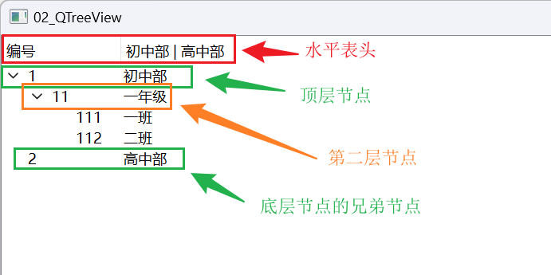

<span style=color:red;background:yellow;font-size:20px>**使用步骤总结**</span>

1、创建视图对象，也就是QTreeView的对象；

2、使用视图对象调用setModel函数 ，指定模型对象；

3、创建模型对象，也就是使用QStandardItemModel创建对象；

4、使用<span style=color:red;background:yellow;font-size:20px>appendRow函数</span>添加数据到模型对象中；

5、添加的数据类型是QList<QStandardItem *>,对于其中的每一项，其实都是一个个的QStandardItem的对象；

6、最后需要设置水平表头，使用的是模型对象调用setHorizontalHeaderLabels函数。

#### 3、表视图QTableView

继承自 QAbstractItemView，用于以表格形式展示数据模型；支持表格视图的交互操作，如编辑、选择、排序、过滤等；适用于需要呈现二维表格数据的情况  

```C++
#include "widget.h"

#include <QTableView>
#include <QStandardItemModel>

Widget::Widget(QWidget *parent)
    : QWidget(parent)
{
    resize(1000, 800);

    //3、创建模型对象
    QStandardItemModel *model = new QStandardItemModel(this);

    //5、添加水平表头
    model->setHorizontalHeaderItem(0, new QStandardItem("学号"));
    model->setHorizontalHeaderItem(1, new QStandardItem("姓名"));
    model->setHorizontalHeaderItem(2, new QStandardItem("性别"));
    model->setHorizontalHeaderItem(3, new QStandardItem("分数"));

    //4、添加数据
    model->setItem(0, 0, new QStandardItem("191102"));
    model->setItem(0, 1, new QStandardItem("杨逍"));
    model->setItem(0, 2, new QStandardItem("男"));
    model->setItem(0, 3, new QStandardItem("680"));

    model->setItem(1, 0, new QStandardItem("191101"));
    model->setItem(1, 1, new QStandardItem("张三丰"));
    model->setItem(1, 2, new QStandardItem("男"));
    model->setItem(1, 3, new QStandardItem("700"));

    model->setItem(2, 0, new QStandardItem("191103"));
    model->setItem(2, 1, new QStandardItem("赵敏"));
    model->setItem(2, 2, new QStandardItem("女"));
    model->setItem(2, 3, new QStandardItem("748"));

    //1、创建视图对象
    QTableView *tabView = new QTableView(this);
    tabView->resize(800, 600);

    //2、调用setModel函数，指定模型
    tabView->setModel(model);

    tabView->setEditTriggers(QAbstractItemView::NoEditTriggers);
    model->sort(0, Qt::DescendingOrder);
}
```

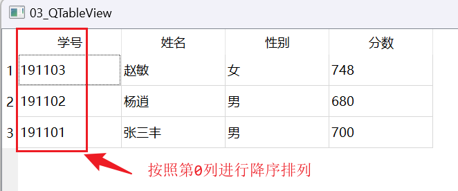

<span style=color:red;background:yellow;font-size:20px>**使用步骤总结**</span>

1、创建视图对象，也就是QTableView的对象；

2、使用视图对象调用setModel函数 ，指定模型对象；

3、创建模型对象，也就是使用QStandardItemModel创建对象；

4、使用<span style=color:red;background:yellow;font-size:20px>setItem函数</span>添加数据到模型对象中,注意要指定行与列；

5、对于其中的每一项，其实都是一个个的QStandardItem的对象；

6、最后需要设置水平表头，使用的是模型对象调用setHorizontalHeaderLabels/setHorizontalHeaderItem函数。

### 四、项目部件

#### 1、列表部件QListWidget

提供了一个基于项的列表部件，<span style=color:red;background:yellow;font-size:20px>QListWidgetItem</span>是列表中的项。是一个用于显示列表数据的控件，适合展示一维数据（如文件列表、选项列表）。QListWidget是一个便利类，它提供了一个类似于QListView提供的列表视图，但具有用于添加和删除项的经典基于项的接口。QListWidget使用一个内部模型管理列表中的每个QListWidgetItem。

```C++
#include <QListWidget>

Widget::Widget(QWidget *parent)
    : QWidget(parent)
{
    resize(1000, 800);

    QListWidget *lstWid = new QListWidget(this);
    lstWid->move(100, 100);
    lstWid->resize(800, 600);

    //第一种添加的方式，以字符串的形式进行添加
    lstWid->addItem("锄禾日当午");
    lstWid->addItem("汗滴禾下土");

    //第二种添加的方式，构建QListWidgetItem对象(可以更改文本的显示方式)
    QListWidgetItem *item1 = new QListWidgetItem("白日依山尽");
    item1->setTextAlignment(Qt::AlignRight);
    lstWid->addItem(item1);
    QListWidgetItem *item2 = new QListWidgetItem("黄河入海流");
    item2->setTextAlignment(Qt::AlignHCenter);
    lstWid->addItem(item2);

    //第三种添加的方式，以QStringList类型的形式进行添加
    lstWid->addItems(QStringList() << "锄禾日当午" << "汗滴禾下土");
}
```

  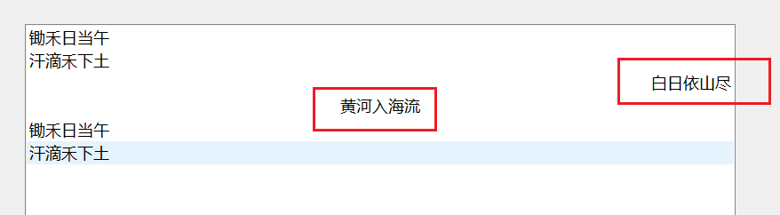

#### 2、树部件QTreeWidget

提供了一个基于项的树形结构的部件，<span style=color:red;background:yellow;font-size:20px>QTreeWidgetItem是树形列表中的项</span>。QTreeWidget是一个用于显示树形结构的部件，用于展示树形列表项。适合展示层次化数据（如文件目录、组织结构）。支持多列显示，但通常第一列用于显示节点文本，其他列用于显示附加信息  

```C++
//用于设置表头标签（列标题）
void setHeaderLabels(const QStringList &labels);
//可以使用addTopLevelItem()函数添加顶层节点。
void addTopLevelItem(QTreeWidgetItem *item);
//使用addChild()函数为节点添加子节点。
void addChild(QTreeWidgetItem *child);
```

#### 3、表格部件QTableWidget

QTableWidget是Qt框架中的一个重要控件，用于展示和编辑二维表格数据。QTableWidget以行和列的形式组织数据，每个单元格由一个<span style=color:red;background:yellow;font-size:20px>QTableWidgetItem</span>对象表示，可以包含文本、图标或其他数据类型  

```C++
//设置表格的列数
void setColumnCount(int columns);
//设置表格的行数
void setRowCount(int rows);
//设置单元格，在第row行，第column列设置表格控件内容item
void setItem(int row, int column, QTableWidgetItem *item);
//设置垂直表头标签（行表头）
void setVerticalHeaderLabels(const QStringList &labels);
//设置水平表头标签（列表头）
void setHorizontalHeaderLabels(const QStringList &labels);
```


## Day06

### 一、问题回顾

1、模型视图设计模式中，模型的作用是什么？视图的作用是什么？如何交互？

2、视图部件中，使用步骤是什么样的？

```C++
1、列表视图  QListView    创建视图对象、setModel、创建模型对象、QStringList；
2、树视图  QTreeView      创建视图对象、setModel、创建模型对象、添加数据appendRow、QList<QStandardItem *>、最后需要设置水平表头setHorizontalHeaderLabels；
 
3、表格视图  QTableView   创建视图对象、setModel、创建模型对象、添加数据setItem、QStandardItem *、最后需要设置水平表头setHorizontalHeaderLabels/setHorizontalHeaderItem；
```

3、项目部件中，分别使用哪个类体现其中的每个项？

```C++
QListWidget;  QListWidgetItem;
QTreeWidget;  QTreeWidgetItem;
QTableWidget; QTableWidgetItem;
```


### 二、输入部件

#### 1、下拉框QComboBox

下拉列表框部件，常用于让用户从多个选项中选择一个。它既可以展示文本选项，也可以展示图像和自定义的内容。  

```C++
#include <QComboBox>
#include <QDebug>

Widget::Widget(QWidget *parent)
    : QWidget(parent)
{   
    resize(600, 480);
    QComboBox *cbox = new QComboBox(this);
    cbox->move(100, 100);
    cbox->resize(200, 40);

    cbox->addItem("北京市");
    cbox->addItem("天津市");
    cbox->addItem("上海市");
    cbox->addItem("重庆市");
    cbox->addItem("湖北省");
    cbox->addItem("湖南省");
    cbox->addItem("海南省");

    connect(cbox, QOverload<int>::of(&QComboBox::currentIndexChanged),
            [=](int idx){
        qDebug() << "idx = " << idx;
        qDebug() << "文本信息: " << cbox->currentText();
    });
}
```

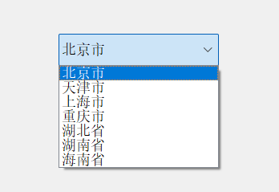

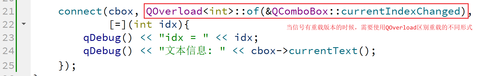

#### 2、<span style=color:red;background:yellow;font-size:30px>三种文本框（非常重要）</span>

QLineEdit：单行文本框，文本的数据量比较小的时候，可以使用这种文本框，比如：登录名、密码。

QTextEdit:富文本框，也可以存储纯文本，但是文本量一般会受到操作系统限制，比如：windows的时候，3w字符。

QPlainTextEdit:纯文本框，可以存储非常大量的纯文本。

```C++
#include "widget.h"

#include <QLineEdit>
#include <QTextEdit>
#include <QPlainTextEdit>
#include <QTextCursor>
#include <QTextCharFormat>

Widget::Widget(QWidget *parent)
    : QWidget(parent)
{
    resize(1000, 800);

    //第一种：单行文本框
//    QLineEdit *lineEdit = new QLineEdit(this);
//    lineEdit->move(100, 50);
//    lineEdit->setText("你好");
//    //设置密码模式
//    lineEdit->setEchoMode(QLineEdit::Password);

    //第二种：纯文本框
//    QPlainTextEdit *ptEdit = new QPlainTextEdit(this);
//    ptEdit->move(100, 150);
//    ptEdit->setPlainText("对哈和大家还非得哈哈开发哈很发达哈哈发回复打开换肤大师");
//    ptEdit->insertPlainText("xxxhjdahdjahf");
//    ptEdit->setPlaceholderText("输入密码");//占位符文本

    //第三种：富文本框
    //在插入文本的时候，将QLineEdit以及QPlainTextEdit
    //中的所有插入文本的方式都进行了包含
    QTextEdit *textEdit = new QTextEdit(this);
    textEdit->move(400, 150);
    textEdit->resize(500, 300);
//    textEdit->setText("heheh");
//    textEdit->setPlaceholderText("");
//    textEdit->setPlainText("xxx");
//    textEdit->insertPlainText("aaa");
    textEdit->insertPlainText("This is an Text Edit");

    //将光标获取出来，移动光标的位置，对选中的文字进行处理
    QTextCursor cursor = textEdit->textCursor();

    //移动光标的位置
    cursor.movePosition(QTextCursor::Start);
    //移动光标的位置，保持锚点
    cursor.movePosition(QTextCursor::EndOfWord, QTextCursor::KeepAnchor);

    //设置选中字体的各种风格或者格式
    QTextCharFormat format;
    format.setFont(QFont("宋体"));
    format.setFontItalic(true);
    format.setFontPointSize(40);
    format.setForeground(QBrush(QColor(255, 0, 0)));

    cursor.mergeCharFormat(format);
}
```

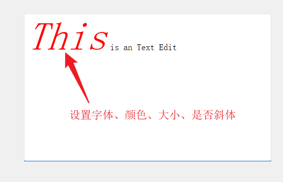

#### 3、微调框

QSpinBox或者QDoubleSpinBox称为微调框。它们是带有按钮的输入框，可以用来输入整数或浮点数或者通过点击按钮来修改数值大小。其中，QSpinBox提供了一个文本框和两个按钮，一个用于增加值，一个用于减小值  

```c++
#include "widget.h"
#include <QSpinBox>

Widget::Widget(QWidget *parent)
    : QWidget(parent)
{
    resize(600, 480);
    QSpinBox *spinBox = new QSpinBox(this);
    spinBox->move(100, 100);
    spinBox->resize(200, 30);

    //设置范围
    spinBox->setRange(-100, 100);
    //设置每次更改的步长
    spinBox->setSingleStep(10);
    //设置默认值
    spinBox->setValue(19);

}
```

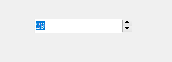

#### 4、时间日期

QTimeEdit：时间相关。

QDateEdit:日期相关。

QDateTimeEdit：时间日期。

```C++
#include "widget.h"

#include <QTimeEdit>
#include <QDateEdit>
#include <QDateTimeEdit>
#include <QCalendarWidget>

Widget::Widget(QWidget *parent)
    : QWidget(parent)
{
    resize(1000, 800);
    
    QTimeEdit *tmedit = new QTimeEdit(QTime::currentTime(), this);
    tmedit->move(100, 0);
    tmedit->resize(300, 30);

    QDateEdit *dtEdit = new QDateEdit(QDate::currentDate(), this);
    dtEdit->move(100, 100);
    dtEdit->resize(300, 30);

    QDateTimeEdit *datetmEdit =
            new QDateTimeEdit(QDateTime::currentDateTime(), this);
    datetmEdit->move(100, 200);
    datetmEdit->resize(300, 30);

    QCalendarWidget *cw = new QCalendarWidget(this);
    cw->move(100, 300);
    cw->resize(400, 400);
}
```

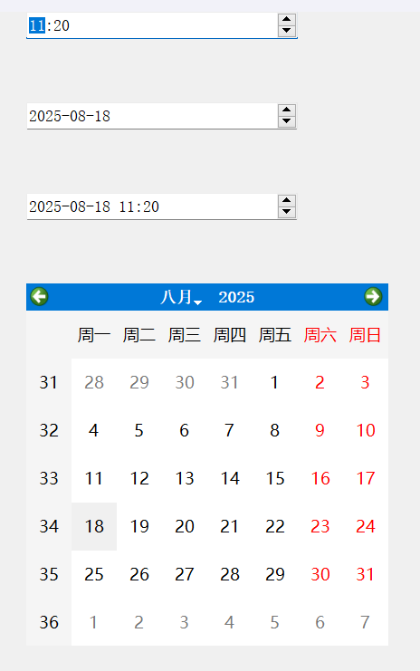

#### 5、<span style=color:red;background:yellow;font-size:25px>水平/垂直滑动块(重要)</span>

```C++
#include "widget.h"

#include <QScrollBar>

Widget::Widget(QWidget *parent)
    : QWidget(parent)
{
    resize(600, 480);

    QScrollBar *hsb = new QScrollBar(Qt::Horizontal, this);
    hsb->move(100, 100);
    hsb->resize(400, 30);


    QScrollBar *vsb = new QScrollBar(Qt::Vertical, this);
    vsb->resize(30, 400);
}
```


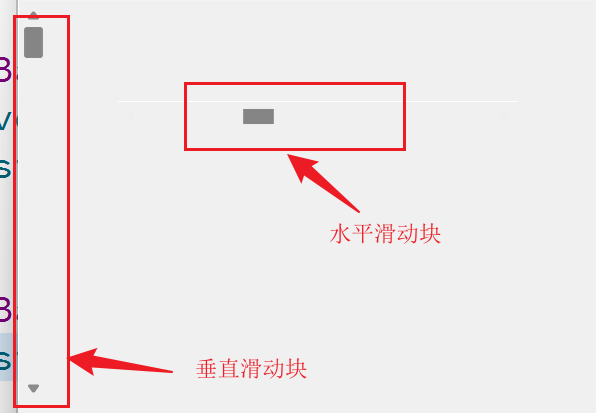

#### 6、<span style=color:red;background:yellow;font-size:25px>水平/垂直滑动条(重要)</span>

```C++
#include "widget.h"

#include <QSlider>

Widget::Widget(QWidget *parent)
    : QWidget(parent)
{
    resize(600, 480);

    QSlider *hslider = new QSlider(Qt::Horizontal, this);
    hslider->move(100, 100);
    hslider->resize(200, 20);
    //设置范围
    hslider->setRange(0, 100);
    //设置刻度
    hslider->setTickInterval(10);
    //设置刻度与滑动条的方位
    hslider->setTickPosition(QSlider::TicksAbove);

    QSlider *vslider = new QSlider(Qt::Vertical, this);
    vslider->resize(20, 200);
}
```

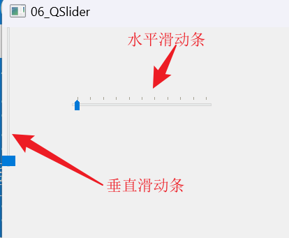

#### 7、快捷键

QKeySequenceEdit是Qt中的一个部件，用于输入和显示键盘快捷键（键序列）。它允许用户方便地设置和修改快捷键组合  

```C++
#include "widget.h"

#include <QKeySequenceEdit>
#include <QDebug>

Widget::Widget(QWidget *parent)
    : QWidget(parent)
{
    resize(600, 480);

    QKeySequenceEdit *kse = new QKeySequenceEdit(this);
    kse->move(100, 100);
    kse->resize(200, 30);

    connect(kse, &QKeySequenceEdit::keySequenceChanged,
            [=](const QKeySequence &ks){
        if(ks == QKeySequence("Ctrl+Q"))
        {
            close();
        }
        else
        {
            qDebug() << "快捷方式制作失败";
        }

    });
}
```

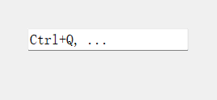

### 三、显示部件

#### 1、<span style=color:red;background:yellow;font-size:25px>标签QLabel(常用)</span>

```C++
#include "widget.h"

#include <QLabel>
#include <QMovie>

Widget::Widget(QWidget *parent)
    : QWidget(parent)
{
    resize(1000, 800);

    QLabel *label = new QLabel(this);
    label->resize(1000, 800);

    //第一种：设置文本
    label->setText("标签");
    //设置外框的形状
    label->setFrameShape(QFrame::Box);

    //第二种：设置静态图片
    //label->setPixmap(QPixmap(":/Image/butterfly.png"));

    //第三种：设置动图
    QMovie *me = new QMovie(":/Image/duck.gif");
    label->setMovie(me);
    me->start();
}
```

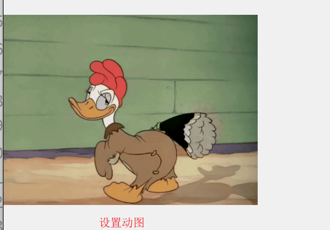

#### 2、文本浏览器QTextBrowser

QTextBrowser是Qt框架中的部件，继承自QTextEdit类，用于显示和编辑富文本（包括HTML 格式）。它提供了更多的功能，比如支持超链接、内嵌图片、和简单的格式化文本  

```C++
#include "widget.h"

#include <QTextBrowser>

Widget::Widget(QWidget *parent)
    : QWidget(parent)
{
    resize(600, 480);
    QTextBrowser *tb = new QTextBrowser(this);
    tb->move(100, 100);
    tb->resize(300, 300);

    tb->insertHtml("<a href='https://www.baidu.com'> 百度 </a>");
    tb->setOpenExternalLinks(true);//打开外部链接
}
```

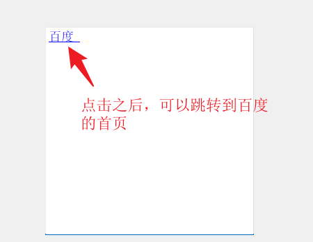

#### 3、液晶显示器QLCDNumber

QLCDNumber是Qt中一个用于显示数字的控件，它模仿了传统LCD（液晶显示器）的显示方式。它通常用于显示数字信息，如计时器、计数器或其它数值数据  

```C++
#include "widget.h"

#include <QLCDNumber>

Widget::Widget(QWidget *parent)
    : QWidget(parent)
{
    resize(600, 480);

    QLCDNumber *lcd = new QLCDNumber(this);
    lcd->move(100, 100);
    lcd->resize(200, 50);

    lcd->setDigitCount(7);
    //显示数据的函数display
    lcd->display(10.12345);
    lcd->setSegmentStyle(QLCDNumber::Flat);
}
```

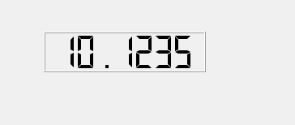

#### 4、<span style=color:red;background:yellow;font-size:25px>进度条QProgressBar(常用) </span>

QProgressBar是Qt中一个非常有用的部件，用于向用户显示某个任务的进度。它提供了一个直观的图形界面，可以显示任务的完成百分比或进度状态  

```C++
#include "widget.h"

#include <QProgressBar>
#include <QPushButton>

Widget::Widget(QWidget *parent)
    : QWidget(parent)
{
    resize(600, 480);

    QProgressBar *pb = new QProgressBar(this);
    pb->move(100, 100);
    pb->resize(300, 30);

    QPushButton *btn = new QPushButton("点击显示下载进度", this);
    btn->move(420, 100);
    btn->resize(180, 30);

    pb->setRange(0, 1000000);
    //设置进度调的显示格式
    //%p:按照百分制进行显示
    //%v:当前值
    //%m:总的值
    pb->setFormat("%v/%m");

    connect(btn, &QPushButton::clicked, [=]{
        for(int idx = 0; idx <= 1000000; ++idx)
        {
            pb->setValue(idx);
        }
    });
}
```

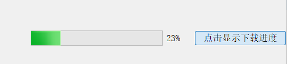

## Day07

### 一、问题回顾

1、输入部件中，为了能让用户从多个选项中，可以选择想要的内容，可以使用哪个部件？它有如何添加数据的？常用信号是哪个？

2、输入部件中，有哪些文本框？它们的区别是什么，该如何选择？

```C++
QLineEdit/QPlainTextEdit/QTextEdit;
```

3、输入部件中，微调框有那两种，有哪些常用函数？

4、输入部件中，与时间日期相关的类有那几个？

5、输入部件中，如果想调节音量、控制屏幕亮度，可以用哪个部件，还有没有其它类似的部件？

6、显示部件中，如果想显示文本或者图片或者动态图，我们该选择哪个部件？

7、显示部件中，那个部件具备液晶显示器的功能？

8、显示部件中，如果想显示下载进度功能，可以用那个部件？

### 二、对话框

#### 1、基本概念

<span style=color:red;background:yellow;font-size:20px>对话框通常会是一个顶层窗口，出现在程序最上层，用于实现短期任务或者简洁的用户交互</span>

对话框与窗口的明显区别在于对话框通常没有最大最小化按钮 。

#### 2、  继承图

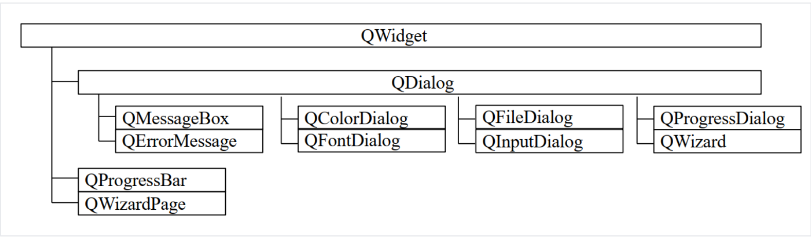

#### 3、对话框的分类

##### 3.1、模态对话框

<span style=color:red;background:yellow;font-size:20px>在同一个程序中，模态对话框会阻止用户与其它可见窗口的交互</span>  ,而对于模态对话框而言，又可以分为两类：

- <span style=color:red;background:yellow;font-size:20px>应用程序模式对话框（默认）</span>： 该模式会阻止用户与应用程序中的所有窗口的交互，直到完成与对话框的交互，并关闭该对话框，然后才能访问程序中的其他窗口。
- 窗口模式对话框：只阻止与对话框相关联的窗口的访问，允许用户在程序中继续使用其他窗口。该模式会阻止与对话框的父窗口、所有祖先窗口及父窗口和祖先窗口的所有兄弟姐妹窗口的交互，除这些窗口外，该模式仍可与其他窗口交互

<span style=color:red;background:yellow;font-size:20px>注意：模态对话框不会阻止与其子窗口的交互</span>  


##### 3.2、非模态对话框

非模态对话框会允许用户与其它可见窗口的交互  

#### 3.3、对话框的创建方式

- 第一种方式：使用QDialog::setModal()或 QWidget::setWindowModality()  ，在函数的参数列表中指定是非模态还是模态对话框；
- 第二种方式：创建对话框之后，调用exec创建的就是模态对话框，如果调用的是show函数，那就是非模态对话框；

#### 3.4、两种对话框的代码测试

```C++
#include "widget.h"

#include <QDialog>
#include <QPushButton>
#include <QDebug>

Widget::Widget(QWidget *parent)
    : QWidget(parent)
{
    resize(600, 480);

    QPushButton *btn1 = new QPushButton("创建模态对话框", this);
    QPushButton *btn2 = new QPushButton("创建非模态对话框,栈对象", this);
    QPushButton *btn3 = new QPushButton("创建非模态对话框,堆对象", this);
    btn1->move(100, 50);
    btn2->move(100, 150);
    btn3->move(100, 250);

    btn1->resize(300, 50);
    btn2->resize(300, 50);
    btn3->resize(300, 50);

    connect(btn1, &QPushButton::clicked, []{
        QDialog dlg;
        dlg.exec();//创建了模态对话框，阻止与其他窗口之间的交互
        qDebug() << "创建了模态对话框";
    });

    connect(btn2, &QPushButton::clicked, []{
        QDialog dlg;//栈对象
        dlg.show();//创建了非模态对话框，但是因为dlg是局部对象，用完
                   //之后会立马销毁，同时show函数不会阻塞，调用完成
                   //完成之后会立马返回

        qDebug() << "创建了非模态对话框,栈对象";
    });

    connect(btn3, &QPushButton::clicked, [=]{
        QDialog *pdlg = new QDialog;//堆对象
        pdlg->show();//因为对话框创建的是堆对象，所以生命周期是
                     //比lambda表达式要长，这样就可以在调用本函数
                     //的时候，会持久显示

       //可以在窗口关闭的时候，将申请的堆空间回收掉
       //(本函数加上枚举值，可以解决内存泄漏的风险)
       pdlg->setAttribute(Qt::WA_DeleteOnClose);

        qDebug() << "创建了非模态对话框,堆对象";
    });
}
```

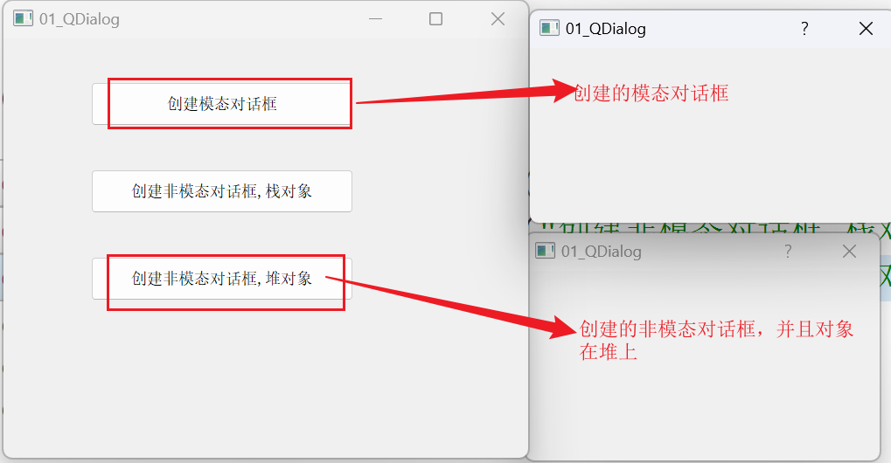

### 三、标准对话框

#### 0、基本概念

所谓标准对话框，是Qt内置的一系列对话框，用于简化开发 。

#### 1、消息对话框QMessageBox

Qt中使用QMessageBox类表示消息对话框，是Qt内部预定义的一种对话框，该类继承自QDialog。消息对话框用于向用户显示一些信息，或者接收用户的答案  


#### 2、颜色对话框QColorDialog


#### 3、字体对话框QFontDialog


#### 4、文件对话框QFileDialog


#### 5、综合代码与显示

```C++
#include "widget.h"
#include <QPushButton>
#include <QPlainTextEdit>
#include <QMessageBox>
#include <QColorDialog>
#include <QFontDialog>
#include <QFileDialog>
#include <QDebug>
#include <QFile>

Widget::Widget(QWidget *parent)
    : QWidget(parent)
{
    resize(1000, 800);

    QPushButton *btn1 = new QPushButton("测试消息对话框", this);
    QPushButton *btn2 = new QPushButton("测试颜色对话框", this);
    QPushButton *btn3 = new QPushButton("测试字体对话框", this);
    QPushButton *btn4 = new QPushButton("测试文件对话框", this);

    QPlainTextEdit *pte = new QPlainTextEdit(this);

    btn1->move(100, 50);
    btn2->move(100, 150);
    btn3->move(100, 250);
    btn4->move(100, 350);
    pte->move(420, 50);

    btn1->resize(300, 50);
    btn2->resize(300, 50);
    btn3->resize(300, 50);
    btn4->resize(300, 50);
    pte->resize(500, 600);

    //测试消息对话框
    connect(btn1, &QPushButton::clicked, [=]{
       // QMessageBox::critical(this, "critical", "严重错误");
       // QMessageBox::information(this, "information", "提示信息");
       // QMessageBox::question(this, "question", "问题信息");
        QMessageBox::warning(this, "warning", "警告信息");
    });

    //测试颜色对话框
    connect(btn2, &QPushButton::clicked, [=]{
       QColor col = QColorDialog::getColor();
       qDebug() << "红色值：" << col.red()
                << "蓝色值: " << col.blue()
                << "绿色值: " << col.green();
    });

    //测试字体对话框
    connect(btn3, &QPushButton::clicked, [=]{
        bool ok;
        QFont font = QFontDialog::getFont(&ok, QFont("宋体"), this, "字体对话框");
        qDebug() <<"ok = " << ok
                 << "字体:" << font.family()
                 << "字体大小:" << font.pointSize()
                 << "是否斜体:" << font.italic()
                 << "是否加粗:"  << font.bold();
    });

    //测试文件对话框(重要)
    connect(btn4, &QPushButton::clicked, [=]{
        QString path =
                QFileDialog::getOpenFileName(this, "caption"
                                             , "C:/Users/lili/Desktop/嵌入式4期/2Qt课件"
                                             //如果需要过滤，可以使用;;
                                             , "(*.pptx);;(*.pdf);;(*.txt)");
        qDebug() <<"path = " << path;

        //----读文本文件----
        QFile fl(path);
        fl.open(QIODevice::ReadOnly);//只读方式打开
        //QByteArray字节数组
        QByteArray ba = fl.readAll();

        QString msg(ba);

        pte->clear();
        pte->insertPlainText(msg);

        fl.close();
    });
}
```


### 四、Qt数据类型

#### 1、数值类型

因为Qt是兼容C++的，而C++是兼容C的，所以C/C++中的内置类型在Qt中可以直接使用，特别的，qreal类型是Qt自定义的浮点数类型，其精度会根据平台的不同而变化 。

#### 2、字符串类型

- QByteArray类：<span style=color:red;background:yellow;font-size:20px>处理原始字节数据</span>，用于存储和操作字节数组，本质是一个动态字节数组。它可以用于处理二进制数据或者文本数据的字节表示.
- QString类：<span style=color:red;background:yellow;font-size:20px>用于存储和操作Unicode字符串</span>。  QString是Qt中的字符串类，与C/C++不同的是，不再使用ASCII编码，而使用Unicode编码。因此一个字符不是8位的char，<span style=color:red;background:yellow;font-size:20px>而是16位的QChar</span>，这就是为什么之前一个汉字占用一个字符的原因  

#### 3、<span style=color:red;background:yellow;font-size:25px>QString的隐式共享（重要）</span>

其实就是C++中std::string曾经的一个实现版本，写时复制。


#### 4、格式化的操作


#### 5、QByteArray与QString之间的转换


### 五、Qt容器类型

#### 1、序列式容器

- QVector:它是<span style=color:red;background:yellow;font-size:20px>动态数组</span>，用于存储和管理元素。<span style=color:red;background:yellow;font-size:20px>QVector在内部使用连续的内存块</span>来存储元素,类似与STL中的vector；  
- QLinkList:双向链表，用于存储和管理元素的动态数据结构，类似STL中的list。Qt6中建议使用QList或QVector替代。 
- QList： <span style=color:red;background:yellow;font-size:20px>用于存储和管理元素的动态数组，底层实现基于动态数组</span>，QList是Qt框架中的一个重要的泛型容器类，它是动态数组的实现，但是<span style=color:red;background:yellow;font-size:20px>它的内部实现并不是简单的连续内存区域，而是根据元素大小和数量选择最优的存储策略（可能是数组或者链表）</span>,类似STL中的deque；  
- QStack：栈，类似于STL中stack；
- QQueue：队列，类似于STL中queue；

#### 2、关联式容器

- QMap提供一个字典(关联数组)，一个键映射到一个值，QMap存储数据是按照键的顺序，它提供了键值对的存储和管理，其中键唯一，每个键应对一个值，如果不在乎存储顺序，使用QHash会更快。<span style=color:red;background:yellow;font-size:20px>底层采用红黑树数据结构。 </span> 类似STL中的map；
- QMultiMap ：类似与STL中的multimap；

#### 3、无序关联式容器

- QSet是基于<span style=color:red;background:yellow;font-size:20px>散列表</span>的集合模板类，它存储数据的顺序是不定的，查找值的速度非常快， QSet<T> 内部就是用QHash实现的。它仅存不重复的元素，因此不允许重复值的存在 ,也就是：<span style=color:red;background:yellow;font-size:20px>元素无序、但是唯一 </span>,类似于STL中的unordered_set；
- QHash是基于散列来实现字典功能的模板，QHash<QKey, T>存储的键值对具有非常快的查找速度，QHash与QMap的功能和用法相似，但是QHash比QMap的查找速度快；QHash的数据项是任意顺序的 。类似于STL中的unordered_map；
- QMultiHash：类似于STL中unordered_multimap；

<span style=color:red;background:yellow;font-size:25px>最后的总结，针对于自定义类型：在Qt中，上述的所有容器如果针对于自定义类型也是需要进行改写的；如果是关联式容器，需要比较两个对象的大小，所以可以重载operator<;如果是无序关联式容器，需要改写operator==以及qHash设置哈希函数</span>

#### 4、容器的两种遍历方式


## Day08

### 一、问题回顾

1、对话框的类名是哪个？作用是什么？可以分为哪两类？分别有什么区别？使用什么方式进行展现？

```C++
exec/show  setModal
```

2、模态对话框的类型有那两种，有什么区别？

3、上课讲解的四种标准对话框是哪些？

```C++
QMessageBox/QColorDialog/QFontDialog/QFileDialog (*.txt);;(*.pdf)   QFile open  read/readAll/write/   close;
```

4、Qt使用什么表示字符串？字符串的底层使用什么思想？如何进行格式化输出？

```C++
QByteArray;
QString;隐式共享；%1 %2 arg;       toUtf8   fromUtf8
```

5、Qt中的容器有哪些？序列式容器有哪些？关联式容器有哪些？底层实现分别采用的是什么？

```C++
序列式容器：QVector/QList/QLinkList/QStack/QQueue;
关联式容器：QMap/QMultiMap;   key     value;   operator<
无序关联式容器：QSet/QHash/QMultiHash;  operator==  qHash
```

6、Qvariant类型的特点？

7、qDebug有哪些特点？

```C++
更加灵活、更加通用  qDebug;
```

### 二、事件系统

#### 1、基本概念

事件是由程序内部或外部产生的事情或者动作的总称。

#### 2、事件的分类

根据事件的来源和传递方式，事件可分为以下三大类。

- 自发事件：这是由<span style=color:red;background:yellow;font-size:20px>窗口系统生成</span>的，这些事件置于<span style=color:red;background:yellow;font-size:20px>系统队列</span>中，并由<span style=color:red;background:yellow;font-size:20px>事件循环</span>一个接一个地处理;

- 发布的事件：该类事件由<span style=color:red;background:yellow;font-size:20px>Qt或应用程序生成</span>，这些事件由<span style=color:red;background:yellow;font-size:20px>Qt排队</span>，并由<span style=color:red;background:yellow;font-size:20px>事件循环</span>处理;
- 发送的事件：该类事件由<span style=color:red;background:yellow;font-size:20px>Qt或应用程序生成</span>，这些事件直接发送到目标对象，不经过事件循环处理。

<span style=color:red;background:yellow;font-size:20px>在Qt中，所有的事件都可以通过QEvent类中的枚举常量进行表示 </span>   

#### 3、事件的传递规则

如果事件未被目标对象处理，则把事件传递给其父对象处理，若父对象仍未处理，则再传递给父对象的父对象处理，重复这个过程，直至这个事件被处理或到达顶级对象为止 ，Qt中事件的传递使用的就是职责链模式。

#### 4、<span style=color:red;background:yellow;font-size:30px>事件的传递步骤(重要)</span>

在Qt中通过调用QCoreApplication::exec()函数启动<span style=color:red;background:yellow;font-size:20px>事件主循环</span>，主循环从事件队列中获取事件，然后创建一个合适的QEvent对象或其子类类型的对象来表示该事件，在此步骤中，<span style=color:red;background:yellow;font-size:20px>事件循环首先处理所有发布的事件，直到队列为空，然后处理自发的事件，最后处理在自发事件期间产生的已发布事件  </span>,而发送事件是不经过事件队列的，会直接发给目标对象。

<span style=color:red;background:yellow;font-size:20px>**接着，Qt会调用QCoreApplication::notify()函数对事件进行传递(或分发)。最后，QObject对象调用QObject::event()函数接收事件。所以整个过程可以总结为启动事件主循环、传递或者分发事件、接收事件，这就是事件的传递步骤**  </span>

最终，可以使用如下图进行理解：<span style=color:red;background:yellow;font-size:30px>（非常重要）</span>


#### 5、事件处理函数

事件是由类的成员函数(通常为虚函数)处理的，通常把处理事件的成员函数称为事件处理函数  

#### 6、event函数

- 第一点：event函数是QObject中的虚函数，后续的QWidget以及子对象可以重写该虚函数；
- 第二点：负责把事件传递给目标对象并调用对应的事件处理函数处理事件 ；
- 第三点：该函数对大多数事件都调用了默认的处理函数 ；
- 第四点：该函数默认不会处理事件，除非重写该函数之后，程序员自己处理事件；

#### 7、<span style=color:red;background:yellow;font-size:30px>事件的五种处理方式（非常重要，面试常考）</span>

- 第一种：重新实现各部件内部默认的事件处理函数；  
- 第二种：重新实现QObject::event()函数(需继承 QObject 类)  ；
- 第三种：子类化QApplication，并重新实现QCoreApplication::notify()函数  
- 第四种：在QObject对象上安装(或称为注册)事件过滤器  
- 第五种：在QApplication上安装(或称为注册)事件过滤器  

## Day09

### 一、问题回顾

1、什么是事件？事件的分类有哪些？

```C++
自发事件：窗口系统，Qt事件循环，事件队列；
发布事件：Qt或者应用程序，Qt事件循环，事件队列；
发送事件：Qt或者应用程序，发送给目标对象；
```

2、事件的传递步骤是什么？遵循什么规则？（<span style=color:red;background:yellow;font-size:20px>重要</span>）

```C++
如果对象处理不了，就交给对象的父对象，如果父对象也处理不了，就交给父对象的父对象，以此类推，直至交给顶层对象进行处理；

事件队列； QApplication::exec启动事件循环； QApplication::notify进行传递与分发；QObject::event、事件处理函数;
```

3、什么是事件处理函数？事件处理有那五种方式？（<span style=color:red;background:yellow;font-size:20px>非常重要</span>）

```C++
重写事件处理函数；
重写event函数；
重写notify函数；
在QObject或者QApplication的对象上安装事件过滤器;
```

### 二、鼠标事件

#### 1、基本概念

在Qt中，鼠标事件是指由用户通过鼠标操作（如点击、移动、释放等）触发的底层输入事件  

#### 2、<span style=color:red;background:yellow;font-size:25px>事件分发器(重要)</span>


```C++
bool MyLabel::event(QEvent *e)
{
    if(e->type() == QEvent::MouseButtonPress)
    {
        qDebug() << "鼠标按压事件被event函数进行了拦截";
        return true;
    }

    return QLabel::event(e);
}
```

#### 3、<span style=color:red;background:yellow;font-size:25px>事件过滤器（重要）</span>

##### 3.1、原理

事件过滤器是一种比事件分发器更高一层的拦截，也叫作高级拦截，可以在event函数之前进行拦截。


##### 3.2、事件过滤器的使用步骤

- 第一步：调用void QObject::installEventFilter(QObject* filterObj)函数，把filterObj对象设置安装(或注册)为事件过滤器，filterObj也称为过滤器对象。 事件过滤器通常在<span style=color:red;background:yellow;font-size:20px>构造函数中</span>进行注册。
- 第二步：在上一步注册的filterObj对象，通过调用bool QObject::eventFilter(QObject* obj, QEvent* e)函数来接收拦截到的事件。也就是说拦截到的事件在filterObj对象中的eventFilter函数中处理。eventFilter 的第一个参数 obj 指向的是事件本应传递到的目标对象。

```C++
MyLabel::MyLabel()
{
    resize(400, 300);

    //第一步：安装事件过滤器
    installEventFilter(this);
}

//第二步：重写事件处理函数
bool MyLabel::eventFilter(QObject *obj, QEvent *e)
{
    if(obj == this)
    {
        if(e->type() == QEvent::MouseButtonPress)
        {
            QMouseEvent *ev = static_cast<QMouseEvent *>(e);
            if(ev->button() == Qt::LeftButton)
            {
                 qDebug() << "鼠标左键按压事件在事件过滤器eventFilter中拦截了";
                 qDebug() << "横坐标:" << ev->x()
                          << "纵坐标:" << ev->y();

                 return true;
            }
        }
    }

    return QLabel::eventFilter(obj, e);
}
```

### 三、定时器事件

#### 1、基本概念

在Qt中，定时器事件(Timer Events)是一种基于系统时钟的周期性事件触发机制 

#### 2、常用函数

```C++
//第一种方式：重写timerEvent函数
void QObject::timerEvent(QTimerEvent *event);

//启动定时器
int QObject::startTimer(int interval, Qt::TimerType timerType = Qt::CoarseTimer);

//获取定时器对应的id
int QTimerEvent::timerId() const;

//第二种方式：QTimer类
//启动定时器，设置时间间隔毫秒
[slot] void start();
[slot] void start(int msec);
void start(std::chrono::milliseconds msec);

//设置触发时间间隔
void setInterval(std::chrono::milliseconds value);

//返回底层定时器的id
int timerId() const;

//超时就会触发信号
[signal] void QTimer::timeout();
```

```C++
#include "widget.h"
#include "ui_widget.h"

#include <QTimerEvent>
#include <QTimer>

Widget::Widget(QWidget *parent)
    : QWidget(parent)
    , ui(new Ui::Widget)
{
    ui->setupUi(this);

    resize(600, 480);

    //调用startTimer函数，启动定时器
    m_id1 = startTimer(500);

    m_id2 = startTimer(1000);

    //定时器
    QTimer *tm = new QTimer(this);

    connect(tm, &QTimer::timeout, [=]{
        static int num = 1;
        ui->label_3->setText(QString::number(num++));
    });

    tm->start(2000);//启动定时器
}

Widget::~Widget()
{
    delete ui;
}

//重写timerEvent
void Widget::timerEvent(QTimerEvent *ev)
{
    //使用timerId函数获取定时器的标识
    if(m_id1 == ev->timerId())
    {
        static int num1 = 1;
        ui->label->setText(QString::number(num1++));
    }

    if(m_id2 == ev->timerId())
    {
        static int num2 = 1;
        ui->label_2->setText(QString::number(num2++));
    }

}
```


### 四、绘图事件

#### 1、基本概念

<span style=color:red;background:yellow;font-size:20px>QPainter</span>用来执行绘制的操作，所以称为<span style=color:red;background:yellow;font-size:20px>绘制器</span>； <span style=color:red;background:yellow;font-size:20px>QPaintDevice</span>是一个二维空间的抽象，这个二维空间允许QPainter在其上面进行绘制，也就是QPainter工作的空间，所以将QPaintDevice称为<span style=color:red;background:yellow;font-size:20px>绘图设备</span>；<span style=color:red;background:yellow;font-size:20px>QPaintEngine</span>提供了画笔(QPainter)在不同的设备上进行绘制的统一的接口，所以称为<span style=color:red;background:yellow;font-size:20px>绘图引擎  </span>


#### 2、绘图系统的继承图


#### 3、<span style=color:red;background:yellow;font-size:30px>绘图步骤（重要）</span>

- 第一步：创建QPainter的对象；
- 第二步：使用QPainter的对象调用begin函数，但是这个函数绝大部分情况下，都在QPainter的构造函数中，所以一般不直接使用;
- 第三步：使用QPainter的对象调用绘图函数进行绘图即可；
- 第四步：使用QPainter的对象调用end函数结束绘制，但是这个函数绝大部分情况下，都在QPainter的析构函数中，所以一般不直接使用;

<span style=color:red;background:yellow;font-size:25px>特别注意:如果绘图设备是QWidget或者其子对象，那么QPainter只能在paintEvent函数中进行绘图，所以需要重写paintEvent函数。</span>

#### 4、绘图的代码

```C++
void Widget::paintEvent(QPaintEvent *ev)
{
    //创建绘制器的对象
    QPainter pat(this);

    //创建画笔对象
    QPen pen;
    pen.setColor(QColor(255, 0, 0));
    pen.setWidth(5);
    pat.setPen(pen);

    //创建画刷对象
    QBrush brush;
    brush.setStyle(Qt::CrossPattern);
    brush.setColor(Qt::cyan);
    pat.setBrush(brush);

    //开始绘图
    //画直线
    pat.drawLine(50, 50, 200, 200);
    //画矩形
    pat.drawRect(200, 50, 200, 100);
    //画圆形
    pat.drawEllipse(50, 200, 100, 100);
    //画椭圆
    pat.drawEllipse(200, 200, 200, 100);
    pat.drawText(400, 100, "好好学习，天天向上");
}
```


<span style=color:red;background:yellow;font-size:25px>注意：绘图函数使用的是draw开头的函数。</span>

#### 5、画家的状态与位置的移动

```C++
void Widget::paintEvent(QPaintEvent *ev)
{

#if 0
    //第一种方式：每次保证画家的位置不变，但是在画图形的时候
    //可以指定图形的位置，同时每次画图的时候，画笔的颜色会
    //随着更改
    QPainter pat(this);
    QPen pen;
    pen.setColor(Qt::red);
    pat.setPen(pen);
    pat.drawRect(10, 10, 200, 100);


    pen.setColor(Qt::green);
    pat.setPen(pen);
    pat.drawRect(310, 10, 200, 100);

    pen.setColor(Qt::red);
    pat.setPen(pen);
    pat.drawRect(610, 10, 200, 100);
#endif
#if 0
    //第二种方式：画图的位置不发生任何的更改，但是可以将
    //画家的位置进行更新
    QPainter pat(this);
    QPen pen;
    pen.setColor(Qt::red);
    pat.setPen(pen);
    pat.drawRect(10, 10, 200, 100);

    //移动画家的位置
    pat.translate(300, 0);
    pen.setColor(Qt::green);
    pat.setPen(pen);
    pat.drawRect(10, 10, 200, 100);

    pat.translate(300, 0);
    pen.setColor(Qt::red);
    pat.setPen(pen);
    pat.drawRect(10, 10, 200, 100);
#endif
    //第三种写法：因为第一次与第三次，画图的画笔的颜色是一样的
    //所以可以保存画家的状态
    QPainter pat(this);
    QPen pen;
    pen.setColor(Qt::red);
    pat.setPen(pen);
    pat.drawRect(10, 10, 200, 100);
    pat.save();//保存画家的状态,使用了栈结构，等价于执行push

    //移动画家的位置
    pat.translate(300, 0);
    pen.setColor(Qt::green);
    pat.setPen(pen);
    pat.drawRect(10, 10, 200, 100);
    pat.save();

    pat.restore();//回复状态，使用了栈结构，等价于执行了pop
    pat.restore();//回复状态
    pat.translate(600, 0);

    pat.drawRect(10, 10, 200, 100);
}
```


<span style=color:red;background:yellow;font-size:25px>总结：移动画家的位置可以使用translate函数；可以使用save函数保存画家的状态以及restore函数恢复画家的状态，特别的，画家的状态包括：画家的位置，使用画笔的颜色、粗度、风格，画刷的颜色、粗度、风格等等,此处使用了一个数据结构：栈结构</span>

#### 6、<span style=color:red;background:yellow;font-size:25px>两种重绘方式的区别（重要）</span>

```C++
#include "widget.h"

#include <QPainter>
#include <QTimer>

Widget::Widget(QWidget *parent)
    : QWidget(parent)
    , m_pos(0)
{
    resize(1000, 800);

    QTimer *tm = new QTimer(this);

    connect(tm, &QTimer::timeout, [=]{
        //paintEvent(nullptr);//error,不能使用绘图引擎
        //repaint();
        update();
    });

    tm->start(100);
}

Widget::~Widget()
{
}

//想在QWidget的对象或者子对象上画一个图片，每隔0.1秒的时间
//将图片向右移动10个单位(将横坐标每0.1s增加10个单位)
void Widget::paintEvent(QPaintEvent *ev)
{
    QPainter pat(this);

//    static int pos = 0;
//    pat.drawPixmap(pos, 0, QPixmap(":/wangdao.png"));
//    pos += 10;

    if(m_pos > this->width())
    {
        m_pos = 0;
    }

    pat.drawPixmap(m_pos, 0, QPixmap(":/wangdao.png"));
    m_pos += 10;
}
```


<span style=color:red;background:yellow;font-size:25px>两种重绘方式都可以触发paintEvent函数的执行，但是有如下区别：</span>

- update函数是异步的，会将多次的结果添加到队列中，然后一次显示，所以实时性要求不高，对性能的要求也不高，一般建议使用update函数；
- repaint函数是同步的，每次都会立即调用repaint函数，所以实时性非常的强，但是同时对性能的要求比较高；

### 五、绘图设备

#### 1、QPixmap绘图设备

```C++
#include "widget.h"

#include <QPainter>
#include <QPixmap>
#include <QPen>

Widget::Widget(QWidget *parent)
    : QWidget(parent)
{
    //通过QPixmap类型创建的对象充当了绘图设备
    //对象一定要指定宽度与高度
    QPixmap pix(400, 300);
    pix.fill(Qt::white);

    //指定绘图设备
    QPainter pat(&pix);
    QPen pen;
    pen.setColor(QColor(255, 0, 0));
    pen.setWidth(3);
    pat.setPen(pen);

    pat.drawRect(10, 10, 200, 100);

    //保存绘制的图形存放的位置
    pix.save("F:/pix.jpg");
}
```

#### 2、QImage绘图设备

```C++
#include "widget.h"

#include <QPainter>
#include <QImage>

Widget::Widget(QWidget *parent)
    : QWidget(parent)
{
    resize(1000, 800);
}

Widget::~Widget()
{
}

void Widget::paintEvent(QPaintEvent *ev)
{
    QImage img;
    img.load(":/butterfly.png");


    QPainter pat(this);

    for(int i = 100; i < 300; ++i)
    {
        for(int j = 100; j < 300; ++j)
        {
            QRgb t = qRgb(255, 0, 0);
            //像素处理的函数
            img.setPixel(i, j, t);
        }
    }

    pat.drawImage(0, 0, img);
}
```


#### 3、QPicture绘图设备

```C++
#include "widget.h"

#include <QPainter>
#include <QPicture>

Widget::Widget(QWidget *parent)
    : QWidget(parent)
{
    //创建QPicture类型的对象
    QPicture pic;

    //指定绘图设备为QPicture对象pic
    QPainter pat(&pic);
    QPen pen;
    pen.setColor(QColor(255, 0, 0));
    pen.setWidth(3);
    pat.setPen(pen);

    //画矩形
    pat.drawRect(10, 10, 200, 100);

    pat.end();//结束绘图

    //保存绘制的图形存放的位置
    pic.save("F:/pic.pp");
}

Widget::~Widget()
{
}

void Widget::paintEvent(QPaintEvent *ev)
{
    QPainter pat(this);

    QPicture pic;
    //加载图片
    pic.load("F:/pic.pp");

    pat.drawPicture(100, 100, pic);
}
```


### <span style=color:red;background:yellow;font-size:30px>六、绘图原理（重要）</span>

绘图系统中会有前台与后台的概念，绘图的时候是在后台绘制的，但是显示的时候是在前台。

<span style=color:red;background:yellow;font-size:20px>Qt中所有的绘图操作先在后台缓冲区完成，然后一次性将后台缓冲区的内容复制到前台缓冲区，显示到屏幕上，避免直接在前台缓冲区绘图，从而减少闪烁和绘制延迟，也就Qt的绘图使用的是双缓冲技术</span>  

## Day10

### 一、问题回顾

1、事件的传递步骤是什么？遵循什么规则？

2、什么是事件处理函数？事件处理有那五种方式？

```C++
三个重写 事件处理函数、event、notify；
二个事件过滤器  QObject、QApplication;
```

3、一般拦截重写什么函数，高级拦截该怎么做？

```C++
event、事件过滤器（1、构造函数安装事件过滤器；2、重写eventFilter）
```

4、定时器讲了那两种，对应的函数与使用区别是什么？

```C++
//第一种：
重写timerEvent;
启动startTimer;
timerId

//第二种：
类QTimer;
信号timeout;
启动start；
```

5、绘图事件中包含哪三个部分？

```C++
QPainter绘制器； QPainetDevice绘图设备;  绘图引擎；
```

6、如果绘图设备是QWidget那么如何使用QPainter进行绘图？

```C++
重写paintEvent;

//1、QPainter创建对象；  2、begin    3、调用画图函数drawXXX     4、end
```

7、使用绘制器QPainter如何获取具体的绘制方法？

8、两种重绘方式update与repaint的区别？

```C++
共同点：调用这两个函数都可以间接调用paintEvent；

update/repaint;
```

9、绘图设备有那几种？

```C++
QPixmap  save;
QImage  像素级别的处理setPixel  ;
QPicture end save  格式任意的形式*.pic *.pp   load  drawPicture;
```

10、Qt绘图使用的原理使用的是什么技术？

```C++
双缓冲   前台缓冲区 后台缓冲区     延迟、闪烁;
```

### 二、Qt线程

#### 1、两种线程的概念

<span style=color:red;background:yellow;font-size:20px>gui线程：第一个线程是GUI线程，也称主线程或者main线程，主线程负责几乎所有GUI操作。</span>

<span style=color:red;background:yellow;font-size:20px>子线程：所有其他的耗时操作，都是由QThread及其子类来完成，可以称为工作线程或者子线程。    </span>

如果子线程也想处理与GUI相关的操作，那么就可以与GUI线程进行信号与槽的连接，这样二者之间就可以进行通信。

#### 2、使用线程的条件

- 处理耗时任务；
- 处理并发任务；
- 保持界面响应 ；

#### 3、Qt线程相关的函数

##### 3.1、线程的启动

```C++
[slot] void QThread::start(QThread::Priority priority = InheritPriority);
```

<span style=color:red;background:yellow;font-size:25px>线程的启动函数，调用该函数后会执行run方法，但在run函数执行前会触发started信号  </span>

##### 3.2、设置优先级

```C++
void QThread::setPriority(QThread::Priority priority);
```

##### 3.3、线程的执行

```C++
[protected] int QThread::exec();
```

该函数的作用是进入<span style=color:red;background:yellow;font-size:20px>事件循环</span>并等待直到调用exit函数，返回值是通过调用exit函数来获得，如果调用成功则返回0。  

```C++
[virtual protected] void QThread::run();
```

<span style=color:red;background:yellow;font-size:20px>线程的运行起点，在调用start函数之后，新创建的线程就会调用这个函数，底层默认调用exec函数，大多数需要重写这个函数，便于管理自己的线程。该方法返回时，该线程的执行将结束</span>

#### 3.4、线程的退出

```C++
[slot] void QThread::quit();
void QThread::exit(int returnCode = 0);
```

这两种方式都可以让线程退出事件循环，quit调用成功等价于执行了exit(0),这两种方式是让线程优雅退出的方式。<span style=color:red;background:yellow;font-size:20px>更建议使用这两种方式让线程退出事件循环。</span>

```C++
[slot] void QThread::terminate();
```

终止线程，线程可能会立即被终止也可能不会，这取决于操作系统的调度策略，使用terminate之后再使用QThread::wait()，以确保万无一失  

##### 3.5、线程的等待

```C++
wait/sleep/msleep/usleep;等待具体的秒数或者毫秒数或者微秒数;
```

##### 3.6、线程的状态

```C++
//判断线程是否结束
bool isFinished() const;

//判断线程是否正在运行
bool isRunning() const;

//如果线程上的任务运行应该停止，返回true。注意：此函数可用于使长时间运行的任务干
//净地中断。从不检查或作用于该函数返回值是安全的，但是建议在长时间运行的函数中经常
//这样做。注意：不要过于频繁调用，以保持较低的开销。
bool isInterruptionRequested() const;
```

##### 3.7、线程的标识

```C++
//返回一个线程指针
[static] QThread *QThread::currentThread();

//返回当前正在执行的线程的id
[static] Qt::HANDLE QThread::currentThreadId();
```

##### 3.8、信号

```C++
//启动线程运行会触发该信号
[signal] void QThread::started();

//终止线程运行会触发该信号
[signal] void QThread::finished();
```

#### 4、函数之间的调用关系图


#### <span style=color:red;background:yellow;font-size:30px>5、创建线程的两种方式(非常重要)</span>

##### 5.1、重写run方法

###### 5.1.1、使用步骤

- 第一步：自定义类让其继承自QThread；
- 第二步：在自定义类中重写run方法，将业务逻辑在run方法中实现即可；

- 第三步：创建MyThread的对象，然后调用start函数即可；

###### 5.1.2、代码测试

```C++
#ifndef MYTREAD_H
#define MYTREAD_H

#include <QThread>

class MyThread : public QThread
{
    Q_OBJECT
public:
    MyThread();
    ~MyThread();

    //重写run
    void run() override;
};

#endif // MYTREAD_H

//run方法模拟了耗时任务
void MyThread::run()
{
    qDebug() << "子线程的id:"
             << QThread::currentThreadId();

    for(int idx = 1; idx < 10; ++idx)
    {
        qDebug() << "idx = " << idx;
        sleep(1);
    }
}
```

测试代码

```C++
#include "widget.h"
#include "mythread.h"

#include <QApplication>
#include <QDebug>

int main(int argc, char *argv[])
{
    QApplication a(argc, argv);
    Widget w;
    w.show();

    qDebug() << "main线程的id:"
             << QThread::currentThreadId();

    //1、创建子对象，该对象继承自QThread
    MyThread myTh;

    //验证线程启动的时候触发了信号started
    QObject::connect(&myTh, &MyThread::started, []{
        qDebug() << "线程启动触发了信号started";

    });

    //验证线程启动的时候触发了信号finished
//    QObject::connect(&myTh, &MyThread::finished, [&w]{
//        qDebug() << "线程执行结束触发了信号finished";
//        w.close();
//    });

    QObject::connect(&myTh, &MyThread::finished, [&a]{
        qDebug() << "线程执行结束触发了信号finished";
        a.quit();
    });

    //2、调用start函数启动线程
    myTh.start();

    return a.exec();
}
```


##### 5.2、<span style=color:red;background:yellow;font-size:25px>使用moveToThread的方法(Qt官网推荐的方式)</span>

###### 5.2.1、使用步骤

- 第一步：自定义类让其继承自QObject类，然后在自定义类中将耗时任务封装成函数；
- 第二步：创建自定义类的对象，可以创建堆对象；
- 第三步：创建QThread的对象，可以创建堆对象；
- 第四步：让自定义类型的对象调用QObject::moveToThread函数，将所有权转移到QThread对象上；
- 第五步：连接信号与槽，包括将started信号与自定义类中处理耗时任务的函数进行连接，其他的信号finished与槽主要在处理资源的回收，然后还可以在自定义类型声明信号，让其连接QThread类型的quit函数；
- 第六步：使用QThread的对象调用start函数，开启线程。

###### 5.2.2、代码测试


```C++
#include "widget.h"

#include "myworker.h"

#include <QApplication>
#include <QThread>
#include <QDebug>

int main(int argc, char *argv[])
{
    QApplication a(argc, argv);
    Widget w;
    w.show();

    qDebug() << "main线程的id:"
                 << QThread::currentThreadId();

    //1、创建MyWorker的对象
    MyWorker *worker = new MyWorker;

    //2、创建QThread的对象
    QThread *pth = new QThread;

    //3、将MyWorker的对象的所有权转移给QThread的对象
    worker->moveToThread(pth);

    //5、信号与槽的关键使用
    QObject::connect(pth, &QThread::started, worker, &MyWorker::doTask);
    //如果QThread中的quit函数被执行，那么QThread线程会退出事件循环
    QObject::connect(worker, &MyWorker::signalQuit, pth, &QThread::quit);

    //当QThred线程执行结束之后，会触发信号finished，可以借助这个信号连接对应的槽函数
    //回收堆空间,也可以关闭窗口
    QObject::connect(pth, &QThread::finished, worker, &MyWorker::deleteLater);
    QObject::connect(pth, &QThread::finished, pth, &QThread::deleteLater);
    QObject::connect(pth, &QThread::finished, [&a]{
        qDebug() << "线程执行结束触发了信号finished";
        a.quit();
    });

    //4、调用QThread对象的start函数启动线程
    pth->start();

    qDebug() << "QThread线程的id:"
             << pth->currentThreadId();

    return a.exec();
}
```


#### 6、两种方式的对比总结

重写run方法的形式，非常的简单，但是灵活性比较差，扩展性比较差；

moveToThread的方法灵活性比较强，可以在同一类中处理大量不同的任务、线程与任务分离的操作，此方式是Qt官方推荐的方式，但是该方式的代码比较复杂；

### 三、Qt的锁机制

#### 1、QMutex锁

类似与C++11中的std::mutex,QMutex锁也只有上锁与解锁两种状态。

```C++
#include <QMutex>
//构造函数
QMutex(QMutex::RecursionMode mode);
//QMutex::RecursionMode枚举：
//QMutex::Recursive 递归，允许多次加锁，但要有对应的多次解锁
//QMutex::NonRecursive 非递归，只能加锁一次

//无参构造
QMutex();

//上锁
void lock();
//解锁
void unlock();
```

#### 2、读写锁QReadWriterLock    

可以允许多个读者同时读数据，但只能有一个写，并且写读操作不同同时进行  

### 四、条件变量

在多线程环境中，线程可能需要等待某个条件成立才能继续执行 ,在Qt中使用QWaitCondition表示条件变量

```C++
QWaitCondition();

void notify_all();
void notify_one();
void wakeAll();
void wakeOne();

bool wait(QMutex *lockedMutex, unsigned long time = ULONG_MAX);
bool wait(QReadWriteLock *lockedReadWriteLock, unsigned long time = ULONG_MAX);
```

### 五、网络编程

#### 1、Linux下socket网络编程回顾

服务器：int listenfd = socket、bind、listen、int connfd = accept、read/recv/write/send、close；

客户端：int fd = socket、connect、read/recv/write/send、close

#### 2、TCP网络编程

##### 2.1、TCP协议

TCP(Transmission Control Protocol)是一种被大多数Internet网路协议（如HTTP和FTP）用于数据传输的低级网络协议，它是可靠的、

面向流、面向连接的传输协议，特别适合用于连续数据的传输

##### 2.2、通信原理图


##### 2.3、QTcpSocket的继承图


##### 2.4、流程图


##### 2.5、服务器端的代码

```C++
#include "widget.h"
#include "ui_widget.h"

#include <QTcpSocket>
#include <QMessageBox>

Widget::Widget(QWidget *parent)
    : QWidget(parent)
    , ui(new Ui::Widget)
{
    ui->setupUi(this);

    setWindowTitle("Tcp Server");
    resize(600, 480);

    //1、创建QTcpServer的对象
    m_tcpServer = new QTcpServer(this);

    //3、连接信号与槽
    connect(m_tcpServer, &QTcpServer::newConnection, this, &Widget::handle);

    //2、监听客户端
    bool ret = m_tcpServer->listen(QHostAddress::Any, 8888);
    if(!ret)
    {
        QMessageBox::critical(this, "critical", "监听失败");
        return;
    }
}

Widget::~Widget()
{
    delete ui;
}

void Widget::handle()
{
    //4、获取到连接
    QTcpSocket *psock = m_tcpServer->nextPendingConnection();

    //5、这个信号readyRead一旦被触发，说明有数据上来
    connect(psock, &QTcpSocket::readyRead, [=]{
        ui->listWidget->addItem("客户端上来了");
        //读取客户端发送过来的数据
        QByteArray ba = psock->readAll();
        ui->listWidget->addItem(QString("服务器接收客户端的数据是: ") +
                                QString::fromUtf8(ba));

        //将相同的数据发送给客户端
        psock->write(ba);
        ui->listWidget->addItem(QString("服务器发送给客户端的数据是: ") +
                                QString::fromUtf8(ba));
    });

    //6、连接断开的时候做的事件
    connect(psock, &QTcpSocket::disconnected, [=]{
        m_tcpServer->close();
        psock->deleteLater();
        close();
    });
}
```

##### 2.6、客户端的代码

```C++
#include "widget.h"
#include "ui_widget.h"

Widget::Widget(QWidget *parent)
    : QWidget(parent)
    , ui(new Ui::Widget)
{
    ui->setupUi(this);

    setWindowTitle("Tcp Client");
    resize(600, 480);

    //1、使用QTcpSocket创建对象，用于通信
    m_tcpSock = new QTcpSocket(this);

    //2、连接到服务器
    m_tcpSock->connectToHost("127.0.0.1", 8888);

    //3、只要服务器发送数据，那么客户端就会触发readyRead
    connect(m_tcpSock, &QTcpSocket::readyRead, [=]{
        //让客户端读取服务器发送过来的数据
        QByteArray ba = m_tcpSock->readAll();
        ui->listWidget->addItem(QString("客户端接收了服务器的数据：") +
                                QString::fromUtf8(ba));
    });

    //连接断开的时候做的事件
    connect(m_tcpSock, &QTcpSocket::disconnected, [=]{
        m_tcpSock->deleteLater();
        close();
    });
}

Widget::~Widget()
{
    delete ui;
}


void Widget::on_pushButton_clicked()
{
    //获取QLineEdit中的文本信息
    QString msg = ui->lineEdit->text();

    //将这个文本信息发送给服务器
    m_tcpSock->write(msg.toUtf8());

    ui->listWidget->addItem(QString("客户端向服务器发送数据：")
                            + msg);
    //清空单行文本框中的内容
    ui->lineEdit->clear();
}

```

##### 2.7、测试结果


#### 3、UDP网络编程

##### 3.1、基本概念

UDP（User Datagram Protocol，用户数据报协议）是轻量的、不可靠的、面向数据报、无连接的协议，它可以用于对可靠性要求不高的场合。  

##### 3.2、原理


##### 3.3、流程图


#### 4、Qt的http网络编程

##### 4.1、三个相关类的作用

QNetworkRequest类通过一个URL地址发起网络协议请求，也保存网络请求的信息，目前支持HTTP、FTP和局部文件URLs的上传和下载。QNetworkAccessManager类用于协调网络操作。<span style=color:red;background:yellow;font-size:20px>在QNetworkRequest发起一个网络请求后，QNetworkAccessManager类负责发送网络请求，创建网络响应。QNetworkReply类表示网络请求的响应。</span>QNetworkAccessManager在发送一个网络请求后创建一个网络响应。QNetworkReply提供的信号finished、readyRead和downloadProgress可以检测网络响应的执行情况，执行响应操作。QNetworkReply是QIODevice的子类，所以QNetworkReply支持流读写功能，也支持异步或者同步工作模式  

##### 4.2、流程图


##### 4.3、测试结果

```C++
#include "widget.h"
#include "ui_widget.h"


#include <QNetworkReply>
#include <QNetworkRequest>
#include <QUrl>

Widget::Widget(QWidget *parent)
    : QWidget(parent)
    , ui(new Ui::Widget)
{
    ui->setupUi(this);

    resize(1000, 800);

    m_manager = new QNetworkAccessManager(this);

}

Widget::~Widget()
{
    delete ui;
}


void Widget::on_pushButton_clicked()
{
    QString msg = ui->lineEdit->text();

    QUrl url(msg);
    QNetworkRequest res(url);

    QNetworkReply *reply = m_manager->get(res);

    connect(reply, &QNetworkReply::finished, [=]{
        //读取的结果是正常的
        if(reply->error() == QNetworkReply::NoError)
        {
            QByteArray ba = reply->readAll();
            ui->plainTextEdit->setPlainText(QString::fromUtf8(ba));
        }
        else
        {
            QString msg = reply->errorString();
            ui->plainTextEdit->setPlainText(msg);
        }
    });
}

```


##### 4.4、环境相关

```C++
将libssl-1_1-x64.dll与libcrypto-1_1-x64.dll文件放在自己的安装路径下，比如我的是：D:\software\qt5\5.14.2\mingw73_64\bin目录下（自己的就找到之前安装Qt软件包的位置），当然如果是32位系统，则是如下两个文件libssl-1_1.dll和libcrypto-1_1.dll（这两个文件我这里有，也可以网络下载）
```

## Day11

### 一、问题回顾

1、Qt线程分为哪两类？QThread线程的常用函数有哪些？

```C++
start  started  run  exec;
quit/exit/terminate   wait/sleep/msleep/usleep;   finished;
```

2、Qt线程有哪两种使用方式？各有什么优缺点？

```C++
(1)class MyThread : public QThread{}; 重写run   MyThread myTh; myTh.start();
(2)class MyWorker : public QObject {  doTask(){   emit signalQuit();}; }                      
MyWorker *worker = new MyWorker;
QThread *pth = new QThread
worker->moveToThread(pth);

QObject::connect(pth, &QThread::started, worker, &MyWorker::doTask);
QObject::connect(worker, &MyWorker::signalQuit, pth, &QThread::quit);

QObject::connect(pth, &QThread::finished, worker, &MyWorker::deleteLater);
QObject::connect(pth, &QThread::finished, worker, pth, &QThread::deleteLater);
pth->start();
```

3、Qt下TCP网络编程对应的函数与流程是什么？

### 二、Qt音频

#### 1、基本概念

多媒体功能指的主要是计算机的音频和视频的输入、输出、显示和播放等功能  

#### 2、相关的类

QMediaPlayer类：媒体播放器，主要用于播放歌曲、网络收音机等功能  

```C++
//构造函数
QMediaPlayer(QObject *parent = nullptr);

//设置播放媒体文件
void setMedia(const QMediaContent &media, QIODevice *stream = nullptr);

//开始播放
void play();

//暂停播放
void pause();

//停止播放
void stop();

//设置播放音量,volume范围是0到100
void setVolume(int volume);

//设置是否静音
void setMuted(bool muted);

//设置播放速度，默认为1，表示正常速度
void setPlaybackRate(qreal rate);
```

```C++
#include "widget.h"

#include <QPushButton>
#include <QMediaPlayer>
#include <QFileDialog>

Widget::Widget(QWidget *parent)
    : QWidget(parent)
{
    resize(600, 480);

    QPushButton *btn = new QPushButton("点击选择对应的文件", this);
    btn->move(100, 100);
    btn->resize(200, 50);

    //创建多媒体的对象
    QMediaPlayer *mp = new QMediaPlayer(this);

    connect(btn, &QPushButton::clicked, [=]{
        QString path =
                QFileDialog::getOpenFileName(this, "capation"
                                             , "C:/Users/lili/Desktop/嵌入式4期/2Qt课件/mp3文件"
                                             , "(*.mp3);;(*.mp4)");
        //指定要播放的音频文件
        mp->setMedia(QMediaContent(path));

        //播放音频
        mp->play();
    });
}

Widget::~Widget()
{
}
```

### 三、Qt视频

#### 1、相关的类

QMediaPlayer类：高级视频播放器综合应用；

QVideoWidget类：用于媒体对象生成的视频,用于显示视频的类  

```C++
QVideoWidget(QWidget *parent = nullptr);
//函数作用是：将QMediaPlayer与视频输出组件关联起来，以便在界面上显示视频内容。
void QMediaPlayer::setVideoOutput(QVideoWidget *output);
void QMediaPlayer::setVideoOutput(QGraphicsVideoItem *output);
void QMediaPlayer::setVideoOutput(QAbstractVideoSurface *surface);
```

```C++
#include "widget.h"

#include <QMediaPlayer>
#include <QVideoWidget>
#include <QPushButton>
#include <QFileDialog>
#include <QVBoxLayout>

Widget::Widget(QWidget *parent)
    : QWidget(parent)
{
    resize(1000, 800);

    QPushButton *btn = new QPushButton("点击选择视频文件");
    QVideoWidget *videoWid = new QVideoWidget;

    QMediaPlayer *mp = new QMediaPlayer(this);
    mp->setVideoOutput(videoWid);

    connect(btn, &QPushButton::clicked, [=]{
        QString path =
                QFileDialog::getOpenFileName(this, "caption"
                                            , "F:/ev录屏"
                                            , "(*.mp4)");
        mp->setMedia(QMediaContent(path));

        mp->play();

    });

    QVBoxLayout *vlayout = new QVBoxLayout;

    vlayout->addWidget(videoWid);
    vlayout->addWidget(btn);

    setLayout(vlayout);
}

Widget::~Widget()
{
}
```

<span style=color:red;background:yellow;font-size:20px>特别注意：部分同学使用上述代码后看不到视频播放，这里需要安装解码工具LAV Filters(lav解码器），不然看不到视频的播放功能，软件名lavfilters_0.73.1.exe，已经上传到服务器上了</span>  
