# 嵌入式讲义（卷一 前置知识）

> 拆分自 `1_嵌入式讲义汇总.md / 卷一 前置知识`，共 6 份 PDF 讲义。所有插图保存在 `assets/` 目录，请保持相对位置不变。

## 目录

- 01 面包板使用指南

- 02 硬件基础

- 03 嵌入式概述

- 04 STM32名词解释

- 05 系统结构与引脚定义

- 06 最小系统板

---

## 01 面包板使用指南

### 1. 面包板是什么

面包板（Breadboard）

是一种无焊接实验电路板，用于搭建、测试和修改电子电路，特别适合初学者和工程师进行电路原型开发。

面包板之所以叫这个名字是因为早期人们在电路实验时，就是**用钉子将电路固定在木制的面包切割板上完成的**，如下图所示：

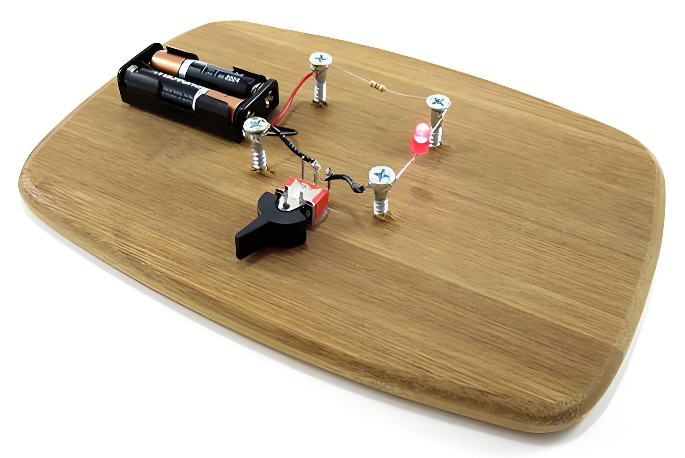

*图1-1真正的面包板-图*

就像中国的菜板子一样，是一大块木板。

当然，现在我们使用的面包板都是塑料材质的，只是沿用了这个名字。

面包板有不同的型号大小，最常见的有下列型号：

###### ◼︎面包板常见型号-表格

| 规格类型 | 孔数 | 尺寸（长 × 宽 × 高） | 特点 |
|---|---|---|---|
| 小型面包板（mini） | 170 | 45mm × 35mm × 9mm | 无电源轨，便携，价格低。 |
| 中型面包板（半尺寸） | 400 | 83mm × 55mm × 10mm | 带单/双电源轨，适合学习单片机。 |
| 大型面包板（全尺寸） | 830 | 165mm × 55mm × 10mm | 双电源轨，适合复杂实验。 |

我们给大家发的面包板都属于**全尺寸面包板**，共有830个可插入孔，带有左右两个**电源轨**，毕竟大的用起来比较方便。

如下图所示：

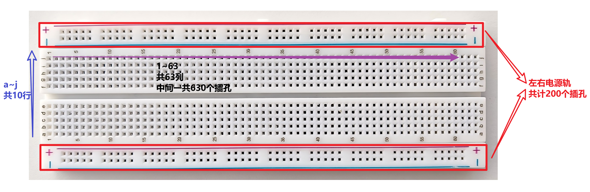

*图1-2全尺寸面包板-图*

当然大家可以直接拿起手头的面包板看一下。

**面包板最方便的地方在于，可以通过插入电子元件（如电阻、电容、LED）和跳线的方式来连接电路，而不需要进行焊接操作。**

那么面包板的工作原理是什么呢？

### 2. 面包板的工作原理

想要弄清楚面包板的工作原理，只需要将面包板的**背面拆开**看看内部构造就清楚了。如下图所示：

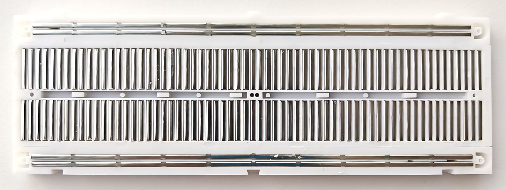

*图2-1全尺寸面包板背面-图*

面包板的背面是一堆金属条，这些金属条的作用是夹住电子元器件的针脚，以及导通电路。如下图所示：

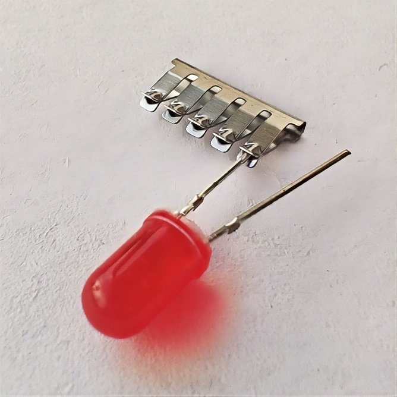

*图2-2面包板金属条-图*

整个全尺寸面包板，其内部电路连通示意图如下：

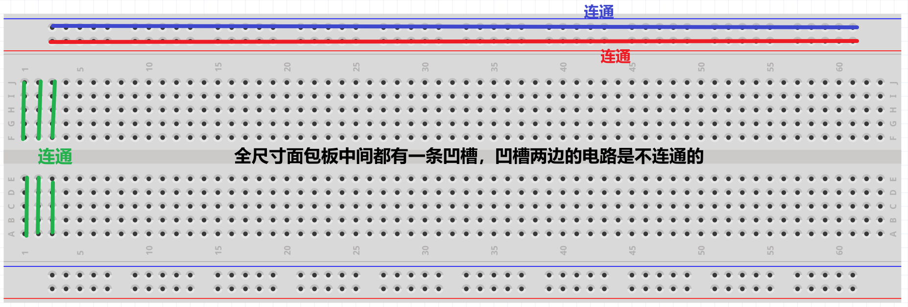

*图2-3全尺寸面包板电路连通-图*

**请一定要理清楚面包板内部电路的连通关系，这是使用面包板的前提！**

还有一些特殊的面包板，比如下图所示：

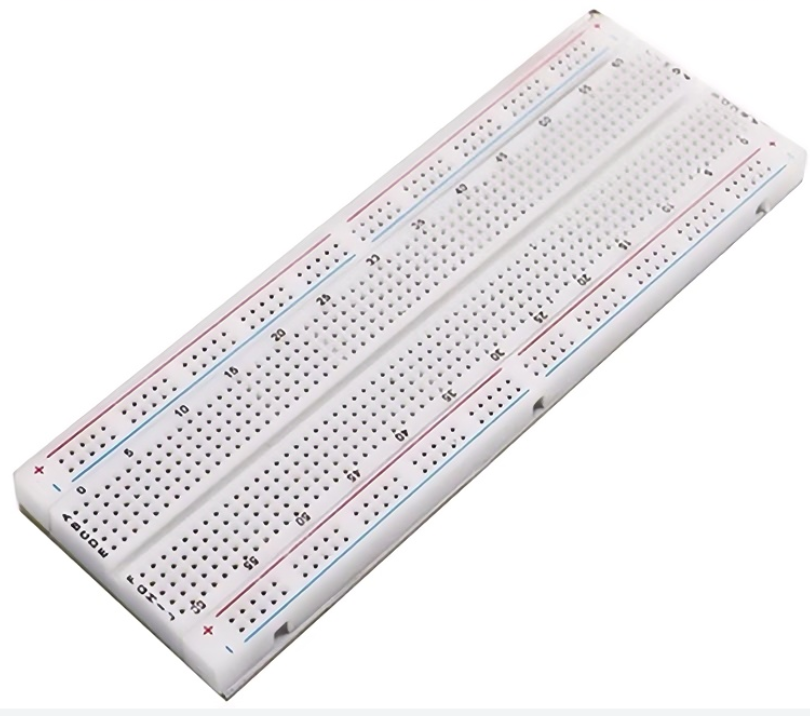

*图2-4全尺寸面包板-图2*

和我们手中的全尺寸面包板不同，它的电源轨线是在中间断开的，表示它们并不连通，你理解了吗？

### 3. 面包板使用示例与说明

下面我们通过一个基本的点灯实验来学会使用面包板。

需要用的电子元件包括：

1. 5号电池组（大家的设备盒中没有，可以虚空做一下这个实验）
2. **红色LED灯**一个
3. 电阻一个（1KΩ）
4. 导线若干

电路接线图如下所示：

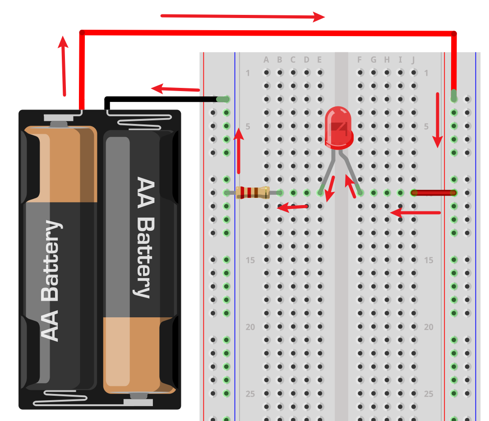

*图3-1面包板点灯-连线图*

在这张接线图中，**红色的线表示电源（供电）正极线或与正极相连的导线**，**黑色线则表示电源负极、0V或者接地的导线**。

上图中的箭头就画出了电流的方向。（电流的方向规定为由正极流向负极，实际上电路中的自由电子（载流子）是由负极流向正极的）

并且电源的正极就连接电源轨正极，电源的负极就连接电源轨负极，不要乱接线。

大家可以用自己手上的工具，自行连接去玩一玩，我这里就不放实物图的照片了。

我们还可以使用同一侧的电源导轨，接线图如下所示：

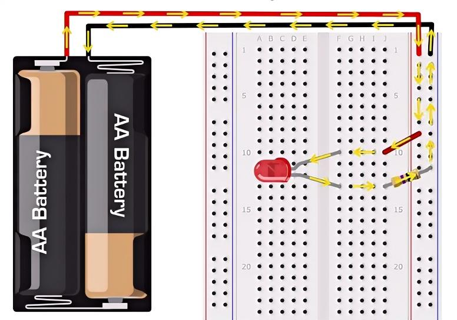

*图3-2面包板点灯-连线图2*

这里有一个小的注意事项：

1. LED灯的两条"腿"，明显有长短之分：
   - a. **长腿是LED灯的阳极，需要接入电源正极，**
   - b. **短腿是LED灯的阴极，需要接入电源负极。**
2. LED即"发光二极管"，既然是二极管，就必须按照上述方式正接，反接是不会亮的。

#### 3.1 将最小系统板插入面包板

大家拿出配件盒中的面包板，以及最小系统板（关于什么是最小系统板，后面会解释），如下图所示：

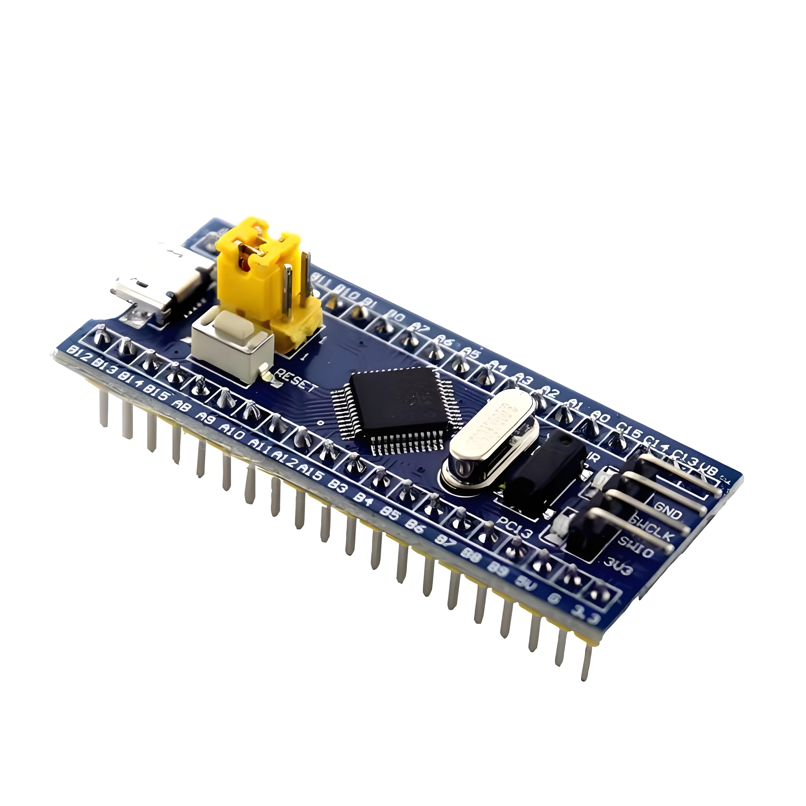

*图3.1-1STM32F103C8T6最小系统板-图*

将它按照下面的接线图，插入面包板中：

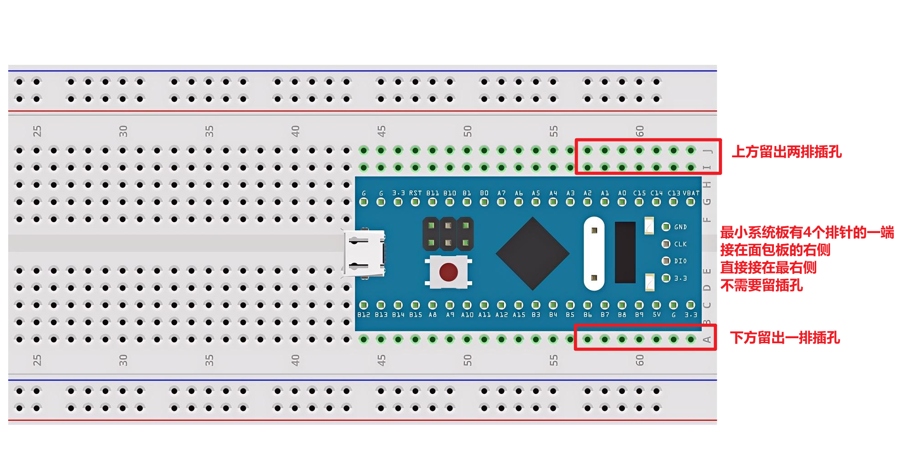

*图3.1-2最小系统板接入面包板-图*

这样最小系统板的外围插针，就和面包板的每一行的五个插孔联通了。

思考一下，图中的最小系统版跨越面包板中间的"槽道"，插在了两边。能不能直接插在一边呢？

**当然不行，都插在一边会导致最小系统板两边的外围插针直接短接在一起，这显然是不合理的！**

实物连线图，如下图所示：

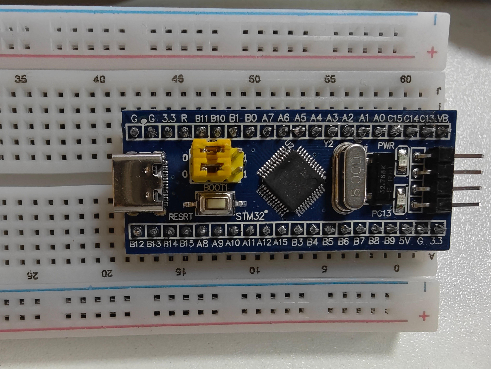

*图3.1-3最小系统板接入面包板-图2*

新面包板的插孔可能比较"硬"，不太容易插进去。

此时可以先用配件盒中的**"公对公杜邦线"**捅一捅插孔，然后再将最小系统板按进去：

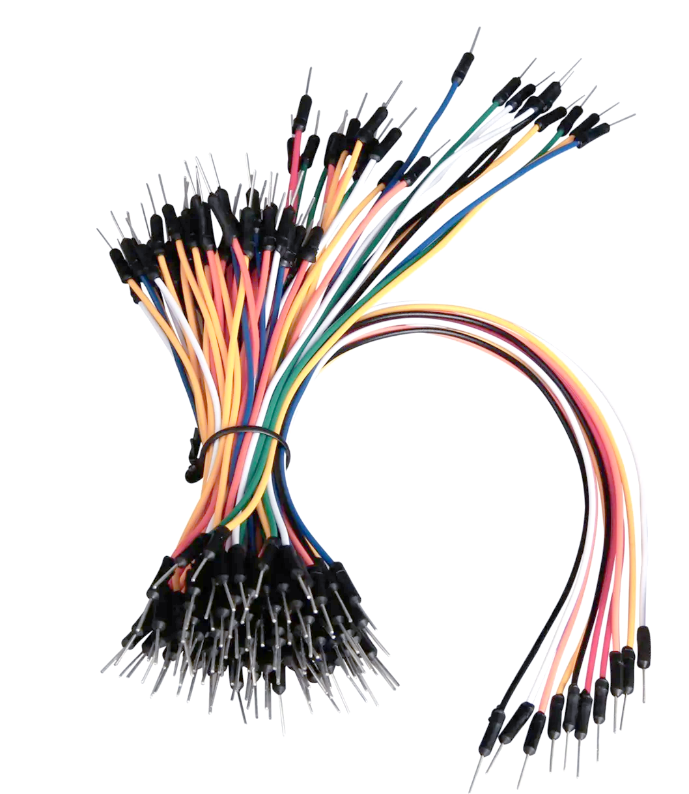

*图3.1-4公对公杜邦线-图*

有以下几个注意事项：

1. 最小系统板插入面包板后，后面就不需要再拔出来了。
2. 做实验需要接线时，大家最好按照图中的方式来接线，有问题可以直接询问老师。
3. **实物图由于拍摄角度问题，可能出现引脚偏移，请大家以接线图为准进行接线。**

#### 3.2 利用最小系统板为面包板电源轨供电

插在面包板上设备的运行肯定离不开电力支持，所以面包板的电源轨正负极应当正确接入电源正负极：

这样，用电器正极接入电源轨正极，负极接入电源轨负极就实现了面包板给用电器供电。

大家可以拿出面包板跳线盒（图中的导线就是常说的"跳线/面包板跳线"）：

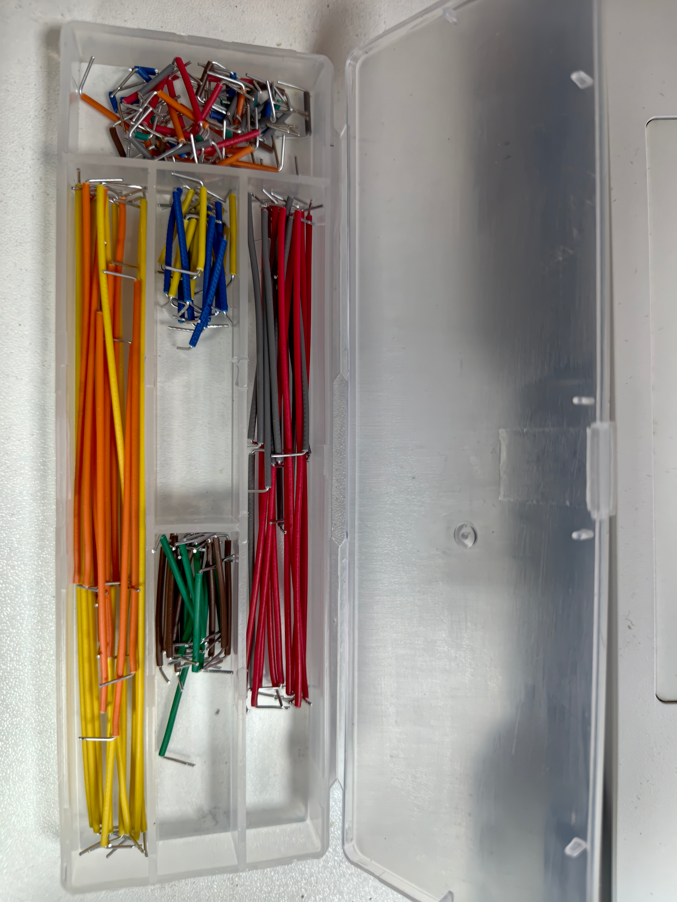

*图3.2-1面包板跳线盒-图*

然后按照下图进行接线：

*图3.2-2电源轨供电-接线图*

具体的实物接线图如下图所示：

*图3.2-3电源轨供电-实物接线图*

注意：

1. 跳线比较软，一定不要硬插，插不进去就用杜邦线捅一捅再插。
2. **一般建议大家使用偏红色艳丽的线来接电源轨正极，用偏灰色蓝色的冷色调颜色的线来接电源轨负极。**
3. **实物图由于拍摄角度问题，可能出现引脚偏移，请大家以接线图为准进行接线。**

### 4. 注意事项

面包板很方便，无需焊接，可以反复使用。

**但缺点也很明显，容易虚接，也就是容易接触不良和不稳定。**

在使用面包板时，一定要注意插紧电路，也不要轻易去晃动已经连好的线路。

还有，大家在使用时，要认真仔细的观察好面包板的连接孔，不要插错了孔，总之使用面包板时要细心一些。

使用面包板做实验时：

**若代码烧录执行后的实验现象与预期不符，那么最优先需要考虑做的事情就是检查面包板接线是否正确。**

### 5. 设备保管注意事项

王道统一会给大家发一整套嵌入式学习的设备，包括嵌入式基础、FreeRTOS以及最后项目阶段会涉及到的所有硬件设备。

这些硬件设备会在使用的时候，再逐一给大家介绍。

硬件设备不似软件，不当的操作和使用可能会引起设备损坏，对于硬件设备的保管使用需要注意以下几个细节：

1. 设备外接供电时，有时会有3.3V和5V供电两种选项（比如ST-Link）。
2. 在STM32嵌入式开发当中，**更普遍的供电选择是3.3V**，千万不要误接5V供电，可能导致设备芯片烧毁。
3. 设备供电往往都有正负极之分，**千万不要短接正负级**，更不能直接用一根导线将正负极短接。
4. 长时间不使用设备建议将设备完全断开电路。比如吃饭或者回去休息了，请将ST-Link从电脑的USB接口拔下来。
5. 保管好自己的设备，不要乱丢乱放设备，丢失设备就需要重新购买。
6. 做完实验，已经用完且对下一次实验没有用处的设备，应该立刻从面包板上拔下来。
   - a. 面包板上的设备应该**即插即用**
   - b. 偷懒地将过多的设备插在面包板上不舍得拔下来是误接线的重要原因！！
7. 尽量按照老师给定的接线图进行接线，即便选择自由发挥也不要乱搞乱来，要遵守基本的物理规律。

请大家在使用面包板做实验时要仔细小心一些，并且要爱惜设备，祝大家实验顺利，做实验不出现硬件疑难杂症。

### 6. 附录：存储容量与传输速率常用单位对照表

**表格 1：存储容量单位表格**

**注意：在表示存储容量时，K、M、G、T 之间的递进关系是乘以 1024。**

| 单位 | 全称 | 换算关系 | 说明 |
|---|---|---|---|
| b | bit | 1 b | 最小数据单位，但一般不常用 |
| B | Byte | 1 B = 8 b | 字节是存储的最基本单位 |
| HW | HalfWord（半字） | 1 HW = 2B = 16b | 实际很多寄存器只用半字 |
| W | Word（字） | 1 W = 4B = 32b | STM32 寄存器的长度就是一个字 |
| KB | Kilobyte | 1 KB = 1024 B | 千字节，但“千”指 1024 |
| MB | Megabyte | 1 MB = 1024 KB | 递进关系是乘以 1024 |
| GB | Gigabyte | 1 GB = 1024 MB | 递进关系是乘以 1024 |
| TB | Terabyte | 1 TB = 1024 GB | 递进关系是乘以 1024 |

**表格 2：传输速率单位表格**

**注意：在表示传输速率时，K、M 之间的递进关系是乘以 1000。**

| 单位 | 全称 | 换算关系 | 说明 |
|---|---|---|---|
| bps | bit per second | 1 bps = 1 bit/s | 比特每秒 |
| kbps | kilobit per second | 1 kbps = 1000 bps | 千比特每秒，但递进关系是乘以 1000 |
| Mbps | megabit per second | 1 Mbps = 1000 kbps | 兆比特每秒，但递进关系是乘以 1000 |
| B/s | Byte per second | 1 B/s = 8 bps | 字节每秒，用比特每秒除以 8 |
| KB/s | Kilobyte per second | 1 KB/s = 1000 B/s | 千字节每秒，但递进关系是乘以 1000 |
| MB/s | Megabyte per second | 1 MB/s = 1000 KB/s | 兆字节每秒，但递进关系是乘以 1000 |

除此之外，还有一个非常非常重要的注意事项：

1. **表示数量级的前缀（千、兆、吉）一律用大写字母，用小写字母一律是错误单位。**

**比如kB，kb都是错误单位。**

2. **表示基本单位的 b 和 B 有严格语义区别，b是bit比特，B是Byte字节，不能乱写。**

你可能会疑惑，同样都带有KB、MB，为什么单位的计量体系不同，一个是1000，另一个却是1024呢？

这是有毛病，故意为难学习者吗？

当然不是。

这个差异性也困扰了我很长时间，一开始我选择死记硬背，但很快就会忘记。

所以大家要理解它们区别差异性的本质，这样后面就不会再忘记，再搞错了。

**在设计存储容量单位时：**

存储的世界本就是二进制的。

比如我们讲 X86 架构时，32 位 CPU 能够寻址的最大存储空间是 2^32 bit，也就是 4GB。在设计存储容量相关单位时，根本没得选，必须设置 1024 为数量级。

那么在设计传输速率单位时，为什么又变成了1000为数量级呢？

**在设计传输速率单位时：**

既然是传输速率，那么必然就与时间有关系。

而时间单位，包括频率等一系列的基础物理单位，都是以1000为尺度数量级的，都是十进制的。

那么传输速率自然而然就被设计成以1000为数量级。

所以两种单位在数量级上的差异，可以说是历史遗留和必然结果。

**Tips：**

**实际上，也有人想过将传输速率和存储容量都统一成1024数量级，设计了下面的传输速率单位：**

1 Kib/s = 1024 bit/s

1 Mib/s = 1024 Kib/s

但这玩意根本没人使用，查无此人，因为大家早就习惯了上面两种单位。

除此之外，这里还列一个关于频率单位的表格：

| 单位 | 全称 | 含义 | 换算关系 |
|---|---|---|---|
| Hz | Hertz | 每秒 1 次 | 1 Hz = 1 次/秒 |
| kHz | kilohertz | 千次/秒 | 1 kHz = 1000 Hz |
| MHz | megahertz | 百万次/秒 | 1 MHz = 1000 kHz |
| GHz | gigahertz | 十亿次/秒 | 1 GHz = 1000 MHz |

**注意其中的千赫兹，"k"固定小写，不能用大写。**

## 02 硬件基础

### 1. 概述

作为嵌入式软件开发工程师，我们不需要掌握嵌入式相关的全部硬件知识，没有必要，也没有时间精力去全面掌握。

但一些基本的电学知识（初中物理），数模电知识，电器元件等硬件知识还是有必要了解的。

本文将大致给大家罗列讲解一下必要的硬件知识。

**目的是让大家能够听懂后续课程中，接触到的一些硬件名词。当然也是给大家补一补硬件的基础知识体系。**

### 2. 电学基础（了解）

主要涉及以下概念：

1. 电流
2. 电压
3. 电阻
4. 电路
5. 直流电和交流电

本小节的内容简单了解即可，都是一些基础知识，不算很重要。

#### 2.1 电流

要想弄清楚什么是电流，需要先了解电流是如何产生的。

##### 2.1.1 电流的产生

**电流（Current）本质上是电荷的定向移动。**

以金属导体为例，其原子核中的质子带有正电荷和外围电子的负电荷是恰好相等的，整体表现为电中性。如下图所示：

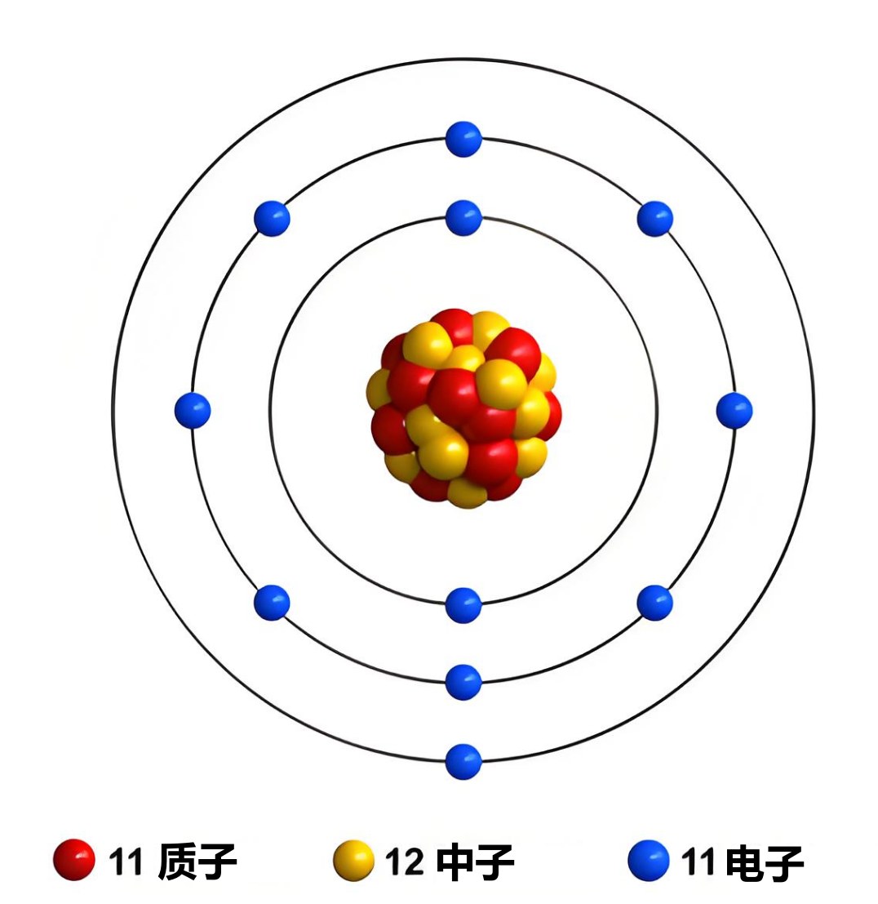

*图2.1.1-1金属Na原子-示意图*

**这实际上就是一个金属钠原子，相对原子质量是23，共有11个质子和12个中子。**

其中原子核外层电子数量，最多为**2n2**个，其中n代表电子层数，n = 1、2、3....

金属原子核最外层电子较少，难以自发形成稳定的电子结构，被称之为**"自由电子"**。

自由电子在**外力（电场）的作用下**可以**轻易**从一个原子跳到另一个原子。

**在宏观上看来，电子在外力（电场）的作用下，固定的朝向一个方向跳跃，这就形成了电流。**

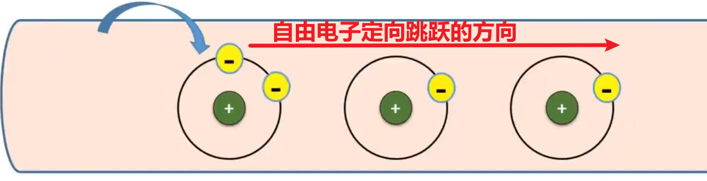

*图2.1.1-2自由电子定向跳跃，示意图*

正是由于自由电子的存在，金属才是一种普遍的导体，这就是金属导体导电的原理。

导体当中能够在外力作用下定向移动，从而产生电流的粒子，被称之为**"载流子"**。

**自由电子就是最常见的载流子类型之一。**

还有某些材料的原子：

最外层电子数量比较多，外层电子结构十分稳固，想要施加外力来使得电子移动就十分困难，这就是**绝缘体**。

而**半导体**的导电性介于导体和绝缘体之间：

其导电性可通过掺杂其它材料或者外界条件来进行调控，是电子信息发展的基石。

假如存在下面一个简单电路：

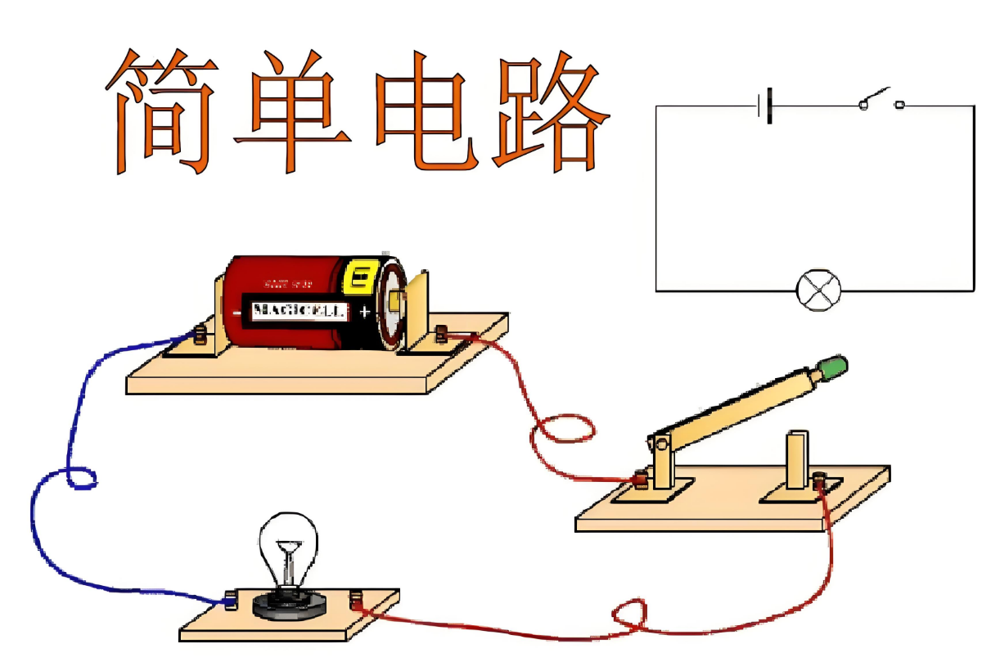

*图2.1.1-3简单电路-示意图*

干电池的正极储存正电荷，负极储存负电荷，电子经由导线连接用电器。

自由电子的移动方向是：负极 --> 正极但**人为规定电流的方向是：正极 --> 负极**，即电子移动的反方向。

之所以会这样，是纯粹的历史原因，大家不用过于纠结。

注意实际应用中，我们更多会考虑电流的方向从正极流向负极，而不会考虑自由电子（载流子）的移动方向。

##### 2.1.2 电流的单位

如何来表示电流的大小呢？

既然电流本质上是电荷的定向移动，于是人们就用**单位时间内通过导体横截面的电荷量**来表示电流的大小。

以金属导体为例，电子在导体中移动。

**电流的基本单位是安培（A），1安培（A）代表1秒内有1库仑（C）电荷量的电子通过了导体横截面。**

其中：

1. 库伦，用字母C表示，它是电荷量的计量单位。
2. 1C是6.242×1018个电子所携带的电荷量，即1个电子携带+1.602×10−19 C的电荷量。（了解）

当然1A是一个非常大的单位，生活中更常用的是mA（毫安）。

电流单位的换算关系：1A = 1000毫安（mA），1mA = 1000微安（uA），1uA=1000纳安（nA）

下图罗列了一些生活中常见的电流大小：

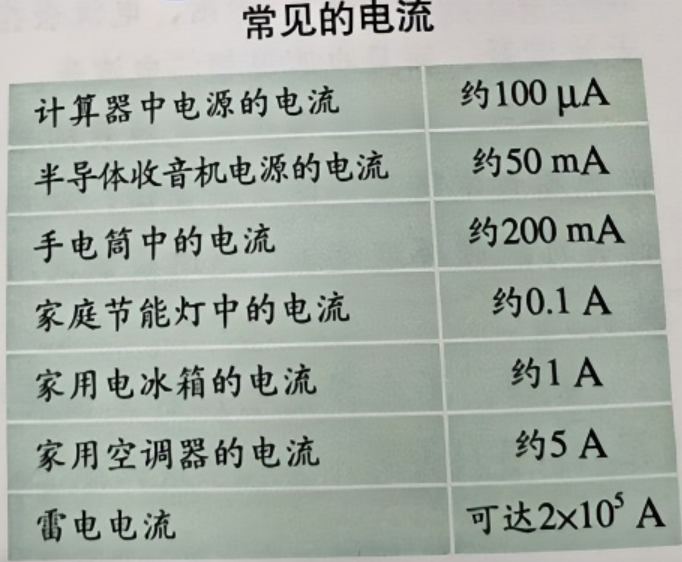

*图2.1.2-1常见电流大小-图*

关于电流的相关概念，大家了解一下即可。

#### 2.2 电压

电压也是一个电学的基本概念，那么什么是电压呢？

**电压（Voltage），又称电势差，它表示单位电荷在电路中从一点移动到另一点所需或释放的能量。**

我们都知道站在高处的人具有重力势能，跳来下就会释放重力势能，电压也是类似的概念。

电压反应了电场中的电荷具有的能量差异。

拿干电池举例，其工作原理基于内部复杂的化学反应，将正电荷集中存储在电源正极，负电荷存储在电源负极。

一旦用导线将正负极与用电器连接起来，就形成了一个完整且稳定的闭合回路。

在这个回路中：

1. 由于电池正、负极存在电位差（即电压）
2. 在电场力的作用下，负极的自由电子会沿着导线向电源正极定向移动，这一电子的定向移动形成了电流。

电流流经用电器时，电场力对电荷做功，使得干电池中存储的化学能逐渐转化为电能，为用电器提供能量。

在这个过程中：

负极的自由电子就会通过导线，移动到电源正极，形成电流并为用电器做功，干电池中存储的化学能就转换成了电能。

随着化学反应进行，电池内部物质逐渐消耗，电势差降低，最终电池的能量耗尽直到不可用。

一般而言，对于一节干电池，它的电压越大，就表示存储的剩余能量越多。

电压越大，也意味着电池能够提供更多的能量，驱动更高功率的设备。

**电压的单位：**

电压的基本单位是**伏特（V）**，1V被定义为当1库仑（1C）的电荷在两点之间移动时，所需或释放的电能为1焦耳（1 J）

常用的电压单位及它们的转换关系如下：

1KV（千伏）= 1000V，1V=1000mV（毫伏），1mV=1000μV（微伏）

下图罗列了一些生活中常见的电压大小：

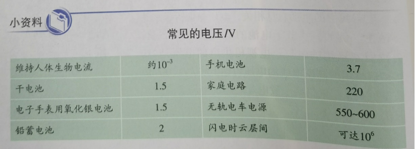

*图2.2-1常见电压大小-图*

**在STM32开发中，我们使用的供电电压都是3.3V的，极少数场景能用到5V。**

#### 2.3 电阻

**在物理学中，用电阻（Resistance）来表示导体对电流阻碍作用的大小。**

导体的电阻越大，表示导体对电流的阻碍作用越大。导体的电阻通常用字母R表示，单位是欧姆，简称欧，符号是Ω。

电阻的单位换算：1KΩ = 1000Ω = 103Ω，1MΩ = 1000000Ω = 106Ω下面截取了初中物理教程中的一个实验：

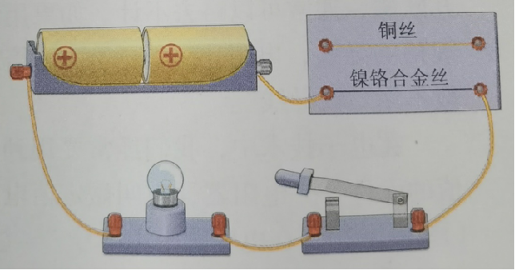

*图2.3-1电阻实验-图*

通过实验我们会发现：

1. 当铜丝接入电路时，小灯泡较明亮。
2. 当把镍铬合金丝接入电路时，小灯泡较暗

**灯泡越亮说明电流做功越多，表示通过灯泡的电流就越大。**

那么为什么会有这种差异呢？

原来，导体虽然容易导电，但是对电流也有一定的阻碍作用。在相同的电压下：

1. 通过铜丝的电流较大，表明铜丝对电流的阻碍作用较小。
2. 通过镍铬合金丝的电流较小，表明镍铬合金丝对电流的阻碍作用较大。

这就是说两种材料的电阻不同，铜丝的电阻小，镍铬合金的电阻大。

**实际上，任何物体都有一定的电阻，或者换句话说，绝缘体也能导电，但其电阻极高，以至于几乎阻止了电流的流动。**

下图展示了常见材料的电阻大小：

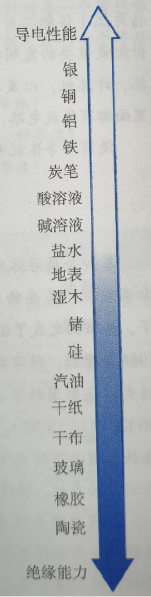

*图2.3-2电阻大小-天梯图*

实际上，人体也是导体，只不过电阻比较大罢了。人体的电阻阻值因条件而异：

1. 干燥状态：人体电阻一般在 10kΩ ~ 100kΩ 之间，此时接触一些不特别大的电压通常不会有严重后果，不会导致大电流通过人体产生危险。
2. 潮湿状态：人体电阻会迅速下降到几百到几千Ω，更容易在相同电压下形成较大电流，增加触电危险。

所以我们小时候都被教育过，不要湿手去触碰开关、插座，这是有道理的。

#### 2.4 电路

物理学中将电池这类提供电能的装置叫做**电源**，将灯泡、电动机、蜂鸣器等这类消耗电能的装置叫做**用电器**。

电源、用电器，再加上导线，往往还有开关，组成了电流可以流过的路径——**电路**。如下图所示：

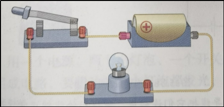

*图2.4-1基础电路-图*

注意只有形成闭合的电路，电路中才会有电流流过。

**电路图：**

画图时，如果把电源、用电器等元件原样画出，既麻烦又不清楚。

为了方便研究，人们通常用图形符号来表示这些元件。下图截取了物理教材中，常见用电器元件的符号：

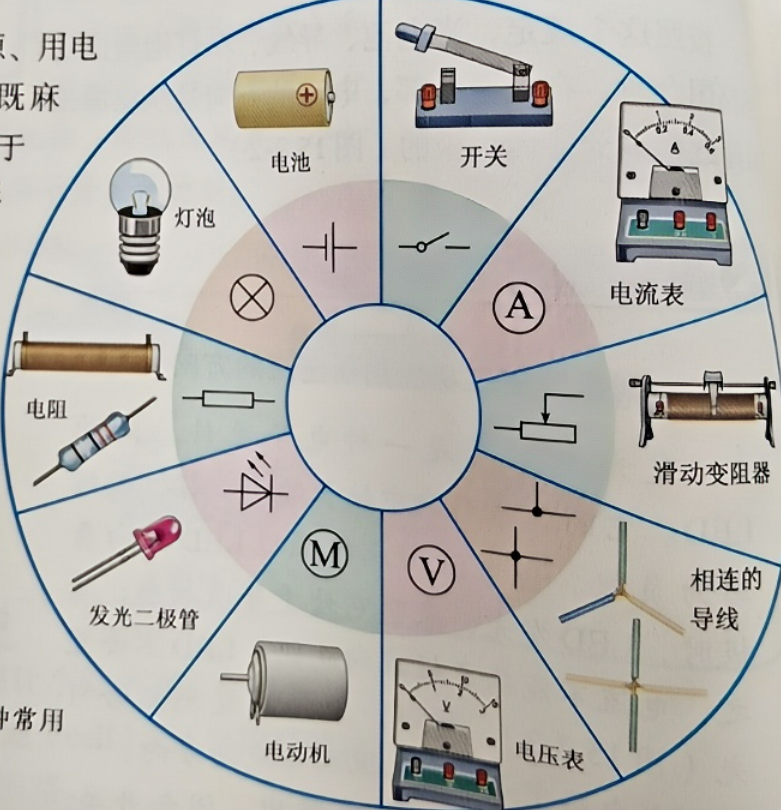

*图2.4-2常见用电器元件符号-图*

除此之外，在电路中表示正负极的方式有很多，这里简单罗列一下：

1. 电源正极：Vcc和Vdd等。
2. 电源负极：Vss和GND等。

详细内容可以参考下图：

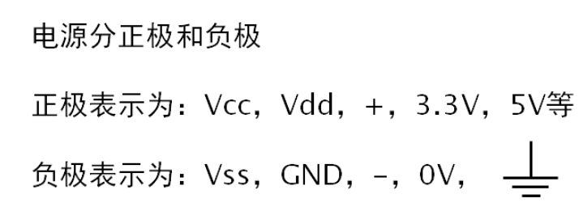

*图2.4-3电路中的正负极表示-图*

**其中VCC和GND是电路中典型的正负极表示方式。**

VDD和VSS分别表示正负极则与NMOS管有关，这一点在下面讲MOS管时我们会讲解。

#### 2.5 直流电和交流电

**直流电：**

**直流电（Direct Current，DC）**是指电流的方向和大小保持恒定不变的电流，其电流始终朝一个方向流动。

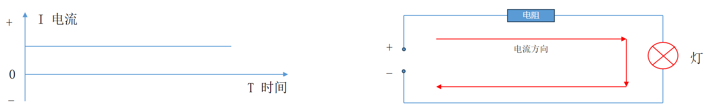

*图2.5-1直流电-示意图*

直流电最主要的三个特点是：

1. **恒定性**：电流方向和大小恒定，电压极性不变。
2. **稳定性**：直流电在传输过程中波动较小，适合需要稳定电压的设备。
3. **存储性**：直流电可以方便地储存在电池、蓄电池等储能装置中。

所以当有稳定电压需求的精密电子仪器，或者需要移动使用电能的设备，常常使用直流电。

比如：手机，笔记本电脑，台式机计算机，服务器等。

**在嵌入式设备中，多数使用的还是直流电，比如我们使用STM32支持3.3V供电，都指的是3.3直流电供电。**

但直流电的缺点是不便于变压，在长距离传输电力时损耗非常大，所以构建电网系统，还需要使用交流电。

这是为什么呢？

因为在电能传输过程中，主要的能量损耗来源于导线发热。

而根据焦耳定律Q = I2 × R × t，在时间、阻值条件不变时，电流越小损耗就越小。

再依据功率计算公式: P = UI，在传输电力能量功率不变的情况下，要想让电流减少就需要增大电压。

这就是**"高压电网输电"**的原理。

**交流电：**

**交流电（Alternating Current，AC）**是指电流的方向和大小随时间周期性变化的电流。

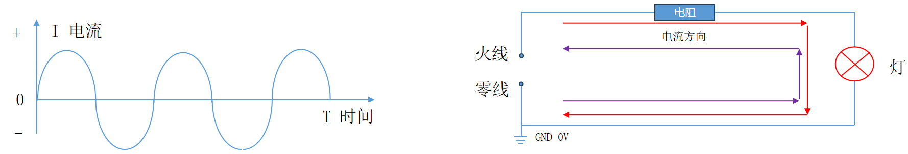

*图2.5-2交流电-示意图*

交流电比较复杂，我们也不需要了解那么多。可以了解以下几点：

1. **变压器的应用：交流电可以通过变压器方便地实现电压的升高或降低。**
   - a. 例如，可以将电压升高到非常高的电压（如110 kV、220 kV或更高）
   - b. 在相同传输功率的前提下，减少了长距离传输电路中的电流。
   - c. 从而减少电能损耗，实现远距离、低损耗的电力传输。
2. 对精密电子设备的影响：交流电的电压和电流随时间变化。
   - a. 可能对某些精密电子设备造成干扰。
   - b. 因此，电子设备通常通过整流和稳压将交流电转换为直流电，以提供稳定的工作电源。
3. **存储的复杂性与电费区间计费：**
   - a. 交流电不易存储，存储交流电不仅复杂而且成本较高。这也是大多数国家采用区间电费计费的原因之一：
   - b. **高峰期**：电力需求高，电价正常。
   - c. **低谷期**：电力需求低，电价较低，鼓励用户在低需求时段使用电力，以平衡电网负荷。
   - d. 某些城市道路系统的灯会点到很晚，这不是浪费电，很有可能是考虑交流电存储成本后的省钱做法。
4. 火线与零线：交流电系统中没有固定的正负极，只有火线和零线之分。
   - a. 零线通常接地，理论电压为0V。零线的作用是为电流提供回路，使电气设备正常工作。
   - b. 火线电压是周期性变化的，会出现相对于零线的正负交替的电压。
   - c. 由于火线的电压交替变化，电流的方向也会随之周期性反转。
   - d. 当火线电压为正时，电流从火线流向零线；
   - e. 当火线电压为负时，电流方向反向，从零线流向火线。
   - f. 这样，电流在电路中不断交变，使电器设备能够正常工作。
5. 交流电的频率：
   - a. 交流电的频率（Hz，赫兹）指的是电流方向每秒变化的次数。
   - b. 例如，中国国家民用电网的交流电就是50Hz 的，表示电流方向每秒改变 50 次（即 25 个完整的正负周期）。
   - c. 由于交流电的电压会周期性的降低、升高。
   - d. 拿一盏电灯来说，会存在周期性变亮变暗的闪烁过程，只不过这个过程很迅速，人肉眼是察觉不出来的。

**交流电仅供了解即可，后续我们讲的STM32相关的电路都是直流电路。**

#### 2.6 常用定律和规律

下面介绍一些常用的电学相关的定律或者规律，理解这些内容对后续的课程学习都有很大帮助。

##### 2.6.1 欧姆定律

欧姆定律是电学当中最基础的定律。

**欧姆定律**指出，在一定温度下，通过导体的电流（I）与导体两端的电压（U）成正比，与导体的电阻（R）成反比。用公式表示为：

`U = I × R`其中：

1. **U**：电压，单位为伏特（V）
2. **I**：电流，单位为安培（A）
3. **R**：电阻，单位为欧姆（Ω）

例如：电路中一个电阻R的阻值为100Ω，电源的电压为 U = 12V，那么通过这个电阻的电流 I 是多少？

电流 I = U / R = 12 / 100 = 0.12 A（安培）

##### 2.6.2 功率计算

功率也是电学当中的一个重要的概念。

在电学中，**功率（Power）**表示电能转化为其他形式能量的速率，是用来表示用电器消耗电能的快慢的物理量。

**功率**的国际单位是**瓦特（W）**，符号为**W**。其他相关单位包括：

1. **千瓦（KW）**：1千瓦 = 1000瓦
2. **兆瓦（MW）**：1兆瓦 = 1,000,000瓦

在电力系统中，常用千瓦（kW）或兆瓦（MW）来表示较大的功率值。

功率常常使用大写字母P表示，它最常用的计算公式如下：

`P = I × U`其中：

1. **P**：功率，单位为欧姆（W）
2. **U**：电压，单位为伏特（V）
3. **I**：电流，单位为安培（A）

这个公式表明，电流和电压越大，电路中的用电器消耗电能就越快，电能转换成其它能量就越多。

**再比如，上述文档中提到的高压传输交流电，当传输电力的功率不变的情况下，电压越大，电路中的电流就越小。**

那么为什么电流越小，传输时的损耗就小呢？

这还需要理解焦耳定律。

##### 2.6.3 焦耳定律

**焦耳定律**指出，在恒定电流通过导体时，导体产生的热量（Q）与电流（I）的平方、电阻（R）以及时间（t）成正比。

公式如下：

Q = I2 × R × t其中：

1. **Q**：产生的热量，单位为**焦耳（J）**。
2. **I**：电流，单位为**安培（A）**。
3. **R**：电阻，单位为**欧姆（Ω）**。
4. **t**：时间，单位为**秒（s）**。

当进行交流电力传输的时候，主要的损耗就是导线发热消耗电能。

**根据焦耳定律，电流越小，产生的热量就越小，消耗的电能自然就越少，而在电力传输时，怎么才能够减少电流呢？**

在电力传输时，保证电能传输功率P不变的前提下下，P = UI，只需要升高电压，就能高减少电流。

这就是高压电传输电力减少损耗的主要原理。

##### 2.6.4 串联电路

**串联电路**是指电路中的各元件依次连接在同一条路径上，电流依次通过每个元件。

换句话说，电流在各元件间没有分流。

串联电路具有下列三个特点（其中R1、R2、R3表示电路中的用电器电阻）：

1. **电流相同**：在串联电路中，流过每个元件的电流相同。即I= I = I = I总R1R2R3
2. **电压分配**：总电压等于各元件两端电压之和，每个元件的电压与其电阻成正比（欧姆定律）。即U= U + U + U总R1R2R3
3. **总电阻累加**：串联电路的总电阻等于各元件电阻的总和。R= R + R + R总R1R2R3

例如，电路中总电压是9V，串联的两个电阻阻值分别是300欧和600欧，求电路中的总电流是多少？

求每个电阻两边的电压是多少？

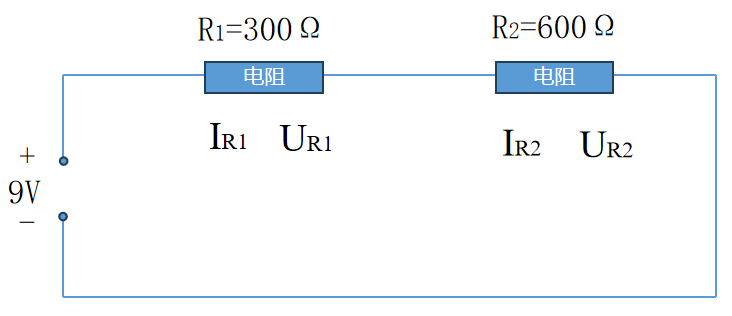

*图2.6.4-1串联电路-图*

总电阻 R = 300 + 600 = 900Ω总总电流 I = 9V /900Ω = 0.01A总电阻R1两端电压 V = 300Ω * 0.01A = 3VR1电阻R2两端电压 V = 600Ω * 0.01A = 6VR2

##### 2.6.5 并联电路

**并联电路**是指电路中的各元件分别连接在同两点之间，形成多个并行的路径，电流可以在不同的路径中分流。

并联电路具有下列三个特点（其中R1、R2、R3表示电路中的用电器电阻）：

1. **电压相同**：在并联电路中，所有元件两端的电压相同，等于电源电压。即U= 总U = U = UR1R2R3
2. **电流分配**：总电流等于各支路电流之和。每个支路的电流与其电阻成反比（欧姆定律）。即I=I + I + I总R1R2R3
3. **总电阻减小**：并联电路的总电阻小于任何一个支路电阻。

并联电路的电阻计算方式如下：

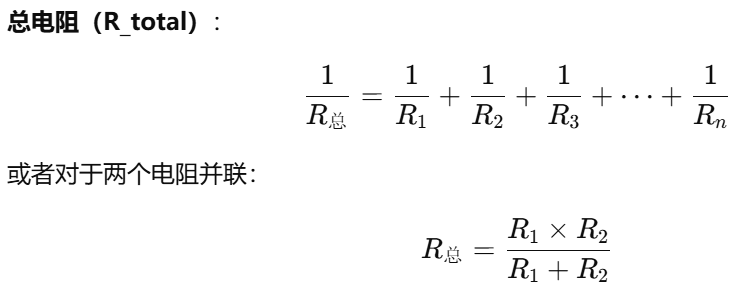

*图2.6.5-1并联电路计算电阻－公式图*

举个例子：

电路中总电压是9V，并联的两个电阻阻值分别是300欧和600欧，求电路中的总电流是多少？

求每个电路支路的电流是多少？

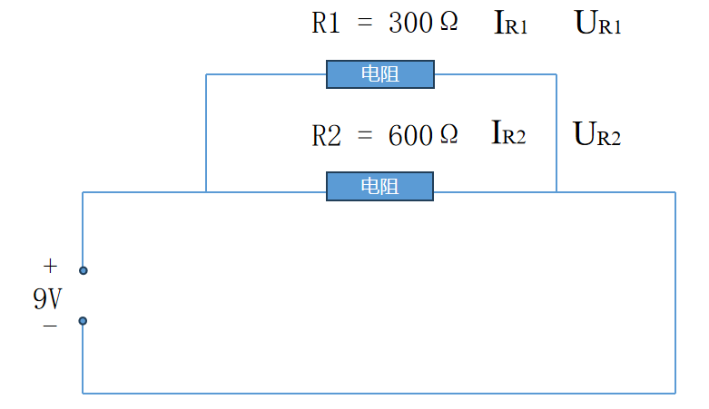

*图2.6.5-2并联电路-图*

并联电路直接求总电阻会很麻烦，考虑到它们的电压相同，我们可以考虑先求各自的电路：

I = 9V / 300Ω = 0.03AR1I = 9V / 600Ω = 0.015AR2I = I + I = 0.03A + 0.015A = 0.045A总R1R2所以总电阻：

R = U / I = 9 / 0.045 = 200Ω，电路总电阻比任何一个分支电阻都要小。

总总总

### 3. 数字电路基础

电子电路是单片机硬件部分的基础知识，我们都知道电子电路又分为：

1. 数字电路
2. 模拟电路

#### 3.1 高电平和低电平（重点）

由于数字电路只有高电平（1）、低电平（0）两种状态，简单且可靠。

**在单片机学习中的电路大都属于数字电路。**

只有使用ADC（Analog to Digital Converter，模拟数字转换器）模块的个别场景中才会接触到模拟电路。

数字电路和模拟电路的对比，可以参考下图（不够全面准确，但对小白来说了解这点就够了）：

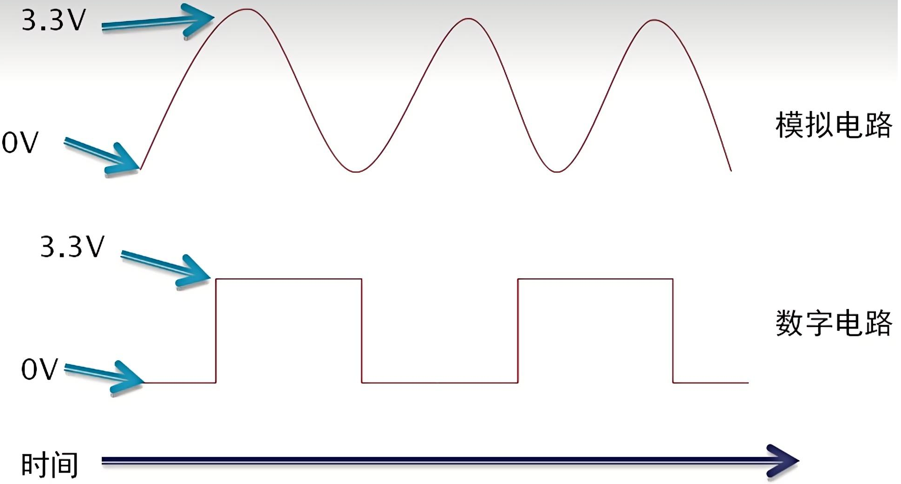

*图3.1-1数字电路和模拟电路-对比图*

**模拟电路：**

模拟电路处理的信号是连续的，表示为一个不断变化的、连续的电压或电流。

信号值可以是任何实数值，在一定范围内连续变化。

模拟电路适合用于处理自然界中存在的连续信号，如声音、温度等。

在嵌入式系统中：

我们使用模拟电路的主要目的是获取各种自然传感器的数值，比如噪音传感器、温度传感器、光照传感器等。

**数字电路：**

数字电路处理的信号是离散的，二进制的。

信号使用离散的二进制数（0 和 1），信号只有两种状态，即**高电平（1）**和**低电平（0）**。

数字电路虽然规定了电路的信号只有两种状态：

但实际上电压不会瞬间从0V跳变到3.3V，也不会瞬间从3.3V降到0V，总会有一个上升和下降的过程。

此外，电压不可能绝对稳定，必然会存在一定的波动。**因此高低电平实际上是一个电压区间，而不是固定的值。**

在STM32的实际编程中，我们主要关注的就是**芯片的某个引脚输出了高低电平、或者输入了高低电平**。

所以高低电平的定义对我们而言至关重要。

关于数字电路中的电平标准，主要涉及到两个技术：

1. CMOS（互补金属氧化物半导体, Complementary Metal-Oxide-Semiconductor）
2. TTL（晶体管-晶体管逻辑, Transistor-Transistor Logic）

如果你想要了解它们，可以参考STM32官方资料《STM32F103 系列数据手册》的**5.3.12-I/O端口特性**这个小节。

通过这个小节你可以完整了解STM32的引脚输入高低电平的具体范围，以及输出高低电平的具体范围。

**关于手册的问题，我们到下面的小节再详细讲。**

**为了简化理解，并避免过多涉及硬件细节，你可以采用以下简化的观点，以STM32为例：**

1. 引脚输出高电平（输出信号1）：引脚输出了接近3.3V，或者就是3.3V的电压。（由于供电就只有3.3V，输出时不可能输出超过VDD的电压）
2. 引脚输出低电平（输出信号0）：引脚输出了接近0V或者就是0V的电压。
3. 引脚接收输入的高电平（接收输入信号1）：向引脚输入了3.3V、接近3.3V，甚至轻微超过3.3V的电压，**部分引脚可以容忍5V的高电平输入。**
4. 引脚接收输入的低电平（接收输入信号0）：向引脚输入了0V、接近0V，甚至略低于0V的电压。

这样简单理解虽然不完全准确，但对于编写软件程序而言，是足够且实用的。

下面我们通过两个例子，让大家理解两个问题：

1. 什么时候使用高电平，什么时候使用低电平？
2. 高电平的效果是什么，低电平的效果是什么？

##### 3.1.1 点灯实践

通过操控STM32的某一引脚，通过"输出电平"，使得LED灯点亮熄灭的实验。电路图如下所示：

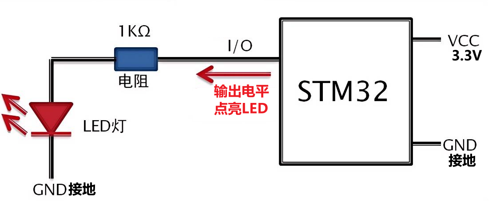

*图3.1.1-1点灯实践1-图*

程序员编写程序控制芯片的IO引脚，输出电平来控制LED灯的点亮或者熄灭，很明显：

1. **引脚输出高电平（1）时，IO引脚（3.3V）与GND（0V）之间存在电压差，电路连通，LED灯点亮。**
2. **引脚输出低电平（0）时，IO引脚（0V）与GND（0V）之间无电压差，电路断开，LED灯熄灭。**

此时这个IO引脚具有输出高电平/低电平的作用，这就是IO引脚的通用推挽输出工作模式。

##### 3.1.2 点灯实践

我们还可以按照下面的方式实现"输出电平"，使得LED灯点亮熄灭：

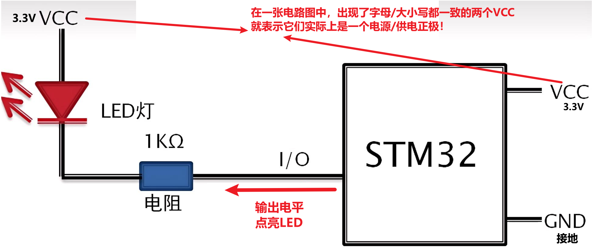

*图3.1.2-1点灯实践2-图*

程序员编写程序控制芯片的IO引脚，输出电平来控制LED灯的点亮或者熄灭，这个时候就完全不同了：

1. **IO口输出高电平（1）时，引脚（3.3V）与VCC（3.3V）之间不存在电压差，电路断开，LED灯熄灭。**
2. **IO口输出低电平（0）时，引脚（0V）与VCC（3.3V）之间存在电压差，电路闭合，LED灯点亮。**

也就是说：

即便引脚的工作逻辑是一样的，都是输出高电平/低电平，但只要电路接线不同，实际的实验现象也会有所不同。

### 4. 常见电子元器件

随着学习的深入，我们会用到很多电子元器件，为了让大家更好的使用这些元器件，在这里讲解一下。

注意，只有当你需要使用某个元器件时，才需要来查看文档，如果还没有用过这个元器件，建议不要看。

#### 4.1 杜邦线

杜邦线是一种用于电子电路实验和开发的连接线，由于这种连接线及其连接器最初是由美国杜邦公司（DuPont）开发和推广的，所以名为杜邦线。

杜邦线的接头，有公母之分：

1. 公头：带有一个针脚（插针），通常是金属制成，排列在塑料外壳中。
2. 母头：带有一个插孔（插座），可以插入一个针脚。

杜邦线实际上就是一根导线，根据两端头的公母不同，分为母对母、公对公、公对母。

下面具体介绍一下：

**母对母杜邦线**两端都是杜邦母头，即两端都是插孔式的连接器。最常见的就是，我们把ST-LINK仿真器和最小系统板连接起来使用的杜邦线。

其实物如下图所示：

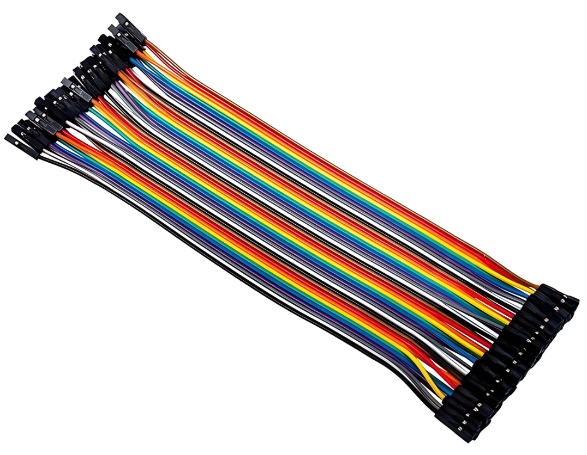

*图4.1-1母对母杜邦线-图*

**公对公杜邦线**两端都是杜邦公头，也就是两端都是一个针脚的连接器。公对公杜邦线可以用来作为导线连接面包板上的两个插孔。其实物如下图所示：

*图4.1-2公对公杜邦线-图*

**公对母杜邦线**一端是杜邦公头，另一端是杜邦母头。即一端是一个插孔，另一端是一个针脚的杜邦线。

这是最常用的一种杜邦线类型因为它可以方便地将具有杜邦母头的器件（如开发板上的引脚、面包板上的插孔等）与具有杜邦公头的器件（如传感器、模块等）连接起来。

其实物图如下所示：

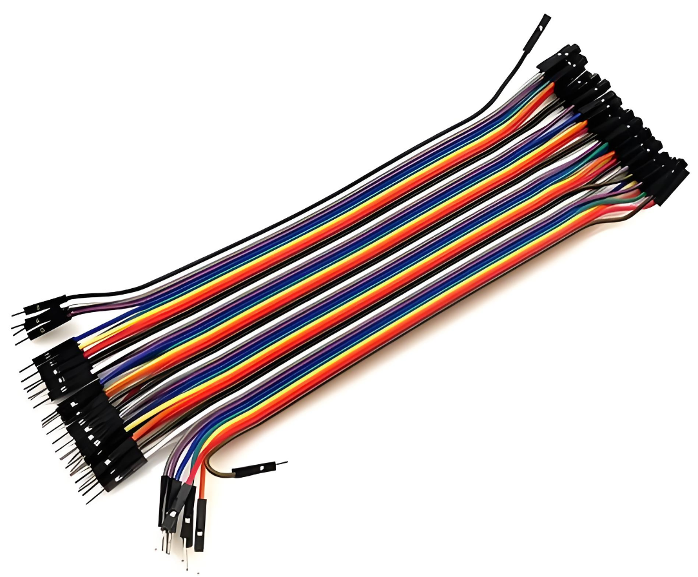

*图4.1-3公对母杜邦线-图*

这些内容了解知道就可以了，本身也属于非常简单的知识点。

#### 4.2 半导体

要了解半导体的基本原理，首先需要从硅（Si）原子的结构和特性讲起。

尽管半导体材料种类繁多，但硅是最常见且应用最广泛的一种，因此本文以硅为例进行说明。

硅原子最外层有4个电子，一群硅原子组成的硅单质通过共享各自最外层的电子，形成稳定的8电子结构。

如下图所示：

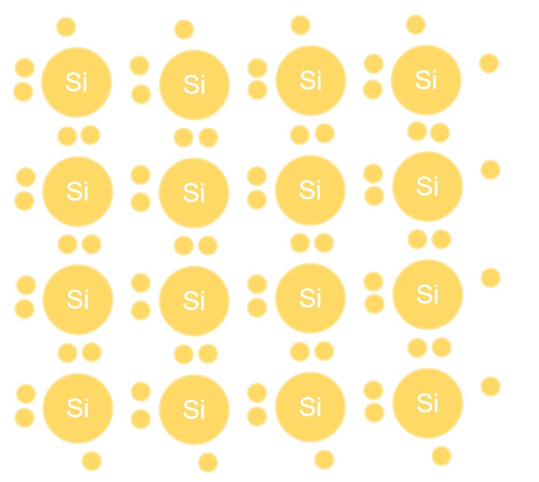

*图4.2-1硅单质的绝缘性-图*

当然由于由于热运动等因素的影响，少数最外层的电子可能获得足够能量挣脱束缚，成为自由电子。

同时在原来的位置留下一个空位，称为空穴：

1. 自由电子带负电
2. 空穴则等效为带正电

自由电子和空穴都可以作为导电的载体，称之为**"载流子"**。

当然自由电子是实际存在的粒子，而空穴是一种 “等效” 的载流子，而且它们传输电流电流的方向也不同，下面会有详细讲解。

这些少量的载流子并不会影响硅单质自身导电的性质，硅单质仍然是纯粹意义上的绝缘体。

**为了让硅导电，于是对硅晶体进行掺杂，形成了一种介于导体和绝缘体之间的材料，即半导体。**

根据掺杂内容的不同，形成了两种不同的半导体，即P型半导体和N型半导体。

##### 4.2.1 N型半导体

在硅原子中掺入少量的五价元素，如磷（P）、砷（As）、锑（Sb）等，就构成了N型半导体。

以磷原子为例：

磷原子最外层有5个电子，如果把磷原子掺杂进硅原子中，在它们共享最外层电子时，最外层就会多出一个电子，如下图所示：

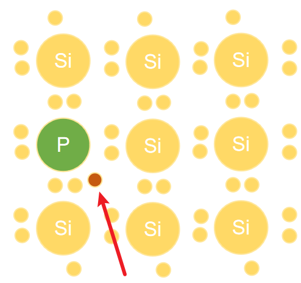

*图4.2.1-1N型半导体-图*

此时这个电子就是一个自由电子，它可以作为电流的**载流子**。

在外部电场的作用下（比如在N型半导体的两端施加电压），这些自由电子就可以定向移动形成电流。

当然自由电子的移动方向和电流方向是相反的。

同样的，由于热运动等自身因素，N型半导体的内部肯定也存在少部分的"空穴"作为载流子，但空穴并不影响N型半导体的性质。

**这种半导体，由于主要的载流子是自由电子，带有负电，于是被称之为N型半导体，意为带有负电，Negative负的。**

##### 4.2.2 P型半导体

在硅原子中掺入少量的三价元素，如硼（B）、铝（Al）、镓（Ga）等，就构成了P型半导体。以硼原子为例：

硼原子最外层有3个电子，如果把硼原子掺进硅原子中，这样它的最外层就少了一个电子。

如下图所示：

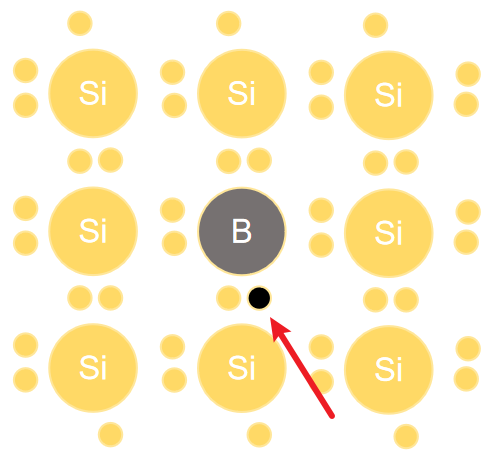

*图4.2.2-1P型半导体-图*

在术语上，把硼原子缺少1个电子的位置称之为"**空穴"**，空穴具有吸引自由电子的特性，对外呈现正电属性。

当有外部电场作用时，空穴附近的硅原子的最外层电子就会丧失稳定状态，使得其中一个电子摆脱束缚，成为自由电子。

这个自由电子就会去填补硼原子周围的空穴，同时电子原来的位置又会产生新的空穴。

如此循环往复，从宏观角度看，仿佛是空穴在定向移动一样。

**空穴的这种定向移动就形成了电流，并且空穴带有正电荷，空穴的移动方向就是电流的方向。**

所以空穴也是一种**等效载流子**，和自由电子一样，不过它带有正电荷。

同样的，由于热运动等自身因素，P型半导体的内部肯定也存在少部分的自由电子作为载流子，但这些自由电子并不影响P型半导体的性质。

这种半导体，由于主要的载流子是空穴，带有正电，被称之为**P型半导体**，叫P型是因为它的载流子是空穴，带有正电，Positive正的。

##### 4.2.3 总结

总结如下：

1. **N型半导体主要载流子是自由电子，带有负电，电流的方向和载流子的运动方向是相反的。**但由于自身热运动等原因，N型半导体中也存在极少数的空穴。
2. **P型半导体主要载流子是空穴，带有正电，电流的方向和载流子的运动方向是相同的。**同时P型半导体中也存在极少数的自由电子。
3. **为了简化理解，我们可以直接把自由电子看成带负电荷的载流子，空穴看成带正电荷的载流子，它们的定向移动就产生了电流！**
4. **无论什么半导体，多数载流子对电流的贡献占主导地位，但少部分载流子的作用也不可忽视，这一点我们在下面的内容中都会讲到。**

#### 4.3 二极管

明白了P型半导体和N型半导体，那么二极管就非常好理解了。

**首先我们来看一下PN结，因为二极管本质上就是一个PN结。**

##### 4.3.1 PN结

所谓的PN结，即一个P型半导体，和一个N型半导体组装拼接在一起形成的，如下图所示：

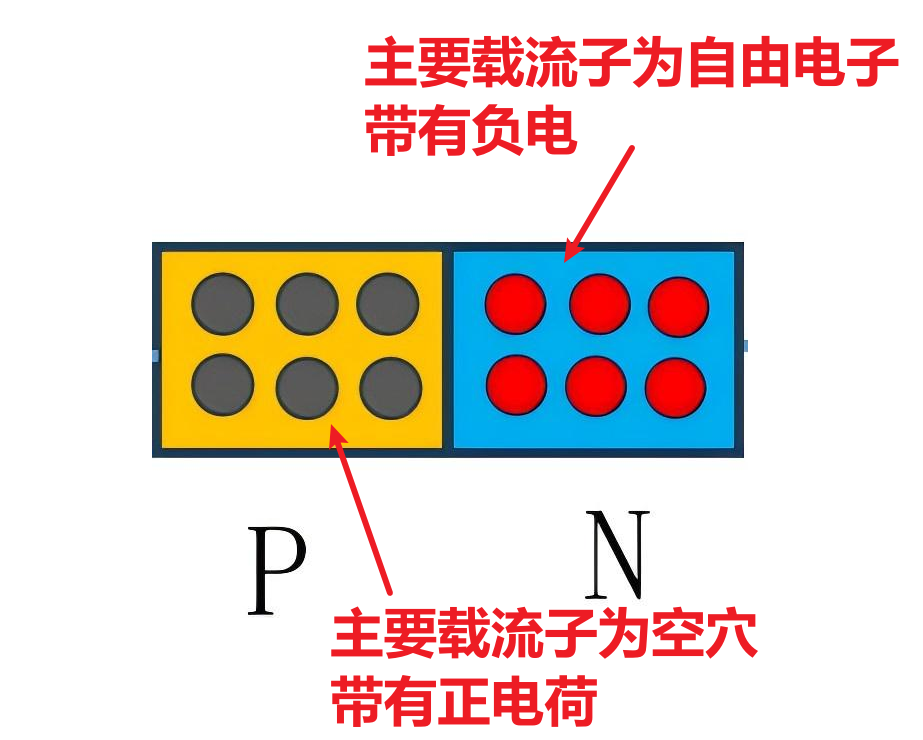

*图4.3.1-1PN结-图*

P型半导体中多数载流子为空穴，N型半导体中多数载流子为自由电子。把它们结合到一起，就像**"干柴遇烈火"**，在它们的结合部分：

1. 结合处P型半导体的一端，N型半导体中的自由电子会和P型半导体中的空穴结合。
   - a. 于是在结合处的P端就形成了一片带有负电荷的离子区域，比如B-硼离子。
   - b. 也就是N型半导体的自由电子扩散到了P型半导体中。
2. 结合处N型半导体的一端，P型半导体中的空穴会和N型半导体中的自由电子相结合。
   - a. 于是在结合处的N端就形成了一片带有正电荷的离子区域，比如P+磷离子。
   - b. 也就是P型半导体的空穴扩散到了N型半导体中。

这些离子由于接收电子或丢失电子而形成了一种稳定的状态，比如：

1. P型半导体中的硼原子，由于希望获取一个电子构成了空穴这种主要的载流子。
   - a. 在PN结的结合处，一些硼原子获得了它渴望的自由电子（来自于N型半导体），形成了B-离子的稳定结构
   - b. 阻止了N型半导体中自由电子的进一步扩散。
2. N型半导体中的磷原子，由于自身多了一个电子而形成了自由电子这种主要的载流子。
   - a. 在PN结的结合处，一些磷原子就失去了它的自由电子（来自于P型半导体），形成了P+离子的稳定结构
   - b. 阻止了P型半导体中空穴的进一步扩散。

在没有外力的作用下，这样的互相渗透肯定不可能彻底完成。

只会在结合处形成一片没有载流子，只有离子的空间电荷区**（也叫耗尽区）**，这样PN结就形成了一种平衡状态。

如下图所示：

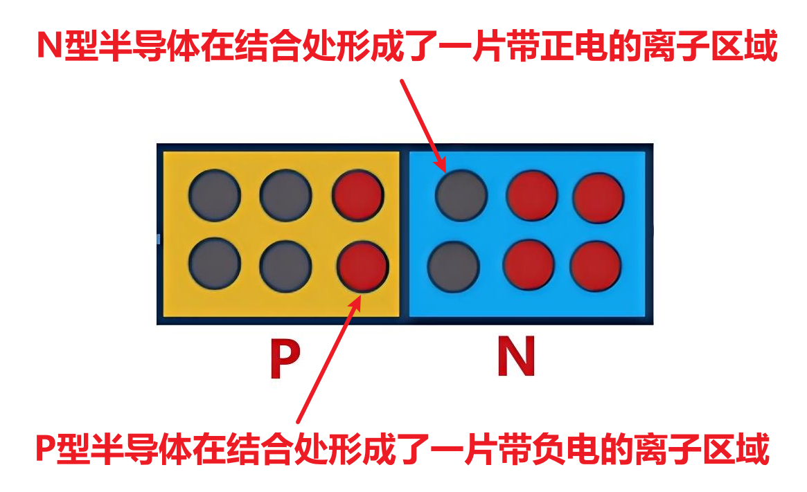

*图4.3.1-2PN结平衡状态-图*

为了让PN结导通，能够完成导电的功能，那就需要破坏这种平衡状态，怎么打破呢？

P型半导体的结合处充斥着负电荷，N型半导体的结合处充斥着正电荷。

这样它们的结合就近似构成了一个**"内置电池"**（只是类比，实际上这里会形成一个内建电场）。

结合处的P端是"内置电池"的负极，结合处的N端是"内置电池"的正极。

打破这种平衡显然是需要外力的：

1. 如果在P端连接电源正极，N端连接电源负极，在PN结内部施加一个和内置电池**反向**的"电场"。
   - a. 这样就会打破内部电场形成的平衡，使得PN结导通，载流子定向移动，形成电流。
   - b. **我们把在P端连接电源正极，N端连接电源负极的方式，称之为"正向偏置"，即PN结导通。**
2. 如果在P端连接电源负极，N端连接电源正极，在PN结内部施加一个和内置电池**同方向**的"电场"。
   - a. 这样反而会加固内部电场，使得PN的平衡状态更加稳固，难以形成电流，即电路处于断开状态。
   - b. **我们把在P端连接电源负极，N端连接电源正极的方式，称之为"反向偏置"，即PN结断开截止。**

**所以很明显，PN结的最大特点是单向导通，即电流只能从P端流向N端，P端必须施加电源的正极。反之，则PN结处于断开状态，无法导通！**

##### 4.3.2 二极管的作用

二极管（Diode）主要的结构就是一个**PN结**，那么这样的一个二极管有什么作用呢？

**二极管具有单向导电性：**

1. 当二极管的**正极**（也叫阳极，其实就是PN结的P端）连接到电源的正极，**负极**连接到电源的负极时，电流可以通过二极管流动，二极管导通。
2. 当二极管的**正极**（也叫阴极，其实就是PN结的N端）连接到电源的负极，**负极**连接到电源的正极时，电流无法通过二极管流动，二极管会阻塞电流。

二极管可以对电路起到保护的作用，避免电路出现反接，它的电路符号如下所示：

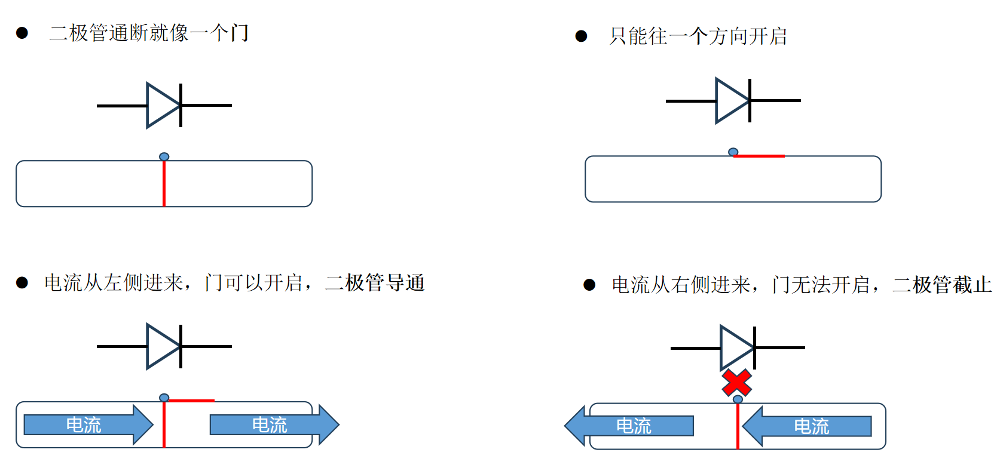

*图4.3.2-1二极管-图1*

二极管的电路符号其实非常形象：

1. **三角形的箭头表示电流允许流过的方向，即二极管的正极。**
2. **三角形的旁边是一个"竖杠"，即二极管的负极。这个竖杠就表示若电流从这个方向过来，就会阻止电流流过。**

以上，我们就简单了解了二级管的工作原理，这对我们而言是足够的。

#### 4.4 LED灯

每一个STM32的高手都是从点灯开始的，我们也不例外，所以这里简单介绍一下LED灯。

**LED灯（Light Emitting Diode）**其实就是一个可以发光的二极管，只不过由于它可以发光的特性，广泛用于照片、显示屏等多个领域。

**关于LED灯，它其实就是一个可以发光的二极管，本质上仍然是PN结的结构，只不过它可以在导通时通过特殊的材料实现发光，且可以在使用材料不同时，发出不同颜色的光。**

文档这里无意讲它的工作原理，大家感兴趣可以自行查阅一下，B站上有很多视频讲这个。

这里简单罗列一下，关于LED灯我们需要知道的一些电气特性。

首先，我们发给大家进行点灯实验的LED灯，都属于小功率的、插针式的LED灯，拥有多个颜色。如下图所示：

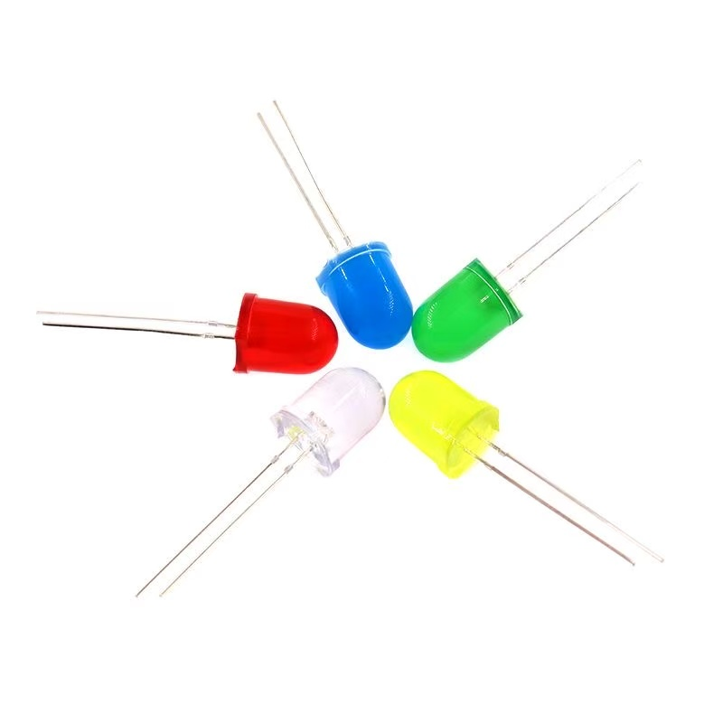

*图4.4-1LED灯-图示*

**正负极：**

既然是二极管，LED就有正负极（阳阴极）之分。以上图中我们使用的插针式的LED灯为例：

1. **正极：**长引脚是LED的正极
2. **负极：**短引脚是LED的负极

所以在使用在LED进行面包板实验时，不要插错了正负极。否则轻则不亮，重则会有烧毁LED的风险。

**工作电流：**

我们使用的小型LED对工作电流是有要求的，不能过高。一般在5mA ~ 20mA之间是安全的工作电流，且电流越高，灯越亮，反之则越暗。

**工作电压：**

不同颜色的LED具有不同的工作电压，例如：

1. **红色、黄色、橙色 LED**工作电压一般在约**1.8V ~ 2.2V**之间。
2. **绿色、蓝色、白色 LED**工作电压一般在约约**2.8V ~ 3.6V**之间。

注意，当LED正向导通，但低于工作电压时，LED灯一般不会亮起。但我们一般也不需要这一点，因为我们的供电都是3.3V/5V，足够驱动LED。

需要注意的是，在使用LED时，正常情况下都要在电路中加上电阻进行限流，以避免高电压/电流烧毁LED。

#### 4.5 MOS管

**MOS管**，全称为**金属氧化物半导体场效应晶体管**（Metal-Oxide-Semiconductor Field-Effect Transistor，简称**MOSFET**）

是一种广泛应用于电子电路中的场效应晶体管，可以说MOS管是现代电子技术中，最基础、最关键的元件之一。

本教程的初衷不是让大家完全理解掌握硬件，所以对于MOS管，我们希望大家能够有一定的了解，理解就足够了。

下面简单介绍一下MOS管以及它的原理，我会尽量讲的简单一些。

MOS管主要由金属电极、氧化物绝缘层和半导体材料三部分组成，进一步可以分为两种类型：

1. N型MOS管
2. P型MOS管

同时为了让MOS管能够与外部电路连接起来，每个MOS管都具有三极：

1. **栅极（G，Gate）**：
   - a. 与金属电极相连，是MOS管的控制端。
   - b. **一般情况下，栅极连接控制电路，控制电路输出高低电平来控制 MOS 管的通断。**
   - c. 栅极的作用就跟门一样，决定了MOS管的通断，所以命名为Gate（门）极。
2. **源极（S，Source）**
   - a. 当MOS管导通时，需要载流子来进行电流的传输。
   - b. **源极是MOS管中载流子移动形成电流的起源，所以我们把这个极，叫做源极。**
3. **漏极（D，Drain）**：**漏极是MOS管中载流子移动形成电流的终点，所以我们把这个极，叫做漏极。**

也就是说，当MOS管正常导通时，**载流子**一定从源极流向漏极，这一点请大家务必记住。

下面分别讲解一下两种MOS管。

##### 4.5.1 N型MOS管

N型MOS管的结构组成，可以参考下图：

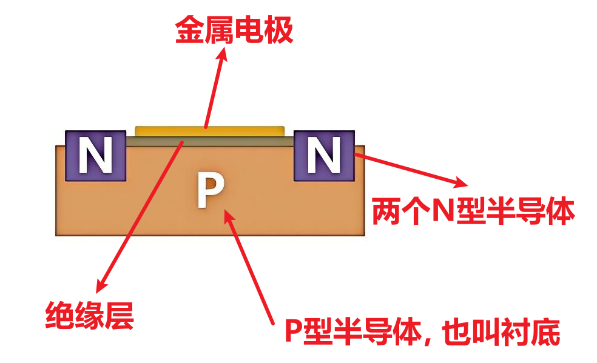

*图4.5.1-1N型MOS管-图1*

NMOS管的三个极，如下图所示：

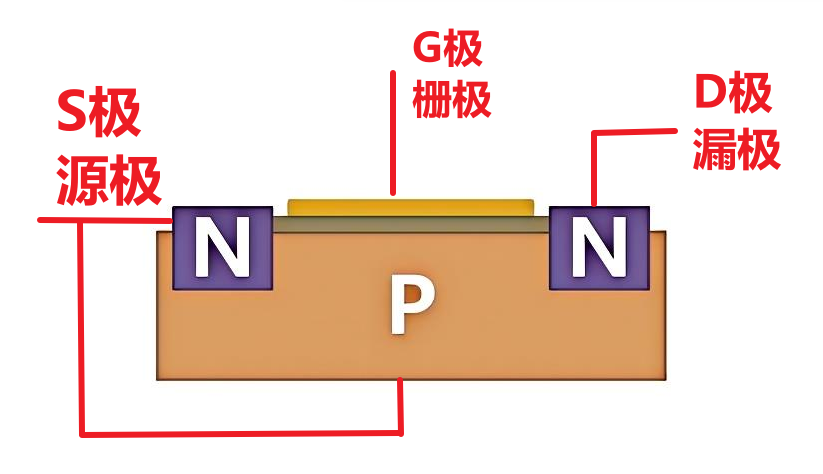

*图4.5.1-2N型MOS管-图2*

**注意源极同时接通左边的N型半导体和P型半导体（衬底）的末端。**

现在我们设计电路，将栅极G连接上电源正极，施加电压，S极接上电源负极，如下图所示：

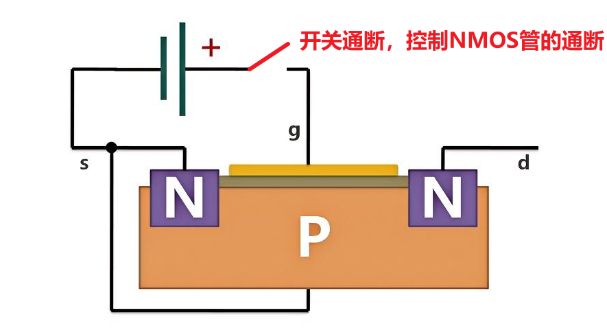

*图4.5.1-3N型MOS管-图3*

通过开关的通断就可以控制NMOS管的通断，这是什么原理呢？

我们在上面讲过，作为衬底的P型半导体，它的主要载流子是空穴，但也存在少数自由电子。

空穴可以直接看成正电荷，少数自由电子可以视为负电荷。

**当开关闭合时，NMOS管导通。**

此时NMOS管的栅极和源极之间虽然没有直接导通，但由于电场的作用，衬底中的少部分自由电子被吸引到绝缘体和衬底的接触部分。

这样一群自由电子聚集在一起，就形成了一条导电通道。如下图所示：

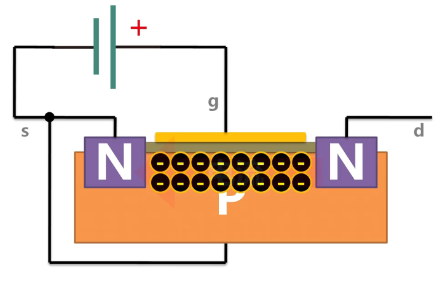

*图4.5.1-4N型MOS管-图4*

那么此时自由电子的移动方向是什么呢？电流的方向是什么呢？

源极S一般连接电源负极，或者接地，在电势差的影响下，自由电子作为载流子会从S源极流向D漏极，形成电流。

**再强调一下：当MOS管正常导通时，载流子一定从源极流向漏极。**

当然电流的方向和负电荷移动的方向相反，此时电流的方向是从D漏极到S源极的。

总结：

1. 当加在NMOS管G栅极的电压高于S源极的电压（高于某个阈值，源极一般接负极或接地，这个阈值要求并不高）时，NMOS管导通。
2. NMOS管导通后，自由电子作为载流子从源极流向漏极，电流的方向是漏极到源极。

**然后我们断开开关，加到栅极和源极之间的电压消失，衬底中的自由电子不再聚集，导电通路消失，此时NMOS管断开。**

讲到这里，NMOS管的最基本原理你就知道了，在继续讲解下一部分知识前，我们还有一个问题：

NMOS管就一定要按照上面给出的电路连接吗？可不可以源极S接正极，栅极G接负极呢？

反接NMOS管，如下图所示：

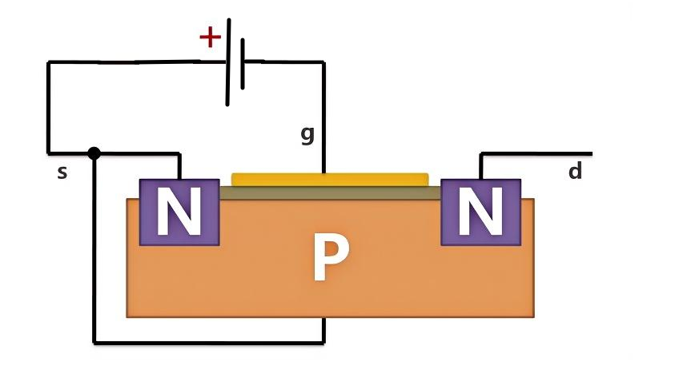

*图4.5.1-5N型MOS管-图5*

**反接时，NMOS管实际上就变成了一个普通的二极管，此时电路的通断无法控制NMOS管的通断！**

原因如下：

1. 衬底和漏极到N型半导体形成了一个PN结，也就是一个二极管。所以任何MOS管内部都会隐藏一个二极管，我们把这个二极管叫做"寄生二极管"。
2. 既然存在寄生二极管，反接电路会使得电流直接从PN结流过，那么NMOS的通断就无所谓了。
3. 如果不反接，电流想从这个PN结走，会恰好被阻塞，此时电流就只能依靠NMOS的通断来流动了。

总之：

**使用NMOS管，源极一般要接入电源负极或接地，通过控制栅极加压与否来控制NMOS通断。除非特殊情况，否则不要将源极接入电源正极，不要反接！**

原理图如下：

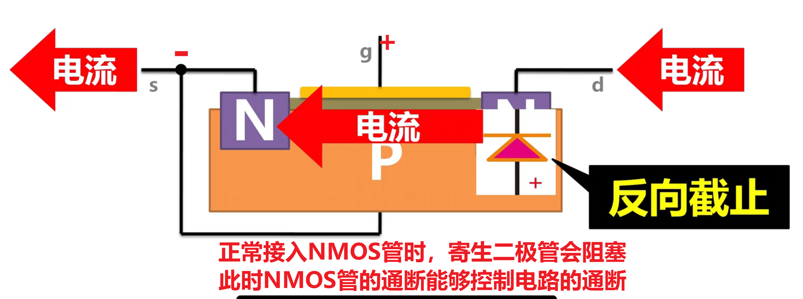

*图4.5.1-6N型MOS管-图6*

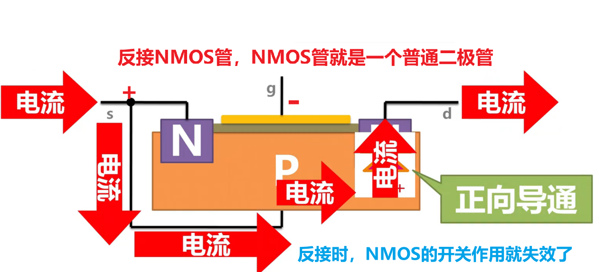

*图4.5.1-7N型MOS管-图7*

在电路图中，最规范的NMOS管的画法如下图所示：

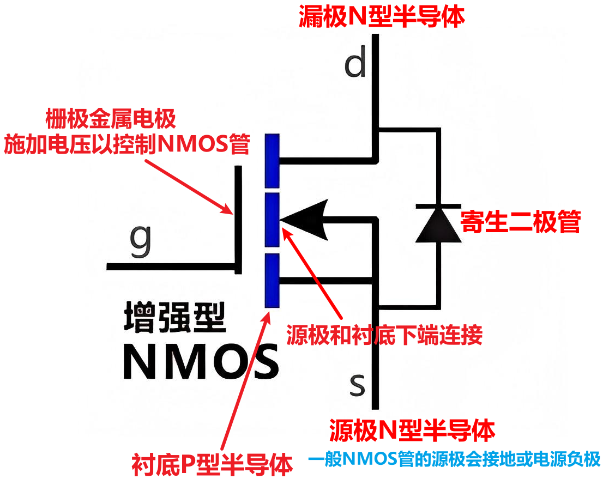

*图4.5.1-8N型MOS管-图8*

从这张图就可以看出：

当电流从漏极D流向源极S时，寄生二极管阻塞，通过控制栅极施加的电压可以控制NMOS管的开闭。

通过上面的描述，不难发现，NMOS管在电路中是可以作为一个开关使用的，此时可以直接把NMOS管简化成下图：

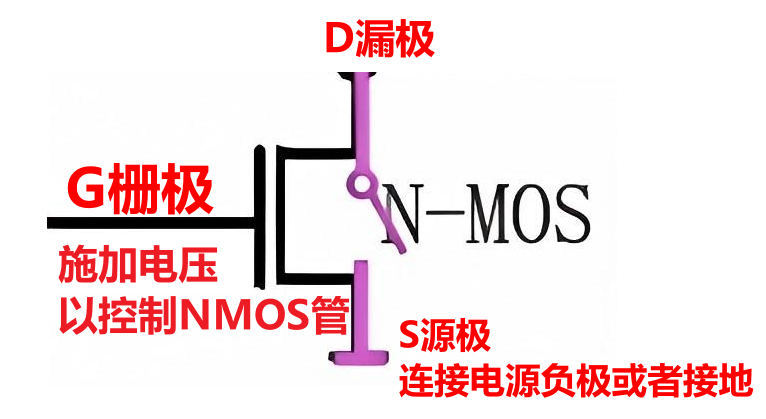

*图4.5.1-9N型MOS管-图9*

当栅极加压时，NMOS管导通，开关闭合。当栅极没有加压时，NMOS管不导通，开关断开。

##### 4.5.2 P型MOS管

理解了N型MOS管，那么P型MOS管，在原理上也是大差不差的。

其材料结构如下图所示：

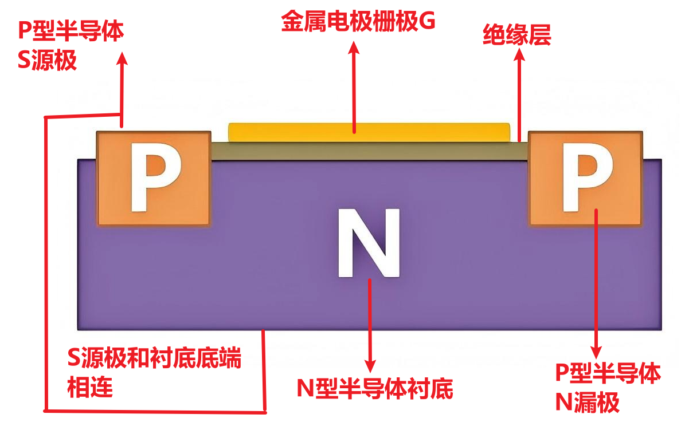

*图4.5.2-1P型MOS管-图1*

**使用NMOS管时，常常把源极接入电源负极或者接地，PMOS管则恰恰相反，使用PMOS管时，常常把源极接入电源正极。**

现在设计一个简单的电路，来使用PMOS管：

*图4.5.2-2P型MOS管-图2*

通过控制对栅极是否加压，有两种情况：

1. 对栅极加压，此时栅极G和源极S都是3.3V，它们之间没有电势差。
2. 对栅极不加压，此时栅极G和源极S之间存在电势差。

那种何种情况意味着PMOS管导通呢？当然是不加压导通，原因如下：

当栅极G和源极S之间存在电势差时，由于电场的作用，N型半导体衬底中极少数空穴被"吸引"到绝缘层和衬底的交界处.

这样一群空穴聚集在一起，就形成了一条导电通道。如下图所示：

*图4.5.2-3P型MOS管-图3*

同样的，在电路图中PMOS管可以用下列图标来表示：

*图4.5.2-4P型MOS管-图4*

很明显：

在源极S接入电源正极时，栅极G不加压时，PMOS管接通，电流从源极S流向漏极D。

且由于寄生二极管的存在，一般情况下也不要反接PMOS管，否则PMOS也会变成一个普通二极管。

同样的，如果把PMOS管视为一个开关，则可以简化为下图：

*图4.5.2-5P型MOS管-图5*

##### 4.5.3 扩展：VDD为什么表示正极？

首先VDD是词组Voltage Drain Drain的首字母缩写，其中Voltage 就是电压的意思，而Drain就是MOS管的漏极的意思。

为了让大家更好的记住VDD表示电源正极，VSS表示电源负极，咱们可以直接粗暴的认为这种命名规则是按照NMOS管的电流方向划定的。

对于NMOS管来说，载流子是自由电子，虽然载流子的运动方向是从源极到漏极，但电流的方向确实从漏极到源极。

所以在基于MOS管的电路中，我们经常看到：

1. 使用VDD表示电源正极，或者高电势。
2. 使用VSS（Source，源极）表示电源负极、接地，或者低电势。

##### 4.5.4 总结

如果你觉得上面的描述太过于麻烦，或者看不懂，或者你干脆懒得看，那么你可以先记住以下结论：

1. 当MOS管导通时，实际上就是MOS管内部形成了由源极到漏极的载流子通道，注意是由源极到漏极的载流子通道。
   - a. NMOS管的载流子是自由电子，所以电流的方向是漏极到源极。
   - b. PMOS管的载流子是空穴，所以电流的方向就是源极到漏极。
2. 正常使用NMOS管时，源极需要接入电源负极或接地，也就是源极需要保持低电平。在这种情况下：
   - a. 向栅极加压（输出高电平），则NMOS管导通。
   - b. 不向栅极加压（输出低电平），则NMOS管断开。
3. 正常使用PMOS管时，源极需要接入电源正极，也就是源极需要保持高电平。在这种情况下：
   - a. 向栅极加压（输出高电平），则PMOS管断开。
   - b. 不向栅极加压（输出低电平），则PMOS管导通。

以上，关于MOS管的讲解就先告一段落了，坦白来说，这段描述正确但有点简陋，但秉承着够用就好的原则，我们先到此为止，祝你学习愉快。

#### 4.6 三极管

二极管是由一个PN结组成的，MOS管是PN型半导体在衬底结构上嵌套另一种类型半导体组成的，而三极管则是由两个PN结组成的：

1. **NPN 型三极管：**由**两层 N 型半导体夹着一层 P 型半导体**组成。
2. **PNP 型三极管：**由**两层 P 型半导体夹着一层 N 型半导体**组成。

如下图所示：

*图4.6-1三极管PN结结构-图*

和MOS管类似，三极管自然有"三级"，分别是：

1. **基极（Base，常缩写为B）：**基极是三级管的控制端，类似MOS管的栅极：
   - a. 基极可以通过控制与发射极之间有无电流通过，从而控制发射极和集电极之间有无电流流过。
   - b. 这就是三极管的作用之一，控制发射极和集电极之间的电流通断，起着一个开关的作用。
   - c. 通常基极和发射极之间的电流只是小电流，而发射极和集电极之间的电流是大电流。
   - d. 这就是三极管的作用之一，用小电流控制大电流，实现电流放大的效果。
2. **发射极（Emitter，常缩写为E）**：类似MOS管的源极，是发射载流子的源头。
   - a. 对于三极管来说，它的发射极总是掺杂浓度更高，拥有更多的载流子。比如：
   - b. PNP型三极管，它的发射极P型半导体掺杂浓度高，比集电极就拥有更多的载流子空穴。
   - c. NPN型三极管，它的发射极N型半导体掺杂浓度高，比集电极就拥有更多的载流子自由电子。
3. **集电极（Collector，常缩写成C）**：类似MOS管的漏极，是接收载流子的目的地。

相比于发射极，掺杂浓度低，载流子更少。

下面我们分别讲解一下两种类型的三极管。

##### 4.6.1 PNP 型三极管

我们主要来讲一下PNP型三极管的开关作用。

基极和发射极是否能够导通，就关乎发射极和集电极是否能够导通。

那么如何让基极和发射极导通呢？

很简单，单独看基极和发射极组合在一起，它们不就是一个PN结嘛？而PN结必须正向偏置，电流从P端流向N端时才可以导通。

于是我们可以做下列的接线：

*图4.6.1-1PNP 型三极管-图1*

发射极接入电源正极，基极接入电源负极，此时这个PN结正向偏置导通，发射极一端的载流子空穴会向基极区域扩散。

在集电极也接入电源负极的情况下，就会出现下面的情况：

1. 一部分载流子空穴和基极区域的自由电子结合，定向移动形成流向基极的电流。
2. 由于基极区域很窄很小，而且发射端的空穴浓度大于集电极区域，大多数发射极的载流子空穴会继续定向移动到集电极区域，从而形成流向集电极的电流。
3. 增大发射极和基极之间的电流，会有更多的空穴从发射极扩散到集电极区域，从而使得集电极电流增大。

总之大家需要记住这个三极管导通的电路设计，对于PNP型三极管：

1. 发射极接入电源正极
2. 基极和集电极接入电源负极
3. 发射极和基极之间导通，发射极和集电极之间就会导通。

在电路图中，PNP型三极管通常画成以下样式：

*图4.6.1-2PNP 型三极管-图2*

若只把PNP型三极管当成电路的控制开关的话，只需要基极**保持低电平（接入电源负极或接地）**就能够使得三极管导通了。

##### 4.6.2 NPN 型三极管

搞清楚PNP型三极管，NPN型三极管就也大差不差了。

对于NPN型三极管来说，单独看基极和发射极组合在一起，它们也是一个PN结。而PN结必须正向偏置，电流从P端流向N端时才可以导通。

于是我们可以做下列的接线：

*图4.6.2-1NPN 型三极管-图1*

发射极接入电源负极，基极接入电源正级，此时这个PN结正向偏置导通，载流子自由电子会从发射极扩散到基极区域。

在集电极也接入电源正极的情况下，就会出现下面的情况：

1. 一部分载流子自由电子和基极区域的空穴结合，自由电子定向移动到基极，即形成从基极流向发射极的电流。
2. 由于基极区域很窄很小，而且发射端的自由电子浓度大于集电极区域，大多数发射极的载流子自由电子会继续定向移动到集电极区域，从而形成从集电极流向发射极的电流。
3. 增大发射极和基极之间的电流，会有更多的自由电子从发射极扩散到集电极区域，从而使得集电极电流增大。

总之大家需要记住这个三极管导通的电路设计，对于NPN型三极管：

1. 发射极接入电源负极
2. 基极和集电极接入电源正极
3. 发射极和基极之间导通，发射极和集电极之间就会导通。

在电路图中，NPN型三极管通常画成以下样式：

*图4.6.2-2NPN型三极管-图2*

若只把NPN型三极管当成电路的控制开关的话，只需要基极**保持高电平（接入电源正极）**就能够使得三极管导通了。

##### 4.6.3 总结

**对于PNP型三极管：**基极输入低电平，即接地或接入电源负极时，PNP型三极管导通。

**对于NPN型三极管：**基极输入高电平，即接入电源正极时，NPN型三极管导通。

## 03 嵌入式概述

### 1. 什么是嵌入式

什么是嵌入式系统？嵌入式开发到底是做什么的？我们通过两个具体的案例来阐述嵌入式系统的概念和内涵。

#### 1.1 案例一：智能手环

智能穿戴设备（智能手环或手表）是现代人日常使用的电子产品之一。

它可以记录人们日常生活的运动、睡眠、心率等实时数据，并将这些数据与智能手机、平板电脑等设备进行同步。

对采集到的日常数据进行大数据分析，发挥指导健康生活的作用。

下面两张图是Fitbit Flex智能手环外观及其拆解图：

*图1.1-1Fitbit Flex手环图*

*图1.1-2Fitbit Flex手环拆解图*

智能手环一般都具有以下功能：

1. 实时显示时间，设定闹钟等传统手表的功能。
2. 测量心率、血压、睡眠时长等健康数据。
3. 统计步数、运动时长、运动消耗等运动数据。
4. 定位。
5. 振动功能。
6. 蓝牙无线数据连接、数据传输。
7. 低功耗与超长待机

由此可见，智能手环一般有以下组成部分：

1. **微控制器（尤其要使用低功耗的）**
2. 定位模块
3. 蓝牙模块
4. OLED显示屏
5. 心率传感器
6. 锂电池及其充电模块
7. 加速度传感器
8. ...

其系统框架图可以用下图描述：

*图1.1-3智能手环嵌入式系统-框图*

有些智能手环可能还兼顾Wi-Fi连接功能，拥有Wi-Fi模块，这样它和智能手机之间就可以直接基于互联网进行通信了。

#### 1.2 案例二：智能家居

在基本居住功能的基础上，融入互联一体、移动端远程控制、智能检测与监控等技术，实现家居系统的自动化、智能化，这就是智能家居系统。

假如要实现一个自动智能管理家用电器的系统，具备以下功能：

1. 家居安全监控：智能门禁、火灾烟雾报警
2. 家居设备监控：灯光设备监控，电气设备监控
3. 家居环境监控：对甲醛、PM2.5、温度、湿度等信息实时采集和监控
4. ...

利用移动互联技术，采用基于云平台的控制方式，以**微控制器**为核心：

辅以相应的传感器进行环境数据监控，再结合软件进行数据分析，从而自动智能的进行家居家电的控制。

智能家居系统的系统框图如下所示：

*图1.2-1智能家居嵌入式系统-框图*

**微控制器**是其中的核心，其主要作用有两个：

1. 采取各类传感器数据并发送给智能家居软件（服务端）进行数据分析处理。
2. 接收智能家居软件（服务端）的指令，通过各类执行器控制系统中的各类电器设备。

#### 1.3 嵌入式的定义

分析上述两个案例，它们都是嵌入式非常经典的应用场景，它们之间有什么共性？

可以总结以下几条：

1. 功能单一且简单，不像传统计算机系统拥有复杂的软硬件设施。
2. 功耗低。
3. 追求高实时性和高可靠性。
4. 应用于特定的场景，整个软硬件系统往往是更大系统的一部分。
5. 人机交互方式简单，往往只需要简单的按键或简易的交互系统，不需要键盘鼠标，往往也没有复杂的操作系统。

关于嵌入式的定义：

电气电子工程师学会（Institute of Electrical and Electronics Engineers，简称IEEE）在《IEEE标准软件工程术语词汇表》中明确给出了嵌入式系统的定义：

Embedded System: A computer system with a dedicated function within a larger mechanical or electrical system, often with real-time computing constraints.

翻译成中文就是：**嵌入式系统是在较大的机械或电气系统中具有专用功能的计算机系统，通常具有实时计算限制。**

所以嵌入式系统仍然是一种计算机系统，只不过是专用的。

而且这个定义中还提到嵌入式系统需要在更大的机械或电气系统中使用的一种计算机系统，这就是“嵌入”的由来。

随着嵌入式的发展，我们还可以给出一个更全面、更容易理解的定义：

**以用户需求和应用场景为核心，拥有高度可定制化的硬件和软件，对功能、可靠性、性能、功耗、体积、价格有严格要求的计算机系统。这些系统通常嵌入在更大的设备或系统中，以实现特定的控制、监测或操作等各种功能，这就是嵌入式系统。**

下面详细的解释这句话：

1. 用户需求是最核心，最重要的考虑点。毕竟再好的东西也要能够卖出去才行，而不同的行业不同的场景，用户的需求是不同的。
2. 硬件和软件都需要根据用户需求进行定制化处理（也可以叫**"软硬件可自由裁剪"**）：
   - a. 对于硬件来说，选择合适的**微控制器**、传感器以及其它各种外部硬件设备等，以满足性能和成本的平衡。比如低性能处理器一般更便宜，某个嵌入式系统只需要低性能处理器，则不需要高性能的处理器。
   - b. 对于软件来说，既可以实现根据需求实现既定功能，也能尽量精简软件系统，以减少资源占用提高效率性能。当然也可以连带降低硬件成本。
3. 功能、可靠性、性能、功耗、体积、价格是实现嵌入式系统时，基于用户的需求，需要考虑的几个点：
   - a. **功能**：嵌入式系统必须实现特定功能，确保其能够满足预期用途，避免功能冗余。
   - b. **可靠性**：嵌入式系统往往一次性烧录制造，然后终身使用。由于其嵌入式的特点，后期维护比较麻烦，因此需要设计高可靠性，确保系统长期稳定运行。
   - c. **性能**：嵌入式系统需要在有限的硬件资源下实现高效的计算和响应能力，尤其是在实时应用中，性能至关重要。
   - d. **功耗**：许多嵌入式设备（如移动设备、物联网终端）对功耗有严格限制，需要采用低功耗设计策略，如动态电压调整和睡眠模式。
   - e. **体积**：嵌入式系统通常集成在更大的设备中，空间有限，因此需要紧凑的硬件设计和高效的布局。
   - f. **价格**：嵌入式系统广泛应用于消费电子和工业产品中，成本控制是关键因素，设计时需在性能和成本之间找到最佳平衡。

嵌入式系统的应用领域，可以说无处不在，举几个比较常见且目前非常火爆的领域：

1. 消费电子，主要指智能手机、平板电脑、智能穿戴设备等。这些设备中的嵌入式系统为用户提供了丰富的功能，如多媒体播放、网络浏览、蓝牙通讯、数据监控等。
2. 汽车电子，汽车中的电子控制单元（ECU）用于控制发动机、变速器、刹车系统、安全气囊等，比如防抱死制动系统（ABS）。嵌入式系统在汽车中的应用提高了汽车的安全性、舒适性、燃油经济性以及智能性。
3. 汽车的辅助驾驶系统（ADAS）、智能驾驶和无人驾驶都是嵌入式系统的典型应用，它们依赖高性能嵌入式处理器、传感器融合和实时计算来实现车辆的智能感知与控制。通过摄像头、雷达、激光雷达等传感器采集环境信息，并由嵌入式AI算法进行决策，从而实现自动加减速、转向、避障等功能，提高驾驶安全性和自动化水平。
4. 工业控制与自动化，用于自动化生产线、数控机床、工业机器人等。嵌入式系统能够精确控制设备的运行，提高生产效率和产品质量。
5. 智能家居物联网，包括智能门锁、智能灯光系统、智能空调等。嵌入式系统能够实现设备之间的互联互通和智能控制，为用户提供便捷、舒适的家居环境。
6. 医疗设备、通信设备、航空航天乃至于无人机、导弹等军事化设施中嵌入式系统也很常见。

一个常见的嵌入式系统，通常包括：

1. 嵌入式**微控制器**（比如我们要讲的STM32就是一种典型的嵌入式**微控制器**）
2. 外围硬件设备（比如各种传感器）
3. 嵌入式操作系统（有些简陋的嵌入式系统不需要操作系统，比如我们在STM32阶段讲的嵌入式系统都是无操作系统的裸机嵌入式系统）
4. 嵌入式应用程序（一般是直接烧录到**微控制器**当中执行的简易应用程序）

为了让大家更好的理解嵌入式这个概念，我们还需要回答一个问题：

既然嵌入式也是一种计算机系统，那么嵌入式系统和通用计算机系统（比如PC）的区别是什么呢？

要回答这个问题我们需要先辨析三个名词：CPU、MPU、MCU

#### 1.4 CPU、MCU、MPU

CPU是现代人都非常熟悉的名词了，中央处理器（Central Processing Unit，简称CPU）

是计算机系统中负责解释和执行指令的核心组件，由算术逻辑单元（ALU）、控制单元（CU）、寄存器等组件组成，用于执行指令、处理数据和协调系统其他部分的操作。

**通俗的说，CPU就是计算机系统的大脑，无论是通用计算机系统（如PC），还是嵌入式系统，都是需要CPU的。**

MPU（Microprocessor的简写），翻译成中文就是**微处理器**。微处理器是一种集成电路（IC），它一般会包含一个或多个CPU核心，还可能集成其它的功能模块，比如：

1. 高速缓存模块，以提高数据访问速度和整体性能。（比如Intel三级缓存技术）
2. 集成图形图像处理单元，也就是iGPU（Integrated GPU）。（也就是我们常说的集成显卡）
3. 一些基础的I/O控制模块。（比如集成USB控制器，以支持USB接口）
4. ...

**但不管如何集成，MPU的主要功能仍然是执行计算和处理任务，不太专业的说，可以把MPU看成是增强版CPU，一个更强大的大脑。**

实际上在生活中，我们常常使用CPU来指代MPU，比如：

熟悉组装台式机的同学都知道，CPU和显卡是组装机器时最重要的两个组件。但实际上，从专业的角度来说，我们买来的"Intel CPU"、"AMD CPU"都是错误的说法，正确的说法是"Intel MPU"、"AMD MPU"。

**CPU是微处理器MPU的核心组成部分。**

既然CPU和MPU都只是大脑，那么想要真正组成一个计算机系统，就还需要其它组成部分。比如：

1. 内存（也就是RAM随机存取存储器以及ROM只读存储器），用于临时存储当前运行的程序和数据
2. 硬盘（也就是外存），用于存储操作系统以及用户应用程序以及数据。
3. 各种外部设备，比如键盘鼠标显示器等。

但MCU则完全不同于CPU和MPU，MCU是单词Microcontroller的缩写，翻译成**微控制器**。

**微控制器是一种集成了CPU、内存储器（RAM或者ROM）、闪存（Flash）、多个O接口、定时器、通信接口等多种功能于单一芯片的设备。它设计用于执行特定的控制任务，能够独立运行，不需要大量的外部组件。**

**可以说，微控制器自身就是一台微型计算机！于是MCU微控制器就有一个非常贴切的外号：单片机，即单一芯片构建成的计算机。**

下面总结一下这三个名词的区别：

1. CPU中央处理器，它是MCU和MPU的核心组成单元。
2. MPU微处理器，由单个或多个CPU核心组成，并集成了一些其他功能模块。但MPU本质上还是CPU，它所集成的功能模块多是为了提升CPU的性能或增加一些额外功能。MPU不能直接组成计算机系统。
3. MCU微控制器，在CPU的基础上，集成了计算机系统所需的功能模块，芯片本身就是一台微型计算机系统，即单片机。

举一些应用场景：

1. 我们常说的芯片更多指的是MPU，比如PC的Intel Core系列芯片，AMD Ryzen系列，移动端处理器芯片（比如高通骁龙系列、苹果的A系列和M系列芯片）
2. 如果不是特别研究过嵌入式，大多数普通人是接触不到微控制器的。我们课程所讲的STM32就是最经典的微控制器之一。

#### 1.5 通用计算机系统和嵌入式的区别

通过一张表格来区分它们：

|  | 通用计算机系统 | 嵌入式系统 |
|---|---|---|
| 硬件 | 通常由MPU、主板、内存、硬盘等多个硬件组件组成 | 多数就是一个MCU和一些简单有限的外围硬件，部分高性能嵌入式系统也会使用MPU以及各种外围硬件 |
| 操作系统 | 主流选择是：Windows、MacOS、以及Linux | 可能是裸机运行无操作系统，也可能使用简单的实时操作系统。需要高性能和复杂功能时，还可能使用Linux |
| 应用程序 | 存储在硬盘中，可以自由安装和卸载 | 直接集成/固化在芯片当中，用户一般不可以随意修改 |

相信通过这样的对比，你会更加理解嵌入式系统。

### 2. 什么是嵌入式开发

虽然我们上面说的比较多，但所谓嵌入式系统无非就是**“针对用户需求，选择合适的硬件，编写适当的软件”**。

所以嵌入式开发归根结底可以分为两个主要部分：

1. 由嵌入式硬件工程师完成的，嵌入式系统的硬件设计与开发，以确保选择和集成合适的硬件组件满足特定的用户需求和应用场景。
2. 基于硬件工程师搭建的特定硬件平台，负责嵌入式系统软件的开发与优化，确保软件能够高效、稳定地运行在硬件平台上，实现预定的功能和性能目标，这就是嵌入式软件工程师需要完成的工作。

下面我们大体来了解一下硬件工程师做什么，软件工程师做什么。

#### 2.1 硬件工程师的职责（了解）

主要包括：

1. 硬件需求分析，选择合适的硬件。
2. 设计印刷电路板（Printed Circuit Board，也就是常说的PCB）
3. 制作样板并调试优化
4. 编写开发板文档
5. 协助软件工程师完成后续工作
6. ....

总之，嵌入式硬件工程师的核心职责集中在**设计出能够实现特定功能且性能可靠的电子硬件**，以及**配合软件工程师完成后续的软件开发调试工作**。

作为软件开发工程师，我们并不需要掌握所有硬件设计细节，只需要熟悉硬件的基本架构、接口和限制，能够阅读硬件相关文档，编写出高效、可靠的软件就可以了。

下面我们来看一下软件工程师的职责。

#### 2.2 软件工程师的职责

主要包括：

1. 软件需求分析。确定软件的功能，性能要求以及接口规范。
2. 软件架构设计，即软件开发大方向上的一些设计。比如制定软件架构，划分模块和功能，决定是否使用实时操作系统亦或者裸机开发等。
3. 软件开发，包括驱动程序以及应用程序的开发，初步完成自测。
4. 配合硬件工程师，进行软件的调试与测试。
5. 进行软件层面的优化工作。
6. ...

可以看到作为一名嵌入式软件工程师，其主要的核心工作还是代码的编写工作。只不过在这个过程中，由于需要直接在特定的硬件平台上进行编程且需要和硬件工程师进行开发配合，所以也需要了解一些相应的硬件知识。

这有点像软件开发中的前后端，前后端工程师各司其职，不需要对相互的工作做深入的学习，但大体的了解还是有必要的。

在我们的课程中，我们使用STM32这款微控制器来搭建硬件平台，然后进行编程开发实现功能。其中有关硬件的部分，我们会在授课的时候再慢慢给大家讲解，大家可以更好的关注软件层面的实现。

这种基于单片机，直接进行裸机或者基于简单的实时操作系统进行的开发，我们称之为单片机开发。

#### 2.3 上位机和下位机

上位机和下位机是嵌入式开发中特别常见的术语，大家还是有必要了解一下，对后面找工作也很有帮助。

**下位机（Lower Computer）**

下位机是指在整体系统架构中处于较低层级的计算设备，主要负责具体的控制任务、数据采集和执行指令。它通常与物理设备直接交互，如传感器、执行器等，具备实时性强和稳定性高的特点。

我们上面所说的单片机MCU，其实就是一种典型的下位机。

在单片机开发中，最常使用的编程语言就是C语言，我们后续的课程就是基于C语言编程实现功能。

有时我们会在招聘时看到下位机开发的岗位，它一般指的是基于单片机或其他嵌入式处理器进行硬件控制和数据采集的软件开发工作。

**上位机（Upper Computer）**

上位机是指在整体系统架构中处于较高层级的计算机设备，主要负责数据的处理、监控、管理和用户交互。上位机通常具备较强的计算能力和丰富的用户接口，能够与下位机进行通信，协调和控制整个系统的运行。

与之相对应的就有上位机软件，它是上位机实现功能的软件系统。

最常见的上位机就是PC，使用Windows或者Linux操作系统，通过专用的上位机软件与下位机完成通信交互功能。

在招聘时，我们可以看到很多公司招收"上位机开发"，这其实指的就是开发上位机软件的岗位，一般就是在Windows或Linux系统上开发出一款专用的，控制下位机的软件。

如果你想做上位机开发，需要学习什么呢？

一款好用的上位机软件，首先需要良好的可视化图形界面，而在PC端最常用的制作图形界面的技术就是**Qt**，一款基于C++的开源图形库。

所以嵌入式开发往往离不开C和C++，下位机开发使用C，上位机开发使用C++。作为一名嵌入式开发者，同时熟悉C/C++是非常有必要的！

当然上位机还有可能是你的智能手机，比如小米的小米运动健康APP，它可以连接你的小米手环，从而获取处理数据，也能对手环进行一些控制操作。

在这个系统架构中，智能手机就是上位机，APP就是上位机软件，而手环则属于下位机，你理解了吗？

当然涉及到智能手机APP的开发，一般都不会叫做下位机开发了，它们会有更常见的称呼，比如负责绘制APP图形界面的**前端开发**，以及相应数据存储处理逻辑的**后端开发**。

## 04 STM32名词解释

### 1. STM32相关名词解释

在本小节中，我们将简要的介绍一下与STM32相关的一些名词概念。

主要涉及以下名词：ARM、ST、STM32以及我们使用的MCU的简单介绍。

#### 1.1 ARM

**为了更好地理解STM32微控制器，我们需要先了解一下ARM这个名词。**

**ARM公司**ARM，首先是一家半导体公司，安谋国际科技股份有限公司[Arm Limited (or its affiliates)] ，即ARM有限公司或它的附属公司。

ARM是一家英国的公司，2016年被日本软件银行集团（SoftBank）收购，2020年曾被英伟达（NVIDIA）收购，但没有成功。

*图1.1-1ARM-商标图*

ARM不直接从事芯片的生产和销售工作，而是专门从事**ARM架构、ARM处理器核心（CPU）**的研发设计工作，然后卖给下游合作伙伴厂商，由下游合作商设计生产出具体的产品进行售卖。

ARM在这个过程中，只卖解决方案，进行知识产权授权。

当然下游的合作厂商卖出了产品，赚到了钱，肯定是要分给ARM公司的。ARM公司的这种商业模式堪称"躺着赚钱"。

**ARM架构**ARM架构最主要的特点就是高性能、低功耗以及灵活性，这种特点使得ARM架构在移动端和嵌入式领域具有**绝对垄断级别**的领先：

1. **几乎所有智能手机、平板电脑的核心处理器都采用ARM架构。**比如苹果公司的A系列处理器，高通的骁龙系列处理器，华为的麒麟（Kirin）系列处理器等等。
2. 苹果公司推出的M系列处理器也属于ARM架构的处理器，苹果公司还率先将它用于PC端处理器，使得MacBook笔记本的性能强劲，功耗低，续航极强。
3. 嵌入式领域最常用的STM32系列微控制器，也是基于ARM架构设计研发的。

**一个非常典型的例子就是：苹果公司的A系列和M系列芯片，它们都是基于ARM架构再研发的芯片。**

**ARM处理器核心（CPU）**

除了设计研发系统架构，ARM公司还基于自身设计的ARM架构，研发了一系列成品处理器核心（CPU），下游合作厂商如果想要更省事可以直接拿设计好的成品处理器核心进行二次研发。

**一个经典的例子就是：STM32微控制器。STM32直接使用ARM公司设计好的处理器核心，并将其集成到微控制器中。STM32并没有自行设计处理器核心，而是直接使用ARM的处理器核心。**

总之，ARM在不同的语境中，可以有以下三种含义：

1. **ARM公司**：专注于设计ARM架构和处理器核心，并将其授权给下游厂商。
2. **ARM架构**：一种处理器架构，类似于桌面端的x86架构，广泛应用于移动端、嵌入式系统等领域。ARM架构以低功耗、高性能和灵活性为特点。
3. **ARM处理器核心**：ARM公司设计的具体处理器核心（如Cortex-A、Cortex-M系列），厂商可以选择使用这些现成的核心来构建自己的产品。

#### 1.2 ARM架构的发展历史

ARM作为一种架构，从1985年的**ARMv1**架构开始，一直发展到今天。最新的ARM架构版本是2021年正式发布的**ARMv9**架构。

ARM架构是一种使用**精简指令集（RISC）**的系统架构，其特点是通过减少指令集的数量，仅重复执行简单的指令，实现了更简单、更高效、功耗更低、体积更小的处理器设计。

这使得ARM架构的处理器特别适用于移动端和嵌入式领域，如智能手机、平板电脑、物联网设备和消费电子产品。

与之对应的x86架构，则是一种使用**复杂指令集（CISC）**的系统架构。

复杂指令集包含了更多种类和更复杂的指令，每条指令可以执行更为复杂的操作。这种设计虽然增加了指令的灵活性和功能性，但也导致了处理器设计的复杂性和功耗的增加。

因此，x86架构的处理器通常性能强大，适用于桌面计算机、服务器和高性能计算领域，但在功耗和散热方面不如ARM架构的处理器高效。

ARM架构和X86架构的区别可以查看下表：

###### ◼︎ARM与x86架构的主要区别

| 特性 | ARM架构 | x86架构 |
|---|---|---|
| 指令集类型 | 精简指令集（RISC） | 复杂指令集（CISC） |
| 功耗 | 低功耗 适合电池供电设备 ， | 相对较高功耗 适合需要高性能 ， 的设备 |
| 性能 | 高能效比 适合移动和嵌入式应 ， 用 | 高单线程性能 适合桌面和服务 ， 器应用 |
| 应用领域 | 移动设备 嵌入式系统 物联 、 、 网 消费电子 、 | 桌面计算机 服务器 高性能计 、 、 算 多媒体应用 、 |
| 生态系统 | 丰富的软件支持 强大的嵌入式 ， 和移动生态系统 | 广泛的软件支持 成熟的桌面和 ， 服务器生态系统 |
| 成本 | 成本较低 适合大规模集成和定 ， 制化应用 | 成本较高 适合高性能和复杂应 ， 用 |
| 向后兼容性 | 般向后兼容性较好 但不如 一 ， x86架构广泛 | 高度向后兼容 确保旧软件和应 ， 用能够在新处理器上运行 |

**这些内容了解即可，满足一下好奇心即可。**

#### 1.3 ARM处理器核心的发展历史

上文中已经提到了ARM是一种架构技术名称，同时ARM公司还基于ARM架构设计了一些处理器的实现，这就是ARM处理器。

ARM处理器核心的命名早期采用数字命名，从1985年的**ARM1处理器**，到2002年的**ARM11系列处理器**。

随后从2004年开始，ARM公司推出了Cortex-M系列处理器核心，正式放弃了数字命名的方式，而是提供了多个处理器核心系列，分别针对不同的市场需求和应用场景。

目前ARM处理器核心主要分为三个系列（这三个系列刚好又是ARM首字母）：

1. **Cortex-A系列（Application）**：
   - a. 主要用于智能手机、平板电脑、嵌入式设备和高性能计算场景。
   - b. 支持多核处理和复杂的操作系统（如Android、Linux）。
   - c. 具有较强的性能和较高的频率，适合运行复杂的应用和多媒体处理。
   - d. 示例：Cortex-A53、Cortex-A72、Cortex-A76、Cortex-A78、Cortex-A78C、Cortex-X1等。
2. **Cortex-M系列（Microcontroller）**：
   - a. 主要是低功耗的微控制器，广泛应用于嵌入式系统、物联网设备、传感器、家居自动化、汽车电子等领域。
   - b. 低功耗、简化的设计和低成本是Cortex-M系列的特点，适合实时操作系统（RTOS）和简单的嵌入式应用。
   - c. 示例：Cortex-M0、Cortex-M3、Cortex-M4、Cortex-M7、Cortex-M33、Cortex-M55等。
3. **Cortex-R系列（Real-time）**：
   - a. 主要针对实时应用设计，适用于硬盘控制器、汽车电子、工业控制等对实时性要求极高的系统。
   - b. 强调实时性、确定性和可靠性，提供更高的响应速度和稳定性。
   - c. 示例：Cortex-R5、Cortex-R7、Cortex-R8等。

其发展历史可以用下图表示：

*图1.3-1ARM处理器核心的发展历史-图*

**这部分内容也属于简单了解即可。**

#### 1.4 ST

下面我们来介绍一下ST，这是一家全球著名的半导体公司。

**STMicroelectronics（ST）**是全球领先的半导体公司之一，总部位于瑞士日内瓦。

ST成立于1987年，由意大利SGS微电子公司和法国Thomson Semiconducteurs的合并而成。由于这样的诞生背景，中文直接将ST翻译成**意法半导体公司**，可以说很简洁精妙。

*图1.4-1欧洲地图*

半导体是一种导电性能介于导体（如铜、铝等金属）和绝缘体（如橡胶、陶瓷等）之间的材料。常见的半导体材料有硅（Si）、锗（Ge）、砷化镓（GaAs）等，其中硅是应用最为广泛的半导体材料。

与之相关的半导体产业，则是专注于半导体材料、器件及其制造技术的发展。

半导体产业是电子产业的基石，全世界著名的半导体公司有：**英伟达（NVIDIA）**、高通（Qualcomm）、Intel、AMD、**台积电**、联发科、三星、华为海思、中芯国际等。

ST公司最著名的产品就是STM32系列微控制器（MCU），具体来说，是ST公司基于**ARM Cortex-M系列处理器核心**，设计外围电路组件，构建的一系列微控制器。

STM32是嵌入式领域最最著名，最常见，最经典的微控制器之一，它功能强大、性能优异、片上资源丰富、功耗低。某种程度上来说，STM32已经成为当今单片机的代名词。

STM32之所以如此流行，不仅仅是因为芯片本身的强大性能，还得益于ST公司为其提供的完善开发生态。

主要的支持工具包括：

1. **丰富的开发库**：例如标准外设库（标准库）、HAL库、LL库等，使得开发者能够快速上手，减少开发时间。
2. **STM32CubeMX**：一款图形化配置工具，帮助开发者轻松配置微控制器外设和中间件，并生成初始化代码。
3. **STM32CubeIDE**：基于Eclipse的集成开发环境，支持代码编辑、编译、调试等全流程开发，提供了一站式开发体验。

这些工具和资源大大降低了STM32的学习成本，同时提升了开发效率。

STM32的成功吸引了一大批追随者，现在许多其他芯片公司也效仿ST公司，为自家生产的芯片提供较完备的开发库以及开发工具。

近些年来，随着国产芯片的迅猛发展，国产芯片性能优异价格便宜，越来越有挑战STM32地位的趋势。

但是由于STM32广泛的应用基础和成熟的开发生态，它仍然是嵌入式开发的首选平台，对后续开发其他芯片具有很高的借鉴和指导意义。

#### 1.5 STM32

上面已经讲过了，所谓STM32指的是ST公司设计生产的，采用ARM Cortex-M系列处理器核心的STM32系列微控制器。

其中：

1. **ST**：是意法半导体的缩写，代表该芯片的生产制造商是ST公司。
2. **M**：表示 Microcontroller，即微控制器，单片机。
3. **32**：代表该微控制器是 32 位的，意味着它的数据处理能力和寻址空间等都是基于32 位架构，能进行更复杂、更高效的数据处理和运算，相较于 8 位或 16 位的微控制器，在性能和功能上有较大提升。

ST公司把STM32分为了四个系列，如下图所示：

*图1.5-1STM32系列微控制器-图*

用户可以根据不同的需求，选择不同的微控制器。

**三大核心数据：**

1. **CoreMark得分**：用数值量化处理器的计算性能，跑分越高，处理器性能越强。
2. **CPU频率**：处理器的时钟频率，单位是兆赫兹（MHz），即每秒的时钟周期数，以百万次为单位。简单来说，时钟频率越高，计算速度越快，性能越强。当然功耗和发热也会更严重。
3. **内核架构**：STM32系列微控制器都采用ARM Cortex-M系列处理器核心，这里标注的是它具体采用哪一款处理器核心。Cortex-M0+（低功耗）→M3→M4（平衡）

→M7（高性能）的阶梯式升级**四大产品线：**

1. **高性能（High Performance）**：适用于工业自动化、高端仪器等计算密集型场景，性能最强，功耗最高，价格最贵。
2. **主流（Mainstream）**：平衡性能与成本，适合家电、消费电子等高性价比场景。
3. **超低功耗（Ultra-Low Power）**：专为物联网传感、穿戴设备优化，功耗低续航强大。
4. **无线（Wireless）**：自带蓝牙/Wi-Fi等无线通信模块，面向智能家居、远程监控等场景。

我们后续课程采用的STM32F103C8T6单片机，属于**STM32F1系列**，从图中可以得知：

1. 它的CoreMark跑分是177，时钟频率是72MHz，代表它的性能中等偏弱，属于低功耗的微控制器。
2. 采用ARM Cortex-M3处理器内核。

这些内容也属于了解即可。

### 2. STM32F103C8T6

到这里，我们更进一步的告诉大家，我们使用的微处理器（MCU，即单片机）型号是：**STM32F103C8T6**

*图2-1STM32F103C8T6-芯片图*

看到这个型号的命名是不是非常头大，不着急，我们慢慢来解释这个命名。

#### 2.1 命名解释

STM32微控制器的命名，以表格形式展示每个部分的含义，如下表所示：

| 命名组成部分 | 示例 | 含义 |
|---|---|---|
| 1. 产品线名称 | `STM32` | 代表 ST 公司的 32 位 MCU 产品线，基于 ARM Cortex-M 内核设计。 其它比如 STM8：代表 ST 公司的 8 位 MCU 产品线，基于 ST 自研的 STM8 内核设计。 |
| 2. 产品系列名称 | F1 | 主流系列的第一代产品，是最早发布的 STM32 系列之一。 F：主流系列（如 F0、F1、F4 等，适合通用应用）。 L：低功耗系列（如 L0、L4）。 H：高性能系列（如 H7）。 G：通用系列（如 G0、G4）。 W：无线系列（如 WB、WL）。 |
| 3. 子系列 | 103 | 表示具体的子系列： 101/102：基础小型系列，外设少、价格低廉。 103：性能系列，外设更丰富，适合更高性能和需求的场景。 105/107：增强系列，提供更丰富的通信配置。 |
| 4. 封装类型 | C | 表示芯片的封装类型（Package）和引脚数量： C：LQFP48（四方扁平封装，48 引脚）。 R：LQFP64（64 引脚）。 V：LQFP100（100 引脚）。 Z：LQFP144（144 引脚）。 K：BGA 或 WLCSP（球栅阵列封装，适合高集成度应用）。 |
| 5. 闪存容量 | 8 | 表示芯片内部闪存的大小（单位为 KB，有些标注为字母）： 6：32KB 闪存；8：64KB 闪存；B：128KB 闪存；C：256KB 闪存；E：512KB 闪存；G：1MB 闪存；I：2MB 闪存。 |
| 6. 温度等级 | T | 表示芯片的工作温度范围： T：工业级（-40°C ~ +85°C）。 H：扩展工业级（-40°C ~ +105°C）。 K：汽车级（-40°C ~ +125°C）。 |
| 7. 电气特性和频率 | 6 | 表示芯片的供电电压范围、工作频率等特性： 4：低频版本，3.3V 工作电压。 6：高频版本，3.3V 工作电压，支持较高频率。 7：增强版本，支持更高的性能和频率范围。 |

STM32F103C8T6 的完整解读：

1. **STM32**：ST 公司设计研发的 32 位微控制器。
2. **F1**：主流 STM32 系列的第一代芯片。
3. **03**：F1 系列的增强性能子系列。
4. **C**：48 引脚 LQFP 封装。
5. **8**：64KB 的闪存容量。
6. **T**：工业级温度范围（-40°C ~ +85°C）。
7. **6**：3.3V 工作电压，支持高频版本。

#### 2.2 芯片型号中需要重点关注的细节

现在我们使用的单片机型号是："STM32F103C8T6"这个命名中，最需要关注的是两个细节：

1. **C：代表这款单片机，一共有48个引脚，也代表封装工艺是LQFP48。**
2. **8：代表这款单片机，其Flash闪存的容量是64KB。**

这里可能要解释一下Flash闪存的概念。

闪存（Flash）是集成在MCU片内的一个存储器，它的作用是存储程序代码或者某些需要长期保存的数据，在系统断电后它仍然能够正常保存数据。

你可以把闪存之于MCU，理解成硬盘之于通用计算机系统，都是用于持久保存数据的存储器。

**当然，闪存是直接集成到MCU内部的，属于MCU芯片的一部分，而硬盘显然和CPU没什么关系。**

这里之所以重点提一下Flash闪存，是因为ST公司会按照芯片闪存容量，把芯片分为以下几个密度档次：

1. 低密度（Low-density、LD）：16KB ～ 32KB，比如经典的STM32F103C6T6，有些中文手册也翻译成小容量。
2. **中密度（Medium-density、MD）**：64KB ～ 128KB，**比如我们使用的、经典的STM32F103C8T6**，有些中文手册也翻译成中等容量。
3. 高密度（High-density、HD）：256KB ～ 512KB，比如STM32F103RCT6，有些中文手册也翻译成大容量。
4. 超高密度（XL-density、XL）: 512KB ～ 1MB，比如STM32F103ZET6，超高密度的概念目前已不在手册中常提，但在很多源代码都能够见到。

除此之外，还有一个特殊的产品线：

互联型产品（Connectivity-Line、CL）：ST 官方为满足**网络通信和高级外设互联**需求而专门推出的一个子系列。在F1系列的芯片中，**STM32F105**和**STM32F107**两大类，Flash闪存容量一般在64 KB ～ 256 KB之间。

这些细节，我们都需要了解知道。

#### 2.3 MCU的其它信息

除此之外关于STM32F103C8T6 ，我们还可以了解一些其它信息，比如：

1. 内核：ARM Cortex-M3
2. RAM（内存）：20KB（SRAM，即静态 RAM的方式实现）
3. ROM（可以理解成外存）：64KB（以Flash闪存存储器取代了传统的ROM）
4. ARM Cortex-M3基于ARMv7-M架构设计。
5. **官方设计时钟主频率：72MHz，在这个频率下单片机可以稳定运行工作。**

说到这里，你有没有好奇过一个问题：

上述数据是从哪里来的呢？

总不能是自己信口雌黄编出来的，肯定是查资料/文档得到的。

于是这就涉及到两个在学习单片机开发过程中，极其重要的文档：**参考手册和数据手册**。

### 3. 两个重要的文档（重点）

现在我们学习和使用的单片机，叫做STM32F103C8T6，这是由ST公司生产的一款经典单片机。

我们已经知道了这款单片机的命名规则，知道了这款单片机的命名由来。

接下来，你想要使用这款单片机。必然的，你的脑海中就会生出两个问题：

1. 这款单片机长啥样？里面有什么东西？能做什么事情？
2. 这款单片机咋用？怎么实现各种各样的功能？

作为单片机的生产制造厂商ST公司，如果他不出具文档说明这些事情，难道还指望用户去猜吗？

**嵌入式开发的学习，必然涉及硬件，而硬件的说明与使用必然依赖硬件生产厂商官方文档，任何硬件都是如此。所以学习嵌入式，第一个想法应当是找官方文档！！！**

ST公司针对这两个问题，给出了两个重要的文档：

1. 用于解释**"这颗芯片长什么样、能干什么"**的**数据手册（DS，Datasheet）**
2. 用于解释**"这颗芯片怎么用，怎么实现功能"**的**参考手册（RM，Reference Manual）**

#### 3.1 数据手册

具体而言，**数据手册（DS，Datasheet）**可能包含以下内容：

1. 芯片型号说明，比如STM32F103C8T6的命名规则
2. 芯片物理参数，比如封装工艺、芯片尺寸、引脚数量、工作温度等
3. 芯片电气参数，比如工作电压、电流、IO特性、时钟时序等
4. 单片机的存储容量（Flash/SRAM）
5. **引脚定义（重要）**
6. **可以了解该型号芯片"到底有哪些外设"**
7. ....

**总之一句话，数据手册就是芯片的说明书，告诉你芯片的参数与"有没有"。**

在给大家提供的资料：

"王道嵌入式软件环境---参考资料文档---数据手册"中，可以找到《STM32F103X8B数据手册》，其中的：

1. 8代表**Flash 容量等级 = 64 KB**，我们所使用的"C8T6"的8，就代表64KB Flash容量。
2. B代表**Flash 容量等级 = 128 KB**，和64KB一样，同属于中等密度。
3. 表示该数据手册适用于，Flash容量是64KB和128KB的所有F103系列芯片。当然也包括STM32F103C8T6

**实际上该数据手册就是STM32F103系列下，所有中等密度芯片的数据手册。**

上一小节当中提到的数据，都来源于这个数据手册。

后续，也有一些数据将会来自于这个数据手册，比如最重要的"引脚定义"。

#### 3.2 参考手册

**参考手册（RM，Reference Manual）**可能包含以下内容：

1. 芯片的系统架构，即芯片由哪些外设、总线构成。
2. 芯片上，所有外设的寄存器结构与描述
3. 芯片上，所有外设的工作原理
4. ....

**总之一句话，参考手册就是芯片的使用说明，告诉你芯片怎么编程使用"。**

在给大家提供的资料：

"王道嵌入式软件环境---参考资料文档---参考手册"中，可以找到《STM32F10xxx参考手册》。

在后续的课程内容中，我们学习单片机的外设使用，参考手册是我们最主要查阅的手册。

**在某些国产芯片的使用中，也把这类手册叫做"用户手册，UM，User Manual"。**

#### 3.3 手册的下载（了解）

在实际的工作中，使用的芯片并不一定就是STM32F103C8T6，可能是ST公司的其它型号，更有可能使用一些国产MCU。

那么，如何获取这款芯片对应的《参考手册》和《数据手册》呢？

**最优先的方式，是向同事或领导获取。**

既然公司正在基于这款芯片进行开发，内部一般都会留有完整、经过验证的手册文档。

但如果真的没有，需要你自行获取文档，那最好的办法就是去官网下载。

比如针对ST公司的芯片，所有芯片的手册文档都可以从ST官网上下载，具体的流程大家可以自行查阅一下，很容易找到。

注意两点：

1. 后续，用《参考手册》简称文档《STM32F10xxx参考手册》，包括以后的工作中大家也都普遍这样简称。
2. 后续，用《数据手册》简称文档《STM32F103X8B数据手册》，包括以后的工作中大家也都普遍这样简称。

Tips：

有同学问：所有的芯片都有类似的参考手册和数据手册吗？

**答：一般来说，大多数 MCU 都会提供这两类文档。只是不同厂商在命名和组织形式上略有差异，有的厂商还会将二者合并为一本用户手册。**

## 05 系统结构与引脚定义

### 1. 概述

在前一章节中：

我们解释了STM32相关的一些名词，知道了我们使用的MCU的基本信息，还了解了两个重要的手册文档。

那么在这一章节中，我们将继续来学习两个非常重要的知识点：

1. MCU的系统结构，了解一下MCU的外设及其功能。
2. MCU的引脚定义，了解一下MCU实现功能的操作方式。

### 2. 系统结构

上面我们讲过，**STM32F103C8T6微控制器可以视为一台独立的微型计算机，即所谓单片机。**

我们打开《参考手册》，参考手册的开头就会讲芯片的系统结构。如下图所示：

*图2-1STM32F103C8T6-系统结构图*

这张图展示了**STM32F10X 系列单片机**的内部硬件模块及其相互连接的关系。

下面我们尽量把这张结构图给大家讲清楚，大家也要尽量去弄明白这张图。

理解这张图对后续课程的学习，会有很大的帮助。

但即便现在没有弄明白也没有关系，因为随着学习进度的深入，再回头看这些内容，相信会有不一样的收获。

#### 2.1 片内外设的概念

**外设（Peripheral）是嵌入式系统或计算机系统中的一个术语，它指的是核心处理器（如 CPU 或微控制器的内核）之外，用于完成特定功能的硬件模块。**

**所谓片内外设，则专指微控制器这台微型计算机系统，它除了集成核心处理器外，还直接把外设都集成到了芯片内部，所以称之为片内外设。**

片内外设是一个特别常用的专有名词，大家要记住它！

需要注意以下几点：

1. 存储器虽然也在核心处理器之外，但一般不把存储器视为外设，存储器作为一个单独的存储模块和核心处理器交互。
2. 上图中的片内外设资源可以分为两大类：
   - a. **功能模块**：直接提供特定功能的硬件模块（如TIM定时器、DMA、GPIO等）
   - b. **通信外设接口**：用于连接和通信外部设备的接口模块（如 SPI、USART、I2C接口等）
3. 外设通过总线与核心处理器连接，由芯片处理器控制片内外设实现各种功能。
4. **实际上，STM32入门的学习就是学会利用芯片来操作各种片内外设，从而实现各种功能。**

总线是什么呢？

总线是计算机系统中用来连接各个功能模块（如处理器、存储器、外设等）的通信通道，是一种共享的通信介质。**可以把总线看作系统中所有模块之间数据传递的“高速公路”。**

片内外设是我们后续课程学习的重点与核心，这里我们先暂时了解一下，知道这个概念即可。

#### 2.2 哈弗结构

为了更好的理解这张系统结构图，我们需要先了解两种经典的计算机体系结构模型：

1. 冯诺依曼结构
2. 哈弗结构

**冯诺依曼结构**冯·诺依曼结构由计算机科学家约翰·冯·诺依曼在 1945 年提出，**冯诺依曼结构最主要的特点是将程序指令和数据存储在同一个存储器中，使用相同的总线传输指令和数据。**

冯诺依曼结构的优点是：

1. **设计简单，易于实现，成本低**：数据和指令共用一个存储器，硬件实现更简单，成本更低。
2. **易于开发**：统一的存储器和总线设计使软件开发更容易。
3. **灵活：**使用单一存储器存放指令和数据，存储器可以根据程序需求动态分配。

但冯诺依曼结构的缺点也显而易见：

1. **并行效率低：**由于程序指令和数据的读写共用一条总线，无法做到同时取指令和数据，限制了处理器的并行效率。
2. **冯诺依曼瓶颈：**存储器的性能远低于CPU，而程序指令和数据又存储在同一个存储器中，进一步成为了性能瓶颈。

从成本、灵活性且够用的角度出发，通用型计算机（PC、笔记本电脑等）大都采用冯·诺依曼结构。

**哈弗结构**在 20 世纪 40 年代，哈佛大学的研究人员提出了一种计算机体系结构模型，它的特点是：**将程序指令和数据分别存储在不同的存储器当中，并通过独立的总线分别进行访问。**后人就把这种设计的计算机结构，称之为"哈弗结构"。

所以哈弗结构和冯诺依曼结构最主要的区别就是，是否单独存储程序指令和数据。

哈弗结构的优势显而易见：

1. **并行效率高：**独立的存储器和总线设计消除了指令和数据之间的总线争用，可以大幅提高处理器的并行效率。
2. **指令和数据隔离，提升安全性：**指令存储器和数据存储器的分离，使得程序指令的存储和运行相对独立，不易受到数据区的干扰和破坏，提高了系统的可靠性和稳定性。

但哈弗结构的劣势也很明显：设计复杂、成本更高、开发难度高、灵活性差。

由于嵌入式领域，恰好需求高实时性，且需要在资源受限的情况下发挥更强的性能，哈弗结构计算机是嵌入式领域大多情况下的选择。

下图指出了冯诺依曼结构和哈弗结构的区别：

*图2.2-1冯诺依曼和哈弗结构-框图*

下面的表格对比：哈佛结构 vs 冯·诺依曼结构

###### ◼︎哈佛结构 vs 冯·诺依曼结构

| 对比项 | 冯·诺依曼结构 | 哈佛结构 |
|---|---|---|
| 存储器组织 | 指令和数据共享一个存储器 | 指令和数据存储在两个独立的存储器中 |
| 总线设计 | 指令和数据共用一条总线 | 指令和数据各自使用独立的总线 |
| 并行性 | 不能并行取指令和访问数据（总线争用） | 可以并行取指令和访问数据（总线独立） |
| 性能 | 性能较低，总线带宽可能成为瓶颈 | 性能较高，总线带宽独立，不存在冲突 |
| 硬件复杂度 | 简单，设计和实现成本低 | 复杂，设计和实现成本较高 |
| 典型应用 | 通用计算机 | 嵌入式系统、实时系统 |

当然这些内容大家看一下，了解一下即可，不算很重要的知识点。

#### 2.3 STM32F1系列系统结构

我们再回到STM32F10X 系列单片机的系统结构图，这台微型计算机，它属于冯诺依曼结构，还是哈弗结构？

当然属于哈弗结构，因为它分离了程序指令存储器和数据存储器。如下图所示：

*图2.3-1STM32F103C8T6-存储器图*

下面我们把这张图，分为两个部分（或者三部分）来讲解，具体的划分方式如下图所示：

*图2.3-2STM32F103C8T6-系统结构分解图*

下面分部分逐一的讲解这张图。

##### 2.3.1 部分一：核心处理器

STM32F103C8T6的核心处理器是ARM Cortex-M3内核（左上角），处理器的作用是执行程序指令，处理中断，控制外设等。

这个内核是ARM公司设计的ARM内核，ST公司直接拿来使用作为单片机的内核。

M3内核在上述框图中并没有详细展开，除了中央处理器（CPU）外，这个内核中还有两个我们需要注意的组件：

1. **嵌套向量中断控制器（ Nested Vectored Interrupt Controller，NVIC）**
2. **系统时钟（SysTick）**

这是我们后续课程内容的重点，这里大家可以先知道一下。

从图中我们可以看到核心部分与外界沟通的方式是三条**总线**：

1. **ICode 总线（Instruction Code Bus）**，即指令总线。
2. **DCode 总线（Data Code Bus）**，即数据总线。
3. **System总线**，即系统总线。

上述提到的三条总线主要的作用是什么呢？我们继续看第二部分。

##### 2.3.2 部分二：存储器部分

存储器部分主要包含两个模块（右上角）：

1. Flash闪存模块。
   - a. 用于存储程序代码指令和部分静态数据（如常量）。
   - b. 特点是断电数据不丢失，类似通用计算机系统中的外存。
   - c. **实际上就是哈弗架构计算机中的指令存储器。**
2. SRAM静态随机存储器模块。
   - a. 用于存储存储程序运行时的临时变量数据。
   - b. 特点是断电数据丢失，用于存储程序运行时数据，类似通用计算机系统中的内存。
   - c. **实际上就是哈弗架构计算机中的数据存储器。**

即便是在没有操作系统概念的情况下，STM32 的嵌入式系统中仍然存在**栈**、**堆**、**数据段**这些概念。

**因为它们完全可以靠“硬件 + 编译器 + 链接器 + 启动代码 + 运行库“来实现。**

以前我们在C语言当中学习的：

1. 变量分为局部变量、全局变量、静态变量等。
2. 同时还存在栈（函数调用，局部变量）堆（动态内存分配）的概念。

**到了嵌入式系统中，这些概念同样存在，特点及其使用方式也是一样的。**

**这些变量都存储在SRAM当中、栈的分配以及堆空间的动态分配也都是在SRAM当中完成的。**

STM32F103C8T6的SRAM大小仅有20KB，在资源如此受限的情况下，自然非常考验程序员对内存的管理。

一般来说，在嵌入式开发，尤其是裸机无操作系统的开发中，直接使用局部变量或者全局变量就可以了。

**动态内存分配在嵌入式系统中使用是比较罕见的：**

因为缺乏操作系统和必要硬件的支持，动态内存分配弊端很多，比如会产生内存碎片，所以尽量不要使用。

上面我们还提到了三条总线连接了核心部分和存储器部分，下面介绍一下三条总线的作用。

###### 2.3.2.1 Flash闪存

ICode 总线（Instruction Code Bus），即指令代码总线，简称指令总线。

DCode 总线（Data Code Bus），即数据代码总线，简称数据总线。

**ICode 和 Dcode 总线负责CPU核心与Flash闪存之间的数据交互。**

其中：

1. ICode 总线**专门**用于处理器从Flash存储器中读取**指令代码**，是处理器和Flash存储器交互的主要途径。
2. Dcode总线的作用有两个：
   - a. 用于辅助从Flash存储器中读取**指令代码**，但基本不会出现这种情况。
   - b. **用于从Flash存储器中读取常量数据，比如代码中的字符串常量。**

**一般情况下，ICode 总线和 DCode 总线不与 SRAM 直接交互。它们的任务是从Flash 存储器读取指令或常量数据。**

ICode总线和 DCode总线的区别如下表所示：

###### ◼︎ICode总线 vs DCode总线

| 特性 | ICode 总线 | DCode 总线 |
|---|---|---|
| 用途 | 用于读取指令代码 | 用于读取或写入数据 以及部分代码指令 ， 访问 |
| 访问对象 | Flash中存储的代码指 令 | Flash 中的常量 部分代码指令 、 |
| 优先级 | 较高 | 较低 |

ICode指令总线的优先级是高于Dcode数据总线的。

###### 2.3.2.2 SRAM

SRAM用于存储程序运行时的变量数据。

而System总线与总线矩阵紧密集成，能够以较高的带宽和低延迟实现对 SRAM 的访问。

**System系统总线是一条核心的总线**，它的作用**之一**就是和SRAM模块进行数据交互。

处理器可以通过 System 总线不断地从 SRAM 中获取变量值并进行处理，或将处理结果写回 SRAM。

**当 ICode 总线读取指令时，System 总线可以同时访问 SRAM 中的变量，避免冲突和等待，提升处理效率。**

这就是哈弗结构的典型特征。

##### 2.3.3 部分三：片内外设资源

Cortex-M3 核心处理器通过**System总线**，连接到**总线矩阵**，再通过**AHB系统总线（Advanced High Performance Bus，即先进高性能总线）**连接到所有的片内外设资源。

**直接和AHB系统总线连接的外设资源有：**

1. FSMC（Flexible Static Memory Controller，灵活静态存储器控制器）：
   - a. 用于连接外部存储器，提供对外部存储器的高速访问。
   - b. STM32F103C8T6单片机不支持此外设。
2. SDIO（Secure Digital Input Output）：用于与 SD 卡或其他外部存储设备通信，通过 AHB 系统总线实现高速数据传输。STM32F103C8T6单片机不支持此外设。
3. 复位和时钟控制（RCC，Reset and Clock Control）：提供复位和时钟支持，用于管理片内所有外设的时钟启停与分频，是基本且重要的片内外设资源。

**AHB 系统总线通过桥接单元连接到 APB1 和 APB2 两条外设总线上，这两条外设总线上又挂载着大量片内外设资源。**

APB的意思是Advanced Peripheral Bus，即先进外设总线，用于连接一般的外设模块。

由于APB和AHB两种总线在总线协议、总线速度、数据传输格式等方面具有差异性，所以需要要经过两个桥接来完成转换连接。

**默认情况下，APB2外设总线的时钟频率高于APB1外设总线。**

时钟频率高通常是存在优势的，所以APB2外设总线上挂载的外设，通常都是更常用、更重要的一些外设，比如：

1. 所有GPIO外设
2. 某种类型外设中的1号选手，比如USART1、TIM1、SPI1、ADC1等。

**需要注意的是，APB1 和 APB2 总线上的外设在功能和基本性能上并不存在本质差异。**

APB1 外设总线上的外设同样可以正常使用，只是在实际开发和学习过程中，通常会**优先选择 APB2 外设总线上的对应外设**。

**但是一定要弄清楚哪个外设挂载到哪个APB总线上，这对后续编程实现功能是至关重要的。例如，不同总线上的外设可能有不同的时钟配置。**

##### 2.3.4 部分四：DMA

DMA（Direct Memory Access，直接存储器访问）既是一种数据传输技术，又是微控制器中重要的片内外设资源，所以我们单独划分一个部分来讲这个内容。

DMA 可以视为 CPU 功能的补充，承担着 CPU 的助理或者秘书的工作。举一个例子：

现在有大量的数据需要从存储器搬到外设中，或者从外设搬到存储器中。这种简单且重复的数据搬运工作如果让 CPU 来完成，不仅浪费时间，还会降低整体系统的性能。

**而 DMA 的作用就是代替 CPU，让外设和存储器之间能够直接传输数据，节省下 CPU 的时间，从而使 CPU 专注于其他更重要的任务（如算法处理或控制逻辑），提升系统性能同时也降低了功耗。**

DMA 通过 DMA 总线连接到总线矩阵，再通过 AHB 总线连接到所有的外设和存储器。

DMA 拥有和 CPU 一样的访问权限，通过总线矩阵获取总线控制权，完成数据搬运。

当外设需要搬运数据时，外设会触发事件（如数据接收完成、转换完成等）通过请求线向 DMA 发出请求，DMA 随后获取总线控制权，直接访问外设和 SRAM，完成数据的转运。整个过程 CPU 不需要参与，从而可以腾出时间处理更重要的任务。这就是 DMA 的核心用途。

关于DMA的使用，大家了解这些即可。

到这里，这张图大体上就讲了一遍，大家留个印象，也不需要记住。

如果有疑问，也不用着急，后续课程这张图中的功能模块我们都会一一学习。

##### 2.3.5 一个很重要的注意事项（重点）

下面的这张图：

*图2.3.5-1STM32F103C8T6-系统结构图*

出自文档：《STM32F10xxx参考手册（中文）》所以这张图描述的是：**STM32F10X 系列单片机的系统结构**。

所以这张图上的外设，是所有STM32F10X 系列单片机可能拥有的所有外设，而不是STM32F103C8T6单片机的外设。

再说清楚一点：**我们学习使用的STM32F103C8T6单片机，并不拥有上图中指出的所有外设！！！**

具体而言，如下：

1. GPIO、ADC、TIM、DMA等外设，STM32F103C8T6并没有图中那么多。比如STM32F103C8T6只有GPIOA、GPIOB、GPIOC、GPIOD，没有EFG。
2. STM32F103C8T6没有DAC、SDIO、FSMC外设。

##### 2.3.6 附录：片内外设资源汇总表

STM32F103C8T6 的片内外设资源，可以参考以下表格。我们后续的学习，主要就是学习这些片内外设资源的使用。

###### ◼︎STM32F103C8T6 的片内外设资源汇总表

| 外设名英文缩写 | 中文全称 | 简要描述 |
|---|---|---|
| NVIC | 嵌套向量中断控制器 | 管理系统中断，支持优先级配置和中断嵌套。 |
| SysTick | 系统滴答定时器 | 提供系统时基，通常用于操作系统的时间管理。 |

以上是内核级别外设，详细情况看下面的说明。

| 外设名英文缩写 | 中文全称 | 简要描述 |
|---|---|---|
| RCC | 复位和时钟控制器 | 管理复位和时钟配置，为所有外设提供时钟支持，支持时钟启停与分频配置。 |
| PWR | 电源控制管理 | 管理芯片的低功耗模式（如休眠、待机）。 |
| IWDG/WWDG | 独立看门狗和窗口看门狗 | 提供系统复位功能，防止程序死锁或超时。 |
| BKP | 备份寄存器 | 主供电断电后，由备用电源 VBAT 供电保存重要数据。 |
| CRC | 硬件循环冗余校验单元 | 用于快速计算数据的校验值，用来检测数据是否被破坏或出错。 |
| RTC | 实时时钟 | 提供低功耗的时钟和日期功能，支持备用电池供电。 |
| EXTI | 外部中断 | 提供对 GPIO 外部中断的支持，最多支持 16 个中断通道。 |
| TIM | 定时器 | 包括高级定时器（TIM1、TIM8）、通用定时器（TIM2、TIM3、TIM4、TIM5）和基本定时器（TIM6、TIM7）。 |
| GPIO | 通用输入输出接口，比如 GPIOA、GPIOB、GPIOC、GPIOD 等 | 通用输入输出引脚，支持数字输入、输出、复用功能和外部中断。 |
| AFIO | 复用功能接口 | 配置 GPIO 的复用功能（如外部中断、串口复用等）。 |
| USART | 同步/异步串口通信接口，比如 USART1、USART2 等 | 支持同步/异步通信（UART/USART），用于串口通信。 |
| I2C | I2C 通信接口，比如 I2C1、I2C2 | 支持多主多从通信模式，用于与 I2C 等传感器、存储设备通信。 |
| SPI | SPI 通信接口，比如 SPI1、SPI2 等 | 支持全双工高速通信，常用于与外部存储设备或屏幕通信。 |
| CAN | CAN 通信接口 | 支持工业和汽车通信的控制器局域网络协议。 |
| USB | USB 通信接口 | 支持 USB 通信，用于与主机的设备通信。 |
| ADC | 模数转换器，比如 ADC1、ADC2 | 将模拟信号输入转换成数字信号输出，支持多通道采样和扫描模式。 |
| DMA | 直接内存访问，比如 DMA1、DMA2 | 用于外设和存储器之间的高效数据传输，支持多通道和优先级配置。 |

注意几点：

1. 所谓内核级外设，指的是NVIC和**SysTick**这两个外设被集成在CPU内部，所以它们的性能较一般外设更强，且使用方式也会独特一些。
2. 单片机的Flash存储器，也可以视为一个外设，程序员可以进行Flash编程来决定存储数据。

### 3. 引脚定义（重要）

**比起单片机的系统结构，对程序员而言，引脚定义是更重要的知识点。**

首先，我们查阅《数据手册》来获取我们心态的引脚定义图，由于我们使用的是STM32F103C8T6微处理器，它的封装工艺是LQFP，具有48引脚。

根据这个线索，我们可以找到下面这张图：

*图3-1STM32F103C8T6-引脚定义图*

这里有个小细节需要注意：

这张图展示的是STM32F103系列，封装工艺是LQFP48，引脚数量是48引脚的单片机的引脚定义图。

而我们使用的单片机**"STM32F103C8T6"**中的**"C"**就代表这些信息，所以：

**这张图就是单片机"STM32F103C8T6"的引脚定义图，这一点一定要记住。**

下面我们来解释一下这张图。

#### 3.1 引脚编号规则

对于STM32微处理器来说，**以小圆点在芯片左上方为基准**，它的一般引脚编号规则如下图所示：

*图3.1-1引脚编号规则-图*

在上面这张图中，我们也是找到这个小圆点，它的左边是1号引脚，然后按照逆时针递增，到小圆点的上方达到最大引脚编号，即48号引脚。

*图3.1-2引脚编号规则-图2*

上图就展示一个实物图的编号，当然大家也可以直接拿出手头的板子，直接看。只要不是过分视力不好，都是很容易找到小圆点和1号引脚的。

#### 3.2 特殊引脚

在这一共48个引脚当中，有11个引脚是具有特殊功能的特殊引脚，如下图所示：

*图3.2-1特殊引脚-示意图*

其中红色部分的特殊引脚，作用都和供电有关。

**注意，这些供电引脚都是外部给 STM32F103C8T6 单片机供电使用的，而不是单片机给外部电路供电！！**

这些引脚是：

1. VBAT（Battery Voltage）备用电池供电引脚，可以使用一个纽扣电池（一般是3V）

给STM32芯片内部供电，以维持部分功能（比如内部时钟）的运转。我们使用的最小系统板没有接入备用电池，本课程暂时也不会涉及到。

2. VDD：电源正极供电引脚，STM32都采用3.3V供电。
3. VSS：接地，即0V低电势。

黄色部分的两个引脚，具有特殊的功能：

**NRST复位引脚：**

在最小系统板中，该引脚上连接了一个复位按钮，按下复位按钮后可以让MCU回归初始状态，从头开始执行程序。

我们都是编写C语言程序烧录到单片机中执行，所以复位按键，实际上就是从头开始执行main函数。

*图3.2-2复位按钮-图*

当我们需要从头开始执行程序时，比如重新上电，或者程序出现异常需要重新启动时，就可以点击这个复位按钮。

**BOOT0启动模式选择引脚：**

在48个引脚中，实际上有两个引脚和启动模式选择有关，即BOOT0和BOOT1引脚，具体可以参考下面的《引脚定义查阅表》。

而到了最小系统板当中，为了方便用户选择启动模式，直接使用了两个跳线帽来连接BOOT0和BOOT1引脚，如下图所示：

*图3.2-3启动模式选择引脚-图*

大家也可以拿起自己手上的最小系统板查看，在默认的情况下，两个跳线帽都连接在左边，表示低电平0，即BOOT0和BOOT1引脚都是低电平0。

那么这代表什么意思呢？可以参考下面表格：

###### ◼︎MCU的三种启动模式

| 启动模式的引脚电平 |  | 启动模式 | 作用说明 |
|---|---|---|---|
| BOOT0 | BOOT1 |  |  |
| 0 | X（任 意） | 主闪存启动模式 | MCU从用户程序所在的 Flash 存 储器执行代码 正常运行用户应 ， 用程序 。 |
| 1 | 0 | 系统存储器启动 模式 | MCU运行ST官方预置的 BootLoader 支持串口烧录 下 ， 、 载固件程序 。 |
| 1 | 1 | 内置SRAM启动 模式 | MCU直接从SRAM中执行代码 一 ， 般用于调试程序 。 |

注意事项：

1. **默认和大多数情况下，MCU都会选择主闪存模式启动，从Flash中读取用户程序启动。**
2. 系统存储器启动模式可以让用户在不使用仿真调试器的情况下，来进行程序的烧录和下载、调试等。
3. SRAM启动模式主要用于进行程序调试，由于SRAM断电易失，所以需要在启动前使用仿真调试器、或者串口下载的方式将代码加载到SRAM中。这种模式，我们暂时也不需要使用，调试程序使用正常模式启动对我们而言，也是足够的。
4. **BOOT1引脚实际上就是PB2引脚，而且该引脚仅在上电启动的一瞬间发挥BOO1引脚选择启动模式的作用，在启动完成后，该引脚就会回归PB2引脚的作用，就会成为一个普通的IO引脚。**

#### 3.3 普通引脚及其命名规则

除了上述提到的11个具有特殊功能的引脚外，剩下的37个引脚都属于普通引脚，也叫普通IO引脚，全称是**通用输入/输出（General - Purpose Input/Output，GPIO）引脚。**

单片机**"STM32F103C8T6"**一共有**四个**GPIO外设，分别是：GPIOA、GPIOB、GPIOC、GPIOD于是我们以字母作为组编号，以数字作为引脚序号，来给这37个普通引脚命名：

1. 挂载在GPIOA上的，一共有16个普通IO引脚，它们是：PA0、PA1、PA2...PA15
2. 挂载在GPIOB上的，一共有16个普通IO引脚，它们是：PB0、PB1、PB2...PB15
3. 挂载在GPIOC上的，一共有3个普通IO引脚，它们是：PC13、PC14、PC15
4. 挂载在GPIOD上的，一共有2个普通IO引脚，它们是：PD0、PD1

如何理解GPIO外设上挂载的引脚呢？

**可以将某个GPIO外设理解成"人"的一只手，而为了让这只手发挥作用，就需要控制它的手指来完成动作，手指就是这些挂载到GPIO外设上的普通引脚。（当然，这个人可能手有点多，手指也比较多...）**

**GPIO 是单片机中最常用、最基础的外设之一，也是初学者最容易上手的外设。**

在实际应用中，我们经常通过控制 GPIO 的某个引脚来实现具体的功能。

注意事项：

1. 通过查看引脚定义图，我们可以很容易发现普通引脚并不是完全连续排布的，比如PA1~PA7是在一起的，PA8则要跳到芯片另一边去了。
2. 普通引脚的主要功能是IO，但程序员可以通过复用、重定义操作来改变普通引脚的功能，具体功能可以查看下面的《引脚定义查阅表》。
3. 一般而言，同系列单片机的前提下，引脚总数量越多，GPIO外设就越多，普通IO引脚就越多。比如：
   - a. STM32F103C8T6一共48个引脚，拥有4个GPIO外设，37个普通IO引脚
   - b. STM32F103ZET6则一共有144个引脚，拥有7个GPIO外设，112个普通IO引脚
4. 单片机的普通IO引脚数量越多，一般而言，能够实现的功能就更多，更丰富。

### 4. 引脚定义表（供查阅）

引脚是我们后续学习STM32的核心，结合我们上面讲的片内外设，可以说："我们学习STM32，就是学习使用引脚来控制各种外设"。

所以这里，我也直接给出一张总表以供大家查阅，不要试图去背住它，用多了，常用的自然就记住了。

表格数据整理来源于《数据手册》，STM32F103C8T6 芯片引脚数据定义表格：

###### ◼︎引脚定义表

| 引脚号 | 引脚名称 | 类型 | I/O 口电平 | 主功能 |
|---|---|---|---|---|
| 1 | VBAT | 电源 | / | VBAT |
| 2 | PC13-TAMPER-RTC | I/O | / | PC13 |
| 3 | PC14-OSC32_IN | I/O | / | PC14 |
| 4 | PC15-OSC32_OUT | I/O | / | PC15 |
| 5 | PD0-OSC_IN | I | / | OSC_IN（外部高速晶振输入） |
| 6 | PD1-OSC_OUT | O | / | OSC_OUT（外部高速晶振输出） |
| 7 | NRST | I/O | / | NRST |
| 8 | VSSA | 电源 | / | VSSA |
| 9 | VDDA | 电源 | / | VDDA |
| 10 | PA0-WKUP | I/O | / | PA0 |
| 11 | PA1 | I/O | / | PA1 |
| 12 | PA2 | I/O | / | PA2 |
| 13 | PA3 | I/O | / | PA3 |
| 14 | PA4 | I/O | / | PA4 |
| 15 | PA5 | I/O | / | PA5 |
| 16 | PA6 | I/O | / | PA6 |
| 17 | PA7 | I/O | / | PA7 |
| 18 | PB0 | I/O | / | PB0 |
| 19 | PB1 | I/O | / | PB1 |
| 20 | PB2 | I/O | FT | PB2/BOOT1 |
| 21 | PB10 | I/O | FT | PB10 |
| 22 | PB11 | I/O | FT | PB11 |
| 23 | VSS_1 | 电源 | / | VSS_1 |
| 24 | VDD_1 | 电源 | / | VDD_1 |
| 25 | PB12 | I/O | FT | PB12 |
| 26 | PB13 | I/O | FT | PB13 |
| 27 | PB14 | I/O | FT | PB14 |
| 28 | PB15 | I/O | FT | PB15 |
| 29 | PA8 | I/O | FT | PA8 |
| 30 | PA9 | I/O | FT | PA9 |
| 31 | PA10 | I/O | FT | PA10 |
| 32 | PA11 | I/O | FT | PA11 |
| 33 | PA12 | I/O | FT | PA12 |
| 34 | PA13 | I/O | FT | JTMS/SWDIO |
| 35 | VSS_2 | 电源 | / | VSS_2 |
| 36 | VDD_2 | 电源 | / | VDD_2 |
| 37 | PA14 | I/O | FT | JTCK/SWCLK |
| 38 | PA15 | I/O | FT | JTDI |
| 39 | PB3 | I/O | FT | JTDO |
| 40 | PB4 | I/O | FT | NJTRST |
| 41 | PB5 | I/O | FT | PB5 |
| 42 | PB6 | I/O | FT | PB6 |
| 43 | PB7 | I/O | FT | PB7 |
| 44 | BOOT0 | I | / | BOOT0 |
| 45 | PB8 | I/O | FT | PB8 |
| 46 | PB9 | I/O | FT | PB9 |
| 47 | VSS_3 | 电源 | / | VSS_3 |
| 48 | VDD_3 | 电源 | / | VDD_3 |

**注意事项：**

上表中STM32F103C8T6的5号和6号引脚（也就是PD0和PD1引脚）

通常作为外部晶振（HSE）的输入和输出接口占用，一般不要实现它们的复用和重定义功能。

**或者更粗暴的理解是，在焊接外部晶振（如使用最小系统板）的前提下，不要使用PD0和PD1引脚。**

听不懂没关系，再粗暴一些：

在当前的学习阶段，可以认为STM32F103C8T6单片机没有PD0和PD1引脚，不要使用它们。

待到你学完后续知识，回头再看这个细节，就能明白了。

#### 4.1 表头名词解释

下面解释一下表格表头中的几个概念：

1. 引脚编号：就是《数据手册》中引脚定义图中的编号，从1号备用电源引脚开始。
2. 引脚名称：就是《数据手册》中引脚定义图中的引脚名称。大多引脚的名词就是它的主功能。
3. I/O 口电平：指此IO引脚能够容忍的电压**输入**大小，若此IO口的该列值为FT则表示能够容忍最大5V电压的输入，否则只能容忍3.3V电压输入
   - a. 注：FT 是 “Five-Volt Tolerant” 的缩写，意思是：5V 容忍（5V 耐受）引脚。
   - b. 对于软件开发者而言，基本不太需要关注这个细节。

表头中还有三个重要的名词：主功能、默认复用功能和重定义功能。

这些名词都涉及引脚的功能，作为软件开发者，是我们最关注的信息，也是最重要的信息，这部分内容放在最后单独解释。

#### 4.2 表格颜色解释

关于表格的颜色与格式的解释：

1. 标注红色的引脚，由于主功能就是IO功能，是推荐日常优先选择的引脚。
2. 阴影红色的引脚是电源相关的引脚，黄色阴影的引脚则为最小系统板相关的特殊引脚。

#### 4.3 仿真调试器和调试接口

编号34、37、38、39、40的这五个引脚虽然是普通IO接口，**但它们的主功能却不是IO功能，而是调试功能，像JTMS/SWDIO、JTCK/SWCLK等都是调试接口。**

如下表所示：

| 引脚号 | 引脚名称 | 类型 | I/O 口电平 | 主功能 | 复用功能 |
|---|---|---|---|---|---|
| 34 | PA13 | I/O | FT | JTMS/SWDIO | / |
| 37 | PA14 | I/O | FT | JTCK/SWCLK | / |
| 38 | PA15 | I/O | FT | JTDI | / |
| 39 | PB3 | I/O | FT | JTDO | / |
| 40 | PB4 | I/O | FT | NJTRST | / |

既然说到了调试，那我们可以回顾一下之前我们使用VS来调试C语言程序。

我们编写代码，直接使用VS的Debug模式就可以实现调试程序了，非常简单，整个过程完全不需要借助任何外部的硬件、软件。

之所以这样，是因为在传统软件调试的过程中，IDE只需要调用操作系统提供的调试API就可以了。

那么在嵌入式系统中，IDE（Keil5）也可以直接像VS一样实现调试功能吗？

当然不可以，嵌入式系统往往没有操作系统，即便有也都是很简陋的，不会对外提供调试的支持。

为了实现调试功能，STM32提供了上述5个引脚的调试接口，通过这些调试接口，外界就可以控制单片机内部程序的执行与暂停，以及查看程序运行时的状态。

这5个调试接口可以分为两类，对应两个主流的仿真器：

1. ST-LINK仿真器，它需要接入两个调试接口，即34和37号引脚的SWDIO、SWCLK接口。
2. J-LINK仿真器，它需要接入五个调试接口，上面的5个接口都需要接入。

我们课程使用的仿真器是ST-LINK，它是由**STMicroelectronics（意法半导体）**公司官方提供的一款仿真器，如下图所示：

*图4.3-1ST-LINK仿真器-图*

几个常见的小问题：

**1.仿真器的主要作用是什么？**

仿真器的主要作用是：

1. **供电：**ST-LINK支持3.3V和5V两种供电模式。
2. **下载程序**：将编译后的程序烧录到微控制器的Flash中。
3. **实时调试**：支持单步执行、设置断点、监视变量和寄存器等。
4. **监控执行**：能够实时监控程序的运行状态，捕捉异常和中断。

**2.仿真器为什么叫仿真器？我感觉它应该叫调试器。**

对于硬件仿真器而言，它们通过专用的调试接口（如SWD、JTAG）来和微控制器进行通信，实现了调试功能。

这个调试过程，某种程度上“仿真”了程序的执行流程，允许开发者在受控环境中观察和修改程序的行为。所以这种硬件设备被称之为"仿真器"。

当然之所以叫仿真器也有一部分历史原因，大家知道就行。

**所谓的仿真器，实际上就是硬件调试器。**

**3.有了仿真器是不是可以直接不买芯片做实验？**

了解了仿真器的原理，就不难发现，仿真器的仿真是通过和MCU通信实现的，所以仿真器是不能脱离硬件使用的。

若想要完全脱离硬件，像做纯软件一样搞嵌入式，其实也不是不可能，可以使用专用的"仿真软件"来模拟硬件环境实现，不过本课程就不涉及这方面内容了。

#### 4.4 引脚功能解释（重点）

在使用引脚时，特殊引脚一般都不会被使用，我们普遍使用普通IO引脚。

每当我们需要使用普通IO引脚时，推荐大家都要去查询一下上面的引脚定义表，然后再去使用。

引脚定义表中，涉及到引脚的三个功能：

1. **主功能：引脚在未经过任何特殊配置时所具备的原始的、基础的功能**
2. **（默认）复用功能：引脚在特定配置下，可以承担的预定义的、主功能外的替代功能。**
3. **重定义功能：也称为引脚重映射，是指通过软件配置，将单片机内部某个外设的功能分配到某个IO引脚上。**

表格中标记红色的普通IO引脚，它们在不经特殊设定的情况下，都发挥普通IO引脚的功能。

所以下面，我们主要解释默认复用功能和重定义功能。

**问题1：**

既然引脚已经有了主要功能，那么为啥还需要默认复用功能和重定义功能呢？

答：默认复用功能和重定义功能，使得某一个引脚具有更多元化的功能，使得单片机在引脚数量有限的情况下实现更多的功能。

**问题2：**

引脚经过特殊设定可以实现特殊的功能，那么具体怎么设定呢？

答：现在我们不考虑，如何通过特殊设定实现引脚特殊功能，这是后续学习的内容。现在我们只关心概念和逻辑即可。具体的实现后续课程都会讲到。

**问题3：**

引脚可以不可以同时具备多种功能，比如既是主功能，又是重定义功能？

**答：任何一个引脚在同一时刻，都只能具有上述三个功能之一，不可能既是又是。**

下面举几个例子来说明，引脚的这些功能。

##### 4.4.1 案例

对于下面引脚定义表的部分内容：

| 引脚号 | 引脚名称 | 类型 | I/O 口电平 | 主功能 | 默认复用功能 |
|---|---|---|---|---|---|
| 30 | PA9 | I/O | FT | PA9 | USART1_TX/TIM1_CH2 |
| 31 | PA10 | I/O | FT | PA10 | USART1_RX/TIM1_CH3 |

这说明：

1. PA9和PA10引脚，在默认不进行任何设定的情况下，就是普通IO引脚，即GPIOA外设的PA9和PA10引脚。
2. 如果实现它们的默认复用功能，就可以把这两个引脚作为串口通信中的USART1_TX、USART1_RX引脚使用。
3. 这两个引脚没有重定义功能。

##### 4.4.2 案例

对于下面引脚定义表的部分内容：

| 引脚号 | 引脚名称 | 类型 | I/O 口电平 | 主功能 | 默认复用功能 |
|---|---|---|---|---|---|
| 42 | PB6 | I/O | FT | PB6 | I2C1_SCL/TIM4_CH1 |
| 43 | PB7 | I/O | FT | PB7 | I2C1_SDA/TIM4_CH2 |

这说明：

1. PB6和PB7引脚，在默认不进行任何设定的情况下，就是普通IO引脚，即GPIOB外设的PB6和PB7引脚。
2. 如果实现它们的默认复用功能，就可以把这两个引脚作为I2C通信中的I2C1_SCL、I2C1_SDA引脚使用。
3. 如果实现它们的重定义功能，这两个引脚也可以作为串口通信中的USART1_TX、USART1_RX引脚使用。

通过上面的两个案例，我们可以得出这样的2个结论：

1. **如果希望使用引脚USART1_TX、USART1_RX实现串口通信，那么可以考虑实现PA9和PA10的默认复用功能。**
2. **如果PA9和PA10已经作为普通IO引脚使用了，无法实现默认复用功能。那么就可以实现PB6和PB7引脚的重定义功能，这样仍然可以实现相同的功能。**

##### 4.4.3 思考几个问题（重要）

**问题1：**

如果PA9和PA10已经作为普通IO引脚使用了，那么还可不可以将它们**同时**设置为USART1_TX、USART1_RX这些特殊功能呢？

答：当然不可以。引脚在同一时刻，只能具有某一种功能，不可能同时具有多种功能。

**问题2：**

需求是使用USART1_TX、USART1_RX这两个引脚功能，但PA9、PA10以及PB6和PB7这些引脚都已经被占用了，那怎么办呢？

答：

1. 首先查阅《引脚定义表》，我们发现STM32F103C8T6单片机的引脚功能中，只有上述4个引脚可以实现USART1_TX、USART1_RX功能
2. 现在，单片机已经没有其它引脚可以实现USART1_TX、USART1_RX功能了
3. **所以结论是，我们使用的单片机引脚数量太少了，需要花钱更新设备，购买拥有更多引脚的单片机。**

**问题3：**

引脚定义表格中，某个引脚的默认复用功能不止一个。比如PA9引脚的默认复用功能是：USART1_TX/TIM1_CH2那么实现PA9引脚的默认复用功能时，到底是USART1_TX还是TIM1_CH2呢？

答：

1. 首先USART1和TIM1都是单片机的外设，USART1_TX是USART1外设的功能引脚，TIM1_CH2是TIM1外设的功能引脚。
2. PA9 引脚支持多个默认复用功能，但同一时刻只能实现其中一个外设的功能。（其它有多个默认复用功能的引脚也是如此）
3. 在实际使用时，实现PA9引脚的默认复用功能后，由具体的软件配置决定PA9 引脚实现哪一个外设的功能。
   - a. 如果USART1外设被配置开启，那么PA9引脚就是USART1外设的USART1_TX引脚。
   - b. 如果TIM1外设被配置开启，那么PA9引脚就是TIM1外设的TIM1_CH2引脚。
   - c. 不能再开启PA9引脚默认复用功能的前提下，同时配置开启USART1和TIM1外设，这将导致功能冲突和错误。

**问题4：**

如果USART1外设需要使用USART1_TX功能，TIM1外设也需要使用TIM1_CH2功能，怎么办？

答：

1. 如果这两个外设想同时使用这两个功能引脚，是不可能实现的。此时只能考虑另选单片机引脚使用，甚至升级使用更多引脚的单片机。
2. 如果这两个外设轮流、交替使用这两个功能引脚。在实现PA9引脚的默认复用功能的前提下，则可以通过下列方式：
   - a. 先配置开启USART1外设，此时PA9引脚的功能就是USART1_TX
   - b. 配置关闭USART1外设，然后再配置开启TIM1外设，此时PA9引脚的功能就是TIM1_CH2
   - c. 但还是要说一句很客观的话：实际生产中，频繁切换引脚复用功能会增加系统复杂性，实操下来容易出错。如果不是实在资源紧张，最好的办法还是加钱，购买更多引脚的单片机。

##### 4.4.4 一个扩展（重要）

如果你已经理解了问题 4，并进一步思考，就不难得出下面这个重要结论：

**单片机中像"USART1、TIM1"这类，在同一引脚上存在复用冲突的外设，它们可以通过软件配置决定是否占用对应引脚资源：**

1. **当引脚被设定为默认复用功能，且外设被配置启用时，该外设功能占用对应引脚资源。**
2. **此时如果外设被配置关闭，那么该外设功能就会释放对应引脚资源，此引脚资源就可以被其它外设使用。**

**用上面的PA9引脚举一个例子：**

1. 把PA9引脚设定为默认复用功能，且配置开启USART1外设，那么此时PA9引脚的功能就是USART1_TX，USART1外设占用PA9引脚资源。
2. 然后配置关闭USART1外设，USART1外设释放PA9引脚资源。
3. 如果此时再配置开启TIM1外设，那么TIM1外设占用PA9引脚资源，PA9引脚的功能此时就TIM1_CH2

**换一个角度，逆向思维一下，如果一个外设不存在"同一引脚上存在复用冲突"的情况，那么它还需要这样的软件配置"开关"吗？**

想象一下：银行的钱是大家的，所以放在金库锁起来，不能让人随便用。那自己的钱呢，也需要锁起来？

显然不太需要。

于是我们可以得出第二个重要结论：

1. **对于存在引脚复用冲突的外设（如USART1和TIM1），在进行软件配置时，需要额外考虑"开启、关闭"的操作；**
2. **而像GPIO外设这种普通的、不存在引脚复用冲突的外设，它们只需要配置好就可以直接使用。**

对于单片机开发者而言，这是一个非常重要的结论和规律。在这里，大家不妨先留意一下。

**以上所讲的内容，尤其是单片机引脚定义，如果有些地方没有想明白，也很正常。大家不妨先继续往后学，学完了后面再回头看这部分知识点，应当会有新的理解和收获。**

## 06 最小系统板

### 1. 概述/什么是最小系统板

本章节的标题是**最小系统板**，因此首先我们需要搞清楚：**什么是最小系统板**。

首先要明确一点：

**单片机本身只是一颗裸芯片。**

虽然常说“单片机芯片本身就是一台计算机”，但如果直接使用裸芯片，实际上会遇到很多问题，例如：

1. 单片机的引脚需要连接外部电路才能使用，但裸芯片引脚非常细小，直接接线或焊接，显然不具备实操性。
2. 裸芯片本身不具备完善的供电电路，直接供电风险很大。
3. 单片机一旦运行死机卡死，需要进行复位，所以还需要提供明确可靠的复位方式，比如复位按钮。
4. 此外还需要考虑程序的下载、调试等问题。

因此，**裸芯片是无法直接使用的**。

为了解决上述问题，我们通常会：

**以单片机芯片为核心，配合必要的外围电路，构建一套能够保证单片机正常供电、正常复位、能够下载调试程序并稳定运行程序的最小硬件系统。**

**这套不可再简化、但又能保证单片机正常工作的硬件集合，就称为：最小系统板。**

说简单一点、说人话就是：

**最小系统板，就是在裸芯片基础上，为单片机提供最基本运行条件的最小硬件系统。**

### 2. 最小系统板的构成

既然最小系统板，是使得单片机能够正常运行的最小硬件系统。那么这套最小硬件系统，应当至少由哪些部分组成呢？

大体上来说，最小系统板应当由以下几部分组成：

1. 芯片本体。
2. 供电电路。给单片机提供稳定、合规的电源。
3. 外部晶振电路。为单片机运行提供稳定时钟信号。
4. 复位电路。
5. 下载 / 调试接口。
6. 启动配置电路。
7. 引脚引出电路。把芯片引脚引出排针，方便使用。
8. ...

这个问题算是一个小的面试问题，作为嵌入式软件工程师，了解即可，不算特别重要。

### 3. STM32F103C8T6最小系统板

以STM32F103C8T6为核心，最小系统板如下图所示：

*图3-1STM32F103C8T6最小系统板-图*

本章节所讲内容来自于文档《STM32F103C8T6核心板原理图》。

**大家可以看到电路板上的排针（针脚），以及元器件旁边印有一些文字和标识，这些印刷在电路板表面的文字和符号，就是丝印。**

**所谓丝印，是指印刷在 PCB（印刷电路板）表面，用于标识元器件位置、引脚名称、接口功能等信息的说明性文字或图形。**

#### 3.1 外围排针

**STM32F103C8T6**最小系统板的外围，上下各20个，一共是40个排针。

正如图上所说，这40个排针用于引出部分芯片引脚，目的是方便外部电路去连接这些引脚。（毕竟不可能直接把设备连到芯片的引脚上去）

这些排针和芯片引脚的连接关系，如下图所示：

*图3.1-1外围排针-图示*

最小系统板上下两排排针所在的电路板上，通常都会印有对应的**丝印标识**。

这些丝印用于说明这些排针和单片机的哪个引脚相连，具有什么样的功能。比如：

1. A0丝印代表，此针脚连接单片机的PA0引脚。外部电路接入AO针脚，就是接入单片机PA0引脚。
2. C15丝印代表，此针脚连接单片机的PC15引脚。外部电路接入C15针脚，就是接入单片机PC15引脚。
3. 3.3丝印代表3.3V，表示供电电压是3.3V。那就有一个问题了：这个3.3V供电，是输入电压还是输出电压？实际上两个都可以：
   - a. 此针脚可以外接3.3V电源正极，用于给最小系统板提供3.3V的供电。
   - b. **此针脚也可以外接用电器正极，用于对外提供3.3V电源输出。实际使用中，此针脚更常用于对外供电输出。**
4. G丝印代表，此针脚是接地的。

#### 3.2 供电和仿真器针脚

在最小系统板的最右侧，存在4个排针（针脚），如下图所示：

*图3.2-1供电和仿真器针脚-图*

这 4 个针脚主要用于**为最小系统板供电**，以及**连接仿真器进行程序下载和调试**。

在上一章节的《引脚定义》中，我们已经介绍过仿真器**ST-Link**以及单片机的调试接口，这里不再赘述。

这四个针脚从上到下分别是（丝印）：

1. G/GND：此针脚需要接地，于是连接仿真器ST-Link的G/GND针脚。
2. SWCLK/CLK：此针脚需要连接仿真器ST-Link的SWCLK针脚。
3. SWDIO/DIO：此针脚需要连接仿真器ST-Link的SWDIO针脚。
4. 3V3/3.3：此针脚需要连接3.3V电源正极，用于给最小系统板供电。于是连接仿真器ST-Link的3.3/3V3针脚。

这里再结合上一小节当中，讲到的上下两排排针中的供电引脚，可以得出如下图的结论：

*图3.2-2最小系统板供电-示意图*

还记得在《面包板使用》章节中，讲过的将最小系统板接入面包板吗？如下图所示：

*图3.2-3电源轨供电-接线图*

*图3.2-4电源轨供电-实物接线图*

现在理解最小系统板哪里是供电输入，哪里是供电输出了吧？

#### 3.3 USB接口

*图3.3-1STM32F103C8T6最小系统板-图*

图中1号位置就是一个USB接口，它可以实现供电和USB通信数据传输两个主要功能。

需要注意的是，电脑的USB接口提供的是5V供电，而最小系统板上的USB接口通过一个3.3V转换电路，将电压降低到了3.3V。

#### 3.4 启动模式选择跳线帽

*图3.4-1STM32F103C8T6最小系统板-图*

图中2号位置是两个跳线帽，它用于选择MCU的启动模式，在上个章节中已经详细介绍过了，这里略过。

#### 3.5 复位按钮

*图3.5-1STM32F103C8T6最小系统板-图*

图中3号位置是一个复位按钮，它连接到芯片的NRST引脚，其作用在上个章节中已经详细介绍过了，这里略过。

#### 3.6 MCU本体

*图3.6-1STM32F103C8T6最小系统板-图*

图中4号位置就是STM32F103C8T6微控制器/MCU/单片机芯片本体了，在上个章节中已经详细介绍过了，这里略过。

#### 3.7 外部晶振

下图中编号5和6的元器件，属于外部晶振电路。

*图3.7-1STM32F103C8T6最小系统板-图*

**外部晶振电路为单片机时钟信号的产生提供信号源，是最小系统板上类似“心脏”一样的核心元器件。**

**但在今天这个阶段，我们暂时还不需要深入了解它的工作原理。**

需要大家先记住的是：

**STM32F103C8T6单片机使用的核心是ARM Cortex-M3，官方推荐的运行主频率是72MHz。**

**最小系统板的外部晶振电路，为系统时钟提供稳定的参考时钟源，该电路是单片机能够运行在72MHz主频下的核心电路之一。**

#### 3.8 PWR电源指示灯

*图3.8-1STM32F103C8T6最小系统板-图*

在丝印PWR旁边有一个LED灯，PWR是电源"Power"的缩写，所以这个灯就是电源指示灯。

但使用任何方式给最小系统板供电时，该灯就会亮起。

需要注意的是：PWR电源指示灯没有和芯片任何引脚相连，MCU是不能控制该灯亮灭的，它就是一个单独指示供电的LED。

*图3.8-2PWR电源指示灯-电路图*

VCC和GND以及限流电阻，共同构建了一个完整的电路。

#### 3.9 PC13指示灯

*图3.9-1STM32F103C8T6最小系统板-图*

在丝印PC13旁边有一个LED灯，显然这个灯是一个受微控制器PC13引脚控制的LED指示灯。其电路图如下图所示：

*图3.9-2PC13指示灯-电路图*

很明显，我们可以写程序，通过MCU来控制PC13引脚的高低电平，从而点亮或熄灭这个灯，那么应该怎么做呢？

### 4. 总结

至此，我们全部的前置知识点终于讲完了，下面我们来完成STM32的第一个实验（万里长城的第一步）：控制点亮/熄灭PC13指示灯。

这个实验就像我们刚开始学习C语言，写下的第一个"hello world"一样，它就是我们嵌入式学习的"hello world"，当然这个"hello world"的前摇可能有点长。

万事开头难，从0到1总是最艰难，也是最兴奋的，接下来让我带领大家成为一个"点灯大师"。

**基于上面的描述，整个第二卷，我们就给它起一个名字，就叫它"HelloWorld"吧！**

当然在这一章节，我们同时也学习单片机的第一个外设——GPIO外设。

---
