# 嵌入式讲义（卷二 HelloWorld&GPIO）

> 拆分自 `1_嵌入式讲义汇总.md / 卷二 HelloWorld&GPIO`，共 7 份 PDF 讲义。所有插图保存在 `assets/` 目录，请保持相对位置不变。

## 目录

- 01 安装Keil5软件

- 02 GPIO通用输出

- 03 新建标准库工程

- 04 PC13点灯实验

- 05 代码风格与格式

- 06 GPIO通用输出的其它实验

- 07 GPIO输入

---

## 01 安装Keil5软件

### 1. 概述

本小节所需要的所有安装包、资料都可以在以下百度网盘中获取：

通过网盘分享的文件：000_王道嵌入式软件环境链接: https://pan.baidu.com/s/1Lnssq2nza3UAUBe6wdxqXQ?pwd=k87j提取码: k87j 现在我们要进行开发环境的软件安装，主要步骤如下：

1. Keil MDK5的安装
2. 器件支持包的安装
3. Keil5的激活
4. 驱动安装

### 2. Keil MDK5的安装

**安装Keil5软件，安装目录的任何一级都禁止出现中文！！！养成习惯，装环境路径名不要带有中文！！！**

**安装Keil5软件，安装目录的任何一级都禁止出现中文！！！养成习惯，装环境路径名不要带有中文！！！**

**安装Keil5软件，安装目录的任何一级都禁止出现中文！！！养成习惯，装环境路径名不要带有中文！！！**

**Keil MDK5**（**Microcontroller Development Kit**），**简称Keil5**，是由德国Keil公司（现已被ARM公司收购）开发的一套集成开发环境（IDE）。

其中，**MDK**意为“微控制器开发工具包”，**5**表示这是该工具包的第五代版本。

Keil5 主要用于基于**ARM Cortex-M**内核的微控制器的嵌入式软件开发，特别是在**STM32**系列微控制器的软件开发中广泛应用。

Keil5是现在开发STM32的主流IDE，大家进入公司后大概率也会使用它，所以本套课程就全程使用Keil5作为我们的开发环境。

Keil5的优点是功能完善，对STM32的适配度很高，可以一站式解决ARM开发。

缺点是页面布局比较古老，代码提示等现代化的智能功能也不是很好。

打开**"百度网盘 -- Keil5 MDK -- 软件安装包"**文件夹，找到安装包"MDK536.exe"，双击打开即可安装。**（需要Windows操作系统）**

你也可以去到Keil官网下载最新版：Keil Product Downloads如果想要安装历史版本，可以查看这个教程：Keil科普教程 | Keil历史版本的几种下载方法 - 知乎下面基本上就是傻瓜式的下一步下一步，但有几张关键截图：

**软件安装目录选择：**

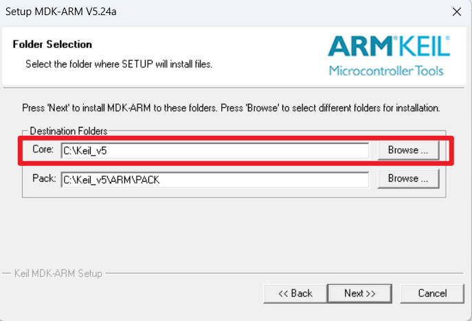

*图 2.  Keil5安装截图-1*

需要注意以下几点：

1. 如果自己的系统盘C盘空间不是非常紧张，可以直接默认安装在C盘，直接下一步。
2. 如果不喜欢将软件装在系统盘，也可以自行选择其它安装目录。建议在其它盘的根目录下

新建一个名为"Keil5"的文件夹，然后选择它作为安装目录。

3. **如果自行创建安装目录，切记安装目录中不要存在中文，也不要出现非英文、数字的特殊**

**字符！！！**

**如果自行创建目录，可以参考下列两张图片的安装方式：**

在E盘中新建目录"Keil5"，在其文件夹下再新建两个文件夹"Core"和"Pack"，如下图所示：


*图 2.-2  Keil5安装截图-2*

**然后再安装的时候做以下选择：**


*图 2.-3  Keil5安装截图-3*

**软件安装的私人信息填写：**


*图 2.-4  Keil5安装截图-4*

如上图所示，随便填就行了。只要别空着就行，因为空着无法进行下一步。

**静等安装完成后，会出现弹窗：**

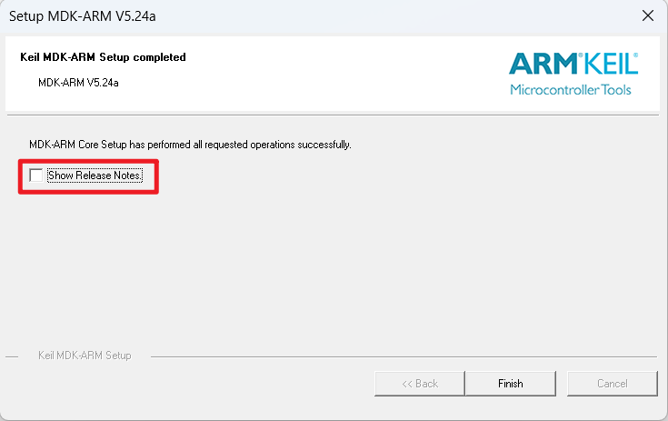

*图 2.-5  Keil5安装截图-5*

红框中的选项意为：显示发布版本说明文档，建议不要勾选，我们不需要看这个东西。

**安装Keil5后，一般都还会出现一个黑色的弹框，如下图所示：**

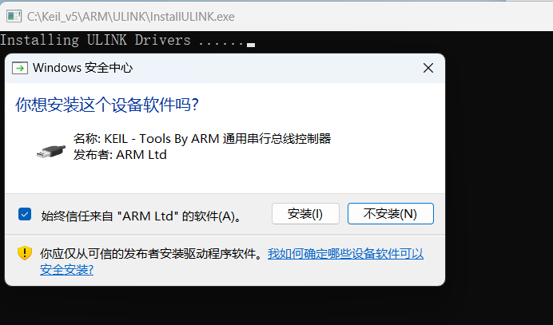

*图 2.-6  Keil5安装截图-4*

这里的意思是让你安装ULINK驱动，**ULINK Drivers**是由Keil提供的一组驱动程序，专门用于支持**ULINK**系列的调试工具。

实际上在我们的课程中并不会选择使用这个调试工具，但考虑到后续使用的可能性，建议**选择安装**。

**上述操作全部完成后，Keil5软件就会自动打开，进入下列的窗口：**

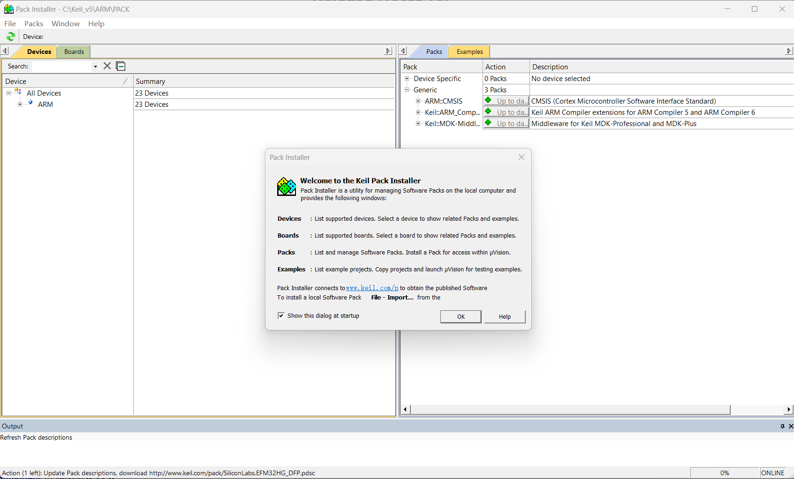

*图 2.-7  Keil5安装截图-5*

**此时Keil5软件的安装就已经完成了，我们只需要点击"叉叉"关闭所有窗口即可。**

但是此时Keil5还不能立刻进行开发工作，因为还需要安装器件支持包。

### 3. 器件支持包的安装

首先我们要知道，为什么要安装器件支持包。

理论上来说，Keil5兼容任何基于**ARM Cortex-M**内核微控制器的开发，但这些芯片种类繁多，如果直接把开发所需的内容全部整合到自身软件中，那么难免会有两个问题：

1. 需要频繁更新Keil5软件来支持新芯片，这对开发者很不友好。
2. Keil5的软件体积和内存占用也会随着支持芯片的增多，而无可避免的增加。

**所以正确的做法是，将特定芯片开发所需要的特定资源独立出来，比如启动代码、驱动程序、配置文件等，打包成一个器件支持包（Device Support Packages，简称DSP），开发者开发某款芯片时，将器件支持包安装到Keil5软件当中即可。**

我们学习使用的芯片是"STM32F1"系列，所以只需要安装它的器件支持包就可以了。

下面介绍两种器件支持包的安装方式：

1. 离线安装（推荐）
2. 在线安装（了解）

#### 3.1 离线安装（推荐）

打开**"百度网盘 -- Keil5 MDK --器件支持包"**文件夹，找到"STM32F1"系列的器件支持包，它是一个以".pack"结尾的文件，如下图所示：


*图 3.1  器件支持包的安装-离线安装图1*

双击打开它，然后直接下一步即可，它会自动安装到安装目录的"Pack"文件夹下。

怎么知道自己有没有安装成功呢？

很简单，再次打开Keil5软件，尝试新建工程。按照下图一步步进行：

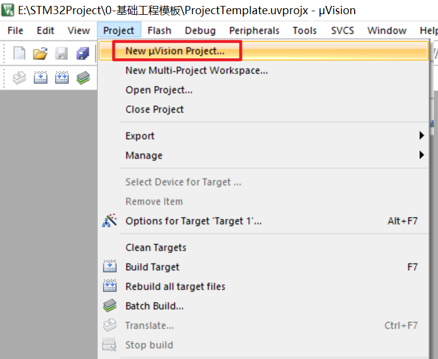

*图 3.1-2  器件支持包的安装-离线安装图2*

然后在桌面上，新建一个工程test，如下图所示：

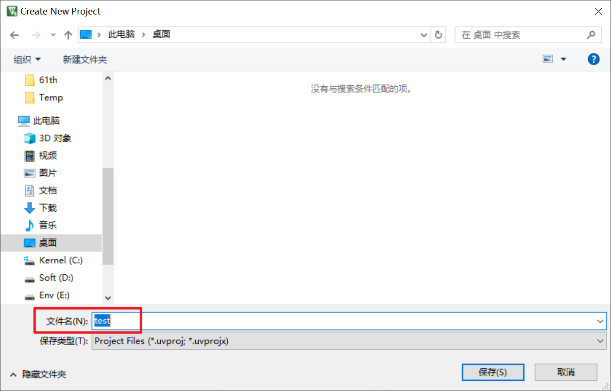

*图 3.1-3  器件支持包的安装-离线安装图3*

点击保存下一步后，弹出下面的对话框：

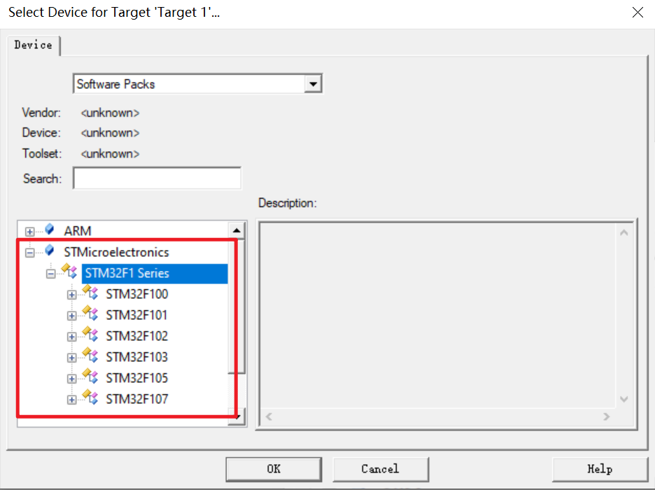

*图 3.1-4  器件支持包的安装-离线安装图4*

可选框中出现上述内容，则表示器件支持包安装成功。而如果你不安装"STM32F1"系列的器件支持包，是不会看到该芯片型号的。

#### 3.2 在线安装（了解）

**这一步你可以不做，仅供参考了解。**

在线安装方式需要联网，最好能够科学上网，因为Keil公司并没有在中国境内设立专门的下载服务器。

为什么需要在线安装呢？

因为大家以后的学习工作，可能需要去开发其它的微控制器，比如"STM32F2"系列，或者其它Keil5支持的ARM架构微控制器。

此时若没有现成的器件安装包，则可以通过在线安装完成。

按照下列步骤进行：

**首先点击"Pack Installer"按钮，下载器材支持包。**

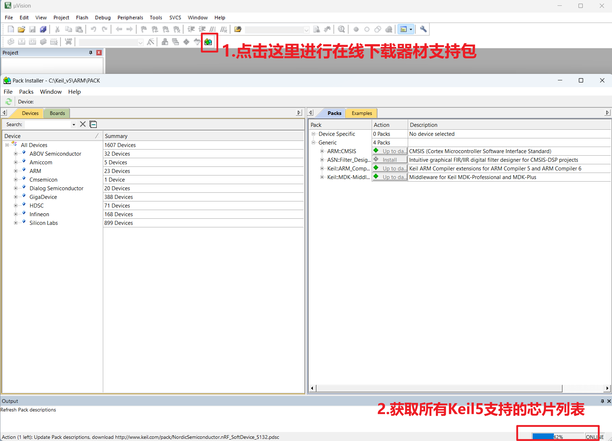

*图 3.2  器件支持包的安装-在线安装图1*

如果是第一次打开这个页面，你要等待一个**较为漫长**的时间，Keil5会自动联网获取支持的所有芯片列表。（我第一次打开等待了将近10分钟）

完全获取完毕后，你就可以看到如下界面：

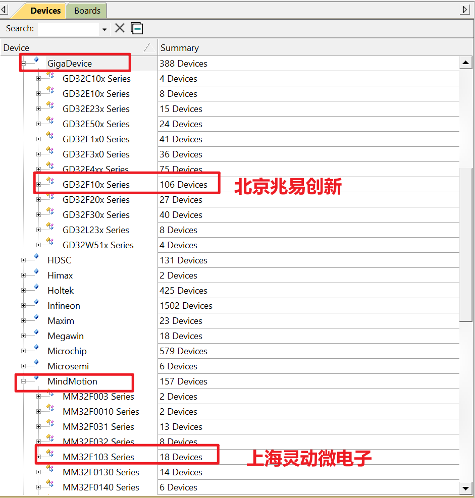

*图 3.2-2  器件支持包的安装-在线安装图2*

上面两个都是国产芯片中的翘楚，它们都可以兼容STM32的部分芯片。

假如我现在想在线安装"STM32F2"系列的器件包，可以参考下图。

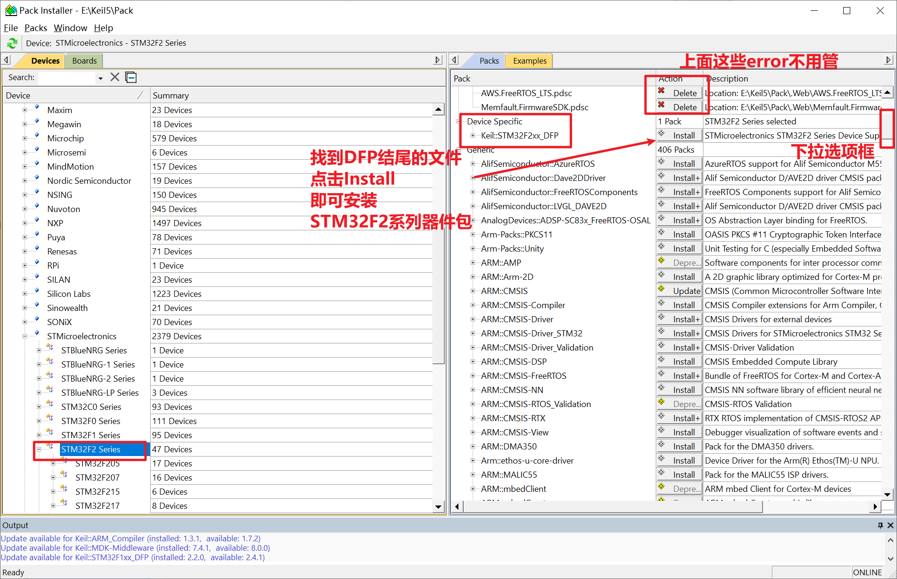

*图 3.2-3  器件支持包的安装-在线安装图3*

在线安装仅供了解，实际工作中为了统一环境，大多公司都会直接给开发者提供器件支持包离线安装，而不需要自己去下载安装。

如果使用keil的图形界面下载网速比较慢，而你又十分需要在线下载器材支持包，也可以直接去keil官网下载：Arm Keil | CMSIS Packs


*图 3.2-4  器件支持包的安装-在线安装图4*

通过这种方式下载好器材包后，依然是双击安装器材包即可。

### 4. Keil5的激活

Keil5本身是收费软件，如果是在公司商业使用还使用盗版容易被"律师函警告"，但个人学习使用问题还是不大的。

下面我们来使用注册机，科学使用Keil5。

首先我们先关闭Keil5软件，然后右键单击Keil5的桌面图标，以**管理员身份运行Keil5**。

按照下图打开"License Management"，即许可证管理。

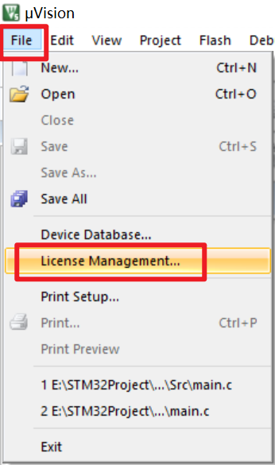

*图 4.  Keil5的破解-图1*

然后复制"Computer ID"。

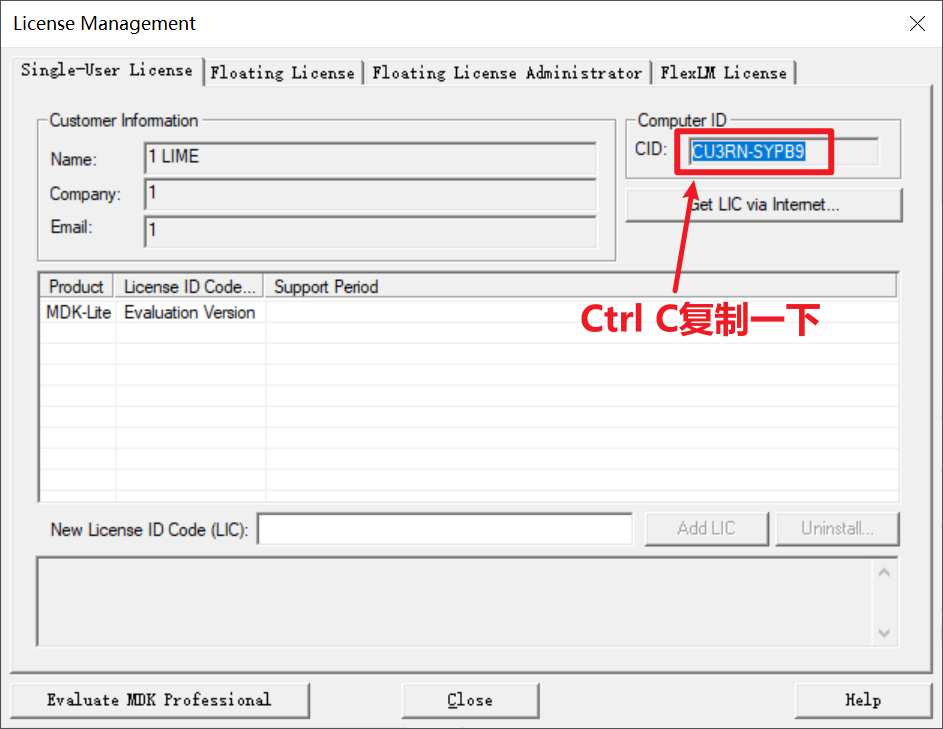

*图 4.-2  Keil5的破解-图2*

然后打开**"百度网盘 -- Keil5 MDK --注册机"**文件夹，直接双击打开注册机：


*图 4.-3  Keil5的破解-图3*

有几个注意事项：

1. **Keil5一定要使用管理员模式打开，否则会提示权限不足导致注册失败！**
2. **注册机软件自带魔音，如果你不想被吓一跳的话，建议关闭或调小电脑音量，尤其是带着**

**耳机的同学。**

3. **如果打开注册机文件夹发现没有这个文件，或者文件一闪而过就消失了，这是防火墙和杀**

**毒软件在作怪。请关闭防火墙和杀毒软件再下载一次注册机，重新激活。**

打开注册机后，按照下图进行操作：

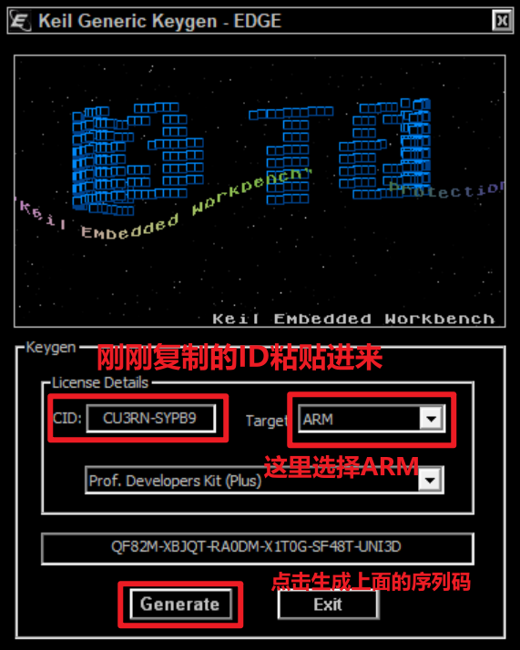

*图 4.-4  Keil5的破解-图4*

最后把生成的序列码，粘贴进Keil5软件，如下图所示：

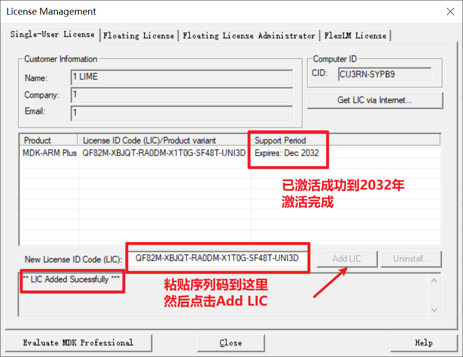

*图 4.-5  Keil5的破解-图5*

以上激活就完成了，重启Keil5软件即可。

**注意后续就不需要再以管理员身份运行Keil5软件了，只需要正常双击打开即可。**

### 5. 驱动安装

这一步我们还需要安装两个驱动：

1. ST-LINK驱动。
2. USB转TTL驱动。

#### 5.1 ST-LINK驱动的安装

在前面我们已经讲过ST-LINK是一款仿真器，但实际上它更像是一款硬件调试器，主要作用就是烧录和调试程序。

其实体如下所示：

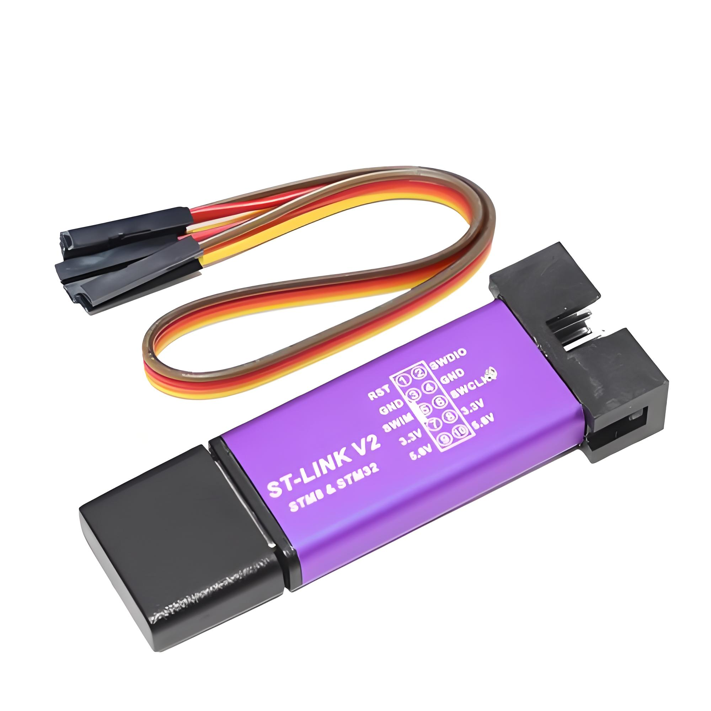

*图 5.1  ST-LINK驱动的安装-图1*

现在我们要来安装ST-LINK的驱动，以使用ST-LINK工具。

将上图中像U盘一样的东西，直接通过USB-A接口接入电脑，然后打开**设备管理器**。

怎么打开计算机的设备管理器？

可以先按下 “Win + R” 组合键，打开 “运行” 对话框，然后在对话框中输入"devmgmt.msc"，最后回车。

如果打开设备管理器，在"其他设备"中看到"带有问号的STM32 STLink"设备，则表示此计算机还没有安装ST-LINK驱动。

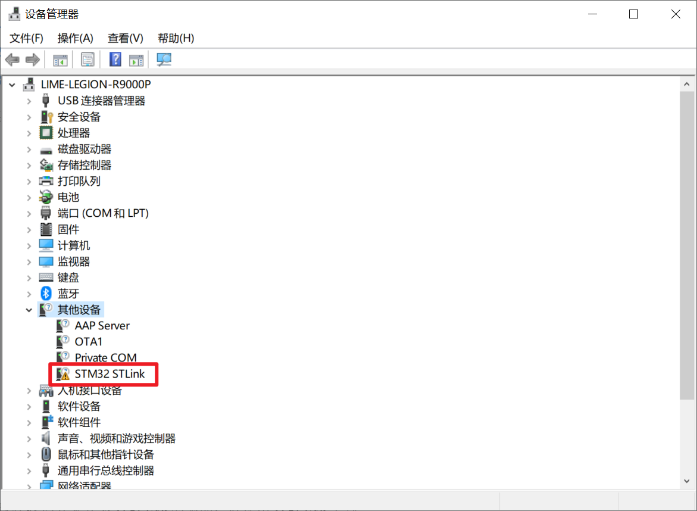

*图 5.1-2  ST-LINK驱动的安装-图2*

并且如果没有安装ST-LINK驱动，插入ST-LINK后，其电源指示灯会一直闪烁红色。

此时打开**"百度网盘 -- 驱动程序 --ST-LINK驱动"**文件夹，**注意要把整个文件夹都下载下来，然后再双击打开其中的安装包即可安装驱动。**

也就是说，你双击安装时，是在下图的文件夹中双击安装的。如果只下载一个可执行程序，驱动是无法安装成功的！！

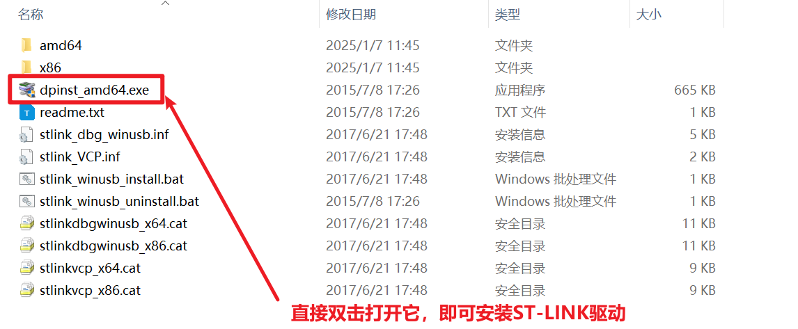

*图 5.1-3  ST-LINK驱动的安装-图3*

驱动安装完成后，ST-LINK的电源指示灯会常亮红色表示驱动安装完成，设备管理器中也会发生如下变化：

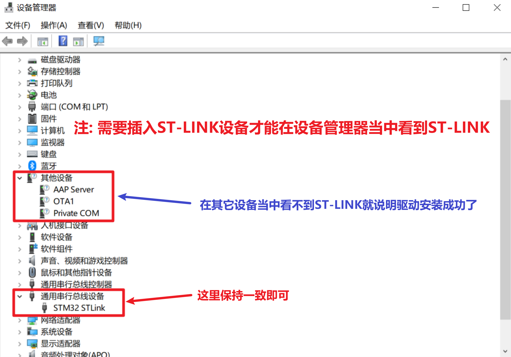

*图 5.1-4  ST-LINK驱动的安装-图4*

如此，ST-LINK驱动就安装完成了。

#### 5.2 USB转串口驱动的安装

**USB转TTL设备**是一种将计算机的USB接口转换为TTL电平的串行通信（UART协议）的设备，也有很多人把它叫做**USB转串口设备**。

TTL（Transistor-Transistor Logic）电平是啥意思呢？

如下表所示：

| 逻辑状态 | 5V TTL（典型） | 3 3V TTL（典型） . |
|---|---|---|
| 高电平（逻辑 1） | 2V 5V（通常为 5V） ~ | 2V 3 3V（通常为 3 3V） ~ . . |
| 低电平（逻辑 0） | 0V 0 8V（通常为 0V） ~ . | 0V 0 8V（通常为 0V） ~ . |

**简单来说：**

1. **高电平（逻辑 1）**：对于**5V TTL**，通常是**5V**；对于**3.3V TTL**，通常是**3.3V**。
2. **低电平（逻辑 0）**：一般是**0V**（接地）。

USB转TTL串口设备，常用于PC和嵌入式设备单片机之间的串行通信。

USB转TTL可以完成ST-LINK的功能，比如供电，下载调试程序等，但我们主要使用它来进行UART串口通信。

使用USB转串口设备，可以使得没有串行接口的现代计算机能够与需要串行通信的设备（如微控制器、调试工具、工业设备等）进行连接和通信，在嵌入式领域的开发调试中非常常用。

我们使用的USB转TTL是基于CH340G芯片的，如下图所示：

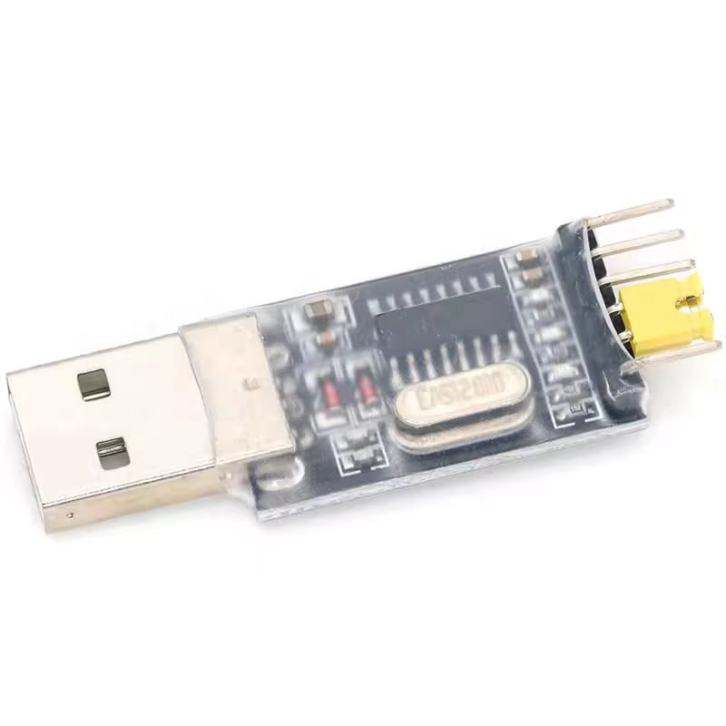

*图 5.2  USB转TTL驱动的安装-图1*

将上图中的设备直接插入电脑，然后打开**设备管理器**。

可以先按下 “Win + R” 组合键，打开 “运行” 对话框，然后在对话框中输入"devmgmt.msc"，最后回车。

如果打开设备管理器，在"其他设备"中看到"带有问号的USB Serial"设备，则表示此计算机还没有安装USB转TTL驱动。

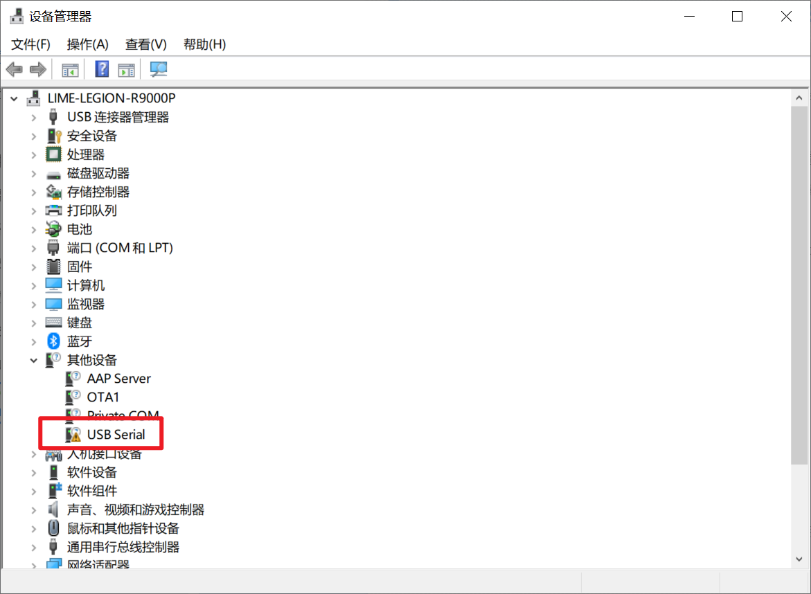

*图 5.2-2  USB转TTL驱动的安装-图2*

此时打开**"百度网盘 -- 驱动程序 --USB转串口CH340驱动"**文件夹，直接双击打开其中的安装包即可安装驱动（不要动别的文件）。

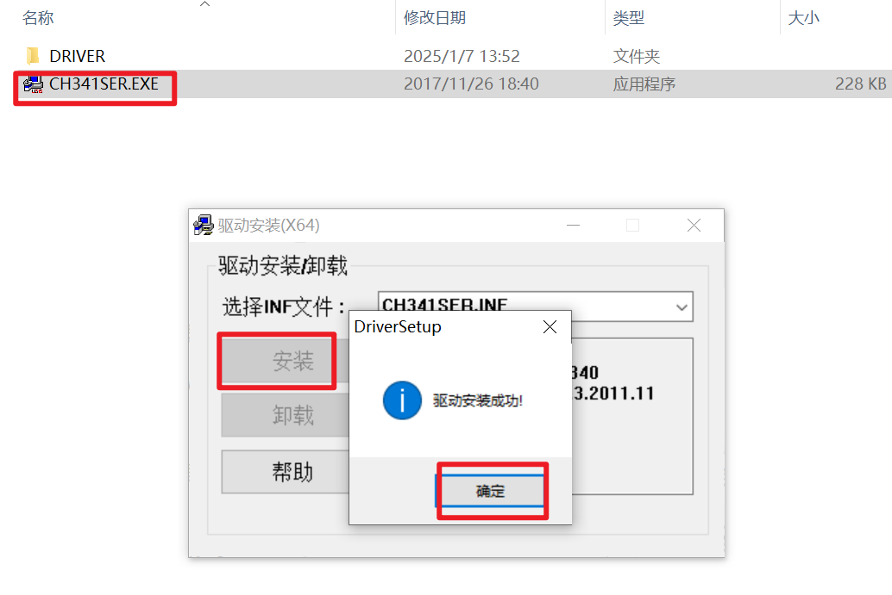

*图 5.2-3  USB转TTL驱动的安装-图3*

安装完成后，在设备管理器中能够正常识别此设备即可：

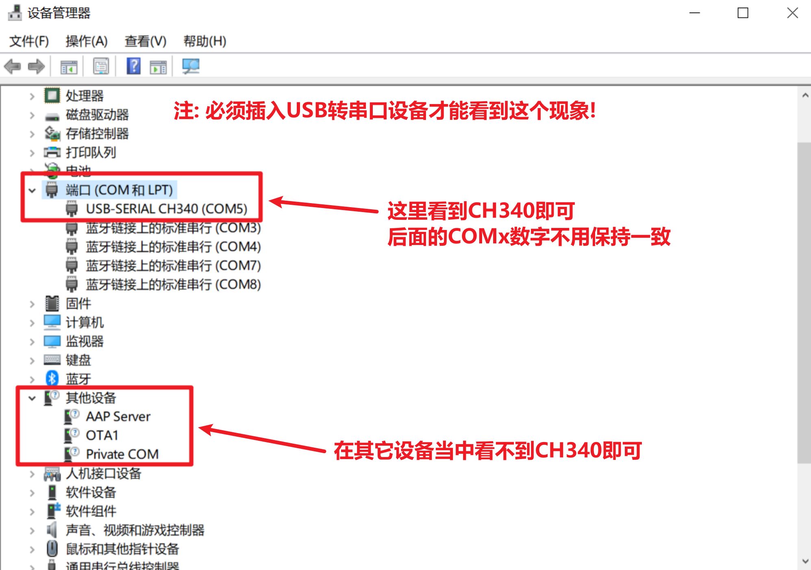

*图 5.2-4  USB转TTL驱动的安装-图4*

以上即完成驱动安装。

USB转TTL设备在我们授课的前期都是用不到的，但等到我们讲串口通信时，尤其是我们后面做项目时，它将是重要的设备。所以这里就提前安装好它。

#### 5.3 ARM版MacOS安装驱动的流程

**如果你是Intel版本的Mac，安装的就是普通的Windows虚拟机，那么你可以直接参照上面的文档安装驱动。**

如果你是M系列芯片的Mac，那么你安装的Windows虚拟机就是ARM版本的Windows，那么安装驱动就需要特定的流程和使用特定的驱动程序。

首先ARM版的驱动需要单独下载使用：

它们在**"百度网盘 -- 王道嵌入式软件环境 -- 驱动程序 -- ARM版驱动"**，如下图所示：


*图 5.3  ARM版驱动-图*

其次建议使用PD软件安装Windows虚拟机，这里就以Windows11（ARM版）为例子，详细的步骤如下：

**第一步：**

按住键盘的"Shift"按键，然后点击开始菜单重启Windows系统，如下图所示：

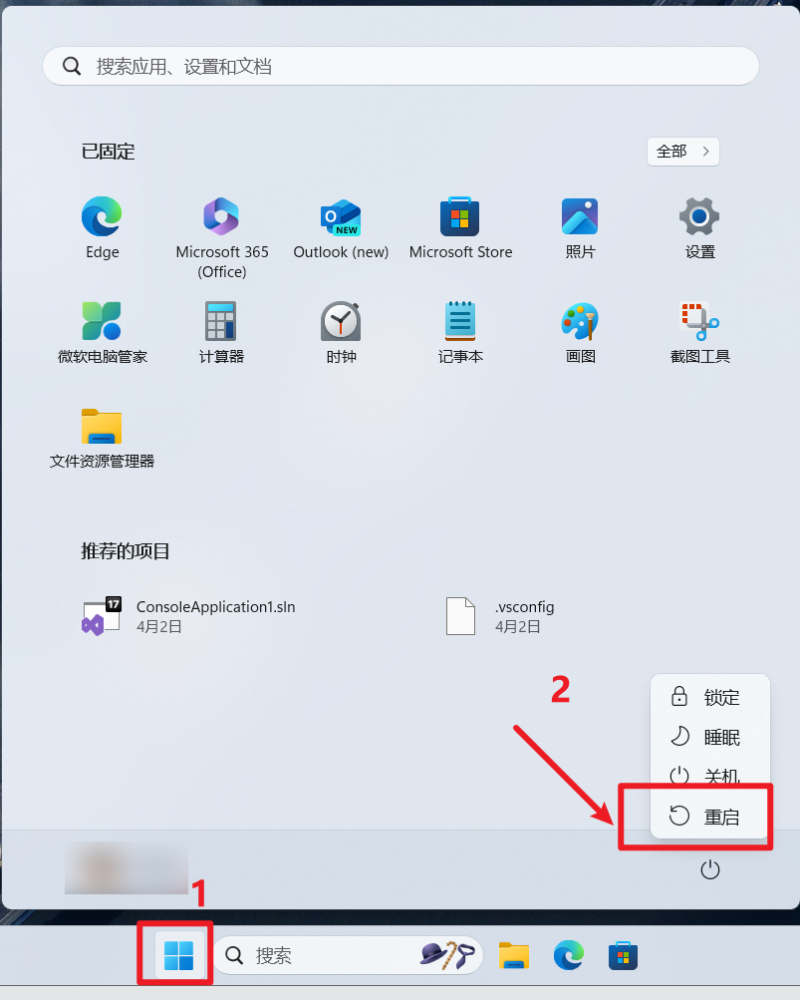

*图 5.3-2  ARM版MacOS安装驱动的流程-图1*

**注意一定要一直按住键盘的"Shift"按键，来点击重启按钮。**

**第二步：**

如果你上面按照"Shift"按键来重启系统，那么你就可以看到下列界面：

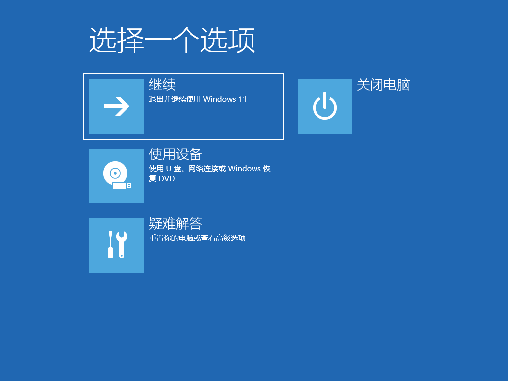

*图 5.3-3  ARM版MacOS安装驱动的流程-图2*

此时你需要点击其中的**"疑难解答"**选项。

**第三步：**

接下来点击**"高级选项"**按钮：


*图 5.3-4  ARM版MacOS安装驱动的流程-图3*

**第四步：**

再点击**"启动设置"**：

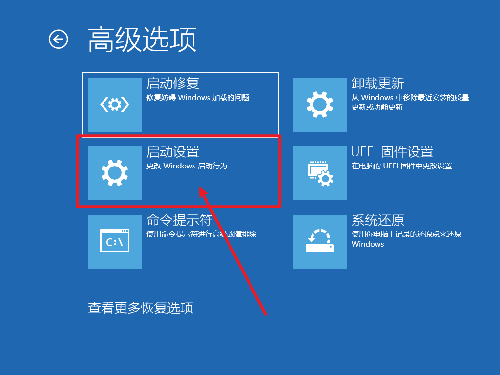

*图 5.3-5  ARM版MacOS安装驱动的流程-图4*

**第五步：**

再点击**"重启"**：

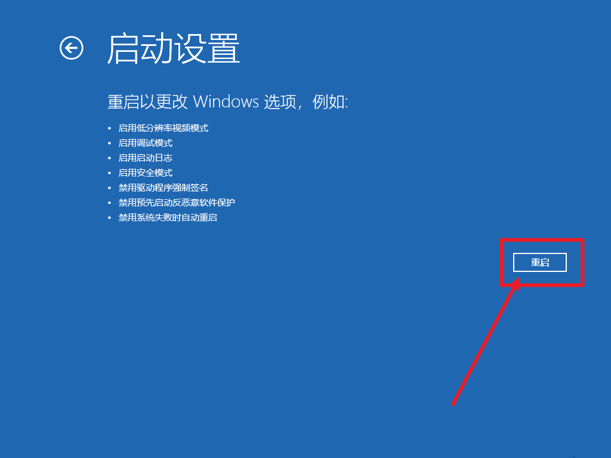

*图 5.3-6  ARM版MacOS安装驱动的流程-图5*

**第六步：**

再按下键盘"7"，以禁用驱动程序强制签名。如下图所示：


*图 5.3-7  ARM版MacOS安装驱动的流程-图6*

**注意不要按小键盘的"7"~**

**第七步：**

此时你的Windows虚拟机就会像往常一样正常重启，看起来和平时没有任何区别。

**此时你就可以解压缩ARM版的驱动，然后参考"5.1/5.2"小节正常安装驱动了。**


若按照这种方式仍然无法安装好驱动，无法正常使用，请联系老师解决~

## 02 GPIO通用输出

### 1. 前置知识回顾

首先我们先来回顾一下，前面我们已经讲解过的知识点，以便于进行进一步的课程内容学习。

目前我们已经讲过MCU的系统结构和引脚定义：

1. 在讲系统结构时，我们提到：STM32基础的学习，某种程度上就是学习利用芯片控制片内外设，从而实现各种功能。
2. 而在讲完芯片引脚定义后，我们做了这样的比喻：
   - a. 某个片内外设就像人的一只手（假设这个人手很多），每只手都承担着特定的功能。
   - b. 引脚就像手指头，不同的手指头功能不同。手要实现某个动作，需要动用手指头，甚至多个手指头共同协作。
   - c. **操作片内外设，最终的落脚点也在于操作引脚，可以是单个引脚也可以是多个引脚的协作。**

现在我们的需求是：操作PC13引脚，来控制PC13指示灯的亮灭。而PC13属于GPIOC外设的引脚之一，于是我们就引出了三个新问题：

1. GPIO是什么？
2. 如何操作引脚呢？
3. PC13引脚的操作，是如何影响指示灯的亮灭呢？

下面我们逐一解决这些问题。

### 2. GPIO概述

**GPIO**是词组General Purpose Input Output的首字母缩写，直接翻译成中文就是通用输入输出端口，是MCU中最基础、且最常用的外设部分。

STM32F103C8T6共有四大类GPIO端口，每个端口又包含数量不等的普通IO引脚，分别是：

1. GPIOA：PA0、PA1、PA2、PA3、PA4、PA5、PA6、PA7、PA8、PA9、PA10、PA11、PA12、PA13、PA14、PA15
2. GPIOB：PB0、PB1、PB2、PB3、PB4、PB5、PB6、PB7、PB8、PB9、PB10、PB11、PB12、PB13、PB14、PB15
3. GPIOC：PC13、PC14、PC15
4. GPIOD：PD0、PD1

**注意：其中PD0和PD1引脚常用于配置启用外部晶振，通常都不能用于普通IO引脚，最小系统板上也没有将这两个引脚引出。**

STM32F103C8T6一共有48个引脚，而GPIO下的普通IO引脚就占据了37个，这充分说明了，GPIO的重要性以及基础性。

GPIO可以配置为8种输入输出模式，简单来说是（下面会详细说）：

1. 四种输出模式，配置输出模式后，可以通过引脚输出高低电平。引脚输出的高电平一般就是3.3V，因为供电就是3.3V，所以不可能输出超过3.3V。（这些内容如果忘记了，可以再看一下硬件基础中讲高低电平的部分）
2. 四种输入模式，配置输入模式后，可以通过引脚接收外部电路的高低电平。接收输入电平时，高电平一般是3.3V左右，部分FT接口允许输入5V电压。（这些内容如果忘记了，可以再看一下硬件基础中讲高低电平的部分）

**输出模式下可控制端口输出高低电平，用以驱动LED（点灯大师）、控制蜂鸣器、模拟各种通信协议输出数据等。**

**输入模式下可读取端口的高低电平或电压，用于按键输入检测、开关状态检测、传感器信号采集、串口通信接收等。**

GPIO外设是STM32单片机最基础的一个片内外设，本身比较简单，没有复杂的功能和原理，但它的使用频率并不低，是常用的片内外设。所以我们把它作为我们学习STM32单片机的第一个片内外设。

### 3. STM32的开发方式

到此为止，我们可以做出以下推论：

我们使用各种MCU单片机来实现功能，本质上是利用此款MCU单片机当中的各种片内外设，单片机的各种功能实现是基于单片机的片内外设的。

而操作片内外设，就拿操作GPIO外设来说，本质上就是操作GPIO外设的引脚，也就是操作普通IO引脚。

**引脚的操作，则是通过对普通IO引脚当中的各类寄存器的操作来完成。（重点）**

**除了GPIO外设之外，其余各种外设的操作，归根结底最终的落脚点都是各种寄存器。**

**（重点）**

**所以可以说，通过实现的任何操作，最终的落脚点都在于操作寄存器。（重点）**

那么什么是寄存器，如何理解寄存器呢？

#### 3.1 单片机开发中的寄存器概念

这里，我们以一种比较通俗的方式来理解单片机开发中的寄存器概念。

**直白的说：寄存器就是单片机外设模块内部，一小块能直接被 CPU 直接读写的存储空间。**

**或者说寄存器就像是一个个小小的 “储物盒”，专门用来存放和管理此外设相关的一些数据。**

特别需求注意的是：寄存器是片上外设模块内的特殊存储单元，和Falsh闪存、SRAM数据存储器不是同等概念。

**既然寄存器是存储数据的小存储空间，那么寄存器有多大呢？**

**我们使用的STM32单片机是32位的，所以寄存器也是32位的，这意味着STM32单片机的某一个寄存器就可以存储32位二进制数据。**

那么这些寄存器有什么作用呢？

仍然通俗的说，寄存器的作用主要有两个：

1. 控制操纵单片机的外设。
   - a. 程序员可以编程写外设的某些寄存器，用于控制操作这个外设。
   - b. 此时寄存器就相当于此外设实现某种功能的一个开关或者按钮。
2. 记录外设运行状态。某些外设的某些寄存器可以自动记录此外设的运行状态，程序员读此寄存器就可以获取外设的运行状态。

就拿我们马上要做的GPIO外设的点灯实验为例：

1. 我们想控制单片机的GPIOA外设的某个普通IO引脚输出高电平
2. 此时就可以通过编程把表示高电平的数据写入到对应的 GPIO引脚**控制寄存器**中
3. 单片机的GPIOA外设，就会根据这个寄存器里的数据来设置引脚的输出状态。

再比如：

我们想基于单片机的USART外设实现串口通信，在通信的过程中肯定需要获取单片机USART外设的运行状态。

这个需求就可以通过读USART外设的某些**状态寄存器**来实现。

**总之，从程序员的角度来思考，寄存器就是程序员和硬件沟通的"桥梁"，通过操作寄存器，程序员就实现了单片机外设的各种操作。**

《参考手册》中对于每一种外设，都会给定其外设的寄存器描述，比如描述GPIO外设的某个寄存器。

如下图所示：

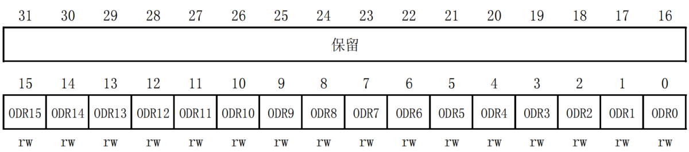

*图3.1-1寄存器描述-图*

同时手册中，还会在配图下面，描述寄存器的每一位/某几位的用途，看寄存器定义是做单片机开发必不可少的步骤。

于是，我们就引出来STM32单片机第一种，也是最直接的开发方式，寄存器开发。

扩展：

每次讲到寄存器，很多同学都有一堆疑惑。一个具有代表性的问题是：

既然一个寄存器能放 32bit 数据，那寄存器可不可以用来存数据呢？

首先，寄存器肯定不可能当外存使用，因为它是断电易失性质的。

那能不能当内存使用呢？

其实也是不行的。

**外设的寄存器都是“有语义的位”，而不是“无语义的数据容器”。**

不要把外设的寄存器当成内存看待。

#### 3.2 寄存器开发

寄存器开发不是我们课程所主要教授的开发方式，但我们仍然可以了解一下寄存器的开发方式。比如回答下列问题：

1. 什么是寄存器开发？
2. 寄存器开发的大体流程是什么样的？如何实现基于寄存器开发单片机呢？

首先回答什么是寄存器开发：

**所谓寄存器开发，就是你直接操作外设寄存器，从而直接操作外设的一种开发方式。**

使用寄存器开发就意味着完全不依赖任何ST公司提供的开发库，而是直接针对某个外设的寄存器，手动开发程序。

**那么寄存器开发的一般流程是什么呢?（了解即可）**

通过寄存器开发单片机的一般流程如下：

1. 分析实现功能所需要操作的外设，弄清楚需要实现的功能具体有哪些，大致流程是什么样的。
2. 查阅芯片《参考手册》中此外设的寄存器定义，确定你需要操作的外设寄存器是什么。
3. 根据《参考手册》中的寄存器定义，编写代码配置操作寄存器，从而实现所需要的功能。

上述流程虽然只是一个非常粗略的大体流程，但仍然可以很明显的发现**寄存器开发具有以下劣势：**

1. **开发难度大**：需要查阅/记住大量寄存器的地址、功能和操作方法，编程过程繁琐，容易出错。
2. **开发效率低**：每一个功能都需要从底层寄存器配置开始，代码量比较大，开发周期也会比较长。
3. **可移植性差**：不同型号的 STM32 芯片寄存器地址和功能可能存在差异，代码难以在不同型号间移植。

当然付出了这么大的代码，劣势这么明显，**寄存器开发仍然有以下优势：**

1. **代码执行效率高**：直接操作硬件寄存器，没有中间层的开销，代码执行速度快，能充分发挥硬件性能。
2. **资源占用少：**直接使用寄存器开发是最直接的开发方式，不存在任何封装，各种资源的占用一般都是最少的。
3. **有利于深入了解硬件**：开发过程中需要深入了解芯片的硬件结构和寄存器功能，有助于开发者透彻掌握 STM32 的工作原理。

寄存器开发最大的优势就是性能优越，但在很多场景中性能并不是我们追求的最大目标。

所以，寄存器开发并不是现在STM32开发的主流形式。

尤其对于新手而言，如果入门就使用寄存器开发，将会最大化学习难度，而且及其繁琐，难以坚持学习。

总之，寄存器开发方式了解即可，在后续的课程中，我们会给大家实现一个基于寄存器开发的简易功能。

#### 3.3 SPL标准库开发

ST公司（其实每个MCU厂商都是这样）在推出STM32系列MCU后，他们也觉得寄存器的开发方式过于原始，难度大且开发效率低。

所以ST公司把对寄存器的操作封装成一个个的库函数，开发者通过调用这些库函数来间接实现对寄存器的操作，从而实现对各种外设的操作。

我们把这种开发方式称之为**"标准外设库函数开发（Standard Peripheral Library，简称SPL）"**，或者直接简称**"标准库开发"**、**"SPL库开发"**等。

**库函数开发的优势：**

1. **比较高的开发效率：**相比于寄存器的开发方式，库函数的开发方式提高了开发效率。
2. **代码的可读性更好：**库函数的函数名和参数都具有明确的意义，代码逻辑清晰，易于理解和维护。
3. **对初学者比较友好：**库函数的开发方式在一定程度上屏蔽了底层寄存器的操作，所以相比较于寄存器的方式学习难度降低了。
   - a. 但库函数本质上是对寄存器操作的封装，使用库函数开发还是需要开发者对STM32 的硬件架构和寄存器有一定了解的。
   - b. 这个平衡，恰好对于STM32的初学者是非常有利的。

**库函数开发的劣势：**

1. **可能被弃用：**ST官方虽然从没有正式说明要放弃更新标准外设库。
   - a. 但事实上从2016年以后ST公司就再也没有更新过标准库了。
   - b. 而且新型号MCU也已经不再支持标准库开发，这些情况都说明ST官方有弃用标准库的趋势。
   - c. 包括Keil5软件，较新版本的Keil5软件就已经不再支持标准库开发编译器了，需要开发者自行安装旧版编译器。
2. **部分高级功能比较欠缺：**标准库函数在实现一些高级复杂功能时，往往还需要开发者自己编写代码
3. **可移植性有，但并不高：**库函数虽然在一定程度上屏蔽底层，屏蔽了不同型号芯片之间的寄存器差异。但实际上还是会有一些差异，库函数开发出来的程序，其移植性差强人意，不够好。

对于初学者而言，我们建议大家采用库函数的方式入门学习。

库函数的开发方式在所有开发方式中，处于中间层，具有进可攻退可守的特点：

1. 一方面，它不像寄存器开发那样过于底层和复杂，能让初学者快速上手，积累开发经验。
2. 另一方面，相比于一些更高级的开发框架，它又能让开发者对硬件架构和寄存器有一定的了解，为后续深入学习打下基础。

而且基于市场惯性的影响，库函数开发方式在实际应用中仍然占据相当的市场份额。

本课程中，我们主要就以库函数开发的形式，来进行STM32的开发。

**实际上，在 STM32 里，真正把 SPL 标准库用得最广、最彻底的，基本就是最早、也最经典的 F1 系列。**

后面出来的 F0、F3、F4、F7 这些系列，ST 官方就已经不再支持 SPL 这一套了，而是改用 HAL 库来作为主要的开发方式。

所以今天你还能经常看到标准库，其实不是因为它现在有多先进，而是 F1系列芯片当年实在太成功了。

#### 3.4 HAL库开发

既然要屏蔽底层硬件，既然要简化开发，那就贯彻到底，HAL库就是这种思潮下的产物。

HAL（Hardware Abstraction Layer，硬件抽象层）库是 ST 公司为 STM32 系列微控制器开发的一种软件库，它的主要目的是将 STM32 微控制器的底层硬件细节进行抽象封装。

通过 HAL 库，开发者不需要直接操作复杂的硬件寄存器，而是调用库中提供的函数来实现对微控制器各种外设的操作和控制。

这极大地简化了开发过程，降低了开发难度，尤其是对于初学者和需要快速开发的项目。

HAL库本质上仍然是对底层寄存器操作的封装，但HAL库有以下**独特的优势**：

1. **封装层次更高。**HAL 库在对寄存器操作的封装上更为抽象和高级。它不仅仅是简单地将寄存器操作封装成函数，还在函数的设计和实现上进行了更高层次的抽象。
2. **统一性更强，以实现更好的跨平台性。**ST公司呕心沥血，为不同型号的 STM32 微控制器提供了统一的 API 接口，确保在不同的芯片上使用相同的函数和相似的参数来实现相同的功能。
3. **复杂和高级功能更多，更好用。**HAL 库对复杂的功能进行了集成和优化。对于像USB、以太网、CAN 总线等复杂外设，HAL 库提供了一套完整的操作函数和状态机，开发者可以直接使用这些函数进行高级功能的开发，而无需像使用标准库那样可能需要自行组合多个基础函数或者编写额外的代码来实现这些功能。
4. **开发效率非常高。**由于HAL库的高度封装屏蔽底层，以及拥有风格统一的、功能完善的各类API，使用HAL库开发的开发效率是极高的。
5. **ST公司主推，倾注了主要精力。**任何东西只要愿意雕琢，总会变得越来越好。HAL库就是ST公司精心雕琢的结果，可以预见这种强大的支持还会持续很长一段时间。

比起标准库的"弃子"身份，HAL库显然优势明显。

**使用HAL库开发也有一些劣势：**

1. **体积大，资源占用多。**HAL库的深度封装使得使用HAL库开发生成的可执行程序体积偏大，占用资源也会更多。在资源紧张的MCU中，HAL库开发可能不是最好的选择。
2. **性能稍弱。**深度的封装带来了一定的性能损失。
3. **对底层硬件理解不深。**如果需要进行硬件层次的优化，可能难以下手。

总之，HAL由于其快速开发的特性，加上ST公司的大力支持，已经成为STM32开发中的主流手段之一。

但是作为初学者，一方面需要了解一些底层硬件知识，另一方面在入门时，没必要同时兼顾多种开发手段增加负担，所以我们的课程会以标准库开发为主要手段。

相信当你理解掌握标准库后，再自己学习HAL库会非常简单。

### 4. 如何操作引脚

以操作GPIO的IO引脚为例子，我们来讲一下引脚的操作，其它引脚操作可能会有所不同，但大同小异。

要想弄明白如何操作引脚，就需要弄清楚引脚内部的电路是什么样的。

我们打开《STM32F103参考手册》，找到章节GPIO后，在章节的开头手册中就给出了引脚的内部电路图，如下所示：


*图4-1IO引脚内部电路-图*

这里我们先来讲解一下两个保护二极管：

#### 4.1 保护二极管

IO引脚和内部电路之间有两个保护二极管，如下图所示：

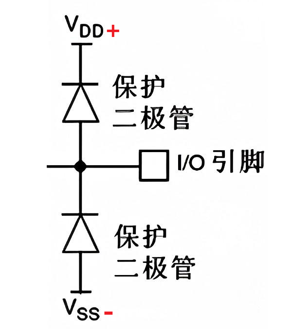

*图4.1-1保护二极管-图示*

其中上面的二极管，我们称之为"**正向保护二极管"**，它的作用是保护引脚内部电路不会因为过高的电压而损坏。

**它的正极和IO引脚连接，负极接入电源正极。**

如果引脚突然输入了一个很高的电压（大于Vdd的电压）时，引脚电压高于VDD，形成电势差，此时上方的正向保护二极管正向偏置，大电流会从引脚流向VDD，从而实现保护内部电路的作用。

比如人用手直接触摸芯片的引脚，由于人体携带有静电，瞬时电压可能高达上万V，若没有上方的正向保护二极管，内部电路就会很容易被破坏掉。

下方的二极管，称之为**"反向保护二极管"**，其原理也是大同小异的。

**它的正极接入电源负极/接地，负极和IO引脚连接。**

如果引脚外部输入的电压非常低，甚至是一个负电压时，引脚电压低于VSS，形成电势差，此时下方的反向保护二极管也会正向偏置（上方的二极管反向偏置，无法形成电流），会形成从VSS到IO引脚的电流，避免引脚过低的电压对内部电路造成损害。

人体的静电或者反接电源等都有可能使得引脚输入低电压，反向保护二极管就起到了保护作用。

#### 4.2 引脚输出模式时的简化电路图

我们发现这张图的上半部分属于IO引脚的输入模式，本小节不讲输入模式，所以上半部分我们直接简化掉，下面的输出部分中有些部分也可以简化掉，最后我们可以得到这样的一张**简化"输出模式"电路图**：

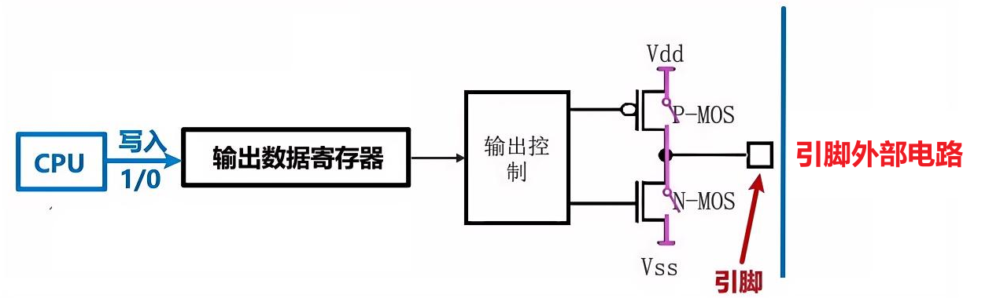

*图4.2-1输出模式电路简化-图*

从图中我们可以得出结论：程序员只要控制CPU向输出数据寄存器中写入0/1，就能够控制引脚输出了。

但是：

1. 仅上图而言，这个引脚是没有任何输出的，因为两个MOS管（上PMOS，下NMOS）都是断开的，引脚和内部电路是断开的。
2. 输出数据寄存器只能写入1或0两种选项，但两个MOS管的开闭组合显然不止两种。

**所以在向输出数据寄存器写入0/1控制引脚输出之前，需要先配置引脚的输出模式，这同时是通过寄存器配置来实现的。**

**通过配置寄存器，配置不同的引脚输出模式，两个MOS管会有不同的通断表现。**

在这里我们先来讲解两个常用的输出模式：

1. 通用推挽输出模式
2. 通用开漏输出模式

**注意，这两种输出模式的差别就在于两个MOS管的通断模式。**

#### 4.3 通用推挽输出模式

首先，通用推挽输出模式是最容易理解的输出模式，因为它的名字就表示它的作用：

1. 推，也就是push，你可以想象成将电流从引脚"推"出去，也就是**引脚输出高电平**。
2. 挽，一个文艺好听的翻译，但使得它有点不太好理解。挽，其实就是拉，也就是pull，你可以想象成将电流从引脚"拉"回来，电流从高电势流向低电势，所以"拉"电流就意味着**引脚输出低电平**。

向输出数据寄存器中写入0/1就恰好对应这两种状态，而且：

1. **向输出数据寄存器中写入0，表示引脚输出低电平。**
2. **向输出数据寄存器中写入1，表示引脚输出高电平。**

**注意：这就是一种单纯编程设计，目的是便于程序员记忆，便于编程。毕竟低电平往往用0表示，写0就表示输出低电平，合情合理。**

通用推挽输出模式的表现，就讲完了，那么两个MOS该如何开闭才能达成这样的效果呢？

我们分为两部分来讲解。

##### 4.3.1 引脚输出高电平

首先，图中的两个MOS管，我们先来标注一下它的三个极。如下图所示：

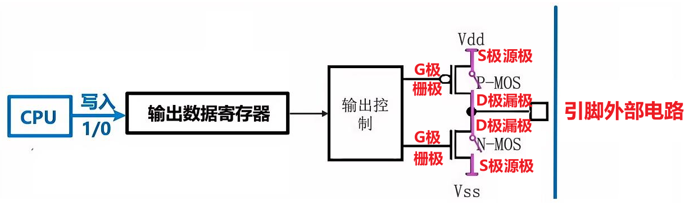

*图4.3.1-1引脚输出高电平-示意图*

很明显，这两个MOS管是不可能同时导通的，如果同时导通，PMOS的源极就会直连NMOS的源极，相当于电源正负极直接连在一起短路。

**在通用推挽输出模式下，上下两个MOS管是交替闭合的，这就是通用推挽输出模式的MOS管通断表现。**

为了引脚能够输出高电平，电路MOS的导通状态一定如下图所示，即上面的PMOS管导通：

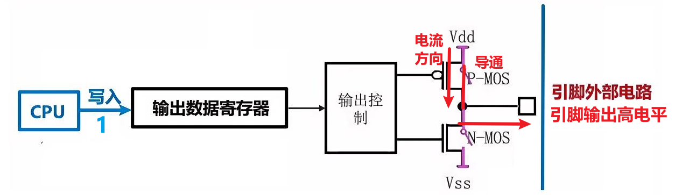

*图4.3.1-2引脚输出高电平-示意图2*

那我们思考一下输出控制电路，加在两个MOS管栅极的电压是什么呢？

很明显：

1. PMOS管导通，所以向PMOS管施加的是低电平，栅极G和源极S存在电势差，PMOS管导通。
2. NMOS管断开，所以向NMOS管施加的也是低电平，栅极G和源极S没有电势差，NMOS管断开。

当然有些同学会觉得向输出数据寄存器写1，相当于"高电平"，应该在两个MOS的栅极施加高电平，但实际上输出控制电路会将这个高电平转换成低电平施加在栅极。

##### 4.3.2 引脚输出低电平

为了让引脚能够输出低电平，电路MOS的导通状态一定如下图所示，即下面的NMOS管导通：

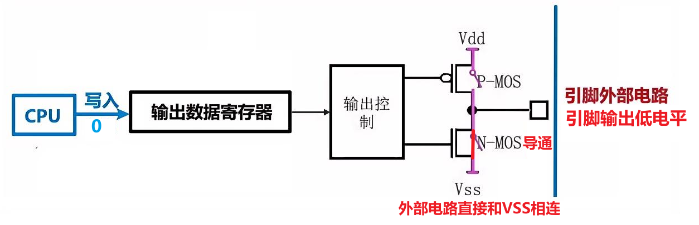

*图4.3.2-1引脚输出低电平-示意图*

那我们思考一下输出控制电路，加在两个MOS管栅极的电压是什么呢？

很明显：

1. PMOS管断开，所以向PMOS管施加的是高电平，栅极G和源极S没有电势差，PMOS管断开。
2. NMOS管导通，所以向NMOS管施加的也是高电平，栅极G和源极S有电势差，NMOS管闭合。

当然有些同学会觉得向输出数据寄存器写0，相当于"低电平"，该在两个MOS的栅极施加低电平，但实际上输出控制电路会将这个低电平转换成高电平施加在栅极。

#### 4.4 通用开漏输出模式

上面我们解释了"推挽输出"为什么叫"推挽"，进而就分析出了推挽模式的电路表现。通用开漏模式，仍然可以继承这样的分析模式。

什么是开漏呢？

电路图中，有什么东西和漏有关？

那自然是MOS管的漏极，所以开漏指的是MOS管的漏极处于开路状态，即MOS管的漏极不能和电源正极接在一起。

我们分析电路，发现：

**若想实现这一点，就必须让PMOS管始终保持断开状态，也就是让电源正极不能接入电路。**

所以当引脚处在通用开漏输出模式时，两个MOS管的通断表现为：

1. PMOS管始终处于断开状态。
2. 向输出数据寄存器写入0时，表示引脚输出低电平，此时NMOS管闭合。
3. 向输出数据寄存器写入1时，引脚对外部电路表现为高阻抗，也就是电路断开，此时NMOS管也断开。

**通用开漏输出模式-引脚输出低电平：**

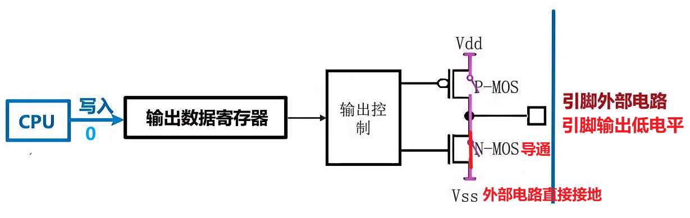

*图4.4-1通用开漏输出模式-图1*

**通用开漏输出模式-引脚表现为断路悬空，高阻抗：**


*图4.4-2通用开漏输出模式-图2*

注意：

**无论是推挽输出、亦或者开漏输出模式，设置完成引脚输出模式后，引脚没有默认的输出电平，所以可以给引脚设置一个初始的输出电平。**

#### 4.5 总结

**对于 GPIO 普通 IO 引脚的操作，本质上都是对 GPIO 外设内部寄存器的读写操作。**

对于引脚通用输出模式的使用，需要以下两个步骤：

1. 配置引脚的功能和工作模式，涉及GPIO外设的配置寄存器。
2. 控制引脚输出状态，涉及向GPIO外设的输出数据寄存器写0或1。

当然，我们采用的是SPL标准外设库的开发方式，寄存器操作都被隐藏在底层了。上述操作在编码实现时，只需调用对应函数即可完成。

现在我们已经学习了两种最常用的GPIO通用输出模式：

1. 通用推挽输出模式：
   - a. 向输出数据寄存器写1，表示引脚输出高电平
   - b. 向输出数据寄存器写0，表示引脚输出低电平
2. 通用开漏输出模式：
   - a. 向输出数据寄存器写1，表示引脚悬空，高阻态。
   - b. 向输出数据寄存器写0，表示引脚输出低电平

很明显可以得出下列结论：**两种通用输出模式，都可以输出低电平。只有通用推挽输出模式，可以输出高电平。**

引脚的输出模式主要用于驱动外部电路，进一步可以得出下列重要结论：

1. 如果外部电路需要高电平驱动，则必须选择通用推挽输出模式。
2. 如果外部电路只需要低电平就可以驱动，则两种通用输出模式实际上都可以。

下列看一个具体的案例，来说明一下该如何选择引脚的通用输出模式。

### 5. 电路接法和引脚输出模式选择

为了点亮PC13指示灯，我们需要进行什么样的引脚操作呢？

为了讲清楚这一点，我们不妨先来看一看若希望使用引脚操作来控制一盏LED的亮灭，需要设计怎样的电路。我们可以直接将简化的引脚电路和LED相连接起来，按照输出模式的不同，分为两种情况：

1. 推挽输出模式接法
2. 开漏输出模式接法

#### 5.1 推挽输出接法

电路图如下所示：

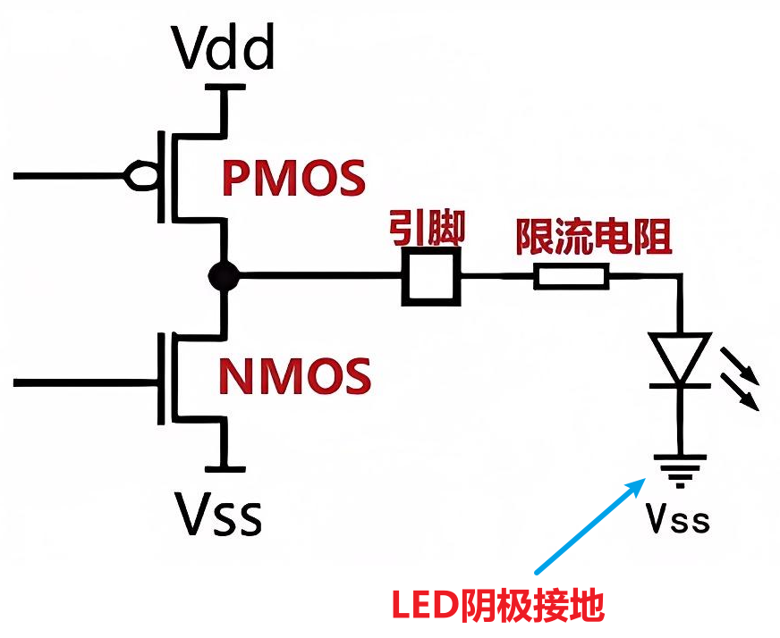

*图5.1-1推挽输出点亮LED-图*

**推挽输出模式下，引脚可以输出高电平和低电平。在这种情况下，为了能够控制LED的亮灭，LED的另一端必须接入低电平（接地）。**

这样：

1. 引脚输出高电平，LED亮
2. 引脚输出低电平，LED灭

结合的寄存器的操作，如果采用**通用推挽输出模式**接法，操作流程是这样的：

1. 通过配置引脚寄存器，将IO引脚的工作模式设置为推挽输出模式。
2. 向输出数据寄存器中写1，使得引脚输出高电平，于是点亮LED
3. 向输出数据寄存器中写0，使得引脚输出低电平，于是熄灭LED

#### 5.2 开漏输出接法

电路图如下所示：

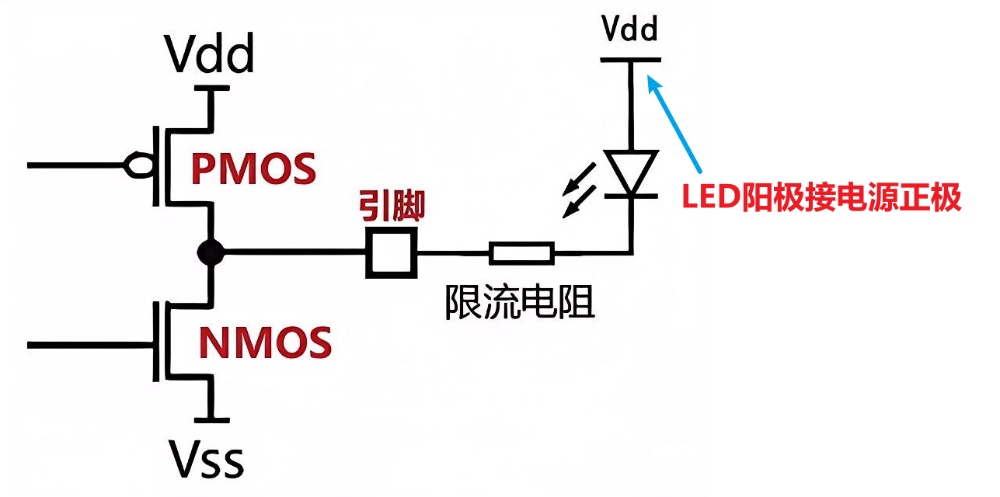

*图5.2-1开漏输出点亮LED-图*

开漏输出模式下，引脚可以输出低电平和高阻抗。在这种情况下，为了能够控制LED的亮灭，LED的另一端必须接入高电平（电源正极）。

这样：

1. 引脚输出低电平，LED亮
2. 引脚输出高阻抗，LED灭

结合的寄存器的操作，如果采用**通用开漏输出模式**接法，操作流程是这样的：

1. 通过配置引脚寄存器，将IO引脚的工作模式设置为开漏输出模式。
2. 向输出数据寄存器中写0，使得引脚输出低电平，即点亮LED
3. 向输出数据寄存器中写1，引脚对外表现为高阻态，此时LED熄灭。

也就是说，使用推挽输出和开漏输出两种输出模式都可以实现点灯，但需要连接的电路是不同的，寄存器的操作也稍有区别。

#### 5.3 控制PC13指示灯的亮灭

通过查阅《STM32F103C8T6核心板原理图》，可得知PC13指示灯的电路图如下所示：

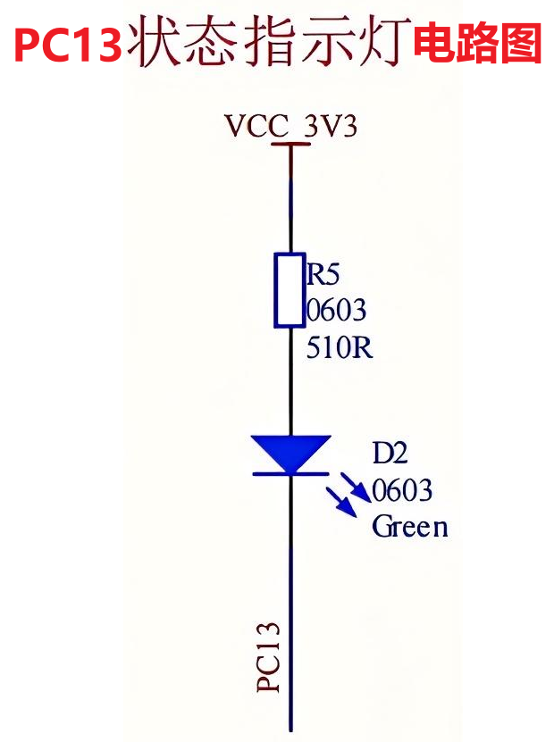

*图5.3-1PC13指示灯-电路图*

这种电路的接法，若想控制LED的亮灭，需要使用什么输出模式呢？

其实这两种输出模式都是可以的。我们可以分析一下：

**如果选择开漏输出模式：**

1. 向输出数据寄存器中写0，引脚输出低电平，电流正向通过LED，即点亮LED
2. 向输出数据寄存器中写1，引脚状态为高阻抗（断路），电路中无电流通过，即熄灭LED

**如果选择推挽输出模式：**

1. 向输出数据寄存器中写0，引脚输出低电平，电流正向通过LED，即点亮LED
2. 向输出数据寄存器中写1，引脚输出高电平，电路两端没有电势差，不会有电流经过LED，即熄灭LED

**当然，更好的选择是将PC13引脚设置为开漏输出模式：**

1. 因为PC13指示灯是典型的开漏接法电路
2. 此电路的通断控制仅需要依赖"拉低--断开（高阻抗）"这两种状态，不需要高电平参与电路控制。
3. 推挽模式虽然也可以用，但由于它不能完全"断开"电路，可能会出现"LED无法完全熄灭，半亮不亮"的情况。

至此：

我们已经完成了所有操作的分析，万事俱备只欠东风，下面我们就开始通过标准库函数来实现对PC13指示灯的控制。

## 03 新建标准库工程

### 1. 概述

本小节所需要的所有文件都可以在以下百度网盘中获取：

通过网盘分享的文件：000_王道嵌入式软件环境链接: https://pan.baidu.com/s/1Lnssq2nza3UAUBe6wdxqXQ?pwd=k87j提取码: k87j 我们使用标准库的形式来进行STM32开发时，首先需要做的就是在Keil5软件中，新建一个标准库的工程。

一共可以分为以下几个步骤：

1. Keil5新建工程文件夹
2. 添加启动文件
3. 添加寄存器开发必要文件
4. 创建用户工作区域

需要注意的是，推荐大家把第一次新建的标准库工程作为一个模板工程，后面直接复制这个模板工程使用，而无需再次新建工程。

### 2. 寄存器开发模板工程的创建

在STM32单片机的开发方式中，寄存器的开发方式是最原始的，也是我们最终需要创建的——"标准库开发模板"的前置部分。

下面请大家按照流程，来一起创建一个寄存器的Keil5开发模板。

#### 2.1 Keil5新建工程文件夹

首先打开Keil5软件，点击下列按钮进行工程的创建：

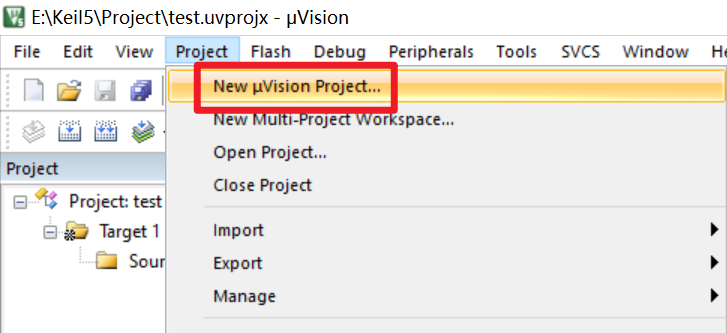

*图 2.1  Keil5新建工程文件夹-图1*

然后在弹出的窗口中设置工程存放的目录，建议寻找一个固定的目录来存储工程文件夹。

**工程文件夹建议和工程名称保持一致。**

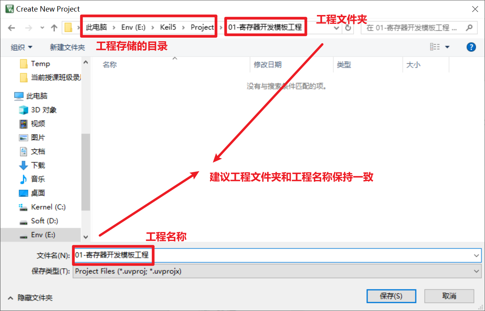

*图 2.1-2  Keil5新建工程文件夹-图2*

随后再选择要开发的MCU型号，我们使用的是STM32F103C8T6，所以选择下拉框中的"STM32F103C8"即可。

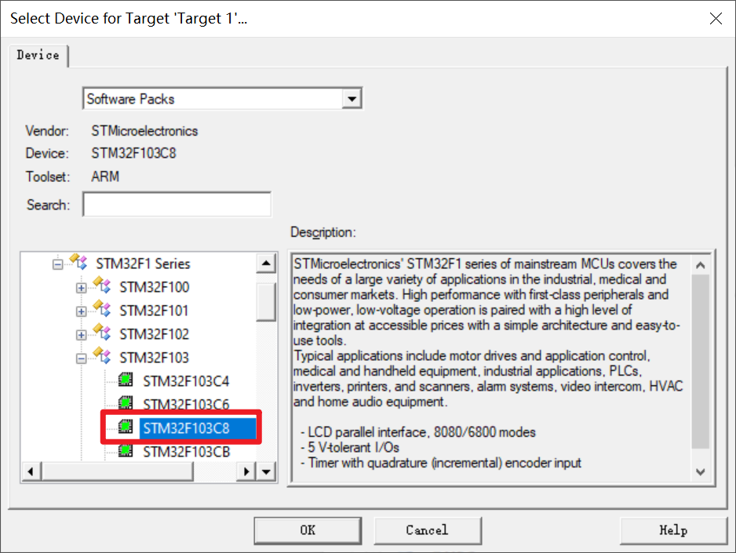

*图 2.1-3  Keil5新建工程文件夹-图3*

在上图界面中选好MCU型号，直接点击OK后，会弹出Keil5工程配置页面，如下图所示：

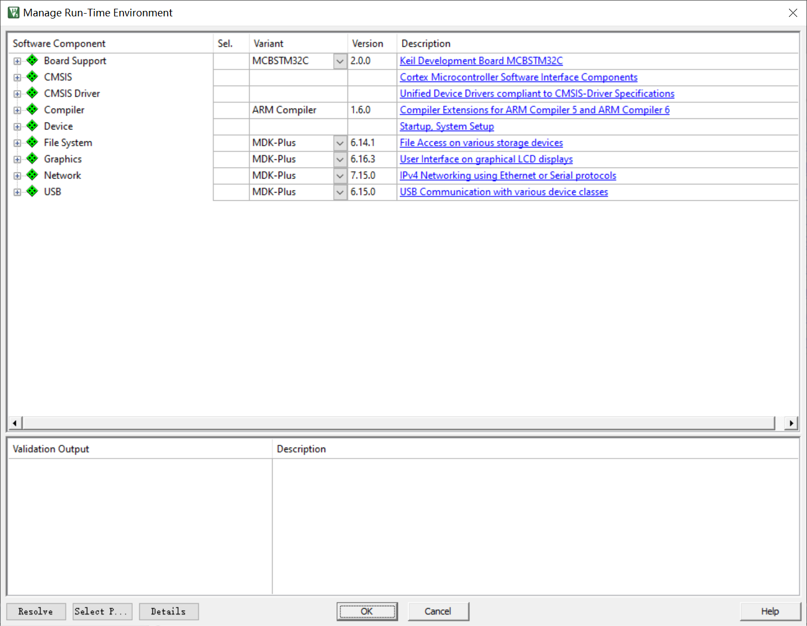

*图 2.1-4  Keil5新建工程文件夹-图4*

**但我们不选择该工具进行配置工程，所以直接点击OK或者直接叉掉都可以。**

上述操作都完成后，在文件夹中打开此工程文件夹，如下图所示：

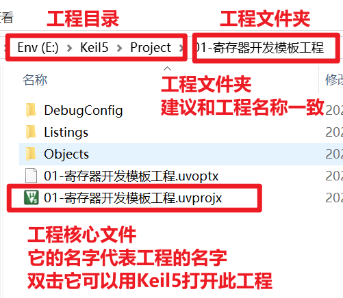

*图 2.1-5  Keil5新建工程文件夹-图5*

如此，一个Keil5工程文件夹就创建完成了。

注意事项：

1. 工程文件夹和工程名建议保持一致。
2. 工程名称的命名风格，在学习时期可以直接使用中文，待到开发时可以根据实际情况再决

定。

3. 第一次创建的工程可以作为后续工程的模板，后续就不用再这样麻烦的创建工程了。

#### 2.2 添加STM32启动文件

**首先，我们需要知道什么是启动文件？**

一个STM32的嵌入式程序的启动，是从启动文件开始的，用于初始化硬件和软件环境。

关于启动文件，了解以下内容即可：

1. STM32的启动文件往往是一个汇编程序，也就是一个`.s`文件。
2. 启动文件的一个核心作用就是调用main函数，也就是说一个STM32的嵌入式程序，在

main函数启动之前，就已经执行过很多汇编代码了。

**启动文件去哪里找？**

你可以选择去官方下载标准外设软件库（固件库）资源，链接如下：STM32标准外设软件库- 意法半导体STMicroelectronics但官网下载比较麻烦，你也可以在百度网盘中直接获取固件库文件，在**"百度网盘 -- 标准外设库文件"**中即可找到这个压缩包。


*图 2.2  添加启动文件-图1*

解压缩这个压缩包，然后找到下面一个文件夹：

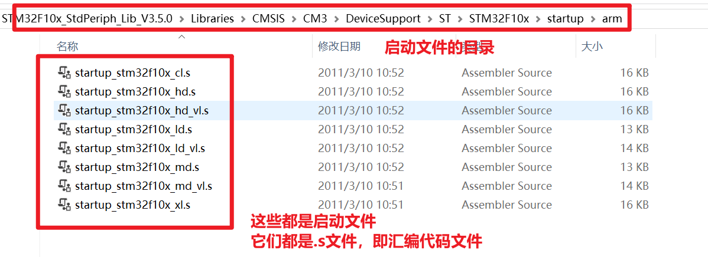

*图 2.2-2  添加启动文件-图2*

此文件夹中存放的都是启动文件。

**如何选择启动文件？**

这么多启动文件，都需要添加吗？当然不是，只需要添加一个就够了。

选择的规则如下表所示：

| 缩写 | 释义 | Flash容量 | 型号 |
|---|---|---|---|
| LD_VL | 小容量产品超值系列 | 16~32K | STM32F100 |
| MD_VL | 中容量产品超值系列 | 64~128K | STM32F100 |
| HD_VL | 大容量产品超值系列 | 256~512K | STM32F100 |
| LD | 小容量产品 | 16~32K | STM32F101/102/103 |
| MD | 中容量产品 | 64~128K | STM32F101/102/103 |
| HD | 大容量产品 | 256~512K | STM32F101/102/103 |
| XL | 加大容量产品 | 大于512K | STM32F101/102/103 |
| CL | 互联型产品 | - | STM32F105/107 |

我们使用的MCU是STM32F103C8T6，其闪存大小是64Kb，型号是STM32F103，所以我们应该选择后缀有"MD"的启动文件。

也就是下面这个文件：

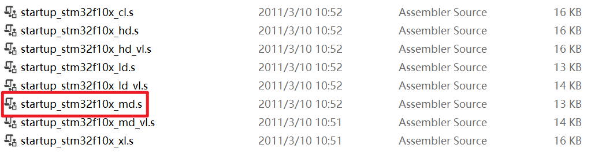

*图 2.2-3  添加启动文件-图3*

**如何添加启动文件？**

按照以下步骤添加启动文件：

第一步：手动在工程目录下，创建一个文件夹"Startup"，即启动开始的意思。

第二步：将选择好的启动文件(我们选择"md.s"结尾的文件)，手动复制到这个文件夹中。如下图所示：


*图 2.2-4  添加启动文件-图4*

第三步：在Keil5软件的Project管理列表中，同步创建一个组Startup。如下图所示：

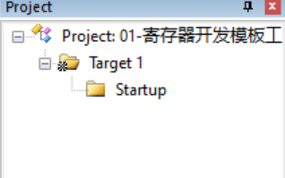

*图 2.2-5  添加启动文件-图5*

**如何创建这个Startup组呢？**可以点击"品字形"图标，如下图进行设置：

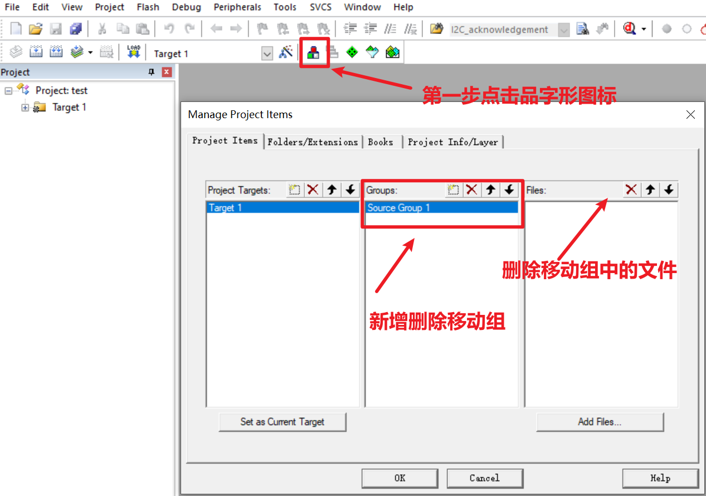

*图 2.2-6  添加启动文件-图6*

第四步：将硬盘上的启动文件，添加到Keil5的Project列表中，操作如下：

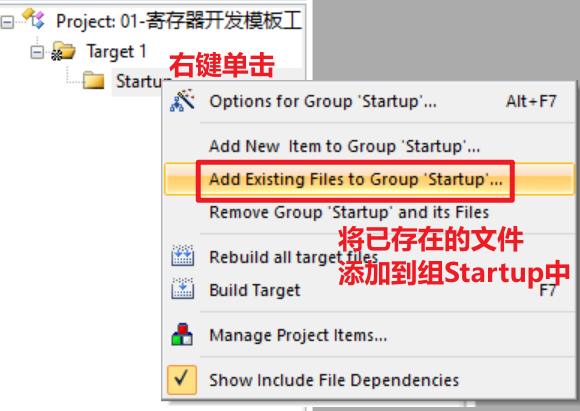

*图 2.2-7  添加启动文件-图7*

第五步：在弹出的窗口中，添加启动文件。如下图所示：

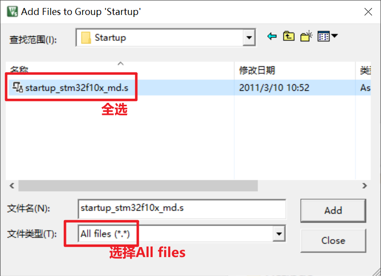

*图 2.2-8  添加启动文件-图8*

注意：

1. **一定要在文件类型选项框中选择"全部文件"类型，否则将看不到".s"文件！**
2. **注意点击Add按钮添加后，此窗口不会自动关闭，不要担心，实际上已经添加成功了。**如

下图所示：

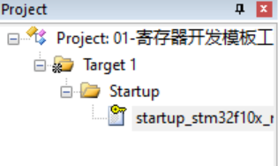

*图 2.2-9  添加启动文件-图9*

以上，启动文件就添加完成了。

#### 2.3 添加寄存器开发必要文件

上面我们已经完成了启动文件的添加，但光有启动文件还不足以支撑我们的开发。

STM32开发中，最底层的开发方式是寄存器开发，但诸如寄存器的定义，寄存器的地址等内容目前还没有添加到工程中。

**而寄存器开发是标准库开发的基础，所以新建标准库工程，首先需要新建一个寄存器开发工程。**

寄存器开发有哪些文件是必要的呢？

有以下五个文件：

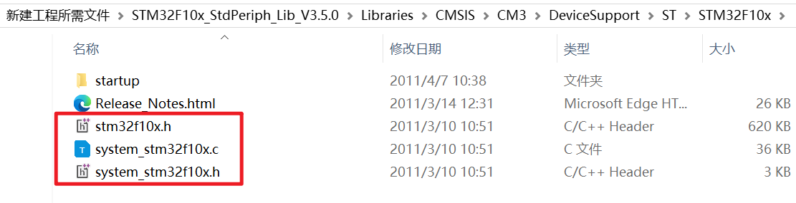

*图 2.3  添加寄存器开发必要文件-图1*

其中：

**stm32f10x.h：**

寄存器开发的核心基础文件，包含所有寄存器的详细定义，比如地址映射等信息。

**system_stm32f10x.c 和 system_stm32f10x.h：**

STM32启动时会调用一个SystemInit函数，用于初始化系统时钟，该函数就定义在此源文件中。

系统时钟的正确配置是启动时的核心工作。

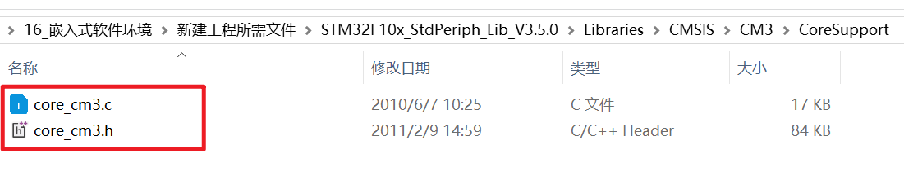

*图 2.3-2  添加寄存器开发必要文件-图2*

这两个文件中含了一些与 Cortex-M3 内核操作密切相关的函数实现，如内核寄存器访问函数等。

**具体应该如何操作呢？**

**第一步：**在工程目录下创建一个新的文件夹，命名为"Core"，表示这些文件是进行开发的核心基础文件。如下图所示：


*图 2.3-3  添加寄存器开发必要文件-图3*

**第二步：**在Keil5软件中，创建新的组"Core"，然后将这些文件添加到组Core中。效果如下图所示：


*图 2.3-4  添加寄存器开发必要文件-图4*

第三步：配置头文件。由于组Core中添加了头文件，所以需要将Core目录配置到工程的头文件目录中，否则将找不到头文件。

操作步骤见下图：


*图 2.3-5  添加寄存器开发必要文件-图5*

**然后按照下列步骤依次完成：**


*图 2.3-6  添加寄存器开发必要文件-图6*

配置完成后，一路点击OK直到完成所有操作。

添加完成后的效果如下图所示：


*图 2.3-7  添加寄存器开发必要文件-图7*

点击OK后，添加寄存器开发必要文件的步骤就完成了。

#### 2.4 创建用户工作区域

上述所有的步骤，都只是为了添加寄存器开发的必要文件。这些文件都是只读的、不可修改的：


*图 2.4  创建用户工作区域-图1*

这个锁的图标表示它们不可修改只读。

接下来，我们还需要用户工作区域，也就是把我们程序员编辑代码的区域，创建过程非常简单。按照下列步骤完成即可：

**第一步：**

在工程目录下，新建User目录，新建一个main.c源文件。完成后效果如下图所示：


*图 2.4-2  创建用户工作区域-图2*

**什么？你不知道如何创建"main.c"文件？那么请按照以下流程完成：**


*图 2.4-3  创建main.c文件的流程-图1*

然后进入下列步骤：


*图 2.4-4  创建main.c文件的流程-图2*

**注意：完成这一步一定要打开文件系统中，显示文件后缀扩展名！！！如果还没有打开，请百度或者举手让老师帮你打开！！**

**第二步：**

在Keil5软件中，新建组User，并且将main.c文件添加到该组中**（工程目录下的文件夹和组总是一一对应的）**。

完成后，效果图如下所示：


*图 2.4-5  创建用户工作区域-图3*

此时main.c文件只是一个空文件。

**第三步：**

给main.c源文件，添加最基本的代码。建议的添加的代码模板如下：

###### STM32开发最简易main函数模板

```c
#include "stm32f10x.h" // Device header

int main(void){
    while(1){
    }
}
```


解释一下这段代码：

`#include "stm32f10x.h"`：

这是一条预处理指令，用于包含头文件。`stm32f10x.h`头文件是STM32开发的核心基础文件，它包含了所有寄存器的定义。只有包含该头文件，才能进行寄存器开发。

while(1)：

很明显这是一个死循环，STM32的嵌入式程序正常不会停下来，会一直执行下去，所以需要加一个死循环。

基于这样的特点，main函数也不需要使用return给出返回值，因为main函数正常永远不会终止返回。

这一点和普通的PC程序是不一样的。

**注意：在Keil5当中进行STM32的开发，每一个文件都要求以一个空白行结束，否则编译器会抛出警告！！！**

**第四步：**

到此为止，一个基础的、基于寄存器开发的Keil5工程就创建完成了。

#### 2.5 main.c文件代码的注意事项

main.c文件中的代码，需要注意以下：

1. STM32的嵌入式程序的最后一行必须是一个空白行，否则Build完成后会弹出一个警告。
2. 不要在main函数的末尾加上返回值return语句，否则Build完成后也会弹出一个警告。

**查看一下自己的main函数，确定没有return语句，并且要确保文件的末尾以空白行结束！**

#### 2.6 切换编译器版本

**Keil MDK5默认选择的编译器版本可能是"6"，但我们需要的编译器版本是"5"。**

可以按照下图的操作来修改编译器的版本：


*图 2.6  可能出现的问题-图2*

**在下列框中选择编译器版本为，版本5，如下图所示：**


*图 2.6-2  可能出现的问题-图3*

若你的Keil5软件下拉框中没有这个编译器，请咨询老师解决问题。

#### 2.7 验证创建是否成功

至此，我们全部的配置都已经完全了，一个Keil5软件的寄存器开发模板就配置完成了。

如何验证创建是否成功呢？可以点击下图中的Build按钮：


*图 2.7  验证创建是否成功-图*

**该按钮会构建工程，其实就是经过编译、链接的过程生成一个STM32嵌入式C语言可执行程序。**

若构建成功，则会在下方输出台中看到0错误，0警告，如下图所示：


*图 2.7-2  验证创建是否成功-图2*

这样就说明创建工程已经完成了。

**如果你的代码编译不成功，有任何错误或者警告，都可以直接举手向老师咨询。**

#### 2.8 总结：需要使用的文件及其位置

**启动核心文件：**


*图 2.8-2  启动核心文件-图*

*图 2.8  启动核心文件位置-图*

**寄存器开发必备文件：**


*图 2.8-3  寄存器开发必备文件-图1图 2.8-5  寄存器开发必备文件-图2*


*图 2.8-4  Cortex内核处理相关文件-图*

请大家先在模板工程中创建两个文件夹，然后手动把这些文件复制过来。

**User文件夹下存放允许用户修改的文件，暂时只需要增加一个main.c文件：**


*图 2.8-6  User文件夹-图*

关于寄存器开发方式，我们暂时先不考虑使用这种方式，后续有机会我们再聊一聊这种开发方式。

### 3. 标准库开发模板工程的创建

下面开始标准库开发模板工程的创建，这是我们后续STM32学习使用的开发工程模板。

首先你要做的第一步就是复用刚刚创建的寄存器开发模板，这就涉及到模板工程的使用了。

#### 3.1 模板工程的使用方式

下面我们开始在原先寄存器开发工程的基础上，添加标准库开发的必要文件，这样这个工程就会变成一个标准库开发的工程。

当然之前寄存器开发的工程名为——寄存器开发模板工程，这个名字显然不适用了。

这里我们来演示一下模板工程的使用方式：

**第一步：**

复制原有的模板工程文件夹，然后改成你想要的新工程名。如下图所示：


*图 3.1  模板工程的使用方式-图1*

**第二步：**

打开新的工程文件夹，将工程文件中的名字修改为新工程的名字，多余的两个文件可以删除。如下图所示：


*图 3.1-2  模板工程的使用方式-图2*

注意，其余内容不需要修改。

**第三步：**

直接双击`.uvprojx`后缀的工程文件（这个文件会有Keil5的图标），就可以在Keil5中打开新工程了。


*图 3.1-3  模板工程的使用方式-图3*

**第四步：**

最后你只需要修改工程输出目录下，输出文件的名字即可，按照下图操作：


*图 3.1-4  模板工程的使用方式-图4*

比如我的新工程叫做"02-标准库开发模板工程"，修改后如下图所示：


*图 3.1-5  模板工程的使用方式-图5*

**第五步：**

点击Build按钮，构建工程，编译链接成功0错误0警告，则表示新工程创建完成！

**使用这种方式，这个新工程会继承老工程的所有文件以及配置，这样我们就不用每次都辛辛苦苦从头开始新建工程了。**

#### 3.2 添加标准库开发必要文件

为了使用标准库进行STM32的开发，我们还需要将标准库的一些源文件、头文件都加到工程中去。具体步骤如下：

**第一步：**

在工程目录下新建一个Lib文件夹，即单词Library的缩写，也就是库的意思。然后把以下文件全部复制粘贴到这个目录下：


*图 3.2  添加标准库开发必要文件-图1*

**下面一个目录的文件也要全选：**


*图 3.2-2  添加标准库开发必要文件-图2*

其中的.c文件就是存放各类外设的库函数的源文件，其中的.h文件就是存放标准库各种描述信息的头文件。

添加完成后，其效果如下图所示：


*图 3.2-3  添加标准库开发必要文件-图3*

**第二步：**

在Keil5软件中新建组"Lib"，并且将Lib目录下的所有文件都添加进去。效果如下图所示：


*图 3.2-4  添加标准库开发必要文件-图4*

**第三步：**

将Lib目录添加到工程的头文件目录中，这个操作上面已经讲过了，完成后效果如下图所示：


*图 3.2-5  添加标准库开发必要文件-图5*

**第四步：**

光添加标准库的头文件和源文件还不够，你还需要找到下面三个文件：


*图 3.2-6  添加标准库开发必要文件-图6*

这三个文件中：

`stm32f10x_conf.h`：这个头文件就是一个大杂烩，只要包含了这个头文件，那么就相当于直接包含了所有的23个标准外设库的头文件。

当然你可以修改这个头文件的内容，使得工程只包含必要的头文件。

**（但一般没这个必要，包含多余头文件对最终生成的可执行程序几乎没啥影响，也不影响运行时效率，只会稍微加长编译和链接的时间。）**

`stm32f10x_it.c`和`stm32f10x_it.h`两个文件中包含了和STM32中断处理相关的函数和定义。

由于这三个文件，都可以被程序员修改，我们把它们和"main.c"视为一类，所以它们也可以放入User目录下。效果如下图所示：


*图 3.2-7  添加标准库开发必要文件-图7*

然后在Keil5软件中，将新增的文件加入User组中，如下图所示：


*图 3.2-8  添加标准库开发必要文件-图8*

并且由于User组也存放了头文件，所以User目录也需要加入工程的头文件目录。效果如下图所示：


*图 3.2-9  添加标准库开发必要文件-图9*

**第五步：**

最后一步你还需要为工程配置一个启动宏定义。如下图所示：


*图 3.2-10  添加标准库开发必要文件-图10*

**也就说你需要在Define输入框中填入下列内容（注意需要填入的内容如下）：**

1. USE_STDPERIPH_DRIVER

这个配置的作用就相当于在预处理开始时，加入了下面的一条预处理指令：

1. #defineUSE_STDPERIPH_DRIVER

那这条指令有啥用呢？

Core目录下的`stm32f10x.h`头文件中有下列的一段条件编译：


*图 3.2-11  添加标准库开发必要文件-图11*

所以只要配置"USE_STDPERIPH_DRIVER"启动宏定义，工程就会自动包含`stm32f10x_conf.h`头文件，也就是包含工程所需的所有标准外设头文件。

**最后一步：**

当你完成上述所有步骤后，最后一步，你还需要验证一下，标准库工程是否真的创建完成。

仍然是点击Build按钮，构建工程，编译链接生成可执行程序，如果看到0错误0警告，即表示工程创建完成！


*图 3.2-12  添加标准库开发必要文件-图12*

**以上，你就完成了一个典型的Keil5，基于标准库方式进行开发的，模板工程。**

**后续你就可以直接使用该模板工程进行开发了，一般情况下，都不需要再次手动新建工程了。**

#### 3.3 配置Keil5软件

Keil5工程的各种配置也会被保存在工程文件中，所以建议修改设置一部分配置，使得Keil5软件更好用。

**第一步，配置编码集为UTF-8、修改Tab空格数量：**

默认的编码集在查看中文时，有可能出现中文乱码，为了避免这种情况。

Keil5默认的Tab长度是2个空格，4个空格更美观，建议修改成4个空格。

按照下图进行设置：


*图 3.3  配置Keil5软件-图1*

**第二步，将调试器设置为ST-LINK：**

点击魔术棒按钮，进行下列设置：


*图 3.3-2  配置Keil5软件-图2*

**根据实测，每次复制粘贴新建工程时，这一步都需要重新设置，不要忘记了！！！**

**第三步，开启下载程序后，立刻复位启动程序：**

在第二步的基础上，直接点击选项框后面的"Settings"按钮，进行下列操作：


*图 3.3-3  配置Keil5软件-图3*

**然后还需要配置一个选项卡的取消勾选，如下图所示：**


*图 3.3-4  配置Keil5软件-图4*

该设置可以让你的单片机在下载烧录程序后，无需点击复位按钮，就可以直接复位从新开始执行程序。还是比较方便的一个功能，推荐设置。

**根据实测，每次复制粘贴新建工程时，这一步都需要重新设置，不要忘记了！！！**

**第四步，字体美化：**

默认的字体比较丑，字号也比较小，看起来很费劲，可以通过下面的方式来美化一下字体。


*图 3.3-5  配置Keil5软件-图5*

建议把C/C++代码文件的格式以及ASM（即汇编文件）的格式都修改一下。

我设置的字体是：Consolas字号是：20号**第五步，调整User组的位置：**

所有组中只有User组中的内容需要修改，所以我们把它调整到最下面，按照下面进行操作：


*图 3.3-6  配置Keil5软件-图6*

**然后按照下面图中进行操作：**


*图 3.3-7  配置Keil5软件-图7*

调整后的效果如下：


*图 3.3-8  配置Keil5软件-图8*

**第六步，选择启动C99标准：**

点击魔术棒按钮，打开设置，


*图 3.3-9  配置Keil5软件-图9*

按照 C99 标准来编译可以拥有更灵活的变量声明位置，更好用。建议勾选！

**这些设置会保存在工程文件中，后续利用模板创建新工程，就不需要再修改这些内容了。**

### 4. 模板工程文件夹的使用

在"王道嵌入式软件环境"这个目录下，直接给出了两个Keil5工程模板，它们在**"百度网盘 -- 工程模板"**中。

你可以直接下载这两个模板，然后直接修改使用，当然我们后续的编码都基于**STM32外设标准库**，你只需要使用标准库工程模板就够了。

如何使用标准库开发的工程模板呢？

请直接参考本文档的**"3.1小节"**。但这里还有一个小细节需要注意，我放在了下面一个小节。

#### 4.1 利用模板创建新工程的设置问题

如果你按照下图来新建一个标准库开发的Keil5工程：


*图 4.1  利用模板创建新工程的设置问题-图1*

那么除了**"3.1"小节**中描述的需要修改的部分，实测还需要修改下列内容（每个新创建的工程都需要重新设置）：

**第一步，将调试器设置为ST-LINK：**

点击魔术棒按钮，进行下列设置：


*图 4.1-2  配置Keil5软件-图2*

**根据实测，每次复制粘贴新建工程时，这一步都需要重新设置，不要忘记了！！！**

**第二步，开启下载程序后，立刻复位启动程序：**

在第二步的基础上，直接点击选项框后面的"Settings"按钮，进行下列操作：


*图 4.1-3  配置Keil5软件-图3*

**然后还需要配置一个选项卡的取消勾选，如下图所示：**


*图 4.1-4  配置Keil5软件-图4*

该设置可以让你的单片机在下载烧录程序后，无需点击复位按钮，就可以直接复位从新开始执行程序。还是比较方便的一个功能，推荐设置。

**根据实测，每次复制粘贴新建工程时，这一步都需要重新设置，不要忘记了！！！**

#### 4.2 使用脚本自动完成创建新工程（新方法，更快速）

上述操作还是稍微有点麻烦了，为了更方便的创建一个新工程，我们可以使用一个脚本来完成新工程的创建。

**这个脚本文件，就在模板工程文件夹的根目录下，不要修改它的路径！！！如下图所示：**


*图 4.2  使用脚本自动完成创建新工程-图1*

现在新建工程，只需要以下三步就足够了：

**第一步：**

直接复制模板工程文件夹，粘贴在当前目录下，然后将粘贴后的工程文件夹的名字修改成你想要的，如下图所示：


*图 4.2-2  使用脚本自动完成创建新工程-图2*

**第二步：**

直接双击打开这个脚本，脚本会自动完成工程文件名字的修改，自动打开这个新工程，**还会将新工程的名字自动复制到剪贴板**。

如下图所示：


*图 4.2-3  使用脚本自动完成创建新工程-图3*

**双击后直接等待工程自动打开就行，不需要自行双击打开工程：**


*图 4.2-4  使用脚本自动完成创建新工程-图4*

**打开工程后，也不需要再手动修改Debug调试器了，调试器自动就保留了原本配置——"ST-Link"。**

而且还会自动修改输出选项卡，不需要再像之前那样，自己手动修改工程输出目录名。

比如你可以打开下面的选项卡：


*图 4.2-5  模板工程的使用方式-图4*

就会发现使用此脚本创建新Keil5项目，输出目录名就是新工程的名字，也就是工程目录的名字。

若还有问题，不妨直接提问老师。


## 04 PC13点灯实验

### 1. 电路接线

在进行编码实现PC13点灯之前，首先需要使用ST-LINK仿真器将STM32F103C8T6最小系统板和电脑链接到一起。

具体的接线方式，如下图所示：


*图1-1点亮PC13实验-接线图*

需要注意几个细节：

1. 面包板的电源轨都已经接入供电了，但本实验暂时用不到这些电源轨。
2. 最小系统板连接ST-LINK的四个针脚，板子上的丝印可能会有名称上的不同，但本质上没有区别。以下丝印名称的意义都是一致的：
   - a. 四个针脚从上到下：
   - b. GND --- G
   - c. SWCLK --- DCLK --- CLK
   - d. SWDIO --- DIO -- SWIO
   - e. 3.3 --- 3V3 --- 3.3V
3. ST-LINK仿真器上我们所需的四个针脚是：SWCLK、SWDIO、GND、3.3V。只需要找到这四个针脚，然后按照图中的方式和最小系统板链接即可。无需在意你手中的ST-LINK针脚顺序是否和图中一致。
4. 不要在意图中线的颜色，只要将对应位置的针脚用**母对母杜邦线**连接起来就可以了。**重要的是对应针脚按名称连接起来，颜色不重要，针脚位置也不重要。**
5. 连线的时候要细心一点，连错了肯定做不成功实验。

#### 1.1 验证接线是否正确

**如何验证接线是否正确成功呢？**

如果接线是成功的，最小系统板的PWR电源指示灯会常亮。

除此之外，你还可以打开你的标准库模板工程，尝试向MCU中烧录一个空的程序。

如下图所示：


*图1.1-1验证接线烧录程序-图*

**若烧录成功，没有报错，则说明接线是成功正确的。**

**注：**

很多生产厂商为了验证硬件是否合格，会默认烧录一个PC13点灯程序到MCU中，所以第一次成功接线后PC13指示灯通常是点亮的状态。

现在你烧录了一个空程序，成功烧录后PC13指示灯就会熄灭。

如果你观察到了这个现象，那么接线就是正确的。

当然，如果你的PC13指示灯一开始就是熄灭状态，则不必理会这个现象，只需要关心Keil5软件烧录成功的提示即可。

#### 1.2 电源轨的使用

我们使用的面板板有上下两侧都有两条正负电源轨，现在我们可以将电源轨和最小系统板上"3.3、G"这些丝印的针脚相连。这样：

**面包板上下两侧的电源轨就可以正常作为电源正负极使用了。**接线方式可以参考下图：


*图1.2-1注：电源轨的使用-图*

注意，接线的时候要看清楚丝印对应的阵脚，不要接错了！！

**接线完成后，可以用一盏LED直接插入电源轨正负极，如果能够点亮，则说明电源轨的接线成功了。**

### 2. 思路分析

一般来说，使用GPIO操作外设时，基本的步骤有三个：

1. 开启GPIO时钟。
   - a. 在STM32微控制器中，为了降低功耗，默认情况下大部分外设的时钟是关闭的。

开启时钟是使用 GPIO 或其他外设的前提，只有在时钟开启后，才能对相应的GPIO 端口或外设进行操作。

   - b. 关于时钟我们后面课程会详细讲，本着入门不增加负担的考虑，这里不详细讲时钟了。
   - c. 可以把时钟简单理解成一个节拍器，为 STM32 里的外设提供工作节奏。只有时钟打开了，外设们才知道如何工作。
   - d. 或者你可以将时钟开启，理解成"给外设供电、或者心脏给人体的某个需要使用的部分供血"。
   - e. **总之，对于大多数片内外设的使用，手动开启时钟都是第一步。**
2. 配置引脚工作模式。根据需求为引脚配置不同的工作模式。
3. 控制引脚电平。根据需求来控制引脚的电平，从而实现功能。

### 3. 库函数讲解

为了点亮PC13指示灯，我们就需要完成上述三个步骤，每一个步骤都有一个封装好的库函数使用，它们分别是：

1. `RCC_APB2PeriphClockCmd`函数
2. `GPIO_Init`函数
3. `GPIO_WriteBit`函数

下面逐一介绍这三个函数。

**小Tips：**

第一次见到STM32的外设标准库函数，肯定会觉得它们的命名很古怪，和传统C语言函数的命名风格很不同。

之所以这么设计，其原因是为了与**C 语言标准库**做出区分，让开发者一眼就能看出是在使用 STM32 标准库函数，而不是 C 语言标准库函数，提高代码的可读性和可维护性。

#### 3.1 RCC_APB2PeriphClockCmd函数

我们需要做的第一步是开启时钟，开启外设时钟。

PC13引脚属于GPIOC外设，而GPIOC又挂载在APB2外设总线上，所以我们使用的库函数就是RCC_APB2PeriphClockCmd函数。

**其函数声明如下：**

```c
void RCC_APB2PeriphClockCmd(uint32_t RCC_APB2Periph, FunctionalState NewState);
```

函数没有返回值，所以只需要弄明白它的参数即可。

**解释一下形参：**

**RCC_APB2Periph形参：**

这是一个uint32_t类型的参数，用来指定要操作的 APB2 总线上的外设。

该参数的取值不需要手动给定一个无符号数，标准库中已经给出了各种外设的宏定义供程序员使用。

打开标准库头文件`stm32f10x_rcc.h`，Ctrl + F搜索字符串"RCC_APB2Periph"，就可以找到下图内容：


*图3.1-1APB2外设宏定义-图*

想要打开某个外设时钟，就将对应的宏定义作为参数传递进去。

把上面的十六进制无符号数，全部转换成二进制（用0b开头），如下所示：

```c
#define RCC_APB2Periph_AFIO((uint32_t)0b0000000000000000000000000000000001)
#define RCC_APB2Periph_GPIOA((uint32_t)0b0000000000000000000000000000000100)
#define RCC_APB2Periph_GPIOB((uint32_t)0b0000000000000000000000000000001000)
#define RCC_APB2Periph_GPIOC((uint32_t)0b0000000000000000000000000000010000)
#define RCC_APB2Periph_GPIOD((uint32_t)0b0000000000000000000000000000100000)
#define RCC_APB2Periph_GPIOE((uint32_t)0b0000000000000000000000000001000000)
#define RCC_APB2Periph_GPIOF((uint32_t)0b0000000000000000000000000010000000)
#define RCC_APB2Periph_GPIOG((uint32_t)0b0000000000000000000000000100000000)
.....
```

所以若想要一次性开启多个APB2外设时钟，只需要用"|"按位或运算符连接多个宏定义就可以了。

**NewState形参：**

这是一个`FunctionalState`类型的参数，用于指定要对上述指定的外设执行的操作，它可以取两个值：

1. `ENABLE`：开启指定外设的时钟。
2. `DISABLE`：关闭指定外设的时钟。

`FunctionalState`实际上是一个枚举类型，它的定义可以在头文件`stm32f10x.h`中找到。如下：

```c
typedef enum {DISABLE = 0, ENABLE =!DISABLE} FunctionalState;
```

其实`ENABLE`就是1，就是true；`DISABLE`就是0，就是false。

`FunctionalState`这个枚举类型，在STM32的库函数编程中，是很常见的，常用于表示各种功能的开关。

ENABLE用于开启，`DISABLE`用于关闭。

#### 3.2 时钟/时钟信号

时钟是STM32单片机的核心概念，是一个复杂且重要的功能。但是在课程入门阶段，我们暂时抛开时钟系统的复杂性，简单理解一下时钟。

**时钟是什么？：**

在讲STM32单片机时，时钟和时钟信号，意思是相同的。就像“指针”和“指针变量”在口头描述上，也基本不去区分概念。

**时钟，本质上是一种周期性变化的电平信号，时钟的作用是成给单片机内部电路提供“工作节拍”。**

对于 STM32 单片机来说，时钟就相当于人体的心脏。

就像人类需要心跳维持生命活动一样，STM32 芯片内部的各种功能模块也需要时钟信号驱动才能正常工作。

包括CPU，以及其它各种片上外设，它们的运行都离不开时钟信号。

**为什么需要开启时钟？**

为了最大化的节省系统功耗，STM32 的绝大多数外设默认处于时钟关闭状态。

所以在使用单片机的外设时，第一步往往都需要开启此外设的时钟。而且由于外设挂载的总线不同，开启外设时钟的库函数也会有所不同。

这就好比，你有一间房子，你去上班了，卧室空调自然就关了。只有你回家了，才会把空调手动打开。

当然，也不是所有的外设在使用之前都需要开启时钟，有些外设的时钟信号是上电就有的，不需要手动开启。

这就好比，只要家里不停电，冰箱默认就有电。

**补充：哪些外设在使用的时候，是不需要手动开启时钟呢？**

不需要手动开启时钟的外设主要分两种情况：

1. 外设自身就属于内核CPU的一部分，而不是挂载在外设总线上。
   - a. CPU运行依赖时钟信号，它们是CPU的一部分，自然不需要再额外开启时钟信号了。
   - b. 这种例子**只有两个**：

i.嵌套向量中断控制器（NVIC），用于配置管理系统中的中断。

ii.系统滴答定时器（SysTick），是一个简易的系统定时器。

2. 本身不和CPU集成在一起，但系统上电启动时，默认会自动开启时钟的外设。
   - a. 这种情况也不算多。
   - b. 最典型的例子就是：复位和时钟控制器（RCC），本身就用于管理系统中外设时钟的开启关闭，它自己的时钟当然是默认开启的。

#### 3.3 GPIO_Init函数

`GPIO_Init`是 STM32 标准外设库中用于初始化 GPIO 引脚的重要函数，通过这个函数你可以配置引脚的工作模式和输出速度。

其函数声明如下：

```c
void GPIO_Init(GPIO_TypeDef* GPIOx, GPIO_InitTypeDef* GPIO_InitStruct);
```

函数没有返回值，所以只需要弄明白它的参数即可。

**解释一下形参：**

**GPIOx形参：**

这是一个指向`GPIO_TypeDef`结构体的指针，用于指定要初始化的 GPIO 端口。

这个参数的传递，并不需要程序员去慢慢创建GPIO_TypeDef结构体对象，再传递结构体对象指针。‘而是在头文件`stm32f10x.h`中，直接用宏定义，定义了可能操作的GPIO 端口，其内容如下：


*图3.3-1GPIO_Init函数-图1*

所以，如果你想要初始化 GPIOC，那么这个参数可以直接传递`GPIOC`。

**GPIO_InitStruct形参：**

这是一个指向`GPIO_InitTypeDef`结构体的指针，该结构体包含了 GPIO 引脚的各种初始化配置信息。

该结构体的类型定义，可以在标准库头文件`stm32f10x_gpio.h`中找到，内容如下所示：

```c
typedef struct{
    uint16_t GPIO_Pin; // 要初始化的引脚编号
    GPIOSpeed_TypeDef GPIO_Speed; // 引脚的输出速度
    GPIOMode_TypeDef GPIO_Mode; // 引脚的工作模式
} GPIO_InitTypeDef;
```

下面解释一下这个结构体的三个成员：

##### 3.3.1 GPIO_Pin结构体成员

**GPIO_Pin成员：**

该成员的取值表示要初始化的引脚编号，也就是PC13中的这个13。它是一个16位无符号整数，但它的取值仍然依赖于宏定义，也可以直接在标准库头文件`stm32f10x_gpio.h`中找到。

内容如下所示：


*图3.3.1-1GPIO_Init函数-图2*

比如要配置PC13引脚，该成员就可以设置为`GPIO_Pin_13`。

如果需要同时配置多个引脚，使用按位或运算符`|`即可。比如同时初始化引脚 10 和11，可以设置为`GPIO_Pin_10|GPIO_Pin_11`。

##### 3.3.2 GPIO_Speed结构体成员

**GPIO_Speed成员：**

指定引脚的输出速度，它是`GPIOSpeed_TypeDef`枚举类型，可以在标准库头文件`stm32f10x_gpio.h`中找到此枚举类型定义。

它共有三个成员如下：

1. `GPIO_Speed_2MHz`：低速，输出速度为 2MHz。
2. `GPIO_Speed_10MHz`：中速，输出速度为 10MHz。
3. `GPIO_Speed_50MHz`：高速，输出速度为 50MHz。

引脚输出速度是一个稍微有点麻烦的概念，现阶段想搞明白有点困难。

对于初学者而言，知道以下几点就可以了：

1. **引脚的输出速度越快，引脚切换翻转电平的速度就越快。**
2. 对一些需要高速切换电平的外设来说，引脚输出速度不能低于最低要求。
3. 引脚输出速度越快就越耗电，如果使用电池供电时，就需要考虑功耗问题。
4. 输出速度要根据引脚操作的具体外设来决定，在可能的情况下，尽量选择更低速的输出速度以降低功耗。
5. 如果仅仅使用引脚驱动外部LED、蜂鸣器等设备，无需引脚持续切换电平，那么IO引脚的输出速度可以尽量选最小，以节省功耗。

你可以这么理解IO引脚的输出速度：

引脚切换电平状态，类比门的开与关两种状态。

**引脚输出速度就是关门的力度，力度越大，关门就越快。**

使用引脚驱动外部LED、蜂鸣器等设备，就好比：你每天上班去了开门，回家了再开门。

此时无需频繁切换电平状态，所以不要用太大的力气开关门，没那个必要。

这种情况下，引脚的输出速度直接选最小就够用了。

但假如遇到了需要频繁切换电平的场景：

我要和“门”玩一个游戏，一会开，一会关，而且要求开关门的时间要尽量短。

那么此时力气就不能太小了，力气太小速度就跟不上要求了，开关门的时间就会被延长。

**所以在需要频繁切换电平的场景，要根据要求，使用较大的引脚输出速度。**

当然，你可能会问：这么多档位，看起来很麻烦，那有没有一个简单一点的办法？

如果一开始拿不准该怎么选，应该怎么办？

**答：如果实在不知道选啥，那就选较快/最快的。**

引脚输出速度过慢，在有些场景是有害的，会导致功能异常。

但引脚输出速度选快了，除了增加功耗，通常不会带来明显问题（但仍然会带来一定的问题）。

##### 3.3.3 GPIO_Mode结构体成员

**GPIO_Mode成员：**

指定引脚的工作模式，它需要传参一个`GPIOMode_TypeDef`枚举类型的值。可以在标准库头文件`stm32f10x_gpio.h`中找到此枚举类型定义。

它有以下成员：

1. `GPIO_Mode_AIN`：模拟输入模式。
2. AIN 代表 Analog Input（模拟输入）
3. 用于接收引脚模拟信号输入，我们暂时用不到。
4. `GPIO_Mode_IN_FLOATING`：浮空输入模式。**IN**代表**Input**（输入），**FLOATING**代表**Floating**（浮空）。
5. `GPIO_Mode_IPD`：下拉输入模式。**IPD**代表**Input Pull-Down**（输入下拉）。
6. `GPIO_Mode_IPU`：上拉输入模式。**IPU**代表**Input Pull-Up**（输入上拉）。
7. `GPIO_Mode_Out_OD`：开漏输出模式。**Out**代表**Output**（输出），**OD**代表**Open-Drain**（开漏）。
8. `GPIO_Mode_Out_PP`：推挽输出模式。**Out**代表**Output**（输出），**PP**代表**Push-Pull**（推挽）。
9. `GPIO_Mode_AF_OD`：复用开漏输出模式。**AF**代表**Alternate Function**（复用功能），**OD**代表**Open-Drain**（开漏）。
10. `GPIO_Mode_AF_PP`：复用推挽输出模式。**AF**代表**Alternate Function**（复用功能），**PP**代表**Push-Pull**（推挽）。

**注意，一个引脚在同一时间不能同时设置为多种工作模式，只能在上述枚举值中选择一个。**

#### 3.4 GPIO_WriteBit函数

`GPIO_WriteBit`是 STM32 标准外设库中用于设置 GPIO 引脚电平的函数。该函数的函数名中带有"Write"单词，说明它是一个输出向的函数。

**实际上该函数在引脚配置为输出模式下才能够使用，用于向输出数据寄存器写1或者0，用于控制引脚的电平状态。**

**该函数的声明如下所示：**

```c
void GPIO_WriteBit(GPIO_TypeDef* GPIOx, uint16_t GPIO_Pin, BitAction BitVal);
```

函数没有返回值，所以只需要弄明白它的参数即可。

**解释一下形参：**

**GPIOx形参：**

这是一个指向`GPIO_TypeDef`结构体的指针，用于指定要初始化的 GPIO 端口。

上面已经解释过了，如果你想要初始化 GPIOC，那么这个参数可以直接传递`GPIOC`。

**GPIO_Pin形参：**

在上面的`GPIO_InitTypeDef`结构体中，我们见过同名的成员，实际上它们的意思也确实是一样的。

用于指出要操作的引脚编号，如果要操作的是13号引脚，可以直接传参`GPIO_Pin_13`。

**BitVal形参：**

这是一个`BitAction`类型的参数，用于指定向输出数据寄存器输出0或者1。这是一个枚举类型，可以在标准库头文件`stm32f10x_gpio.h`中找到此枚举类型定义，其类型定义如下（）：

```c
typedef enum{
    Bit_RESET = 0,
    Bit_SET
}BitAction;
```

很明显，它可以取两个值：

1. `Bit_RESET`：向输出数据寄存器中写入0
2. `Bit_SET`：向输出数据寄存器中写入1

利用该函数就可以完成对引脚的控制，当然选择不同的输出模式，最终引脚的电平表现是不同的。

### 4. 编写代码，实现功能

现在我们使用开漏输出模式，来实现点亮/熄灭PC13指示灯，参考代码如下：

```c
 #include "stm32f10x.h" // Device header

 int main(void) {
     // 需求: 控制PC13指示灯的点亮和熄灭
     // 1.开启GPIOC外设时钟
     /*
        管理外设时钟,是RCC外设模块的功能,所以只需要去标准库的rcc模块中找对应函数就可以了
        既然目标是找函数,那么就去看头文件,这个头文件叫xxx_rcc.h
        GPIOC外设挂载在APB2外设总线上,SPL标准库的函数命名都严格遵守见名知意
        最终就找到了这个函数: RCC_APB2PeriphClockCmd
        于是开启GPIOC外设时钟就需要调用这个函数
     */
     RCC_APB2PeriphClockCmd(RCC_APB2Periph_GPIOC, ENABLE);

     /*
        假如我现在希望同时开启GPIOC,GPIOA外设时钟,怎么办?
        可以调用多次函数,但没有必要
        只需要调用一次函数,然后把多个外设宏用"|"按位或即可
     */
     // RCC_APB2PeriphClockCmd(RCC_APB2Periph_GPIOC, ENABLE);
     // RCC_APB2PeriphClockCmd(RCC_APB2Periph_GPIOA, ENABLE);
     // RCC_APB2PeriphClockCmd(RCC_APB2Periph_GPIOA |RCC_APB2Periph_GPIOC,ENABLE);

     // 2.初始化GPIOC外设,在初始化的同时需要设置PC13引脚的工作模式
     /*
        既然要使用GPIOC外设,第一步就需要初始化这个外设
        初始化所需要的函数,肯定在SPL库的gpio模块中
        可以通过查看xxx_gpio.h头文件找到这个函数

        这个函数实际上就是GPIO_Init函数
        扩展: 使用单片机的某个外设,大多数情况下都需要先初始化这个外设
            而初始化这个外设需要调用的SPL库函数,都叫XXX_init
            比如初始化GPIO外设,就需要调用GPIO_Init
            初始化USART外设,就需要调用USART_Init
            而且这些函数的传参,都需要传参一个结构体指针,表示传参此结构体的内存块
            这个结构体的成员取值就代表此外设初始化时的一些初始配置参数

            这些结构体的类型都叫做XXXX_InitTypeDef
            比如初始化GPIO外设,就使用GPIO_InitTypeDef
            比如初始化USART外设,就使用USART_InitTypeDef

            并且此结构体的对象应该直接创建在栈上,是一个局部变量
            此局部变量结构体对象的命名应该是XXX_InitStruct
     */
     GPIO_InitTypeDef GPIO_InitStruct; // 仅定义,此时结构体对象的成员取值是随机值
     GPIO_InitStruct.GPIO_Mode = GPIO_Mode_Out_OD; // 将引脚设置为通用开漏输出模式
     GPIO_InitStruct.GPIO_Pin = GPIO_Pin_13; // 表明初始化的引脚是编号为13的引脚
     GPIO_InitStruct.GPIO_Speed = GPIO_Speed_2MHz; // 引脚的输出速度设置为2MHz
     GPIO_Init(GPIOC, &GPIO_InitStruct); // 调用函数完成PC13引脚的初始化

     // 3.写PC13引脚的输出数据寄存器,0/1,实现控制PC13引脚的输出
     /*
        引脚的输出,肯定是GPIO外设的功能,所以还是去xxx_gpio.h头文件中找到这个函数
        最终我们确定使用GPIO_WriteBit函数,来控制PC13引脚输出
 */

     // 控制PC13引脚输出低电平(向PC13引脚的输出数据寄存器中写0)
     // PC13指示灯点亮
     // GPIO_WriteBit(GPIOC, GPIO_Pin_13, Bit_RESET);

     // 控制PC13引脚输出高阻态(向PC13引脚的输出数据寄存器中写1)
     // PC13指示灯熄灭
     // GPIO_WriteBit(GPIOC, GPIO_Pin_13, Bit_SET);

     while (1) {
     }
 }

```

编号3的两句代码，可以轮流注释掉，从而控制PC13指示灯的亮灭。

除此之外，我们还可以通过一个简单的思路，实现指示灯的闪烁：

1. 点亮PC13指示灯
2. 程序延时休眠一段时间，比如100ms
3. 熄灭PC13指示灯
4. 程序延时休眠一段时间，比如100ms

循环往复的执行上述结构，就能轻松实现闪烁了。

首先，为了实现程序延时功能，你还需要把"Delay模块"的源文件和头文件添加到工程中。你可以在**"百度网盘 -- 函数模块 -- Delay函数模块"**文件夹下找到这个源文件和头文件。

该模块提供了下面三个函数，大家可以直接使用：


*图4-1Delay模块函数-图*

**首先你需要在工程目录下，新建一个"Tools"文件夹用来存放模块的文件，并且需要同步在Keil5软件中新建一个"Tools"组并将文件添加进去，最后你还需要将"Tools"添加到工程的头文件目录中去。**

这些操作之前文档中都做过，这里不再赘述，若有疑问不妨直接互相问问或者问问老师。

添加完成后，不要忘记修改main.c文件，需要在main.c文件中包含头文件。

整体实现后的参考代码如下所示：

```c
 #include "stm32f10x.h" // Device header
 #include "Delay.h" // 包含Delay模块头文件

 int main(void) {
     // 1.开启GPIOC外设时钟
     RCC_APB2PeriphClockCmd(RCC_APB2Periph_GPIOC, ENABLE);

     // 2.1 初始化GPIO_InitTypeDef结构体,设置工作模式和输出速度
     GPIO_InitTypeDef GPIO_InitStruct; // GPIO_InitStruct是一个习惯命名
     GPIO_InitStruct.GPIO_Pin = GPIO_Pin_13; // 初始化的引脚是PC13引脚
     GPIO_InitStruct.GPIO_Speed = GPIO_Speed_2MHz; // 引脚输出速度为2MHz即可
     GPIO_InitStruct.GPIO_Mode = GPIO_Mode_Out_OD; // 引脚的工作模式是通用开漏输出模式
     // 2.2 调用GPIO_Init, 完成PC13引脚初始化
     GPIO_Init(GPIOC, &GPIO_InitStruct);

     // 下面两句代码，轮流放开可以控制PC13指示灯的亮灭
     // 3.1 在开漏输出模式的情况下，向输出数据寄存器写0，引脚输出低电平，点亮
     // GPIO_WriteBit(GPIOC, GPIO_Pin_13, Bit_RESET);
     // 3.2 在开漏输出模式的情况下，向输出数据寄存器写1，引脚高阻抗，熄灭
     // GPIO_WriteBit(GPIOC, GPIO_Pin_13, Bit_SET);

     while (1) {
         // PC13指示灯闪烁
         // 1.点亮PC13指示灯
         GPIO_WriteBit(GPIOC, GPIO_Pin_13, Bit_RESET);
         // 2.延时100ms
         Delay_Ms(100);
         // 熄灭PC13指示灯
         GPIO_WriteBit(GPIOC, GPIO_Pin_13, Bit_SET);
         // 2.延时100ms
         Delay_Ms(100);
     }
 }

```

**以上，一个最最基本的STM32点灯实验就完成啦，恭喜你，你可以称得上入门了。**

### 5. 扩展了解：寄存器开发实现PC13点灯

我们已经大体了解过寄存器开发的一般流程了，知道寄存器开发需要频繁查阅《参考手册》，那么究竟如何实际的完成一个寄存器开发案例呢？

本小节内容完全属于了解，不要求大家掌握，寄存器开发方式也不是主流开发方式。

首先我们还需要了解一些前置知识点：

虽然寄存器在物理上属于外设模块内部的特殊控制单元，并不属于传统单片机的存储器（如 SRAM、Flash）

但为了让程序员能够更方便的访问操作寄存器，单片机采用了**"Memory Mapped I/O（内存映射 I/O）"技术**，将每一个寄存器映射到系统统一的内存地址空间中。

**程序员在编程时，只需像读写普通内存一样，访问特定的内存地址，即可直接控制或读取对应寄存器，实现对外设的控制和状态获取。**

总之就是一句话：

**在具体操作寄存器时，可以查阅《参考手册》找到一个此外设寄存器的固定内存地址值，然后基于指针操作内存地址的方式来操作寄存器。**

寄存器开发实现PC13点灯的具体流程是这样的：

#### 5.1 开启GPIOC外设时钟（寄存器开发方式）

**第一步：查阅RCC外设的寄存器起始地址。**

可以在《参考手册》的"Memory Map内存映射"小节（有些中文版本会翻译成内存映像）找到。

如下图所是：

*图5.1-1开启GPIOC外设时钟-图1*

所以RCC外设寄存器的起始地址是：`0x40021000`。

但光知道起始地址还不够，因为外设的寄存器大多都不止一个，所以还需要确定使用的寄存器是哪一个。

**第二步：找到所需要使用的RCC外设寄存器。**

由于我们的目标是开启GPIOC外设时钟，所以就需要使用**APB2 外设时钟使能寄存器(RCC_APB2ENR)**。

它的偏移地址是：0x18，也就是在起始地址的基础上偏移0x18所以该寄存器的内存映射地址是：`0x40021018`**第三步：确定此寄存器如何开启GPIOC外设时钟。**

在《参考手册中》可以查阅到如下信息：


*图5.1-2开启GPIOC外设时钟-图2*


*图5.1-3开启GPIOC外设时钟-图3*

也就是说：将此寄存器的位4，也就是从`0x40021018`开始的第4位(从0开始)，把该位的值设置为1，就表示开启GPIOC外设时钟。

那么用寄存器开发的方式，用代码实现这个开启GPIOC外设时钟的功能，应该怎么做呢？

首先我们可以定义初始化一个指针，用于指向APB2 外设时钟使能寄存器，由于寄存器是32位的，这个指针也可以设置为`uint32_t*`类型。

如此代码就可以写成下面的样式：

```c
// RCC_APB2ENR是一个指向APB2 外设时钟使能寄存器的指针,解引用它可以读取或修改RCC_APB2ENR寄存器存储的32位值
uint32_t* RCC_APB2ENR = (uint32_t *)(0x40021018);
// 0x10就是二进制数10000,解引用指针并按位或等(|=)10000,就是将此寄存器的位4设置为1,也就是开启GPIOC外设时钟
*RCC_APB2ENR |= 0x10;
```

以上，这就完成了开启GPIOC外设时钟的操作，感受一下寄存器开发的方式吧。

#### 5.2 volatile关键字

在继续讲解下一个操作寄存器实现之前，我们需要先来了解和使用一下volatile关键字。

**在 C/C++ 编程语言中，编译器会对代码进行优化，例如将某个变量的取值缓存到 CPU 寄存器中，减少对内存的访问以提升运行速度。**

对普通变量来说，这种优化不会有问题，因为变量取值在没有被代码显式修改的情况下是不会变的，如果仅仅访问它，那么从缓存中访问显然性能更好。

**但是在嵌入式开发中，很多变量的取值（特别是硬件寄存器的取值）不光可以由程序本身修改，也可以被硬件、中断服务程序、DMA等手段在程序不知晓的情况下修改。**

此时如果仍然去缓存中读取该变量的取值，就可能得到一个错误的值。

为了解决这种问题，C/C++ 提供了`volatile`关键字，用来告诉编译器：

这个变量的值随时可能发生变化，每次都必须从它的真实存储位置读取它的值，不需要再优化它的访问了。

**在嵌入式开发中，volatile关键字的主要作用就是防止编译器优化掉对变量的访问，确保程序每次读取的值都是最新的、真实的硬件状态。**

在上述代码中，指针变量RCC_APB2ENR获取的是RCC外设，硬件寄存器中的数据，此数据在某些情况下就有可能被硬件、中断等非程序手段修改。

**所以这个变量必须使用volatile关键字来修饰它，正确的代码如下：**

```c
// RCC_APB2ENR是一个指向APB2 外设时钟使能寄存器的指针,解引用它可以读取或修改RCC_APB2ENR寄存器存储的32位值
volatile uint32_t* RCC_APB2ENR = (uint32_t *)(0x40021018);
// 0x10就是二进制数10000,解引用指针并按位或等(|=)10000,就是将此寄存器的位4设置为1,也就是开启GPIOC外设时钟
*RCC_APB2ENR |= 0x10;
```

以上。

当然后续所有涉及寄存器硬件数据的指针变量，也都应当使用volatile关键字修饰。

#### 5.3 初始化PC13引脚（寄存器开发方式）

**第一步：查阅 GPIOC 外设的寄存器起始地址。**如下图所示：

*图5.3-1初始化PC13引脚-图1*

也就是说：GPIOC 外设寄存器的起始地址是：`0x40011000`**第二：找到 GPIOC 外设中用于配置引脚，配置工作模式，配置引脚输出速度的寄存器。**

实际上这个寄存器就是：**端口配置高寄存器(GPIOx_CRH)**，它用于编号为8、9、10...15这些引脚的配置。

参考手册上这个寄存器的定义如下图所示：


*图5.3-2初始化PC13引脚-图2*

首先，此寄存器的偏移地址是：`0x04`，所以此寄存器的地址就是：`0x40011004`**第三，阅读和分析如何通过此寄存器初始化PC13引脚。**

通过阅读《参考手册》我们可以得出结论：

此寄存器一共可以配置8个引脚，每4位用于配置一个引脚：

1. 每四位中的`CNFy`段,占据两位,它用于配置引脚的工作模式。
2. 每四位中的`MODEy`段,占据两位,它用于配置引脚的最大输出速度。

现在我们需要配置的引脚是`PC13`，所以就配置`CNF13`和`MODE13`这四位，也就是配置此寄存器的`位23~20`。具体应该如何配置呢？

引脚需要设置为输出模式，所以`MODE13`段需要设置为大于0的值，于是我们选择`10`，将引脚最大输出速度设置为2MHz。

引脚具体的工作模式，可以选择通用开漏输出，也可以选择通用推挽输出，也就是说`CNF13`段可以配置为`00`或者`01`。

总结：

需要将此寄存器的`位23~20`这四位，设置为`1000`或者`1001`。或者分开设置：

1. 将此寄存器的`位23~22`这两位，设置`00`表示PC13引脚设置为通用推挽输出模式。
2. 或者将此寄存器的`位23~22`这两位，设置`01`表示PC13引脚设置为通用开漏输出模式。
3. 最后将此寄存器的`位21~20`这两位，设置`10`表示PC13引脚设置为输出模式，引脚最大输出速度是2MHz。

具体的操作代码，可以参考下列代码：

```c
 // GPIOC_CRH是一个指向 GPIOC外设端口配置高寄存器 的指针，解引用它可以读取或修改GPIOC_CRH寄存器存储的32位值
 volatile uint32_t* GPIOC_CRH = (uint32_t *)(0x40011004);

 // 设置PC13引脚的工作模式为通用推挽输出模式,也就是将GPIOC_CRH寄存器的位23~22这两位设置为00
 // 0x3即二进制:11,左移22位就是: 1100 0000 0000 0000 0000 0000,即位22和位23都是1
 // 将上面的数按位取反后,与寄存器中原先的32位数值做按位与等&=运算,运算完成后寄存器的位23~22这两位就被置0了
 *GPIOC_CRH &= ~(0x3 << 22);

 // 设置PC13引脚的输出速度为2MHz,也就是将GPIOC_CRH寄存器的位20~21这两位设置为10
 // 第一步: 先将位21~20这两位清零,原理和上面一样
 *GPIOC_CRH &= ~(0x3 << 20);

 // 第二步: 将位21设置为1
 // 0x1左移21位就是: 0010 0000 0000 0000 0000 0000,即位21是1,其余都是0
 *GPIOC_CRH |= (0x1 << 21);
```

如果想要将引脚设置为通用开漏输出，只需要将寄存器的`位23~22`这两位，设置为01，就只需要多一步。

可以这么操作：

```c
*GPIOC_CRH &= ~(0x3 << 22); // 位23~22已经清零
*GPIOC_CRH |= (0x1 << 22); // 位22被设置为1,完成将引脚设置为通用开漏输出的配置
```

以上。

**扩展：**

《参考手册》中明确写，此端口配置高寄存器的复位值是：0x4444 4444，除此之外，用于配置编号为`0~7`这八个引脚的端口配置低寄存器它的复位值也是：0x4444 4444。

这个复位值是什么含义呢？

0x4444 4444即二进制：`01000100010001000100010001000100`每四位代表一个引脚的配置信息，每一个引脚的`MODE`段都是`00`，每一个引脚的CNF段都是`01`，这说明：

**在上电启动单片机的瞬间，GPIO的每一个引脚，都被默认设置为：浮空输入模式。**

#### 5.4 控制PC13引脚输出（寄存器开发方式）

控制PC13引脚的输出，而PC13引脚属于GPIOC外设，所以上面找到的GPIOC外设寄存器起始地址仍然可以继续用，即：

GPIOC 外设寄存器的起始地址是：`0x40011000`**第一步：找到 GPIOC 外设中用于控制引脚输出的寄存器，这个我们早就知道了，即输出数据寄存器。**

《参考手册》中对这个寄存器的定义如下：


*图5.4-1控制PC13引脚输出-图1*

此寄存器的偏移地址是：`0x0C`，所以此寄存器的地址就是：`0x4001100C`。

注意：上图中的偏移值是`0Ch`，这明显是中文版翻译时的错误问题，英文原版这个地址偏移值是`0X0C`。

**第二步：写输出数据寄存器的0或1，控制PC13引脚输出。**

输出数据寄存器的高16位并没有被使用，低16位则分别代表此GPIO外设的`0~15`一个16个引脚。

**我们需要控制PC13引脚，只需要改变位13的值为0或者1就可以了。**

代码非常简单，如下所示：

```c
// GPIOC_ODR是一个指向GPIOC输出数据寄存器的指针，解引用它可以读取或修改GPIOC_ODR寄存器存储的32位值
volatile uint32_t* GPIOC_ODR = (uint32_t *)(0x4001100C);

// 将GPIOC_ODR寄存器的位13位置0，即表示PC13输出低电平，随之点亮LED
*GPIOC_ODR &= ~(1 << 13);
```

如此，一个基于寄存器开发方式的，控制PC13指示灯点亮熄灭的程序就完成了。

#### 5.5 完整参考代码（寄存器开发方式）

完整参考代码如下：

```c
 #include "stm32f10x.h" // Device header

 int main(void) {
  // RCC_APB2ENR是一个指向APB2 外设时钟使能寄存器的指针,解引用它可以读取或修改RCC_APB2ENR寄存器存储的32位值
  volatile uint32_t *RCC_APB2ENR = (uint32_t *)(0x40021018);
  // 0x10就是二进制数10000,解引用指针并按位或等(|=)10000,就是将此寄存器的位4设置为1,也就是开启GPIOC外设时钟
  *RCC_APB2ENR |= 0x10;

  // GPIOC_CRH是一个指向 GPIOC外设端口配置高寄存器 的指针，解引用它可以读取或修改GPIOC_CRH寄存器存储的32位值
  volatile uint32_t *GPIOC_CRH = (uint32_t *)(0x40011004);

  // 设置PC13引脚的工作模式为通用推挽输出模式,也就是将GPIOC_CRH寄存器的位23~22这两位设置为00
  // 0x3即二进制:11,左移22位就是: 1100 0000 0000 0000 0000 0000,即位22和位23都是1
  // 将上面的数按位取反后,与寄存器中原先的32位数值做按位与等&=运算,运算完成后寄存器的位23~22这两位就被置0了
  *GPIOC_CRH &= ~(0x3 << 22);

  // 设置PC13引脚的输出速度为2MHz,也就是将GPIOC_CRH寄存器的位20~21这两位设置为10
  // 第一步: 先将位21~20这两位清零,原理和上面一样
  *GPIOC_CRH &= ~(0x3 << 20);

  // 第二步: 将位21设置为1
  // 0x1左移21位就是: 0010 0000 0000 0000 0000 0000,即位21是1,其余都是0
  *GPIOC_CRH |= (0x1 << 21);

  // GPIOC_ODR是一个指向GPIOC输出数据寄存器的指针，解引用它可以读取或修改GPIOC_ODR寄存器存储的32位值
  volatile uint32_t *GPIOC_ODR = (uint32_t *)(0x4001100C);

  // 将GPIOC_ODR寄存器的位13位置0，即表示PC13输出低电平，随之点亮LED
  *GPIOC_ODR &= ~(1 << 13);

  // 如果需要熄灭PC13指示灯，则只需要PC13引脚输出高阻态（位13设置为1）
  // *GPIOC_ODR |= (0x1 << 13);

  while (1) {

  }
 }

```

你可以自行去测试一下，感受一下寄存器开发的魅力吧。

#### 5.6 用寄存器结构体指针宏来简化寄存器开发

上述展示的直接手写地址的寄存器开发方式，即便在寄存器开发方式中，也有点过于原始人了。

实际上在核心头文件`stm32f10x.h`里，由ST官方定义了一系列的**寄存器结构体指针宏**。如下图所示：


*图5.6-1官方寄存器结构体指针宏-图*

大多数寄存器开发都不会手写寄存器地址，而是直接使用这些宏。

比如在点亮/熄灭PC13指示灯的操作中，我们需要用到下面这些**寄存器结构体指针宏**：

1. RCC宏：指向 RCC 的寄存器组的首地址。
2. GPIOC 宏：指向 GPIOC 的寄存器组的首地址。

其中：

1. RCC外设配置开启GPIOC外设时钟，使用的是RCC外设的APB2ENR寄存器。
2. GPIOC外设配置PC13引脚的工作模式等属性，使用的是GPIOC外设的CRH寄存器。
3. GPIOC外设控制PC13引脚的输出，需要操作GPIOC外设的ODR寄存器。

原理和上面一样不变，只不过不再需要我们自己手动写寄存器地址了，代码就能够简化非常多了：

```c
 #include "stm32f10x.h" // Device header

 int main(void) {
     /* 1. 使能 GPIOC 外设时钟
        RCC->APB2ENR 的 bit4 对应 GPIOC
        0x00000010 = 1 << 4
     */
     RCC->APB2ENR = 0x00000010;

     /* 2. 配置 PC13 为通用推挽输出，速度 2MHz
        GPIOC->CRH 负责 PC8 ~ PC15
        PC13 对应 CRH 的位 [23:20]

        MODE13 = 10 (2MHz)
        CNF13 = 00 (通用推挽)
        合起来 4bit = 0010b = 0x2

        0x2 << 20 = 0x00200000
     */
     GPIOC->CRH = 0x00200000;

     /* 3. 点亮 PC13 指示灯（低电平）
        ODR 的 bit13 置 0
     */
     // GPIOC->ODR = 0x00000000;

     // 4.熄灭PC13指示灯
     // ODR 的 bit13 置 1
     GPIOC->ODR = 0x00002000;

     while (1) {
     }
 }

```

当然，这里写法也是为了简化，所以直接手动改寄存器的值，严格来说是不规范的，因为很多不需要改的位都被改掉了。

如果想要更规范的操作，可以参考下面的代码：

```c
 #include "stm32f10x.h" // Device header

 int main(void) {
     /* 1. 使能 GPIOC 外设时钟
        采用按位或的方式，仅修改 APB2ENR 中的 IOPCEN 位，
        避免影响其它外设的时钟配置
     */
     RCC->APB2ENR |= (1 << 4); // IOPCEN = 1，开启 GPIOC时钟

     /* 2. 配置 PC13 为通用推挽输出，速度 2MHz
        PC13 位于 GPIOC->CRH 的 [23:20] 位段
        每个引脚占 4bit：CNF[1:0] + MODE[1:0]
     */

     // 2.1 先清零 PC13 对应的 4 个配置位
     GPIOC->CRH &= ~(0xF << 20);

     // 2.2 再写入新的配置：0010b
     // CNF13 = 00（通用推挽输出）
     // MODE13 = 10（2MHz）
     GPIOC->CRH |= (0x2 << 20);

     /* 3. 控制 PC13 引脚输出电平
        PC13 为板载 LED，低电平点亮，高电平熄灭
     */

     // 点亮 PC13 指示灯（输出低电平）
     GPIOC->ODR &= ~(1 << 13);

     // 熄灭 PC13 指示灯（输出高电平）
     // GPIOC->ODR |= (1 << 13);

     while (1)
     {
     }
 }

```

以上。

这些内容大家了解一下即可，无需作为重点。

## 05 代码风格与格式

### 1. 代码风格说明

在 C 语言阶段，我们统一采用的是英文字母全部小写，下划线式命名风格。

进入嵌入式阶段后，虽然我们写的仍然是 C 语言代码。

但所使用的代码库已经不再是 C 语言标准库（ISO-C），而是 ST 公司提供的 SPL标准外设库。

因此，在代码命名风格上，我们也可以做出相应调整，以便与之前的 C 阶段代码形成区分。

当然，早在 C 语言阶段讲代码风格时已经说过：

**代码风格本身具有较强的公司、团队乃至个人特点，并不存在绝对的“对”或“错”。**

在学习阶段，我们可以**参考成熟库的风格作为范例**，进入公司后则可以灵活应变。

下面我们就参考一下SPL标准外设库的命名风格，作为我们嵌入式阶段的代码风格。

#### 1.1 函数命名风格

**首先来说一下函数的命名风格。**

SPL 中函数名通常由以下几部分组成：

1. **外设模块作为前缀**：表示函数操作所属的外设模块。
   - a. 常见的比如：`GPIO_`、`RCC_`、`I2C`等。
   - b. 通过这个前缀让调用者可以很清晰的知道函数操作的外设模块。
2. **动作描述**：表示函数的功能动作，代表函数的核心功能是什么。
   - a. 通常使用英文单词的动词或者动词短语。
   - b. 比如：`Init`、`Set`、`Get`、`Reset`等。
   - c. 函数本质上就是一个行为动作，函数名中的动作描述的动词体现了函数的核心功能作用。
3. **对象描述**：表示函数操作的对象。
   - a. 比如`Pin`、`Bit`、`Bits`、`Clock`、`LED`、`KEY`等
   - b. 我们在自定义函数时，出于简洁考虑，可以把外设模块的前缀省略，直接用操作对象作为前缀。

**具体到每一个部分的单词描述，通常都使用大驼峰的格式，部分名词（如外设名）还可能使用全大写的英文单词。**

**每个组成部分之间，为了区分，通常使用下划线"_"分隔。**

如此，函数名的命名可以由以下组合格式/形式：

1. "外设模块_动作描述操作对象"。
   - a. SPL库的官方函数通常都是这么命名的，其中动作描述和操作对象之间只用大驼峰区分，而不使用下划线。
   - b. 如函数名：`GPIO_Init`、`GPIO_SetBits`、`RCC_APB2PeriphClockCmd`等。
2. 简化起见，还可以采用"操作对象_动作描述"。
   - a. 我们在自定义函数名时可以考虑这么简化命名，主要是为了方便，避免带上冗长的模块名。
   - b. 如函数名：`LED_Init`、`KEY_Init`等。

在章节《PC13点灯实验》的代码中，如果把PC13点灯的代码提取出函数，可以得到下列示例代码：

```c
 #include "stm32f10x.h" // Device header
 #include "Delay.h" // 引入延时函数

 void LED_Init(void);
 void LED_On(void);
 void LED_Off(void);
 void LED_Blink(uint32_t ms);

 /**
   * @brief 初始化控制LED的GPIOC外设和PC13引脚
   * @param 无
   * @retval 无
   */
 void LED_Init(void) {
     // 1.开启GPIOC外设时钟
     RCC_APB2PeriphClockCmd(RCC_APB2Periph_GPIOC, ENABLE);

     // 2.初始化配置PC13引脚
     GPIO_InitTypeDef GPIO_InitStruct;
     GPIO_InitStruct.GPIO_Pin = GPIO_Pin_13; // 选择 PC13引脚
     GPIO_InitStruct.GPIO_Speed = GPIO_Speed_2MHz; // 引脚输出速度设置为2MHz即可
     GPIO_InitStruct.GPIO_Mode = GPIO_Mode_Out_OD; // 引脚设置为通用开漏输出模式
     GPIO_Init(GPIOC, &GPIO_InitStruct);

     // 3.初始化引脚后，设置PC13引脚输出高阻态，LED关闭
     // 初始化引脚后，为引脚显式设置输出是一个好习惯
     LED_Off();
 }

 /**
   * @brief 点亮 LED
   * @param 无
   * @retval 无
   * @note PC13 采用开漏输出方式：
   * 向输出数据寄存器写 0，引脚输出低电平，LED 点亮
   */
 void LED_On(void) {
     // 输出低电平，点亮 LED
     GPIO_WriteBit(GPIOC, GPIO_Pin_13, Bit_RESET);
 }

 /**
   * @brief 熄灭 LED
   * @param 无
   * @retval 无
   * @note PC13 采用开漏输出方式：
   * 向输出数据寄存器写 1，引脚呈高阻态，LED 熄灭
   */
 void LED_Off(void) {
     // 输出高阻态，熄灭 LED
     GPIO_WriteBit(GPIOC, GPIO_Pin_13, Bit_SET);
 }

 /**
   * @brief 控制 LED 按指定时间间隔闪烁一次
   * @param ms: LED亮灭闪烁的间隔时长,以ms毫秒为单位
   * @retval 无
   */
 void LED_Blink(uint32_t ms) {
     // 点亮 LED
     LED_On();
     Delay_Ms(ms); // 延时ms时间

     // 熄灭 LED
     LED_Off();
     Delay_Ms(ms); // 延时ms时间
 }

 int main(void) {
     // 初始化LED
     LED_Init();

     LED_On();
     Delay_S(3);
     LED_Off();
     Delay_S(3);

     while (1) {
         LED_Blink(100);
         // LED最终处于闪烁状态
     }
 }

```

上述代码中的函数名，均符合我们设定的规范要求。

除此之外，代码中还依照SPL库函数的函数注释模板，为每一个函数都编写了注释。

#### 1.2 初始化引脚后显式设置引脚默认输出

在上面的代码中，我们执行了这样一个操作：

在初始化 PC13 引脚后，随即向输出数据寄存器写 1，使 PC13 引脚处于高阻态，从而使 LED 熄灭。

也就是说，在完成 PC13 引脚初始化后，我们**显式地为该引脚设置了一个默认输出状态（高阻态）**，确保引脚初始化后 LED 处于关闭状态。

这是一个非常好的工程习惯，一句话总结就是：

**GPIO 引脚初始化完成后，其输出状态是不可控和不确定的。**

**在初始化后显式设置引脚的默认输出状态，可以有效避免初始化引脚后引脚输出状态未知导致的意外情况，提高系统的安全性和代码的健壮性，是一种推荐的工程实践。**

#### 1.3 扩展：GPIO 引脚的默认输出状态问题

看到这里，有些同学可能会产生一个疑惑：

GPIO 引脚初始化完成后，其引脚的默认输出状态到底是什么？

为什么说它是“不确定的”呢？

我们先把这个问题，用更加**专业一点的术语**重新描述一遍：

**初始化某个GPIO引脚后，如果软件没有显式设置该引脚的输出状态，那么该引脚的默认输出状态是什么呢？**

答案已经给出来了，那就是——无法确定。

为什么是不确定的呢？

首先引脚的初始化，也就是我们调用的`GPIO_Init`函数，并不会对ODR（输出数据寄存器）做任何设置。

初始化引脚的过程，不涉及对引脚输出状态的修改，这就导致此时引脚的输出状态可能依赖：

1. ODR寄存器上电复位的默认值
2. 程序运行过程中，先前使用过该引脚，导致ODR寄存器中可能残留历史设置值
3. ....

在工程比较复杂时，程序员往往容易忽视残留值，导致系统运行出现意料之外的情况，这是非常有害的。

因此，我们得出结论：

**初始化引脚后，如果不设置引脚的默认输出状态，那么其输出状态是无法确定的。**

**补充说明**当然，如果我们能够确认单片机处于刚上电启动的状态，在初始化引脚之前没有代码执行，ODR寄存器上的值就是单片机上电复位的默认值，那么我们可以通过查阅《参考手册》来找到这个默认值，从而得知引脚此时的输出状态。

**但在实际工程中，更推荐的做法仍然是：在 GPIO 初始化完成后，主动、显式地设置引脚的默认输出状态，明确给出引脚输出状态。**

#### 1.4 扩展：上电后引脚复位默认值

为了回答这个问题，我们需要查阅《参考手册》的GPIO外设章节，并找到外设寄存器定义小节中的ODR寄存器定义。

如下图所示：


*图1.4-1ODR寄存器定义-图*

ODR 寄存器在上电复位后的默认值为**0x0000 0000**，即在单片机复位启动后，引脚的输出状态都是0。

所以：

**在能够确定单片机处于刚上电启动，引脚初始化前没有代码执行，ODR寄存器的值是复位默认值的情况下：**

**引脚输出数据寄存器默认写0，引脚输出状态为低电平（无论什么输出模式，0都表示低电平）。**

这个细节其实可以了解一下，偶尔也能碰到需要用到该细节的场景。

#### 1.5 结构体类型的命名风格

在 SPL 标准外设库中，封装定义了大量的结构体类型，它们的命名方式和用途各不相同。

但其中有一类结构体**非常有代表性，也非常重要**，值得我们单独拿出来强调。

**这类结构体类型的主要作用是：用于初始化某一个外设模块，描述该外设的初始配置参数。**

**这类结构体类型的命名特点是：外设模块名 + _InitTypeDef**在初始化GPIO外设及其引脚时，使用的结构体类型是：GPIO_InitTypeDef 再比如后续课程中会使用到的：

1. 初始化USART外设时，使用的结构体类型是：USART_InitTypeDef
2. 初始化NVIC外设时，使用的结构体类型是：NVIC_InitTypeDef
3. 初始化I2C外设时，使用的结构体类型是：I2C_InitTypeDef
4. ....

除此之外，SPL标准外设库针对该种类结构体类型的对象名，也具有统一命名的特点：

外设模块名 + __InitStruct比如：

1. 初始化GPIO外设时，使用GPIO_InitTypeDef类型结构体，其结构体对象的命名为：

GPIO_InitStructure

2. 初始化NVIC外设时，使用NVIC_InitTypeDef类型结构体，其结构体对象的命名为：

NVIC_InitStructure

3. 初始化USART外设时，使用USART_InitTypeDef类型结构体，其结构体对象的命名为：USART_InitStructure
4. ...

**这是一个重要的规律，大家可以记忆一下！对于后续学习记忆SPL库函数，有一定帮助。**

#### 1.6 一般变量的命名

SPL标准库中对一般变量的命名风格比较混乱，没有很统一的命名规则。这可能与SPL库开发的历史背景有关：

经过长时间开发维护，尤其是经手多名开发者后，不同模块之间的变量命名风格并未做到完全统一。

所以大家在给一般变量命名时，可以更灵活自由一些。

我这里给大家提两点建议和要求：

1. 尽量做到"见名知意"，可读性是非常重要的。
2. 命名风格尽量统一，比如都使用大驼峰、都使用小驼峰或者都使用下划线风格。

**我一般比较喜欢使用大驼峰式，SPL库中的变量也比较多使用大驼峰式的命名风格。**

### 2. 使用Astyle自动格式化代码（必做）

在Keil5软件当中编写代码，由于Keil5软件本身没有自动格式化代码的功能，经常会碰到一个棘手的问题，

1. **手动调整代码格式既繁琐又耗时，影响编码效率。**
2. **但如果无视代码缩进对齐格式，不仅影响可读性，还可能导致对代码结构的误判，例如大括号边界不清晰，容易引发逻辑错误。**

总之，我们需要一个三方工具来帮助我们完成代码的自动格式化：也就是使用一个简单的快捷键，就可以自动格式化代码，对齐代码格式。

Astyle（Artistic Style）是一个代码自动格式化工具，用于美化和规范 C、C++、C# 和Java 代码的缩进、对齐、括号风格等。它可以自动调整代码格式，提高可读性，减少因代码缩进混乱而导致的错误。

Astyle可以集成到Keil5软件当中，下面来讲解一下该软件的使用流程。

#### 2.1 第一步: 下载Astyle

大家可以在**"百度网盘 -- 王道嵌入式软件环境 -- Astyle软件"**当中找到Astyle软件的压缩包。

如果你已经下载过了，那就不需要重新下载了，如果还没有下载那就去百度网盘中下载一下。


*图2.1-1百度网盘Astyle-图*

通过网盘分享的文件：000_王道嵌入式软件环境链接: https://pan.baidu.com/s/1PovrhzvoIKDGgIZ4ZxYETA?pwd=4cxz提取码: 4cxz 注意下载完成后，要将它进行解压缩操作，比如解压缩到桌面，你将得到下面一个文件夹：


*图2.1-2百度网盘Astyle-图2*

#### 2.2 第二步: 将Astyle文件夹放入Keil5安装目录下

接下来，你需要将解压缩好的Astyle文件夹放入Keil5安装目录下，具体而言需要将这个文件夹放入安装时选择的Core位置。

如果在安装Keil5软件的时候如果你专门配置了这个Core位置，如下图所示：


*图2.2-1Keil5软件的安装设置-图*

那么你就找到这个Core位置，将文件夹剪切进去，如下图所示：


*图2.2-2Keil5软件的安装位置-图*

如果你实在找不到放到哪里，可以求助老师。

#### 2.3 第三步：在Keil5软件中配置AStyle

最后只需要在Keil5软件当中配置AStyle即可，操作步骤如下：

**打开Keil5菜单栏的下列菜单:**


*图2.3-1在Keil5软件中配置AStyle-图1*

**打开后，在弹出的窗口进行下列配置：**


*图2.3-2在Keil5软件中配置AStyle-图2*

最后一步，需要填入一系列格式化相关的指令，这些指令用于确定将代码最终格式化为什么样子。

大家可以直接参考我的配置：

```text
!E --style=java --indent-col1-comments --break-blocks --pad-oper --pad-comma --pad-header --unpad-paren --align-pointer=name --break-one-line-headers --add-braces --max-code-length=120
```

**直接将这一段复制粘贴到上面"Arguments"输入框中。**

注:

这些指令的作用如下列表格所示：

| 参数 | 作用 |
|---|---|
| `!E` | Keil5 传入当前编辑的文件路径，也就是格式化当前文件 |
| `--style=java` | 采用 Java 的大括号风格（大括号独占一行） |
| `--indent-col1-comments` | 自动缩进注释格式，使其对齐代码块 |
| `--break-blocks` | 在代码块之间添加空行 |
| `--pad-oper` | 操作符（+、-、= 等）两侧加空格 |
| `--pad-comma` | 逗号 `,` 后面加空格 |
| `--pad-header` | `if`、`for`、`while` 关键字后加空格 |
| `--unpad-paren` | 移除括号 `()` 内侧的空格，让括号更紧凑 |
| `--align-pointer=name` | 对齐指针 `*`，使其靠近变量名，而不是数据类型 |
| `--break-one-line-headers` | `if`、`while`、`for` 语句强制换行 |
| `--add-braces` | 为单行 `if`、`while`、`for` 语句添加大括号 `{}` |
| `--max-code-length=120` | 代码行长度超过 120 个字符时换行 |

一般不需要修改上述这些指令，大家直接照抄即可，感兴趣且有闲余时间再考虑去研究研究这些指令。

完成上述配置后，就可以测试一下格式化效果了，使用方式如下：


*图2.3-3在Keil5软件中配置AStyle-图3*

注意点击的选项就是你刚刚新增栏目的名字，如果你的名字和我不一样，那么看到的选项名也不一样。

#### 2.4 第四步：配置快捷键

如果每一次格式化代码都需要点击选项，还是有点太慢了，太笨了。

**所以我们要给Astyle格式化代码，配置一个快捷键。**

具体的操作流程如下：


*图2.4-1配置快捷键的流程-图*

我建议将这个快捷键配置为**"F4"**，你也可以配置为你自己喜欢的快捷键。

#### 2.5 注意事项（必看）

**在使用快捷键（比如"F4"）格式化代码之前，推荐先使用快捷键"Ctrl + S"保存一下文件，然后再执行格式化操作。**

如果修改代码后没有保存文件，直接使用快捷键格式化代码，有几率会格式化失败！

## 06 GPIO通用输出的其它实验

### 1. 概述

本小节基本上没有原理性知识，主要是继续做几个小实验，仍然基于GPIO外设的两个通用输出模式。

总共需要做三个小实验：

1. 单个LED点灯实验。
2. 多个LED流水灯实验。
3. 蜂鸣器实验。

说实话都比较简单，大家按照接线图接好线路，利用学过的API即可实现功能。

下面一个一个来完成。

### 2. 单个LED点灯实验

做一个实验，大体流程可以分为三步：

1. 在面包板上，按照给定的接线图，接好线路。
2. 在Keil5中编写程序。
3. 烧录程序，并调试程序，实现功能。

下面我们先来看一下接线图。

#### 2.1 接线图

电路接线图如下图所示：


*图2.1-1单个LED点灯实验-接线图*

将LED的正极（长腿）和引脚PB11相连，同时LED负极（短腿）和面包板电源导轨负极相连，这样就能构成了一个完整的通路：

1. 只要PB11引脚输出高电平，那么电流流经此LED灯，LED点亮。
2. 只要PB11引脚输出低电平，那么回路中无电流通过，LED熄灭。

**PB11引脚需要做到能够输出高低电平的作用，所以PB11引脚需要设置为推挽输出工作模式。**

#### 2.2 GPIO_SetBits和GPIO_ResetBits函数

在前面的小节中，我们已经学过一个`GPIO_WriteBit`函数，用于向输出数据寄存器中写0/1，下面我们再学习两个函数：

1. GPIO_SetBits函数
2. GPIO_ResetBits函数

这两个函数本质上和`GPIO_WriteBit`函数是完全一致的，但它们使用起来会更简洁一些，因为函数调用的参数会更少一些。

**GPIO_SetBits函数：**

其函数声明如下所示：

```c
void GPIO_SetBits(GPIO_TypeDef* GPIOx, uint16_t GPIO_Pin);
```

函数没有返回值，我们可以直接看它的形参列表。

它的形参列表只有两个，实际上和`GPIO_WriteBit`函数的前两个形参是完全一样的，传参也是一样的：

1. `GPIOx`：指向`GPIO_TypeDef`结构体的指针，用于指定要操作的 GPIO 端口，可以直接传参宏定义，例如`GPIOC`、`GPIOA`等。
2. `GPIO_Pin`：无符号 16 位整数，用于指定要操作的具体引脚，可使用`GPIO_Pin_0`到`GPIO_Pin_15`表示，也可使用按位或（`|`）操作同时操作多个引脚，如`GPIO_Pin_0|GPIO_Pin_1`。

实际上这个函数就是把`GPIO_WriteBit`函数的第三个参数写死成`Bit_SET`，其余都是完全一致的。

**也就是说此函数的作用是：操作目标GPIOx外设的xx引脚，向输出数据寄存器中写1。**

**GPIO_ResetBits函数：**

其函数声明如下所示：

```c
void GPIO_ResetBits(GPIO_TypeDef* GPIOx, uint16_t GPIO_Pin);
```

函数没有返回值，我们可以直接看它的形参列表。

它的形参列表只有两个，实际上和`GPIO_WriteBit`函数的前两个形参是完全一样的，传参也是一样的：

1. `GPIOx`：指向`GPIO_TypeDef`结构体的指针，用于指定要操作的 GPIO 端口，可以直接传参宏定义，例如`GPIOC`、`GPIOA`等。
2. `GPIO_Pin`：无符号 16 位整数，用于指定要操作的具体引脚，可使用`GPIO_Pin_0`到`GPIO_Pin_15`表示，也可使用按位或（`|`）操作同时操作多个引脚，如`GPIO_Pin_0|GPIO_Pin_1`。

实际上这个函数就是把`GPIO_WriteBit`函数的第三个参数写死成`Bit_RESET`，其余都是完全一致的。

**也就是说此函数的作用是：操作目标GPIOx外设的xx引脚，向输出数据寄存器中写0。**

这两个函数用起来更方便，推荐使用。

#### 2.3 编写代码

实现单个LED点亮/熄灭，设置PA3引脚为推挽输出模式，参考代码如下：

```c
 #include "stm32f10x.h" // Device header
 #include "Delay.h" // 包含Delay模块头文件

 int main(void) {
     // 目标：利用推挽输出模式，控制PB11引脚连接的LED
     // 1.开启GPIOB外设时钟
     RCC_APB2PeriphClockCmd(RCC_APB2Periph_GPIOB, ENABLE);

     // 2.1 初始化GPIO_InitTypeDef结构体,设置工作模式和输出速度
     GPIO_InitTypeDef GPIO_InitStruct; // GPIO_InitStruct是一个习惯命名
     GPIO_InitStruct.GPIO_Pin = GPIO_Pin_11; // 初始化的引脚是PB11引脚
     GPIO_InitStruct.GPIO_Speed = GPIO_Speed_2MHz; // 引脚输出速度设置为2MHz
     GPIO_InitStruct.GPIO_Mode = GPIO_Mode_Out_PP; // 引脚的工作模式是通用推挽输出模式
     // 2.2 调用GPIO_Init, 完成PB11引脚初始化
     GPIO_Init(GPIOB, &GPIO_InitStruct);

     // 3.1 向输出数据寄存器写1，PB11引脚输出高电平，LED点亮
     GPIO_SetBits(GPIOB, GPIO_Pin_11);

     // 3.2 延时一段时间
     Delay_S(3);

     // 3.3 向输出数据寄存器写0，PB11引脚输出低电平，LED熄灭
     GPIO_ResetBits(GPIOB, GPIO_Pin_11);

     while (1) {
     }
 }

```

同样的，实现闪烁也非常简单，代码如下图所示：

```c
 #include "stm32f10x.h" // Device header
 #include "Delay.h" // 包含Delay模块头文件

 int main(void) {
     // 目标：利用推挽输出模式，控制PB11引脚连接的LED
     // 1.开启GPIOB外设时钟
     RCC_APB2PeriphClockCmd(RCC_APB2Periph_GPIOB, ENABLE);

     // 2.1 初始化GPIO_InitTypeDef结构体,设置工作模式和输出速度
     GPIO_InitTypeDef GPIO_InitStruct; // GPIO_InitStruct是一个习惯命名
     GPIO_InitStruct.GPIO_Pin = GPIO_Pin_11; // 初始化的引脚是PB11引脚
     GPIO_InitStruct.GPIO_Speed = GPIO_Speed_2MHz; // 引脚输出速度设置为2MHz
     GPIO_InitStruct.GPIO_Mode = GPIO_Mode_Out_PP; // 引脚的工作模式是通用推挽输出模式
     // 2.2 调用GPIO_Init, 完成PB11引脚初始化
     GPIO_Init(GPIOB, &GPIO_InitStruct);

     while (1) {
        // 实现LED闪烁功能
        // 3.1 向输出数据寄存器写1，PB11引脚输出高电平，LED点亮
        GPIO_SetBits(GPIOB, GPIO_Pin_11);
        // 3.2 延迟100ms
        Delay_Ms(100);
        // 3.2 向输出数据寄存器写0，PB11引脚输出低电平，LED熄灭
        GPIO_ResetBits(GPIOB, GPIO_Pin_11);
        // 3.2 延迟100ms
        Delay_Ms(100);
     }
 }

```

以上，简单的一个LED点灯实验就完成了。

### 3. 两个LED点灯实验

在上一个实验的基础上，在面包板上再接入一个LED。接线图如下图所示：


*图3-1两个LED点灯实验-接线图*

两个LED的接线方式如下：

1. LED1：阳极接入PB11引脚，阴极接入电源轨负极。
2. LED2：阳极接入电源轨正极，阴极接入PA0引脚。

现在想要控制这两盏LED的点亮、熄灭以及闪烁，应该怎么办呢？分析如下：

1. PA0和PB11引脚分别属于GPIOA和GPIOB外设，使用它们需要开启两个外设的时钟。
2. **PB11引脚必须输出高电平才能点亮LED1，所以PB11引脚必须设置为通用推挽输出模式。**
3. **PA0引脚只需要输出低电平即可点亮LED2，输出高电平或高阻态都可以熄灭LED2，所以PA0引脚两种通用输出模式都可以使用。**

提供四个函数，引脚初始化，全部点亮，全部熄灭，以及全部闪烁，参考代码如下：

```c
  #include "stm32f10x.h"
  #include "Delay.h"

  /*
     LED1: 阳极接入PB11引脚,阴极接入电源轨负极
     LED2: 阳极接入电源轨正极,阴极接入PA0引脚
     需求: 控制这两个LED的点亮和熄灭,闪烁
  */
  void LED_Init(void);
  void LED_AllOn(void);
  void LED_AllOff(void);
  void LED_AllBlink(uint32_t ms);

  /**
   * @brief 初始化两个LED所使用的GPIO引脚
   * @param 无
   * @retval 无
   * @note
   * LED1：PB11，通用推挽输出，高电平点亮
   * LED2：PA0，通用推挽/开漏输出均可，低电平点亮
   */
  void LED_Init(void) {
     // 1.开启GPIOA和GPIOB外设时钟
     RCC_APB2PeriphClockCmd(RCC_APB2Periph_GPIOA |RCC_APB2Periph_GPIOB,ENABLE);

     // 2.初始化LED1的PB11引脚，设置为通用推挽输出模式
     GPIO_InitTypeDef GPIO_InitStruct;
     GPIO_InitStruct.GPIO_Pin = GPIO_Pin_11;
     GPIO_InitStruct.GPIO_Speed = GPIO_Speed_2MHz; // 引脚输出速度设置为2MHz即可
     GPIO_InitStruct.GPIO_Mode = GPIO_Mode_Out_PP;
     GPIO_Init(GPIOB, &GPIO_InitStruct);

     // 3.初始化LED2的PA0引脚，直接复用结构体对象即可，但需要进行必要的重新赋值
     GPIO_InitStruct.GPIO_Pin = GPIO_Pin_0; // 初始化新引脚PA0
     // 引脚输出速度和工作模式都可以保持不变，不需要重新赋值
     GPIO_Init(GPIOA, &GPIO_InitStruct);

     // 4.引脚初始化完成后，显式设置引脚输出状态，使得两个LED都熄灭
     // 于是PB11引脚输出低电平，PA0引脚输出高电平
     GPIO_ResetBits(GPIOB, GPIO_Pin_11); // LED1 灭
     GPIO_SetBits(GPIOA, GPIO_Pin_0); // LED2 灭
  }

  /**
   * @brief 点亮两个LED
   * @param 无
   * @retval 无
   * @note
   * LED1：PB11输出高电平
   * LED2：PA0输出低电平
   */
  void LED_AllOn(void) {
     // LED1：高电平点亮
     GPIO_SetBits(GPIOB, GPIO_Pin_11);
     // LED2：低电平点亮
     GPIO_ResetBits(GPIOA, GPIO_Pin_0);
  }

  /**
   * @brief 熄灭两个LED
   * @param 无
   * @retval 无
   * @note
   * LED1：PB11输出低电平
   * LED2：PA0输出高电平
   */
  void LED_AllOff(void) {
     // LED1：低电平熄灭
     GPIO_ResetBits(GPIOB, GPIO_Pin_11);
     // LED2：高电平熄灭
     GPIO_SetBits(GPIOA, GPIO_Pin_0);
  }

  /**
   * @brief 两个LED一起闪烁
   * @param ms 点亮和熄灭LED的间隔
   * @retval 无
   * @note ms数值越小闪烁越快
   */
  void LED_AllBlink(uint32_t ms) {
     LED_AllOn();
     Delay_Ms(ms);

     LED_AllOff();
     Delay_Ms(ms);
  }

  int main(void) {
     // 初始化LED
     LED_Init();

     // 同时点亮两个LED
     LED_AllOn();
     Delay_S(3);
     // 同时熄灭两个LED
     LED_AllOff();
     Delay_S(3);

     while (1) {
         // 两盏LED最终处于闪烁状态
         LED_AllBlink(100);
     }
  }

```

这段代码中有两个小细节可以单独拿出来说两句：

1. 同时开启多个外设时钟，如果这些外设挂载在同一条外设总线上，使用同一个函数开启时钟，那么没必要调用两次函数，只需要调用一次即可。
2. **如果需要多次初始化同一个外设，比如多次初始化GPIO外设引脚时，完全可以复用结构体对象，不需要创建多个结构体对象。只需要同一个结构体对象做不同成员赋值，然后分别调用初始化函数即可。**

以上。

### 4. LED流水灯实验

LED流水灯实验，本质上是单个流水灯的闪烁实验没有区别，只不过用到的引脚更多了，电路连接的LED灯更多了。

所以在这个实验中，我们将学习一个新的库函数，用于一次性操作多个引脚的电平。

#### 4.1 接线图

可以按照下图来进行接线，可以直接在单个LED实验的基础上继续插入LED灯就可以了：


*图4.1-1LED流水灯实验-接线图*

注意：

1. 一共8个LED灯，建议先接入左右两端的两个LED灯并向两端掰弯，然后再逐一向内插入LED灯。
2. LED灯的颜色无所谓，随便插。但是要注意**LED阳极和PA0~PA7这些引脚相连，LED阴极插入面包板的负电源轨。**
3. LED插入的所有引脚都需要高电平驱动LED点亮，引脚都必须设置为通用推挽输出模式。

#### 4.2 编写代码

分析一下思路：

1. 所谓的流水灯的效果，就是按照一定的方向（从左到右或者从右向左），LED灯依次点亮。**也就是说，在某个灯点亮时，其余灯都要熄灭！**
2. 我们可以一次性把PA0~PA7一共8个引脚，全部设置为**通用推挽输出**工作模式。我们要实现的效果是：按照顺序，当任何一个引脚输出高电平时，其余7个引脚都要输出低电平！
3. 也就是说我们要一次性操作8个引脚的电平，如果用之前学过的库函数，显然也是可以实现的，但稍显麻烦。于是我们学习一个新的函数。

**GPIO_Write函数：**

其函数声明如下：

```c
void GPIO_Write(GPIO_TypeDef* GPIOx, uint16_t PortVal);
```

函数没有返回值，但是有两个形参，逐一介绍一下这两个形参。

第一个形参`GPIOx`非常简单，上面讲过多次了，直接用`GPIOC`、`GPIOA`等宏定义传参即可，该参数表示要操作的外设是GPIOx。

第二个参数`PortVal`则非常有趣，它是一个16位的无符号整数。

**此参数从最低位开始，到最高位共16位，就分别对应 GPIOx 的 GPIO_Pin_0 到GPIO_Pin_15共16个引脚的输出数据寄存器的值。**

举例子，以操作GPIOA外设为例子：

1. 假如PortVal传参`0000000000000001`即`0x0001`时，表示：
   - a. `GPIO_Pin_0`的输出数据寄存器写1
   - b. 其余所有引脚的输出数据寄存器都写0
2. 假如PortVal传参`0100000000001001`即`0x4009`时，表示
   - a. `GPIO_Pin_0`的输出数据寄存器写1
   - b. `GPIO_Pin_3`的输出数据寄存器写1
   - c. `GPIO_Pin_14`的输出数据寄存器写1
   - d. 其余所有引脚的输出数据寄存器都写0
3. ...

**当然C语言代码中不允许直接写二进制整数，所以需要传参一个十六进制数。**

回到本实验，应该如何实现"按照顺序，当任何一个引脚输出高电平时，其余7个引脚都要输出低电平！"呢？

很简单，调用8次GPIO_Write函数，依次传参：

1. `0x0001`，二进制`0000000000000001`
2. `0x0002`，二进制`0000000000000010`
3. `0x0004`，二进制`0000000000000100`
4. ....

整体程序的参考代码如下：

```c
 #include "stm32f10x.h" // Device header
 #include "Delay.h" // 包含Delay模块头文件

 int main(void) {
     // 1.开启GPIOA外设时钟
     RCC_APB2PeriphClockCmd(RCC_APB2Periph_GPIOA, ENABLE);

     // 2.1 初始化GPIO_InitTypeDef结构体,设置工作模式和输出速度
     GPIO_InitTypeDef GPIO_InitStruct; // GPIO_InitStruct是一个习惯命名
     GPIO_InitStruct.GPIO_Pin = GPIO_Pin_All; // 直接初始化GPIOA的所有引脚
     GPIO_InitStruct.GPIO_Speed = GPIO_Speed_2MHz; // 引脚输出速度设置为2MHz
     GPIO_InitStruct.GPIO_Mode = GPIO_Mode_Out_PP; // 引脚的工作模式是推挽输出模式
     // 2.2 调用GPIO_Init, 完成PA3引脚初始化
     GPIO_Init(GPIOA, &GPIO_InitStruct);

     while (1) {
         // 3.1 调用GPIO_Write, 向GPIO_Pin_0输出数据寄存器写1, 其余引脚全部写0
         GPIO_Write(GPIOA, 0x0001); // 0000 0000 0000 0001
         Delay_Ms(100);

         // 3.2 调用GPIO_Write, 向GPIO_Pin_1输出数据寄存器写1, 其余引脚全部写0
         GPIO_Write(GPIOA, 0x0002); // 0000 0000 0000 0010
         Delay_Ms(100);

         // 3.3 调用GPIO_Write, 向GPIO_Pin_2输出数据寄存器写1, 其余引脚全部写0
         GPIO_Write(GPIOA, 0x0004); // 0000 0000 0000 0100
         Delay_Ms(100);

         // 3.4 调用GPIO_Write, 向GPIO_Pin_3输出数据寄存器写1, 其余引脚全部写0
         GPIO_Write(GPIOA, 0x0008); // 0000 0000 0000 1000
         Delay_Ms(100);

         // 3.5 调用GPIO_Write, 向GPIO_Pin_4输出数据寄存器写1, 其余引脚全部写0
         GPIO_Write(GPIOA, 0x0010); // 0000 0000 0001 0000
         Delay_Ms(100);

         // 3.6 调用GPIO_Write, 向GPIO_Pin_5输出数据寄存器写1, 其余引脚全部写0
         GPIO_Write(GPIOA, 0x0020); // 0000 0000 0010 0000
         Delay_Ms(100);

         // 3.7 调用GPIO_Write, 向GPIO_Pin_6输出数据寄存器写1, 其余引脚全部写0
         GPIO_Write(GPIOA, 0x0040); // 0000 0000 0100 0000
         Delay_Ms(100);

         // 3.8 调用GPIO_Write, 向GPIO_Pin_7输出数据寄存器写1, 其余引脚全部写0
         GPIO_Write(GPIOA, 0x0080); // 0000 0000 1000 0000
         Delay_Ms(100);
     }
 }

```

**注意：若出现某个灯单独不亮，则有可能是插错孔位了。8个LED插入确实有点满，如果确实不好插，可以改成4个LED，效果是一样的。**

#### 4.3 优化代码

上述代码实现的while循环中，很明显有大量重复代码，所以可以考虑使用循环优化一下。

优化后的代码如下：

```c
 #include "stm32f10x.h" // Device header
 #include "Delay.h" // 包含Delay模块头文件

 int main(void) {
     // 1.开启GPIOA外设时钟
     RCC_APB2PeriphClockCmd(RCC_APB2Periph_GPIOA, ENABLE);

     // 2.1 初始化GPIO_InitTypeDef结构体,设置工作模式和输出速度
     GPIO_InitTypeDef GPIO_InitStruct; // GPIO_InitStruct是一个习惯命名
     GPIO_InitStruct.GPIO_Pin = GPIO_Pin_All; // 直接初始化GPIOA的所有引脚
     GPIO_InitStruct.GPIO_Speed = GPIO_Speed_2MHz; // 引脚输出速度设置为2MHz
     GPIO_InitStruct.GPIO_Mode = GPIO_Mode_Out_PP; // 引脚的工作模式是通用推挽输出模式
     // 2.2 调用GPIO_Init, 完成PA3引脚初始化
     GPIO_Init(GPIOA, &GPIO_InitStruct);

     // value初始值表示向GPIO_PIN_0的输出数据寄存器写1，其它引脚写0
     uint16_t Value = 0x0001;

     while (1) {
         // 循环8次，依次点亮LED
         for (uint8_t i = 0; i < 8; i++) {
            GPIO_Write(GPIOA, Value);
            Value <<= 1; // 左移一位，点亮下一个 LED
            Delay_Ms(100);
         }
         // 重新开始点亮第一个LED
         Value = 0x0001;
     }
 }

```

上面实现的是从PA0 ~ PA7的点亮顺序，你也可以实现PA7~PA0的点亮顺序，代码只需要简单改一下：

```c
 // value初始值表示向GPIO_PIN_7的输出数据寄存器写1，其它引脚写0
 uint16_t Value = 0x0080;

 while (1) {
    // 循环8次，依次点亮LED
    for (uint8_t i = 0; i < 8; i++) {
        GPIO_Write(GPIOA, Value);
        Value >>= 1; // 右移一位，点亮下一个 LED
        Delay_Ms(100);
    }
    // 重新开始点亮第一个LED
    Value = 0x0080;
 }
```

**注意，你也可以把Value变量的定义初始化语句放到死循环while(1)的开头，这样就不需要手动将Value变量的取值复原了。**

### 5. 蜂鸣器驱动实验

接下来我们需要做一个简单的实验，即通过STM32来控制蜂鸣器的工作。

首先，拿出配件盒中的有源蜂鸣器，它大概长这个样子：


*图5-1有源蜂鸣器-器件图*

注意：

1. **如果你不想被蜂鸣器的声音狠狠吵到，不要撕掉蜂鸣器发声装置上的贴纸！**
2. **贴纸还可以防止蜂鸣器的发音单元受潮损坏，所以不要不要撕掉蜂鸣器发声装置上的贴纸！**

然后按照下面的接线图，把蜂鸣器接入电路：


*图5-2蜂鸣器控制实验-接线图*

**其中蜂鸣器的IO控制针脚需要和STM32的PB15引脚连接起来，GND针脚接地，VCC针脚接入电源正极，需要使用三条"公对母"杜邦线。**

蜂鸣器的工作原理图如下图所示：


*图5-3有源蜂鸣器-原理图*

整个蜂鸣器的控制电路核心是一个"PNP"型三极管，它的基极就是2号针脚连接到了STM32的**PB15引脚**上：

1. 当此三极管的基极（B）接入低电平，即PB15引脚输出低电平时，蜂鸣器工作。
2. 当此三极管的基极（B）接入高电平，即PB15引脚输出高电平时，蜂鸣器停止工作。

#### 5.1 开关蜂鸣器

于是可以实现一个简单的功能，即控制蜂鸣器开关，这个实验实现起来非常简单，参考代码如下：

```c
 #include "stm32f10x.h" // Device header
 #include "Delay.h" // 包含Delay模块头文件

 int main(void) {
     // 1.开启GPIOB外设时钟
     RCC_APB2PeriphClockCmd(RCC_APB2Periph_GPIOB, ENABLE);

     // 2.1 初始化GPIO_InitTypeDef结构体,设置工作模式和输出速度
     GPIO_InitTypeDef GPIO_InitStruct; // GPIO_InitStruct是一个习惯命名
     GPIO_InitStruct.GPIO_Pin = GPIO_Pin_15; // 初始化PB15
     GPIO_InitStruct.GPIO_Speed = GPIO_Speed_2MHz; // 引脚输出速度设置为2MHz
     GPIO_InitStruct.GPIO_Mode = GPIO_Mode_Out_PP; // 引脚的工作模式是通用推挽输出模式
     // 2.2 调用GPIO_Init, 完成PB15引脚初始化
     GPIO_Init(GPIOB, &GPIO_InitStruct);

     // 3.1 PB15引脚输出低电平，蜂鸣器工作
     // GPIO_ResetBits(GPIOB, GPIO_Pin_15);

     // 3.2 PB15引脚输出高电平，蜂鸣器关闭
     // GPIO_SetBits(GPIOB, GPIO_Pin_15);

     while (1) {
     }
 }

```

#### 5.2 蜂鸣器"滴...滴...滴"

若想让蜂鸣器实现"滴...滴...滴"这样的音效，也只需要在蜂鸣器工作与关闭之间加入一个延时，参考代码如下：

```c
 #include "stm32f10x.h" // Device header
 #include "Delay.h" // 包含Delay模块头文件

 int main(void) {
     // 1.开启GPIOB外设时钟
     RCC_APB2PeriphClockCmd(RCC_APB2Periph_GPIOB, ENABLE);

     // 2.1 初始化GPIO_InitTypeDef结构体,设置工作模式和输出速度
     GPIO_InitTypeDef GPIO_InitStruct; // GPIO_InitStruct是一个习惯命名
     GPIO_InitStruct.GPIO_Pin = GPIO_Pin_15; // 初始化PB15
     GPIO_InitStruct.GPIO_Speed = GPIO_Speed_2MHz; // 引脚输出速度设置为2MHz
     GPIO_InitStruct.GPIO_Mode = GPIO_Mode_Out_PP; // 引脚的工作模式是通用推挽输出模式
     // 2.2 调用GPIO_Init, 完成PB15引脚初始化
     GPIO_Init(GPIOB, &GPIO_InitStruct);

     while (1) {
        // 在蜂鸣器工作与关闭之间插入延时，即可实现"滴..滴..滴"的效果
        GPIO_ResetBits(GPIOB, GPIO_Pin_15);
        Delay_Ms(100);
        GPIO_SetBits(GPIOB, GPIO_Pin_15);
        Delay_Ms(100);
     }
 }

```

显然这个延时越短，蜂鸣器的音效就越急促，大家可以自行尝试一下。

#### 5.3 蜂鸣器倒计时：越来越急促的"滴滴"声

**扩展：**

模拟CS游戏中C4炸弹爆炸的"滴滴"声，即一开始滴滴声比较缓慢，随时间推移越来越急促，直到持续"滴滴"（此时炸弹爆炸）。

思路并不难，可以搞一个初始的延时值，然后每开关一次蜂鸣器就减少一次延时时间，当达到最小的延时时间时就让引脚持续输出低电平，从而使得蜂鸣器持续发声。

当然这个过程，需要不断的测试参数，比如初始延时值是多少..一次性减少多少延时等。

参考代码如下：

```c
 #include "stm32f10x.h" // Device header
 #include "Delay.h" // 包含 Delay 模块头文件

 int main(void) {
     // 1. 开启 GPIOB 外设时钟
     RCC_APB2PeriphClockCmd(RCC_APB2Periph_GPIOB, ENABLE);

     // 2.1 初始化 GPIO_InitTypeDef 结构体,设置工作模式和输出速度
     GPIO_InitTypeDef GPIO_InitStruct; // GPIO_InitStruct 是一个习惯命名
     GPIO_InitStruct.GPIO_Pin = GPIO_Pin_15; // 初始化 PB15
     GPIO_InitStruct.GPIO_Speed = GPIO_Speed_2MHz; // 引脚输出速度设置为2MHz
     GPIO_InitStruct.GPIO_Mode = GPIO_Mode_Out_PP; // 引脚的工作模式是通用推挽输出模式
     // 2.2 调用 GPIO_Init, 完成 PB15 引脚初始化
     GPIO_Init(GPIOB, &GPIO_InitStruct);

     // 延时时间初始设定为500ms，后面会慢慢减少
     uint16_t DelayTime = 500;
     // 每次缩短的时间间隔，设定为10ms
     uint16_t Step = 10;
     // 最小的延时时间，设定为10ms
     uint16_t MinDelay = 10;

     while (1) {
        // 如果已经达到最小延时时长,那么让蜂鸣器持续发声
        if (DelayTime == MinDelay) {
            GPIO_ResetBits(GPIOB, GPIO_Pin_15);
            continue;
        }
        // 在蜂鸣器工作与关闭之间插入延时，即可实现"滴..滴..滴"的效果
        GPIO_ResetBits(GPIOB, GPIO_Pin_15);
        Delay_Ms(DelayTime);
        GPIO_SetBits(GPIOB, GPIO_Pin_15);
        Delay_Ms(DelayTime);

        // 减少延时时间，让滴滴声更急促
        DelayTime -= Step;
     }
 }

```

以上。

## 07 GPIO输入

### 1. 概述

我们已经学习了GPIO的两种通用输出模式：

1. 通用推挽输出
2. 通用开漏输出

输出模式还有两种复用模式：

1. 复用推挽输出
2. 复用开漏输出

这两个模式我们暂时还用不到，所以这里我们先跳过不讲，后面用到的时候再讲。

除了输出模式，GPIO还有四种输入模式，分别是：

1. 上拉输入模式
2. 下拉输入模式
3. 浮空输入模式
4. 模拟输入模式

其中模拟输入模式不常用且暂时也用不到，本章节就只讲最常用的三种输入模式，上拉、下拉以及浮空输入模式。

**有个小细节可以留意下：输入模式没有通用复用之分！**

当然一开始看到这些输入模式的名称，肯定是很懵逼的，但没有关系，下面我们慢慢学习。

### 2. 引脚输入模式下的电路分析

在讲解GPIO通用输出的时候，我们已经看过IO引脚的电路图了，如下所示：


*图2-1IO引脚内部电路-图*

这一次我们不再关心这张图中输出模式部分的电路，而是专注关注输入部分的电路，于是我们得到下面简化的电路：


*图2-2输入模式电路简化-图*

这张简化的电路图其实还可以进一步简化，从上拉、下拉两个电阻开始，到施密特触发器这部分的电路组成了电平转换电路。

要想弄清楚GPIO的输入模式，首先就要弄清楚这个电平转换电路，下面我们来讲解这个电平转换电路。

#### 2.1 施密特触发器

施密特触发器是电平转换电路的核心器件，我们先来简单了解一下。

**简单来说，施密特触发器会把输入的连续的、模拟电压信号，转换成高低电平的1和0数字信号，并写入输入数据寄存器。**

也就是说施密特触发器是一种将模拟信号转换成数字信号的一种元器件。

具体来说，施密特触发器有两个核心关键的参数：

1. 正向阈值电压V: 当输入电压大于V时，施密特触发器输出高电平，也就是向输入t+t+数据寄存器写1。
2. 负向阈值电压V：当输入电压小于V时，施密特触发器输出低电平，也就是向输入t-t-数据寄存器写0。

也就是说：

1. 当输入电压从0V开始一直持续上升，在上升到正向阈值电压V之前，施密特触发器t+始终输出低电平。只有当输入电压超过V时，输出才变为高电平。

t+

2. 当输入电压从V开始一直持续下降，在下降到负向阈值电压V之前，施密特触发t+t-器始终输出高电平。只有当输入电压低于V时，输出才变为低电平。

t-其工作原理可以参考这张图：


*图2.1-1施密特触发器-作用图*

**这样施密特触发器就不仅实现了模数转换，还巧妙避免了因输入电压的抖动变化导致的输入数据寄存器中的0/1的抖动变化。**

#### 2.2 上拉输入模式

**当我们将IO引脚配置为上拉输入模式时，上拉电阻部分的开关就会闭合，上拉电阻接入电路。**

而下拉电阻部分的开关并不会闭合，此时下拉电阻就没有接入电路，所以这个电路图，可以再简化一下：


*图2.2-1上拉输入模式-图*

上面我们已经讲过施密特触发器的作用了，那么电路中的这个上拉电阻有什么作用呢？

**上拉电阻的主要作用是为引脚提供一个默认的高电平输入，即便引脚未连接任何有效的外部信号源。**

上拉电阻一端连接电源Vdd，另一端连接引脚，通过闭合的开关构成通路。

此时电流从电源经过上拉电阻流向引脚，使得引脚的输入电压接近电源电压，呈现高电平状态，此时输入数据寄存器中的值就是高电平"1"，这种设计就避免了引脚处于悬空状态而导致的电平不确定（或者电平的反复横跳）。

**由于上拉电阻的阻值很大，Vdd电压也不高（3.3V），上拉支路中的电流十分微弱。**

**当 GPIO 引脚外部由强驱动能力的电路（如推挽输出）稳定输出高或低电平时，电平主要由外部电路决定。**

**上拉电阻几乎不影响电平状态，其作用通常可忽略不计。**

总之，当引脚设置为上拉输入模式时：

1. 若引脚输入了高电平，此时读取输入数据寄存器，可以读到代表高电平的"1"信号。
2. 若引脚输入了低电平或者引脚接地，此时读取输入数据寄存器，可以读到代表低电平的"0"信号。
3. 若引脚处于悬空状态，无外部信号输入时，由于上拉电阻的影响，此时读取输入数据寄存器，仍然可以读到代表高电平的"1"信号。

什么时候使用上拉输入模式呢？

希望IO引脚悬空，外部电路断开时，引脚具有默认的高电平时都可以使用上拉输入模式。

#### 2.3 下拉输入模式

弄清楚了上拉输入模式，那么下拉输入模式就是大同小异的。

**当我们将IO引脚配置为下拉输入模式时，下拉电阻部分的开关就会闭合，下拉电阻接入电路。**而上拉电阻则不会接入电路，此时电路图可以简化成下图：


*图2.3-1下拉输入模式-图*

**在这个电路中，下拉电阻的主要作用是为引脚提供一个默认的低电平输入，即便引脚未连接任何有效的外部信号源。**

下拉电阻的一端接地，另一端连接引脚，当引脚悬空时，下拉电阻使引脚电位接近地电平，呈现低电平状态。

此时输入数据寄存器就能够得到一个稳定的电平信号"0"，这种设计就避免了引脚处于悬空状态而导致的电平不确定（或者电平的反复横跳）。

**由于下拉电阻阻值也非常大，其下拉支路中形成的电流也非常小。**

**当 GPIO 引脚由强驱动电路（如推挽输出）稳定输入高电平或低电平时，电平由外部主导，下拉电阻对引脚输入电平的影响可以忽略。**

总之，当引脚设置为下拉输入模式时：

1. 若引脚输入了高电压，此时读取输入数据寄存器，可以读到代表高电平的"1"信号。
2. 若引脚输入了低电压或者引脚接地，此时读取输入数据寄存器，可以读到代表低电平的"0"信号。
3. 若引脚处于悬空状态，无外部信号输入时，由于下拉电阻的影响，此时读取输入数据寄存器，仍然可以读到代表低电平的"0"信号。

什么时候使用下拉输入模式呢？

希望IO引脚悬空，外部电路断开时，引脚具有默认的低电平时都可以使用下拉输入模式。

#### 2.4 浮空输入模式

若将IO引脚设置为浮空输入模式，那就更简单了。

浮空输入模式意味着上、下两个电阻都不会接入电路，那么直接将它们从电路中删除，浮空输入模式的简化电路图如下所示：


*图2.4-1浮空输入模式-图*

此时引脚直接与施密特触发器相连，然后连接到输入数据寄存器，CPU 通过读取输入数据寄存器来获取引脚的输入状态信息。

此时引脚的电平状态完全由外部连接的电路决定，内部没有默认的上拉或下拉机制来设定默认引脚电平。也就是说：

1. 如果外部电路稳定输入高电平，那么输入数据寄存器中存储的数据就稳定是1。
2. 如果外部电路稳定输入低电平，那么输入数据寄存器中存储的数据就稳定是0。
3. 如果外部电路是断路悬空的，那么外部的信号是无法确定的，此时输入数据寄存器中的数值是无意义的“垃圾值”。

**浮空输入模式常用于需要检测外部电路真实电平状态，且外部电路能够提供稳定的高电平或低电平信号的场景。**

**比如外部电路是推挽输出的。**

#### 2.5 扩展：上拉电阻和下拉电阻的作用

在上面我们已经讲过，如果外部电路是**强推挽输出**，能够主动、稳定地推高和拉低电平：

那么无论是**上拉电阻**还是**下拉电阻**，其产生的影响都相对较小，在多数情况下可以忽略它们的作用。

你可以理解成：强推挽是一条壮汉，无论上拉电阻还是下拉电阻，都是一名弱女子，力量相比较于壮汉都还太弱小了。

**但如果排除外界条件，只讨论它们本身对电路产生的影响，那差别就比较大了。**

我们可以从两个角度来分析它们的不同。

**第一，通俗的理解。**

上拉的本质可以通俗理解成，给节点电路充电，或者说补充电荷。

下拉的本质可以通俗理解成，给节点电路放点，或者说释放电荷。

很浅显的道理：

放电总比充电容易多了。

所以下拉往往更容易对电路产生影响。

**比如电路本身是输出高电平的，接入一个下拉电阻，有可能就会使得电路不能稳定输出高电平。**

反之，上拉电阻要想实现上拉是很困难的。

比如电路本身输出低电平，好比电路中完全没电，现在接一个上拉电阻，指望上拉电阻把这个低电平拉成高电平，是几乎不可能的。

**第二，我们也可以从较专业的角度理解。**

在前面的课程中，我们讲过高低电平，本身是一个范围，存在一个阈值。《数据手册》中对此描述如下：


*图2.5-1电平阈值-图*

低电平的范围是：-0.5V ~ 0.8V，阈值是0.8，低于0.8V都视为低电平。

高电平的范围是：2V ~ 3.8V，阈值是2，高于2V都视为高电平。

假如，电路输出3.3V，输出高电平，此时接入下拉电阻，只需要把输出电压拉到2V以下，就不再是稳定高电平状态了。

反之，电路接地输出低电平0V，此时接入上拉电阻，需要把电压拉到2V才可能变成变成高电平，这显然困难多了。

**总结：**

1. 在电路中接入一个上拉电阻，不会影响电路原本的高电平状态，也很难破坏电路本来的低电平状态。
2. 在电路中接入一个下拉电阻，不会影响电路的低电平状态，却可能破坏电路本身的高电平状态。

**对于实践使用的建议：**

1. **上拉电阻，以及对应的上拉输入模式，在使用时可以更随意一些、使用场景也更广泛一些。**
   - a. **因为上拉电阻的作用就是在电路断路时，提供稳定高电平，其余情况下作用不明显。**
   - b. **很多时候，只要能用浮空输入，往往也能用上拉输入。**
2. **下拉电阻，以及对应的下拉输入模式，在使用时则要更加小心谨慎。**
   - a. **因为下拉电阻除了可以在电路断路时提供稳定低电平外，还可能破坏原本电路的高电平状态。**
   - b. **很多时候，下拉电阻对高电平状态的破坏，都会使得下拉输入模式不可用！**

### 3. 按住按键LED点亮实验

首先要看一下实验的接线图：

从你的配件盒中拿出一个按键，如下图所示：


*图3-1按键-实物图*

再拿出一个LED灯（颜色不限），按照下面的接线图接好电路：


*图3-2按住按键LED点亮实验-接线图*

具体的细节图中都有描述，建议使用导线将按键接入电路，整个布局会更宽松一些。

（其实也可以将按键直接接在电源轨和引脚之间）

#### 3.1 按键的使用

在图中我们的按键一端接入引脚，一端接入了负极（接地），其电路图就如下图所示：


*图3.1-1按键-电路图*

当按键按下时，电路导通，按键松开释放时电路断开。

现在，我们希望通过IO引脚来读取按键是否按下，此引脚应该采用什么工作模式呢？

首先肯定要采用输入模式，那么应该采用什么输入模式呢？

可以直接排除浮空输入模式，因为按键只相当于开关，它不能直接提供稳定的电平输入。

**那么上拉输入模式和下拉输入模式，应该选择哪一个呢？**

若选择上拉输入模式，则简化电路图如下所示：


*图3.1-2按键引脚上拉输入-图*

由于上拉电阻的存在，引脚在悬空时默认有一个高电平的输入，也就是说：

1. 当按键没有按下时，引脚输入高电平，输入数据寄存器中存储"1"。
2. 当按键按下时，引脚接地也就是低电平，输入数据寄存器中存储"0"。

所以，选择上拉输入模式是可以的，能够正常获取按键的按下状态。

那能不能选择下拉输入模式呢？其简化电路图如下所示：


*图3.1-3按键引脚下拉输入-图*

由于下拉电阻的存在，引脚在悬空时默认有一个低电平的输入，也就是说：

1. 当按键没有按下时，引脚输入低电平，输入数据寄存器中存储"0"。
2. 当按键按下时，引脚接地也就是低电平，输入数据寄存器中存储"0"。

显然下拉输入模式是不行的，因为无论是否按下按键，引脚都输入低电平。

于是我们得出结论：

1. **引脚设置为"上拉输入模式"。**
2. **读取输入数据寄存器，若读到的数据是0，则表示按键按下，若读到的数据是1，则表示按键没有按下。**

#### 3.2 GPIO_ReadInputDataBit函数

现在我们万事俱备，只需要知道如何读取输入数据寄存器的0/1，就可以编写代码实现功能了。

在 STM32 的标准库中，`GPIO_ReadInputDataBit`函数用于读取指定 GPIO 引脚的输入电平状态，也就是读取输入数据寄存器中的0/1，下面我们来了解一下这个函数。

**其函数声明如下：**

```c
uint8_t GPIO_ReadInputDataBit(GPIO_TypeDef* GPIOx, uint16_t GPIO_Pin);
```

**函数返回值类型是：**

返回值类型是`uint8_t`，也就是1个字节的无符号整数，也就是`unsignedchar`类型。

实际上这个函数的返回值只有两个：

1. `Bit_SET`：它是枚举类型`BitAction`的一个枚举值，其实就是整数1，代表引脚输入高电平状态。
2. `Bit_RESET`：它是枚举类型`BitAction`的一个枚举值，其实就是整数0，代表引脚输入低电平状态。

枚举`BitAction`可以在头文件`stm32f10x_gpio.h`中找到它的类型定义。

**函数的形参GPIOx：**

这个参数是我们的老朋友，老演员了，用来指定需要操作的 GPIO 端口。

你可以直接传参诸如`GPIOA`、`GPIOB`、`GPIOC`这样的宏定义，来表示操作的GPIO端口。

**函数的形参GPIO_Pin：**

用于指出要操作的引脚编号，如果要操作的是13号引脚，可以直接传参`GPIO_Pin_13`。

如果需要同时配置多个引脚，使用按位或运算符`|`即可。比如同时操作引脚 10 和11，可以设置为`GPIO_Pin_10|GPIO_Pin_11`。

#### 3.3 编码实现

现在我们先实现一个简单的功能：按住按键LED点亮，松开按键LED熄灭。

由于接线图中 LED 的负极接入了 PA3 引脚，所以只需将 PA3 引脚设置为通用推挽输出模式，引脚输出低电平即点亮 LED。

然后将 PB10 引脚设置为上拉输入模式，当按键按下时引脚输入低电平。

也就是说当 PB10 引脚输入低电平时，让 PA3 引脚输出低电平，即可实现点亮 LED。

参考代码如下：

```c
 #include "stm32f10x.h"

 int main(void) {
  // 开启GPIOA和GPIOB的时钟
  RCC_APB2PeriphClockCmd(RCC_APB2Periph_GPIOA |RCC_APB2Periph_GPIOB,ENABLE);

  GPIO_InitTypeDef GPIO_InitStructure;

  // 初始化PB10引脚
  // 配置PB10引脚为上拉输入模式
  GPIO_InitStructure.GPIO_Pin = GPIO_Pin_10;
  GPIO_InitStructure.GPIO_Mode = GPIO_Mode_IPU;
  // 对于输入模式来说，引脚的输出速度是无所谓的，这里随便配置一下
  GPIO_InitStructure.GPIO_Speed = GPIO_Speed_50MHz;
  GPIO_Init(GPIOB, &GPIO_InitStructure);

  // 初始化PA3引脚
  // 配置PA3引脚为推挽输出模式
  GPIO_InitStructure.GPIO_Pin = GPIO_Pin_3;
  GPIO_InitStructure.GPIO_Mode = GPIO_Mode_Out_PP;
  GPIO_InitStructure.GPIO_Speed = GPIO_Speed_50MHz;
  GPIO_Init(GPIOA, &GPIO_InitStructure);

  while (1) {
      /*
        读取PB10引脚的输入电平
        1.如果PB10引脚输入的是低电平,那么按键按下,LED需点亮
        2.如果PB10引脚输入的是高电平,那么按键释放,LED需熄灭
     */
      if (GPIO_ReadInputDataBit(GPIOB, GPIO_Pin_10) == Bit_RESET){
         GPIO_ResetBits(GPIOA, GPIO_Pin_3); // 按下按键,LED点亮
      } else {
         GPIO_SetBits(GPIOA, GPIO_Pin_3); // 释放按键,LED熄灭
      }
  }
 }

```

**这些代码都写在main函数当中，代码都挤在一坨，显然也不太好。**

**所以我们可以考虑提取函数出来，这样参考代码就如下：**

```c
 #include "stm32f10x.h"

 // 初始化按键KEY
 void KEY_Init(void);

 // 初始化LED
 void LED_Init(void);

 int main(void) {
  // 目标: 按下按键使得LED点亮, 按键的一脚接地,另一脚接PB10引脚
  // 调用两个初始化函数, 完成按键和LED的初始化工作
  KEY_Init();
  LED_Init();

  while (1) {
      /*
        读取PB10引脚的输入电平
        1.如果PB10引脚输入的是低电平,那么按键按下,LED需点亮
        2.如果PB10引脚输入的是高电平,那么按键释放,LED需熄灭
      */
      if (GPIO_ReadInputDataBit(GPIOB, GPIO_Pin_10) == Bit_RESET){
         GPIO_ResetBits(GPIOA, GPIO_Pin_3); // 按下按键,LED点亮
      } else {
         GPIO_SetBits(GPIOA, GPIO_Pin_3); // 释放按键,LED熄灭
      }
  }
 }

 /**
   * @brief 初始化按键Key
   * @param 无
   * @retval 无
   * @note 双脚式按键, 一脚接在电源负极
   * 另一脚接在PB10引脚上, 引脚设置为上拉输入模式
   */
 void KEY_Init(void) {
     // 1.开启GPIOB的外设时钟
     RCC_APB2PeriphClockCmd(RCC_APB2Periph_GPIOB, ENABLE);

     // 2.初始化PB10引脚, 设置为上拉输入模式
     GPIO_InitTypeDef GPIO_InitStruct;
     GPIO_InitStruct.GPIO_Pin = GPIO_Pin_10; // 初始化PB10引脚
     // 引脚设置为输入模式时, 输出速度成员可以不赋值, 也可以赋值但无任何意义,建议不赋值
     GPIO_InitStruct.GPIO_Mode = GPIO_Mode_IPU; // 引脚设置为上拉输入模式
     GPIO_Init(GPIOB, &GPIO_InitStruct);
 }

 /**
   * @brief 初始化LED
   * @param 无
   * @retval 无
   * @note LED阳极接入电源正极,阴极接入PA3引脚,设置引脚为通用开漏输出模式
   */
 void LED_Init(void) {
     // 1.开启GPIOA的外设时钟
     RCC_APB2PeriphClockCmd(RCC_APB2Periph_GPIOA, ENABLE);

     // 2.初始化PA3引脚, 设置为通用开漏输出
     GPIO_InitTypeDef GPIO_InitStruct;

     GPIO_InitStruct.GPIO_Pin = GPIO_Pin_3; // 初始化PA3引脚
     GPIO_InitStruct.GPIO_Speed = GPIO_Speed_2MHz; // 引脚输出速度为2MHz
     GPIO_InitStruct.GPIO_Mode = GPIO_Mode_Out_OD; // 引脚设置为通用开漏输出
     GPIO_Init(GPIOA, &GPIO_InitStruct);

     // 3.为PA3引脚设置默认输出高阻态,LED熄灭
     GPIO_SetBits(GPIOA, GPIO_Pin_3);
 }

```

我们自定义的这些函数的命名风格，也遵循参照了STM32官方SPL标准外设库库的函数命名风格。

这个细节我们之前已经讲过了，这里就不再赘述。

### 4. 按键切换LED状态实验

保持接线方式不变，如下图所示：


*图4-1按键切换LED状态实验-接线图*

现在我们把按键视为LED灯的开关，希望能够实现下面的效果：

1. 按压一次按键并松开，LED点亮。
2. 再按压一次按键并松开，LED熄灭。

**即：按压并释放一次按键，切换LED当前状态。**

那么如何实现这个功能呢？

首先关于按键的使用，这里我们要讲一下小细节。

#### 4.1 按键抖动

在上面的程序中，我们仅实现了按下按键点亮LED的简单功能。

由于LED点亮需要按键保持按压的状态，所以不需要考虑按键的一些细节因素。

但本小节的实验，由于需要按下按键然后松开后切换LED状态，那么就必须要考虑**按键抖动**了。

所谓按键抖动，指的是：

**由于按键内部使用的是机械式弹簧片来进行通断的，所以在按下和松手的瞬间会伴随有一连串的、不稳定的电平抖动。**

如下图所示


*图4.1-1按压按键一次电平变化-图*

为了规避抖动对最终电平结果的影响，一个常用好用的办法就是加延时。

于是，我们可以提取一个函数用于确定按键是否按下弹起，即返回按键状态的函数，此函数的行为是这样的：

1. 若按键按下且已弹起，则程序需要切换LED状态，此时函数返回一个整数值1。
2. 若按键没有按下，则程序需要保持LED当前状态，此时函数返回一个整数值0。

考虑到代码中直接写字面值不够规范，我们可以**定义两个宏或者直接定义一个枚举类型**。

最后此函数的参考代码如下：

```c
 #include "stm32f10x.h" // Device header
 #include "Delay.h"

 // #define PRESSED 1 // 宏定义PRESSED表示按键完成从按下到松开的一个完整过程
 // #define UNPRESSED 0 // 宏定义UNPRESSED表示按键还没有按下

 // 定义表示按键状态的枚举类型
 typedef enum{
     PRESSED,
     UNPRESSED
 }KeyState;

 // 获取按键当前的状态
 KeyState KEY_GetState(void);

 /**
   * @brief 获取按键当前的状态
   * @param 无
   * @retval KeyState枚举类型, 返回值有两个:
   * PRESSED: 表示按键经历了按下到释放的完整过程
   * UNPRESSED: 表示按键完全处于释放状态
   */
 KeyState KEY_GetState(void){
     // 判断处理按键从按下到释放的整个过程
     if(GPIO_ReadInputDataBit(GPIOB, GPIO_Pin_10) == Bit_RESET){
         // 引脚输入转换成低电平, 表示按键被按下
         // 延时20ms, 用于处理按键抖动
         Delay_Ms(20);

         // 将按键按下的过程全部跳过,也就是等到PB10引脚变为高电平
         while(GPIO_ReadInputDataBit(GPIOB, GPIO_Pin_10) ==Bit_RESET);
         // while循环结束时, PB10引脚变为高电平, 也就是按键被释放了
         // 延时20ms, 用于处理按键抖动
         Delay_Ms(20);
         if(GPIO_ReadInputDataBit(GPIOB, GPIO_Pin_10) == Bit_SET){
            // 引脚输入稳定变为高电平状态,说明按键完全被释放
            return PRESSED;
         }
     }
     // PB10引脚稳定输入高电平, 说明按键处于未按下状态
     return UNPRESSED;
 }
```

解决了按键抖动问题，可以获取按键是否按下释放的状态了，接下来就需要思考一个问题了：

如何实现LED状态的切换呢？

#### 4.2 GPIO_ReadOutputDataBit函数

要进行LED状态的切换，其实就是切换IO引脚的输出电平：

1. LED亮时，引脚输出低电平，于是切换成输出高电平，LED就熄灭了。
2. LED不亮时，引脚输出高电平，于是就切换成输出低电平，LED就点亮了。

那么如何获取引脚当前输出的是高电平还是低电平呢？

换句话说，如何知道某个引脚的输出数据寄存器，当前是1还是0呢？

要想实现这个功能，就需要使用`GPIO_ReadOutputDataBit`函数了。该函数用于读取指定 GPIO 引脚的当前输出数据寄存器中的位状态，也就是读取当前引脚输出的是1，还是0。

**其函数声明如下：**

```c
uint8_t GPIO_ReadOutputDataBit(GPIO_TypeDef* GPIOx, uint16_t GPIO_Pin);
```

**函数返回值类型是：**

返回值类型是`uint8_t`，也就是1个字节的无符号整数，也就是`unsignedchar`类型。

实际上这个函数的返回值只有两个：

1. `Bit_SET`：它是枚举类型`BitAction`的一个枚举值，其实就是整数1，代表引脚输入高电平状态。
2. `Bit_RESET`：它是枚举类型`BitAction`的一个枚举值，其实就是整数0，代表引脚输入低电平状态。

枚举`BitAction`可以在头文件`stm32f10x_gpio.h`中找到它的类型定义。

**函数的形参GPIOx：**

这个参数是我们的老朋友，老演员了，用来指定需要操作的 GPIO 端口。

你可以直接传参诸如`GPIOA`、`GPIOB`、`GPIOC`这样的宏定义，来表示操作的GPIO端口。

**函数的形参GPIO_Pin：**

用于指出要操作的引脚编号，如果要操作的是13号引脚，可以直接传参`GPIO_Pin_13`。

**注意，此函数的Pin传参不能传入多个引脚编号！！**

了解了这个函数，那么你就可以成功编写代码实现功能了。

##### 4.2.1 完整代码

最终整个程序的参考代码如下：

```c
 #include "stm32f10x.h"
 #include "Delay.h"

 // #define PRESSED 1 // 宏定义PRESSED表示按键完成从按下到松开的一个完整过程
 // #define UNPRESSED 0 // 宏定义UNPRESSED表示按键还没有按下

 // 定义表示按键状态的枚举类型
 typedef enum {
     PRESSED,
     UNPRESSED
 } KeyState;

 // 初始化按键KEY
 void KEY_Init(void);

 // 初始化LED
 void LED_Init(void);

 // 获取按键当前的状态
 KeyState KEY_GetState(void);

 // 切换LED的状态
 void LED_SwitchState(void);

 int main(void) {
     /* 目标: 每按下并释放一次按键, 切换一次LED状态 */
     LED_Init();
     KEY_Init();

     // 让LED处在初始熄灭的状态
     GPIO_SetBits(GPIOA, GPIO_Pin_3);

     while (1) {
         if (KEY_GetState() == PRESSED) {
             // 说明按键完成了一次, 从按下到释放的整个过程, 于是切换LED的状态
             LED_SwitchState();
         }
     }
 }

 /**
   * @brief 初始化按键Key
   * @param 无
   * @retval 无
   * @note 双脚式按键, 一脚接在电源负极
   * 另一脚接在PB10引脚上, 引脚设置为上拉输入模式
   */
 void KEY_Init(void) {
     // 1.开启GPIOB的外设时钟
     RCC_APB2PeriphClockCmd(RCC_APB2Periph_GPIOB, ENABLE);

     // 2.初始化PB10引脚, 设置为上拉输入模式
     GPIO_InitTypeDef GPIO_InitStruct;
     GPIO_InitStruct.GPIO_Pin = GPIO_Pin_10; // 初始化PB8引脚
     // 引脚设置为输入模式时, 输出速度成员可以不赋值, 也可以赋值但无任何意义,建议不赋值
     GPIO_InitStruct.GPIO_Mode = GPIO_Mode_IPU; // 引脚设置为上拉输入模式
     GPIO_Init(GPIOB, &GPIO_InitStruct);
 }

 /**
   * @brief 初始化LED
   * @param 无
   * @retval 无
   * @note LED阳极接入电源正极,阴极接入PA3引脚,设置引脚为通用开漏输出模式
   */
 void LED_Init(void) {
     // 1.开启GPIOA的外设时钟
     RCC_APB2PeriphClockCmd(RCC_APB2Periph_GPIOA, ENABLE);

     // 2.初始化PA3引脚, 设置为通用开漏输出
     GPIO_InitTypeDef GPIO_InitStruct;

     GPIO_InitStruct.GPIO_Pin = GPIO_Pin_3; // 初始化PA3引脚
     GPIO_InitStruct.GPIO_Speed = GPIO_Speed_2MHz; // 引脚输出速度为2MHz
     GPIO_InitStruct.GPIO_Mode = GPIO_Mode_Out_OD; // 引脚设置为通用开漏输出
     GPIO_Init(GPIOA, &GPIO_InitStruct);
 }

 /**
   * @brief 获取按键当前的状态
   * @param 无
   * @retval KeyState枚举类型, 返回值有两个:
   * PRESSED: 表示按键经历了按下到释放的完整过程
   * UNPRESSED: 表示按键完全处于释放状态
   */
 KeyState KEY_GetState(void) {
     // 判断处理按键从按下到释放的整个过程
     if (GPIO_ReadInputDataBit(GPIOB, GPIO_Pin_10) == Bit_RESET){
         // 引脚输入转换成低电平, 表示按键被按下
         // 延时20ms, 用于处理按键抖动
         Delay_Ms(20);

         // 将按键按下的过程全部跳过,也就是等到PB10引脚变为高电平
         while (GPIO_ReadInputDataBit(GPIOB, GPIO_Pin_10) ==Bit_RESET);

         // while循环结束时, PB10引脚变为高电平, 也就是按键被释放了
         // 延时20ms, 用于处理按键抖动
         Delay_Ms(20);

         if (GPIO_ReadInputDataBit(GPIOB, GPIO_Pin_10) ==Bit_SET){
             // 引脚输入稳定变为高电平状态,说明按键完全被释放
             return PRESSED;
         }
     }

     // PB10引脚稳定输入高电平, 说明按键处于未按下状态
     return UNPRESSED;
 }

 /**
   * @brief 切换当前LED的状态, 当前LED点亮就熄灭它, 当前LED熄灭就点亮它
   * @param 无
   * @retval 无
   */
 void LED_SwitchState(void) {
     // 获取PA3引脚输出数据寄存器的值
     // 如果值为1表示LED当前处于熄灭状态, 于是将输出数据寄存器的值设置为0,点亮LED
     // 如果值为0表示LED当前处于点亮状态, 于是将输出数据寄存器的值设置为1,熄灭LED
     if (GPIO_ReadOutputDataBit(GPIOA, GPIO_Pin_3) == Bit_SET) {
         // PA3引脚高阻态, LED熄灭, 于是让PA3引脚输出低电平, 点亮LED
         GPIO_ResetBits(GPIOA, GPIO_Pin_3);
     } else {
         // PA3引脚输出低电平, LED点亮, 于是让PA3引脚变为高阻态, 熄灭LED
         GPIO_SetBits(GPIOA, GPIO_Pin_3);
     }
 }

```

以上。

### 5. 光敏电阻传感器控制LED实验

首先从配件盒中拿出光敏电阻传感器，如下图所示：


*图5-1光敏电阻传感器-图*

**注意：针脚对面连接的就是一个光敏电阻，可以适当掰一下它，将它掰到正面以方便操作。**

**但不要过分用力或者频繁掰动它，有断开的风险！！**

然后再上述按键按键实验的基础上直接将光敏电阻传感器接入电路，接线图如下所示：


*图5-2光敏电阻传感器LED实验-图*

注意光敏电阻传感器的DO针脚要使用**公对母杜邦线**和引脚PB6接在一起，看好位置接线，不要接错位置了。

所谓光敏电阻传感器，顾名思义，这个传感器可以通过光敏电阻检测光照的强度：

1. 正常白天/灯光照射光敏电阻时，DO针脚会输出一种电平（具体会输出什么电平，下面详细分析）
2. 用手遮住光敏电阻/夜晚不开灯时，DO针脚会输出另一种电平（具体会输出什么电平，下面详细分析）

所以我们可以设置PB6引脚为输入模式，检测DO针脚输出的高低电平，然后就可以实现对LED灯的控制。这就类似于某些小区中，具有夜晚自动点亮功能的路灯，现在我们就要实现类似的功能。

对于引脚读取输入的控制，以及LED点亮/熄灭的控制，我们都已经学习过了。阻碍我们实现功能的障碍就只有一个了：

**DO针脚输出高低电平的规律是什么呢？**

所以接下来我们要简单了解一下光敏电阻传感器的工作原理。

#### 5.1 光敏电阻

光敏电阻通常由半导体材料制成，如硫化镉（CdS）、硒化镉（CdSe）等。其外形一般如下图所示：


*图5.1-1光敏电阻-图*

我们使用的光敏电阻传感器上就存在这样的一个光敏电阻，用于检测光照的强度。

光敏电阻的半导体材料在光照下，其内部的电子吸收光子能量后，会从价带跃迁到导带，从而产生更多的自由电子 - 空穴对，使得半导体的电导率增加，电阻值降低。

光照强度越大，产生的自由载流子（电子和空穴）就越多，电阻值下降得越明显。

总之，光敏电阻是这样的一种电子元器件：

1. **光照强度提高，电阻的阻值减少。**
2. **光照强度降低，电阻的阻值将会增大。**

#### 5.2 光敏电阻传感器

一个典型的光敏电阻传感器的内部电路如下图所示：


*图5.2-1光敏电阻传感器-电路图*

首先这张图的左上角是电源指示灯的相关电路，电容（两个横杠）在电路中的作用是稳定信号，过滤干扰，分析电路时也可以去掉，传感器的AO针脚的目的是获取光敏电阻上的电压模拟信号，我们暂时用不到，所以也可以去掉。

于是我们可以把这个电路图简化成如下图所示：


*图5.2-2光敏电阻传感器-电路图2*

下面我们简单介绍一下图中的重要元器件。

##### 5.2.1 各部分元器件介绍

**LM393电压比较器：**

LM393 是一种双路电压比较器，能够对两个输入电压（正极 + 和负极 -）进行比较，并且根据比较的结果使得DO口输出低电平或者进入高阻态状态。**所以LM393的输出模式是开漏输出模式，可以输出低电平或高阻态两种状态。**

LM393比较器，和施密特触发器一样，同样是一种将模拟信号转换到数字信号的元器件。

具体工作逻辑如下：

1. **当正极（+）输入电压大于负极（-）输入电压时**：
   - a. **相当于开漏输出模式，输出1，即DO 引脚进入高阻抗状态，电路在DO引脚处完全断开。**
   - b. 在高阻态下，DO 引脚本身没有确定的电压，但由于电路中存在**上拉电阻**，于是将 DO 引脚电压稳定拉到和VCC一致，此时DO输出高电平。
   - c. **总之，当正极（+）电压 > 负极（-）电压时，DO 引脚输出高电平。**
2. **当正极（+）输入电压小于负极（-）输入电压时**：
   - a. **相当于开漏输出模式，输出0，相当于DO引脚接地，此时DO引脚输出低电平。**
   - b. 此时 DO 引脚的电压被拉到低电平（接近 0V）。
   - c. **总之，当正极（+）电压 < 负极（-）电压时，DO 引脚输出低电平。**

所以在这个电路中，我们分析DO引脚输出电平的核心点，在于分析比较器的正负极电压分别是多少，以及它们如何变化。

**DO-LED指示灯：**

这个DO-LED指示灯，可以直接在元器件上面看到，如下图所示：


*图5.2.1-1传感器各部分说明-图*

在上面的电路图中，和DO针脚指示灯相关联的其实只有这一部分：


*图5.2.1-2DO-LED指示灯-电路图*

这个LED指示灯的阳极接入了电源正极VCC，阴极通过一个1K电阻，和DO引脚相连。

那么这个LED什么时候亮起呢？显然：

1. **当DO引脚输出高电平时，VCC和DO引脚之间没有电势差，LED熄灭。**
2. **当DO引脚输出低电平时，DO引脚接地，此时形成完整通路，LED点亮。**

所以这个DO-LED指示灯，当它亮起时，其实说明DO引脚输出了低电平。

##### 5.2.2 比较器正极输入电压分析

光敏电阻传感器的DO针脚连接到了STM32的PB6引脚A.

PB6引脚则通过输入模式读取DO针脚的高低电平，从而确定当前的光照强度。

现在我们已知DO针脚输出高低电平的规律如下：

1. 当正极（+）电压 > 负极（-）电压时，DO 引脚输出高电平。
2. 当正极（+）电压 < 负极（-）电压时，DO 引脚输出低电平。

那么比较器的正极输入电压如何来计算呢？

首先我们把和比较器正负极电压输入无关的部分删除，简化后的电路图如下所示：


*图5.2.2-1比较器正负极电压分析-电路图*

**首先分析比较器正极的电压输入：**

比较器正极输入的电压，来源于**10kΩ 电阻和光敏电阻之间的分压点**，其相关的电流通路是：

**"VCC --> 10K电阻 --> 光敏电阻 --> GND"**10K电阻和光敏电阻是串联连接的，串联分压，当电流流过10K电阻时会分走一部分电压。

而到了比较器正极接入点时，比较器**正极输入电压的就是光敏电阻在串联电路中分得的电压**。

于是我们可以得出以下结论：

**比较器正极输入的电压就是光敏电阻在电路中分到的电压：**

1. 由于串联分压，光敏电阻分到的电压和其阻值成正比，而光敏电阻的阻值和光照强度成反比。
2. **所以光线越暗，比较器正极输入的电压就越大，光照越强，比较器正极输入的电压就越小。**

##### 5.2.3 比较器负极输入电压分析

**再分析比较器负极的电压输入：**

比较器负极和滑动变阻器的滑动端相连，其相关的电流通路是：

**"VCC --> 滑动电阻器VR1 --> GND"**比较器的负极和滑动变阻器的滑动端相连，可以认为此时: 滑动变阻器的上半部分和下半部分串联起来的了。

**于是比较器负极输入的电压就是滑动变阻器的下半部分分到的电压，这样负极就可以输入一个0V~VCC的电压。**

比较器负数输入电压就是滑动变阻器（电位器）的下半部分在电路中分到的电压。

这个电位器可以直接使用螺丝刀（配件盒中有）拧动螺丝进行调节：

1. **顺时针拧动电位器，滑动变阻器的下半部分就越多，分到的电压就越大，比较器负极输入的电压就越大。**
2. **逆时针拧动电位器，滑动变阻器的下半部分就越少，分到的电压就越小，比较器负极输入的电压就越小。**

##### 5.2.4 最终结论

结合上面的所有结论，针对我们的光敏电阻传感器实物，我们可以以下四条最终结论：

1. 顺时针拧动电位器（向右），比较器的负极输入电压就越大，DO口就越容易输出一个低电平，DO指示灯就越容易点亮。
2. 逆时针拧动电位器（向左），比较器的负极输入电压就越小，DO口就越容易输出一个高电平，DO指示灯就越难以点亮。
3. 光照强度越小，光敏电阻上方的环境越暗，比较器的正极输入电压就越大，DO口就越容易输出一个高电平，DO指示灯就越难以点亮。
4. 光照强度越大，光敏电阻上方的环境越亮，比较器的正极输入电压就越小，DO口就越容易输出一个低电平，DO指示灯就越容易点亮。

##### 5.2.5 临界状态与扩展

现在我们需要使用光敏电阻传感器来判断光线的亮暗，而DO指示灯刚好可以充当这个指示标志：

1. DO指示灯亮，说明DO口输出低电平。如果不拧动电位器，在光线比较亮，光照强度比较大时，DO指示灯更容易亮。
2. DO指示灯熄灭，说明DO口输出高电平。如果不拧动电位器，在光线比较暗，光照强度比较小时，DO指示灯更容易熄灭。

于是，光敏电阻传感器就存在这样一个临界点：

**在正常光照下，DO指示灯亮起，光线变暗或捂住光敏电阻，DO指示灯熄灭。**

只需要拧动电位器，就可以找到这个临界点。找到这个临界点后，就可以使用该光敏电阻传感器指示光照强弱了。

该如何拧动电位器找到临界点呢？

1. 在正常光照下，先顺时针（向右）拧动电位器，保证DO指示灯点亮。
2. 光照条件不变，再逆时针（向左）慢慢拧动电位器，找到DO指示灯熄灭的位置。
3. 光照条件不变，再稍稍顺时针（向右）拧动电位器。让DO指示灯点亮，此时光敏电阻传感器就处于临界状态。

下面根据已知结论，扩展几个小问题，加深你对光敏电阻传感器的理解。

**问题一：DO指示灯目前亮起，有几种方式可以使它熄灭？**

可以尝试以下方式：

1. 捂住光敏电阻或减弱环境光照。
2. 逆时针拧动电位器。

**问题二：DO指示灯目前熄灭，有几种方式可以使它点亮？**

可以尝试以下方式：

1. 增强环境光照，比如打开手电筒照射光敏电阻。
2. 顺时针拧动电位器。

#### 5.3 编码实现利用光照强度控制LED

把上述原理、结论都弄清楚后，我们就可以编码实现利用光照强度来控制LED的亮灭了。

**我们想要实现的效果是：当光线比较暗时（用手遮住光敏电阻），LED点亮，当光线比较亮时（不用手遮光敏电阻），LED熄灭。**

此时的思路是：

1. 当DO引脚输出高电平时，意味着光线比较暗，PB6引脚会读到一个高电平，此时点亮LED，即让PA3引脚输出低电平。
2. 当DO引脚输出低电平时，意味着光线比较亮，PB6引脚会读到一个低电平，此时熄灭LED，即让PA3引脚输出高电平。

那么最后一个问题：PB6引脚的工作模式应该如何选择呢？

首先肯定要选择输入模式，那么是上拉输入，还是下拉输入，还是浮空输入，亦或者无所谓呢？

这就需要考虑DO引脚输出高低电平的工作原理了，上面已经讲过了：

1. 当光照不足较暗时，传感器的DO引脚实际会进入高阻态，此时会由内部的上拉电阻将电平拉高，引脚对外输出高电平。
2. 当光照充足较亮时，DO引脚会输出低电平。

根据这个规律，那么此时引脚的输入模式可以选择两种：

1. 浮空输入模式，由于DO引脚没有悬空状态，总是稳定的输出高低电平，所以完全可以选择引脚的工作模式为浮空输入模式。
2. 上拉输入模式，既然DO引脚输出高电平是依靠内部上拉电阻完成的，那么也可以再将引脚设置为上拉输入，这样可以增加上拉作用，使得DO口输出的高电平更加稳定。**（当然这么做不是必须的！）**

**注意不要选择下拉输入模式，因为下拉输入会与传感器内部上拉电阻形成分压，可能导致高电平电压不足，从而影响逻辑判断。**

**最终程序实现的参考代码如下：**

```c
 #include "stm32f10x.h" // Device header
 #include "Delay.h"

 // 初始化LED模块
 void LED_Init(void);

 // 初始化光敏电阻传感器模块
 void LDRSensor_Init(void);

 /*
     目标: 光线较暗时自动点亮LED, 光线较强时自动熄灭LED
     分析:
        光线较亮时, PB6引脚输入的是低电平, 熄灭LED
        光线较暗时, PB6引脚输入的是高电平, 点亮LED
 */
 int main(void) {
     // 调用函数初始化LED和光敏电阻模块
     LED_Init();
     LDRSensor_Init();

     while (1) {
        // 读取PB6引脚的输入电平
        if (GPIO_ReadInputDataBit(GPIOB, GPIO_Pin_6) == Bit_SET){
            // PB6引脚读到了高电平, 此时传感器的DO指示灯是熄灭的
            // 说明比较器正极输入大于负极输入
            // 说明当前光线是比较暗的, 于是要点亮LED
            GPIO_ResetBits(GPIOA, GPIO_Pin_3);
        } else {
            // PB6引脚读到了低电平, 此时传感器的DO指示灯是点亮的
            // 说明比较器正极输入小于负极输入
            // 说明当前光线是比较明亮的, 于是要熄灭LED
            GPIO_SetBits(GPIOA, GPIO_Pin_3);
        }
     }
 }

 /**
   * @brief 初始化LED
   * @param 无
   * @retval 无
   * @note LED阳极接入电源正极,阴极接入PA3引脚,设置引脚为通用开漏输出模式
   */
 void LED_Init(void) {
     // 1.开启GPIOA的外设时钟
     RCC_APB2PeriphClockCmd(RCC_APB2Periph_GPIOA, ENABLE);

     // 2.初始化PA3引脚, 设置为通用开漏输出
     GPIO_InitTypeDef GPIO_InitStruct;

     GPIO_InitStruct.GPIO_Pin = GPIO_Pin_3; // 初始化PA3引脚
     GPIO_InitStruct.GPIO_Speed = GPIO_Speed_2MHz; // 引脚输出速度为2MHz
     GPIO_InitStruct.GPIO_Mode = GPIO_Mode_Out_OD; // 引脚设置为通用开漏输出
     GPIO_Init(GPIOA, &GPIO_InitStruct);

     // 3.设置PA3引脚默认输出高阻态，LED的初始状态熄灭
     GPIO_SetBits(GPIOA, GPIO_Pin_3);
 }

 /**
   * @brief 初始化光敏电阻传感器
   * @param 无
   * @retval 无
   * @note 光敏电阻传感器的DO口接入单片机的PB6引脚,设置引脚为浮空输入模式
   */
 void LDRSensor_Init(void) {
     // 1.开启GPIOB的外设时钟
     RCC_APB2PeriphClockCmd(RCC_APB2Periph_GPIOB, ENABLE);

     // 2.初始化PB6引脚, 设置为浮空输入模式
     GPIO_InitTypeDef GPIO_InitStruct;

     GPIO_InitStruct.GPIO_Pin = GPIO_Pin_6; // 初始化PB6引脚
     GPIO_InitStruct.GPIO_Mode = GPIO_Mode_IN_FLOATING; // 引脚设置为浮空输入模式
     GPIO_Init(GPIOB, &GPIO_InitStruct);
 }

```

注意事项：

将上述代码编译链接生成可执行程序，烧录程序到单片机后，可以开始测试程序验证效果。

具体操作步骤如下：

1. 拧动电位器，使得光敏电阻传感器处于临界状态，操作方式查看上一小节。
2. 完成步骤1后，就可以进行测试实验了：
   - a. **遮住光敏电阻时**：由于光照强度降低，光敏电阻阻值增加，比较强正极输入电压增大。DO口会输出高电平，DO指示灯熄灭，LED 点亮。
   - b. **手松开，光照恢复正常时**，由于光照强度恢复正常状态，DO 会输出低电平，DO指示灯点亮，LED 熄灭。

以上，这个实验就完成了，大家要认真分析一个光敏电阻传感器，它是一个很常用的传感器。

### 6. 扩展：热敏电阻传感器

搞明白了光敏电阻传感器，那么热敏电阻传感器也就容易理解了。

**它本质上就是把光敏电阻传感器电路中的光敏电阻换成了热敏电阻，其他分析思路基本一致。**


*图6-1热敏电阻传感器-实物图*

其参考电路原理如下图所示：


*图6-2热敏电阻传感器-原理图*

图中的 NTC，即 Negative Temperature Coefficient，负温度系数热敏电阻。它的特点是：

**温度越高，热敏电阻的阻值越小。**

**同样使用它的DO口，可以输出高低电平来指示环境温度是否超过一个阈值。**

这个阈值并不是固定写死的，而是由模块上的电位器来调节的。

其工作过程可以这样理解：

1. 热敏电阻 NTC 和固定电阻构成分压电路，产生一个随温度变化而变化的电压。
2. 电位器提供另一个可调的参考电压。
3. LM393 比较器不断比较这两个电压的大小关系。
4. 当两者大小关系发生变化时，DO 口的输出高低电平也随之翻转。

电位器还是可以直接使用螺丝刀（配件盒中有）拧动螺丝进行调节：

1. 顺时针拧动电位器，滑动变阻器的下半部分就越多，分到的电压就越大，比较器负极输入的电压就越大。
2. 逆时针拧动电位器，滑动变阻器的下半部分就越少，分到的电压就越小，比较器负极输入的电压就越小。

而比较器正极输入电压就是NTC热敏电阻分得的电压，而温度越高它的阻值越小。

所以：

1. 温度越高，热敏电阻阻值越小，比较器正极输入电压就越小。
2. 温度越低，热敏电阻阻值越大，比较器正极输入电压就越大。

结合上述两段内容，可以得出以下结论：

1. DO口想要输出高电平，需要降低温度或者逆时针拧动电位器
2. DO口想要输出低电平，需要升高温度或者顺时针拧动电位器
3. 在电位器不变的前提下，可以把DO口输出从高到低，DO指示灯点亮，作为温度超过阈值的特征。
4. 在电位器不变的前提下，可以把DO口输出从低到高，DO指示灯熄灭，作为温度低于阈值的特征。
5. 越顺时针拧动电位器，DO口就越容易输出低电平，这可以降低传感器温度的阈值。
6. 越逆时针拧动电位器，DO口就越容易输出高电平，这可以升高传感器温度的阈值。

### 7. 总结：基于标准库开发的一般流程

结合我们已实现的各种实验的经验，基于STM32标准库开发的一般流程可以总结为以下几个步骤：

1. 必要的准备工作。包括：
   - a. 软件部分：安装Keil5软件、创建Keil5标准库开发工程模板、必要的设置等。
   - b. 硬件部分：STM32F103C8T6开发板、面包板以及其它实验必要的硬件。
2. 在Keil5中新建工程用于编写实验代码、硬件部分则按照接线图在面包板上接好。
3. 尝试编写第一版代码：
   - a. 开启相应外设时钟，不需要的时钟则不需要开启。
   - b. 配置相关引脚工作模式，输出模式下还需要选择引脚输出速度。
   - c. 编写实现功能的应用程序，以控制相应外设，一般就是通过控制和操作引脚来控制操作外设。
4. 烧录程序到单片机，观察外设是否按预期工作。
5. 调试、优化以及各种修改。

### 8. 附录：GPIO外设配置的参数表

在设置、初始化GPIO外设引脚时，需要调用到一系列标准外设库函数。

这些库函数的传参参数都是比较固定的，它们有些是基于宏定义的，有些是基于枚举值的，这里列出一个GPIO外设配置的参数表，供大家参考。

每当你忘记了某个函数的传参格式时，就可以参阅这张表。当然除了GPIO外设，其它外设的配置函数，也往往能够用到这些参数。

| 参数名称 | 宏定义/枚举 | 常用值举例 | 备注说明 |
|---|---|---|---|
| 引脚编号（Pin） | 宏定义 | `GPIO_Pin_0` ~ `GPIO_Pin_15` |  |
| 引脚工作模式（Mode） | 枚举（`GPIOMode_TypeDef`） | 浮空输入模式：`GPIO_Mode_IN_FLOATING` | FLOATING就是浮空的意思 |
|  |  | 下拉输入模式：`GPIO_Mode_IPD` | IPD即Input Pull-Down下拉输入 |
|  |  | 上拉输入模式：`GPIO_Mode_IPU` | IPU即Input Pull-Up上拉输入 |
|  |  | 开漏输出模式：`GPIO_Mode_Out_OD` | OD即Open-Drain漏极断开即开漏 |
|  |  | 推挽输出模式：`GPIO_Mode_Out_PP` | PP即Push-Pull推拉、推挽的意思 |
|  |  | 复用开漏模式：`GPIO_Mode_AF_OD` | AF即Alternate Function意为备用方案 |
|  |  | 复用推挽模式：`GPIO_Mode_AF_PP` |  |
| 引脚输出速度（Speed） | 枚举（`GPIOSpeed_TypeDef`） | `GPIO_Speed_10MHz` |  |
|  |  | `GPIO_Speed_2MHz` |  |
|  |  | `GPIO_Speed_50MHz` |  |
| GPIO 端口（Port） | 宏定义 | `GPIOA` ~ `GPIOG` | 常用A ~ C |
| GPIO外设时钟 | 宏定义 | `RCC_APB2Periph_GPIOA` ~ `RCC_APB2Periph_GPIOG` |  |
| 外设时钟开闭/开启控制 | 宏定义 | 开启时钟：`ENABLE` |  |
|  |  | 关闭时钟：`DISABLE` |  |
| 向寄存器写0/1 | 枚举（`BitAction`） | 写0：`Bit_RESET` |  |
|  |  | 写1：`Bit_SET` |  |

**相信你后面会经常用到这个表格的，每次忘了就查一查，查多了自然全部都记住了。**


---
