# 嵌入式讲义（卷三 USART串口通信）

> 拆分自 `1_嵌入式讲义汇总.md / 卷三 USART串口通信`，共 5 份 PDF 讲义。所有插图保存在 `assets/` 目录，请保持相对位置不变。

## 目录

- 01 OLED与程序调试

- 02 串口通信相关概念

- 03 串口通信协议

- 04 STM32的串口外设

- 05 PC串口通信实验

---

## 01 OLED与程序调试

### 1. 概述

在C语言编程中，`printf`函数常用于将数据打印到屏幕上，便于调试和监控程序运行状态。

然而，STM32单片机没有显示器，无法直接使用`printf`。

为此，我们可以通过外接的**OLED显示屏**来实现类似功能。

OLED显示屏通过通信协议（如I2C或SPI）与单片机连接，用于显示程序运行状态或调试信息。在本节课程中，大家可以直接使用我提供的工具函数来显示数据，而无需关心底层实现。通信协议和函数编写的详细内容将在后续课程中讲解。

外接OLED 屏幕，是一种**更简单更直观**显示程序运行状态，调试程序的手段，使用广泛。

### 2. OLED显示屏简介

**OLED屏幕**（Organic Light-Emitting Diode，有机发光二极管）是一种基于有机材料的自发光显示技术。

相比于传统的LCD（Liquid Crystal Display，液晶显示屏），OLED屏幕的每个像素都可以独立发光，因此不需要背光模块。

OLED显示器具有以下优点：

1. 自发光，显示效果好。
2. 响应速度快，适合动态显示。
3. 视角广，色彩鲜艳。
4. 轻薄柔性，设计灵活。
5. 低功耗：尤其是显示黑色或深色内容时，OLED屏幕的功耗比较低。

当然OLED显示屏也有一些缺点，比如：

1. 成本较高。
2. 寿命相对较短。
3. 容易烧屏（长时间显示静态图像会导致像素老化）。

基于上述特点，OLED显示屏广泛应用于消费电子、工业设备和嵌入式系统等领域。

在STM32等单片机开发中，OLED屏幕常用于显示调试信息、传感器数据或用户界面，是常用的扩展外设。

#### 2.1 两种常见的OLED显示屏

在单片机领域，我们常使用的OLED屏幕主要有两种：四针脚版本、七针脚版本。如下所示：

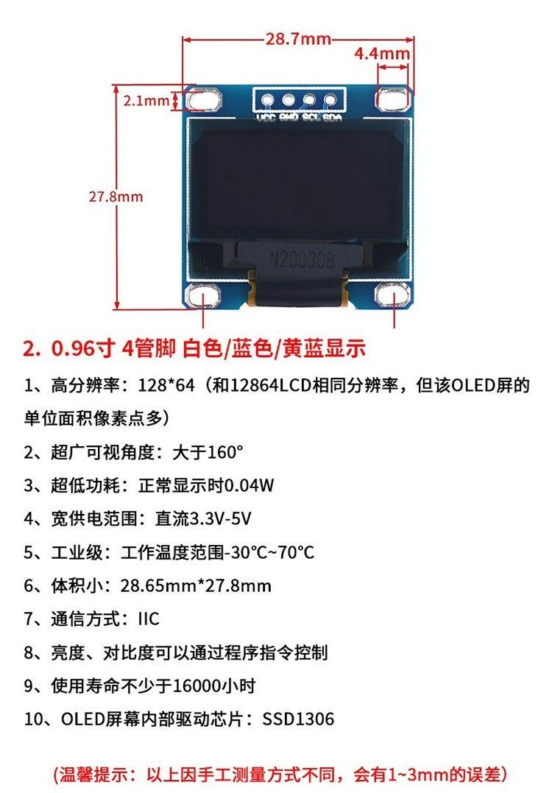

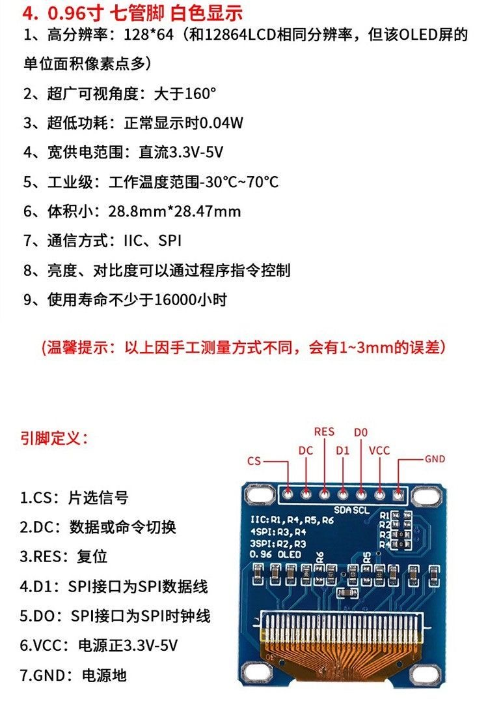

*Figure 2.1-1 OLED显示屏-四针脚图*

*Figure 2.1-2 OLED显示屏-七针脚图*

四针脚版本一般都使用I2C作为通信协议，而七针脚版本往往额外支持SPI通信协议，除此之外它们的显示像素的颜色也有差别，比如可以显示白色、黄色、蓝色等。

屏幕的分辨率都比较小，只有128* 64，这对手机等复杂的电子设备来说显然是不够的，但对于我们使用单片机则是完全够用的。

我们的工具盒中使用的OLED显示屏是：0.96寸、**四针脚**、白色像素显示、供电电源为3.3V/5V。

#### 2.2 针脚接线

我们使用的OLED显示屏，一种有四个针脚，如下图所示：

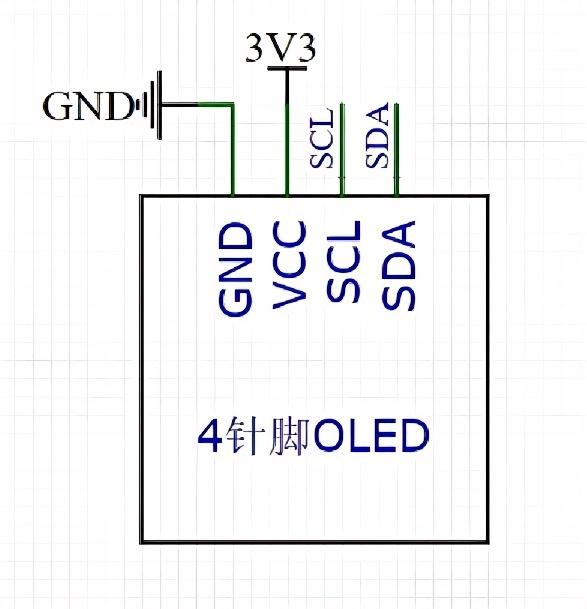

*Figure 2.2-1 OLED显示屏-四针脚硬件电路图*

其中GND和VCC针脚就分别接地、以及接上3.3V供电。而SCL和SDA两个引脚是用于和单片机进行I2C通信的两个引脚，其中：

1. **SCL**（Serial Clock Line）：**串行时钟线**，用于同步时钟信号。
2. **SDA**（Serial Data Line）：**串行数据线**，用于传输实际的数据。

它们的具体作用，待到后续课程讲解I2C通信时，我们再详谈。

一般情况下，这两个针脚就需要接入到单片机的I2C通信协议引脚上，但在我给大家的工具函数中，直接使用了GPIO口模拟了I2C协议，所以这两个针脚接到任意GPIO口都是可以的。

这句话你可能也不太看得懂，没有关系，后面我们讲完I2C通信，就很容易理解了。

**下面我们主要关注OLED屏幕的使用，它的原理我们后面都会详细讲解。**

#### 2.3 OLED屏幕显示字符数量

OLED的分辨率是128*64，即屏幕有 128 列像素和 64 行像素，表示一共有8192个像素点。

而通常使用8列像素，16行像素来表示常见的一个英文字符（比如英文字母、数字等），即一个英文字符需要128个像素点来表示。

这样的话：**整个OLED屏幕就可以显示4（64/ 16）行，16（128/8）列，总共64（8192/128）个常见英文字符。**

可以参考下面的两张图来理解OLED显示字符的格式：

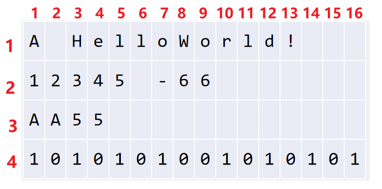

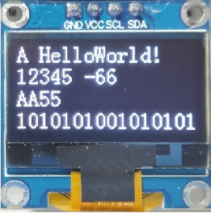

*Figure 2.3-1 OLED显示字符-图1*

*Figure 2.3-2 OLED显示字符-图2*

当然OLED还可以显示中文，甚至也可以各种简单的图案，但对我们查看和调试程序的需求而言，用不太到，这里不涉及了。

### 3. OLED显示数据实验

了解完毕OLED显示屏的常规信息，下面我们可以基于这块屏幕，做一个简单数据显示实验。

#### 3.1 实验接线图

首先需要将OLED硬件设备插入到面包板上，并且各个针脚也必须正确的接入。其接线电路图如下所示：

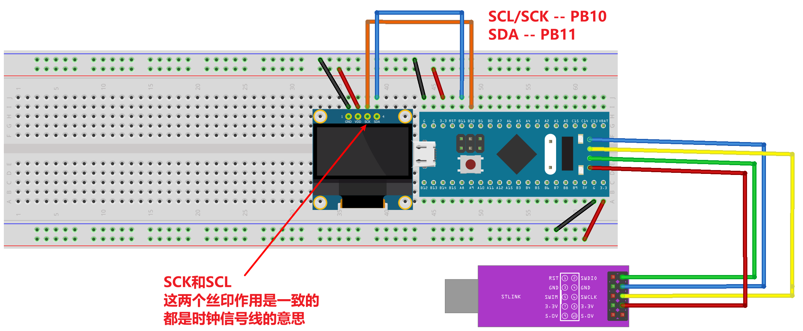

*Figure 3.1-1 OLED显示实验-接线图*

由于配件盒当中的导线没有长度恰好适配的，所以我们可以拿出**两根最短的跳线**，来连接SCL/SDA引脚和单片机。

**实物接线图大家可以参考一下（颜色无所谓，找两个最短的跳线就行）：**

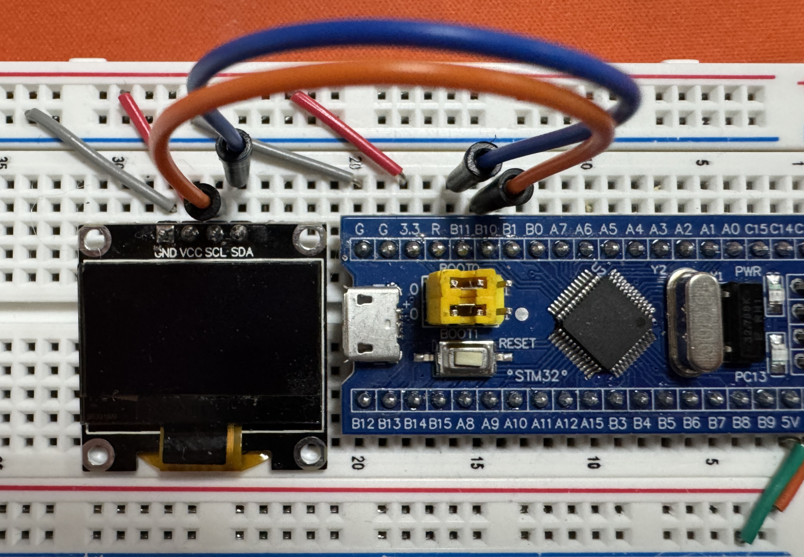

*Figure 3.1-2 OLED显示实验-接线图2*

引脚插孔不要接错了，可以把板子翻过来仔细看看。

在进行STM32实验时，引脚接错了，是常见的导致实验失败的原因，大家一定要细心一点。

**在后续的STM32基础课程中，我们就持续将OLED屏幕放在这个位置，如无特殊原因，大家可以不用动OLED显示屏相关的接线了。**

#### 3.2 使用OLED模块驱动代码

接线完成后，你可以在**"百度网盘 -- 王道嵌入式软件环境 -- 函数模块 -- OLED驱动模块"**中找到头文件和源文件。

然后新建一个工程，将其中的源文件和头文件都复制到工程的Tools目录下，并且将这些文件都添加到Keil5的"Group--Tools"中。这些操作前面都讲过了，这里就不再赘述了。

这段代码的详细原理大家都可以不了解，仅需要了解一部分代码。在文件"OLED.c"源文件的开头，有这样一段代码：

```c
 /*
    引脚配置宏，若改变了SCL和SDA接入引脚需要修改
    当前SCL针脚接入PB10引脚
    当前SDA针脚接入PB11引脚
    建议按照文档中的接线图接线, 这样就无需修改这里！
 */
 #define OLED_SCL_GPIO_PORT GPIOB
 #define OLED_SCL_GPIO_PIN GPIO_Pin_10
 #define OLED_SDA_GPIO_PORT GPIOB
 #define OLED_SDA_GPIO_PIN GPIO_Pin_11
```

这段代码通过宏定义的方式，配置了显示屏的SCL/SDA引脚和单片机的某两个引脚连接。

建议按照文档中的接线图接线，这样就无需修改这里！

**如果你确实不想使用PB10/PB11这两个引脚，就可以修改这段代码，但一般没有这个必要。**

然后你就可以直接在main.c中写以下测试代码：

```c
 #include "stm32f10x.h"
 #include "OLED.h"
 #include "Delay.h"

 int main(void) {
     // 初始化OLED
     OLED_Init();
     OLED_ShowChar(1, 1, 'X');
     OLED_ShowString(1, 3, "hello world!");
     OLED_ShowUnsignedNum(2, 1, 6666, 4);
     OLED_ShowSignedNum(2, 6, 1234, 4);
     OLED_ShowSignedNum(2, 12, -1234, 4);
     OLED_ShowHexNum(3, 1, 0xFC12, 4);
     OLED_ShowDouble(3, 8, 3.14159, 1, 5);
     OLED_ShowBinNum(4, 1, 1234, 16);

     // 延时3s后执行清屏
     Delay_S(3);

     OLED_Clear();
     while (1) {

     }
 }

```

这样你就可以看到LED显示屏，显示以下内容：

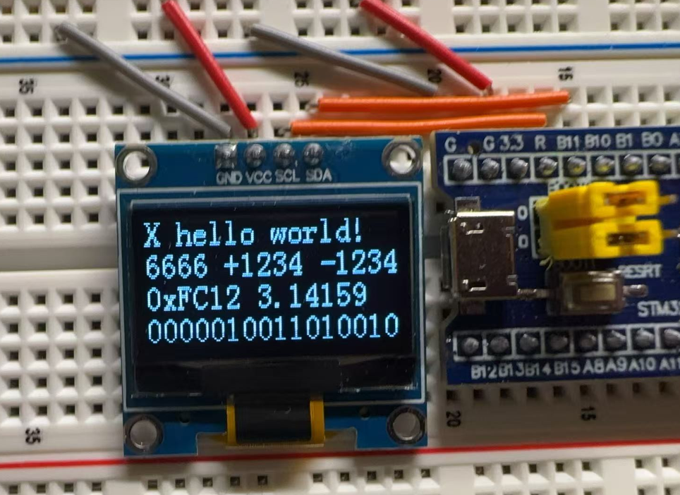

*Figure 3.2-1 OLED显示实验-显示结果图*

**在后续的课程中，我们会经常使用OLED屏幕来完成实验或者调试程序，大家可以把OLED插到这个位置后，就不需要再动了。**

#### 3.3 扩展：OLED显示中文或图案

OLED 显示屏本质上是通过**点亮或熄灭像素点**来显示内容的。

因此，无论是显示英文、中文字符，还是显示图案，甚至是显示动画，本质上都只是**像素数据的不同组织和刷新方式**。

这部分内容严格来说，不属于单片机开发、通信机制等核心技术问题，如果大家真感兴趣可以考虑去B站搜一下视频教程，然后抄作业调试即可。

**当然，如果不是时间很多，建议不要搞这些东西，可以把时间花在钻研MCU、通信原理等核心技术上。**

### 4. 如何调试程序？

程序调试对于编程而言是至关重要的，在嵌入式系统中也不例外，下面简单介绍一下调试程序的一些手段。

**当然程序调试是一个积累经验逐渐进步的过程，大家在学习过程中遇到的bug问题都可以尝试调试解决，这样就会越来越熟练。**

为了给大家演示这个调试模式，我们需要一个实验程序，就拿之前我们做过的一个光敏电阻传感器，将DO针脚接到STM32的**PB6**引脚上。

具体的接线图如下所示：

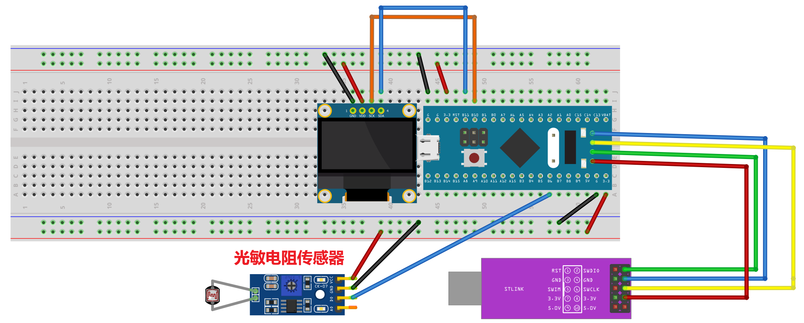

*Figure 4-1 演示调试实验-接线图*

大家只需要把之前用过的光敏电阻传感器，拿出来接上就可以了。

这个实验的程序就是当PB6引脚输入高电平光线较暗时，控制PC13引脚输出低电平，点亮LED即可，这样的话：

1. PB6引脚需要设置为上拉输入模式。
2. PC引脚需要设置为推挽输出模式/开漏输出模式。

```c
 #include "stm32f10x.h"
 #include "OLED.h"
 #include "Delay.h"

 // 初始化光敏电阻传感器的DO口GPIO引脚 PB6
 void LDRSensor_Init(void) {
     GPIO_InitTypeDef GPIO_InitStructure;

     // 开启 GPIOB 时钟
     RCC_APB2PeriphClockCmd(RCC_APB2Periph_GPIOB, ENABLE);

     // 配置 PB6 为上拉输入模式
     GPIO_InitStructure.GPIO_Pin = GPIO_Pin_6;
     GPIO_InitStructure.GPIO_Mode = GPIO_Mode_IPU; // 上拉输入模式
     GPIO_InitStructure.GPIO_Speed = GPIO_Speed_50MHz;
     GPIO_Init(GPIOB, &GPIO_InitStructure);
 }

 // 初始化PC13指示灯
 void LED_Init(void) {
     GPIO_InitTypeDef GPIO_InitStructure;

     // 开启 GPIOC 时钟
     RCC_APB2PeriphClockCmd(RCC_APB2Periph_GPIOC, ENABLE);

     // 配置 PC13 为推挽输出模式
     GPIO_InitStructure.GPIO_Pin = GPIO_Pin_13;
     GPIO_InitStructure.GPIO_Mode = GPIO_Mode_Out_PP; // 推挽输出模式
     GPIO_InitStructure.GPIO_Speed = GPIO_Speed_50MHz;
     GPIO_Init(GPIOC, &GPIO_InitStructure);

     // 设置PC13引脚默认输出高电平，指示灯熄灭
     GPIO_SetBits(GPIOC, GPIO_Pin_13);
 }

 int main(void) {
     // 调用初始化函数
     LDRSensor_Init();
     LED_Init();

     while (1) {
         // 读取 PB6 引脚的状态
         if (GPIO_ReadInputDataBit(GPIOB, GPIO_Pin_6) ==Bit_RESET){
            // 如果 PB6 输入低电平(DO引脚输入低电平)，说明光线较亮，DO指示灯此时亮起，于是熄灭PC13指示灯
            GPIO_SetBits(GPIOC, GPIO_Pin_13);
         } else {
            // 如果 PB6 输入高电平(DO引脚输入高电平)，说明光线较暗，DO指示灯此时熄灭，于是点亮PC13指示灯
            GPIO_ResetBits(GPIOC, GPIO_Pin_13);
         }
     }
 }

```

下面我们来介绍两种方式来调试这段代码。

#### 4.1 Keil5的调试模式

Keil5是一款强大的开发STM32的IDE，自然也支持Debug调试模式。**Keil5的调试模式需要调试器的支持，我们使用的调试器就是ST-LINK。**

需要进行下面的设置后，才能开启Debug模式：

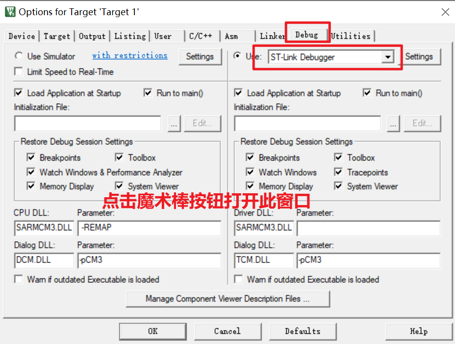

*Figure 4.1-1 Keil5设置调试器-图*

接好硬件，编写好代码后，可以点击下列两个按钮（选项）进入调试模式（皆可）：

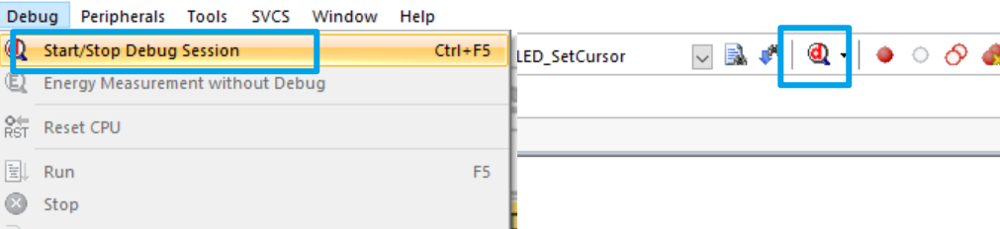

*Figure 4.1-2 Keil5的调试模式-图*

进入调试模式后，一般程序会停留在main函数头部：

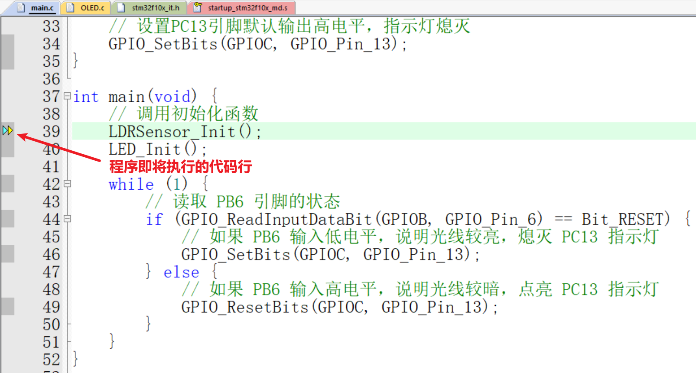

*Figure 4.1-3 Keil5的调试模式-图2*

几个比较常用的、类似VS的Debug模式中下一步的功能，如下图所示：


*Figure 4.1-4 Keil5的调试模式-图2*

从左到右，其功能分别是：

1. Reset复位执行，也就是从头开始执行单片机的程序，一般会跳到启动汇编代码文件。
2. Run全速执行，让程序全速运行，直到遇到断点或手动暂停。
3. Stop暂停执行，当点击Run让程序全速执行后，再点击Stop按钮就可以让程序暂停执行，程序就会停在当前程序运行的位置。
4. Step单步执行，若将要执行的代码是一个函数调用，则会进入此函数调用当中。
5. Step Over单步跳过，若将要执行的代码是一个函数调用，则会直接执行完此函数，不会进入函数调用。
6. Step Out单步跳出，从当前函数内部跳出，返回到调用该函数的位置。main函数当中无法执行该操作。
7. Run to Cursor运行到光标处，将程序从当前位置运行到光标所在行，并暂停（相当于临时断点）。
8. Show Next Statement，将光标跳转到将要运行的代码行，不会执行其它操作。

如果你对程序的运行过程不太熟悉，想要了解程序是如何一步一步执行的，那么使用这些功能就可以满足你的需求。

除此之外，Keil5调试模式下，比较常用的功能还有：

外设寄存器查看窗口，以查看GPIOC外设的各种寄存器状态为例：

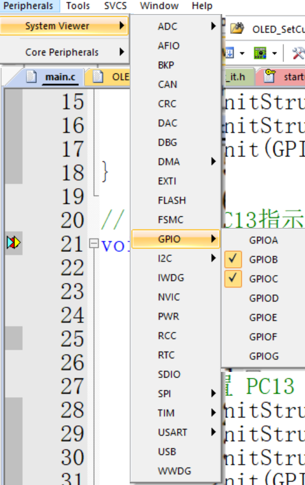

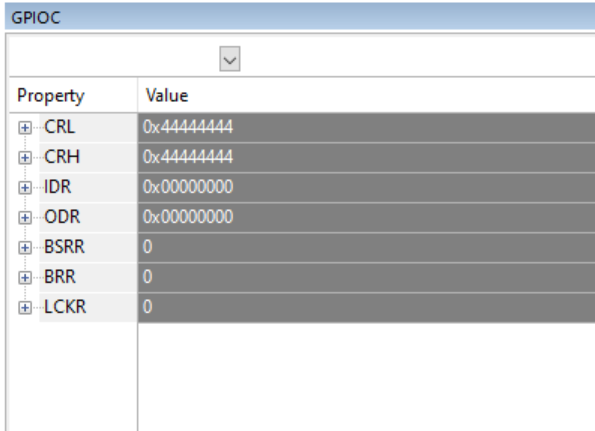

*Figure 4.1-6 外设寄存器查看窗口-图2*

*Figure 4.1-5 外设寄存器查看窗口-图*

IDR即输入数据寄存器，ODR即输出数据寄存器。

**变量数据查看窗口：**

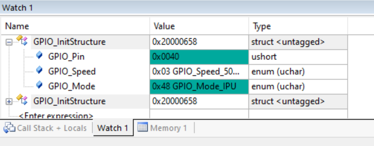

*Figure 4.1-7 变量数据查看窗口-图*

该功能类似VS调试模式下的监视窗口，可以自行输入变量名/表示式，配合程序的暂停与执行，可以查看程序中变量的变化情况。

#### 4.2 Keil5调试模式的使用细节/注意事项

关于Keil5的调试模式，几个注意事项/细节：

1. 可以先打断点再进入调试模式，也可以先进入调试模式后再打断点，两种方式没什么本质区别。
2. 如果不打断点直接进入调试模式，程序通常默认停在main函数执行的入口位置。
3. **在进入调试模式之前，应当重新编译程序，并且重新烧录程序。因为进入调试模式通常不会自动帮你做这些事情。**
4. 在进入调试模式后，如果你发现某行代码不可以打断点，通常有两种可能性：
   - a. 该行是新编辑的代码，没有重新编译烧录就直接进入调试模式。Keil5还不认识这一行代码。
   - b. Keil5认为该行代码没有执行的可能性，所以将它优化掉了。比如函数定义了，但实际没有被调用。
5. 退出调试模式之前，最好手动取消所有断点，否则有可能导致Keil5软件卡死。**尤其是路径名存在中文时！**

最后Keil5软件的调试模式是存在Bug的（尤其是路径名存在中文时）：

如果你在调试过程中打了断点，然后直接退出调式模式且没有手动取消断点，那么就会导致keil5软件卡死。

此时就只能使用任务管理器强行关闭Keil5软件了。

**所以在退出Keil5的调试模式之前，一定要手动取消掉所有的断点！！**

当然一个一个的手动点掉断点还是太笨了，调试模式下使用下图中的按钮可以直接一键去掉所有断点：

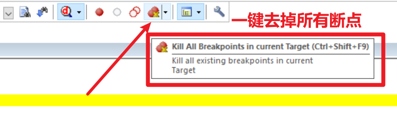

*Figure 4.2-1 一键去掉断点-按钮图*

切记退出调试模式之前，一定要去掉所有断点。

#### 4.3 使用OLED直接打印调试数据

通过OLED显示屏，我们可以直接打印出程序运行过程中的一些状态信息。

比如针对当前这个调试程序，我们可以增添一些代码，在OLED显示屏上输出引脚电平状态、LED亮灭状态等。

我给定的输出信息是：

1. 光照强度：暗或者亮
2. 光敏电阻传感器DO引脚输出高低电平，即PB6引脚的输入高低电平
3. PC13引脚输出，可以输出高阻态（断路）和低电平两种
4. PC13指示灯的亮灭。

参考代码如下所示：

```c
 #include "stm32f10x.h"
 #include "OLED.h"

 // 初始化光敏电阻传感器的DO口GPIO引脚 PB6
 void LDRSensor_Init(void) {
     // 开启 GPIOB 时钟
     RCC_APB2PeriphClockCmd(RCC_APB2Periph_GPIOB, ENABLE);

     // 配置 PB6 为上拉输入模式
     GPIO_InitTypeDef GPIO_InitStructure;
     GPIO_InitStructure.GPIO_Pin = GPIO_Pin_6;
     GPIO_InitStructure.GPIO_Mode = GPIO_Mode_IPU; // 上拉输入模式
     GPIO_InitStructure.GPIO_Speed = GPIO_Speed_50MHz;
     GPIO_Init(GPIOB, &GPIO_InitStructure);
 }

 // 初始化PC13指示灯
 void LED_Init(void) {
     GPIO_InitTypeDef GPIO_InitStructure;

     // 开启 GPIOC 时钟
     RCC_APB2PeriphClockCmd(RCC_APB2Periph_GPIOC, ENABLE);

     // 配置 PC13 为开漏输出模式
     GPIO_InitStructure.GPIO_Pin = GPIO_Pin_13;
     GPIO_InitStructure.GPIO_Mode = GPIO_Mode_Out_OD; // 开漏输出模式
     GPIO_InitStructure.GPIO_Speed = GPIO_Speed_50MHz;
     GPIO_Init(GPIOC, &GPIO_InitStructure);

     // 设置PC13引脚默认输出高阻态，PC13指示灯熄灭
     GPIO_SetBits(GPIOC, GPIO_Pin_13);
 }

 void OLED_UpdateDisplay(uint8_t Pb6State, uint8_t Pc13State) {
     // 先清屏
     OLED_Clear();
     // 第一行：光线状态
     OLED_ShowString(1, 1, "Light:");
     OLED_ShowString(1, 8, Pb6State ? "Dark" : "Bright");

     // 第二行：PB6引脚输入状态
     OLED_ShowString(2, 1, "DO Out:");
     OLED_ShowString(2, 9, Pb6State ? "High" : "Low");

     // 第三行：PC13引脚输出状态
     OLED_ShowString(3, 1, "PC13 Out:");
     OLED_ShowString(3, 11, Pc13State ? "Open" : "Low");

     // 第四行：PC13指示灯状态
     OLED_ShowString(4, 1, "PC13 LED:");
     OLED_ShowString(4, 11, Pc13State ? "Off" : "On");
 }

 int main(void) {
     // 初始化所有外设
     LDRSensor_Init();
     LED_Init();
     OLED_Init();

     uint8_t LastPb6State = 0xFF; // 初始化为一个无效值

     while (1) {
         // 获取当前PB6引脚的输入电平以及PC13的输出电平
         uint8_t CurrentPb6State = GPIO_ReadInputDataBit(GPIOB,GPIO_Pin_6);

         // 仅在状态变化时更新显示内容
         if (CurrentPb6State != LastPb6State) {
            // 控制LED
            if (CurrentPb6State == Bit_SET) {
                GPIO_ResetBits(GPIOC, GPIO_Pin_13); // 点亮LED
            } else {
                GPIO_SetBits(GPIOC, GPIO_Pin_13); // 熄灭LED
            }

            // 更新显示内容
            OLED_UpdateDisplay(CurrentPb6State,GPIO_ReadOutputDataBit(GPIOC,GPIO_Pin_13));

            // 更新当前pb6引脚的状态
            LastPb6State = CurrentPb6State;
         }
     }
 }

```

当然，你可以根据自己的想法打印任何数据到显示屏上，你可以自行测试一下。

当然，理清逻辑很重要，不要把自己绕进去了。

## 02 串口通信相关概念

### 1. 通信的概念

从本章节开始，我们将正式学习**单片机与外部硬件之间的通信方式**。在此之前，先来了解一些通信相关的基础概念。

**通信**，是指两个或多个设备之间，通过某种传输媒介（如导线、光纤或无线电波等），进行信息交换的过程。

通信的核心目的在于：

将数据从发送方传递到接收方，并确保接收方能够正确接收和理解这些数据。

**通信的基本要素有：**

1. **发送方（Transmitter）**：产生并发送数据的设备。
2. **接收方（Receiver）**：接收并处理数据的设备。
3. **传输媒介（Medium）**：数据传递的通道，如电线、光纤、空气（无线通信）。
4. **数据（Data）**：需要传递的信息，可以是文本、数字、图像、音频等。
5. **通信协议（Protocol）**：通信双方约定的规则，用于确保数据能够被正确传输和解析。通信协议定义了数据的格式、传输顺序、速率、错误检测与纠正方法等内容。

可以看到，在通信的各个要素中，**通信协议是核心**。

只需要通信双方遵循同一套通信协议，并配合合适的硬件以及传输介质，就可以实现设备间数据通信了。

**从工程实践的角度来看，单片机开发的很大一部分工作，都体现在通信的实现与调试上。**

**你掌握的通信协议越多，单片机就能连接和使用更多的外部硬件，整个单片机系统的功能也就越强大。**

**因此，学习和掌握各种通信协议，是单片机开发中一项非常重要、也是绕不开的核心内容。**

当然，不同的单片机能够支持的通信协议是不同的，我们使用的C8T6单片机支持哪些通信协议呢？

### 2. STM32F103C8T6支持的通信协议

STM32F103C8T6中集成了很多用于通信的外设模块，如下所示：

| 通信协议名/单片机外设名 | 引脚 | 双工 | 设备 | 应用场景 |
|---|---|---|---|---|
| USART | TX、RX | 全双工 | 点对点 | 单片机与 PC 通信、GPS 模块、WIFI/蓝牙模块 |
| I2C | SCL、SDA | 半双工 | 多设备 | 传感器、显示屏 |
| SPI | SCLK、MOSI、MISO、CS | 全双工 | 多设备 | Flash 存储器、显示屏、高速 ADC/DAC |
| CAN | CAN_H、CAN_L | 半双工 | 多设备 | 汽车电子、工业控制、机器人 |
| USB | DP、DM | 半双工 | 点对点 | PC 外设、存储设备、手机通信 |

**表格第一列的名字既是一种通信协议的名称，也是单片机的一个外设模块名称。如USART既是单片机一个外设模块名，也是一种通信协议名。**

表格第二列的引脚名，指的是单片机进行该通信时的需要使用的引脚名，具体的内容在讲解对应通信协议时再详谈。

表格第三列有一个“双工”的概念，下面解释一下双工这个概念：

1. **单工通信**：数据只能单向传输（类似广播，发送端只能发送，接收端只能接收）。
2. **半双工通信**：数据可以双向传输，但不能同时进行（类似对讲机，双方轮流充当发送端和接收端）。
3. **全双工通信**：数据可以同时双向传输（类似电话，双方可以同时充当发送端和接收端）。

**在当前章节中，我们先学习第一种最简单、最基本其实也是最常用的通信协议——USART串口通信协议。**

**同时我们也会完成第一个基本的通信实验——PC与单片机的双向数据通信。**

通过该实验，帮助大家建立对通信的直观认识，为后续学习 I2C、SPI等通信打下基础。

### 3. 串口相关概念

为了避免**“迷迷糊糊就把概念学完了，代码写完了，然后迷迷糊糊的就实现功能了”**这种情况的出现，我们还是要讲解一些基本的概念。

理解概念，可以使得基础更加牢固，后续学习提升、与人沟通交流、面试才能够更加得心应手，也能学得更明白。

所以概念虽然很枯燥无趣，看起来也不怎么影响写代码，但仍然需要给予足够的重视。

**后续每学习一种新的通信，总是从学习概念开始，刚开始这些概念可以大体看一下，不用求甚解。**

**但一定要在学完这种通信后，再回顾复习一下这些概念，大概率都会“温故而知新”。**

#### 3.1 串行通信

在学习具体通信协议之前，我们首先需要了解**串行通信**的基本概念。

**所谓串行通信指的是，将数据一位一位（一个bit一个bit）地按照顺序在一条传输线上进行传输，同一时刻只能传输1个bit位。**

数据在存储和处理时通常以1个字节（8位）为最小基本单位，一次性存储处理1个字节的数据，这种形式被称之为**"并行存储"**。

而串行通信时，数据是串行发送的。

所以在串行通信的过程中：

1. 发送端会将原本以并行形式存在的二进制数据，按照通信协议规定的顺序逐位发送出去。这个过程称之为“并转串”。
2. 接收端接收到逐位传输的串行数据后，再依照通信协议，将其重新组合为适合计算机内部处理的并行数据。这个过程称之为“串转并”。

理解了串行通信的数据传输方式后，就可以总结出它的一些优势：

1. 硬件实现简单，成本相对低廉：只需要简单的接收线和发送线，以及一些控制信号线就可以实现串行通信。
2. 抗干扰性强，可靠性强：由于数据是逐位传输的，即便传输过程中出现了干扰，这些干扰也往往会集中在某一位上，比较容易检测和纠正错误，提高了数据传输的可靠性。

但缺点也很明显，数据需要一位一位地传输，比起直接的并行通信传输数据，传输速度相对较慢。

**总得来说，串行通信方式虽然通信速率相对较慢，但简单可靠、成本低廉，是嵌入式系统中最常用的通信方式。**

**STM32F10x系列单片机，支持的五种通信协议：USART、I2C、SPI、CAN、USB都是基于串行通信的通信协议。**

#### 3.2 串行通信实现数据传输的方式

在串行通信过程中，数据总是以**1 个比特位（bit）为单位**，依次进行发送和接收。

那么，具体到嵌入式系统中，这**1 个 bit 的数据究竟是如何被传输的呢？**

换句话说，通信过程中是**如何区分当前发送的数据是 1，还是 0**的？

结合前面关于数字电路和 GPIO 的相关知识，相信大家已经能够得出答案。

从单片机的角度来看，串行通信中的每一个 bit，本质上就是通过引脚的电平状态来表示的：

1. **引脚输出高电平，表示发送一个 bit 数据 1**
2. **引脚输出低电平，表示发送一个 bit 数据 0**

因此串行通信的本质过程，站在单片机的视角就是：

1. 单片机引脚在高电平和低电平之间不断切换，就能够将数据发送出去。实际上就是引脚的输出模式。
2. 单片机检测引脚输入的电平状态，来判断当前接收到的 bit 是 1 还是 0。实际上就是引脚的输入模式。

当然，与单片机通信的另一个设备也是类似，只是作为单片机开发，我们通常不考虑它的实现。

#### 3.3 同步和异步串行通信

上面提到了USART、I2C、SPI、CAN、USB都是基于串行通信的通信方式，它们又可以进一步分为两类：

1. 异步串行通信
2. 同步串行通信

下面简单了解一下这两类不同的串行通信方式，只做基本了解即可，具体的细节还需要学到这些通信协议后再详谈。

##### 3.3.1 时序的概念(重要)

对于通信而言，**时序**是一个非常重要的概念。

在我们学习各种通信协议的文档、技术文章和教学视频中，时序几乎无处不在，在日常的技术交流中也经常被提及。

因此，在正式学习具体通信协议之前，有必要先对**时序这一概念**进行说明。

**所谓时序，指的是：随着时间的推进，某一个时刻下或者某一段时间内，通信系统中应当会发生哪些行为。**

说人话就是，时序由通信双方约定好，在什么时间就做什么事情。

例如，在某一次通信过程中，随着时间推进，双方按照约定可能发生下面事情：

1. 在这一个时刻，通信开始了。
2. 在这一时刻，发送端发送了1位（bit）数据。
3. ...
4. 在某一个时刻，通信结束了。

**如果将上述随时间推进而发生的一系列事件，用图形的方式直观地表示出来，这种图就称为时序图。**

在学习通信协议的过程中，**分析和理解时序图是非常重要的能力**。看懂时序图是学习某种通信的基本要求。

##### 3.3.2 数据帧的概念

**数据帧，就是通信协议中规定的“一次完整数据传输的基本单位”。**

或者换一种说法：

**数据帧，就是在一串连续的 bit 流中，用来明确标记 “从哪里开始、到哪里结束”的一段结构化数据。**

说人话就是：

**在串行通信中，数据的收发肯定不可能以单个 bit 为单位进行，而是以数据帧为基本单位进行的。**

1. 发送端一次最少发1个数据帧，称之为发送了“1帧数据”。
2. 同时接收端一次最少也会接收"1帧数据"。

一个数据帧通常由**多个 bit 位组成**，而不同的通信协议，其数据帧的具体格式和组成方式也会有所不同。

##### 3.3.3 异步串行通信

异步串行通信的基本特点如下：

1. **异步串行通信的最大特点是，通信双方不需要共享同一个时钟信号，没有时钟信号这个统一的“指挥中心”。**
   - a. 时钟信号可以简单理解成"工作节奏信号"，共享时钟信号就意味着工作的节奏一致，这就是同步，否则就是异步。
   - b. 说人话就是，异步串行通信的过程中没有指挥中心，双方可以不同时收发数据，允许一定程度的延时通信。
   - c. 既然不需要统一时钟信号，异步串行通信在硬件接线时，不需要额外的时钟信号线来统一时钟信号。
2. **虽然通信双方不共享时钟，但必须事先约定相同的波特率。**
   - a. 关于波特率是什么，为什么要统一波特率，在后面的小节会专门讲解。
   - b. 如果把通信看成写信给对方，那么约定好波特率就相当于约定好语言以及文字大小，这样对方才能看懂这封信。
   - c. 波特率的统一，是异步串行通信的双方可以正确解析数据，成功实现通信的关键。
3. **在异步串行通信中，通信双方还需要约定一套关于数据格式的规则，也就是需要统一数据帧格式。**
   - a. 由于通信双方不共享时钟信号，接收端无法依赖时钟来判断数据边界。
   - b. 所以双方会约定好数据帧的开始和结束标志，接收端可以依靠这些标志判断通信的开始和结束。
   - c. 数据帧格式的其它方面也需要提前约定好，这些约定通信双方必须遵守，否则通信就会失败。
4. **正是由于统一了波特率，约定了数据帧格式，在异步串行通信中，接收端即便不立刻同步处理接收数据，数据通常也不会立刻丢失。**
   - a. 如果接收端无法立刻处理数据，这些数据通常会暂时缓存在接收端的内部寄存器当中。
   - b. 当然如果发送端持续高速发送，而接收端处理过慢或者干脆不处理，数据仍然会丢失。
5. **异步串行通信的时序没有时钟信号统一控制，需要基于双方的约定，由双方各自控制时序。**
   - a. 异步串行通信，其通信过程没有统一时钟信号约束，仅由一系列规则约定，那么时序的控制就由双方各自控制。
   - b. 当然自行控制时序不是乱来，异步串行通信的时序由双方约定的规则控制。
   - c. 好比我们约定好9点碰面，那我来了，你也要来了，双方做什么事情还是有统一约定的。

如果想要用一句话来总结异步串行通信，可以用这样的一句话：

**异步串行通信的本质，是在不共享时钟信号的情况下，通过约定通信规则来完成数据传输，其通信时序由通信双方各自独立控制。**

下面举一个生活中写信交流的场景，来类比一下异步串行通信。

**写信时：异步串行通信：**

1. 不需要一边写另一边马上读，写信1双方不共享时钟信号，不需要同时和读信不需要完全同时进行。“在线”通信。
2. 需要统一语言，且字不能写太大也2统一波特率，否则通信双方无法正不能太小，否则影响辨认。确解析数据。
3. 约定好信的开头和结尾等格式，双3约定好起始和终止条件，双方都知方都能够识别信件内容。道通信的开始和结束。
4. 写信和读写可以不同时，但长时间4通信允许不同时进行，允许延时通不读信，信件容易丢失。信。但接收端长时间不接收数据，可能发生数据丢失。
5. 按照约定规则，双方完成写信或读写。但写信读信都是各自独立完成5时序是双方独立、各自控制的。

的，不会受某种因素统一控制。

##### 3.3.4 同步串行通信

同步串行通信的基本特点如下：

1. **同步串行通信的最大特点是，通信双方必须共享同一个时钟信号，通信要求双方同时在线、实时配合。**
   - a. 时钟信号可以理解为“工作的节奏信号”，在同步串行通信中，发送端和接收端**完全按照同一个节奏工作**。
   - b. 由于共享时钟信号，通信双方在发送和接收数据时，**通常是严格同时同步进行的**，在时间上是完全对齐的。
   - c. 在硬件连接上，同步串行通信**通常需要额外的时钟信号线**，用于在通信过程中统一时钟信号。
   - d. 说人话就是，通信双方就像一起跳双人舞，双方都跟着时钟信号这个“音乐节拍”，这样大家都不会跳错。
2. **同步串行通信的时序依靠时钟信号统一控制，而不是各自独立控制。**
   - a. 异步串行通信的时序由双方约定各种规则后，由双方各自独立控制自身时序。
   - b. 但同步串行通信的时序则由共享的时钟信号统一控制。
   - c. 举一个例子，异步串行通信就像双方约会，约定好 9 点集合，于是双方各自按照约定各自行动，在 9 点的时候碰面。
   - d. 而同步串行通信则更像双方上班，公司规定 9 点上班，此时双方的行为就由"公司规定"来进行约束控制了。
   - e. **这就是时序控制权是由通信双方在约定规则后各自独立控制，还是由共享的时钟信号进行统一约束和控制的区别。**
3. **在同步串行通信中，通信的各个重要节点，双方行为都由时钟信号规定。**
   - a. 在同步串行通信中，时钟信号约束和指导双方通信的过程，双方需要在约定好的时钟信号下，各自完成通信动作。
   - b. **就像大家一起喊"121...121..."的干活，1的时候做一个动作，2的时候做一个动作，然后重复，这就是统一时钟信号的作用。**

如果想要用一句话来总结同步串行通信，可以用这样的一句话：

**同步串行通信的本质，是用共享的时钟信号，对通信双方的每一个时间行为进行严格约束，时序严格固定。**

同步串行通信，可以想象成你和朋友一起跳一段双人舞：

**跳双人舞时的特点：同步串行通信的特点：**

1. 双方必须同时在场，总不能一个人1通信双方必须同时在线，实时配跳双人舞。合。
2. **双方必须跟着同一个音乐节拍跳。**2由统一的时钟信号约束通信行为。
3. 每一个动作都有明确的时间点，由3通信行为有明确的时间点，由时钟音乐节拍规定。双方都不能自由发信号约束，时序由时钟信号统一控挥。制。双方的时序都不是各自独立控制的。
4. 双方必须配合节拍，一方的不配合或失误，都会导致整体失败。4通信双方都必须严格配合时钟信号，完成通信。

##### 3.3.5 具体通信分类

STM32F103C8T6支持的通信中：

1. USART串口通信、CAN总线通信都是异步串行通信。
2. I2C、SPI则属于同步串行通信。
3. USB则比较复杂，它不能简单归类成异步或同步，这里不讨论。

**后续，我们会学习其中最常用的三种通信方式——USART、I2C以及SPI。**

### 4. 串行通信接口和串口

要想实现串行通信，除了相关协议外，肯定还需要相应的硬件支持，串行通信接口就是这种硬件接口。

**串行通信接口：**

1. 是指用于实现串行通信功能的硬件接口。
2. 包括物理连接引脚及其配套电路，是串行通信得以实现的物理基础。
3. 串行通信接口负责在设备之间传输和接收串行数据。
4. 对于嵌入式开发而言，常见的串行通信接口有 UART 接口、SPI 接口、I2C 接口、USB接口、CAN接口等。

**我们本卷学习的内容，大标题叫做“串口通信”，那么串口就是串行通信接口的缩写简称吗？**

**答：并不是，串口不是串行通信接口的缩写！！**

**串口：**

串口专指UART通信协议的串行通信接口，也就是UART接口。

**所以串行通信接口有很多，但串口却专指UART通信协议的串行通信接口。**

### 5. UART和USART

上一节我们提到，通常所说的“串口”，专指基于 UART 通信协议的串行通信接口，也就是UART接口。

但在 STM32 的片内外设中，我们会看到一个名为**USART**的外设模块，那么 UART 和USART 之间是什么关系呢？

首先来看一下它们的英文和中文译名：

UART（Universal Asynchronous Receiver/Transmitter）：通用异步接收器/发送器。

USART（Universal Synchronous/Asynchronous Receiver/Transmitter）：通用同步/异步接收/发送器说人话就是：

**USART 是在 UART 异步通信能力的基础上，额外支持同步通信模式的一种外设/通信协议。**

**但是：**

在实际工程应用中，同步串行通信更多会使用SPI或者I2C等，USART的同步通信模式基本不会使用。

在大多数嵌入式开发场景下，USART 更多是以异步方式工作，即作为 UART 接口使用。

即大多数实际应用中：USART ≈ UART。

于是，我们这里对相关名词的使用做一个约定：

**如果不特别说明，在后续的学习乃至于工作中，串口通信 = UART通信 = USART通信。**

## 03 串口通信协议

### 1. 概述

对于任何通信方式而言，**通信协议的学习都是核心内容，没有之一**。

因为无论使用的是哪一种通信接口，本质上都是在按照既定的通信协议，对数据进行收发和解析。

串口通信的通信协议相对比较简单，同时又几乎是最常用的通信方式，所以我们先来学习一下串口通信，作为通信学习的入门。

我们将从以下三个角度来分析串口通信协议：

1. 串口通信的硬件接线方式。
2. 串口通信的数据帧格式。
3. **波特率问题。**

最后本章节的末尾，我们还需要学习一下单片机USART外设的基本工作原理，再分析一下单片机引脚的使用及PC端接线。

通过以上内容的学习，我们就可以在下一章节中，实现**单片机与 PC 端之间的双向串口通信**。

### 2. 串口通信的硬件接线方式

串口通信的硬件接线方式非常简单，具有以下特点：

1. **常用异步串口通信中，通信只需要两条信号线就可以了。**
2. **点对点通信**：UART 通常用于两个设备之间的通信，一个设备作为发送方（Tx），另一个设备作为接收方（Rx）。
3. **Tx和Rx交叉相连**：需将一方的**Tx 引脚连接到另一方的 Rx 引脚**，再将另一方的 Tx 引脚连接回本方的 Rx 引脚。

**尤其要注意接线方式是交叉相连，而不是对应相连，这是新手在接线时非常容易犯的错误！**

假如我们要实现PC与单片机之间的串口通信，就需要把PC和单片机的Tx和Rx引脚交叉连接起来。如下图所示：


*Figure 2-1 串口通信的硬件接线-图*

从这种硬件接线方式就可以看出，**串口通信是一种全双工通信方式**，通信双方可以在同一时刻同时发送和接收数据，而互不影响。

完成上图中的接线后，单片机如果想要向PC端发送数据，则可以控制Tx引脚：

1. 输出高电平，表示发送一个bit数据1
2. 输出低电平，表示发送一个bit数据0

如果单片机想要接收PC端发送的数据，则可以控制Rx引脚：

1. 读取输入的高电平，就表示接收一个bit数据1
2. 读取输入的低电平，就表示接收一个bit数据0

需要注意的是，在串口通信的接线中，**通信双方还必须将 GND 引脚连接在一起**。**也就是通信双方需要同时接地。**

这是由于串口通信中使用高低电平来表示传输1/0，设备双方同时接地，可以保证具有统一的**参考低电平**。

而且同时接地，还可以减少外部干扰以及保障电路安全。

### 3. 串口通信数据帧格式（重点）

UART通信采用的通信方式是**串行通信**，即数据按**位**（bit）顺序一位一位的传输。

而不管是发送端还是接收端，一次性处理数据的基本单位都是数据帧，所以我们首先就需要了解串口通信的数据帧格式。

一个经典的UART数据帧格式如下图所示：


*Figure 3-1 串口数据帧格式-图*

下面基于这张图，我们来逐一讲解一下串口通信数据帧的组成。

#### 3.1 通信空闲状态

即便物理层面的接线已经完成，也并不意味着通信会立刻开始。

在真正发送数据之前，通信总是会处于一种**尚未开始传输数据的状态**，这称为**通信的空闲状态**。

对于任何一种通信方式而言，其通信协议中都会明确规定：

**在什么样的条件下，通信应当被认为是处于空闲状态**。

那么，在串口通信中，空闲状态是如何表示的呢？

在串口通信协议中，明确规定：

**当通信导线上保持为高电平时，表示串口通信处于空闲状态。**

以**单片机与 PC 之间的串口通信**为例：

1. 单片机的**Tx引脚持续输出高电平**，即表示通信还未开始，单片机当前没有向 PC 发送数据。
2. 当单片机的**Rx 引脚持续检测到输入高电平**时，表示通信尚未开始，PC 当前没有向单片机发送数据。

**也就是说，在串口通信中，通信双方在没有数据传输时，通信线路始终保持在高电平状态，以此作为通信空闲状态的标志。**

#### 3.2 起始位

既然在串口通信中，**通信线路上持续保持高电平表示通信处于空闲状态**，意味着通信尚未开始。

那么做什么能够表示通信开始了呢？

**发送端又是通过什么方式，来告诉接收端“通信要开始了，可以准备接收数据了”呢？**

答案是：

在串口通信中，发送端会通过 Tx 引脚发送**1位**低电平，用这**1位**低电平来明确表示：一帧数据的传输即将开始。

这**1位**低电平就是通信开始的标志，这就是起始位。

接收端检测到这个起始位，就知道通信已经开始了。

当然起始位不属于要接收的数据，发送端在起始位后面紧跟着发送的一连串数据，称之为“数据位”，才是真正发送的数据。

#### 3.3 数据位

很显然，在串口通信中，**数据位不可能只有 1 位**，实际传输的数据长度也远不止一个bit。

根据串口通信协议的规定，**数据位的长度可以配置为 8 位或 9 位**。

同时，为了提高数据传输的可靠性，还可以将数据位的最后1位设置为校验位（称之为带校验位），用于简单的数据错误检测。

于是串口通信的数据位配置，就有4种可能的选择：

1. 8位，不带校验位。
2. 8位，带校验位。
3. 9位，不带校验位。
4. 9位，带校验位。

如下图所示：

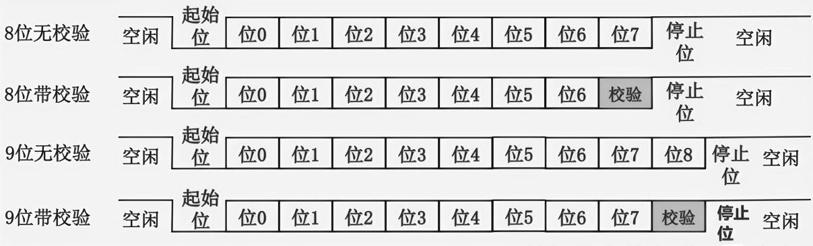

*Figure 3.3-1 串口数据帧格式-图2*

需要注意的是：

1. 选择2和选择3会导致1个数据帧发送的数据不再是完整的字节，在程序中处理起来不符合程序员的直觉，比较少用。
2. 选择4，可以发送1个字节数据，而且带1位校验位。但串口通信本身已经具有较高的稳定性可靠性，为了简化通信，通常不会带数据位。

**所以，综合实际情况，选择1，8位数据位长度且不带校验位，是串口通信最常见的数据位选择。**

#### 3.4 停止位

既然有起始位，那就有停止位，它代表着一帧数据的结束，表示接收端已经接收到1帧完整数据。

根据串口通信的协议规定：

1. 在数据位之后，发送端紧跟着发送**1位**高电平，用这**1位**高电平来明确表示：一帧数据的传输已经完成了。
2. 同时，这**1位**高电平还会使通信线路重新回到**高电平的空闲状态**，这与空闲状态的设计也是自洽的。
3. 当停止位发送完成后，**一帧串口数据就完整发送结束了**。
4. 停止位的长度可选择0.5位、1位、1.5位以及2位，其中1位停止位是最常见的选择。

由此可以看出：

1. 串口通信的**数据帧长度是固定且较短的**
2. 配置数据位是8位不带校验位的情况下，每一帧数据只能携带 1 个字节（8 bit）有效数据
3. 如果需要发送多字节的数据内容，就必须**连续发送多个数据帧**来完成。

**串口通信，无法在一个数据帧中同时发送多个字节的数据。**

关于停止位，还有一个很有趣的问题，值得思考一番：

起始位是持续高电平后的**1位**低电平，所以很容易被接收端识别，那么终止位是如何识别的呢？

关键原因在于：**串口通信中的数据帧格式是事先严格约定好的，而且是固定的。**

例如，在采用**8 位数据、不带校验位**的配置时：

1. 接收端在接收到起始位、约定好的数据位后
2. 紧接着的1位就必须是高电平，也就是停止位

如果数据位后紧接着的不是高电平，也就不是停止位，那就说明这1帧数据在发送过程中出现了问题，必然是出错了。

所以，停止位的识别并不依赖电平的转换，而是依赖于数据帧格式的严格规定，依赖其约束力。

#### 3.5 比特序（重要）

到此为止，我们已经完整地讲解了**串口通信的数据帧格式**。

但串口通信中，还有一个非常重要的问题需要进一步解决：

串口通信是一种串行通信，数据并不是一次性整体发送的，而是**1 个 bit、1 个 bit**依次发送的。

**那么，当我们通过串口发送数据时，待发送的多个 bit 数据，究竟应该按照什么顺序发送呢？**

举一个例子：

对于整数88，以1个字节存储它时，存储它的补码形式：0101 1000现在通过串口将整数88发送出去，那么在发送的1个数据帧中，其8位数据位，应该按照什么样的顺序发送呢？

从左往右？还是从右往左？

为了规范的回答这个问题，我们先提出一个概念——比特序。

**比特序，用于在串行通信中，描述一个数据单元内部，bit位逐位发送的顺序。**

比特序有两种最常见的形式：

1. LSB First，即Least Significant Bit First，最低有效位优先。此时数据会从**一个数据单元内部**的最低有效位，发送到最高有效位结束。
2. MSB First，即Most Significant Bit First，最高有效位优先。此时数据会从**一个数据单元内部**的最高有效位，发送到最低有效位结束。

##### 3.5.1 串口通信的比特序

在串口通信协议中，明确规定：

1. **串口通信的比特序采用LSB First，即数据位从最低有效位发送到最高有效位。**
2. **比特序在串口通信中，仅作用于数据位，数据帧其余部分皆已固定，和比特序无关。**

仍然回到发送整数88这个例子：

发送端在发送整数88时，数据位的发送顺序是：

0 -> 0 -> 0 -> 1 -> 1 -> 0 -> 1 -> 0每次讲到这里时，总有同学会问：

为什么串口通信会选择LSB First的比特序呢？

排除“别人设计时就是这么搞得，要你管，不服你自己设计通信协议”，这种抬杠式的回答。

串口通信的比特序设计是有原因的：

1. 兼容老旧设备，早期串行通信LSB First是主流设计。
2. LSB First在硬件层面上比较易于实现。详情可以参考下面的小节《USART外设数据帧处理的工作原理》

##### 3.5.2 串口多字节数据发送

要理解串口多字节数据发送，我们需要理解**“数据单元”**这个概念：

1. 假如要发送的数据是88，那么88就是一个数据单元，数据单元的长度是1个字节。
2. 假如要发送的数据是字符串”abc“，那么该字符串整体就是一个数据单元，数据单元的长度是3个字节。

那么字符串”abc“这种多字节数据，应该怎么发送出去呢？

在通信传输数据时，发送"abc"肯定是：

1. 先发a这1个字节
2. 再发b这1个字节
3. 最后发c这1个字节

这样才能保证接收端也是先接收a再接到b，最后收到c，如此就能收到一个字符串"abc"。

字符串"abc"转换成二进制表示，即转换成各个字符的编码值表示，各个字符的编码值是：

1. 'a'：十进制97，0x61，即二进制0110 0001
2. 'b'：十进制98，0x62，即二进制0110 0010
3. 'c'：十进制99，0x63，即二进制0110 0011

最后结合串口通信数据帧一次只能发送1个字节数据，以及串口比特序的概念，我们可以得出以下数据发送顺序：

1. 第一个数据帧的数据位：1000 0110（发送字符a）
2. 第二个数据帧的数据位：0100 0110（发送字符b）
3. 第三个数据帧的数据位：1100 0110（发送字符c）

由此可见，串口在发送多字节数据时：

1. **数据帧彼此是独立的，先发的数据帧对方先收到，数据帧的发送顺序由实际数据的字节顺序决定。**
2. **每一个数据帧内部的数据位，都依照“LSB First”的比特序逐位发送。**

下面，我们可以把上面讲的整数88，以及字符串“abc”发送的时序图画出来，参考下面的小节。

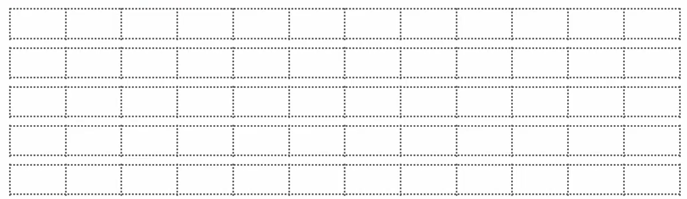

*Figure 3.5.2-1 数据帧画板-空白图*


#### 3.6 数字88发送的时序图

数字88转换成二进制补码形式，数据是：0101 1000**在 8 位数据位、无校验、串口通信发送 1 个字节数据 88 时的时序图，如下所示：**


*Figure 3.6-1 数字88的数据帧-图*


#### 3.7 字符串"abc"发送的时序图

字符串"abc"转换成二进制表示，即转换成各个字符的编码值表示，各个字符的编码值是：

1. 'a'：十进制97，0x61，即二进制0110 0001
2. 'b'：十进制98，0x62，即二进制0110 0010
3. 'c'：十进制99，0x63，即二进制0110 0011

字符串"abc"整体是一个待发送的数据单元，有3个字节，但每个数据帧只能发送1个字节。

所以abc三个字符作为三个数据帧依次发送，但各个数据帧内部的数据位按照“LSB First”

从最低位发送到最高位。

**在 8 位数据位、无校验、串口通信发送 3 个字节字符串数据 "abc" 时的时序图，如下所示：**

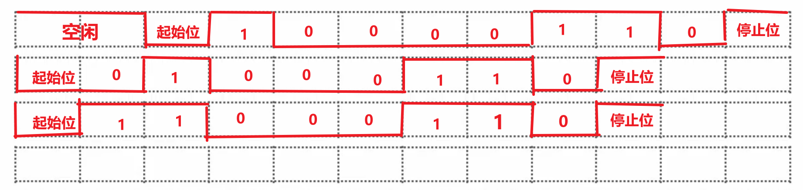

*Figure 3.7-1 字符串"abc"的数据帧-图*

你搞懂了吗？

#### 3.8 校验位（奇偶校验）

校验位通常不带，包括我们讲串口通信时，也不会带校验位，但我们还是可以了解一下校验位。

了解一下校验位是如何工作的。

所谓数据校验，就是把数据位的最后一位作为校验位，然后发送端和接收端采用统一的校验方式来判断数据位是否发送正确。

注意校验位只能用于校验判断数据传输是否出错，它本身是不具备纠错功能的。

最简单、也比较常用的校验手段是**奇偶校验**。

进一步可以分为：

1. 奇校验：要求数据位中有奇数个1
2. 偶校验：要求数据位中有偶数个1


*Figure 3.8-1 串口数据帧格式-图*

假如采用9位带校验的数据位格式，发送端发送数据85，采用奇校验，那么分析如下：

1. 数字 85 的二进制表示中，数据位里一共有**4 个 “1”**，这是一个**偶数**。
2. 采用奇校验的话，数据位的1应该是奇数个。
3. 因此，校验位中的数据应该是1，这样才能使得数据位的1的个数变为奇数个。

如此，发送整数85的时序图，如下图所示：


*Figure 3.8-2 奇校验发送端数据帧-图1*

然后，接收端接收到这一帧数据后，只需要校验数据位中1是否为奇数个，就可以粗略的判断数据传输是否有问题。

比如接收端接收到的数据帧如下图：


*Figure 3.8-3 奇校验接收端数据帧-图2*

接收端发现接收到的这一帧数据中的数据位，1的个数变成了偶数个，那就说明数据传输出现了问题，可以要求发送端重传或者采取其它做法。

奇偶校验一定能发现数据传输中的错误吗？

当然不是，假如数据位在传输时，恰好有偶数个“1”变成了“0”，那么数据位1总数的奇偶性就不会改变了，这样奇偶校验就失效了。

所以：

**奇偶校验是一种实现简单、但检测能力有限的数据校验方式。**

**由于串口通信本身抗干扰能力较强，所以在实际使用串口通信时，可以选择不使用校验位，以简化通信过程。**

#### 3.9 数据帧格式设置

串口通信，数据帧格式如下图所示：

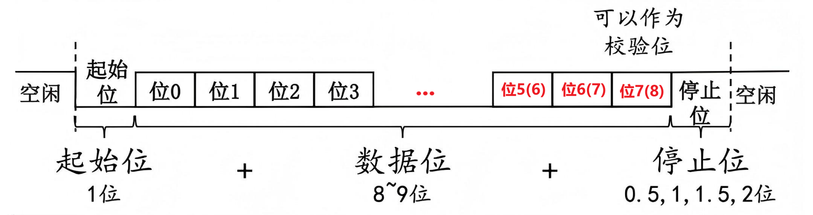

*Figure 3.9-1 串口数据帧格式-图*

我们可以设置的地方有：

1. 选择数据位的长度，8位或者9位。
2. 数据位的最后一位是否有校验位，若有校验是奇校验还是偶校验。
3. 停止位用几位，可以选择0.5位、1位、1.5位以及2位。

**在后续的实验中，我们使用的数据帧格式是：数据位8位，不带校验位，停止位为1位。**

**这也是串口通信中，最常见、最通用、最“懒人友好”的数据帧格式。**

**工程中，我们习惯把它称之为“8N1”数据帧格式，其中8代表8位数据位，N代表无校验位（No Parity），1停止位。**

### 4. 波特率的问题（重点）

串口通信是一种异步串行通信协议，不需要通信双方共享统一时钟信号，通信时序是由双方自行控制的。

这样就出现了一个显而易见的问题：

数据帧的发送是依靠一定频率的高低电平变化来表示发送数据0和1，那么当发送端发送一个数据帧时，接收端如何才能准确识别每一个比特（bit）的时间间隔呢？

有点迷糊，没听懂这个问题，用人话来描述一下这个问题：

**我给你写了一封信，信的内容如下：**


*Figure 4-1 波特率的问题-图1*

那么我问你：

我这封的内容是“好”，还是“女子”？

很明显大家都知道，这封信的内容是“好”。为什么呢？

因为依靠大家经验性的约定，上图内容中的文字间距和文字大小，显然不像是两个字，明显就只有一个字，所以信的内容就是“好”。

**对于文字的阅读我们依靠经验约定，通信中数据的解析肯定不可能依靠经验约定，必然需要通信协议强制约定。**

**现在把这个例子等价到串口通信中，假如数据位采用8位无校验位，那么一帧数据的长度是10位：**

假如发送端发送1个数据帧，用时1秒钟，那么就是每0.1秒发送1位，0.1秒这个间隔就是每位的间隔。如下图所示：

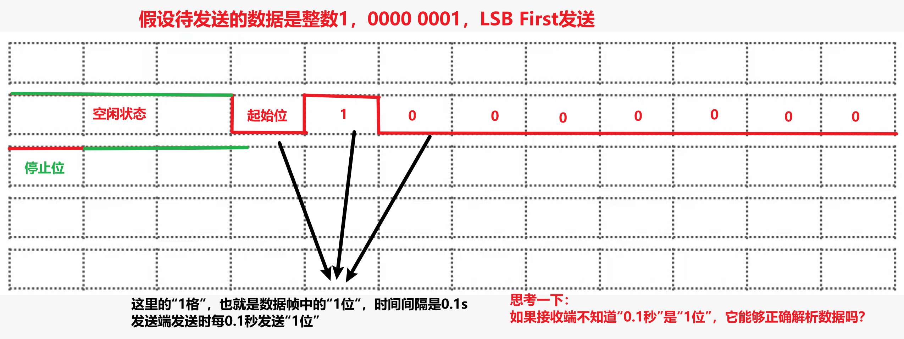

*Figure 4-2 波特率的问题-图2*

问题来了：

**若接收端不知道0.1秒这个间隔，接收端能够正确解析数据帧吗？**

显然是不可以的。

为了解决这个问题，这种串口通信引入了**波特率（Baud Rate）**的概念。

波特率可以理解成：通信中每秒传输的比特数量，单位是**bps（bits per second）**，即“每秒传输的比特数”。

既然知道1秒钟能传输多少个bit位，那么1个bit位究竟占多长时间就也可以确定了。

简单来说：

1. **波特率 = 1秒内传输的bit数量**
2. 比如波特率是**9600 bps**，意味着**每秒传输 9600 个 bit**。

对于串口通信来说：

1. **波特率用于衡量通信过程中的数据传输速率，在其它条件相同的情况下，波特率越大，传输效率越高。**
2. **波特率必须由双方统一约定好，双方都必须遵守，否则就会通信失败。**
3. 双方约定统一波特率，就相当于双方都知道1个bit位，究竟占据多长时间，这样接收端才能够正常解析数据。

**在UART通信中，最常见的波特率是9600、115200、57600 等。**

有了波特率这个概念后：

1. 通信的发送端，知道每间隔多长时间发送1位数据。
2. 通信的接收端，也知道每间隔多长时间接收解析1位数据。

现在你搞清楚波特率的概念，以及为什么需要波特率了吗？

## 04 STM32的串口外设

### 1. 概述

本章节的末尾，我们还需要学习一下单片机USART外设的基本工作原理，再分析一下单片机引脚的使用及PC端接线。

通过以上内容的学习，我们就可以在下一章节中，实现**单片机与 PC 端之间的双向串口通信**。

### 2. STM32的USART模块

在上面我们已经了解了UART串口通信的基本内容，下面我们来学习一下STM32的USART模块的使用。

当然前面已经说过了，USART模块支持同步和异步，但我们一般只使用它的异步模式，也就是把USART当成UART使用。

让我们回到讲STM32F103C8T6外设模块时，看到的一张图，如下图所示：

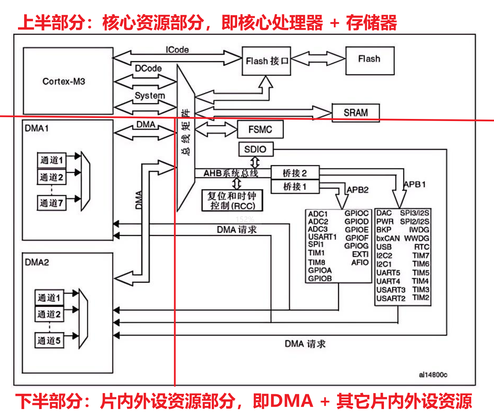

*Figure 2-1 STM32F103C8T6-系统结构分解图*

这张图中：

挂载在APB2总线上的USART1以及挂载在APB1总线上的USART2、USART3以及UART4、UART5都可以用于实现串口通信，都属于串口通信外设。

当然，我们可以再通过查阅《引脚定义表》（STM32F103系列，中等密度芯片），就可以发现：

**STM32F103C8T6单片机实际上只有三个USART外设，即USART1、USART2以及USART3。**

其中只有USART1外设挂载在APB2外设总线上，如无特别的需求，建议优先考虑使用USART1外设。

#### 2.1 波特率的设置原理

波特率的概念我们已经了解了：波特率指通信中每秒传输的比特数量。

那么STM32的USART外设是如何产生这个波特率的呢？

USART外设模块硬件内部中有专门的电路用于生成波特率，下图是一个简化的原理图：


*Figure 2.1-1 USART模块设置波特率-图*

为了讲清楚这个图，我们先来讲一下图中的“时钟”是什么意思。

##### 2.1.1 USART外设时钟

**这张图里的“时钟”，指的是提供给 USART 外设的工作时钟（外设时钟）频率，此时钟频率经过后续一系列分频最终得到波特率.**

USART外设的外设时钟是怎么来的呢？

在 STM32F103C8T6 中，USART 的时钟来源是固定规则的：

1. USART1外设时钟来源于 APB2 外设总线时钟。
2. USART2、USART3外设时钟来源于 APB1 外设总线时钟。

而两条外设总线APB1和APB2时钟，都来源于AHB系统总线时钟。可以查看我们之前讲过的单片机《系统结构图》：

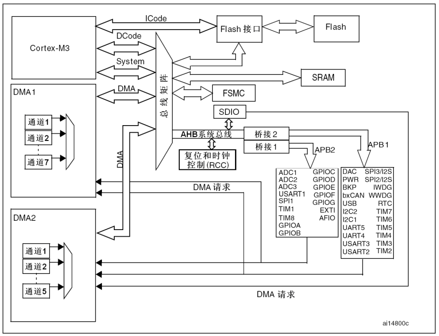

*Figure 2.1.1-1 USART外设时钟来源-图*

USART外设时钟的来源参考下面的链条序列：

系统时钟 -> AHB系统总线时钟 -> APB1/APB2外设总线时钟 -> USART外设时钟了解下列内容：

1. **在默认情况下，基于最小系统板的外部晶振电路，单片机的系统主时钟频率是72MHz。**
2. **在默认情况下，AHB系统总线时钟不分频系统时钟，AHB系统总线时钟频率也是72MHz。**
3. **在默认情况下，APB2外设总线时钟也不分频AHB系统总线时钟，APB2外设总线时钟频率也是72MHz。**
4. **在默认情况下，APB1外设总线时钟1/2分频AHB系统总线时钟，APB1外设总线时钟频率是36MHz。**

所以我们的结论就是：

1. **如果选择使用挂载在APB2外设总线上的USART1外设，那么USART时钟频率是72MHz。**
2. **如果选择使用挂载在APB1外设总线上的USART2、USART3外设，那么USART时钟频率是36MHz。**

##### 2.1.2 USART外设优先级问题

前面我们已经讲过优先使用USART1外设，那么为什么呢？

结合前面的知识，有以下几点原因：

1. USART1外设时钟频率，在默认情况下是系统主频率，频率更高，后续分频自然就更宽裕、更精准，且能设置更高的波特率。
2. USART1 的外设时钟，默认情况下与系统主频一致，计算过程更直观，不容易出错。
3. 单片机USART1外设的引脚用起来更方便，这一点后续小节会体现。

当然，如果USART1确实不可用，使用APB1外设总线上的USART2或USART3也没有本质区别，只需要注意APB1的1/2分频即可。

##### 2.1.3 时钟周期和时钟频率

在以前的内容中，我们已经知道：

单片机的系统主时钟频率是 72MHz，而 USART1 外设的时钟频率，在默认情况下同样是 72MHz。

那么，在学习到这里时，你心中很自然地会产生以下两个问题：

1. 时钟到底是什么啊？
2. 时钟频率又是啥概念？

关于时钟，在讲GPIO外设开启时钟时，我们简单提到过。

当时，我们讲：

**时钟/时钟信号，本质上是一种周期性变化的电平信号，时钟的作用是成给单片机内部电路提供“工作节拍”。**

前面我们只知道这个“工作节拍”很有用，单片机运行没它不行。

那么这个“工作节拍”，具体有什么用呢？

下面通过一个案例来解释时钟信号的作用：

无论是学习、工作还是生活，我们都习惯用“秒”“分钟”“小时”等时间单位来描述和规划事情。

单片机虽然不是人，但它的工作过程同样离不开“时间”的概念。

只是，单片机并不能直接理解“1 秒”“1 分钟”这样的抽象时间单位。

为了让单片机也能够“感知时间”，就引入了**时钟/时钟信号**这一设计。

可以把时钟理解为单片机内部的“节拍器”或“心脏”：

1. 每打一个节拍或者心脏跳动一下，这就是一个**“时钟周期”**。
2. **单片机可以通过统计“过了多少个时钟周期”，来感知时间的流逝。**

时钟信号每一次完整的周期性变化，称为一个时钟周期。

结合我们讲数字电路中的高低电平，更通俗直观的说：

**一个高电平加上一个低电平，就组成了一个完整的时钟周期。**

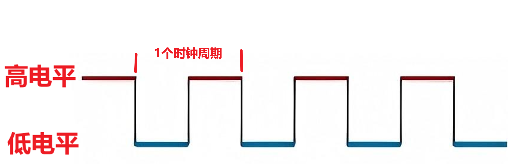

*Figure 2.1.3-1 时钟周期-图*

那么一个时钟周期到底有多长时间呢？

要想弄清楚这个问题，还需要了解一个概念：时钟频率。

**时钟频率用于描述1秒钟内，有多少个时钟周期。单位是Hz，意为每秒多少个时钟周期。**

比如STM32F103C8T6单片机，在默认情况下，系统主时钟频率是72MHz，也就意味着：

在1秒钟内，存在7200 0000个时钟周期。

在这种情况算下来，一个时钟周期就是1 / 72000000 秒钟，也就是约13.9纳秒一个时钟周期。

理解上述内容，我们给出以下几点结论：

1. 单片机通过时钟信号来理解时间。
2. **单片机理解的时间并不连续，它认为时间的基本单位是“时钟周期”。**
3. 在单片机内部执行的操作，比如CPU执行指令、外设处理数据等，都以时钟周期为基本时间单位，最少也需要执行1个时钟周期。
4. 单片机完成某项工作的时间 = “执行时钟周期数” * “时钟周期时间”。

##### 2.1.4 时钟频率和波特率的关系

**时钟频率和波特率到底有啥关系呢？**

**在前面的内容中我们已经知道，波特率通常用于描述串口通信中每秒钟传输多少个比特。**

换句话说：波特率决定了通信中，1个bit位数据在发送时，需要发送多长时间，需要维持多长时间的电平稳定表示数据发送。

这是人对波特率的理解。

但单片机不理解人类的时间，它对时间的认知需要用时钟周期来衡量。

**于是，单片机对波特率的理解就是：发送1个bit位数据，发送时，需要持续多少个时钟周期的电平稳定。**

基于这样的关系，USART外设在确定波特率时，都基于USART外设时钟频率，进行分频计算得到。

为什么需要分频呢？

因为USART串口外设支持的通信速率较慢，不可能1个时钟周期发送1个bit，所以必须分频，用很多个时钟周期加起来发送1个bit数据。

##### 2.1.5 波特率和时钟周期的关系

那么在串口通信中，一个 bit 数据究竟要发送多少个时钟周期呢？

我们换一种机器视角来看这个问题。

STM32F103C8T6 在常见配置下，主频为 72 MHz。

这意味着：1 秒钟内有 72,000,000 个时钟周期。

也就是说：1 个时钟周期 = 1 / 72,000,000 秒。

1个时钟周期是1/72000000秒钟。

**假如波特率是9600，那么传输一个bit需要1/9600秒钟。**

**于是1个bit的传输，需要的时钟周期是：(1/9600) / (1/72000000) = 7500个时钟周期假如波特率是115200，那么传输一个bit需要1/115200秒钟。**

**于是1个bit的传输，需要的时钟周期是：(1/115200) / (1/72000000) = 625个时钟周期**所以：

**发送 1 个 bit 所需的时钟周期数 = 外设时钟频率 / 波特率**当然，这里并不是说，串口每发送一个bit数据，CPU“傻等”这么多个周期。

而是：单片机的USART串口外设，需要数这么多时钟周期，来确定发出1个bit数据，并维持这么多时钟周期时间内电平稳定。

##### 2.1.6 设置波特率分频

时钟的概念我们已经讲清楚了，下面我们默认使用USART1外设，外设时钟频率是72MHz，即系统默认主频率。

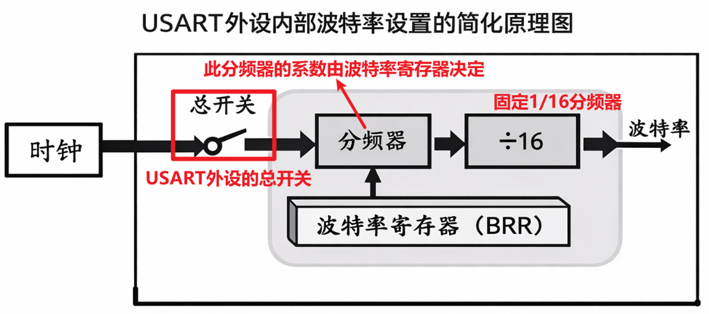

*Figure 2.1.6-1 波特率寄存器设置波特率分频-图*

如上图所示，串口通信中的波特率，本质上就是**对 72 MHz 时钟进行分频后得到的结果**。

1. 第一级：**波特率寄存器（BRR）**设定的，可变的分频因子
2. 第二级：固定的 1/16 分频器。

其中，固定的 1/16 分频器是硬件决定的，无法修改；

但我们可以通过设置波特率寄存器，来获得一个可变的分频器：

**若波特率寄存器的值为N，分频系数为N，就会得到一个1/N分频器，就会将输入的时钟频率除以N。**

波特率的计算公式为：

波特率 = 72 000 000 / N / 16 串口通信的常见波特率是：9600和115200，尤其是115200是最常见的波特率设置。

假如选择波特率为115200，我们可以反推一下波特率寄存器中的分频系数：

72 000 000 / 16 / 115200 = 39.0625**这个分频系数不是一个整数，这是什么情况呢？波特率寄存器如何表示这个分频系数呢？**

**很明显分频系数是可以为小数的！！**

为了回答这个问题，我们可以看一下波特率寄存器的构成，如下图所示：

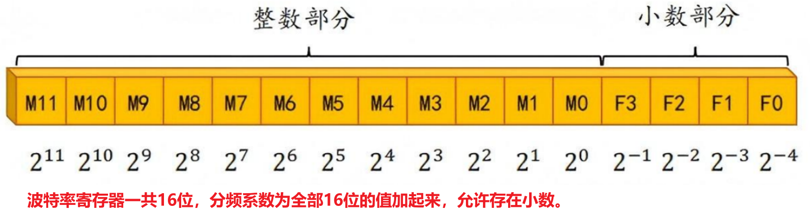

*Figure 2.1.6-2 波特率寄存器设置波特率分频-图2*

波特率寄存器一共16位，分频系数为全部16位的值加起来，允许存在小数。

假如：

波特率寄存器的16位数据为：0001 1101 0100 1100整数部分是0001 1101 0100：1 × 28 + 1 × 27 + 1 × 26 + 1 × 24 + 1 × 22 = 256 + 128 + 64 + 16 + 4 = 468小数部分是1100：1 × 2-1 + 1 × 2-2 = 0.5 + 0.25 = 0.75所以此时分频系数是468.75此时的波特率为：72000 000 / 468.75 / 16 = 9600**这就是波特率为9600时的波特率寄存器取值。**

115200波特率时，波特率寄存器需要存储39.0625这个分频系数，于是存储的16位数据就是：

0000 0010 0111 0001因为：

整数部分是0000 0010 0111 = 1 × 25 + 1 × 22 + 1 × 21 + 1 × 20 = 32 + 4 + 2 + 1 = 39小数部分是0001 = 1 × 2-4 = 0.0625你搞懂了吗？

如果你搞懂了，肯定会产生这样的想法：

**通过波特率寄存器设置分频，从而设置波特率，这也太麻烦了，需要慢慢算，如果不小心搞错了1位全盘皆错，这也太坑了。**

实际上：

1. 如果你选择寄存器的开发方式，需要手动配置波特率寄存器来设置波特率，那么这些麻烦是你需要承受的。
2. 如果你选择使用标准库开发方式，乃至于更上层的开发方式，这些寄存器操作就被封装了，程序员只需要调用函数即可自动设置波特率。

##### 2.1.7 采样和采样时机

现在我们已经对**波特率**有了一个比较全面的认知：

串口通信的双方，通过约定波特率，确定了1个bit位数据在传输时，占用多长时间。

对于单片机而言，波特率就是，确定了1个bit位数据在传输时，占用多少个时钟周期。

对于串口通信而言，发送端想要发送1个bit位数据，只需要在既定时钟周期内，保持信号线的电平稳定。

那么对于接收端呢？接收端如何获取发送端发送的数据呢？

**对于任何串行通信而言，接收端采集数据，确定接收bit1还是bit0，都是一个重要的事情。**

下面我们来讲解一下串口通信在这方面的特点，为了方便解释，我们引入两个标准术语：

1. 采样：接收端在某一确定时刻，对信号线上的电平状态进行读取，并将其判定为逻辑 0 或逻辑 1 的过程。
2. 采样时机：通信协议所规定的，接收端执行采样操作的具体时刻、时间点。

以串口通信为例，描述这两个术语，说人话就是：

1. 采样：接收端在某个时刻，查看Rx引脚的输入电平，从而得知对方到底发送了bit1还是bit0。
2. 采样时机：接收端到底啥时候去看Rx引脚，输入电平状态。

**搞懂了“采样”和“采样时机”这两个术语之后，下面我们就来看串口通信协议在采样与采样时机方面的具体规定。**

串口通信属于异步通信，双方只约定了一个波特率，用于确定通信中一个bit位的时长。

由于没有稳定的时钟信号来同步时序，所以对于串口通信这种异步通信而言，每个bit位只采样一次是不够的，容易出现误差。

**大多数USART硬件外设在实现采样时，都会在一个bit的中点附近采样多次，然后采用投票判决来确定最终数据。**

比如：在一个bit的中点附近采样三次，其中2次是1，1次是0，那么数据最终是1。

这个过程详细描述如下：

1. 接收端一旦检测到 Rx 引脚出现低电平，就认为可能出现起始信号，通信可能会开始。于是启动内部接收和定时逻辑。
2. 接收端按照约定的波特率进行计时，在起始位持续时间的中间位置（也就是0.5bit的位置）附近，对 Rx 引脚输入进行多次采样。
3. 如果经过多次采样并投票判决，最终结果为低电平，则确认起始位有效，通信正式开始。
4. 以起始位为时间对齐基准：
   - a. 后续的数据位和停止位，在每个bit的中间位置进行多次采样并投票判决，从而完成数据的正确接收。
   - b. 每一个bit位数据，接收端都会采样多次，然后投票决定最终结果。
5. **在串口通信中，这种“多次采样，然后投票判决”的采样方式，被称之为“过采样机制”。**

如下图所示：

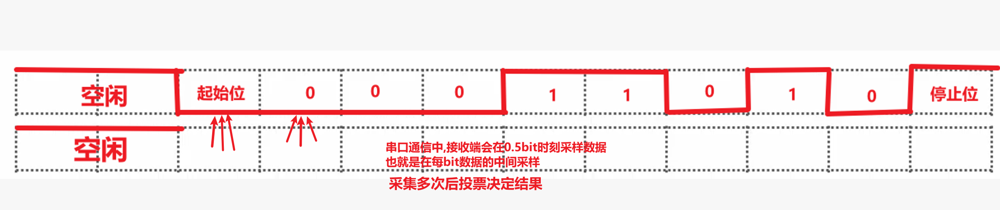

*Figure 2.1.7-1 采样和采样时机-图*

上述整个描述，我们可以记住以下精简结论：

**串口通信的采样时机，是在每一个 bit 位数据持续时间的中点附近进行多次采样，然后投票判决得出最终结果。**

那么接收端如何确定这个中间时刻呢？

**接收端通过检测起始信号对齐时间，再加上双方约定好波特率，就能够找到0.5bit的时间位置，从而进行数据采样。**

当然“过采样机制”本身是由USART硬件自动完成的，程序员在使用 USART 外设进行串口通信时，无需手动实现该机制。

##### 2.1.8 波特率和通信速率

**问题1：在串口通信中，最常使用的波特率是9600、115200。为什么波特率是这些特定的数值，而不是别的数值呢？**

答：

1. 这些波特率在常见的系统时钟频率下，都可以被波特率寄存器设置分频，较为精确的得到。这是一个很大的优势。
2. 串口通信的设计目标不是追求高通信速度，而是更加追求实现简单、兼容性强且通信稳定。
3. 115200 是在通信速度、稳定性和兼容性之间取得较好平衡的一个波特率。
4. **115200，是串口通信在实际应用中的“默认波特率”！**

**问题2：串口通信确定波特率后，大约的通信速率如何进行计算？**

以常见的115200波特率为例，每秒钟传输115200个bit数据，换算一下单位：

也就是：115200 / 8 / 1000 = 14.4KB/s这就结束了吗？这就是通信速率吗？

**当然不是，串口数据帧中的数据并非全都是有效数据。**

以常见的"8N1"为例，有效数据是"8 / 10"，停止位和起始位这两bit是无效数据。

所以波特率是115200，数据帧格式采用"8N1"的情况下，串口的通信速率是：

14.4 * (8 / 10) = 11.52KB/s当然这是理论最大传输速率（协议层理论速率），实际总会存在一定损耗（软件与硬件层面都会存在损耗），应用时还需具体分析。

至此，关于USART外设波特率设置的相关原理，我们就搞清楚了，下面我们来研究一下USART外设处于数据帧的工作原理。

#### 2.2 数据帧处理的工作原理

USART外设模块在处理数据帧发送和接收时，它的工作原理框图如下图所示：

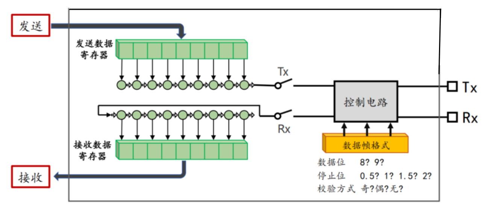

*Figure 2.2-1 数据帧处理的工作原理*

USART外设在处理数据帧时：

1. 单片机的USART外设在作为发送端时，存在一个"并->串"的过程，该过程由USART外设自行完成。
2. 单片机的USART外设在作为接收端时，存在一个"串->并"的过程，该过程由USART外设自行完成。

**由此看来，单片机的USART外设在实现串口通信时，帮我们完成了绝大多数工作。**

**这也是我们要使用USART硬件外设完成串口通信，而不是纯依靠软件模拟通信时序，实现通信的原因。**

下面我们简单了解一下，USART是如何实现这些过程的，了解一下USART外设在通信中的工作。

##### 2.2.1 USART外设在通信中的工作（了解）

以一个字节整数88的发送和接收过程举例，"并->串"的过程和“串 -> 并”的过程如下图所示：

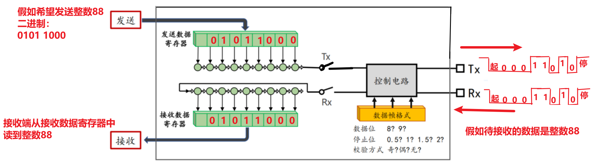

*Figure 2.2.1-1 USART外设在通信中的工作-图1*

**具体到"并 -> 串"的过程**程序员将数据写入到发送数据寄存器中，USART外设的发送端内部电路，会自动将数据逐位移出，通过Tx引脚发送出去。

如下图所示：


*Figure 2.2.1-2 USART外设在通信中的工作-图2*

仅通过移动寄存器的右移就可以实现数据，从最低有效位发送到最高有效位。

所以串口通信采用LSB First的比特序，硬件实现更简单。

**具体到"串 -> 并"的过程**USART外设的接收端内部电路仍然通过移位寄存器的右移，简单地实现了这个过程。

并且最终将数据位存储到接收数据寄存器当中。

如下图所示：

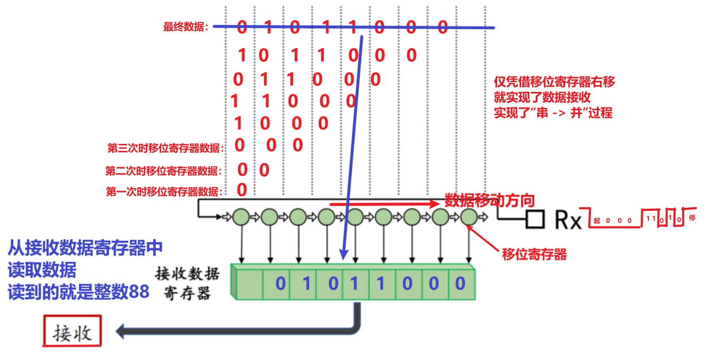

*Figure 2.2.1-3 USART外设在通信中的工作-图3*

当然，在串口通信中，USART外设做什么，我们只需要了解即可。

我们要把重点放在“程序员能做什么”上面，这样我们才能够使用USART外设实现串口通信。

##### 2.2.2 程序员在通信中的工作（发送端）

**基于USART外设实现串口通信，单片机作为发送端时，由程序员决定发送的数据是什么。**

这是一句正确的废话！

再结合上面的工作原理图，在发送时，程序员真正需要执行的工作是：

**将待发送的数据，写入发送数据寄存器当中，随后由USART外设自行实现“并 -> 串”将数据发送出去。**

需要注意的是：

1. 发送数据寄存器至多有9位有效空间，用于存储待发送数据帧的数据位。
2. 发送数据寄存器属于硬件设备，USART外设将发送数据寄存器中的数据，完全发送出去是需要时间的。

那么问题来了：

直接无脑写发送数据寄存器，能够保证所有待发送数据都正确发送完成吗？

显然是不行的。

假如上一个数据位还没有发完，就立刻写发送数据寄存器，就会导致数据覆盖，从而丢失数据。

所以：

**只能在确定发送数据寄存器为空的前提下，才能够写发送数据寄存器。**

##### 2.2.3 程序员在通信中的工作（接收端）

与之对应的，**基于USART外设实现串口通信，单片机作为接收端时，由程序员决定读取接收的数据是什么。**

这也是一句正确的废话！

前面讲过：

**USART作为接收端时，会自动接收比特流，自动完成“串 -> 并”的过程，然后将接收到的数据位存储在接收数据寄存器！**

接收数据寄存器同样是9位有效空间，用于临时缓存接收到的数据位。

所以：

**在确定接收数据寄存器非空的前提下，程序员可以读接收数据寄存器，将接收到数据位读出来！**

##### 2.2.4 核心问题：如何判断寄存器状态

读到这里的同学，如果认真思考了，肯定会产生两个问题：

1. 怎么知道USART外设的发送数据寄存器空了？
2. 怎么知道USART外设的接收数据寄存器非空了？

如果不能解决上面两个问题，如果不能判断寄存器的状态，上面小节所讲的操作是无法实现的。

既然程序员有需求，那么单片机的设计生产厂商肯定需要满足这种需求。于是：

1. **单片机的设计厂商会在某外设的硬件中，明确设置标志位寄存器，用于存储指示该外设各种运行状态的标志位。**
2. 基本上稍微复杂一些的外设都设有标志位寄存器，用于存储状态标志位，指示单片机运行状态。

比如USART外设中，就存在标志位寄存器，存储了一些指示状态的标志位。

##### 2.2.5 USART外设三个常用标志位(重点)

使用USART外设时，三个最常用的，几乎绕不开的状态标志位如下表：

| 状态标志位名称 | 标志位的宏定义 | 英文全称及含义 |
|---|---|---|
| TXE | `USART_FLAG_TXE` | 发送数据寄存器为空（Transmit Data Register Empty） |
| TC | `USART_FLAG_TC` | 发送完成（Transmission Complete） |
| RXNE | `USART_FLAG_RXNE` | 接收数据寄存器非空（Receive Data Register Not Empty） |

首先状态标志位是存在取值的，且取值只有两种：

1. 1，即标志位名称指示的条件已经满足。
   - a. SPL库用SET这个枚举值表示1，注意编码时要使用SET，不要使用魔法数1。
   - b. **标志位取值为1时，通常称为置1、置位或者干脆就叫SET。**
2. 0，即标志位名称指示的条件还未满足。
   - a. SPL库用RESET这个枚举值表示0，注意编码时要使用RESET，不要使用魔法数0。
   - b. **标志位取值为0时，通常称为置0、复位、清零、清除或者干脆就叫RESET。**

解释一下每一个标志位：

**状态标志位TXE：**

1. 标志位本身翻译成中文，意为：发送数据寄存器是空的。
2. 用于指示，发送数据寄存器是否为空的状态。
3. TXE标志位置位时，表示发送数据寄存器已经是空的了。
4. TXE标志位复位时，表示发送数据寄存器不是空的。

**状态标志位TC：**

1. 标志位本身翻译成中文，意为：发送完成、数据传输完成。
2. 注意，发送数据寄存器为空，并不意味着传输已经完成，因为数据可能还在移位寄存器中移位发送。
3. TC标志位置位时，表示发送数据寄存器和发送端移位寄存器都为空，数据已经完全发送完毕了。
4. TC标志位复位时，表示发送数据寄存器和发送端移位寄存器任一不为空。

**状态标志位RXNE：**

1. 标志位本身翻译成中文，意为：接收数据寄存器**非空**。
2. 用于指示，接收数据寄存器是否为**非空**的状态。
3. RXNE标志位置位时，表示接收数据寄存器是非空状态。
4. RXNE标志位复位时，表示接收数据寄存器还是空的。

### 3. PC和STM32的串口

串口通信是两台支持串口通信协议的设备之间的通信。此时只需要将它们各自的Tx引脚和Rx引脚连接起来，就可以实现双工通信。如下图所示：

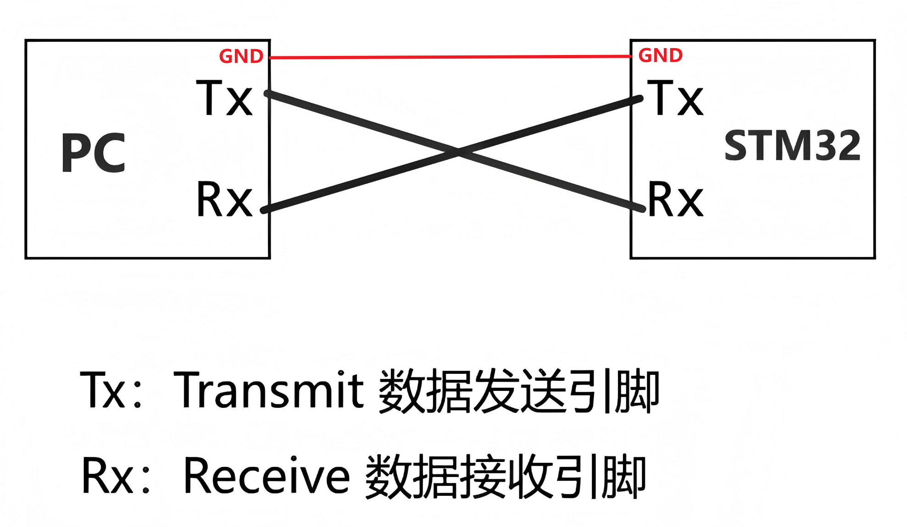

*Figure 3-1 串口的引脚连接方式-图*

现在我们已经了解了串口通信协议、以及单片机USART外设模块的工作原理。

现在我们期望使用SPL库，编程实现PC与STM32之间的串口双向通信，抛开具体使用什么函数，这种软件层面上的问题不谈。

硬件上面我们还有以下问题没有解决：

1. PC端的串口接口在哪里？
2. STM32的串口引脚在哪里？
3. 如何设置和使用STM32的串口引脚？

这些问题，我们逐一来解释解决。

#### 3.1 PC的串口

在最早期的PC计算机（台式机）上，主板通常还会配备串口，可以直接用于串口通信。

但现代PC计算机上早已不再自带传统的串口，因此我们需要借助额外的硬件设备来扩展串口功能。

最常见的就是**USB 转 TTL 串口模块**。

它将 PC 的 USB 信号转换为 UART（TTL 电平）信号，使其可以与 STM32 进行串口通信。

在前面的课程内容中，我们已经介绍过USB转串口设备了。下面是直接复制过来的内容：

**USB转TTL设备**是一种将计算机的USB接口转换为TTL电平的串行通信（UART协议）的设备也有很多人把它叫做**USB转串口设备**。

TTL（Transistor-Transistor Logic）电平是啥意思呢？

如下表所示：

| 逻辑状态 | 5V TTL（典型） | 3 3V TTL（典型） . |
|---|---|---|
| 高电平（逻辑 1） | 2V 5V（通常为 5V） ~ | 2V 3 3V（通常为 3 3V） ~ . . |
| 低电平（逻辑 0） | 0V 0 8V（通常为 0V） ~ . | 0V 0 8V（通常为 0V） ~ . |

**简单来说：**

1. **高电平（逻辑 1）**：对于**5V TTL**，通常是**5V**；对于**3.3V TTL**，通常是**3.3V**。
2. **低电平（逻辑 0）**：一般是**0V**（接地）。

USB转TTL串口设备，常用于PC和嵌入式设备单片机之间的串行通信。

USB转TTL可以完成ST-LINK的功能，比如供电，下载调试程序等，但我们主要使用它来进行UART串口通信。

使用USB转串口设备，可以使得没有串行接口的现代计算机能够与需要串行通信的设备（如微控制器、调试工具、工业设备等）进行连接和通信，在嵌入式领域的开发调试中非常常用。

我们使用的USB转TTL是基于CH340G芯片的，如下图所示：

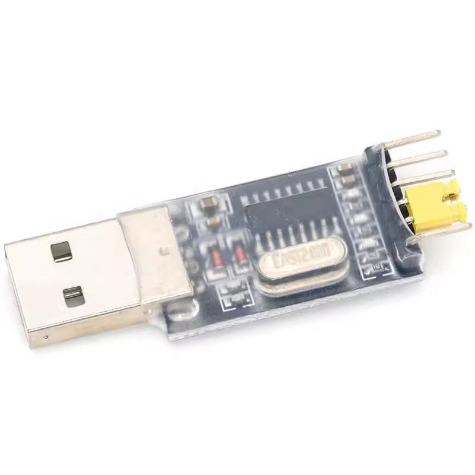

*Figure 3.1-1 USB转TTL驱动的安装-图1*

大家可以找出配件盒当中USB转串口设备。

在USB接口的另一边有很多针脚，这些针脚中就包括Tx和Rx针脚（多了一个D字母是Data的意思，表示发送和接收数据）。

如果你之前已经安装过USB转串口驱动，那么在设备管理器中就可以看到以下内容：

可以先按下 “Win + R” 组合键，打开 “运行” 对话框，然后在对话框中输入"devmgmt.msc"，最后回车。

如果打开设备管理器，在"其他设备"中看到"带有问号的USB Serial"设备，则表示此计算机还没有安装USB转TTL驱动。

安装完成后，在设备管理器中能够正常识别此设备即可：

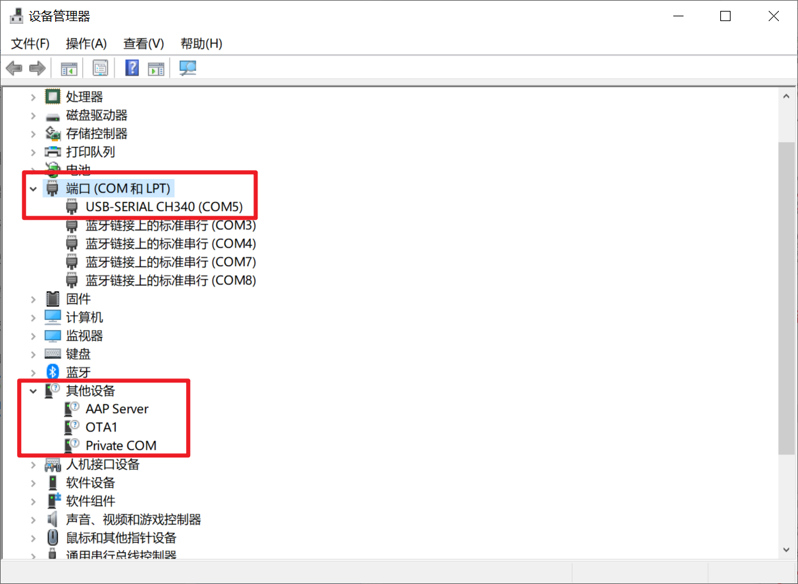

*Figure 3.1-2 USB转TTL驱动的安装-图4*

如果你还没有安装这个驱动，可以根据这个文档来安装：USB转串口驱动的安装以上即完成PC设备端的串口通信准备。

下面更重要的问题是STM32的串口通信引脚在哪里呢？

#### 3.2 USART模块的引脚

STM32F103C8T6提供的USART外设模块的引脚一共有五种，如下图所示：

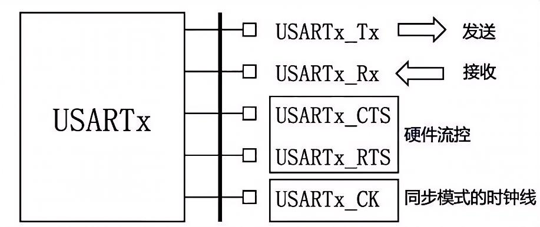

*Figure 3.2-1 USART模块的引脚-图*

其中Rx和Tx引脚自不必多说。

硬件流控的两个引脚：

1. RTS由接收端控制，决定是否允许对方发送数据，连接到发送端的CTS。
2. CTS由发送端控制，决定是否允许自己发送数据，连接到接收端的RTS。

硬件流控适合在高速、大数据传输时保证数据传输稳定性，防止丢包，一般用于WiFi、4G/5G数据通信、蓝牙通信等场景。

在PC和单片机通信时，没有使用的必要。

CK同步时钟线则在USART当做同步串行通信时使用，用于同步设备间的时钟信号，我们也不需要用。

所以我们只需要关心STM32的Rx和Tx引脚就可以了。

那么这两个引脚在哪里呢？

#### 3.3 STM32的Tx和Rx引脚

在之前的课程中，我们已经学习过STM32F103C8T6的引脚分布图了，如下图所示：

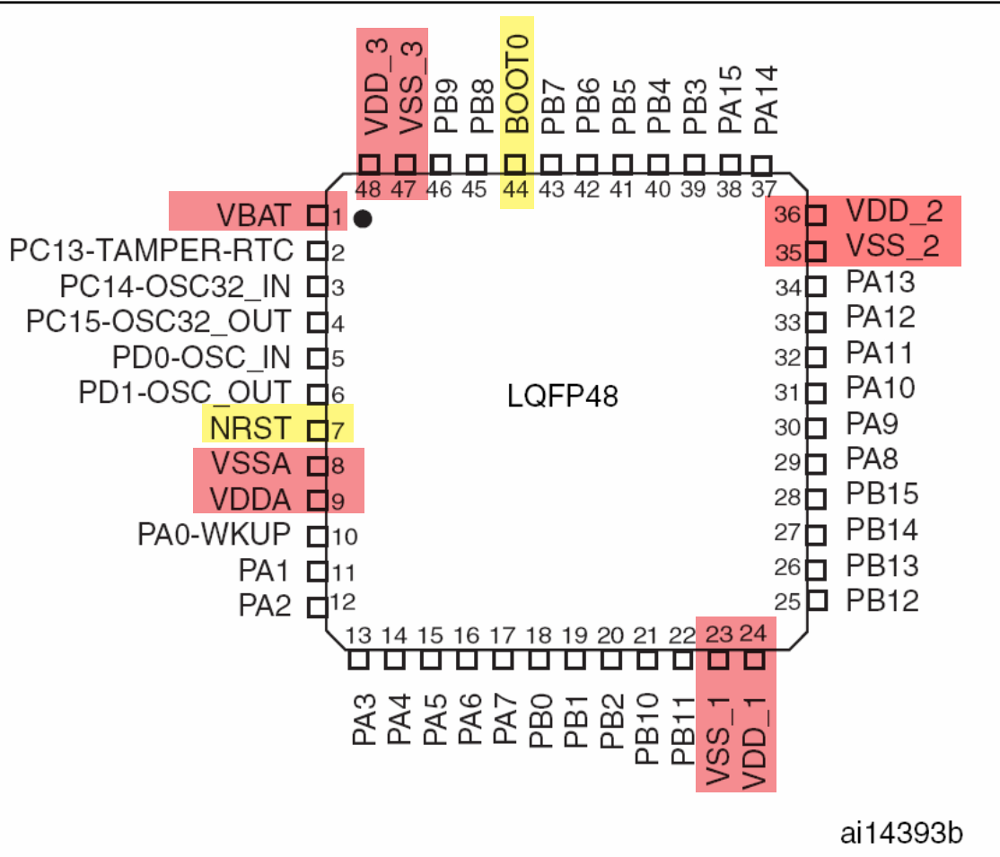

*Figure 3.3-1 STM32引脚分布图-示意图*

其中有颜色标注的地方都是特殊引脚，那么其它位置的引脚中能找到Rx和Tx引脚吗？

显然是没有的。

那这两个引脚在哪里呢？

不要着急，我们慢慢分析。

STM32自带的USART外设模块不止一个，如下图所示：


*Figure 3.3-2 STM32F103C8T6-系统结构分解图*

前面已经讲过我们使用的单片机STM32F103C8T6，一共有3个USART外设，分别是USART1、USART2以及USART3。

其中我们优先使用USART1外设。

**于是我们就进一步确定了，我们要使用的两个引脚为：USART1_Tx和USART1_Rx**引脚分布图上找不到这两个引脚，但是不要忘记了，引脚分布图上画出来的都是引脚的主功能，但引脚还有复用功能和重定义功能。

具体的引脚定义表可以参考之前的文档：引脚定义表

##### 3.3.1 PA9引脚的工作模式设置

这里仅截取了PA9引脚和USART1_Tx功能相关的部分，如下图所示：


*Figure 3.3.1-1 USART1_Tx引脚复用-图*

也就是说：**PA9引脚，设置为复用工作模式，它可以充当USART1_Tx功能，即串口的发送端。**

那么这个工作模式具体是什么模式呢？

首先，发送端的作用是输出高低电平，从而传输数据，所以它必然要使用输出向的工作模式。而输出向的工作模式，我们已经学习过两个了：

1. 通用推挽输出模式
2. 通用开漏输出模式

能不能用这两个模式呢？

显然不行，将PA9设置为这两个工作模式，它们就是普通的IO口，不是USART1_Tx功能。

于是我们想到了两个复用输出模式：

1. 复用推挽输出模式
2. 复用开漏输出模式

这两个所谓复用输出模式，我们之前没有讲，但实际上非常简单。查看引脚内部电路图，复用输出模式相关的电路如下图所示：

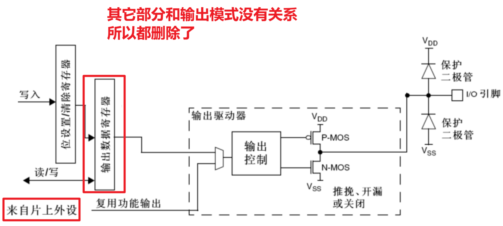

*Figure 3.3.1-2 IO引脚内部输出电路-图*

也就是说，通用输出和复用输出的核心差异在于**引脚控制权的归属**：

1. 通用输出模式：由**GPIO 外设**自己直接控制，程序通过写入**GPIO_ODR（输出数据寄存器）**来改变引脚电平。
2. 复用输出模式：GPIO 将控制权**交给其他外设（如 USART、SPI、I2C 等）**，这些外设控制 GPIO 输出高低电平。

它们的核心区别在于控制权的变化，但推挽模式和开漏模式的本质没有变化：

1. 推挽输出模式仍然是上下两个MOS管交替导通，引脚可以输出高电平和低电平。
   - a. 通用推挽输出，输出的控制权在GPIO自身，输出数据寄存器写1就输出高电平，写0就输出低电平。
   - b. 复用推挽输出，输出的控制权在其它外设模块，其它外设输出1，引脚就输出高电平，输出0，引脚就输出低电平。
2. 开漏输出模式仍然是PMOS管始终断开，控制NMOS管的开闭，从而使得引脚可以输出低电平和高阻抗状态。
   - a. 通用开漏输出，输出的控制权在GPIO自身，输出数据寄存器写1就输出高阻抗，写0就输出低电平。
   - b. 复用开漏输出，输出的控制权在其它外设模块，其它外设输出1，引脚就输出高阻抗，输出0，引脚就输出低电平。

看了这么一段描述后，PA9应该设置为哪个复用输出模式，才能够支撑USART1_Tx的功能呢？

显然需要选择复用推挽输出模式，因为USART1_Tx需要直接输出高低电平，这显然是开漏模式做不到的。

而且应该把引脚的控制权交给USART1外设，而不是GPIO自己。

当然，这里还有一个小问题：

根据《引脚定义表》，PA9引脚实现复用功能时，引脚控制权可能是USART1外设，也可能是TIM1外设，那究竟属于哪个外设呢？

**这个问题我们前面也讲解过了，哪一个外设开启控制权就属于谁，禁止同时开启两个外设！**

于是，我们最终得出结论：

**将PA9引脚设置为复用推挽输出模式（GPIO_Mode_AF_PP），并且开启USART1外设，此时PA9引脚功能就是USART1_Tx。**

尤其是要注意：

**USART1外设在使用上，除了类似GPIO的初始化外，还需要多一步手动开启的操作！！！**

##### 3.3.2 PA10引脚的工作模式设置

这里仅截取了PA10引脚和USART1_Rx功能相关的部分，如下图所示：

*Figure 3.3.2-1 USART1_Rx引脚复用-图*

那么PA10引脚应该设置为什么工作模式呢？

首先肯定需要设置为输入模式，因为Rx引脚的作用是读取发送端输出的高低电平。

**单片机的引脚输出是主动向操作，需要某个外设来控制输出，于是引脚的输出模式就有控制权问题，输出模式就存在通用和复用的区别！**

但引脚的输入显然是一种被动向操作，不存在所谓控制权的概念：

1. GPIO外设可以读输入，其它外设也可以同时读。
2. **所以引脚的输入模式，没有通用和复用的区别。**

其实这一点，我们仍然可以通过阅读，引脚输入模式的电路图来理解：

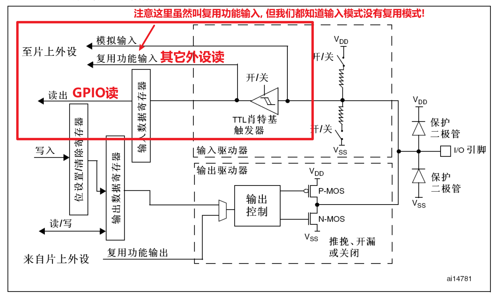

*Figure 3.3.2-2 输入模式引脚电路-图*

IO引脚只是负责将外部电平送到芯片内部，至于哪个外设来读这个电平都是可以的，而且允许同时读：

1. GPIO外设读输入电平，其实就是读GPIO外设的输入数据寄存器，这个操作我们之前做过很多次了。
2. 其它外设的内部电路，也会根据自己内部电路的处理来读取外部电平输入。

举一个例子：

对于PA10引脚来说，根据《引脚定义表》，此时**GPIO、USART1以及TIM1三个外设都可以读PA10引脚输入，而且可以同时读。**

**问题1：PA10引脚需要设置为“复用”输入模式吗？**

答：输入模式没有控制权的概念，输入模式也不存在“复用”，只需要根据情况设置普通的输入模式即可。

**问题2：引脚的复用输出模式时，开启哪一个外设引脚的输出控制权就在于谁，PA10引脚也需要开启谁就让谁读吗？**

答：不需要，通过查看电路，谁想读都可以。PA10引脚的输入，理论上允许三个外设一起读。

**问题3：真的可能出现两个，甚至多个外设一起读PA10引脚输入的情况吗？**

答：理论上可以，硬件电路上允许，但实际上大概率不会。

每一种外设都有自身需要的引脚输入，USART１外设需要读数据帧的输入，其它外设肯定不需要读串口的数据帧。

**所以，从实际情况出发，引脚的输入，在同一时刻，大概率还是仅有一个外设在读，哪怕理论上允许多个外设读取。**

**问题4：USART1外设需要读PA10引脚输入，那么PA10引脚应该设置为什么输入模式呢？**

关于PA10输入模式，现在我们以下三个选项：浮空输入模式、上拉输入模式以及下拉输入模式。

答：

首先排除下拉输入模式，下拉输入模式时，引脚默认输入一个低电平。

而低电平是串口通信的数据帧起始位，如果选择下拉输入模式会导致接收端始终处于要接收数据的状态，显然不合理。

而浮空输入模式和上拉输入模式都可以选择使用：

1. 可以选择浮空输入模式，因为浮空输入模式引脚默认不会输入任何电平，不会对输入电平产生影响。
2. 上拉输入模式默认输入高电平，而高电平作为数据帧的空闲位，对串口而言一般不会造成什么影响，所以也是可以选择的。

**上拉输入模式还有一个有趣的功能：**

假设单片机Rx引脚和PC端的Tx引脚，存在断开或接线不稳定的情况，此时将PA10设置为上拉输入模式：

PA10引脚将在断路时保持默认高电平输入，而高电平是串口通信规定的空闲状态。

所以PA10引脚使用上拉输入模式，可以在接线断路时，避免因误检测杂乱信号导致的通信乱码问题。

**总之，在接线可能会断开的场景中，可以优先考虑PA10引脚使用上拉输入模式，否则就将PA10设置为浮空输入模式即可。**

## 05 PC串口通信实验

### 1. PC和STM32串口电路接线图

拿出你的USB转TTL设备，参照以下接线图，将PC和STM32通过串口连接起来：

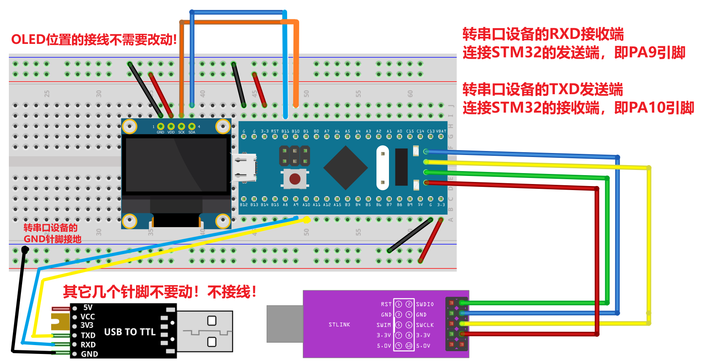

*Figure 1-1 串口通信接线-图*

**仔细点接线，注意双方的Tx和Rx引脚是交叉相连的！不要接错了！**

**后续所有的串口通信实验都继续沿用这张接线图，不需要动它了。**

### 2. 初始化工作

现在电路已经接线完成了，各自的硬件串口问题也已经解决了，现在开始正式的编码实现串口通信。

首先需要完成两步初始化工作：

1. 初始化Tx和Rx引脚，即正确初始化PA9和PA10引脚。
2. 初始化外设USART1

下面来逐一实现它们。

#### 2.1 初始化Tx和Rx引脚

这一步是比较简单的，使用的函数我们都已经学习过了，关于参数的设置我们之前也已经分析过了。参考代码如下：

```c
 /**
   * @brief 初始化USART1外设使用的两个引脚PA9(USART1_Tx)和PA10(USART1_Rx)
   * @param 无
   * @retval 无
   */
 void USART1_TxRxInit(void) {
     // 1.开启GPIOA外设时钟
     RCC_APB2PeriphClockCmd(RCC_APB2Periph_GPIOA, ENABLE);

     // 2.初始化两个引脚
     GPIO_InitTypeDef GPIO_InitStruct;
     GPIO_InitStruct.GPIO_Mode = GPIO_Mode_AF_PP; // PA9引脚设置为复用推挽输出模式
     GPIO_InitStruct.GPIO_Pin = GPIO_Pin_9;
     GPIO_InitStruct.GPIO_Speed = GPIO_Speed_2MHz;
     GPIO_Init(GPIOA, &GPIO_InitStruct);

     GPIO_InitStruct.GPIO_Mode = GPIO_Mode_IN_FLOATING; // PA10引脚设置为浮空输入模式
     GPIO_InitStruct.GPIO_Pin = GPIO_Pin_10;
     GPIO_Init(GPIOA, &GPIO_InitStruct);

     // 3.PA9引脚设置一个默认的高电平输出,表示通信空闲状态
     GPIO_SetBits(GPIOA, GPIO_Pin_9);
 }

```

PA10引脚的工作模式也可以设置为`GPIO_Mode_IPU`上拉输入模式，但不能设置为`GPIO_Mode_IPD`下拉输入模式。

这里我们思考一个问题，这是之前某位同学提出的一个比较“奇特”的问题：

以往我们设置引脚为**通用输出模式**后，为了避免引脚输出状态未知，会给定引脚一个默认输出电平。

这里有必要也这么做吗？

当然没必要，此时引脚是复用输出模式，引脚的输出控制权不在GPIO，而是USART1外设。

USART1外设会自动根据串口通信协议的时序要求，设置PA9引脚的输出状态。包括空闲状态，起始位等等。

况且此时再调用GPIO对应函数，向输出数据寄存器写0/1，也已经没有任何作用了。

#### 2.2 初始化USART1外设

初始化USART1外设和初始化GPIO没有本质区别，大体步骤都是一样的：

1. 开启USART1外设时钟，由于USART1外设也挂载在APB2总线上，使用的函数仍然是`RCC_APB2PeriphClockCmd`，只需要改变一下第一个参数即可。
2. 初始化USART1外设，配置USART1串口通信的各项参数，比如：波特率、数据位长度、停止位长度、有无校验位等等。类比GPIO初始化，使用的函数是`USART_Init`函数。
3. 开启`USART1`外设。原因之前已经讲过了，这里不再赘述，无非就是学一个函数开启USART1外设罢了。

##### 2.2.1 USART_Init函数

`USART_Init()`是**STM32 标准外设库**提供的**USART 串口初始化函数**，用于配置**波特率、数据格式、校验位、停止位、模式等参数**，并将配置应用到指定的 USART 外设（如`USART1`、`USART2`）。

其函数声明如下：

```c
void USART_Init(USART_TypeDef *USARTx, USART_InitTypeDef *USART_InitStruct);
```

此函数没有返回值，我们主要来解释一下它的各个形参：

**USARTx形参：**

指定要初始化的 USART 外设，取值可以是宏定义`USART1`、`USART2`、`USART3`。类似`GPIO_Init`函数的第一个参数，传入的是要初始化的GPIO模块。

**USART_InitStruct形参：**

类比`GPIO_Init`函数的第二个参数，这里也是需要传入一个结构体对象的指针，它们的调用方式也是完全一致的。

这个结构体的定义如下：

```c
typedef struct{
    uint32_t USART_BaudRate; // 波特率（常见：9600、115200）
    uint16_t USART_WordLength; // 数据位长度（8 位/9 位）
    uint16_t USART_StopBits; // 停止位（1 位/2 位）
    uint16_t USART_Parity; // 校验位（无/奇/偶）
    uint16_t USART_Mode; // 发送/接收模式（Tx、Rx）
    uint16_t USART_HardwareFlowControl; // 硬件流控（RTS/CTS）
} USART_InitTypeDef;
```

这个结构体的每一个成员的取值都比较特殊，除了波特率都使用固定的宏定义作为取值，其取值可以直接参考下列表格：

| 结构体成员 | 常见取值（宏定义） | 备注说明 |
|---|---|---|
| `USART_BaudRate` | 9600、115200（单位：bps） | 串口波特率，表示通信速率 |
| `USART_WordLength` | `USART_WordLength_8b` | 数据位是 8 位（推荐无校验时使用） |
|  | `USART_WordLength_9b` | 数据位是 9 位（推荐有校验时使用） |
| `USART_StopBits` | `USART_StopBits_1` | 1 位停止位（推荐） |
|  | `USART_StopBits_0_5` | 0.5 位停止位（不推荐） |
|  | `USART_StopBits_2` | 2 位停止位（不推荐） |
|  | `USART_StopBits_1_5` | 1.5 位停止位（不推荐） |
| `USART_Parity` | `USART_Parity_No` | 无校验位（推荐） |
|  | `USART_Parity_Even` | 偶校验 |
|  | `USART_Parity_Odd` | 奇校验 |
| `USART_Mode` | `USART_Mode_Rx` | 只接收模式 |
|  | `USART_Mode_Tx` | 只发送模式 |
|  | `USART_Mode_Tx \| USART_Mode_Rx` | 同时接收和发送（推荐） |
| `USART_HardwareFlowControl` | `USART_HardwareFlowControl_None` | 不使用硬件流控（推荐） |
|  | `USART_HardwareFlowControl_RTS` | RTS（请求发送）流控 |
|  | `USART_HardwareFlowControl_CTS` | CTS（允许发送）流控 |
|  | `USART_HardwareFlowControl_RTS_CTS` | RTS + CTS 双向流控 |

USART_Mode成员的取值可以详细说一下，由于我们采用的接线方式如下：

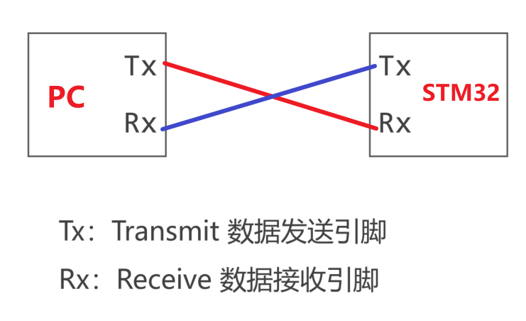

*Figure 2.2.1-1 串口的引脚连接方式-图*

这是一种"全双工通信"的接法，所以我们USART_Mode成员的取值应该选择`USART_Mode_Tx|USART_Mode_Rx`。

假如希望单片机USART外设仅发送或者仅接收，则可以选择其它模式，但一般不需要。

##### 2.2.2 开启USART1外设

在初始化GPIO外设时，调用完函数`GPIO_Init`就初始化完成了，但初始化USART1外设时，还需要加一步：开启USART1外设。

USART 是一个比GPIO更复杂的外设，它涉及波特率、数据格式、校验位、停止位、收发模式、流控等多个参数。

当调用`USART_Init()`配置完 USART1 后，USART 1外设仍处于禁用状态，不会立即工作。

所以初始化USART1外设的最后一步，还需要手动开启USART1外设。

从代码上来说，就需要调用`USART_Cmd`函数。

这个函数的函数声明如下：

```c
void USART_Cmd(USART_TypeDef* USARTx, FunctionalState NewState);
```

函数没有返回值，第一个参数就是要开启的USART外设，比如：`USART1`、`USART2`、`USART3`函数的第二个参数可以直接填入`ENABLE`或者`DISABLE`表示开启或者关闭。

##### 2.2.3 代码实现

以上万事俱备，我们可以直接通过代码实现初始化USART1外设，参考代码如下：

```c
 /**
   * @brief 初始化USAR1外设,数据位是8位,不带校验位,停止位是1位,波特率是115200
   * @param 无
   * @param 无
   * @retval 无
   */
 void USART1_Init(void) {
     // 1.开启USART1外设时钟
     RCC_APB2PeriphClockCmd(RCC_APB2Periph_USART1, ENABLE);

     // 2.利用USART_Init函数完成USART1外设的初始化
     USART_InitTypeDef USART_InitStruct;
     USART_InitStruct.USART_BaudRate = 115200; // 波特率设置为115200
     USART_InitStruct.USART_HardwareFlowControl =USART_HardwareFlowControl_None;//不使用硬件流控
     USART_InitStruct.USART_Mode = USART_Mode_Rx | USART_Mode_Tx;//设置为可收可发模式
     USART_InitStruct.USART_Parity = USART_Parity_No; // 不进行数据校验
     USART_InitStruct.USART_StopBits = USART_StopBits_1; // 选择1位停止位
     USART_InitStruct.USART_WordLength = USART_WordLength_8b;//数据位是8位
     USART_Init(USART1, &USART_InitStruct);

     // 3.使能开启USART1外设
     USART_Cmd(USART1, ENABLE);
 }
```

以上初始化部分的工作就全都完成了，下面我们开始考虑数据的收发，我们先来实现一个简单的功能：发送一个字节的数据。

### 3. 单片机发送数据到PC

现在我们的数据位设置为8位，且没有校验位，也就是说我们一次性可以发送1个字节的数据。

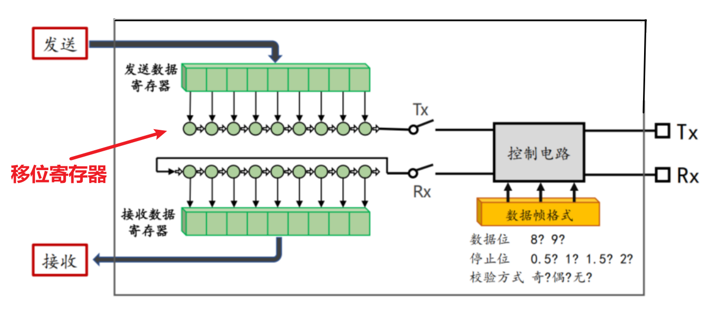

*Figure 3-1 数据帧处理的工作原理-图*

STM32的USART外设**发送数据帧**的过程是这样的：

1. **程序员控制STM32，将待发送的数据写入发送数据寄存器。**
2. 将发送数据寄存器中的数据写入到移位寄存器，此时清空发送数据寄存器。**（由USART外设自行完成）**
3. 移位寄存器逐位的将数据移除，通过控制电路再通过Tx引脚输出高低电平从而输出发送数据。当发送完当前1个字节的数据帧时，移位寄存器清空。**（由USART外设自行完成）**
4. 重复上述过程，直到所有的数据都发送完成。

对于程序员而言，USART外设自动完成的部分我们自不必操作，我们只需要：

**在确定发送数据寄存器为空的前提下，将待发送的数据写入发送数据寄存器！**

为了确定发送数据寄存器的状态，我们需要获取状态标志位TXE的值，下面介绍一个函数来获取标志位状态值。

#### 3.1 USART_GetFlagStatus函数

`USART_GetFlagStatus()`是**STM32 标准外设库**提供的一个**查询 USART 状态标志位**的函数。

其实就是获取在数据传输过程中寄存器的状态，从而对数据的输入、输出等情况做出判断。

其函数声明如下：

```c
FlagStatus USART_GetFlagStatus(USART_TypeDef* USARTx, uint16_t USART_FLAG);
```

**首先函数的返回值类型是FlagStatus：**

它其实就是一个枚举类型：

```c
typedef enum {RESET = 0, SET = !RESET} FlagStatus, ITStatus;
```

当返回值是：

1. 枚举值`RESET`时，其实就是返回0，表示条件没有满足。
2. 枚举值`SET`时，其实就是返回1，表示条件已经满足。

**再来看函数的形参USARTx：**

没什么好说的，表示要判断的USART外设是哪一个，直接传参`USART1`、`USART2`、`USART3`即可。

**第二个形参USART_FLAG：**

USART_FLAG参数是此函数的核心参数，它表示要查询的 USART 状态标志位。

此形参的类型是`uint16_t`，但实际传参时用直接使用宏定义，你可以在`stm32f10x_usart.h`头文件中找到它们。

这里我们只需要用到两个标志位，如下所示：

| 标志位 | 含义/作用 | 置为SET（1）的条件 |
|---|---|---|
| TXE | Transmit Data Register Empty ， 标志发送数据寄存器是否为空 | 当发送数据寄存器为空时 置为 ， SET（1） |
| TC | Transmission Complete 标志 ， 传输是否完成 | 当发送数据寄存器和发送移位寄 存器均为空时 置为SET（1） ， |

这样我们只需要再学习一个发送数据的函数，就可以实现串口数据发送功能了。

#### 3.2 USART_SendData函数

`USART_SendData()`是 STM32 标准外设库提供的一个发送数据到 USART 的函数，**它将 1 个字节或 9 位数据写入 USART 的发送数据寄存器中**，从而开始串口发送过程。

此函数的声明如下：

```c
void USART_SendData(USART_TypeDef* USARTx, uint16_t Data);
```

函数没有返回值，第一个参数也不必多说，表示发送数据的USART外设名。

**第二个参数Data：**

很明显Data是要发送的数据，那么它为什么是`uint16_t`16位无符号整数，而不是8位呢？

原因很简单，因为数据帧的数据位，也就是待发送的数据，可以是8位1字节，也可以是9位，所以只能使用`uint16_t`作为形参类型。

好了万事俱备，我们开始实现串口通信发送数据吧。

#### 3.3 单片机发送1个字节的数据到PC

思路是：

1. 判断TXE标志位，等待标志位置为`SET`，即等待发送寄存器数据发送完毕。
2. 再向发送数据寄存器写1个字节数据。

参考代码如下：

```c
/**
 * @brief 通过USART1发送1个字节的数据到PC
 * @param 待发送的1个字节数据
 * @retval 无
 */
void USART1_SendByte(uint8_t Byte){
    while (USART_GetFlagStatus(USART1, USART_FLAG_TXE) == RESET);//等待发送寄存器数据发送完毕
    USART_SendData(USART1, Byte); // 发送1个字节的数据，由USART自动转换成高低电平输出
}
```

注意函数的形参要写`uint8_t`这种类型别名，而不要使用基本数据类型char，**在嵌入式系统中使用类型别名是一个特别好的习惯**。

#### 3.4 PC端串口工具

写好上述函数后，我们可以在mian函数中写以下测试代码：

```c
int main(void) {
    USART1_TxRx_Init(); // 初始化 USART1 的 TX/RX 引脚
    USART1_Init(); // 初始化 USART1

    while (1) {
        USART1_SendByte('A'); // 发送字符 'A' 到 PC 端
        Delay_S(2); // 延时2s，避免发的太快
    }
}
```

我们编译下载一气呵成，现在STM32会持续向PC端发送字符'A'，那么在PC端如何能够看到发送的数据呢？

这就需要使用串口助手了。

你可以在**"百度网盘 -- 王道嵌入式软件环境 -- 串口助手"**文件夹下直接找到一个可执行程序"串口助手.exe"，直接双击打开它即可使用。

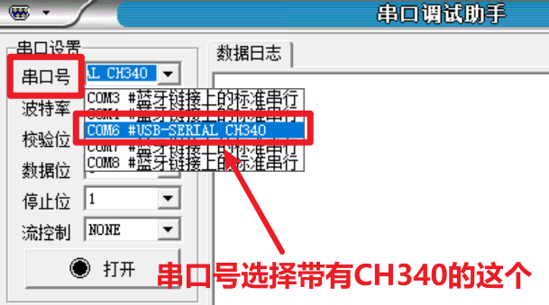

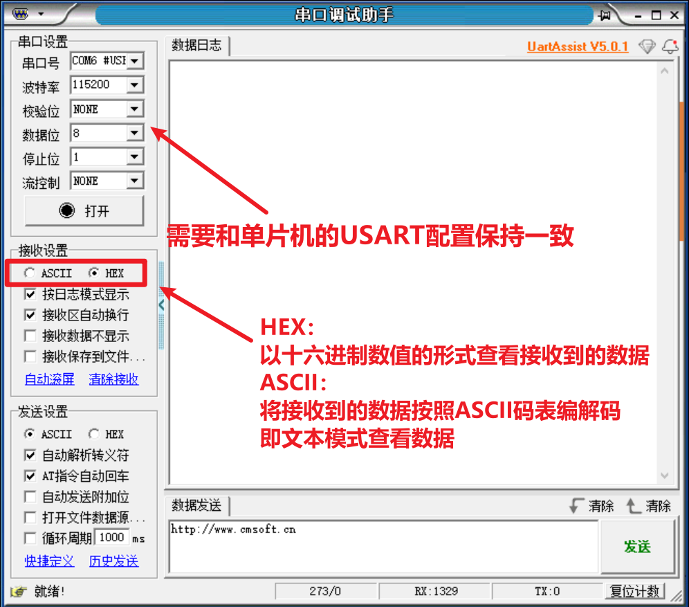

*Figure 3.4-1 串口助手-图1*

*Figure 3.4-2 串口助手-图2*

按照上面的两张图进行设置即可，比如对于上述测试代码而言，在串口助手界面下：

1. 假如选择"ASCII"模式，将会看到输出"A"字符。
2. 假如选择"Hex"模式，将会看到输出"41"这个十六进制数，因为字符'A'的十进制编码值是65，十六进制编码值是0x41

**注：**

若点击单片机复位按键，会看到单片机上电瞬间串口会发送一个"FF"数据。

这是上电瞬间，USART硬件状态未稳定从而导致发送了杂乱数据，通常可以不管这个脏数据。

也可以在上电后稍微延时一段时间，软件层面缓解这个问题，还可以在电路中增加滤波电容可以更好的解决问题。

#### 3.5 发送字节数组到 PC

已经实现了发送1个字节的数据，那么发送字节数组只需要调用这个函数即可。

除此之外，不要忘记，在C语言中操作数组，需要传参数组的长度。

参考代码如下：

```c
 /**
  * @brief 通过 USART1 发送字节数组到PC
  * @param Datas 指向待发送数据的字节数组
  * @param Length 需要发送的字节数，也就是字节数组的长度
  * @retval 无
  */
 void USART1_SendBytes(const uint8_t *Bytes, uint16_t Length) {
    for (uint16_t i = 0; i < Length; i++) {
        USART1_SendByte(Bytes[i]);
    }
    // 等待全部数据发送完毕
    while (USART_GetFlagStatus(USART1, USART_FLAG_TC) == RESET);
 }
```

写好这个函数后，可以直接使用以下测试代码进行测试：

```c
 #define ARRAY_LEN(arr) (sizeof(arr) / sizeof((arr)[0]))

 int main(void) {
     USART1_TxRx_Init(); // 初始化 USART1 的 TX/RX 引脚
     USART1_Init(); // 初始化 USART1

     uint8_t Bytes[] = {1, 2, 3, 4, 5}; // 定义要发送的数据数组
     uint16_t BytesLength = ARRAY_LEN(Bytes); // 计算数组长度

     while (1) {
        USART1_SendBytes(Bytes, BytesLength); // 发送数据数组
        Delay_S(2); // 延时 2 秒，避免发送过快
     }
 }
```

此时在串口工具中，将接收数据的格式选择为"Hex"，则可以看到以下数据输出：

01 02 03 04 05 注意不要把格式选择为"ASCII"格式，因为串口输出的数据是整数的补码二进制位，不是它们的编码值！选择"ASCII"格式，打印会出现乱码！

#### 3.6 发送字符串到 PC

发送字符串和发送字节数组有点类似，但有明显不同：

1. 发送字符串的函数形参可以直接写`char*`
2. 虽然传输的数据本质上也是数组，但字符串处理不需要传参字符数组的长度！

参考代码如下：

```c
 /**
  * @brief 通过 USART1 发送字符串（以 '\0' 结尾）到PC
  * @param str 指向字符串的指针
  * @retval 无
  */
 void USART1_SendString(const char *Str) {
    while (*Str) {
        USART1_SendByte((uint8_t)*Str++);
    }
    // 等待全部数据发送完毕
    while (USART_GetFlagStatus(USART1, USART_FLAG_TC) == RESET);
 }
```

注意：

1. 你仍然可以继续使用for循环，但使用while循环才是处理字符串的最佳手段。
2. `*p++`结构在字符串处理中永远是常用的！它可以简化代码！
3. 强转语法可写可不写，对于ASCII码表中的字符而言，都是一样的。

假如测试代码，如下所示：

```c
 int main(void) {
    // 初始化 USART1 的 TX/RX 引脚
    USART1_TxRx_Init();

    // 初始化 USART1 串口（波特率 115200）
    USART1_Init();

    while (1) {
        USART1_SendString("Hello STM32!\n"); // 发送字符串到 PC
        Delay_S(2); // 延时 2 秒，避免发送过快
    }
 }
```

在串口助手界面下：

1. 假如选择"ASCII"模式，将会看到输出字符串"Hello STM32!"，并且输出的两个字符串之间还会换行。
2. 假如选择"Hex"模式，将会看到输出这个字符串的十六进制编码值，具体应该是"48 65 6C 6C 6F 20 53 54 4D 33 32 21 0A"

#### 3.7 发送无符号整数到PC

现在我们希望发送`uint32_t`的无符号整数到PC上，它有两种实现方式：

**第一种，可以直接把数字转换成字符串，然后调用上面的发送字符串函数，以字符串的形式将数据发送到PC端。**

参考代码如下：

```c
 /**
  * @brief 通过 USART1 发送无符号整数（以字符串格式）到PC
  * @param num 需要发送的无符号整数 取值范围[0, 4294967295]
  * @retval 无
  */
 void USART1_SendUIntStr(uint32_t Num) {
    char Buffer[11]; // 足够容纳 10 位数字 + 终止符
    sprintf(Buffer, "%u", Num); // 将整数转换为字符串
    USART1_SendString(Buffer);
 }
```

假如测试代码如下所示：

```c
 int main(void) {
    USART1_TxRx_Init(); // 初始化 USART1 的 TX/RX 引脚
    USART1_Init(); // 初始化 USART1

    uint32_t Num = 6789;
    while (1) {
        USART1_SendUIntStr(Num);
        Delay_S(2); // 延时 2 秒，避免发送过快
    }
 }
```

那么在串口助手界面下：

1. 假如选择"ASCII"模式，将会看到输出"6789"字符串。
2. 假如选择"Hex"模式，将会看到输出"36 37 38 39"这四个十六进制数，因为字符'6'的十进制编码值是54，十六进制编码值是0x36

**第二种，直接发送数字的补码二进制位到PC端。**

`uint32_t`类型是 4 字节（32 位），但是串口（UART）是逐字节（8 位）发送数据，因此需要将 32 位整数拆分成 4 个独立的字节来传输。

**而且STM32在串口传输二进制数据时，一般也遵循小端顺序：**

**所以数据拆分方式如下（小端序）：**

1. 此4字节无符号整数的最低字节（低 8 位），率先被发送出去
2. 此4字节无符号整数的次低字节（8-15 位），第二次被发送出去
3. 此4字节无符号整数的次高字节（16-23 位），第三次被发送出去
4. 此4字节无符号整数的最高字节（24-31 位），最后被发送出去

在具体实现时，还用到了一些位运算符，具体参考代码如下：

```c
 /**
  * @brief 通过 USART1 发送 32 位无符号整数二进制位（以小端序发送）到PC
  * @param num 需要发送的无符号整数（uint32_t 类型）
  * @retval 无
  */
 void USART1_SendUInt(uint32_t Num) {
    uint8_t Buffer[4]; // 用于存储 32 位整数拆分后的 4 个字节

    // 逐字节提取 32 位整数的各个字节（按照小端序存储）
    Buffer[0] = (uint8_t)(Num & 0xFF); // 提取num最后一个字节数据作为最先发送的字节
    Buffer[1] = (uint8_t)((Num >> 8) & 0xFF); // 提取num倒数第二个字节数据作为其次发送的字节
    Buffer[2] = (uint8_t)((Num >> 16) & 0xFF); // 提取num倒数第三个字节数据作为第三次发送的字节
    Buffer[3] = (uint8_t)((Num >> 24) & 0xFF); // 提取num第一个字节数据作为最后发送的字节

    // 通过串口发送这 4 个字节
    USART1_SendBytes(Buffer, 4);
 }
```

假设测试代码如下：

```c
 int main(void) {
    USART1_TxRx_Init(); // 初始化 USART1 的 TX/RX 引脚
    USART1_Init(); // 初始化 USART1

    uint32_t Num = 0x00112233;
    while (1) {
        USART1_SendUInt(Num);
        Delay_S(2); // 延时 2 秒，避免发送过快
    }
 }
```

那么在串口助手界面下：

1. 假如选择"ASCII"模式，将会看到乱码，因为发送的不是编码值，而是补码二进制位。
2. 假如选择"Hex"模式，将会看到输出"33 22 11 00"这四个十六进制数，因为数据是采用小端法发送的。

#### 3.8 格式化发送字符串到PC

在以往的C阶段，我们经常使用"printf"函数将数据格式化的以字符串输出。

在串口通信时我们也希望能够"格式化发送字符串到PC"，应该怎么做呢？

分析过程如下：

1. 标准"printf"函数会将数据以格式化的形式打印输出到stdout标准输出缓冲区中，stdout的默认输出目的地是显示器屏幕。
2. STM32单片机自身是没有显示器屏幕的，所以在STM32嵌入式系统中直接使用"printf"函数是没有任何效果的。
3. **于是我们就想到了重定向：**
   - a. 将stdout的目的地由默认的屏幕重定向到USART
   - b. 这样USART外设就实现了格式化的发送字符串功能

如何重定向stdout呢？

**C语言的函数重定义语法：**

首先我们要知道"printf"函数的原理：它在构建好格式化的字符串后，会把数据输出到stdout缓冲区当中，然后缓冲区当中的数据再使用"fputc"函数逐字符的输出目的地。

所以我们只要能够改变"fputc"函数的实现，就可以改变"printf"函数的输出目的地。

C语言支持函数重定义的语法，具体来说是：

**对于标准库中的部分I/O函数如fputc()、putchar()等，C语言允许程序员自己编写它们的实现。这样链接器会优先链接程序员编写的实现，而不是标准库中的默认实现，这样就实现了改变标准库函数行为的目的。**

函数重定义语法，表面上非常类似C++/Java等高级面向对象编程语言中的**"函数覆盖/重写"**的语法，但实际C语言并不支持真正的函数重写。

C语言只允许少数标准库I/O函数可以这么做，一般的普通的函数若被重定义会出现编译报错。

那么如何重定义"fputc"函数呢？

很简单，只需要将它的声明抄下来，然后重写编写函数体实现即可。

其函数声明如下：

```c
int fputc(int ch, FILE *f);
```

现在我们希望printf的输出目的地不再是屏幕，而是USART1，只需要重定义此函数即可：

```c
 /**
  * @brief 重定向 printf() 的输出到 USART1
  * @param ch 需要发送的字符
  * @param f 文件流指针（当前函数无用）
  * @retval 返回发送的字符（与输入ch相同）
  */
 int fputc(int ch, FILE *f){
    USART1_SendByte(ch); // 通过 USART1 发送字符到 PC 端
    return ch; // 返回发送的字符
 }
```

这样在STM32系统中，重定向后的`printf()`数据流如下：

printf("Hello, USART!");

↓"Hello, USART!"信息输出到stdout缓冲区缓冲区当中的数据会逐字符的输出到目的↓调用 fputc('H', stdout)↓USART1_SendByte('H') → 通过 USART1 发送到 PC↓PC 端串口工具接收到 "Hello, USART!"将上述实现写在测试代码如下：

```c
 int main(void) {
    // 初始化 USART1 的 TX/RX 引脚
    USART1_TxRx_Init();

    // 初始化 USART1 串口（波特率 115200）
    USART1_Init();

    while (1) {
        printf("Hello STM32!\n");
        Delay_S(2); // 延时 2 秒，避免发送过快
    }
 }
```

**注意，需要勾选下面选项卡中的选项：**


*Figure 3.8-1 Use MicroLIB选项-图*

MicroLIB是Keil为嵌入式系统平台提供的一个简化的、优化的标准库实现。

若不勾选此选项则会使用完全的标准库实现，在嵌入式系统上我们上面的操作可能达不到预期效果。

#### 3.9 完整参考代码

完整参考代码如下：

```c
 #include "stm32f10x.h"
 #include "Delay.h"
 #include <stdio.h>

 #define ARRAY_LEN(arr) (sizeof(arr) / sizeof((arr)[0]))

 /**
  * @brief 配置 USART1 的 TX（PA9）和 RX（PA10）引脚
  * @param 无
  * @retval 无
  */
 void USART1_TxRx_Init(void) {
     // 开启 GPIOA 时钟
     RCC_APB2PeriphClockCmd(RCC_APB2Periph_GPIOA, ENABLE);

     // 配置 PA9（USART1 TX）
     GPIO_InitTypeDef GPIO_InitStruct;
     GPIO_InitStruct.GPIO_Pin = GPIO_Pin_9;
     GPIO_InitStruct.GPIO_Mode = GPIO_Mode_AF_PP; // 复用推挽输出模式
     GPIO_InitStruct.GPIO_Speed = GPIO_Speed_50MHz;
     GPIO_Init(GPIOA, &GPIO_InitStruct);

     // 配置 PA10（USART1 RX）
     GPIO_InitStruct.GPIO_Pin = GPIO_Pin_10;
     GPIO_InitStruct.GPIO_Mode = GPIO_Mode_IN_FLOATING; // 浮空输入模式
     // 输入模式下，引脚的输出速度参数可以不设置，也可以随意设置一个值
     GPIO_Init(GPIOA, &GPIO_InitStruct);
 }

 /**
   * @brief 初始化USAR1外设,数据位是8位,不带校验位,停止位是1位,波特率是115200
   * @param 无
   * @param 无
   * @retval 无
   */
 void USART1_Init(void) {
     // 1.开启USART1外设时钟
     RCC_APB2PeriphClockCmd(RCC_APB2Periph_USART1, ENABLE);

     // 2.利用USART_Init函数完成USART1外设的初始化
     USART_InitTypeDef USART_InitStruct;
     USART_InitStruct.USART_BaudRate = 115200; // 波特率设置为115200
     USART_InitStruct.USART_HardwareFlowControl =USART_HardwareFlowControl_None;//不使用硬件流控
     USART_InitStruct.USART_Mode = USART_Mode_Rx | USART_Mode_Tx;//设置为可收可发模式
     USART_InitStruct.USART_Parity = USART_Parity_No; // 不进行数据校验
     USART_InitStruct.USART_StopBits = USART_StopBits_1; // 选择1位停止位
     USART_InitStruct.USART_WordLength = USART_WordLength_8b;//数据位是8位
     USART_Init(USART1, &USART_InitStruct);

     // 3.使能开启USART1外设
     USART_Cmd(USART1, ENABLE);
 }

 /**
  * @brief 通过USART1发送1个字节的数据
  * @param 待发送的1个字节数据
  * @retval 无
  */
 void USART1_SendByte(uint8_t Byte) {
     while (USART_GetFlagStatus(USART1, USART_FLAG_TXE) ==RESET);//等待发送寄存器数据发送完毕
     USART_SendData(USART1, Byte); // 发送1个字节的数据，由USART自动转换成高低电平输出
 }

 /**
  * @brief 通过 USART1 发送字节数组到PC
  * @param Datas 指向待发送数据的字节数组
  * @param Length 需要发送的字节数，也就是字节数组的长度
  * @retval 无
  */
 void USART1_SendBytes(const uint8_t *Bytes, uint16_t Length) {
     for (uint16_t i = 0; i < Length; i++) {
         USART1_SendByte(Bytes[i]);
     }
 }

 /**
  * @brief 通过 USART1 发送字符串（以 '\0' 结尾）到PC
  * @param str 指向字符串的指针
  * @retval 无
  */
 void USART1_SendString(const char *Str) {
     while (*Str) {
         USART1_SendByte((uint8_t)*Str++);
     }
 }

 /**
  * @brief 通过 USART1 发送无符号整数（以字符串格式）到PC
  * @param num 需要发送的无符号整数 取值范围[0, 4294967295]
  * @retval 无
  */
 void USART1_SendUIntStr(uint32_t Num) {
     char Buffer[11]; // 足够容纳 10 位数字 + 终止符
     sprintf(Buffer, "%u", Num); // 将整数转换为字符串
     USART1_SendString(Buffer);
 }

 /**
  * @brief 通过 USART1 发送 32 位无符号整数二进制位（以小端序发送）到PC
  * @param num 需要发送的无符号整数（uint32_t 类型）
  * @retval 无
  */
 void USART1_SendUInt(uint32_t Num) {
     uint8_t Buffer[4]; // 用于存储 32 位整数拆分后的 4 个字节

     // 逐字节提取 32 位整数的各个字节（按照小端序存储）
     Buffer[0] = (uint8_t)(Num & 0xFF); // 提取num最后一个字节数据作为最先发送的字节
     Buffer[1] = (uint8_t)((Num >> 8) & 0xFF); // 提取num倒数第二个字节数据作为其次发送的字节
     Buffer[2] = (uint8_t)((Num >> 16) & 0xFF); // 提取num倒数第三个字节数据作为第三次发送的字节
     Buffer[3] = (uint8_t)((Num >> 24) & 0xFF); // 提取num第一个字节数据作为最后发送的字节

     // 通过串口发送这 4 个字节
     USART1_SendBytes(Buffer, 4);
 }

 /**
  * @brief 重定向 printf() 的输出到 USART1
  * @param ch 需要发送的字符
  * @param f 文件流指针（当前函数无用）
  * @retval 返回发送的字符（与输入ch相同）
  */
 int fputc(int ch, FILE *f) {
     USART1_SendByte((uint8_t)ch); // 通过 USART1 发送字符到 PC 端
     return ch; // 返回发送的字符
 }

 int main(void) {
     // 初始化 USART1 的 TX/RX 引脚
     USART1_TxRx_Init();

     // 初始化 USART1 串口（波特率 115200）
     USART1_Init();

     while (1) {
         // 其余函数的测试代码省略...
         printf("Hello STM32!\n");
         Delay_S(2); // 延时 2 秒，避免发送过快
     }
 }

```

以上。

### 4. 单片机接收PC端数据

在PC我们使用串口助手将数据位设置为8位，且没有校验位，也就是说我们一次性可以发送1个字节的数据。

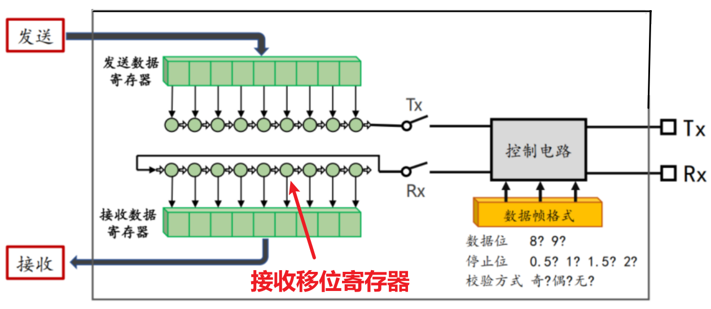

*Figure 4-1 数据帧处理的工作原理-图*

STM32的USART外设接收数据帧的过程是这样的：

1. Rx引脚接收到的数据首先被放入接收移位数据寄存器当中。
2. 当移位数据寄存器收到一个完整的数据帧后，就把移位数据寄存器中的数据写入接收数据寄存器，此时清空移位寄存器。
3. **（前面两步都由USART外设内部完成，程序员不需要控制）**
4. **当接收数据寄存器非空时，程序员控制STM32将接收数据寄存器中的数据读出来，接收数据寄存器被清空。**
5. 重复上述过程，直到所有的数据都接收完成。

所以对于程序员而言，只需要搞清楚两个事情，就可以实现STM32串口接收数据了：

1. 如何确定接收数据寄存器是非空的，从而开始读取数据呢？
2. 如何将接收数据寄存器中的数据读出来呢？

针对这两个问题，下面我们讲：

1. 标志位：RXNE
2. 标准库函数：USART_ReceiveData

#### 4.1 RXNE标志位

RXNE （Receive Data Register Not Empty，接收数据寄存器非空），即接收数据寄存器非空标志位。

**用于指示 USART 已经接收到数据，并且数据已经存入接收数据寄存器，等待被读取。**

当RXNE 标志位为RESET（0）时，表示接收数据寄存器为空，此时不能进行数据读取。

当RXNE 标志位为SET（1）时，表示接收数据寄存器非空有数据，此时可以进行数据读取。

在实现串口接收读取数据时，我们通常都会在读取之前，加上一行代码：

```c
// 等待接收数据寄存器非空
while(USART_GetFlagStatus(USART1, USART_FLAG_RXNE) == RESET);
```

该行代码的作用是等待接收数据寄存器变为非空状态，从而进行下一步读取数据的操作。

#### 4.2 USART_ReceiveData函数

`USART_ReceiveData()`是 STM32 标准外设库提供的，一个用于从 USART 接收数据寄存器中读取数据的函数。

此函数的声明如下：

```c
uint16_t USART_ReceiveData(USART_TypeDef* USARTx);
```

其形参USARTx没什么可说的，指定要读取数据的 USART 外设（如`USART1`、`USART2`）。

其返回值就是USART接收到的一个数据帧的数据，虽然返回值是16位无符号数，但实际上只有低9位有效：8 位的数据位 + 可能存在的校验位。

假如不使用校验位，那就是只有低8位有效，表示有效数据位。

注意：

1. 如果**USART 采用 8 位数据格式**，则返回值的低 8 位为有效数据。
2. 如果**USART 采用 9 位数据格式**，则返回值的低 9 位有效（需手动处理）。
3. **读取**USART_ReceiveData()**会自动设置**RXNE**标志位为RESET，表示接收数据寄存器已空。**

现在完事具备，开始实现STM32串口接收数据。

#### 4.3 PC发送指令控制PC13指示灯

在PC端使用串口工具发送数据，STM32接收数据后，实现控制PC13指示灯。

具体而言，**PC 端发送数据**

1. 发送0**→ PC13 LED 熄灭**
2. 发送1**→ PC13 LED 点亮**

参考代码如下：

```c
  #include "stm32f10x.h"                  // Device header
  #include "Delay.h"
  #include "OLED.h"
  #include <stdio.h>

  /*
     PC端的Tx引脚接入PA10引脚(USART1_Rx)
     PC端的Rx引脚接入PA9引脚(USART1_Tx)
     需求: 实现单片机向PC端发送数据
     流程如下:
     1.接线
     2.编写程序
     3.初始化PA9引脚为复用推挽输出模式,初始化PA10引脚设置为浮空输入模式
         如果考虑接线可能会断路,PA10引脚可能悬空
         也可以把PA10引脚设置为上拉输入模式
         引脚悬空时存在一个默认的高电平输入,表示通信的空闲状态
     4.初始化USART1外设,设置串口通信的各项参数
         数据位: 8位,不带校验位
         波特率: 115200
         停止位: 1位
     5.真正开启USART1外设,USART_Cmd

     LED直接选择PC13指示灯,需要PC端发送指令控制它的开启与熄灭.

     以上就完成了USART1外设使用的准备工作
     需求:
     在PC端使用串口助手发送字符'0',表示熄灭LED
     在PC端使用串口助手发送字符'1',表示点亮LED
  */

  void USART1_TxRxInit(void);
  void USART1_Init(void);
  void USART1_SendByte(uint8_t Byte);
  uint8_t USART1_ReceiveByte(void);
  void LED_Init(void);
  void LED_ControlByPC(void);

  int main(void) {
     // main函数中调用USART1初始化函数
     USART1_TxRxInit();
     USART1_Init();
     // 初始化LED
     LED_Init();

     while (1) {
         // 在死循环中调用,持续不断的,轮询PC发送指令
         // PC端一旦发送指令,立刻指令相关的LED控制
         LED_ControlByPC();
     }
  }

  /**
    * @brief PC端发送指令控制LED的开启与熄灭.
    * @param 无
    * @retval 无
    * @note
    */
  void LED_ControlByPC(void) {
     // 1.接收PC端发送的指令
     // 注意: USART1_ReceiveByte函数是一个阻塞函数
     // 只要PC端不发送指令,那么该函数会一直阻塞在while中
     uint8_t ReceiveCmd = USART1_ReceiveByte();

     // 代码执行到这里,说明PC端已经发送了指令
     // 2.下面基于指令来控制LED的点亮和熄灭
     switch (ReceiveCmd) {
     case '0':
         // 熄灭
         GPIO_SetBits(GPIOC, GPIO_Pin_13);
         // 返回消息给PC端
         printf("LED Off!");
         break;

     case '1':
         GPIO_ResetBits(GPIOC, GPIO_Pin_13);
         // 返回消息给PC端
         printf("LED On!");
         break;

     default:
         printf("error: Command not exist!");
     }
  }

  /**
    * @brief 初始化推挽接法,接入单片机PA0引脚的LED
    * @param 无
    * @retval 无
    */
  void LED_Init(void) {
     // 1.开启GPIOC外设时钟
     RCC_APB2PeriphClockCmd(RCC_APB2Periph_GPIOC, ENABLE);

     // 2.初始化PC13引脚为通用推挽输出模式
     GPIO_InitTypeDef GPIO_InitStruct;
     GPIO_InitStruct.GPIO_Mode = GPIO_Mode_Out_PP;
     GPIO_InitStruct.GPIO_Pin = GPIO_Pin_13;
     GPIO_InitStruct.GPIO_Speed = GPIO_Speed_2MHz;
     GPIO_Init(GPIOC, &GPIO_InitStruct);

     // 3.PC13引脚默认输出高电平,LED熄灭
     GPIO_SetBits(GPIOC, GPIO_Pin_13);
  }

  /**
    * @brief 单片机基于USART1外设,接收PC端发送的1个字节数据
    * @param 无
    * @retval uint8_t: 单片机接收到的PC端发来的1个字节数据
    */
  uint8_t USART1_ReceiveByte(void) {
     // 1.等待接收数据寄存器非空
     // 也就是等待RXNE状态标志位置位
     while (USART_GetFlagStatus(USART1, USART_FLAG_RXNE) ==RESET);

     // 代码执行到这里时,RXNE标志位置位
     // 接收数据寄存器非空了,可以接收数据了

     // 2.接收USART1外设接收数据寄存器的数据,并返回
     return (uint8_t)USART_ReceiveData(USART1);
  }

  /*
     想要改变stdout的输出目的地,重定向stdout,需要改写fputc函数的实现
     改写此函数的实现,只需要将函数的声明照抄,然后直接给出自己想要的定义即可
     此函数的定义如下:
     int fputc(int ch, FILE *f);
     该函数的返回值是这一次输出的字符,ch就是待输出的字符

     扩展:
     这里属于改写了fputc函数的实现,属于一种"开后门"的语法
     C语言标准库的某些函数
     允许程序员自己编写它们的实现,然后在链接阶段
     链接器如果发现程序自己编写了实现,那就不去链接标准库实现
     而是优先链接程序员自己的实现
  */
  int fputc(int ch, FILE *f) {
     USART1_SendByte(ch);
     return ch;
  }

  /**
    * @brief 单片机发送1个字节数据给PC端
    * @param Byte: 待发送的1个字节数据
    * @retval 无
    */
  void USART1_SendByte(uint8_t Byte) {
     // 1.等待发送数据寄存器为空,也就是等待TXE状态标志位置位
     while (USART_GetFlagStatus(USART1, USART_FLAG_TXE) ==RESET);

     // 代码执行到这里,说明TXE已经置位了,发送数据寄存器已经为空了
     // 可以写发送数据寄存器,发送数据了
     // 2.将Byte数据发送出去
     USART_SendData(USART1, Byte);
  }

  /**
    * @brief 初始化USART1外设使用的两个引脚PA9(USART1_Tx)和PA10(USART1_Rx)
    * @param 无
    * @retval 无
    */
  void USART1_TxRxInit(void) {
     // 1.开启GPIOA外设时钟
     RCC_APB2PeriphClockCmd(RCC_APB2Periph_GPIOA, ENABLE);

     // 2.初始化两个引脚
     GPIO_InitTypeDef GPIO_InitStruct;
     GPIO_InitStruct.GPIO_Mode = GPIO_Mode_AF_PP; // PA9引脚设置为复用推挽输出模式
     GPIO_InitStruct.GPIO_Pin = GPIO_Pin_9;
     GPIO_InitStruct.GPIO_Speed = GPIO_Speed_2MHz;
     GPIO_Init(GPIOA, &GPIO_InitStruct);

     GPIO_InitStruct.GPIO_Mode = GPIO_Mode_IN_FLOATING; // PA10引脚设置为浮空输入模式
     GPIO_InitStruct.GPIO_Pin = GPIO_Pin_10;
     GPIO_Init(GPIOA, &GPIO_InitStruct);

     // 3.PA9引脚设置一个默认的高电平输出,表示通信空闲状态
     GPIO_SetBits(GPIOA, GPIO_Pin_9);
  }

  /**
    * @brief 初始化USART1外设
    * @param 无
    * @retval 无
    */
  void USART1_Init(void) {
     // 1.开启USART1外设时钟
     RCC_APB2PeriphClockCmd(RCC_APB2Periph_USART1, ENABLE);

     // 2.调用USART_Init函数,初始化USART1外设,设置串口通信的各项参数
     USART_InitTypeDef USART_InitStruct;
     USART_InitStruct.USART_BaudRate = 115200; // 设置波特率为115200
     USART_InitStruct.USART_HardwareFlowControl =USART_HardwareFlowControl_None;//不使用硬件流控
     USART_InitStruct.USART_Mode = USART_Mode_Rx | USART_Mode_Tx;//设置为可收可发模式
     USART_InitStruct.USART_Parity = USART_Parity_No; // 不进行奇偶校验
     USART_InitStruct.USART_StopBits = USART_StopBits_1; // 选择1位停止位
     USART_InitStruct.USART_WordLength = USART_WordLength_8b;//数据位选择8位,1个字节
     USART_Init(USART1, &USART_InitStruct);

     // 3.真正开启USART1外设
     USART_Cmd(USART1, ENABLE);
  }

```

这样只需要在PC端使用串口工具，发送"0/1"就可以实现PC13指示灯的亮灭控制了。

顺带着单片机还回复了LED控制消息给PC端。

需要注意的是：

1. PC端的串口工具发送的应该是字符"0/1"，而不是整数值"0/1"，这一点一定不要弄错了！
2. `USART1_ReceiveByte`函数在开头使用了while循环，轮询的去判断标志位，等待接收数据寄存器非空有数据可读。
   - a. 这意味着，若此函数调用后，始终无数据可读，那么整个程序将会阻塞在此函数的while循环当中。
   - b. `USART1_ReceiveByte`函数是一个阻塞函数，若PC端不发数据，导致USART读不到数据，该函数就会一直阻塞。

在`USART1_ReceiveByte`函数阻塞期间，STM32其它什么事情都做不了，这显然不太合理，需要优化，那应该怎么办呢？

**我们先挖个坑，后续课程马上来填坑。**

#### 4.4 PC端发送一行字符串，显示在OLED上

在之前的课程中，我们已经把OLED显示屏接入了面包板，并且也已经尝试使用工具函数将数据显示在OLED上。

现在就将OLED和串口通信结合在一起，共同实现程序的功能。

现在我们的需求是：

1. PC端使用串口发送字符串，以'\n'结尾表示发送完毕。**（必须给定一个结束标志，否则Read函数会一直读下去）**
2. STM32通过串口接收这个字符串，并将这个字符串显示在OLED显示屏上。

首先，接收数据时我们仍然只能使用下列函数，只能一个字节一个字节的接收：

```c
 /**
   * @brief 单片机基于USART1外设,接收PC端发送的1个字节数据
   * @param 无
   * @retval uint8_t: 单片机接收到的PC端发来的1个字节数据
   */
 uint8_t USART1_ReceiveByte(void) {
    // 1.等待接收数据寄存器非空
    // 也就是等待RXNE状态标志位置位
    while (USART_GetFlagStatus(USART1, USART_FLAG_RXNE) ==RESET);

    // 代码执行到这里时,RXNE标志位置位
    // 接收数据寄存器非空了,可以接收数据了

    // 2.接收USART1外设接收数据寄存器的数据,并返回
    return (uint8_t)USART_ReceiveData(USART1);
 }
```

那么怎么实现接收字符串呢？

很显然，我们需要一个字符一个字符的接收数据，然后自己构建出一个字符串，最后再把这个字符串打印到OLED上。

完整参考代码如下：

```c
  #include "stm32f10x.h" // Device header
  #include "Delay.h"
  #include "OLED.h"
  #include <stdio.h>

  // 此枚举类型表示下面函数构建字符串是否完成
  typedef enum {
     FINISHED, // 构建完成,可以调用函数展示字符串在OLED上
     UNFINISHED // 构建未完成
  } BuildStrStatus;
  // OLED屏幕上最终可以展示一个长度为5的字符串
  #define BUFFER_SIZE 6

  void USART1_TxRxInit(void);
  void USART1_Init(void);
  uint8_t USART1_ReceiveByte(void);
  void OLED_UpdateDisplay(char *Str);
  BuildStrStatus USART1_ReceiveChar2Str(char *Buffer);

  int main(void) {
     // main函数中调用USART1初始化函数
     USART1_TxRxInit();
     USART1_Init();
     OLED_Init();
     OLED_Clear();

     // 首先在OLED屏幕上展示一个标题:
     OLED_ShowString(1, 1, "Waiting String:");

     // 在main函数中创建局部变量Buffer,用作构建字符串的内存块
     char Buffer[BUFFER_SIZE];

     while (1) {
         // 轮询单片机是否完成字符串的构建,只要完成构建,立刻在OLED上展示这个字符串
         if (USART1_ReceiveChar2Str(Buffer) == FINISHED) {
             OLED_UpdateDisplay(Buffer);
         }
     }
  }

  /**
  * @brief 在 OLED 上更新字符串显示（循环覆盖 2-4 行）
  * @param Str 接收到的字符串
  * @retval 无
  */
  void OLED_UpdateDisplay(char *Str) {
     // 当前显示数据的行，从第 2 行开始（第 1 行是标题）
     static uint8_t CurrentLine = 2;

     // 如果到达 OLED 第 5 行（超出 4 行），重新回到第 2 行
     if (CurrentLine > 4) {
         // 先清屏再打印标题
         OLED_Clear();
         OLED_ShowString(1, 1, "Waiting String:");
         CurrentLine = 2;
     }

     OLED_ShowString(CurrentLine, 1, Str);
     // 切换到下一行
     CurrentLine++;
  }

  /*
     此函数一边接收PC端发送的字符,一边构建字符串,最终可以在OLED屏幕上展示这个字符串
     构建字符串就需要一个字符数组的存储空间
     那么这个存储空间,申请创建在哪里呢?多大呢?

     数据段肯定是可以的,该字符串还需要在main函数中展示在OLED上,本身就需要跨函数访问
     所以全局变量是可用的

     栈和局部变量就不行吗?
     实际上是可以的
     只有两个函数需要用到这块内存,本函数和main函数
     所以只需要,在main函数栈帧中申请创建局部变量字符数组内存空间
     然后在调用此函数时,把这块main函数栈帧上的局部变量内存块,作为参数传递
     这样就不需要使用全局变量了,也就不用使用数据段了.

     2.调用此函数,会出现一种情况:PC端暂时没有发送表示字符串结束的'\n'换行符
     那么此函数就一直阻塞吗?
     为了避免此函数一直阻塞,可以给此函数设置一个返回值
     用于指示字符串的构建是否完成
     只有构建完成时,才调用展示函数,将接收到的字符串展示在OLED上
     这样可以避免此函数阻塞单片机的执行

     BuildStrStatus这个枚举类型就表示此函数的,构建字符串状态
     此函数调用一次,就完成一个字符的接收,构建字符串当中的1个字符
  */
  BuildStrStatus USART1_ReceiveChar2Str(char *Buffer) {
     // 1.接收PC端发送的1个字符
     char ReceiveChar = (char)USART1_ReceiveByte();

     // 2.设置一个静态局部变量下标,用于指示下一个接收到的字符应该存储的位置
     static uint8_t BufferIdx = 0; // BufferIdx指的是Buffer数组的下标

     // 3.判断当前的字符数组是否可以继续存放字符,如果已经存不下了
     if (BufferIdx == BUFFER_SIZE - 1) {
         // 直接在字符末尾加上空字符,构建成字符串.
         // 丢弃当前接收到的字符,避免出现越界情况
         Buffer[BufferIdx] = 0;
         // 已经完成了一次字符串的构建,所以要重置BufferIdx
         BufferIdx = 0;
         return FINISHED;
     }

     // 代码运行到这里,说明字符数组仍然有位置存储字符
     // 4.判断一下接收到的字符是不是换行符,如果是换行符,那就直接完成字符串构建
     // 当然换行符就被丢弃了,不会被存储进字符数组
     if (ReceiveChar == '\n') {
         Buffer[BufferIdx] = 0;
         BufferIdx = 0;
         return FINISHED;
     }

     // 代码执行到这里,说明字符数组仍然有位置存储字符
     // 而且接收到字符不是换行符,于是把这个字符存入字符数组,构建没有完成
     Buffer[BufferIdx++] = ReceiveChar;
     return UNFINISHED;
  }

  /**
   * @brief 单片机基于USART1外设,接收PC端发送的1个字节数据
   * @param 无
   * @retval uint8_t: 单片机接收到的PC端发来的1个字节数据
   */
  uint8_t USART1_ReceiveByte(void) {
     // 1.等待接收数据寄存器非空
     // 也就是等待RXNE状态标志位置位
     while (USART_GetFlagStatus(USART1, USART_FLAG_RXNE) ==RESET);

     // 代码执行到这里时,RXNE标志位置位
     // 接收数据寄存器非空了,可以接收数据了

     // 2.接收USART1外设接收数据寄存器的数据,并返回
     return (uint8_t)USART_ReceiveData(USART1);
  }

  /**
   * @brief 初始化USART1外设使用的两个引脚PA9(USART1_Tx)和PA10(USART1_Rx)
   * @param 无
   * @retval 无
   */
  void USART1_TxRxInit(void) {
     // 1.开启GPIOA外设时钟
     RCC_APB2PeriphClockCmd(RCC_APB2Periph_GPIOA, ENABLE);

     // 2.初始化两个引脚
     GPIO_InitTypeDef GPIO_InitStruct;
     GPIO_InitStruct.GPIO_Mode = GPIO_Mode_AF_PP; // PA9引脚设置为复用推挽输出模式
     GPIO_InitStruct.GPIO_Pin = GPIO_Pin_9;
     GPIO_InitStruct.GPIO_Speed = GPIO_Speed_2MHz;
     GPIO_Init(GPIOA, &GPIO_InitStruct);

     GPIO_InitStruct.GPIO_Mode = GPIO_Mode_IN_FLOATING; // PA10引脚设置为浮空输入模式
     GPIO_InitStruct.GPIO_Pin = GPIO_Pin_10;
     GPIO_Init(GPIOA, &GPIO_InitStruct);

     // 3.PA9引脚设置一个默认的高电平输出,表示通信空闲状态
     GPIO_SetBits(GPIOA, GPIO_Pin_9);
  }

  /**
   * @brief 初始化USART1外设
   * @param 无
   * @retval 无
   */
  void USART1_Init(void) {
     // 1.开启USART1外设时钟
     RCC_APB2PeriphClockCmd(RCC_APB2Periph_USART1, ENABLE);

     // 2.调用USART_Init函数,初始化USART1外设,设置串口通信的各项参数
     USART_InitTypeDef USART_InitStruct;
     USART_InitStruct.USART_BaudRate = 115200; // 设置波特率为115200
     USART_InitStruct.USART_HardwareFlowControl =USART_HardwareFlowControl_None;//不使用硬件流控
     USART_InitStruct.USART_Mode = USART_Mode_Rx | USART_Mode_Tx;//设置为可收可发模式
     USART_InitStruct.USART_Parity = USART_Parity_No; // 不进行奇偶校验
     USART_InitStruct.USART_StopBits = USART_StopBits_1; // 选择1位停止位
     USART_InitStruct.USART_WordLength = USART_WordLength_8b;//数据位选择8位,1个字节
     USART_Init(USART1, &USART_InitStruct);

     // 3.真正开启USART1外设
     USART_Cmd(USART1, ENABLE);
  }

```

大家可以认真仔细的看一看这段代码实现，一些函数设计的细节问题，在注释中有较好的讲解，文档中就不一一详细说明了。

### 5. 扩展: 构建字符串越界时的处理（了解）

把上述构建字符串的缓冲区容量，也就是以下宏定义从100改成5：

```c
#define BUFFER_SIZE 6
```

然后实现以下功能：

1. 若PC端正常发送`\n`结尾构建字符串，且没有越界，则OLED正常展示这个字符串。
2. 若PC端发送的字符已经或累计超出阈值，则OLED最多展示5个长度的字符串。
3. **即便某次PC端发送数据越界，也不应该影响下一次PC端发送数据！！**

首先如果仍然按照上述代码继续执行，只是将缓冲区的容量改成6，会出现什么情况呢？

假如PC端发送的数据是"123456789\n"，那么OLED屏幕上展示的数据是"12345"，这是因为缓冲区的容量为6：

1. 前5个字符，也就是"12345"正常被存入字符数组，成为字符串的内容部分。
2. 处理接收'6'这个字符时，缓冲区容量不够了，于是丢弃这个'6'字符，并且在缓冲区末尾加上空字符，构建字符串。
3. 接下来程序会在OLED上展示字符串"12345"。

相信上述的逻辑，大家都能理解和搞清楚，那么如果此时PC继续发送数据会怎么样呢？

假如PC发送字符串"abc\n"，OLED上展示的数据是什么呢？

**经过测试，我们发现OLED屏幕上最终展示的数据是："7abc"，这是为什么呢？怎么清理掉这个多余的字符串'7'呢？**

#### 5.1 字符'7'的由来

**首先我们来解释第一件事情：'7'这个字符哪里来的？**

首先我们可以查询开发手册当中对这种情况的一个说明：

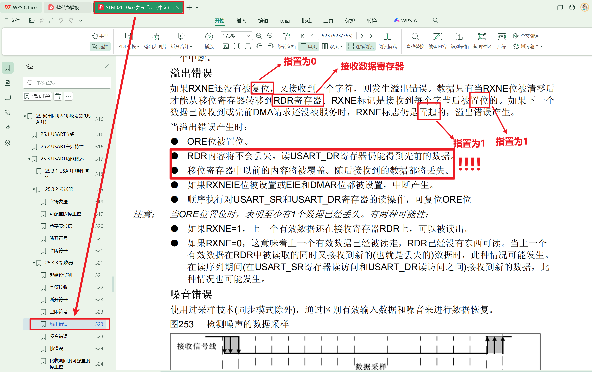

*Figure 5.1-1 USART外设溢出错误-图*

这段描述，用大白话来说就是：

1. 当接收数据寄存器非空、一直未被读取且后续需要接收其它数据时，USART外设会产生一个溢出错误。
2. 此时，USART会选择保留第一个未读取的数据位。
3. **而后续所有发送的数据都只会覆盖移位寄存器当中的数据，而不会覆盖接收数据寄存器当中的数据。**

比如我们的例子中：

字符'6'被正常读到了且执行了缓冲区构建字符串的处理操作，但'6'没有被放入缓冲区，而是被直接丢弃了。

从字符'7'开始，单片机实际上并没有处理数据的接收操作，因为这个时候单片机忙于执行OLED显示字符串的操作。

**所以从字符'7'开始，只有'7'被保留在接收数据寄存器当中，后续的"89\n"全部都被丢弃了。**

当PC端再次发送"abc\n"字符串给单片机时，由于接收数据寄存器仍然保留了字符'7'，所以这个字符'7'就成为了构建字符串的第一个字符。

这也就是第二次OLED展示字符串内容为"7abc"的原因，你搞懂了吗？

#### 5.2 清空接收数据寄存器操作

现在我们知道接收数据寄存器会由于PC发送数据过多而产生溢出错误，从而只保留第一个未读取数据。

那么该如何实现清空接收数据寄存器的操作呢？毕竟这唯一的一个保留数据也不是我们需要的。

这个操作的实现其实非常简单，只需要在循环中判断RXNE标志位为`SET`，然后在循环当中把接收数据寄存器数据读出来即可。

于是我们就可以实现下面的一个函数：

```c
// 读取PC发送的残留数据, 清空接收数据寄存器
void USART1_ClearRDR(void) {
    while (USART_GetFlagStatus(USART1, USART_FLAG_RXNE) == SET) {
        USART_ReceiveData(USART1); // 读接收数据寄存器但不存储，丢弃数据
    }
}
```

那么这个函数应该在哪里调用呢？

我们首先想到的是在处理缓冲区溢出/越界的逻辑中调用此函数，即：

```c
 // ...其它代码省略, 和上面实现保持一致

 // 代码运行到这里, 说明接收到的字符不是换行符
 // 将字符写入Buffer数组
 if (BufferIdx < BUFFER_SIZE - 1) {
     // 当前的Buffer数组还能继续追加字符
     Buffer[BufferIdx++] = ReceiveChar;
 } else {
     // 当前的Buffer数组已经装满了, 不能继续装了, 直接构建字符串, 然后结束
     Buffer[BufferIdx] = 0;
     BufferIdx = 0;
     USART1_ClearRDR(); // 清理接收数据寄存器
     return COMPLETED;
 }
```

这样可以实现功能吗？经过实测，这样是无法实现功能的。程序和之前相比，执行的结果没有发生任何改变。

我们可以通过Keil5软件的调试模式来查看一下程序的执行状态，不难发现`USART1_ClearRDR`函数当中的while循环实际上是没有执行的。

这是为什么呢？

这是因为程序指令的执行速度是很快的，但USART外设传输数据的速率却显著更慢。

所以当你把清理逻辑放在字符'6'的读取处理逻辑中时，**此时的字符'7'仍然处在移位寄存器当中**，还没有来得及被放入接收数据寄存器。

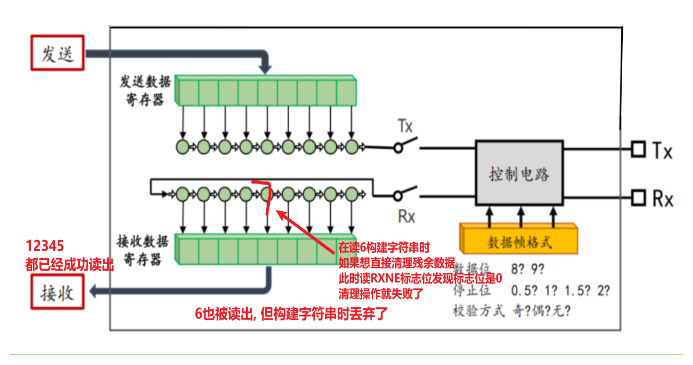

*Figure 5.2-1 清理RDR寄存器-图*

在这样的场景下，使用RXNE标志位为1进行判断，从而读取RDR寄存器清理残余数据，显然是不会成功的。因为连while循环都进不去。

那怎么办呢？

**既然指令的执行速度太快，那么加个延迟不就好了：**

```c
 // ...其它代码省略, 和上面实现保持一致

 // 代码运行到这里, 说明接收到的字符不是换行符
 // 将字符写入Buffer数组
 if (BufferIdx < BUFFER_SIZE - 1) {
    // 当前的Buffer数组还能继续追加字符
    Buffer[BufferIdx++] = ReceiveChar;
 } else {
    // 当前的Buffer数组已经装满了, 不能继续装了, 直接构建字符串, 然后结束
    Buffer[BufferIdx] = 0;
    BufferIdx = 0;
    // 延时1ms即可
    Delay_Ms(1);
    USART1_ClearRDR(); // 清理接收数据寄存器
    return COMPLETED;
 }
```

这样就可以实现：

PC发送"123456789\n"，OLED展示"12345"PC再次发送"abc\n"，OLED展示"abc"当然，这个函数还有一个更好的调用位置，且不用增加延迟。

**在main函数当中，在OLED展示字符串信息后，由于间隔较长，RDR寄存器一定就已经非空了。**

此时调用清理函数就再合适不过了：

```c
 int main(void) {
    // ...省略

    while (1) {
        if (USART1_ReceiveString(Buffer) == COMPLETED) {
            OLED_UpdateDisplay(Buffer);
            USART1_ClearBuffer(); // 清理接收数据寄存器
        }
    }
 }
```

这样依然可以实现一样的效果，且不需要延时。

你理解了吗？

### 6. 总结：串口通信编程的一般流程

首先硬件层面的接线这里就不再赘述了，直接从软件编程上开始总结。一般步骤/流程如下：

**第一步：STM32的Rx和Tx引脚初始化**我们以使用USART1外设，利用引脚的复用功能为例子。

主要完成下面两个步骤就可以了：

1. **开启外设时钟**：使用`RCC_APB2PeriphClockCmd()`启动 GPIOA 和 USART1 外设的时钟。
2. **引脚初始化**：配置 Tx (PA9) 和 Rx (PA10) 引脚。PA9 设置为复用推挽输出模式，用于发送数据，PA10 设置为浮空/上拉输入模式，用于接收数据。

**第二步：USART 外设配置**

1. **波特率设置**：设置波特率为 115200。
2. **数据位配置**：设置数据位为 8 位（`USART_WordLength_8b`）。
3. **校验位设置**：不使用校验位（`USART_Parity_No`）。
4. **停止位配置**：设置停止位为 1 位（`USART_StopBits_1`）。
5. **硬件流控设置**：没有硬件流控（`USART_HardwareFlowControl_None`）。
6. **启用串口**：通过`USART_Init()`配置 USART 的所有参数，然后用`USART_Cmd()`启动 USART1。

**第三步：单片机发送数据的流程**

1. 检查发送寄存器空标志位`USART_FLAG_TXE`
2. 当发送数据寄存器为空时，才将数据写入USART的发送数据寄存器（TDR）。

基于上面的发送函数，可以实现多种多样的发送逻辑。

**第四步：单片机接收数据的流程**

1. 检查接收数据寄存器非空标志位（`USART_FLAG_RXNE`）。
2. 当接收数据寄存器非空时，从接收数据寄存器（RDR）中读取数据。
3. 处理接收到的数据。

基于上面的接收函数，可以实现多种多样的接收并处理逻辑。

### 7. 补充与总结：USART的状态标志位

在上面我们已经讲过USART的三个状态标志位了：

1. TXE
2. TC
3. RXNE

但实际上USART的状态标志位并不仅只有三个。

下列表格罗列了常见的标志位。但由于时间关系，就不一一演示讲解了。

| 标志位名称 | 标志位的宏定义 | 英文全称及含义 |
|---|---|---|
| TXE | `USART_FLAG_TXE` | 发送数据寄存器为空（Transmit Data Register Empty） |
| TC | `USART_FLAG_TC` | 发送完成（Transmission Complete） |
| RXNE | `USART_FLAG_RXNE` | 接收数据寄存器非空（Receive Data Register Not Empty） |
| ORE | `USART_FLAG_ORE` | 溢出错误（Overrun Error） |
| NE | `USART_FLAG_NE` | 噪声错误（Noise Error） |
| FE | `USART_FLAG_FE` | 帧错误（Framing Error） |
| PE | `USART_FLAG_PE` | 奇偶校验错误（Parity Error） |

这些状态标志位的作用，以及它们何时置为1，可以参考下面这个表格：

| 标志位名称 | 标志位的作用 | 标志位何时置为 1 |
|---|---|---|
| TXE | 指示发送数据寄存器是否为空 | 当发送数据寄存器为空时，置为 1 |
| TC | 指示传输是否完成 | 发送/移位数据寄存器都为空时，传输完成，置为 1 |
| RXNE | 指示接收数据寄存器是否为非空 | 当接收数据寄存器非空时，置为 1 |
| ORE | 溢出错误，表示接收寄存器的内容未被及时读取，发生了溢出错误 | 当接收数据寄存器中的数据未被读取，且新的数据到达时，置为 1。 |
| NE | 噪声错误，表示接收到的数据帧中有噪声错误 | 当外部存在噪声干扰导致数据接收错误时，置为 1 |
| FE | 帧错误，表示接收的数据帧格式错误（如起始位、数据位或停止位错误） | 最常见的就是检测不到停止位，置为 1 |
| PE | 奇偶校验错误，表示接收到的帧的奇偶校验位不正确 | 当接收到的数据的奇偶校验位错误时，置为 1 |

值得谈一谈的就是 ORE 溢出错误。假如单片机作为接收端接收 PC 发送来的数据，但单片机未能及时处理数据，比如：

1. 单片机压根没有开启相应外设，没有执行相应处理逻辑。
2. 单片机忙于其它任务的处理，无暇顾及处于通信数据。
3. ...

在这些场景中，接收数据寄存器就只会保留第一个未接收的数据位。

后续剩余数据位则全部丢弃，这就导致数据丢失的情况出现，此时就产生了 ORE 溢出错误。

当然关于 ORE 溢出错误，上面的扩展中也讲了具体细节，大家感兴趣可以自行去查看学习一下。

这些大家仅做了解即可，后续学习工作中若用到了，则可以回头看一看。

### 8. 扩展：用于打印调试信息的串口模块

**注意，使用printf函数重定向stdout实现格式化打印调试信息，必须使用微型库：**

**必须勾选下面选项卡中的选项：**

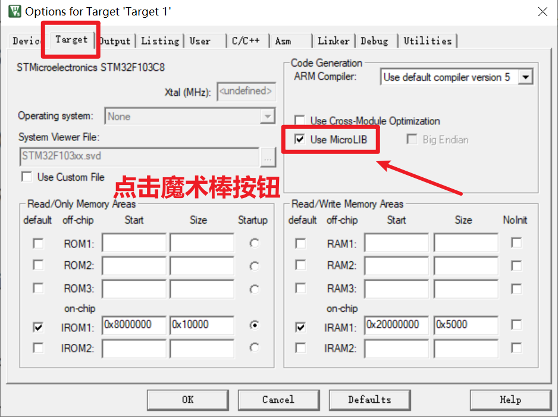

*Figure 8-1 Use MicroLIB选项-图*

**注意，不勾选此选项，printf函数会直接卡死，程序无法执行。**

**DebugUSART1.h头文件，代码如下：**

```c
 #ifndef __DEBUG_USART1_H
 #define __DEBUG_USART1_H

 #include "stm32f10x.h"
 #include <stdio.h>

 void DebugUSART1_Init(void);

 #endif // !__DEBUG_USART1_H
```

**DebugUSART1.c源代码文件，代码如下：**

```c
 #include "DebugUSART1.h"

 /**
   * @brief 配置 USART1 的 TX（PA9）和 RX（PA10）引脚
   * @param 无
   * @retval 无
   */
 static void DebugUSART1_TxRx_Init(void) {
     // 开启 GPIOA 时钟
     RCC_APB2PeriphClockCmd(RCC_APB2Periph_GPIOA, ENABLE);

     GPIO_InitTypeDef GPIO_InitStruct;

     // PA9 -> USART1_TX（复用推挽输出）
     GPIO_InitStruct.GPIO_Pin = GPIO_Pin_9;
     GPIO_InitStruct.GPIO_Mode = GPIO_Mode_AF_PP;
     GPIO_InitStruct.GPIO_Speed = GPIO_Speed_50MHz;
     GPIO_Init(GPIOA, &GPIO_InitStruct);

     // PA10 -> USART1_RX（浮空输入）
     GPIO_InitStruct.GPIO_Pin = GPIO_Pin_10;
     GPIO_InitStruct.GPIO_Mode = GPIO_Mode_IN_FLOATING;
     GPIO_Init(GPIOA, &GPIO_InitStruct);
 }

 /**
   * @brief 初始化 USART1 外设
   * 默认配置：115200，8位数据位，无校验，1位停止位（8N1）
   * @param 无
   * @retval 无
   */
 void DebugUSART1_Init(void) {
     // 1. 初始化 TX/RX 引脚
     DebugUSART1_TxRx_Init();

     // 2. 开启 USART1 外设时钟
     RCC_APB2PeriphClockCmd(RCC_APB2Periph_USART1, ENABLE);

     // 3. 配置 USART1 参数
     USART_InitTypeDef USART_InitStruct;
     USART_InitStruct.USART_BaudRate = 115200;//波特率
     USART_InitStruct.USART_HardwareFlowControl =USART_HardwareFlowControl_None;//无硬件流控
     USART_InitStruct.USART_Mode = USART_Mode_Rx | USART_Mode_Tx;//可收可发
     USART_InitStruct.USART_Parity = USART_Parity_No;//无校验位
     USART_InitStruct.USART_StopBits = USART_StopBits_1;//1位停止位
     USART_InitStruct.USART_WordLength = USART_WordLength_8b;//8位数据位
     USART_Init(USART1, &USART_InitStruct);

     // 4. 开启 USART1 外设
     USART_Cmd(USART1, ENABLE);
 }

 /**
   * @brief 重定向 printf() 输出到 USART1（轮询方式）
   * @param ch 需要发送的字符
   * @param f 文件流指针（当前函数中无实际作用）
   * @retval 返回发送的字符
   */
 int fputc(int ch, FILE *f) {
     // 等待发送数据寄存器为空（TXE = 1）
     while (USART_GetFlagStatus(USART1, USART_FLAG_TXE) == RESET);

     // 将数据写入发送寄存器
     USART_SendData(USART1, (uint8_t)ch);
     return ch;
 }
```

**测试代码：**

```c
 #include "stm32f10x.h"
 #include "Delay.h"
 #include "DebugUSART1.h"

 int main(void) {
     // 初始化调试串口
     DebugUSART1_Init();
     // 延时等待稳定
     Delay_Ms(10);

     printf("\r\n");
     printf("=================================\r\n");
     printf(" Debug USART1 Test Start\r\n");
     printf("=================================\r\n");

     uint32_t Count = 0;

     while (1) {
         // 1. 普通字符串测试
         printf("Hello STM32!\r\n");

         // 2. 格式化输出测试
         printf("Count = %u\r\n", Count);

         // 3. 多种格式输出测试
         printf("Dec:%u Hex:0x%08X\r\n", Count, Count);

         printf("---------------------------------\r\n");

         Count++;

         Delay_S(3); // 每3秒打印一次
     }
 }

```

大家可以自行测试一下，当然这个串口打印调试信息，是基于重定向`fputc`函数实现的。

这两个文件，在“王道嵌入式软件环境”下，也有对应版本，你可以下载下来使用，当然你完全也可以选择自己创建。

实际上还可以选择其它的实现方式。

### 9. 扩展：模仿printf函数手动实现printf1格式化打印字符串

除了可以重定向`stdout`到串口，使用`printf`函数来格式化打印调试信息到串口外：

还可以模仿`printf`函数的实现思路，自己手动封装一个`printf1`函数，用来格式化打印调试信息。

这种方式通常是更推荐使用的方式：

1. 它不依赖将`stdout`重定向到串口
2. **它可以更直观地看到字符串格式化以及串口输出的整个过程，更可控，出问题时也更容易排查**
3. 它也不需要依赖微型库

仍然采用模块化编程，参考代码如下：

**DebugUSART1.h头文件，代码如下：**

```c
 #ifndef __DEBUG_USART1_H__
 #define __DEBUG_USART1_H__

 #include "stm32f10x.h"
 // 以下两个头文件中的某些函数声明，在实现printf1函数时需要用到
 #include <stdio.h> // 格式化构建字符串过程中需要调用函数的头文件
 #include <stdarg.h> // 使用可变参数的头文件

 /**
  * @brief 初始化调试串口 USART1
  */
 void DebugUSART1_Init(void);

 /**
  * @brief 调试打印函数（串口版 printf）
  */
 void printf1(const char *format, ...);

 #endif // !__DEBUG_USART1_H__
```

**DebugUSART1.c源代码文件，代码如下：**

```c
 /* DebugUSART1.c
  *
  * 模块定位：
  * ------------------------------------------------------------
  * 本文件实现一个基于 USART1 的调试输出工具
  *
  * 对外仅暴露 初始化 和 printf1 接口
  * printf1函数并不依赖stdout
  * 但调用方式和printf类似，效果是格式化输出字符串到USART1
  */

 #include "DebugUSART1.h"

 /* ================= 内部函数（不对外暴露） ================= */

 /**
  * @brief USART1 发送单字节（阻塞式）
  * @note 仅供本文件内部使用
  */
 static void DebugUSART1_SendByte(uint8_t Byte) {
     USART_SendData(USART1, Byte);

     /* 等待发送数据寄存器为空 */
     while (USART_GetFlagStatus(USART1, USART_FLAG_TXE) == RESET);
 }

 /* ================= 对外接口实现 ================= */

 /**
  * @brief 初始化 USART1，用于调试输出
  */
 void DebugUSART1_Init(void) {
     /* 1. 开启 USART1 和 GPIOA 外设时钟 */
     RCC_APB2PeriphClockCmd(RCC_APB2Periph_USART1, ENABLE);
     RCC_APB2PeriphClockCmd(RCC_APB2Periph_GPIOA, ENABLE);

     /* 2. 初始化 GPIO 引脚 */
     GPIO_InitTypeDef GPIO_InitStructure;

     /* PA9 -> USART1_TX：复用推挽输出 */
     GPIO_InitStructure.GPIO_Mode = GPIO_Mode_AF_PP;
     GPIO_InitStructure.GPIO_Pin = GPIO_Pin_9;
     GPIO_InitStructure.GPIO_Speed = GPIO_Speed_50MHz;
     GPIO_Init(GPIOA, &GPIO_InitStructure);

     /* PA10 -> USART1_RX：上拉输入 */
     GPIO_InitStructure.GPIO_Mode = GPIO_Mode_IPU;
     GPIO_InitStructure.GPIO_Pin = GPIO_Pin_10;
     GPIO_InitStructure.GPIO_Speed = GPIO_Speed_50MHz;
     GPIO_Init(GPIOA, &GPIO_InitStructure);

     /* 3. USART 参数配置：115200, 8N1 */
     USART_InitTypeDef USART_InitStructure;
     USART_InitStructure.USART_BaudRate = 115200;
     USART_InitStructure.USART_HardwareFlowControl =USART_HardwareFlowControl_None;
     USART_InitStructure.USART_Mode = USART_Mode_Tx |USART_Mode_Rx;
     USART_InitStructure.USART_Parity = USART_Parity_No;
     USART_InitStructure.USART_StopBits = USART_StopBits_1;
     USART_InitStructure.USART_WordLength = USART_WordLength_8b;
     USART_Init(USART1, &USART_InitStructure);

     /* 4. 开启 USART1 */
     USART_Cmd(USART1, ENABLE);
 }

 /**
  * @brief 调试打印函数（串口版 printf）
  * @param format: 格式化字符串，和printf函数的第一个参数完全一致
  * @note
  * 1. 用法与 printf 类似
  * 2. 实际输出通过 USART1 完成
  */
 void printf1(const char *format, ...) {
     // 初始情况下，单次格式化构建字符串的最大长度为99
     // 后续可以根据实际情况，增加buffer的容量
     char buffer[100];
     /*
        参照C语言库函数中printf函数的实现
        把 printf1("xxx", 参数...) 里的可变参数
        安全地取出来，并按格式拼成一段字符串。

        具体的实现，大家可以不了解。
     */
     va_list list;
     va_start(list, format);
     vsprintf(buffer, format, list);
     va_end(list);

     /* 逐字节输出数据到串口 */
     for (uint16_t i = 0; buffer[i] != '\0'; i++) {
        DebugUSART1_SendByte((uint8_t)buffer[i]);
     }
 }
```

**测试代码：**

```c
 #include "stm32f10x.h"
 #include "Delay.h"
 #include "DebugUSART1.h"

 int main(void) {
     // 初始化调试串口
     DebugUSART1_Init();
     // 延时等待稳定
     Delay_Ms(1000);

     printf1("\r\n");
     printf1("=================================\r\n");
     printf1(" Debug USART1 Test Start\r\n");
     printf1("=================================\r\n");

     uint32_t Count = 0;

     while (1) {
         // 1. 普通字符串测试
         printf1("Hello STM32!\r\n");

         // 2. 格式化输出测试
         printf1("Count = %u\r\n", Count);

         // 3. 多种格式输出测试
         printf1("Dec:%u Hex:0x%08X\r\n", Count, Count);

         printf1("---------------------------------\r\n");

         Count++;

         Delay_S(3); // 每3秒打印一次
     }
 }

```

测试代码无非就是把之前的printf函数调用，改成了printf1函数调用。

注意：

printf1格式化构建字符串的过程，参考了printf函数的源码实现，其实现原理不需要了解。

**只需要知道——当成构建字符串的buffer数组长度是100，也就是说最多一次性打印字符串的长度是99！**

如果是手动实现printf1函数来格式化打印调试信息，就不需要使用微型库了！


---
