# 嵌入式讲义（卷四 中断）

> 拆分自 `1_嵌入式讲义汇总.md / 卷四 中断`，共 4 份 PDF 讲义。所有插图保存在 `assets/` 目录，请保持相对位置不变。

## 目录

- 01 中断相关概念

- 02 串口外设中断

- 03 外部中断

- 04 标志位总结

---

## 01 中断相关概念

### 1. 概述

**中断（Interrupt）**作为嵌入式系统一个非常重要的概念，已成为单片机（MCU）中最基础的外设模块/功能之一。

利用中断机制可以有效提高 CPU 效率，绝大多数嵌入式应用开发都会用到中断系统。

熟练编写中断程序是嵌入式开发人员必备的基本技能。

基于中断的重要性、基础性以及相对比较简单，我们将中断放到GPIO和串口通信之后学习。

是我们学习STM32外设的第三大部分。

### 2. 中断是什么？

为了讲清楚中断是什么，我们可以打一个通俗的比喻：

你正在图书馆看书学习，这时快递员通知你的快递到了，你暂停看书去拿快递，那么拿快递就是一个**中断**。中止你现在正在做的事情（看书）转而去做另一个事情。

如果在去取快递的路上，你突然肚子疼，只好先去趟卫生间，然后再去拿快递。

此时，肚子疼又是一个中断，而且是比拿快递更重要、更紧迫的事件，也就是说，中断中又有一个中断，这就是**中断嵌套**。

只有更重要、更迫切的（高级别）中断才能中止当前级别低的中断，也就是说中断是有**优先级**的。

能够引发中断的事件（快递到了、肚子疼等）称为**中断源**。

而对中断进行处理（拿快递、去卫生间等）称为**中断服务程序（Interrupt Service Routine, 简称ISR）**。

这里有三个重要的概念：

1. **中断：**在主程序运行过程中，出现了特定的中断触发条件**（中断源）**，使得CPU暂停当前正在运行的程序，转而去处理中断程序，处理完成后又返回原来被暂停的位置继续运行。
2. **中断优先级：**当有多个中断源同时申请中断时，CPU会根据中断源的轻重缓急进行裁决，优先响应处理更加紧急的中断源。
3. **中断嵌套：**当一个中断服务程序正在运行时，又有新的更高优先级的中断源申请中断，CPU再次暂停当前中断程序，转而去处理新的中断程序，处理完成后依次进行返回。

下面的两张图就很好的解释了中断和中断嵌套：

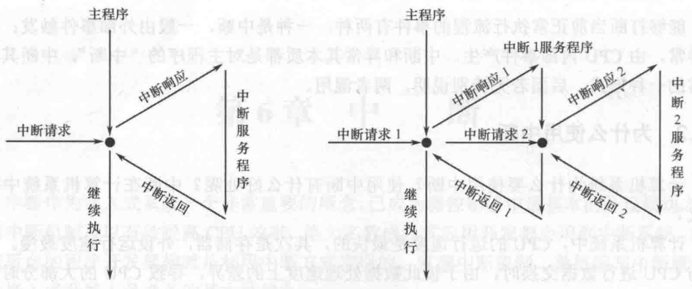

*图2-1中断和中断嵌套-流程图*

在一个实际程序中，中断的处理是自动完成的，请看下图：

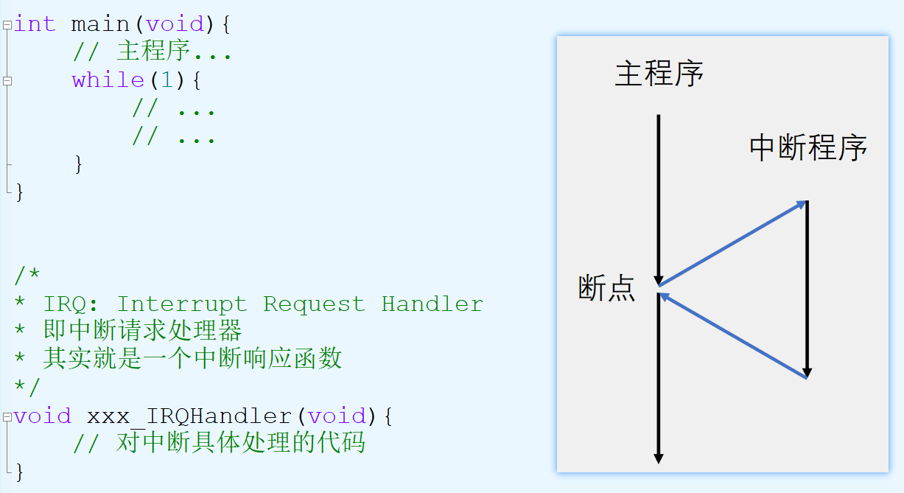

*图2-2中断处理函数-图*

简单来说：

**程序员只需要编写好中断服务程序，并完成中断触发条件等相关配置即可。**

当主程序运行过程中触发中断条件时，嵌入式系统会自动完成以下操作：

1. 自动保存主程序的当前执行状态
2. 跳转去执行中断处理函数（中断服务程序，ISR）
3. 执行完毕中断处理逻辑后，自动恢复之前保存的主程序状态，并继续从中断前的指令处执行。
4. **这个过程就是常说的“上下文切换”，或者“中断上下文切换”。**

以上这些过程，都由嵌入式系统自动完成，程序员不需要手动处理这些细节。

那么程序员在使用中断这种机制时，需要动手做的事情有哪些呢？

1. 设置好中断源，配置好中断相关的参数数据，还需要手动开启这个中断源。
2. 编写好相应的中断服务程序，也就是编写对应的中断处理函数。

**从这个角度看，中断是一种高效且易用的语法机制。**

### 3. 中断优先级

在上面我们已经理解了中断的概念含义，现在我们进一步来了解一下中断优先级的概念。

在一个STM32嵌入式系统中，几乎所有的外设都可以产生中断源。

如果这些中断同时发生（例如多个外设同时产生中断请求），那么必须决定哪一个中断先被处理。

为此，STM32 提供了中断优先级机制，允许程序员为每个中断源设置不同的优先级。

STM32 的中断优先级被分为两组，这两组优先级分别是：

1. **抢占优先级（Preemption Priority）**
2. **子优先级（Subpriority，有些地方也叫响应优先级）**

下面来讲解一下这两个优先级的相关概念。

**优先级具体在表示时，都会使用非负整数表示，最小值是0，数值越小表示优先级越高，0就是最高的优先级。**

#### 3.1 抢占优先级

**抢占优先级是最关键且核心的优先级：**

1. 若主程序正常运行时，同时产生了多个中断，那么抢占优先级更高的中断先执行。
2. 若主程序已经在执行中断A了，中断A执行过程中产生了中断B，且中断B的抢占优先级更高，则会产生中断嵌套，优先执行中断B。

**总之抢占优先级的核心点在于"抢占"二字，具有更高抢占优先级的中断可以打断正在执行中的低优先级中断。**

#### 3.2 子优先级

**只有当抢占优先级相同时，才需要考虑中断的子优先级：**

1. 若主程序正常运行时，同时产生了多个抢占优先级相同的中断，那么子优先级更高的中断先执行。
2. 若A和B是相同抢占优先级的两个中断：
   - a. 系统当前正在执行中断A，此时产生了中断B
   - b. **无论中断B的子优先级更高还是更低，中断B都不能打断中断A的执行，无法产生中断嵌套。**

也就是说，子优先级和中断嵌套没有关系，只要当前已有中断在执行，那么相同抢占优先级的中断就无法打断。

总之结论如下：

1. **抢占优先级决定了多个中断同时触发时，哪个中断优先执行，抢占优先级越高，越先执行。**
2. **抢占优先级还决定了哪个中断可以打断另一个中断，抢占优先级高的中断可以打断，当前正在执行的，抢占优先级更低的中断。**
3. **子优先级只用来区分同一抢占优先级的中断触发时，执行的先后顺序，子优先级越高，越先执行。子优先级和中断嵌套没有关系！**

#### 3.3 中断执行优先级举例

假如现在有5个中断：

1. A中断，抢占优先级3，子优先级3
2. B中断，抢占优先级2，子优先级4
3. C中断，抢占优先级2，子优先级2
4. D中断，抢占优先级2，子优先级3

假如主程序在正常执行的某点，突然触发了A中断，此时由于只有一个中断源，不用考虑优先级，直接执行A中断的处理函数，如下图所示：

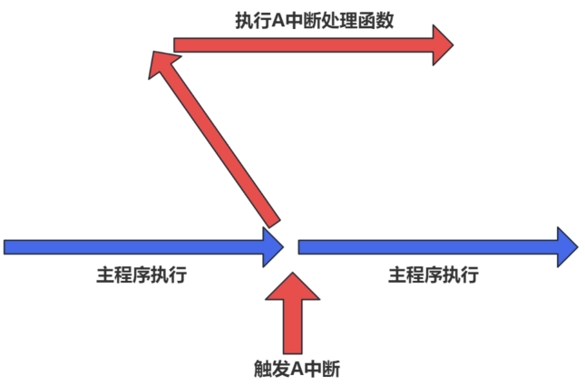

*图3.3-1中断执行优先级举例-图1*

假如在执行A中断处理函数的过程中，突然触发了B中断，会发生什么事情呢？

由于B中断的抢占优先级更高（2 < 3），所以B会打断A中断函数的执行，嵌套执行B中断，即产生了中断嵌套。如下图所示：

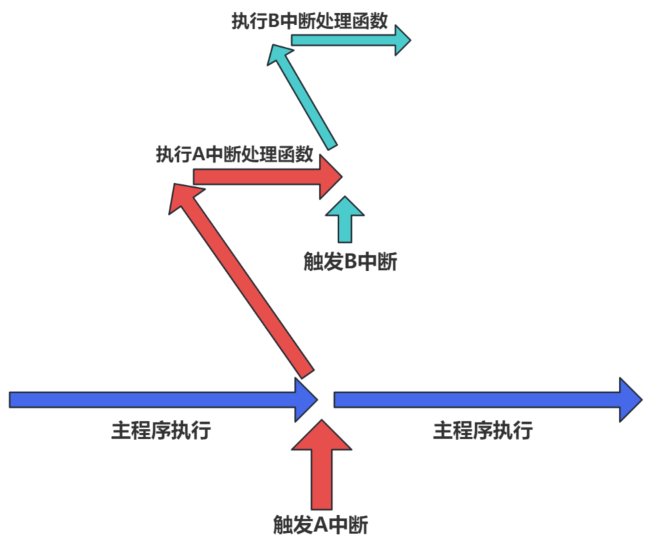

*图3.3-2中断执行优先级举例-图2*

再假如在执行B中断处理函数的过程中，突然同时触发了CD两个中断，会发生什么事情呢？

BCD四者的抢占优先级是一致的，哪怕CD的子优先级更高，但子优先级和中断嵌套没有关系，所以CD都必须等待B中断执行完毕后才可能执行。

在B中断执行完毕后，会返回A中断被嵌套中断的断点位置，CD的抢占优先级高于A，所以CD会继续打断A的执行。

而C和D之间，则会根据子优先级来排列它们的执行顺序，C的子优先级更高，所以C先于C执行完毕，都先于A执行完毕。

整个中断执行的流程图，如下图所示：

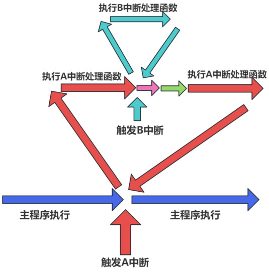

*图3.3-3中断执行优先级举例-图3*

在大多数嵌入式应用中，程序的复杂度往往比较低，中断触发的情况通常是由单一事件引起的，中断嵌套的情况是比较少见的，更不用说上述这么复杂的情况。

但是在一些实时系统中，还是会存在一些比较复杂的中断系统，所以对于中断优先级的相关概念，大家还是要了解清楚的。

搞清楚了STM32中断优先级的概念，那么如何设置中断的优先级呢？

**为了搞清楚这个事情，我们先来看一下STM32的中断系统框图。**

### 4. STM32的中断系统框图

STM32的中断系统框图，如下图所示：

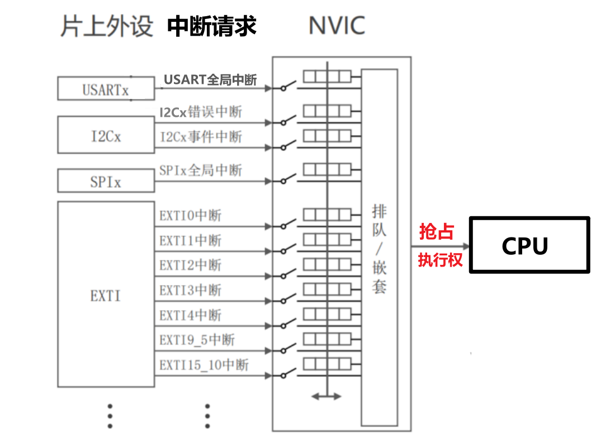

*图4-1中断系统-框图*

STM32 当中有很多片上外设都可以产生中断源，例如 USART、EXTI、TIM、SPI、I2C 等。

这些外设在满足中断条件时：

都会向 CPU 提出中断请求，都希望**抢占 CPU 的执行权**，转而执行各自对应的中断服务程序（ISR）。

这么多中断如果同时存在，而没有一个统一管理的“机构”，那中断系统就乱套了。

**在整个中断系统中，处于核心控制地位，负责中断调度、优先级管理和中断嵌套的组件，就是 NVIC。**

#### 4.1 NVIC的作用

NVIC (Nested Vectored Interrupt Controller) ，直译为嵌套矢量中断控制器。

当然一般没什么人直接叫它的中文译名，直接叫NVIC即可。

NVIC 是单片机中非常重要的、核心的组成部分，几乎所有中断相关的事项都需要NVIC参与处理。

其主要作用有以下几项：

1. 中断的开启和关闭。
   - a. 外设可以提交中断请求给NVIC，但只有被NVIC开启的中断才能够抢占CPU执行。
   - b. NVIC如果关闭了某个中断，那么此中断就完全无效。
2. 中断的优先级设置，NVIC 负责为各个中断源请求配置和管理优先级。
3. 中断调度与执行控制。
   - a. NVIC 会根据已配置的优先级规则，对所有中断请求进行仲裁，决定哪个中断优先进入 CPU 执行
   - b. 中断的挂起等待、中断嵌套等一系列中断行为都由NVIC决定。

总之，用通俗的话来说：

**外设只负责产生中断请求，而NVIC来决定“中断是否生效、中断什么时候执行以及什么顺序执行”。**

#### 4.2 NVIC不属于片上外设

NVIC在使用时可以把它视为一个特殊的片上外设，尤其是在编程的时候。毕竟：

它同样具有寄存器，也需要配置寄存器，SPL库中也有对应函数可以调用。

但严格来说，NVIC并不是片上外设，它和GPIO、USART等外设有着本质上的区别：

1. NVIC属于Cortex-M 内核的一部分。
2. NVIC也并没有挂载在AHB或者APB总线上，它集成在CPU内部，是CPU的一部分，和CPU“住在一起”。

这样NVIC在使用时，就和一般片上外设具有差异性。最重要的有两条：

1. **只要CPU运行，NVIC就处于工作状态。所以NVIC在使用时，不需要像传统外设那样开启时钟！**
2. 片上外设可能由于芯片型号不同，在数量或功能细节上存在差异。但NVIC属于内核组件，只要核心相同的芯片，NVIC在使用上都是一致的。

当然，在日常交流口头上，说“NVIC外设”通常也没有大问题，大家都能够理解。

### 5. NVIC中断优先级的配置

**其它外设产生中断请求，然后交给NVIC外设统一配置，其中就包括配置此中断请求的优先级。**

那么NVIC是如何实现中断优先级的配置呢？

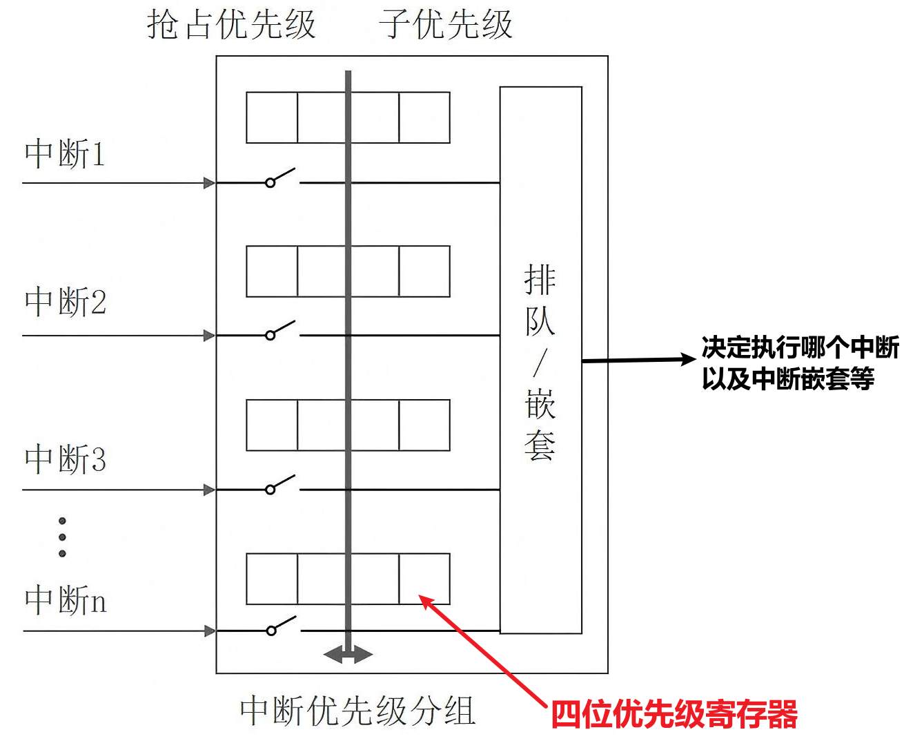

*图5-1NVIC中断优先级配置-图*

NVIC的中断优先级由**优先级寄存器**的4位（上图中间的四个格子）决定，这4位可以进行切分：

1. 高n位决定抢占优先级的取值。
2. 低ｍ位决定子优先级的取值，其中**m = 4 - n**。

下面详细讲一下STM32中断优先级分组。

#### 5.1 中断优先级分组

很明显，根据n的取值不同，一共可以分为5种情况，也就是5个分组。如下图所示：

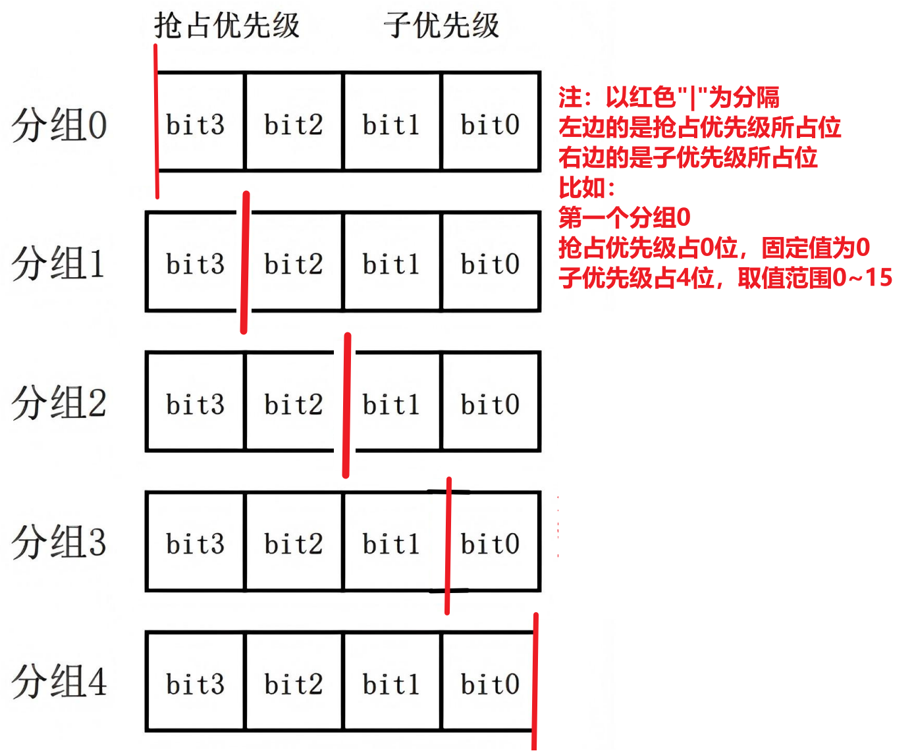

*图5.1-1NVIC中断优先级配置-图2*

**分组０，注意从０开始，不是从1开始：**

1. n = 0，没有抢占优先级，或者可以认为所有中断的抢占优先级都一样，固定是0。
2. m = 4，优先级寄存器的 4 位都用于子优先级，子优先级的取值范围是 0 ~ 15

**采用分组0时，由于没有抢占优先级，中断系统完全依赖子优先级来管理。**

**此时中断系统中没有嵌套行为，单纯依赖子优先级排队执行。**

**分组1：**

1. n = 1，优先级寄存器的 1 位用于抢占优先级，抢占优先级的取值范围是 0 ~ 1
2. m = 3，优先级寄存器的 3 位用于子优先级，子优先级的取值范围是 0 ~ 7

**分组2：**

1. n = 2，优先级寄存器的 2 位用于抢占优先级，抢占优先级的取值范围是 0 ~ 3
2. m = 2，优先级寄存器的 2 位用于子优先级，子优先级的取值范围是 0 ~ 3

**分组3：**

1. n = 3，优先级寄存器的 3 位用于抢占优先级，抢占优先级的取值范围是 0 ~ 7
2. m = 1，优先级寄存器的 1 位用于子优先级，子优先级的取值范围是 0 ~ 1

**分组4：**

1. n = 4，优先级寄存器的 4 位都用于抢占优先级，抢占优先级的取值范围是 0 ~ 15
2. m = 0，没有子优先级，或者可以认为所有中断的子优先级都一样，固定是0。

**采用分组4时，中断系统没有子优先级，完全依赖抢占优先级来管理中断的执行顺序，存在中断嵌套。**

注意以下几点：

1. **在设置具体中断优先级数值之前，应该先设置优先级分组。因为分组决定了优先级数值的具体取值范围！**
2. **如果不小心忘记明确设置优先级分组，那么单片机本身会采用默认分组0。**
   - a. 这个默认的分组0，来自于NVIC上电启动后寄存器的复位值，是一种默认行为。
   - b. 默认分组0就意味着系统内不存在抢占优先级，全部依赖子优先级决定中断的执行。
   - c. 在该分组下，中断之间不会发生嵌套抢占。
   - d. 这显然是一种保守的、安全的中断优先级分组配置。
3. **最好不要依赖优先级分组的默认行为。**
   - a. 试想一下，如果忘记设置优先级分组，直接配置抢占优先级字段。
   - b. 看似设置成功，实则没有任何作用，中断不会出现任何抢占行为。
   - c. 因为分组0没有抢占优先级。
   - d. **为了避免这种情况出现，请大家一定不要忘记手动设置优先级分组！一定要显式设置分组后再设置优先级数值！**
4. 多次设置中断优先级分组通常也是无意义的，而且具有风险。所以设置分组的操作最好就放在main函数死循环的上面，只执行一次即可。
5. 由于我们采用标准库开发方式，底层寄存器操作被封装了，所以分组和优先级数值的设置，实际都只需要调用函数就足够了。

#### 5.2 优先级都一样怎么办？

如果你真正搞懂了上述优先级相关内容，且善于发散思考，你可能会提出这样的问题：

抢占优先级不同优先看抢占优先级，抢占优先级相同就看子优先级。

**那么如果两个中断抢占优先级和子优先级都一样，怎么办呢？**

**谁先谁后执行？**

STM32的设计者早已想到了这个问题了：

**在多个中断优先级完全一致时，单片机会优先执行中断向量表中向上靠前的中断，也就是优先执行表格中编号小的中断。**

那么什么是**中断向量表**呢？

1. **简单来说，中断向量表是一张"函数地址表"，每一个中断类型的中断服务程序（ISR）都具有唯一对应的函数入口地址（函数指针）。**
2. CPU在执行某一中断类型的中断服务程序时，就需要查表来确定函数的入口地址，从而执行该中断服务程序。

在《参考手册》的中断和事件章节，章节开头就给出了中断向量表。

一部分截图如下：

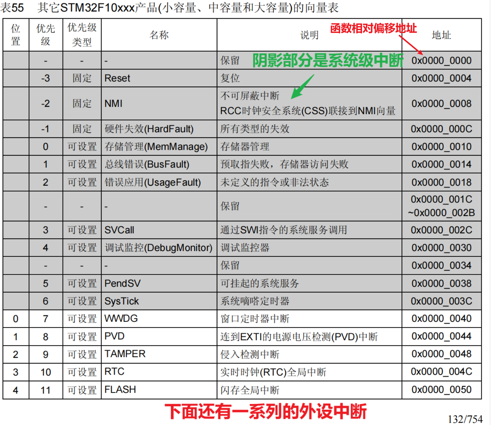

*图5.2-1参考手册中断向量表-图*

很明显如果两种优先级都一样，系统级中断具有优先执行权。

还有一个叫Reset的中断，也就是复位操作，它的优先级是固定最高的，不管单片机在做什么，触发复位时都会优先执行。

其余外设中断的执行顺序，则可以查表得到，这里就不赘述了。

## 02 串口外设中断

### 1. PC控制LED闪烁实验（非中断）

在以往的串口通信实现中，我们已经实现了这样的一个功能：

1. PC端串口工具发送0，熄灭PC13指示灯。
2. PC端串口工具发送1，点亮PC13指示灯。

现在我们在原先程序的基础上，扩展一些功能：

1. PC端串口工具发送2，PC13指示灯闪烁（间隔500ms慢速闪烁）。
2. PC端串口工具发送3，PC13指示灯闪烁（间隔100ms快速闪烁）。

接线图仍然保持串口通信时的状态不变，如下所示：

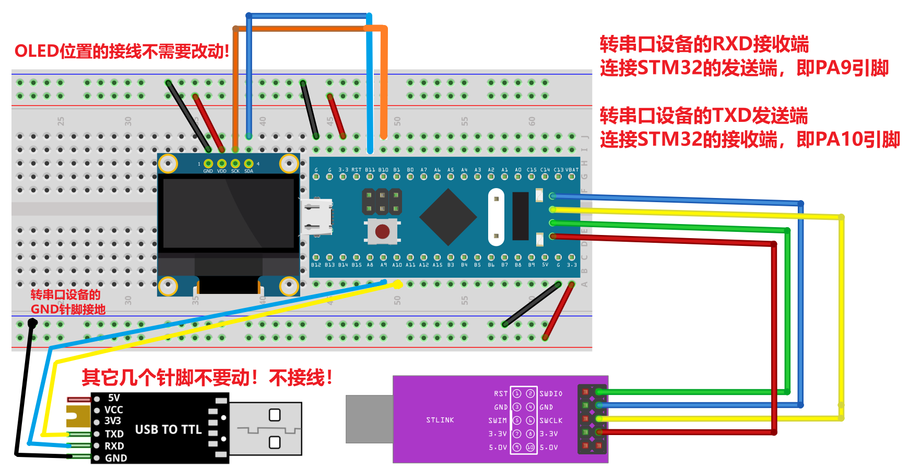

*图1-1串口通信接线-图*

我们可以用一个`g_LEDMode`的全局变量，来指示LED的闪烁状态，实现代码如下：

**以"g_"作为变量名的开头，以突出它是一个全局变量，这种命名习惯可以学习。**

```c
 #include "stm32f10x.h"
 #include "Delay.h"

 // LED_NORMAL表示不闪烁，LED_FAST_BLINK表示快闪烁，LED_SLOW_BLINK表示慢闪烁
 typedef enum {
     LED_NORMAL,
     LED_FAST_BLINK,
     LED_SLOW_BLINK
 } LEDWorkingMode;

 // LEDMode用于指示LED当前工作的模式
 static LEDWorkingMode g_LEDMode = LED_NORMAL;

 // 初始化TX(PA9)和RX(PA10)引脚
 void USART1_InitRxTx(void);

 // 初始化USAR1外设
 void USART1_Init(void);

 // 单片机接收PC端发来的1个字节的数据, 并返回
 uint8_t USART1_ReceiveByte(void);

 // 处理PC发送的指令, 控制LED的状态
 void LED_Control(uint8_t byteRcvd);

 // 初始化PC13指示灯
 void LED_Init(void);

 int main(void) {
     // 初始化 USART1 的 TX/RX 引脚
     USART1_InitRxTx();
     // 初始化 USART1 串口（波特率 115200）
     USART1_Init();
     // 初始化LED
     LED_Init();

     while (1) {
         // 轮询接收PC发送的指令,注意这是一个阻塞操作
         // 如果PC端没有发指令,此函数会持续监听
         uint8_t RcvdByte = USART1_ReceiveByte();
         LED_Control(RcvdByte); // 处理指令，控制LED

         if (g_LEDMode == LED_SLOW_BLINK) {
             GPIO_SetBits(GPIOC, GPIO_Pin_13);
             Delay_Ms(500);
             GPIO_ResetBits(GPIOC, GPIO_Pin_13);
             Delay_Ms(500);
         }

         if (g_LEDMode == LED_FAST_BLINK) {
             GPIO_SetBits(GPIOC, GPIO_Pin_13);
             Delay_Ms(100);
             GPIO_ResetBits(GPIOC, GPIO_Pin_13);
             Delay_Ms(100);
         }
     }
 }

 // 初始化PC13指示灯
 void LED_Init(void) {
     // 开启 GPIOC 时钟
     RCC_APB2PeriphClockCmd(RCC_APB2Periph_GPIOC, ENABLE);

     // 配置PC13引脚为通用推挽输出
     GPIO_InitTypeDef GPIO_InitStructure;
     GPIO_InitStructure.GPIO_Pin = GPIO_Pin_13;
     GPIO_InitStructure.GPIO_Mode = GPIO_Mode_Out_PP; // 通用推挽输出
     GPIO_InitStructure.GPIO_Speed = GPIO_Speed_2MHz;
     GPIO_Init(GPIOC, &GPIO_InitStructure);

     // PC13默认输出高电平,初始状态熄灭LED
     GPIO_SetBits(GPIOC, GPIO_Pin_13);
 }

 /**
  * @brief 根据接收到的指令，控制 LED 状态
  * @param RcvdByte 接收到的指令
  * @retval 无
  */
 void LED_Control(uint8_t RcvdByte) {
     switch (RcvdByte) {
         case '0':
             GPIO_SetBits(GPIOC, GPIO_Pin_13); // LED 熄灭
             g_LEDMode = LED_NORMAL;
             break;

         case '1':
             GPIO_ResetBits(GPIOC, GPIO_Pin_13); // LED 亮
             g_LEDMode = LED_NORMAL;
             break;

         case '2':
             // LED设置为慢闪烁状态
             g_LEDMode = LED_SLOW_BLINK;
             break;

         case '3':
             // LED设置为快闪烁状态
             g_LEDMode = LED_FAST_BLINK;
             break;

         default:
             break;
     }
 }

 /**
   * @brief 单片机接收PC端发来的1个字节的数据, 并返回
   * @param 无
   * @retval uint8_t类型, 也就是PC端发来的1个字节的数据
   * @note
   */
 uint8_t USART1_ReceiveByte(void) {
     // 1.等待接收数据寄存器是非空的,也就是等待RXNE标志位被置为1
     while (USART_GetFlagStatus(USART1, USART_FLAG_RXNE) ==RESET);

     // 2.将接收数据寄存器当中的1个字节的数据, 读出来
     // 该函数会自动将RXNE标志位置为0
     return (uint8_t)USART_ReceiveData(USART1);
 }

 /**
   * @brief 初始化RX和TX引脚, PA9就是TX(复用推挽输出), PA10就是RX(浮空输入)
   * @param 无
   * @retval 无
   */
 void USART1_InitRxTx(void) {
     // 开启 GPIOA 时钟
     RCC_APB2PeriphClockCmd(RCC_APB2Periph_GPIOA, ENABLE);

     GPIO_InitTypeDef GPIO_InitStructure;
     // 配置 TX(PA9)引脚 为复用推挽输出
     GPIO_InitStructure.GPIO_Pin = GPIO_Pin_9;
     GPIO_InitStructure.GPIO_Mode = GPIO_Mode_AF_PP; // 复用推挽输出
     GPIO_InitStructure.GPIO_Speed = GPIO_Speed_2MHz;
     GPIO_Init(GPIOA, &GPIO_InitStructure);

     // 配置 RX(PA10)引脚 为浮空输入
     GPIO_InitStructure.GPIO_Pin = GPIO_Pin_10;
     GPIO_InitStructure.GPIO_Mode = GPIO_Mode_IN_FLOATING; // 浮空输入模式
     GPIO_Init(GPIOA, &GPIO_InitStructure);
 }

 /**
   * @brief 初始化USAR1外设,数据位是8位,不带校验位,停止位是1位,波特率是115200
   * @param 无
   * @param 无
   * @retval 无
   */
 void USART1_Init(void) {
     // 1.开启USART1外设时钟
     RCC_APB2PeriphClockCmd(RCC_APB2Periph_USART1, ENABLE);

     // 2.利用USART_Init函数完成USART1外设的初始化
     USART_InitTypeDef USART_InitStruct;
     USART_InitStruct.USART_BaudRate = 115200; // 波特率设置为115200
     USART_InitStruct.USART_HardwareFlowControl =USART_HardwareFlowControl_None;//不使用硬件流控
     USART_InitStruct.USART_Mode = USART_Mode_Rx | USART_Mode_Tx;//设置为可收可发模式
     USART_InitStruct.USART_Parity = USART_Parity_No; // 不进行数据校验
     USART_InitStruct.USART_StopBits = USART_StopBits_1; // 选择1位停止位
     USART_InitStruct.USART_WordLength = USART_WordLength_8b;//数据位是8位
     USART_Init(USART1, &USART_InitStruct);

     // 3.使能开启USART1外设
     USART_Cmd(USART1, ENABLE);
 }

```

这段代码看起来能生效，但实际有用吗？

当然是没有用的。

`USART1_ReceiveByte`是一个阻塞函数，会一直等待PC端发送数据，接收一次PC端发送的数据后程序就会阻塞在此函数中。

所以当PC端发送1或者2时，只能使得PC13指示灯短暂的、快速的闪烁1次。

这离我们想要的效果差之甚远。

那怎么办呢？

最核心要解决的问题就是：

while(1)死循环中，不能再调用一个阻塞函数了。

这样的话，我们可以把"USART1_ReceiveByte"函数实现当中的`while`循环改成`if`判断，这样此函数就不再是一个阻塞函数了。

完整参考代码，如下：

```c
 #include "stm32f10x.h"
 #include "Delay.h"

 #define RECEIVED 1
 #define UNRECEIVED 0

 // LED_NORMAL表示不闪烁，LED_FAST_BLINK表示快闪烁，LED_SLOW_BLINK表示慢闪烁
 typedef enum {
     LED_NORMAL,
     LED_FAST_BLINK,
     LED_SLOW_BLINK
 } LEDWorkingMode;

 // g_LEDMode用于指示LED当前工作的模式
 static LEDWorkingMode g_LEDMode = LED_NORMAL;

 // 初始化TX(PA9)和RX(PA10)引脚
 void USART1_InitRxTx(void);

 // 初始化USAR1外设
 void USART1_Init(void);

 // 处理PC发送的指令, 控制LED的状态
 void LED_Control(uint8_t byteRcvd);

 // 初始化PC13指示灯
 void LED_Init(void);

 // 单片机接收PC端发来的1个字节的数据, 再通过形参的指针传参将接收数据返回,但是此函数不会阻塞
 uint8_t USART1_ReceiveByteNonBlocking(uint8_t *byteRcvd);

 // main函数做以下修改
 int main(void) {
     // 初始化 USART1 的 TX/RX 引脚
     USART1_InitRxTx();
     // 初始化 USART1 串口（波特率 115200）
     USART1_Init();
     // 初始化LED
     LED_Init();

     while (1) {
         uint8_t RcvdByte;
         // 此时程序就不再会阻塞在这里了, 只会在接收到PC发送的指令后执行LED_Control函数
         if (USART1_ReceiveByteNonBlocking(&RcvdByte) ==RECEIVED){
             LED_Control(RcvdByte); // 处理指令，控制LED
         }

         if (g_LEDMode == LED_SLOW_BLINK) {
             GPIO_SetBits(GPIOC, GPIO_Pin_13);
             Delay_Ms(500);
             GPIO_ResetBits(GPIOC, GPIO_Pin_13);
             Delay_Ms(500);
         }

         if (g_LEDMode == LED_FAST_BLINK) {
             GPIO_SetBits(GPIOC, GPIO_Pin_13);
             Delay_Ms(100);
             GPIO_ResetBits(GPIOC, GPIO_Pin_13);
             Delay_Ms(100);
         }
     }
 }

 // 初始化PC13指示灯
 void LED_Init(void) {
     RCC_APB2PeriphClockCmd(RCC_APB2Periph_GPIOC, ENABLE);

     // 将PC13引脚配置为通用推挽输出模式
     GPIO_InitTypeDef GPIO_InitStructure;
     GPIO_InitStructure.GPIO_Pin = GPIO_Pin_13;
     GPIO_InitStructure.GPIO_Mode = GPIO_Mode_Out_PP;
     GPIO_InitStructure.GPIO_Speed = GPIO_Speed_2MHz;
     GPIO_Init(GPIOC, &GPIO_InitStructure);

     // 设置PC13引脚默认输出高电平,LED熄灭
     GPIO_SetBits(GPIOC, GPIO_Pin_13);
 }

 /**
  * @brief 根据接收到的指令，控制 LED 状态
  * @param RcvdByte 接收到的指令
  * @retval 无
  */
 void LED_Control(uint8_t RcvdByte) {
     switch (RcvdByte) {
         case '0':
             GPIO_SetBits(GPIOC, GPIO_Pin_13); // LED 熄灭
             g_LEDMode = LED_NORMAL;
             break;

         case '1':
             GPIO_ResetBits(GPIOC, GPIO_Pin_13); // LED 亮
             g_LEDMode = LED_NORMAL;
             break;

         case '2':
             // LED设置为慢闪烁状态
             g_LEDMode = LED_SLOW_BLINK;
             break;

         case '3':
             // LED设置为快闪烁状态
             g_LEDMode = LED_FAST_BLINK;
             break;

         default:
             break;
     }
 }

 /**
   * @brief 单片机接收PC端发来的1个字节的数据, 并返回, 但是此函数不会阻塞
   * @param *RcvdByte: 指向main函数中RcvdByte局部变量的指针
   * @retval 返回的是有无读到PC端发送指令的结果
   * 如果返回RECEIVED表示收到了PC端发送的数据,返回UNRECEIVED表示没接收到
   * @note
   */
 uint8_t USART1_ReceiveByteNonBlocking(uint8_t *RcvdByte) {
     if (USART_GetFlagStatus(USART1, USART_FLAG_RXNE) == SET) {
         *RcvdByte = (uint8_t)USART_ReceiveData(USART1);
         return RECEIVED;
     }

     return UNRECEIVED;
 }

 /**
   * @brief 初始化RX和TX引脚, PA9就是TX(复用推挽输出), PA10就是RX(浮空输入)
   * @param 无
   * @retval 无
   */
 void USART1_InitRxTx(void) {
     // 开启 GPIOA 时钟
     RCC_APB2PeriphClockCmd(RCC_APB2Periph_GPIOA, ENABLE);

     GPIO_InitTypeDef GPIO_InitStructure;
     // 配置 TX(PA9)引脚 为复用推挽输出
     GPIO_InitStructure.GPIO_Pin = GPIO_Pin_9;
     GPIO_InitStructure.GPIO_Mode = GPIO_Mode_AF_PP; // 复用推挽输出
     GPIO_InitStructure.GPIO_Speed = GPIO_Speed_2MHz;
     GPIO_Init(GPIOA, &GPIO_InitStructure);

     // 配置 RX(PA10)引脚 为浮空输入
     GPIO_InitStructure.GPIO_Pin = GPIO_Pin_10;
     GPIO_InitStructure.GPIO_Mode = GPIO_Mode_IN_FLOATING; // 浮空输入模式
     GPIO_Init(GPIOA, &GPIO_InitStructure);
 }

 /**
   * @brief 初始化USAR1外设,数据位是8位,不带校验位,停止位是1位,波特率是115200
   * @param 无
   * @param 无
   * @retval 无
   */
 void USART1_Init(void) {
     // 1.开启USART1外设时钟
     RCC_APB2PeriphClockCmd(RCC_APB2Periph_USART1, ENABLE);

     // 2.利用USART_Init函数完成USART1外设的初始化
     USART_InitTypeDef USART_InitStruct;
     USART_InitStruct.USART_BaudRate = 115200; // 波特率设置为115200
     USART_InitStruct.USART_HardwareFlowControl =USART_HardwareFlowControl_None;//不使用硬件流控
     USART_InitStruct.USART_Mode = USART_Mode_Rx | USART_Mode_Tx;//设置为可收可发模式
     USART_InitStruct.USART_Parity = USART_Parity_No; // 不进行数据校验
     USART_InitStruct.USART_StopBits = USART_StopBits_1; // 选择1位停止位
     USART_InitStruct.USART_WordLength = USART_WordLength_8b;//数据位是8位
     USART_Init(USART1, &USART_InitStruct);

     // 3.使能开启USART1外设
     USART_Cmd(USART1, ENABLE);
 }

```

上述代码虽然可以正常工作，但仍然存在明显的设计缺陷：

1. 串口数据的接收本质上，仍然依赖CPU轮询
2. 只不过CPU执行指令速度很快，接收延迟很小，不易被人察觉。但在 PC 端指令发送完成后，往往仍需等待 CPU 下一次轮询才能进行处理。
3. 真正的实时处理，应该做到PC端发送指令后，系统能够及时、稳定的触发相应的处理流程。
4. 在对实时性有要求的嵌入式应用场景中，这种轮询方案显然无法满足需求。

那么，如何实现一种**非阻塞、且能够实时响应串口数据接收**的程序呢？

这时就需要用到中断机制了。

### 2. USART串口中断编程

在上面的案例中，我们对中断的需求是：

**当 USART 外设检测到接收事件（即接收数据寄存器非空）时，应当立即触发中断，由中断服务程序完成指令接收与处理。**

所以：

我们需要USART1外设来产生一个中断，即USART外设中断。

下面我们首先来了解一下，USART外设中断的产生机制。

#### 2.1 USART外设中断产生机制

USART外设内部是可以产生中断请求的，它产生中断的原理框图如下图所示：

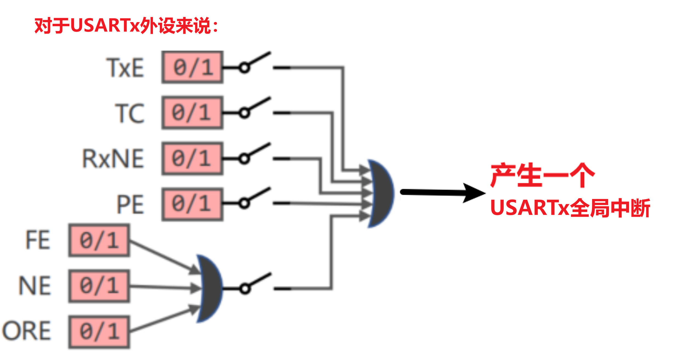

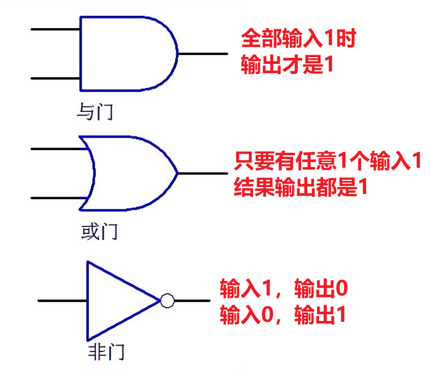

*图2.1-1USART外设中断机制-图*

图中有两个月牙状的"逻辑或门"电路符号。

*图2.1-2逻辑门电路符号-图*

表示：任何一个中断标志位置位都会触发产生全局中断。

**首先说明一下图中标志位的问题：**

1. TXE、TC、RXNE等都是标志位，在中断系统中，我们把这些标志位叫做“中断标志位”。
2. 关于“中断标志位”和“普通状态标志位”的区别，后续章节我们再详细总结。
3. 我们需记住：对于USART外设来说，状态标志位和中断标志位的置位复位是同步进行的。

**举一个例子：**

1. PC端向USART1外设发数据，此时接收数据寄存器非空，于是中断标志位RXNE自动置位。
2. 程序员调用Receive库函数完成数据接收，中断标志位RXNE自动复位。
3. 这和前面讲状态标志位RXNE的使用是完全一致的。
4. **只不过在SPL库中，必须区分中断标志位和状态标志位，因为它们使用的函数是不同的。**

除此标志位的问题外，你应该还注意到图中有很多“小开关”。

这些小开关的作用是：

**USART外设必须开启相应中断，才能够在中断标志位置位时产生全局中断请求。**

举个例子：

1. 设置开启了RXNE标志位中断，等到RXNE中断标志位置位时，USART外设就会发中断请求。
2. 没有开启TXE标志位中断，即便TXE中断标志位置位了，USART外设也不会发中断请求。

其实也很好理解：

发中断请求也需要”耗电“，没事就发请求，不设置就能发请求，也太奇怪了！

**最后再总结一下这张图：**

1. **USART外设必须开启相应标志位的中断，USART外设才会发送中断请求。**
2. **在开启中断的前提下，TXE、TC、RXNE、PE这四个中断标志位任何一个置位1时，都会产生一个USART中断请求，发送给NVIC。**
3. 任何一个USARTx外设同时只能产生一个中断，即USARTx全局中断。
4. **比如USART1外设无论如何只能产生一个中断请求，这个中断叫做USART1全局中断。**
5. 也就是说，无论USART1内部有多少种条件产生中断，但在NVIC看来，都只有一个全局中断。

#### 2.2 USART外设中断的使用流程

结合前面，我们讲过的所有知识点，描述一下USART1外设中断的使用流程（以接收数据触发中断为例）：

1. 完成USART1外设的基本初始化配置工作（包括引脚和USART1外设本身）
2. 开启RXNE标志位中断，使得USART1外设在RXNE中断标志位置位时，可以发送中断请求给NVIC。
3. 在NVIC中配置USART1全局中断的优先级**（注意配置优先级前要设置分组）**
4. 在NVIC中开启USART1全局中断。
5. 手动编写USART1全局中断的中断服务程序，也就是编写对应中断处理函数。

以上流程完成后，中断的触发、执行等都由中断系统自动完成。如此，就实现了真正意义上，实时处理串口数据接收！

最后总结一下整个过程：

1. USART1外设，负责在接收数据寄存器非空时，产生中断请求。
2. NVIC负责居中调度管理。
3. **中断服务程序，也就是中断处理函数，负责处理实时数据接收！**

那么到这里，万事俱备，剩下的就是学习SPL库函数调用了。下面逐一介绍这些函数：

#### 2.3 USART_ITConfig函数

`USART_ITConfig()`是 STM32 标准外设库中提供的用于**开启或关闭 USART 标志位中断源的函数**。

它用于配置 USART 外设是否可以产生中断请求，以及哪个中断标志位会产生中断请求。

其函数名字中的"IT"是中断"Interrupt"的缩写，连上Config配置，表示此函数用于配置USART的中断源信息。

此函数的声明如下：

```c
void USART_ITConfig(USART_TypeDef* USARTx, uint16_t USART_IT, FunctionalState NewState);
```

函数没有返回值。

函数的第一个参数USARTx也没什么值得说的，用于指示配置中断源的USART外设名，比如`USART1`、`USART2`。

**函数的第二个参数USART_IT用于指示产生中断源的标志位。**

它使用一系列宏定义来指示各种标志位中断源，比如：

| 标志位名称 | USART_IT 传参宏定义 | 开启标志位中断源后的作用 |
|---|---|---|
| TXE | `USART_IT_TXE` | 当发送数据寄存器为空时，产生中断请求 |
| TC | `USART_IT_TC` | 当发送/移位寄存器全部为空、数据发送完成时，产生中断请求 |
| RXNE | `USART_IT_RXNE` | 接收数据寄存器非空、有数据可读时，产生中断请求 |
| PE | `USART_IT_PE` | 奇偶校验错误时，产生中断请求 |

**这些中间是“IT”的标志位，我们称之为中断标志位，它是SPL库特有的一套宏定义体系！**

函数的最后一个参数则非常简单，只需要传参`ENABLE`表示开启此标志位中断，设为DISABLE则表示禁用。

`USART_ITConfig()`函数开启了USART 外设的中断源，使得USART外设可以产生一个中断请求。

但这个中断请求还需要交给NVIC处理，所以接下来还需要初始化NVIC，让NVIC去设置这个中断源（中断号），并且为此中断源设置优先级等。

**所以处理外设中断的操作步骤就是：**

1. 开启外设中断源，使得外设能够在特定条件下产生一个中断请求。
2. 初始化NVIC，通过设置中断号来开启此中断、设置优先级等，也就是让NVIC来管理这个外设中断请求，允许CPU相应处理此中断源。

#### 2.4 NVIC_PriorityGroupConfig函数

在初始化NVIC时，核心的操作就是设置抢占优先级和子优先级，而在设置两个优先级之前，首先需要做的事情就是设置优先级分组。

这就需要调用`NVIC_PriorityGroupConfig()`函数来实现了。

此函数的声明也很简单，如下：

```c
void NVIC_PriorityGroupConfig(uint32_t NVIC_PriorityGroup);
```

其形参NVIC_PriorityGroup，用于指定优先级分组。

形参的具体传参使用一组宏定义，你可以在`misc.h`头文件中找到它们。

不同的宏定义取值决定了不同的优先级分组，具体细节参考下列表格：

| 宏定义（分组） | 抢占优先级位数 | 子优先级位数 | 抢占优先级范围 | 子优先级范围 |
|---|---|---|---|---|
| `NVIC_PriorityGroup_0` | 0 | 4 | 无或者固定 0 | 0~15 |
| `NVIC_PriorityGroup_1` | 1 | 3 | 0~1 | 0~7 |
| `NVIC_PriorityGroup_2` | 2 | 2 | 0~3 | 0~3 |
| `NVIC_PriorityGroup_3` | 3 | 1 | 0~7 | 0~1 |
| `NVIC_PriorityGroup_4` | 4 | 0 | 0~15 | 无或者固定 0 |

**所以在设置某个中断的优先级之前，需要先调用NVIC_PriorityGroupConfig函数来设置它的分组。**

当然你也可以不调用这个函数来设置分组，默认采用的分组是`NVIC_PriorityGroup_0`，当然建议最好还是设置分组，比如使用分组2。

注意：

1. 重复调用`NVIC_PriorityGroupConfig`会覆盖之前的设置，重新配置抢占优先级和子优先级位数的分配，可能会带未知的后果。
2. **所以建议仅在main函数的while死循环上面，调用此函数一次就可以了。并且要在NVIC_Init初始化函数之前调用。**

#### 2.5 NVIC_Init函数

初始化NVIC就需要使用NVIC_Init函数，和我们之前初始化外设使用的"Init"函数，它也需要给一个结构体赋值来完成NVIC初始化。

NVIC_Init函数的声明很简单，只有一个形参：

```c
void NVIC_Init(NVIC_InitTypeDef* NVIC_InitStruct);
```

此函数需要传入一个`NVIC_InitTypeDef`类型的结构体对象指针，该结构体类型的声明如下：

```c
typedef struct {
    uint8_t NVIC_IRQChannel; // 要配置的中断通道（IRQ号）
    uint8_t NVIC_IRQChannelPreemptionPriority; // 抢占优先级
    uint8_t NVIC_IRQChannelSubPriority; // 响应优先级（子优先级）
    FunctionalState NVIC_IRQChannelCmd; // 开启（ENABLE）或禁用（DISABLE）
} NVIC_InitTypeDef;
```

其各个成员的解释如下：

IRQ：是中断请求（Interrupt Request）的缩写。

IRQChannel：直译是中断请求的通道，用于指定要配置的具体中断源，可以直接用中断号给这个成员赋值。

| 结构体成员 | 含义 |
|---|---|
| `NVIC_IRQChannel` | 需要配置的中断号（如 `USART1_IRQn`、`EXTI0_IRQn`） |
| `NVIC_IRQChannelPreemptionPriority` | 抢占优先级（值越小优先级越高，可以打断低优先级中断） |
| `NVIC_IRQChannelSubPriority` | 子优先级（同级抢占优先级时，子优先级越低越先执行） |
| `NVIC_IRQChannelCmd` | `ENABLE`（开启此中断）或 `DISABLE`（禁用此中断） |

剩下的：

1. 抢占优先级和子优先级这两个成员的赋值非常简单，可以直接根据优先级分组，填入一个合适的整数值即可。
2. 最后一个成员表示开启或禁用`IRQChannel`对应的中断，根据使用目的选择即可。

注意：NVIC外设只需要初始化即可使用，不用考虑开启时钟，也没有时钟开启功能。

#### 2.6 中断号/中断通道

**中断号的问题（重点！）**

上述`NVIC_InitTypeDef`结构体，在给第一个成员赋值时，需要填入一个中断号，那么什么是中断号呢？

**中断号（IRQn，Interrupt Request Number）是 NVIC中，用于标识每个外设产生中断的唯一性编号。**

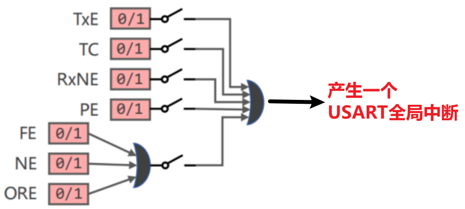

*图2.6-1USART外设中断机制-图*

现在，我们知道USART会产生一个全局中断请求，那么这个中断请求的中断号是什么呢？在哪里可以查这个中断号呢？

**这个中断号切记不能随便填写，也尽量不要依靠记忆填写，建议的方式是——抄。**

在头文件`stm32f10x.h`的一开头，定义了一个叫做`IRQn/IRQn_Type`的枚举类型，这个枚举类型中的枚举值就是全部中断号定义。

再加上我们使用的芯片是STM32F103C8T6，Flash闪存容量是64KB，属于中等密度（MD）芯片。

所以外设中断的中断号主要看这部分内容：

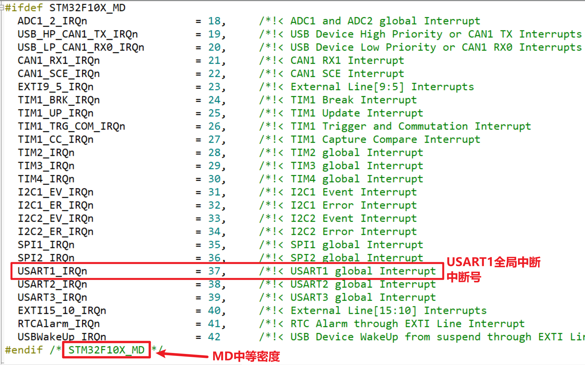

*图2.6-2外设中断号-图*

后续假如我们要配置别的中断请求，查找中断号时，也是来这里查。这些中断号的命名都非常显著，很好找。

**切记中断号要靠抄！如果因为写错中断号而导致中断不触发，那就显得太聪明了！**

**切记中断号要靠抄！如果因为写错中断号而导致中断不触发，那就显得太聪明了！**

**切记中断号要靠抄！如果因为写错中断号而导致中断不触发，那就显得太聪明了！**

到这里为止，除了中断服务程序还没有编写，其它流程涉及到的函数我们都学习了。

#### 2.7 设置中断源参考代码

设置中断源，可以写出下列参考代码：

```c
  #include "stm32f10x.h"
  #include "Delay.h"

  // LED_NORMAL表示不闪烁，LED_FAST_BLINK表示快闪烁，LED_SLOW_BLINK表示慢闪烁
  typedef enum {
     LED_NORMAL,
     LED_FAST_BLINK,
     LED_SLOW_BLINK
  } LEDWorkingMode;

  // g_LEDMode全局变量用于指示LED, 当前工作的模式
  static LEDWorkingMode g_LEDMode = LED_NORMAL;

  // 初始化PC13指示灯
  void LED_Init(void);

  // 初始化配置USART1外设,包括引脚及其外设
  void USART1_Init(void);

  // 配置开启USART1外设RXNE中断源
  void USART1_RXNEITConfig(void);

  // NVIC配置开启USART1全局中断
  void NVIC_USART1_Init(void);

  int main(void) {
     // 依次调用初始化函数
     // NVIC配置USART1全局中断之前,设置中断优先级分组
     // 这里选择分组2,即抢占优先级和子优先级都各占2位,取值范围都是0~3
     NVIC_PriorityGroupConfig(NVIC_PriorityGroup_2);
     LED_Init();
     USART1_Init();
     USART1_RXNEITConfig();
     NVIC_USART1_Init();

     while (1) {
     }
  }

  /**
   * @brief 初始化PC13指示灯
   * @param 无
   * @retval 无
   */
  void LED_Init(void) {
     // 开启 GPIOC 时钟
     RCC_APB2PeriphClockCmd(RCC_APB2Periph_GPIOC, ENABLE);

     // PC13引脚设置为通用推挽输出模式
     GPIO_InitTypeDef GPIO_InitStructure;
     GPIO_InitStructure.GPIO_Pin = GPIO_Pin_13;
     GPIO_InitStructure.GPIO_Mode = GPIO_Mode_Out_PP;
     GPIO_InitStructure.GPIO_Speed = GPIO_Speed_2MHz;
     GPIO_Init(GPIOC, &GPIO_InitStructure);

     // PC13引脚默认输出高电平,LED默认熄灭
     GPIO_SetBits(GPIOC, GPIO_Pin_13);
  }

  /**
   * @brief 初始化配置USART外设,包括引脚及其外设
   * @param 无
   * @retval 无
   */
  void USART1_Init(void) {
     // 1.初始化PA9(Tx)和PA10(Rx)引脚
     RCC_APB2PeriphClockCmd(RCC_APB2Periph_GPIOA, ENABLE);

     GPIO_InitTypeDef GPIO_InitStructure;
     GPIO_InitStructure.GPIO_Pin = GPIO_Pin_9;
     GPIO_InitStructure.GPIO_Mode = GPIO_Mode_AF_PP;
     GPIO_InitStructure.GPIO_Speed = GPIO_Speed_2MHz;
     GPIO_Init(GPIOA, &GPIO_InitStructure);

     GPIO_InitStructure.GPIO_Pin = GPIO_Pin_10;
     GPIO_InitStructure.GPIO_Mode = GPIO_Mode_IN_FLOATING;
     GPIO_Init(GPIOA, &GPIO_InitStructure);

     // 2.初始化USART1外设,并且开启此外设
     // 开启USART1外设时钟
     RCC_APB2PeriphClockCmd(RCC_APB2Periph_USART1, ENABLE);

     // 利用USART_Init函数完成USART1外设的初始化
     USART_InitTypeDef USART_InitStruct;
     USART_InitStruct.USART_BaudRate = 115200; // 波特率设置为115200
     USART_InitStruct.USART_HardwareFlowControl =USART_HardwareFlowControl_None;//不使用硬件流控
     USART_InitStruct.USART_Mode = USART_Mode_Rx | USART_Mode_Tx;//设置为可收可发模式
     USART_InitStruct.USART_Parity = USART_Parity_No; // 不进行数据校验
     USART_InitStruct.USART_StopBits = USART_StopBits_1; // 选择1位停止位
     USART_InitStruct.USART_WordLength = USART_WordLength_8b;//数据位是8位
     USART_Init(USART1, &USART_InitStruct);

     // 开启USART1外设
     USART_Cmd(USART1, ENABLE);
  }

  /**
   * @brief 配置开启USART1外设,RXNE标志位中断源
   * @param 无
   * @retval 无
   * @note 只是一条函数调用语句,后续写代码可以合并到初始化USART1外设时
   */
  void USART1_RXNEITConfig(void) {
     USART_ITConfig(USART1, USART_IT_RXNE, ENABLE);
     // 此函数调用后,每当接收数据寄存器非空,USART1外设就会发送中断请求给NVIC外设
  }

  /**
   * @brief NVIC配置开启USART1全局中断
   * @param 无
   * @retval 无
   */
  void USART1_NVIC_Init(void) {
     // 调用NVIC_Init函数,来初始化NVIC外设
     NVIC_InitTypeDef NVIC_InitStruct;

     // 设置优先级数值之前,需要在main函数上面设置优先级分组
     NVIC_InitStruct.NVIC_IRQChannelPreemptionPriority = 0; // 设置抢占优先级
     NVIC_InitStruct.NVIC_IRQChannelSubPriority = 0; // 设置子优先级

     // 设置中断源为USART1外设全局中断
     // 此中断号从stm32f10x.h头文件中抄,不要自行手写
     NVIC_InitStruct.NVIC_IRQChannel = USART1_IRQn;
     NVIC_InitStruct.NVIC_IRQChannelCmd = ENABLE; // 开启此USART1外设全局中断
     NVIC_Init(&NVIC_InitStruct);
  }

```

**当然这段代码写完后，中断机制还不能使用，因为最重要的中断服务程序还没有编写。**

下面我们专门来讲一下中断服务程序如何完成编写。

### 3. 中断服务程序的编写

现在我们已经实现了下列功能：

1. 配置开启了USART外设的标志位中断源。
2. 配置开启了NVIC的USART外设中断请求。

在完成上面两步后，只要主程序在运行的过程中，触发了中断源，NVIC 会自动调用对应的中断服务程序。

**也就是NVIC 会自动调用对应的中断处理函数。**

注意：官方的叫法是中断服务程序（ISR），但我更喜欢叫中断处理函数。它们是一回事，只是名字有区别罢了。

后续文档，一律不再区分中断服务程序和中断处理函数。

那么中断处理函数应该怎么写呢？

注意中断处理函数由NVIC自动调用，为了让NVIC能够找到这个函数。

**对某个中断源触发的中断处理函数，有明确的要求：**

1. 所有中断处理函数的返回值类型都是void，不允许自定义返回值类型！
2. 所有中断处理函数的形参列表也必须是void，不允许自定义形参列表！
3. 某个外设的中断处理函数，**采用固定的函数名**，不允许自定义函数名！
4. 中断处理函数的具体实现内容可以由程序员自己决定，通常可以是任意实现！

那么，既然中断处理函数的名字是固定的，那么应该去哪里找这个名字呢？

#### 3.1 中断处理函数的名字（重点）

在上面的章节中，我们提到过《中断向量表》的概念。

**所谓中断向量表，就是一张"函数地址表"。**

**每一个中断类型的中断服务程序（ISR）都具有唯一对应的函数入口地址（函数指针）**

下面这张截图来自《参考手册》，其中的地址是相对基准地址的偏移地址，并不是真实的内存地址。


*图3.1-1参考手册中断向量表-图*

那么在STM32的中断系统在运行的过程中，是如何找到对应的中断处理函数的呢？

思考过程：

函数地址也叫做函数指针，在C语言的时候我们学习过《函数指针》我们知道：在C语言代码中，函数名就代表函数指针，就代表函数的地址。

那么在SPL库的代码中，有没有这样一段记录中断处理函数函数名（函数指针）的代码呢？

答：

当然有。

**就在启动文件"startup_stm32f10x.s"中，几乎就在启动文件的一开头，存在下面的汇编代码片段：**

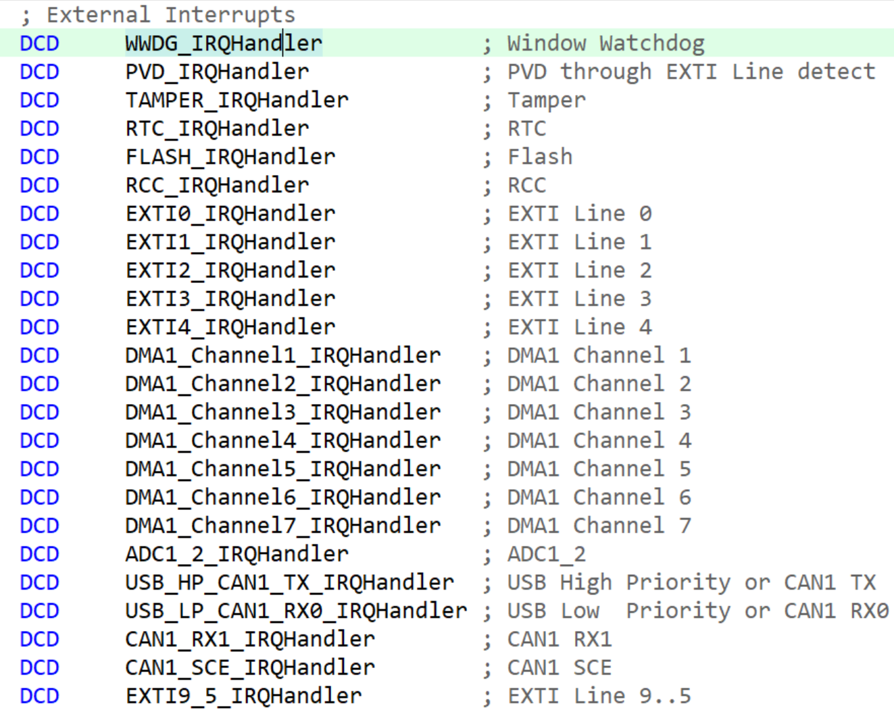

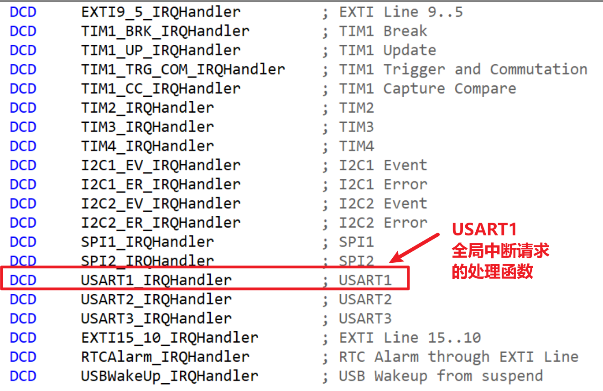

*图3.1-3中断处理函数名-图2*

*图3.1-2中断处理函数名-图1*

这里实际上是《中断向量表》的函数名（函数指针）形式，和《参考手册》中的是完全对应的。

因此任何中断服务程序的函数名都是固定的，**必须严格与启动文件中定义的名称保持一致**，否则 CPU 在中断发生时就无法找到对应函数了。

中断服务程序就无法执行了。

所以：

**如果需要编写中断处理函数，就去启动文件中找函数名，然后复制粘贴，禁止自行编写函数名！！！**

**如果需要编写中断处理函数，就去启动文件中找函数名，然后复制粘贴，禁止自行编写函数名！！！**

**如果需要编写中断处理函数，就去启动文件中找函数名，然后复制粘贴，禁止自行编写函数名！！！**

#### 3.2 完成串口中断服务程序的编写

在上面讲解USART外设中断机制时，我们已经知道：

整个USART1外设都只能产生一个全局中断`USART1_IRQn`（在stm32f10x.h头文件中找到，中断号在枚举类型`IRQn_Type`中定义）

它对应的中断服务程序的函数名为：`USART1_IRQHandler`（在 startup_stm32f10x.s启动文件中找到，就在此汇编代码文件的开头）

于是可以写出这个中断服务程序的函数声明：

```c
void USART1_IRQHandler(void);
```

那么这个函数具体如何实现呢？

该中断处理函数需要执行的逻辑其实非常简单：

1. 读接收数据寄存器（RDR）的数据，也就是读取PC端发送的指令。
2. 根据接收到的指令，修改LED工作模式，也就是更改全局变量LEDMode的值。

此中断服务程序的，参考代码实现如下:

```c
 /**
   * @brief 处理USART1外设中断请求的中断服务程序
   * @param 无
   * @retval 无
   * @note 在RXNE中断标志位置位时,处理指令接收并修改LED状态
   */
 void USART1_IRQHandler(void) {
     uint8_t ReceiveCmd = (uint8_t)USART_ReceiveData(USART1);
     switch (ReceiveCmd) {
        case '0':
            GPIO_SetBits(GPIOC, GPIO_Pin_13); // LED熄灭
            g_LEDMode = LED_NORMAL;
            break;

        case '1':
            GPIO_ResetBits(GPIOC, GPIO_Pin_13); // LED点亮
            g_LEDMode = LED_NORMAL;
            break;

        case '2':
            // LED设置为慢闪烁状态
            g_LEDMode = LED_SLOW_BLINK;
            break;

        case '3':
            // LED设置为快闪烁状态
            g_LEDMode = LED_FAST_BLINK;
            break;

        default:
            break;
     }
 }
```

这段代码有没有什么问题呢？

#### 3.3 USART全局中断应当判断中断源

这段代码看起来没有问题，但实际上是有问题的：

1. USART外设只能产生一个全局中断，但此全局中断的触发条件有很多，比如RXNE、TXE、TC等。
2. 如果不对触发源进行判断，怎么知道是RXNE置位触发的中断呢？
3. 如果不是这个中断源触发的中断，直接读接收数据寄存器显然是错误的。

此时就需要使用函数：**USART_GetITStatus**，该函数用于获取某个USART外设的中断标志位是否被置为1。

也就是获取下图当中的中断标志位的状态：


*图3.3-1USART外设中断机制-图*

该函数的声明如下：

```c
ITStatus USART_GetITStatus(USART_TypeDef* USARTx, uint16_t USART_IT);
```

第一个形参很好理解，需要填入要查询的USART1外设具体的名字，比如直接填"USART1"。

第二个形参当中的IT是单词"Interrupt"的缩写，它表示各种USART外设中断标志位，可以取以下一些值：

| 中断标志位宏定义 | 置为 1 的条件 |
|---|---|
| `USART_IT_RXNE` | 当接收数据寄存器非空时，该中断标志位置为 1 |
| `USART_IT_TXE` | 当发送数据寄存器为空时，该中断标志位置为 1 |
| `USART_IT_TC` | 所有数据发送完成时，该中断标志位置为 1 |
| `USART_IT_PE` | 当出现奇偶校验错误时，该中断标志位置为 1 |

具体的内容的大家可以自行查阅相关的手册，或者可以直接阅读源码注释。

此函数的返回值就很好理解了，返回的是此中断标志位的状态，也就是0和1两个状态。

ITStatus和FlagStatus其实是同一个枚举类型，这个枚举类型专门用来指示标志位状态的1和0。

```c
typedef enum {RESET = 0, SET = !RESET} FlagStatus, ITStatus;
```

此类型的取值只有两个：

| 返回值 | 类型 | 说明 |
|---|---|---|
| SET | ITStatus | 置位 中断源条件已满足 可以发送中断 ， ， 请求 |
| RESET | ITStatus | 复位 中断源条件未满足 不会发中断请 ， ， 求 |

**中断标志位和普通状态标志位，在取值上没有任何区别，都是SET和RESET。**

所以这个中断服务程序应当写成如下形式：

```c
 /**
   * @brief 处理USART1外设中断请求的中断服务程序
   * @param 无
   * @retval 无
   * @note 在RXNE中断标志位置位时,处理指令接收并修改LED状态
   */
 void USART1_IRQHandler(void) {
     // 校验RXNE中断标志位是否置位,只处理接收数据寄存器非空的情况
     if (USART_GetITStatus(USART1, USART_IT_RXNE) == SET) {
        uint8_t ReceiveCmd = (uint8_t)USART_ReceiveData(USART1);
        switch (ReceiveCmd) {
            case '0':
                GPIO_SetBits(GPIOC, GPIO_Pin_13); // LED熄灭
                g_LEDMode = LED_NORMAL;
                break;

            case '1':
                GPIO_ResetBits(GPIOC, GPIO_Pin_13); // LED点亮
                g_LEDMode = LED_NORMAL;
                break;

            case '2':
                // LED设置为慢闪烁状态
                g_LEDMode = LED_SLOW_BLINK;
                break;

            case '3':
                // LED设置为快闪烁状态
                g_LEDMode = LED_FAST_BLINK;
                break;

            default:
                break;
        }
     }
 }
```

这样加入触发源判断后，中断服务程序会更健壮，扩展性也会更好。

#### 3.4 中断标志位的清零问题（重点）

学到这里，我们应该能够意识到以下事实：

1. **当外设的中断标志位置位，且对应中断源处于开启状态时，此外设就会发送中断请求给NVIC。**
2. **在满足1的前提下，如果NVIC配置开启了此中断，那么就会调度执行对应中断服务程序。**

那么你能否想到这样的一个问题：

**如果中断标志位一直处于置位状态，始终没有复位清零，会发生什么情况呢？**

答：

1. 如果中断标志位一直处于置位状态，那么中断请求条件就始终成立。
2. 当CPU执行完该中断服务程序后，就会再次检测到该中断请求，于是不断重新进入同一个中断服务程序。
3. 主程序就得不到机会执行了，此时程序就卡死在中断服务程序里了。

这显然是不合理的。

那怎么办呢？

**当然是在中断服务程序中，在合适的位置清理复位中断标志位，这样中断就不会重复触发了。**

换句话说：

**中断服务程序的核心职责之一，就是在适当的时机清除中断标志位，否则中断将无法“结束”。**

那么中断服务程序的什么位置适合清零中断标志位呢?

**通常来说，在已经确定处理完本次中断事件之后，再清除中断标志位。**

举例：

RXNE中断标志位置位的条件是：接收数据寄存器非空。

所以，只要确定读完了数据，就可以将该标志位置0清除。

但这里存在一个巧妙的硬件设计：

1. 读数据，需要调用USART_ReceiveData函数。
2. 此函数调用，会读接收数据寄存器。
3. **而接收数据寄存器硬件的设计，使得读此寄存器就可以自动将RXNE标志位复位！！！**

**所以在串口RXNE中断的处理过程中，不需要手动复位RXNE标志位！**

```c
// 这一行代码既完成了读数据，也完成了清零RXNE中断标志
uint8_t ReceiveCmd = (uint8_t)USART_ReceiveData(USART1);
```

需要特别注意的是，这种“自动清除中断标志位”的机制并不是所有外设、所有中断都具备的。

**如果某个中断标志位在处理中不会被硬件自动清零，那么就必须在中断服务程序中，由软件手动将该标志位清除，否则中断将会反复触发。**

在后续的学习中，我们马上就会遇到这种**必须手动清零中断标志位**的典型场景。

#### 3.5 中断处理应该短平快

USART1外设只能产生一个全局中断，但触发中断的标志位有很多个。

**所以需要先判断是不是 RXNE 中断真的发生了。**

除此之外：

**所有的中断处理，都应该尽量只做必须做的事情，保持中断处理短平快！**

**可以不放在中断中处理的事情，应当尽量不放在中断中处理！！！**

比如：

LED 亮灭的GPIO操作，实际上完全可以不在中断中完成，而放在main函数中。

这样中断处理的职责更单一，中断可以更快速执行完成，更加规范。

参考代码如下：

**新增两个LED状态：**

```c
 typedef enum {
     LED_OFF, // LED熄灭
     LED_ON, // LED点亮
     LED_SLOW_BLINK, // LED慢闪烁
     LED_FAST_BLINK // LED快闪烁
 } LEDWorkingMode;

 /**
   * @brief USART1中断服务函数
   * @param 无
   * @retval 无
   * @note 当接收到1字节数据且RXNE标志位置位时，读取接收数据并更新LED控制状态
   */
 void USART1_IRQHandler(void) {
     // 由于USART1全局中断可能有多个中断源触发，所以判断一下
     // 判断当前中断处理函数，是不是RXNE中断标志位置位触发的
     if (USART_GetITStatus(USART1, USART_IT_RXNE) == SET) {
         uint8_t ReceiveCmd = (uint8_t)USART_ReceiveData(USART1);

         switch (ReceiveCmd) {
            case '0':
                g_LEDMode = LED_OFF;
                break;

            case '1':
                g_LEDMode = LED_ON;
                break;

            case '2':
                // LED设置为慢闪烁状态
                g_LEDMode = LED_SLOW_BLINK;
                break;

            case '3':
                // LED设置为快闪烁状态
                g_LEDMode = LED_FAST_BLINK;
                break;

            default:
                break;
         }
     }
 }
```

**main函数当中统一处理，参考代码如下：**

**新增一个LastLEDMode用来记录，LED状态是否切换：**

```c
 int main(void) {
     LEDMode_t LastLEDMode = LED_OFF;

     // 先进行中断优先级分组配置
     NVIC_PriorityGroupConfig(NVIC_PriorityGroup_2);

     // 依次调用初始化函数
     LED_Init();
     USART1_Init();
     USART1_RXNEITConfig();
     NVIC_USART1_Init();

     while (1) {
        /* 如果LED工作模式发生变化，则先处理一次模式切换 */
        if (g_LEDMode != LastLEDMode) {
            LastLEDMode = g_LEDMode; // LED改变了，不要忘记更新最后状态
            switch (g_LEDMode) {
                case LED_OFF:
                    GPIO_SetBits(GPIOC, GPIO_Pin_13); // LED熄灭
                    break;

                case LED_ON:
                    GPIO_ResetBits(GPIOC, GPIO_Pin_13); // LED点亮
                    break;

                default:
                    break;
            }
        }

        /* 闪烁模式需要持续执行 */
        if (g_LEDMode == LED_SLOW_BLINK) {
            GPIO_ResetBits(GPIOC, GPIO_Pin_13);
            Delay_Ms(500);
            /* 延时结束后再次确认模式是否仍然没变 */
            if (g_LEDMode != LED_SLOW_BLINK) {
                continue;
            }
            GPIO_SetBits(GPIOC, GPIO_Pin_13);
            Delay_Ms(500);
        } else if (g_LEDMode == LED_FAST_BLINK) {
            GPIO_ResetBits(GPIOC, GPIO_Pin_13);
            Delay_Ms(100);
            /* 延时结束后再次确认模式是否仍然没变 */
            if (g_LEDMode != LED_FAST_BLINK) {
                continue;
            }
            GPIO_SetBits(GPIOC, GPIO_Pin_13);
            Delay_Ms(100);
        }
     }
 }
```

以上。

### 4. 串口中断控制LED完整参考代码

串口中断控制LED实验，完整参考代码如下：

```c
 #include "stm32f10x.h"
 #include "Delay.h"

 typedef enum {
     LED_OFF, // LED熄灭
     LED_ON, // LED点亮
     LED_SLOW_BLINK, // LED慢闪烁
     LED_FAST_BLINK // LED快闪烁
 } LEDWorkingMode;

 // g_LEDMode全局变量用于指示LED, 当前工作的模式
 static LEDWorkingMode g_LEDMode = LED_NORMAL;

 // 初始化PC13指示灯
 void LED_Init(void);

 // 初始化配置USART1外设,包括引脚及其外设
 void USART1_Init(void);

 // 配置开启USART1外设RXNE中断源
 void USART1_RXNEITConfig(void);

 // NVIC配置开启USART1全局中断
 void NVIC_USART1_Init(void);

 // USART1全局中断处理函数
 void USART1_IRQHandler(void);

 int main(void) {
     LEDMode_t LastLEDMode = LED_OFF;
     // 先进行中断优先级分组配置
     NVIC_PriorityGroupConfig(NVIC_PriorityGroup_2);
     // 依次调用初始化函数
     LED_Init();
     USART1_Init();
     USART1_RXNEITConfig();
     NVIC_USART1_Init();

     while (1) {
         /* 如果LED工作模式发生变化，则先处理一次模式切换 */
         if (g_LEDMode != LastLEDMode) {
            LastLEDMode = g_LEDMode; // LED改变了，不要忘记更新最后状态
            switch (g_LEDMode) {
                case LED_OFF:
                    GPIO_SetBits(GPIOC, GPIO_Pin_13); // LED熄灭
                    break;

                case LED_ON:
                    GPIO_ResetBits(GPIOC, GPIO_Pin_13); // LED点亮
                    break;

                default:
                    break;
            }
         }

         /* 闪烁模式需要持续执行 */
         if (g_LEDMode == LED_SLOW_BLINK) {
            GPIO_ResetBits(GPIOC, GPIO_Pin_13);
            Delay_Ms(500);
            /* 延时结束后再次确认模式是否仍然没变 */
            if (g_LEDMode != LED_SLOW_BLINK) {
                continue;
            }
            GPIO_SetBits(GPIOC, GPIO_Pin_13);
            Delay_Ms(500);
         } else if (g_LEDMode == LED_FAST_BLINK) {
            GPIO_ResetBits(GPIOC, GPIO_Pin_13);
            Delay_Ms(100);
            /* 延时结束后再次确认模式是否仍然没变 */
            if (g_LEDMode != LED_FAST_BLINK) {
                continue;
            }
            GPIO_SetBits(GPIOC, GPIO_Pin_13);
            Delay_Ms(100);
         }
     }
 }

 /**
   * @brief USART1中断服务函数
   * @param 无
   * @retval 无
   * @note 当接收到1字节数据且RXNE标志位置位时，读取接收数据并更新LED控制状态
   */
 void USART1_IRQHandler(void) {
     // 由于USART1全局中断可能有多个中断源触发，所以判断一下
     // 判断当前中断处理函数，是不是RXNE中断标志位置位触发的
     if (USART_GetITStatus(USART1, USART_IT_RXNE) == SET) {
         uint8_t ReceiveCmd = (uint8_t)USART_ReceiveData(USART1);

         switch (ReceiveCmd) {
            case '0':
                g_LEDMode = LED_OFF;
                break;

            case '1':
                g_LEDMode = LED_ON;
                break;

            case '2':
                // LED设置为慢闪烁状态
                g_LEDMode = LED_SLOW_BLINK;
                break;

            case '3':
                // LED设置为快闪烁状态
                g_LEDMode = LED_FAST_BLINK;
                break;

            default:
                break;
         }
     }
 }

 /**
   * @brief 初始化PC13指示灯
   * @param 无
   * @retval 无
   */
 void LED_Init(void) {
     // 开启 GPIOC 时钟
     RCC_APB2PeriphClockCmd(RCC_APB2Periph_GPIOC, ENABLE);

     // PC13引脚设置为通用推挽输出模式
     GPIO_InitTypeDef GPIO_InitStructure;
     GPIO_InitStructure.GPIO_Pin = GPIO_Pin_13;
     GPIO_InitStructure.GPIO_Mode = GPIO_Mode_Out_PP;
     GPIO_InitStructure.GPIO_Speed = GPIO_Speed_2MHz;
     GPIO_Init(GPIOC, &GPIO_InitStructure);

     // PC13引脚默认输出高电平,LED默认熄灭
     GPIO_SetBits(GPIOC, GPIO_Pin_13);
 }

 /**
   * @brief 初始化配置USART外设,包括引脚及其外设
   * @param 无
   * @retval 无
   */
 void USART1_Init(void) {
     // 1.初始化PA9(Tx)和PA10(Rx)引脚
     RCC_APB2PeriphClockCmd(RCC_APB2Periph_GPIOA, ENABLE);

     GPIO_InitTypeDef GPIO_InitStructure;
     GPIO_InitStructure.GPIO_Pin = GPIO_Pin_9;
     GPIO_InitStructure.GPIO_Mode = GPIO_Mode_AF_PP;
     GPIO_InitStructure.GPIO_Speed = GPIO_Speed_2MHz;
     GPIO_Init(GPIOA, &GPIO_InitStructure);

     GPIO_InitStructure.GPIO_Pin = GPIO_Pin_10;
     GPIO_InitStructure.GPIO_Mode = GPIO_Mode_IN_FLOATING;
     GPIO_Init(GPIOA, &GPIO_InitStructure);

     // 2.初始化USART1外设,并且开启此外设
     // 开启USART1外设时钟
     RCC_APB2PeriphClockCmd(RCC_APB2Periph_USART1, ENABLE);

     // 利用USART_Init函数完成USART1外设的初始化
     USART_InitTypeDef USART_InitStruct;
     USART_InitStruct.USART_BaudRate = 115200; // 波特率设置为115200
     USART_InitStruct.USART_HardwareFlowControl =USART_HardwareFlowControl_None;//不使用硬件流控
     USART_InitStruct.USART_Mode = USART_Mode_Rx | USART_Mode_Tx;//设置为可收可发模式
     USART_InitStruct.USART_Parity = USART_Parity_No; // 不进行数据校验
     USART_InitStruct.USART_StopBits = USART_StopBits_1; // 选择1位停止位
     USART_InitStruct.USART_WordLength = USART_WordLength_8b;//数据位是8位
     USART_Init(USART1, &USART_InitStruct);

     // 开启USART1外设
     USART_Cmd(USART1, ENABLE);
 }

 /**
   * @brief 配置开启USART1外设,RXNE标志位中断源
   * @param 无
   * @retval 无
   * @note 只是一条函数调用语句,后续写代码可以合并到初始化USART1外设时
   */
 void USART1_RXNEITConfig(void) {
     USART_ITConfig(USART1, USART_IT_RXNE, ENABLE);
     // 此函数调用后,每当接收数据寄存器非空,USART1外设就会发送中断请求给NVIC外设
 }

 /**
   * @brief NVIC配置开启USART1全局中断
   * @param 无
   * @retval 无
   */
 void USART1_NVIC_Init(void) {
     // 调用NVIC_Init函数,来初始化NVIC外设
     NVIC_InitTypeDef NVIC_InitStruct;

     // 设置优先级数值之前,需要在main函数上面设置优先级分组
     NVIC_InitStruct.NVIC_IRQChannelPreemptionPriority = 0; // 设置抢占优先级
     NVIC_InitStruct.NVIC_IRQChannelSubPriority = 0; // 设置子优先级

     // 设置中断源为USART1外设全局中断
     // 此中断号从stm32f10x.h头文件中抄,不要自行手写
     NVIC_InitStruct.NVIC_IRQChannel = USART1_IRQn;
     NVIC_InitStruct.NVIC_IRQChannelCmd = ENABLE; // 开启此USART1外设全局中断
     NVIC_Init(&NVIC_InitStruct);
 }

```

细节可以参考代码注释，这里不再赘述了。

如此我们就实现了，非阻塞，实时响应的，PC发送指令控制LED操作。

讲几个小的注意事项。

第一，我们提供的 Delay 延时函数，本质上是利用系统嘀嗒定时器（SysTick）做阻塞式精确延时。

也就是说，CPU 会在设定的计数周期内，一直轮询等待计数结束。

在此期间，CPU 处于“忙等待”状态，不执行其他主循环逻辑。

可以理解为：CPU 在等待 SysTick 把时间“数完”。

**某种程度上，这是一种更加精确的、可以自己定义延时时长的for循环延时。**

第二，主函数`while(1)`中的 LED 闪烁逻辑，建议改写成`elseif`结构。

在没有中断机制的情况下，程序的执行路径是单一的。

也就是说，在一轮 while 循环中，`g_LEDMode`的值不会发生变化，因此只会进入其中一个闪烁分支。

例如：

```c
if (g_LEDMode == LED_SLOW_BLINK) { ... }
if (g_LEDMode == LED_FAST_BLINK) { ... }
```

在无中断情况下，这种写法是没有问题的。

但是，当加入中断机制之后，情况就不同了。

因为`g_LEDMode`的值可能在 Delay 执行期间被中断服务函数修改。

如果在执行慢闪逻辑时，串口中断触发并把模式改为快闪，那么：

1. 第一段 if 语句已经进入并执行完成
2. 第二段 if 再次判断时，条件已经发生变化
3. 于是同一轮 while 循环中，可能连续执行两种不同的闪烁逻辑

这种行为虽然不是语法错误，但会导致程序表现不稳定，闪烁节奏异常。

为避免这种情况，更规范的写法是：

```c
if (g_LEDMode == LED_SLOW_BLINK) {
    ...
} else if (g_LEDMode == LED_FAST_BLINK) {
    ...
} else {
    ...
}
```

else`if`结构可以保证：

在一轮 while 循环中，只会进入其中一个分支逻辑。

即使中断在执行过程中修改了状态，也要等下一轮循环才会生效。

这样程序行为更加可控，逻辑更加清晰。

除此之外：

就是需要在两个延时之间加上判断，避免在延时中触发中断改变LED状态，中断恢复后，随后又改变LED状态。

### 5. 总结：使用中断的好处

计算机系统为什么要使用中断？使用中断有什么好处呢？中断在计算机系统中有何意义？

这三个问题的答案都可以通过上面的，一个简单的串口中断的案例得出。

计算机系统（无论嵌入式系统还是通用计算机系统）中：

1. **CPU的运行速度是最快的，其次是存储器，外设运行速度最慢。**
2. 当外设与CPU进行数据交换时，由于彼此数据处理速度上的差异，导致CPU的大部分时间都在等待外设，大大降低了CPU效率。

中断机制的出现解决了这个问题：

1. 传统的实现方式，需要使用CPU持续轮询外设状态，导致大量时间浪费在等待慢速外设上。
2. **采用中断方式**：外设就绪时主动触发中断，CPU仅在需要时响应，其余时间处理其他任务，实现同步工作，显著减少空闲等待。

**这就是使用中断的第一个好处：显著提升了CPU的利用率以及效率！**

除此之外在嵌入式系统中，对实时性的要求很高，中断机制使CPU能立即处理紧急事件（如传感器信号、用户输入、错误故障等），满足实时控制系统的时效性需求。

**总之，中断在计算机系统特别是嵌入式系统中占有极其重要的地位，中断机制可以说嵌入式系统的基石，是核心机制！**

### 6. 总结：外设中断开发的一般流程

以上，我们就学习了外设中断开发的所有前置知识和用到的函数，这里进行一个总结。

以**USART1 外设发出中断请求，NVIC 处理并执行中断**为例，完整的外设中断开发流程如下：

1. 第一步：了解USART外设触发中断的条件与机制。
2. 第二步：使用USART_ITConfig函数开启USART1标志位中断源，使得USART1外设可以**在特定情况下**向NVIC发送中断请求。
3. 第三步：使用NVIC_PriorityGroupConfig函数设置优先级分组，为设置NVIC设置优先级做准备。
4. 第四步：使用NVIC_Init函数设置USART1中断请求的优先级，并开启USART1中断，使得CPU可以响应执行此中断。
5. 第五步：在`startup_stm32f10x.s`启动文件中找到 USART1 的中断处理函数名称，并编写 USART1_IRQHandler() 进行实际的中断处理。
6. 第六步：编写中断服务程序时要注意判断中断源，以及注意中断标志位的复位问题。

当主程序运行过程中，USART1中断源条件满足，触发中断，NVIC 立即调用`USART1_IRQHandler()`自动执行中断处理逻辑。

### 7. 细节：使用Keil5软件调试中断

当程序行为不符合预期时，Keil5 的调试模式是排查中断问题非常高效的工具。

调试的核心思想只有一句话：

**先确认中断“能不能进中断服务函数”，再去检查中断服务函数“里面写得对不对”。**

**用调试模式把问题范围快速缩小。**

具体可以这么做：

1. 在对应的中断服务函数的**第一行**打断点。
2. 进入 Keil5 调试模式，点击**Run（全速执行）**。
3. 在硬件上制造一次中断触发条件（如PC发送指令）。

此时会出现两种情况：

1. 程序的运行，停在中断处理函数的第一行。
   - a. 说明中断可以正常触发，那么整个中断的逻辑除了处理函数本身，都是没问题的。
   - b. 此时程序行为仍不如预期，说明是中断处理函数的逻辑问题，重点检查中断处理逻辑即可。
2. 程序继续执行，没有停在断点位置。

如果出现了第二种情况，则说明：**中断没有进入 ISR**，问题通常出在 ISR 之外，也就是中断的某个环节没有配置正确。

此时建议按从外到内的顺序逐项排查：

1. 检查硬件接线，确保接线正确。
2. 中断服务程序的函数名是不是写错了。
3. NVIC初始化时，是不是把中断号写错了。
4. 其余各项配置是否因马虎大意而出错。
5. 是不是忘记开某个外设的时钟。
6. ....

总结：

1. **先用断点验证是否进入 ISR**：快速判定问题在“ISR 内”还是“ISR 外”。
2. **进了 ISR**：重点查中断处理逻辑或者是不是忘记清标志位
3. **进不去 ISR**：逐一排查接线、函数名、中断号、各种外设配置初始化等。

**程序调试的本质，就是利用工具缩小范围、逐一排除，中断调试也不例外。**

### 8. 中断服务程序的编写要求（重点）

一个优秀的中断服务程序，应当满足哪些条件呢？

首先，实现功能，满足需求是最基本的，如果连需求都无法满足，那显然不能称之为一个合格的中断服务程序。

但实际上，比实现需求**更重要的**是：

**中断服务程序，不能破坏系统的实时性、稳定性和可维护性。**

**说人话就是，中断是主程序的补充，中断不能取代了主程序！**

**“你去图书馆学习的时候，上厕所可以是一个中断，但你不能掉进厕所里不出来。”**

下面用更详细的场景来说明，**正常**来说：

1. 中断服务程序的逻辑应当清晰明了，能短则短。
   - a. 不要在中断服务程序中长篇大论，只做必做且紧急的事情。
   - b. 上厕所可以，但总不能去厕所吃个饭、再健个身吧？
2. 中断服务程序的执行时间要短，应当能快则快。
   - a. 中断执行时间太长会破坏系统的实时性，显然不合理。
   - b. 上厕所总不能蹲个一小时再出来吧？
3. **中断服务程序中禁止出现阻塞！下列内容，通常禁止出现在中断处理函数中：**
   - a. **Delay一系列的延时函数**
   - b. **一直等待某个条件，才执行的循环**
   - c. **长循环乃至于死循环等**
   - d. 我去上厕所，你把厕所门焊死了不让我出来，这不合适吧？
4. 中断服务程序中应当正确判断中断源，以及要正确清除中断标志位。
5. **主程序、中断服务程序乃至于硬件都共同处理的数据，最好使用volatile 关键字声明，避免出现并发访问问题。**
6. ...

最后再总结一下：

**中断服务程序不是用来“干大事”的，而是用来“及时处理紧急事件并尽快退出”的。**

**而且优先级越高的中断，越要更快的完成并退出！**

你理解了吗？

### 9. 附录：USART中断实现接收PC发送的字符串

大家可以直接把前面我们写过的，使用轮询方式实现的接收PC端发送字符串的代码拿过来。

**注意事项：在这里为了简单起见，当PC端发送的数据超过Buffer缓冲区的容量时，我们选择将多余的数据全部丢弃不再使用。**

为此，我们需要使用一个全局变量：

`g_CompletedFlag`：用于指示构建字符串的过程是否完成。

```c
// 全局变量, 用于指示构建字符串的过程是否完成
static volatile uint8_t g_CompletedFlag = 0; // 0表示未完成, 1表示已完成
```

当然，由于中断服务程序是没有形参的，所以构建字符串的缓冲区 Buffer 也需要改成全局变量，包括这个缓冲区的下标也需要改成全局变量：

```c
// 缓冲区的容量是6, 也就是说最多在OLED上展示长度为5的字符串
#define BUFFER_SIZE 6

// 全局变量用于指示缓冲区下一个字符应当存储的位置
static volatile uint8_t g_BufferIndex = 0;

// 全局变量缓冲区, 用于实现构建字符串的过程
static volatile char g_Buffer[BUFFER_SIZE];
```

**整体的参考代码如下：**

```c
  #include "stm32f10x.h"
  #include "OLED.h"
  // 缓冲区的容量是6, 也就是说最多在OLED上展示长度为5的字符串
  #define BUFFER_SIZE 6

  // 以下全局变量，可能会被主程序、中断服务程序并发访问
  // 为了避免出错，选择用volatile关键字修饰，使得CPU每次都去内存中读取数据
  // 全局变量, 用于指示构建字符串的过程是否完成
  static volatile uint8_t g_CompletedFlag = 0; // 0表示未完成, 1表示已完成

  // 全局变量用于指示缓冲区下一个字符应当存储的位置
  static volatile uint8_t g_BufferIndex = 0;

  // 全局变量缓冲区, 用于实现构建字符串的过程
  static volatile char g_Buffer[BUFFER_SIZE];

  // 配置 USART1 的 TX（PA9）和 RX（PA10）引脚
  void USART1_TxRx_Init(void);

  // 初始化 USART1（配置波特率、数据位长度、工作模式等）
  void USART1_Init(void);

  // 配置NVIC开启USART1的RXNE标志位中断
  void USART1_NVIC_Init(void);

  // USART1全局中断的中断处理函数，构建字符串，以用于显示屏显示
  void USART1_IRQHandler(void);

  // 在 OLED 上更新字符串显示（循环覆盖 2-4 行）
  void OLED_UpdateDisplay(char *str);

  // 清空接收数据寄存器RDR
  void USART1_ClearRDR(void) {
     while (USART_GetFlagStatus(USART1, USART_FLAG_RXNE) == SET){
         USART_ReceiveData(USART1);
     }
  }

  int main(void) {
     // 执行一系列外设, 引脚初始化的工作
     USART1_TxRx_Init();
     USART1_Init();
     USART1_NVIC_Init();
     OLED_Init();
     OLED_ShowString(1, 1, "Waiting String:");

     while (1) {
         if (g_CompletedFlag) {
             // USART1_ClearRDR(); 注：清理RDR的操作实际上可以不做，因为中断触发会读完残留数据
             // 展示字符串到OLED
             OLED_UpdateDisplay(g_Buffer);
             // 重置已完成标志, 以及重置缓冲区下标
             g_CompletedFlag = 0;
             g_BufferIndex = 0;
         }
     }
  }

  /**
  * @brief 配置 USART1 的 TX（PA9）和 RX（PA10）引脚
  * @param 无
  * @retval 无
  */
  void USART1_TxRx_Init(void) {
     // 开启 GPIOA 时钟
     RCC_APB2PeriphClockCmd(RCC_APB2Periph_GPIOA, ENABLE);

     // 配置 PA9（USART1 TX）
     GPIO_InitTypeDef GPIO_InitStruct;
     GPIO_InitStruct.GPIO_Pin = GPIO_Pin_9;
     GPIO_InitStruct.GPIO_Mode = GPIO_Mode_AF_PP; // 复用推挽输出模式
     GPIO_InitStruct.GPIO_Speed = GPIO_Speed_50MHz;
     GPIO_Init(GPIOA, &GPIO_InitStruct);

     // 配置 PA10（USART1 RX）
     GPIO_InitStruct.GPIO_Pin = GPIO_Pin_10;
     GPIO_InitStruct.GPIO_Mode = GPIO_Mode_IN_FLOATING; // 浮空输入模式
     // 输入模式下，引脚的输出速度参数可以不设置，也可以随意设置一个值
     GPIO_Init(GPIOA, &GPIO_InitStruct);
  }

  /**
  * @brief 初始化 USART1（配置波特率、数据位长度、工作模式等）
  * @param 无
  * @retval 无
  */
  void USART1_Init(void) {
     // 开启 USART1 时钟
     RCC_APB2PeriphClockCmd(RCC_APB2Periph_USART1, ENABLE);

     // 设置 USART1 的各项参数
     USART_InitTypeDef USART_InitStruct;
     USART_InitStruct.USART_BaudRate = 115200; // 波特率设置为常用的115200
     USART_InitStruct.USART_Mode = USART_Mode_Tx | USART_Mode_Rx;//工作模式设置为可发可接
     USART_InitStruct.USART_WordLength = USART_WordLength_8b;//数据位长度是8位，1个字节
     USART_InitStruct.USART_StopBits = USART_StopBits_1; // 终止位为1个bit
     USART_InitStruct.USART_Parity = USART_Parity_No; // 不使用校验位
     USART_InitStruct.USART_HardwareFlowControl =USART_HardwareFlowControl_None;//不使用硬件流控
     USART_Init(USART1, &USART_InitStruct);

     // 开启 USART1 外设
     USART_Cmd(USART1, ENABLE);
  }

  /**
  * @brief 配置NVIC开启USART1的RXNE标志位中断
  * @param 无
  * @retval 无
  */
  void USART1_NVIC_Init(void) {
     // 1.开启USART1的RXNE标志位中断源，每当接收数据寄存器非空时就触发中断请求
     USART_ITConfig(USART1, USART_IT_RXNE, ENABLE);

     // 2.设置优先级分组为分组2，抢占优先级范围和子优先级的取值范围都是0~3
     NVIC_PriorityGroupConfig(NVIC_PriorityGroup_2);

     // 3.配置NVIC处理USART1中断请求
     NVIC_InitTypeDef NVIC_InitStruct;
     NVIC_InitStruct.NVIC_IRQChannel = USART1_IRQn; // USART1中断号
     NVIC_InitStruct.NVIC_IRQChannelPreemptionPriority = 0; // 抢占优先级为0
     NVIC_InitStruct.NVIC_IRQChannelSubPriority = 0; // 子优先级为0
     NVIC_InitStruct.NVIC_IRQChannelCmd = ENABLE; // 开启USART1中断
     NVIC_Init(&NVIC_InitStruct);
  }

  /**
  * @brief 在 OLED 上更新字符串显示（循环覆盖 2-4 行）
  * @param str 接收到的字符串
  * @retval 无
  */
  void OLED_UpdateDisplay(char *str) {
     // 当前显示数据的行，从第 2 行开始（第 1 行是标题）
     static uint8_t OLED_CurrentLine = 2;

     // 如果到达 OLED 第 5 行（超出 4 行），重新回到第 2 行
     if (OLED_CurrentLine > 4) {
         // 先清屏再打印标题
         OLED_Clear();
         OLED_ShowString(1, 1, "Waiting String:");
         OLED_CurrentLine = 2;
     }

     OLED_ShowString(OLED_CurrentLine, 1, str);
     // 切换到下一行
     OLED_CurrentLine++;
  }

  /**
  * @brief USART1全局中断的中断处理函数，构建字符串，以用于显示屏显示
  * @param 无
  * @retval 无
  */
  void USART1_IRQHandler(void) {
     // 先检查是否是 RXNE置为1 触发的中断, 也就是接收数据寄存器非空触发中断
     if (USART_GetITStatus(USART1, USART_IT_RXNE) == SET) {
         // 接收PC端发送的数据, 接收完成后RXNE中断标志位自动置0
         uint8_t ReceiveData = USART_ReceiveData(USART1);

         if (ReceiveData == '\n' || ReceiveData == '\r') {
             g_Buffer[g_BufferIndex] = '\0'; // 将缓冲区字符数组构建成字符串
             g_CompletedFlag = 1; // 字符串构建完成,可以在OLED上展示
             return;
         }

         if (g_BufferIndex < BUFFER_SIZE - 1) {
             // 缓冲区还有容量, 就继续构建字符串的内容
             g_Buffer[g_BufferIndex++] = ReceiveData;
         } else {
             g_Buffer[g_BufferIndex] = '\0'; // 将缓冲区字符数组构建成字符串
             g_CompletedFlag = 1; // 字符串构建完成,可以在OLED上展示
             return;
         }
     }
  }

```

参考代码中的注释，大家可以自行摸索一下实现。

这段程序还解决了串口接收溢出的问题，大家可以自行研究一下。

## 03 外部中断

### 1. EXTI外部中断

在上面我们已经讲过了STM32中断系统的系统框图，如下所示：

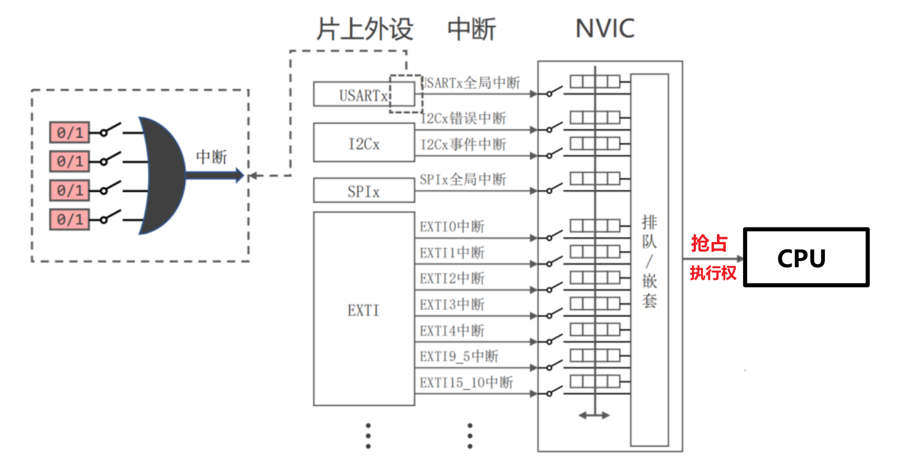

*图1-1中断系统-框图*

像 USART、这类**片内外设**，本身就是单片机内部集成的功能模块。

它们在检测到特定事件发生（比如接收完成）时，可以直接向NVIC发送中断请求。

再由NVIC统一进行中断调度执行。

那么问题来了：

**那些连接在 GPIO 引脚上的“片外外设”，如果它们也想发送中断请求，怎么办？**

比如：

1. 某个接在IO引脚上的按键，希望能够在按键按下时，触发一个中断请求，怎么实现呢？
2. 某个可以输出高低电平状态的传感器，希望在输出高电平时，触发一个中断请求，怎么实现呢？

中断是单片机内部系统的功能，所以这些外部设备，需要借助一个单片机外设来向NVIC发送中断请求。

这个外设就是：**EXTI外设**。

注意：

1. 只要输入型的设备，才具有发送中断请求的需求，比如按键、传感器等。
2. 输出驱动型设备，像LED、蜂鸣器等显然没有这种需求。

#### 1.1 EXTI外设简述

EXTI（External interrupt / event controller，外部中断 / 事件控制器），一般直接简称为**外部中断**。

需要特别注意的是：

**EXTI 外设不是 “EXIT / exit”，并不是“退出”的英文单词，而是 “External Interrupt” 的缩写，请不要混淆。

**EXTI 外设，是单片机内部的一个片内外设，用于统一处理来自 GPIO 引脚所连接的外部设备的中断请求。**

**说得更具体一点：**

EXTI 外设的作用，是将 GPIO 引脚上的外部电平变化（例如由低电平变为高电平），转换为单片机内部可以识别的中断请求。

**说得更通俗一点：**

**GPIO引脚上接入的外部设备，在引脚输入电平变化时，可以借助EXTI外设，由EXTI外设向NVIC发送中断请求。**

再举一个实际的例子：

1. PA0 引脚上接入了一个传感器，该传感器可以输出高电平或低电平。
2. 在正常情况下，传感器输出低电平，PA0 引脚输入低电平。
3. 当外部环境发生变化时，传感器转而输出高电平，此时 PA0 引脚的输入电平从**低电平切换为高电平**。
4. EXTI 外设捕捉到 PA0 引脚输入电平的这一变化，并向 NVIC 发送中断请求。
5. **后续的处理过程与我们前面学习的中断流程一致，即通过配置 NVIC 使能此外部中断，并由 NVIC 统一完成中断调度与执行。**

如果能够理解以上内容，就可以发现：

**EXTI 只是帮 GPIO 引脚上的外部设备“代发”了一次中断请求。**

**一旦中断请求进入 NVIC，后面走的流程，就和 USART外设中断没有任何区别了。**

#### 1.2 EXTI外部中断执行流程

GPIO引脚只有在设置为输入模式，连接一个输入向设备时，才有借助EXTI外设发起中断请求的需求。

**为了让EXTI外设，能够及时检测IO引脚的输入电平变化，我们需要将IO引脚的电平信号映射到EXTI外设。**

**这里需要借助一个新的外设——AFIO，来完成这个信号映射。**

EXTI外部中断，整个执行流程如下图所示：

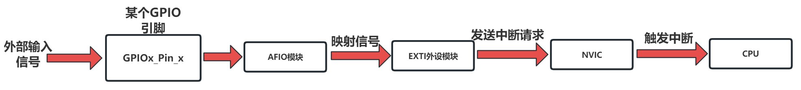

*图1.2-1EXTI和GPIO-系统框图*

在这个系统中：

1. GPIO引脚，负责接收外部信号，必须配置为输入工作模式。
2. AFIO外设，负责将GPIO引脚接收到的外部信号，映射传递给EXTI模块。
3. EXTI是信号的处理者，负责检测GPIO引脚的电平变化并提交中断请求给NVIC。
4. NVIC作为中断的中心处理管理者，负责管理中断优先级以及中断响应等。
5. 最后，由NVIC打断主程序/其它中断执行，执行当前EXTI的中断处理程序。

整个外部中断流程，从外部信号输入开始，依次经过 GPIO、AFIO、EXTI、NVIC 四个模块，最终由 CPU 执行中断处理程序。

因此，后续在实现外部中断功能时，需要严格按照这一流程，对各个模块进行正确配置。

其中的第一步，即设置IO引脚为输入模式，这个我们已经非常熟悉了，这里不再赘述。

下面我们来介绍一下AFIO模块。

### 2. AFIO外设模块

AFIO（Alternate Function I/O，复用 I/O 接口）是 STM32 系列单片机中一个功能相对较少的外设模块，主要起到**辅助和配置**的作用。

**在SPL库中，它也没有专门的函数模块，其相关函数都合并在GPIO模块。**

AFIO最主要的用途就只有两个：

1. 实现引脚的重定义功能，参考表格引脚定义表。
   - a. 当硬件设计中默认复用功能引脚被占用时，可以通过 AFIO 重映射切换到其他引脚。
   - b. 在SPL库中，实际只需要调用一个`GPIO_PinRemapConfig`函数就可以实现引脚功能重定义。
2. **将某个IO引脚的输入信号，映射到EXTI外设上。**AFIO 可以将特定的 GPIO 引脚映射到 EXTI模块，用于处理外部信号输入并触发中断请求。

下面我们就来看一下，AFIO外设模块的这两个功能。

需要注意的是：

1. **作为一个独立的外设模块，在使用 AFIO 之前，必须先开启其外设时钟。**
2. AFIO 外设挂载在**APB2 外设总线**上，相关时钟使能方式与其他 APB2 外设一致，这里不再赘述。

#### 2.1 AFIO重定义引脚功能

在之前所有的串口通信中，我们都直接使用了PA9和PA10的引脚复用功能，直接把它们当成USART1_TX和USART1_RX引脚使用。

现在假如PA9和PA10引脚不可用了，于是我们只能考虑重定义引脚功能。比如参考下图：


*图2.1-1重定义引脚功能-图*

我们把串口通信的接线图稍作修改：

1. 将USB-TTL设备的RXD针脚接入单片机的PB6（USART1_Tx）引脚。
2. 将USB-TTL设备的TXD针脚接入单片机的PB7（USART1_Rx）引脚。

如下图所示：

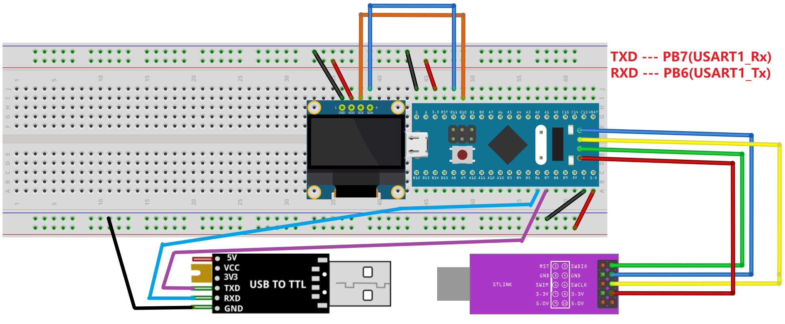

*图2.1-2AFIO重定义引脚功能-接线图*

然后继续使用上面实现过的"中断控制LED闪烁实验"的代码，原始的引脚初始化代码如下：

**注意这段代码使用的引脚仍然是PA9和PA10，需要修改！**

```c
 /**
  * @brief 配置 USART1 的 TX（PA9）和 RX（PA10）引脚
  * @param 无
  * @retval 无
  */
 void USART1_TxRx_Init(void) {
     // 开启 GPIOA 时钟
     RCC_APB2PeriphClockCmd(RCC_APB2Periph_GPIOA, ENABLE);

     // 配置 PA9（USART1 TX）
     GPIO_InitTypeDef GPIO_InitStruct;
     GPIO_InitStruct.GPIO_Pin = GPIO_Pin_9;
     GPIO_InitStruct.GPIO_Mode = GPIO_Mode_AF_PP; // 复用推挽输出模式
     GPIO_InitStruct.GPIO_Speed = GPIO_Speed_50MHz;
     GPIO_Init(GPIOA, &GPIO_InitStruct);

     // 配置 PA10（USART1 RX）
     GPIO_InitStruct.GPIO_Pin = GPIO_Pin_10;
     GPIO_InitStruct.GPIO_Mode = GPIO_Mode_IN_FLOATING; // 浮空输入模式
     // 输入模式下，引脚的输出速度参数可以不设置，也可以随意设置一个值
     GPIO_Init(GPIOA, &GPIO_InitStruct);
 }
```

现在我们使用AFIO模块，来将PB6和PB7重定义为串口通信的引脚。

此时我们需要使用的函数就是`GPIO_PinRemapConfig`函数。

`GPIO_PinRemapConfig`是 STM32 标准库中的一个函数，主要用于重定义GPIO引脚的功能。

其函数声明如下：

```c
void GPIO_PinRemapConfig(uint32_t GPIO_Remap, FunctionalState NewState);
```

**第一个参数GPIO_Remap是此函数的核心：**

**用于指定将要重定义的引脚类型。**

它使用一系列的宏定义作为传参，比如我们需要的：`GPIO_Remap_USART1`通过查表我们知道能够作为USART1类型的重定义功能引脚，只有PB6和PB7。

也就是说调用此函数后，只需要将这两个引脚按照需求正常初始化，即可实现它们的重定义USART1功能。

第二个参数NewState则没什么可说的，直接传参ENABLE表示开启重定义功能，DISABLE表示禁用重定义功能。

除此之外，此函数还有以下注意事项：

1. 引脚重定义功能的实现需要AFIO外设的参与，所以调用此函数之前不要忘记开启AFIO外设时钟。
2. 此函数一次调用只能重定义一种功能的引脚，不能同时重定义多种类型的引脚。

最终，我们把USART1_TxRx_Init函数的实现代码改成下面：

```c
 /**
  * @brief 配置 USART1 的 TX（PB6）和 RX（PB7）引脚
  * @param 无
  * @retval 无
  * @note 需要使用PB6和PB7引脚的重定义功能
  */
 void USART1_TxRx_Init(void) {
     // 开启 GPIOB、AFIO 和 USART1 时钟
     RCC_APB2PeriphClockCmd(RCC_APB2Periph_GPIOB |RCC_APB2Periph_AFIO,ENABLE);

     // 进行 USART1 功能类型引脚进行重定义
     GPIO_PinRemapConfig(GPIO_Remap_USART1, ENABLE);

     // 初始化 PB6（USART1 TX）
     GPIO_InitTypeDef GPIO_InitStruct;
     GPIO_InitStruct.GPIO_Pin = GPIO_Pin_6;
     GPIO_InitStruct.GPIO_Mode = GPIO_Mode_AF_PP; // 复用推挽输出模式
     GPIO_InitStruct.GPIO_Speed = GPIO_Speed_50MHz;
     GPIO_Init(GPIOB, &GPIO_InitStruct);

     // 初始化 PB7（USART1 RX）
     GPIO_InitStruct.GPIO_Pin = GPIO_Pin_7;
     GPIO_InitStruct.GPIO_Mode = GPIO_Mode_IN_FLOATING; // 浮空输入模式
     GPIO_Init(GPIOB, &GPIO_InitStruct);
 }
```

其余代码都不需要做修改，编译烧录后打开串口工具进行测试，功能实现应当是完全一样的。

**注意，不要忘记修改电路接线，现在使用的是PB6和PAB引脚！！！**

#### 2.2 AFIO映射IO引脚到EXTI线（重点）

AFIO外设的第二个功能是，映射IO引脚电平信号到EXTI外设。

AFIO映射IO引脚到EXTI，再由EXTI产生中断请求，其过程如下图所示：

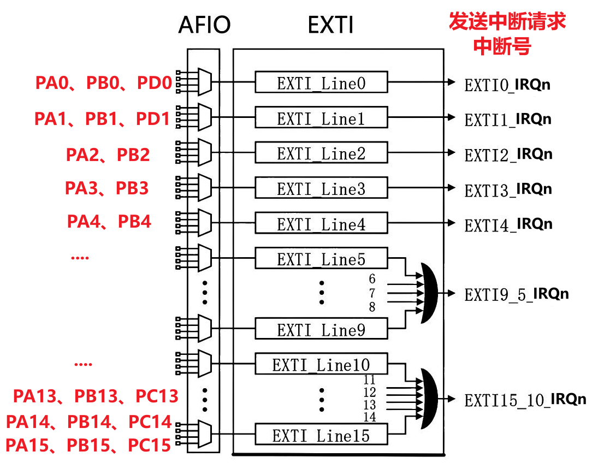

*图2.2-1AFIO映射IO引脚到EXTI-图*

下面详细来解释一下这张图。

##### 2.2.1 EXTI线

AFIO外设会将GPIO引脚的电平信号，映射到**EXTI中断线**上。

EXTI外设内部一共提供了16条外部中断线（后续直接简称为**“EXTI线”**），分别是：

EXTI_Line0 ~ EXTI_Line15**每一条线都对应一个固定的IO引脚编号，而不是对应某个具体的IO引脚。**

比如：

1. EXTI_Line0对应所有编号为0的引脚，比如PA0、PB0、PD0
2. ....
3. EXTI_Line4对应所有编号为4的引脚，比如PA4、PB4
4. .....

**假如PA0引脚连接的设备需要发中断请求，那么就需要让AFIO外设，将PA0引脚的电平信号映射到EXTI线0上。**

当然，这里就自然而然地联想到一个问题：

某条EXTI线，同一时刻可以映射多个IO引脚吗？

比如EXTI线0，可不可以同时映射PA0和PB0引脚呢？

当然不可以。

**（重点）某条EXTI线，在同一时刻，只能映射相同编号的一个IO引脚！！**

比如：

1. 将PA1引脚映射到EXTI线1上，就不能再映射PB1引脚。
2. 如果再次将PB1引脚映射到EXTI线1，那么PB1引脚的映射就会覆盖PA1引脚！EXTI线1此时的电平信号就是PB1引脚的。

（了解）这是因为引脚到EXTI线的映射配置，是AFIO外设的外部中断配置寄存器组决定的，同一个编号的引脚不能同时映射到同一条线。

寄存器的定义内容, 可以参考下面的图片（从参考手册中获取）：

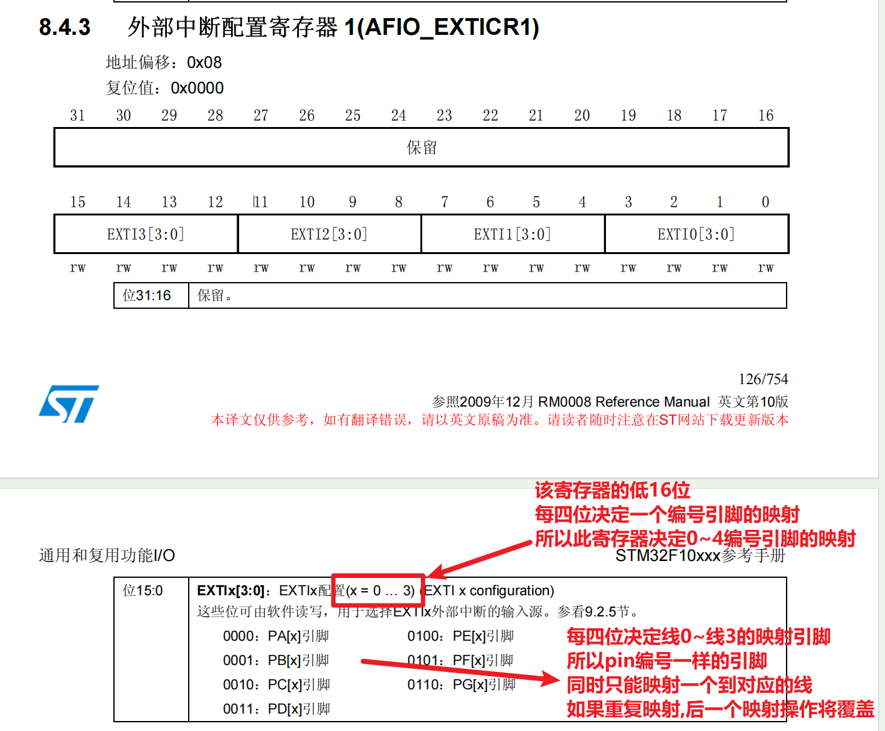

*图2.2.1-1EXTI线映射-寄存器图*

可以看到AFIO外部中断配置寄存器中，某一条线的映射引脚是固定4位确定的，如果重复映射，就会产生覆盖行为！

这一个细节大家可以留意一下。

##### 2.2.2 EXTI外部中断请求

EXTI检测IO引脚的电平变化，最终的目的是要向NVIC发送中断请求。

**那么EXTI外部中断外设，总共可以发送多少个中断请求呢？（类比整个USART1外设，只能发送1个全局中断）**


*图2.2.2-1AFIO映射IO引脚到EXTI-图*

很明显，通过阅读这张图：**EXTI外设一共可以产生7个中断请求。**

具体来说是：

1. GPIO所有编号为0~4的IO引脚，它们都被AFIO映射到0~4的EXTI线上，并最终各自单独发送一个EXTIx_IRQn的中断请求。
   - a. 这5条线，都可以发送单独的中断请求：
   - b. **EXTI_Line0 → EXTI0_IRQn**
   - c. **EXTI_Line1 → EXTI1_IRQn**
   - d. **EXTI_Line2 → EXTI2_IRQn**
   - e. **EXTI_Line3 → EXTI3_IRQn**
   - f. **EXTI_Line4 → EXTI4_IRQn**
2. GPIO所有编号为5~9的IO引脚，它们分别被AFIO映射到5~9的EXTI线上，但它们共同触发一个中断请求EXTI9_5_IRQn
   - a. 注意这5条线，虽然它们的映射线也5有条，但它们只能发出同一个中断请求。
   - b. **EXTI线号和引脚编号独立对应，但中断请求并不和线号独立对应！**
3. GPIO所有编号为10~15的IO引脚，它们分别被AFIO映射到10~15的EXTI线上，但它们共同触发一个中断请求EXTI15_10_IRQn
   - a. 注意这6条线，虽然它们的映射线也有6条，但它们只能发出同一个中断请求。
   - b. **EXTI线号和引脚编号独立对应，但中断请求并不和线号独立对应！**

综合上面讲解的EXTI线，以及外部中断请求的知识点，我们举一些例子：

1. PB14引脚上连接的设备，有发送外部中断请求的需求。
   - a. 借助AFIO外设，将PB14引脚的输入信号映射到EXTI线14。
   - b. EXTI外设，此时产生的中断请求是：EXTI15_10_IRQn。
2. PA3引脚上连接的设备，有发送外部中断请求的需求。
   - a. 借助AFIO外设，将PA3引脚的输入信号映射到EXTI线3。
   - b. EXTI外设，此时产生的中断请求是：EXTI3_IRQn。

最后，我们再思考几个问题：

**问题1：与此同时，PB3引脚上的设备也想发中断请求，能够实现吗？**

答：当然无法实现。

同一条线在同一时刻，只能映射唯一的一个IO引脚。

比如EXTI线3映射了PA3引脚，就不可能再同时映射PB3引脚了。

**问题2：既然EXT线3不能同时映射两个引脚，那么能不能让PB3引脚映射到EXTI线4呢？**

答：当然也不可以。EXTI线号和引脚编号是严格一一对应的，这是硬件设计问题。

如果出现这种情况，最好的办法就是，考虑换一个引脚编号，不再都使用"Pin_3"。

**问题3：与此同时，PB11引脚上连接的设备，也有发送外部中断请求的需求。这个能实现吗？**

答：这是允许的。PB11引脚会映射到EXTI线11，并没有冲突。

**但是EXTI线11和线14，都发送同一个外部中断请求EXTI15_10_IRQn，在编写中断处理函数时需要对触发线做判断！**

到目前为止，关于AFIO映射EXTI线的相关问题，我们都理解了。

EXTI外设获取了IO引脚的电平变化，那么它会在什么情况下产生中断请求呢？

换句话说，EXTI外设产生中断请求的条件是什么呢？

下面我们就来了解一下EXTI外设触发中断的条件与机制。

### 3. EXTI触发中断的条件与机制（重点）

通过 AFIO 外设的映射，EXTI 外设已经能够获取 GPIO 引脚上的外部输入电平变化。

**接下来，EXTI 外设就需要根据引脚电平变化的方式，来决定是否产生中断请求。**

EXTI外设提供了三种不同的中断触发方式：

1. **上升沿触发：当 GPIO 引脚从低电平（0）变化为高电平（1）时，EXTI 产生中断请求。**
2. **下降沿触发：当 GPIO 引脚从高电平（1）变化为低电平（0）时，EXTI 产生中断请求。**
3. **双边沿触发：只要 GPIO 引脚的输入电平发生了变化（低到高或者高到低），EXTI 都会产生中断请求。**

如下图所示：

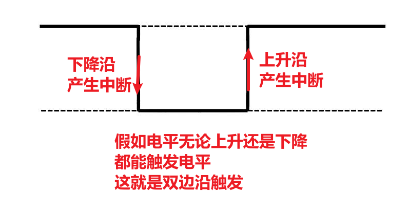

*图3-1EXTI触发中断的条件与机制-图1*

对于EXTI外设而言，它的中断机制可以用下图来描述：

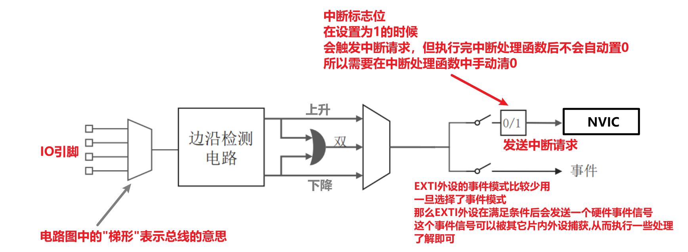

*图3-2EXTI触发中断的条件与机制-图2*

也就是说，要让**某一条 EXTI 线产生中断请求**，需要进行以下配置：

1. 配置开启中断产生的EXTI线。
2. 配置EXTI线的模式为中断模式，而不是事件模式。
3. 配置EXTI中断的触发条件：上升沿，下降沿或者双边沿。

除此之外，使用外部中断有一个特别需求注意的事情：

**在外部中断的中断处理函数中，一定要手动清除（清零）中断标志位，否则中断会一直触发！程序直接卡死。**

**在外部中断的中断处理函数中，一定要手动清除（清零）中断标志位，否则中断会一直触发！程序直接卡死。**

**在外部中断的中断处理函数中，一定要手动清除（清零）中断标志位，否则中断会一直触发！程序直接卡死。**

如此，在EXTI外设中配置产生中断请求就全部弄明白了。

剩下的步骤是什么呢？剩下的步骤就是配置NVIC，然后中断触发执行处理逻辑。

如此，EXTI外部中断触发的完整流程如下：

1. 配置 GPIO 引脚为输入模式。
2. AFIO映射IO引脚到EXTI线。
3. 配置EXTI外设，设置中断触发条件，设置模式为发送中断请求，设置某条EXTI线工作等。
4. 配置NVIC，设置EXTI外部中断的中断号、优先级并开启此中断。
5. 编写对应EXTI外部中断号的中断处理函数。
6. NVIC 管理中断请求，并根据优先级决定是否响应。
7. **中断响应执行对应中断号的中断处理函数，并且在中断处理函数中清除（清零）中断标志位！**

现在，我们万事俱备，几乎所有的原理都搞明白了，只差学习对应的函数。

下面我们用具体的实验案例，来加深对原理的理解，并且实现外部中断。

### 4. 扩展了解：EXTI的事件模式

EXTI 外设最主要的作用，是产生**外部中断请求**。

但在少数应用场景下，EXTI 外设还可以用来**产生事件信号**，这就是 EXTI 外设的**事件模式**。

在事件模式下，当某一条 EXTI 线满足设定的触发条件（例如上升沿或下降沿）时：

1. EXTI 外设会在内部产生一个**硬件事件信号**
2. **这个硬件事件信号，不会发中断请求，不会触发 NVIC**
3. **自然也不会进入中断处理函数**

也就是说：

**EXTI外设的事件模式，只产生事件，不发中断请求。**

那EXTI产生的事件，有什么用呢？

这些事件信号可以被单片机内部的某些片上外设接收，从而触发特定的硬件行为。

EXTI外设的事件模式比较少用到，下面举一个比较简单的例子，大家了解一下这个事件模式的作用就可以了：

STM32 的 PWR 电源控制器模块，可以让单片机进入一种**超低功耗的 STOP 模式**。在该模式下单片机的时钟会几乎完全停止，CPU不再执行，只使用少部分电力维持SRAM和寄存器的数据。

此时，如果希望单片机从 STOP 模式中退出，重新回到正常运行状态，可以通过：

1. 中断唤醒
2. 事件唤醒

在支持事件唤醒的情况下，可以使用**EXTI 外设的事件模式**：

1. 将某个 GPIO 引脚连接到按键
2. 配置对应 EXTI 线为事件模式
3. 设置触发条件为上升沿或下降沿
4. 当按键被按下时，产生事件信号
5. 事件信号触发单片机从 STOP 模式中唤醒

这种方式进行唤醒，不会打断主程序的执行流程，不会进入中断服务程序，非常适合用于节能应用。

### 5. 外部中断实验：对射式红外传感器计次

实验目的：

基于对射式红外传感器，结合外部中断功能，实现对物体通过传感器时的**计数功能**。

对射式红外传感器通常由**红外发射管和接收管**组成：

1. 当挡片进入传感器时，会阻挡红外光，传感器的输出端电平会产生变化。
2. 当挡片从传感器内部时移出时，红外光会照射接收管使得电路导通，传感器的输出端电平也会产生变化。

这个变化的电平信号可以作为外部中断的触发信号，单片机可以在中断处理中实现一些逻辑，从而完成计次或者测速效果。

本小节，我们就来完成使用对射式红外传感器计次的功能。首先，我们需要来介绍一下对射式红外传感器。

#### 5.1 对射式红外传感器

首先从你的配件盒中拿出对射式红外传感器，它长下面这个样子：

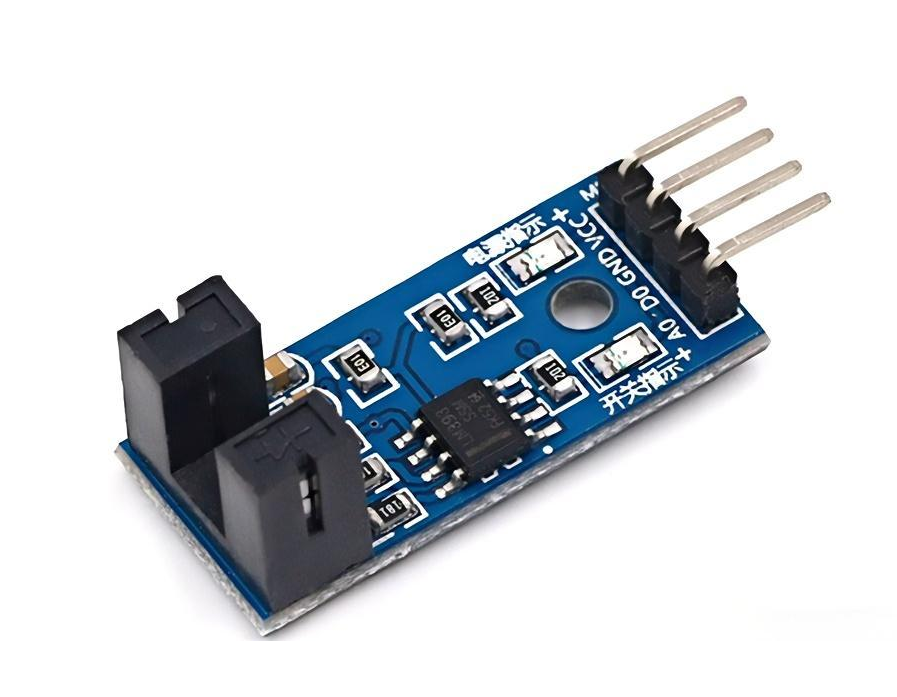

*图5.1-1对射式红外传感器-实物图*

当然基于它的不同实际用途，它还有一些其它的名字，比如：光电测速传感器、红外计数传感器....

测速传感器和我们之前讲的光敏电阻传感器的原理几乎是一模一样的，电路设计也几乎是一样的：

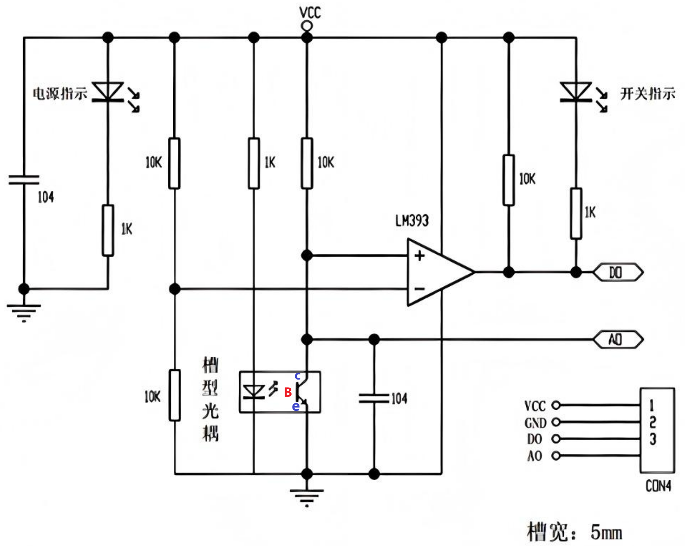

*图5.1-2对射式红外传感器-电路图*

只改变了两个地方：

1. **电位器（滑动变阻器）改成了一个固定阻值的电阻，所以LM393比较器的负极就直接输入了一个固定的电压值。**
2. 光敏电阻替换成了槽型光耦模块，LM393比较器的正极仍然接在原来的位置。

此时LM393比较器的正极输入电压发生了什么变化呢？

简化电路图如下图所示：

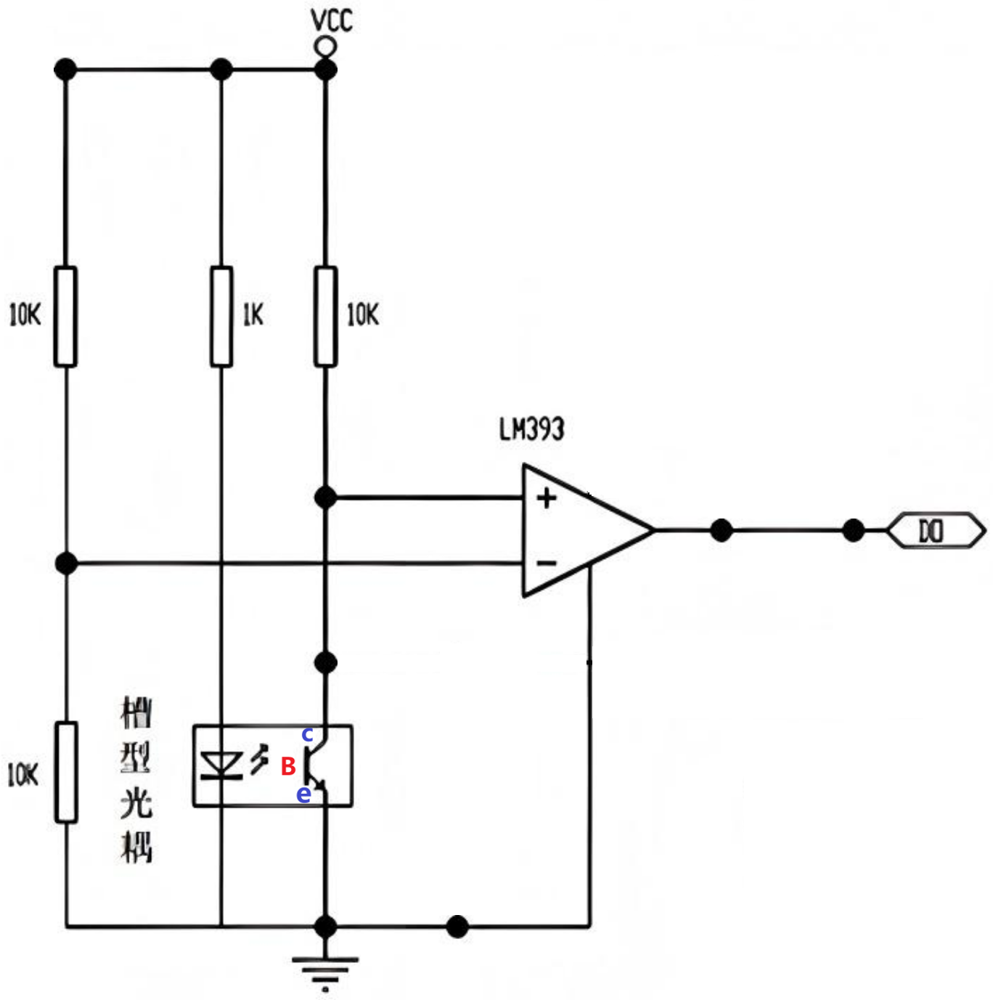

*图5.1-3对射式红外传感器-简化电路图*

**槽型光耦的一侧是一个发射红外线的LED，另一侧是一个接收红外LED光信号的光电晶体管。**

光电晶体管可以看成是一个**基极具有光电效应的NPN型三极管（以下都简称三极管）**，它的特点是这样的：

1. **三极管的基极具有光电效应，光照到基极区域时，会产生光生载流子（电子和空穴对）。**
2. 如此就会产生等效的基极高电平，产生基极流向发射极的电流，这样三级管就会导通。
3. 如果完全不遮挡凹槽，红外光完全照射基极，三极管就会完全导通。
4. 如果完全遮住凹槽，几乎不让红外光进入晶体管
   - a. 光生载流子消失，等效基极电流变为零
   - b. 集电极到发射极的电流也随之消失，三级管进入截止中断状态，几乎不导通。

也就是说，只要找一个**黑色物品**拦在槽型结构的LED和三极管之间，那么三极管就会截止断开，电路就无法接地闭合。

对射式红外传感器的工作可以简化理解为以下三种主要状态：

1. 当槽中无遮挡时，发射端发出的红外线能够直接到达接收端，光敏三极管导通较强。
   - a. 此时闭合回路中只有一个10k电阻，它将分走绝大多数电压。
   - b. 这样LM393的正极输入的电压就非常小。
   - c. 一定小于LM393负极输入的电压（负极输入的电压是2个10K电阻组成的电路中1个10K电阻分到的电压）。
   - d. **也就是说：当槽中完全无遮挡时，三极管彻底导通，DO引脚输出低电平，开关指示灯点亮。**
2. 当槽中存在黑色遮挡物体时，三极管几乎彻底断开，无法形成闭合电路。
   - a. 此时LM393的正极连接的10K电阻，相当于一个上拉电阻。
   - b. 它会把LM393的正极输入电压拉高到VCC，VCC一定大于LM393负极输入的电压。
   - c. 此时DO引脚会输出高阻抗，再由于电路中存在上拉电阻，实际DO引脚会输出高电平（VCC）
   - d. **也就是说：当槽中有黑色遮挡时，三极管几乎完全断开，DO引脚输出高电平，开关指示灯熄灭。**
3. 如果凹槽中存在遮挡物，但无法完全遮光，可以透过一些红外光：
   - a. 此时三极管会导通，但导通程度比不遮挡时要低，电阻阻值会比完全导通时更大
   - b. 此时比较器的正极输入电压就会相比三极管完全导通时，增大。
   - c. 但这种情况，我们通常不考虑，因为不方便判断正负极的电压输入情况。

**所以，使用对射式红外传感器时，通常把它当作一个两态开关器件来使用，重点考虑：**

1. 槽中无遮挡
2. 槽中存在有效遮挡（黑色遮挡）

**在我们的配件盒当中，黑色镊子的尾部就非常适合做这个遮挡物。**

了解了对射式红外传感器的工作原理，下面我们就可以把这个传感器接入电路了。

#### 5.2 电路接线图

电路接线图如下图所示：

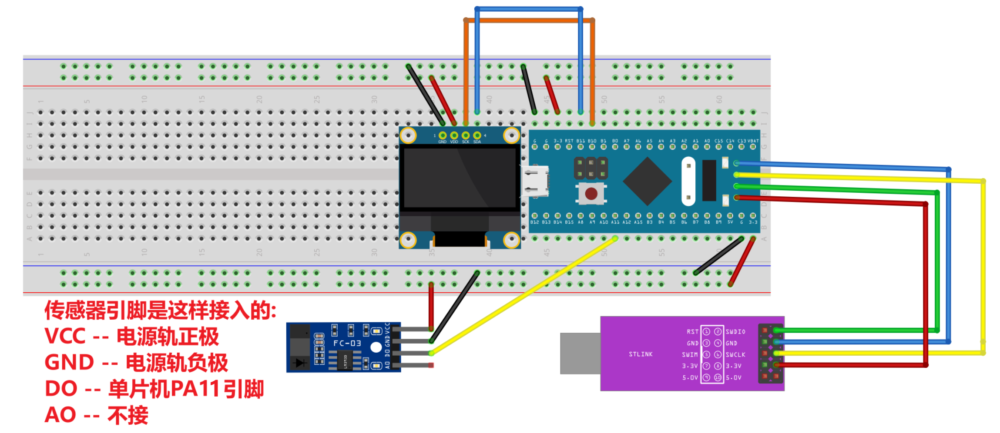

*图5.2-1测速传感器计次实验-图*

将对射式红外传感器的DO针脚，接入STM32的PA11引脚，不要接错了引脚。

下面我们要介绍两个全新的库函数：

1. 用于AFIO外设映射IO引脚到EXTI线的**GPIO_EXTILineConfig**函数。
2. 用于初始化配置EXTI外设，设置EXTI线、中断触发条件等信息的**EXTI_Init**函数。

#### 5.3 GPIO_EXTILineConfig函数

`GPIO_EXTILineConfig()`是 STM32 标准库中的一个函数，用于将 GPIO 引脚映射到EXTI 外部中断线。

其函数声明如下：

```c
void GPIO_EXTILineConfig(uint8_t GPIO_PortSource, uint8_t GPIO_PinSource);
```

函数没有返回值，所以直接看它的形参列表。

**第一个参数GPIO_PortSource：**

用于指定 GPIO 端口的来源，表示连接到 EXTI 线的 GPIO 外设端口。

它可以用一系列宏定义进行赋值，可以在`stm32f10x_gpio.h`文件中找到它们。对我们而言，能用的就只有以下四个：

1. `GPIO_PortSourceGPIOA`：表示GPIOA下的引脚触发外部中断。
2. `GPIO_PortSourceGPIOB`：表示GPIOB下的引脚触发外部中断。
3. `GPIO_PortSourceGPIOC`：表示GPIOC下的引脚触发外部中断。
4. `GPIO_PortSourceGPIOD`：表示GPIOD下的引脚触发外部中断。

**第二个参数GPIO_PinSource：**

指定要映射到 EXTI 的 GPIO 引脚编号。可以是以下值：

`GPIO_PinSource0`到`GPIO_PinSource15`，表示引脚 0 到 15。

通过这两个参数实际上就指定映射了某个IO引脚到某条EXTI线上，为后续触发外部中断做好了准备。

此函数非常简单，但也要注意几点：

1. IO引脚映射EXTI线是固定的映射关系，比如PA0 可以映射到 EXTI_Line0，PB1 可以映射到 EXTI_Line1，以此类推。
2. **该函数需要使用AFIO外设模块，所以用之前首先需要开启AFIO外设时钟（这个外设挂载在APB2总线上）。**

#### 5.4 EXTI_Init函数

EXTI_Init函数就会更复杂一些了。

`EXTI_Init()`函数是 STM32 标准库中用来配置 EXTI 外部中断线的**关键函数**，它允许你设置外部中断的触发方式、是否开启等选项。

此函数的声明如下：

```c
void EXTI_Init(EXTI_InitTypeDef* EXTI_InitStruct);
```

学到今天，大家应该已经发现了：

**使用某个外设的第一步都是初始化这个外设，需要调用它的"XXX_Init"函数，而调用这个函数往往都需要先定义一个结构体对象，然后给结构体对象成员赋值表示配置这个外设，最后再传参这个结构体对象的指针，这一套流程想必大家已经非常熟悉了。**

我们直接来看`EXTI_InitTypeDef`这个结构体类型，在`stm32f10x_exti.h`头文件就能够找到它的类型定义：

```c
typedef struct{
    uint32_t EXTI_Line; // EXTI 中断线（选择哪一条 EXTI线）
    uint32_t EXTI_Mode; // 中断模式（中断或事件）
    uint32_t EXTI_Trigger; // 触发模式（上升沿、下降沿、双边沿）
    FunctionalState EXTI_LineCmd; // 开启或禁用 EXTI 线
} EXTI_InitTypeDef;
```

这个结构体就包含了 EXTI 配置初始化所需的所有信息，通过给成员赋值就完成了EXTI的初始化配置工作。

**结构体成员的含义：**

**EXTI_Line成员：**

这个字段指定了需要配置的**EXTI 线**。STM32 支持 16 条 EXTI 线（EXTI_Line0 ~ EXTI_Line15），每条 EXTI 线都对应一套 GPIO 引脚编号，可以通过该字段选择具体的线。

它的传参使用16个宏定义完成，比如：`EXTI_Line0`对应所有编号0引脚触发外部中断，`EXTI_Line1`对应所有编号1引脚触发外部中断，`EXTI_LINE2`则对应所有编号2的引脚触发外部中断，等等以此类推。

**EXTI_Mode成员：**

在上面我们讲过，EXTI可以选择触发中断，也可以选择触发事件。该成员就用于配置触发的类型。

该参数可以直接使用下列枚举值传参：

```c
typedef enum{
    EXTI_Mode_Interrupt = 0x00,
    EXTI_Mode_Event = 0x04
}EXTIMode_TypeDef;
```

`EXTI_Mode_Interrupt`：表示该 EXTI 线用于触发中断。

`EXTI_Mode_Event`：表示该 EXTI 线用于触发事件（事件不会触发中断，只会设置标志，程序需要通过轮询来检测）。

**EXTI_Trigger成员：**

Trigger单词有触发器的含义，所以该成员自然而然就用于设置中断的触发方式。

它的传参可以直接使用下列枚举类型的枚举值完成：

```c
typedef enum{
    EXTI_Trigger_Rising = 0x08,
    EXTI_Trigger_Falling = 0x0C,
    EXTI_Trigger_Rising_Falling = 0x10
}EXTITrigger_TypeDef;
```

`EXTI_Trigger_Rising`：上升沿触发。

`EXTI_Trigger_Falling`：下降沿触发。

`EXTI_Trigger_Rising_Falling`：双边沿触发（上升沿或下降沿均可触发中断）。

**EXTI_LineCmd成员：**

开启或者禁用`EXTI_Line成员`指定的EXTI线。

传参的取值是我们的老朋友了：

```c
typedef enum {DISABLE = 0, ENABLE = !DISABLE} FunctionalState;
```

ENABLE：开启该 EXTI 线。

DISABLE：禁用该 EXTI 线。

以上我们就学习了所有的，必要的函数，下面开始思路分析，然后逐步完成代码编写工作。

#### 5.5 细节：EXTI开启时钟的问题

**EXTI模块虽然也是一个外设模块，但是它和传统的外设模块（如GPIO、USART等）略有差异，使用它不需要进行开启时钟的操作！**

记住这个结论即可，下面的解释了解即可：

**EXTI 不需要开启时钟，原因和 NVIC 本质上是一样的。它们都属于系统级中断控制逻辑，不受 RCC 外设的时钟控制。**

你可以认为EXTI外设，和NVIC一样，只要上电就可以直接使用，不需要经过RCC外设再单独开启时钟。

当然：

EXTI外设的使用，需要依赖于GPIO和AFIO外设，所以这两个外设的时钟、配置都要正确完成，否则会导致EXTI外设也不可用。

#### 5.6 思路分析

整个程序，实际上只需要两个大步骤就可以完成了：

1. 初始化光电测试传感器，从IO引脚的初始化，到AFIO映射EXTI线，再到初始化配置EXTI，最后是配置NVIC设置和响应外部中断。
2. 编写对应的中断处理函数。

再思考几个问题：

**光电测试传感器接入的IO引脚（PA11）应该设置为什么工作模式呢？**

肯定需要选择输入工作模式，那么上拉输入、下拉输入还是浮空输入呢？

光电测试传感器的DO引脚是这么输出高低电平的：

1. 当不遮挡时，引脚直接输出低电平。
2. 当遮挡时，引脚实际表现为高阻抗，依靠内部的上拉电阻将DO引脚拉到高电平输出。

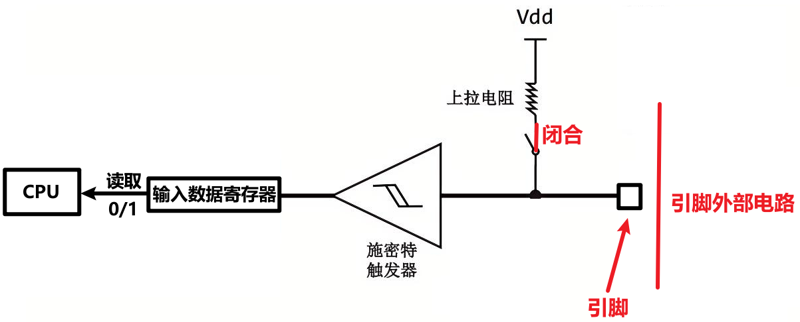

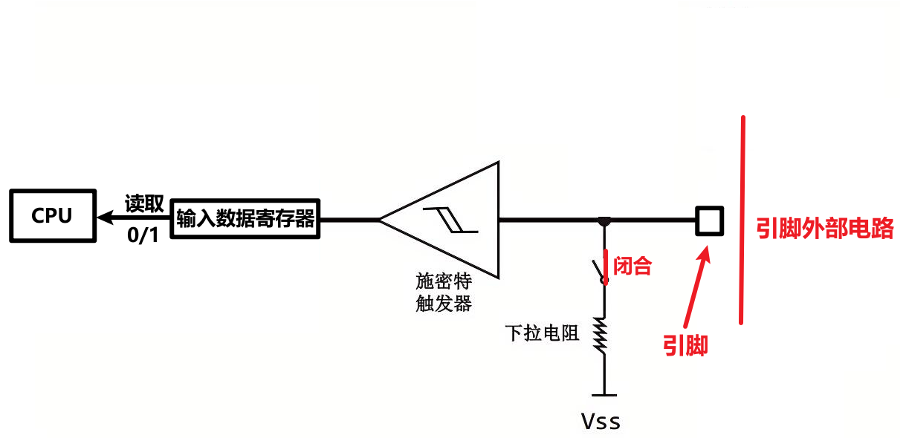

*图5.6-1上拉输入模式-图*

*图5.6-2下拉输入模式-图*

**首先，不建议选择下拉输入模式：**

1. 传感器DO口输出的高电平是靠内部上拉电阻，上拉实现的。
2. 如果 PA11 配置为下拉输入，单片机内部的下拉电阻会与外部上拉电阻形成“对拉”
3. 可能导致电平被拉低、阈值不稳定，甚至把高电平误判为低电平。
4. 所以不建议选择下拉输入模式。

**其次，可以选择上拉输入模式：**

1. 当 DO 处于高阻态时，引脚内部的上拉电阻能进一步保证电平稳定为高
2. 当 DO 输出低电平时，引脚内部的上拉电阻并不会影响这个低电平输入。

**也可以选择浮空输入模式：**

因为DO引脚完全可以稳定输出高低电平，虽然输出高电平依赖自身的上拉电阻。

但这也无关紧要，只要能稳定输出高低电平，就可以选择浮空输入模式。

**中断处理函数的声明应该怎么写呢？**

首先，我们需要触发外部中断的引脚是PA11，它需要映射到EXTI_Line11上，而EXTI_Line11最终发出的中断请求的中断号是：`EXTI15_10_IRQn`我们可以去汇编代码启动文件中找到这个中断号，对应的中断处理函数的名字，就是：

EXTI15_10_IRQHandler最终这个中断函数的声明如下：

```c
void EXTI15_10_IRQHandler(void);
```

当然我们再回顾一下，这两个名字的由来：

1. EXTI15_10_IRQn是NVIC配置中断时需要使用的中断号，它可以从"stm32f10x.h"头文件中获取。
2. EXTI15_10_IRQHandler是中断服务程序的函数名，可以从启动汇编文件中获取。

以上。

#### 5.7 部分代码实现

上面已经讲的非常细致了，从IO引脚的初始化，到AFIO映射EXTI线，再到初始化配置EXTI，最后是配置NVIC设置和响应外部中断。

我们可以用四个函数来完成这些工作，甚至main函数的代码都可以直接完成。

参考代码如下所示：

```c
  #include "stm32f10x.h" // Device header
  #include "Delay.h"
  #include "OLED.h"

  // 初始化测速传感器DO口连接的PA11引脚
  void SpeedSensor_GPIO_Init(void);

  // 利用AFIO外设映射PA11引脚到EXTI线11
  void SpeedSensor_AFIO_Map(void);

  // 初始化配置EXTI外设,发送中断请求给NVIC
  void SpeedSensor_EXTI_Init(void);

  // 初始化NVIC外设,配置EXTI发送的外部中断请求
  void SpeedSensor_NVIC_Config(void);

  // 全局变量计数器
  static uint32_t Count;

  int main(void) {
     // 完成一系列的初始化配置工作
     OLED_Init();
     OLED_Clear();
     SpeedSensor_GPIO_Init();
     SpeedSensor_AFIO_Map();
     SpeedSensor_EXTI_Init();
     NVIC_PriorityGroupConfig(NVIC_PriorityGroup_2);
     SpeedSensor_NVIC_Config();

     OLED_ShowString(1, 1, "Total Count:");

     while (1) {
         OLED_ShowUnsignedNum(2, 1, Count, 5);
     }
  }

  /**
   * @brief 初始化NVIC外设,配置EXTI线11发送的中断请求
   * @param 无
   * @retval 无
   * @note NVIC外设使用时,不需要手动开启时钟,时钟默认开启
   */
  void SpeedSensor_NVIC_Config(void) {
     NVIC_InitTypeDef NVIC_InitStruct;
     // 线10到线15一共6条线,都产生同一个外部中断EXTI15_10_IRQn
     NVIC_InitStruct.NVIC_IRQChannel = EXTI15_10_IRQn;
     NVIC_InitStruct.NVIC_IRQChannelCmd = ENABLE; // 开启EXTI线11外部中断
     NVIC_InitStruct.NVIC_IRQChannelPreemptionPriority = 0; // 设置抢占优先级
     NVIC_InitStruct.NVIC_IRQChannelSubPriority = 0; // 设置子优先级
     NVIC_Init(&NVIC_InitStruct);
  }

  /**
   * @brief 初始化配置EXTI外设,发送中断请求给NVIC
   * @param 无
   * @retval 无
   */
  void SpeedSensor_EXTI_Init(void) {
     // 1.注意: 使用EXTI外设时,是不需要开启时钟,因为此外设的工作不需要时钟信号
     // 2.调用EXTI_Init函数,进行EXTI外设的初始化
     EXTI_InitTypeDef EXTI_InitStruct;
     EXTI_InitStruct.EXTI_Line = EXTI_Line11;
     EXTI_InitStruct.EXTI_LineCmd = ENABLE;
     // 设置EXTI外设发送外部中断请求
     EXTI_InitStruct.EXTI_Mode = EXTI_Mode_Interrupt;
     /*
         遮挡物放入凹槽时触发中断,那么中断的触发方式应该是:
         没有遮住时,DO口输出低电平,遮住输出高电平
         上升沿触发

         希望遮挡物从凹槽中取出时触发中断,那么中断的触发方式应该是:
         遮住时,DO口输出高电平,拿出遮挡物,不遮住时输出低电平
         下降沿触发

         如果希望放进去触发,拿出来也触发,那就设置为双边沿触发
     */
     EXTI_InitStruct.EXTI_Trigger = EXTI_Trigger_Falling; // 设置为下降沿触发中断
     EXTI_Init(&EXTI_InitStruct);

  }

  /**
   * @brief 初始化测速传感器DO口连接的PA11引脚
   * @param 无
   * @retval 无
   */
  void SpeedSensor_GPIO_Init(void) {
     // 1.开启GPIOA的外设时钟
     RCC_APB2PeriphClockCmd(RCC_APB2Periph_GPIOA, ENABLE);
     // 2.初始化PA11引脚, 设置为浮空输入模式
     GPIO_InitTypeDef GPIO_InitStruct;
     GPIO_InitStruct.GPIO_Mode = GPIO_Mode_IN_FLOATING;
     GPIO_InitStruct.GPIO_Pin = GPIO_Pin_11;
     GPIO_Init(GPIOA, &GPIO_InitStruct);
  }

  /**
   * @brief 利用AFIO外设映射PA11引脚到EXTI线11
   * @param 无
   * @retval 无
   */
  void SpeedSensor_AFIO_Map(void) {
     // 1.不要忘记开启AFIO外设时钟
     RCC_APB2PeriphClockCmd(RCC_APB2Periph_AFIO, ENABLE);
     // 2.将PA11引脚输入映射到EXTI线11
     GPIO_EXTILineConfig(GPIO_PortSourceGPIOA, GPIO_PinSource11);
  }

```

在主函数中，只要不间断的获取`Count`的值，然后打印即可。

现在万事俱备，只差中断处理函数，那么中断处理函数如何实现呢？

#### 5.8 中断处理函数的实现

首先，在中断处理函数当中，必须要做的一件事情就是：清除中断标志位，避免EXTI持续发送中断请求，使得中断处理函数持续被调用。

这时就需要调用`EXTI_ClearITPendingBit`函数。

##### 5.8.1 EXTI_ClearITPendingBit函数

`EXTI_ClearITPendingBit`函数是用于清除**外部中断标志位**的一个标准外设库函数。

其函数声明如下：

```c
void EXTI_ClearITPendingBit(uint32_t EXTI_Line);
```

**它只有一个形参EXTI_Line：**用于指定需要清除外部中断标志位的外部中断线。

如果该函数用于清零GPIO引脚中断挂起标志位，那么此函数可以传入以下一系列的宏定义：

即`EXTI_Line0` ~ `EXTI_Line15`，分别表示对应16个GPIO引脚的16条EXTI线。

**此函数最好在进入中断处理逻辑时就调用，这样能够保证在整个中断处理逻辑的过程中，同类型外部不会再触发！**

##### 5.8.2 再次校验中断触发EXTI线

中断处理函数能不能立刻进入"Count++"的计数逻辑呢？

当然不能。

因为此时触发的中断是`EXTI15_10`，此中断对应EXTI线有：

1. EXTI_Line10
2. EXTI_Line11
3. EXTI_Line12
4. ...
5. EXTI_Line15

一共6条EXTI线都可以触发中断EXTI15_10，但只有**EXTI_Line11**触发的EXTI15_10中断，才是我们希望处理的中断。

所以在中断函数的一开头，就应当校验中断的触发EXTI线，在校验成功后才能进入中断的处理逻辑。

这时需要使用`EXTI_GetITStatus`函数。

##### 5.8.3 EXTI_GetITStatus函数

`EXTI_GetITStatus`是用于检查**某个EXTI线**的**中断标志位**是否被设置为1，也就是判断某条外部中断线是否触发了中断。

其函数的声明如下：

```c
ITStatus EXTI_GetITStatus(uint32_t EXTI_Line);
```

**它只有一个形参EXTI_Line：**用于指定要获取中断标志位状态的EXTI线。

它可以通过一系列的宏定义传参：即`EXTI_Line0` ~ `EXTI_Line19`，分别表示对应的20条EXTI线。

**它的返回值是一个ITStatus类型的数据，它是一个枚举类型：**

```c
typedef enum {RESET = 0, SET = !RESET} FlagStatus, ITStatus;
```

1. `SET`：表示此EXTI线的中断标志位被置为1，表示该EXTI线触发了中断。
2. `RESET`：表示此EXTI线的中断标志位是0，表示该EXTI线没有触发中断。

也就是说，中断处理函数的开头，就应该调用此函数用于判断触发中断的EXTI线是不是EXTI_Line11。

##### 5.8.4 传感器抖动

综合上面一大堆描述，我们终于写出了这个中断处理函数：

```c
 /**
   * @brief EXTI15_10_IRQn中断处理函数
   * @param 无
   * @retval 无
   */
 void EXTI15_10_IRQHandler(void) {
    if (EXTI_GetITStatus(EXTI_Line11) == SET) { // 判断此外部中断是EXTI_Line11触发的
        // 此中断由EXTI_Line11触发，执行计数逻辑
        Count++; // 计数加1
        EXTI_ClearITPendingBit(EXTI_Line11); // 清除中断标志,千万别忘记！
    }
 }
```

编译烧录程序，迫不及待的测速，如我们所愿吗？

当然没有。如果就这样编码，计数器会呈现"怪异的、非常不稳定"数据乱跳。

原因是我们还需要考虑抖动现象。

传感器理想状态是这样的：

1. 当一个物体进入传感器的检测范围时，传感器的 DO 输出会从低电平瞬间跳到高电平，表示传感器被遮挡。
2. 当物体离开检测范围时，DO 会从高电平恢复到低电平，表示无遮挡状态。
3. 理想情况下，信号是一个干净、平滑的上升沿或下降沿。

但实际情况下，由于物理运动的抖动、光学干扰、电学噪音等等一系列因素的影响：

1. 在挡板开始进入凹槽到完全进入的过程中，信号会反复抖动几次，而不是直接稳定的输出高电平。
2. 在挡板开始离开凹槽到完全离开的过程中，信号也会反复抖动几次，而不是直接稳定的输出低电平。

所以在`count++`之前，还需要再次判断一下当前PA11引脚的输入电平，确定是输入低电平后（下降沿触发），才能执行累加。

##### 5.8.5 最终实现

中断处理函数最终实现的参考代码如下：

```c
 /**
   * @brief 编写EXTI线11的中断服务程序,完成测速传感器计数功能
   * @param 无
   * @retval 无
   */
 void EXTI15_10_IRQHandler(void) {
    // 1.判断此外部中断是由EXTI线11触发的,而不是其它线
    if (EXTI_GetITStatus(EXTI_Line11) == SET) {
        // 线11的中断标志位置位,说明此外部中断就是线11触发的
        // 2.立刻马上手动复位线11的中断标志位,避免中断标志位置位重复触发外部中断
        EXTI_ClearITPendingBit(EXTI_Line11); // 一定要手动复位,否则中断一直触发

        // 3.对PA11引脚输入电平再次校验,判断出PA11稳定输入低电平后再进行计数
        // 这是做传感器的防抖操作
        if(GPIO_ReadInputDataBit(GPIOA, GPIO_Pin_11) ==Bit_RESET){
            Count++;
        }
    }
 }
```

我们采用"下降沿"触发中断，也就实现以下程序效果：

**挡片从凹槽当中拿出时，PA11引脚从输入高电平变为低电平，产生一个下降沿，从而触发中断，然后计数加1，显示在OLED上。**

注意细节：

EXTI_ClearITPendingBit函数用于清零外部中断标志位。

这个操作应该写在中断处理逻辑当中（直接写开头就可以）

这就能保证在中断处理的过程中不会因标志位为1而重复触发相同的中断。

#### 5.9 整体实现代码

整体实现代码如下：

```c
 #include "stm32f10x.h" // Device header
 #include "Delay.h"
 #include "OLED.h"

 // 初始化测速传感器DO口连接的PA11引脚
 void SpeedSensor_GPIO_Init(void);

 // 利用AFIO外设映射PA11引脚到EXTI线11
 void SpeedSensor_AFIO_Map(void);

 // 初始化配置EXTI外设,发送中断请求给NVIC
 void SpeedSensor_EXTI_Init(void);

 // 初始化NVIC外设,配置EXTI发送的外部中断请求
 void SpeedSensor_NVIC_Config(void);

 // 编写EXTI线11的中断服务程序,完成测速传感器计数功能
 void EXTI15_10_IRQHandler(void);

 // 全局变量计数器
 static uint32_t Count;

 int main(void) {
     // 完成一系列的初始化配置工作
     OLED_Init();
     OLED_Clear();
     SpeedSensor_GPIO_Init();
     SpeedSensor_AFIO_Map();
     SpeedSensor_EXTI_Init();
     NVIC_PriorityGroupConfig(NVIC_PriorityGroup_2);
     SpeedSensor_NVIC_Config();

     OLED_ShowString(1, 1, "Total Count:");

     while (1) {
         OLED_ShowUnsignedNum(2, 1, Count, 5);
     }
 }

 /**
   * @brief 编写EXTI线11的中断服务程序,完成测速传感器计数功能
   * @param 无
   * @retval 无
   */
 void EXTI15_10_IRQHandler(void) {
     // 1.判断此外部中断是由EXTI线11触发的,而不是其它线
     if (EXTI_GetITStatus(EXTI_Line11) == SET) {
         // 线11的中断标志位置位,说明此外部中断就是线11触发的
         // 2.立刻马上手动复位线11的中断标志位,避免中断标志位置位重复触发外部中断
         EXTI_ClearITPendingBit(EXTI_Line11); // 一定要手动复位,否则中断一直触发

         // 3.对PA11引脚输入电平再次校验,判断出PA11稳定输入高电平后再进行计数
         // 这是做传感器的防抖操作
         if (GPIO_ReadInputDataBit(GPIOA, GPIO_Pin_11) ==Bit_RESET){
            Count++;
         }
     }
 }

 /**
   * @brief 初始化NVIC外设,配置EXTI线11发送的中断请求
   * @param 无
   * @retval 无
   * @note NVIC外设使用时,不需要手动开启时钟,时钟默认开启
   */
 void SpeedSensor_NVIC_Config(void) {
     NVIC_InitTypeDef NVIC_InitStruct;
     // 线10到线15一共6条线,都产生同一个外部中断EXTI15_10_IRQn
     NVIC_InitStruct.NVIC_IRQChannel = EXTI15_10_IRQn;
     NVIC_InitStruct.NVIC_IRQChannelCmd = ENABLE; // 开启EXTI线11外部中断
     NVIC_InitStruct.NVIC_IRQChannelPreemptionPriority = 0; // 设置抢占优先级
     NVIC_InitStruct.NVIC_IRQChannelSubPriority = 0; // 设置子优先级
     NVIC_Init(&NVIC_InitStruct);
 }

 /**
   * @brief 初始化配置EXTI外设,发送中断请求给NVIC
   * @param 无
   * @retval 无
   */
 void SpeedSensor_EXTI_Init(void) {
     // 1.注意: 使用EXTI外设时,是不需要开启时钟,因为此外设的工作不需要时钟信号
     // 2.调用EXTI_Init函数,进行EXTI外设的初始化
     EXTI_InitTypeDef EXTI_InitStruct;
     EXTI_InitStruct.EXTI_Line = EXTI_Line11;
     EXTI_InitStruct.EXTI_LineCmd = ENABLE;
     // 设置EXTI外设发送外部中断请求
     EXTI_InitStruct.EXTI_Mode = EXTI_Mode_Interrupt;
     /*
         遮挡物放入凹槽时触发中断,那么中断的触发方式应该是:
         没有遮住时,DO口输出低电平,遮住输出高电平
         上升沿触发

         希望遮挡物从凹槽中取出时触发中断,那么中断的触发方式应该是:
         遮住时,DO口输出高电平,拿出遮挡物,不遮住时输出低电平
         下降沿触发

         如果希望放进去触发,拿出来也触发,那就设置为双边沿触发
     */
     EXTI_InitStruct.EXTI_Trigger = EXTI_Trigger_Falling;
     EXTI_Init(&EXTI_InitStruct);

 }

 /**
   * @brief 初始化测速传感器DO口连接的PA11引脚
   * @param 无
   * @retval 无
   */
 void SpeedSensor_GPIO_Init(void) {
     // 1.开启GPIOA的外设时钟
     RCC_APB2PeriphClockCmd(RCC_APB2Periph_GPIOA, ENABLE);
     // 2.初始化PA11引脚, 设置为浮空输入模式
     GPIO_InitTypeDef GPIO_InitStruct;
     GPIO_InitStruct.GPIO_Mode = GPIO_Mode_IN_FLOATING;
     GPIO_InitStruct.GPIO_Pin = GPIO_Pin_11;
     GPIO_Init(GPIOA, &GPIO_InitStruct);
 }

 /**
   * @brief 利用AFIO外设映射PA11引脚到EXTI线11
   * @param 无
   * @retval 无
   */
 void SpeedSensor_AFIO_Map(void) {
     // 1.不要忘记开启AFIO外设时钟
     RCC_APB2PeriphClockCmd(RCC_APB2Periph_AFIO, ENABLE);
     // 2.将PA11引脚输入映射到EXTI线11
     GPIO_EXTILineConfig(GPIO_PortSourceGPIOA, GPIO_PinSource11);
 }

```

以上。

#### 5.10 扩展：其它触发方式

在上述代码中，我们使用的是下降沿的触发方式，也就是将挡片拿出凹槽时执行计数器加加。

现在我们只需要修改下面两个部分就能改成上升沿触发方式，即将挡片放入的凹槽时执行计数器自增：

1. 在设置外部中断的触发机制时选择使用其它边沿触发。
2. 修改中断处理函数当中对高低电平的处理。

**可以参考下面代码：**

```c
 // 其余部分代码不需要修改

 /**
   * @brief 初始化 EXTI 配置（EXTI_Line11）
   * @param 无
   * @retval 无
   */
 void SpeedSensor_EXTI_Init(void) {
     // 配置 EXTI_Line11
     EXTI_InitTypeDef EXTI_InitStructure;
     EXTI_InitStructure.EXTI_Line = EXTI_Line11; // 选择 EXTI11
     EXTI_InitStructure.EXTI_Mode = EXTI_Mode_Interrupt; // 选择触发中断模式
     // EXTI_InitStructure.EXTI_Trigger = EXTI_Trigger_Falling; //下降沿触发
     // EXTI_InitStructure.EXTI_Trigger =EXTI_Trigger_Rising_Falling;//双边沿触发
     EXTI_InitStructure.EXTI_Trigger = EXTI_Trigger_Rising; // 上升沿触发

     EXTI_InitStructure.EXTI_LineCmd = ENABLE; // 开启EXTI线,可以发出中断请求
     EXTI_Init(&EXTI_InitStructure);
 }

 /**
   * @brief EXTI15_10_IRQn中断处理函数
   * @param 无
   * @retval 无
   */
 void EXTI15_10_IRQHandler(void) {
     if (EXTI_GetITStatus(EXTI_Line11) == SET) { // 判断此外部中断是EXTI_Line11触发的
         // 此中断由EXTI_Line11触发，执行处理逻辑
         EXTI_ClearITPendingBit(EXTI_Line11); // 清除中断标志,千万别忘记！
         // 再次确认引脚状态为高电平，确保是稳定的上升沿触发
         if (GPIO_ReadInputDataBit(GPIOA, GPIO_Pin_11) == Bit_SET){
            Count++; // 计数加1
         }
     }
 }
```

如果需要改成双边沿触发就更简单了，除了修改触发方式，就直接修改中断处理函数如下：

```c
 /**
   * @brief EXTI15_10_IRQn中断处理函数
   * @param 无
   * @retval 无
   */
 void EXTI15_10_IRQHandler(void) {
    if (EXTI_GetITStatus(EXTI_Line11) == SET) { // 判断此外部中断是EXTI_Line11触发的
        // 此中断由EXTI_Line11触发，执行处理逻辑
        EXTI_ClearITPendingBit(EXTI_Line11); // 清除中断标志,千万别忘记！
        Count++; // 计数加1
    }
 }
```

以上。

#### 5.11 总结：外部中断使用的一般流程步骤

根据上述代码，我们可以总结 STM32 外部中断（EXTI）的标准使用流程，包括：

1. GPIO 配置
2. AFIO 映射
3. EXTI 线配置
4. NVIC 配置
5. 中断处理函数

具体步骤如下：

**第一步：开启 GPIO 端口时钟**

**目的：**STM32 的 GPIO 外设时钟默认是关闭的，需要开启时钟以使用对应的引脚。

```c
RCC_APB2PeriphClockCmd(RCC_APB2Periph_GPIOA, ENABLE); // 开启 GPIOA 时钟
```

**第二步：配置 GPIO 引脚模式**

**目的：**STM32 的**GPIO 引脚**需要配置成**输入模式**，以便检测外部信号的变化。

```c
GPIO_InitTypeDef GPIO_InitStructure;
GPIO_InitStructure.GPIO_Pin = GPIO_Pin_11;
GPIO_InitStructure.GPIO_Mode = GPIO_Mode_IN_FLOATING; // 上拉输入模式
GPIO_Init(GPIOA, &GPIO_InitStructure);
```

输入模式最常使用的有三种，应该如何选择这三种输入模式呢？

1. `GPIO_Mode_IN_FLOATING`（浮空输入）：
   - a. 当外部电路能够依靠自身稳定的输入高低电平时，就可以选择浮空输入模式。
   - b. 比如光敏电阻传感器、对射式红外传感器的DO口...它们所连接的IO引脚就可以直接设置为浮空输入模式。

**如果引脚连接的外部电路可能出现悬空断路的状态，那么一般就需要使用上拉或者下拉的输入模式了。**

1. `GPIO_Mode_IPU`（上拉输入模式）：
   - a. 若外部电路能稳定的输出低电平，但无法自行输出高电平。
   - b. 此时外部电路的高电平输入就可以依赖上拉输入模式的上拉电阻实现。
   - c. 比如一脚接入电源负极的双脚式按键，当按键按下时能够稳定输入低电平，但无法依靠自身输入高电平。
   - d. 于是在按键没有按下（电路断路）时，就可以靠上拉输入模式提供一个稳定的高电平。
   - e. 这样就可以通过读取引脚输入电平来获取按键状态了。**"引脚输入低电平表示按键按下，引脚输入高电平表示按键释放"**
2. `GPIO_Mode_IPD`（下拉输入）：也完全类似，比如按键一脚接入了电源正极。

**第三步：开启 AFIO 外设时钟，并完成GPIO引脚到EXTI线的映射。**

**目的：**STM32 外部中断（EXTI）不能直接使用 GPIO，而是需要通过 AFIO外设将GPIO 端口映射到某个 EXTI 线。

```c
RCC_APB2PeriphClockCmd(RCC_APB2Periph_AFIO, ENABLE); // 开启 AFIO时钟
GPIO_EXTILineConfig(GPIO_PortSourceGPIOA, GPIO_PinSource11); // 将 PA11 映射到 EXTI线11
```

**第四步：配置 EXTI（外部中断触发方式）**

**目的：**

1. 选择**中断模式**（中断 / 事件触发）。
2. 选择**触发方式**（上升沿 / 下降沿 / 双边沿）。
3. 开启 EXTI 线路。

```c
EXTI_InitTypeDef EXTI_InitStructure;
EXTI_InitStructure.EXTI_Line = EXTI_Line11; // 选择 EXTI11
EXTI_InitStructure.EXTI_Mode = EXTI_Mode_Interrupt; // 选择触发中断模式
EXTI_InitStructure.EXTI_Trigger = EXTI_Trigger_Falling; // 下降沿触发
EXTI_InitStructure.EXTI_LineCmd = ENABLE; // 开启 EXTI
EXTI_Init(&EXTI_InitStructure);
```

**触发模式说明：**

| 触发模式 | 描述 |
|---|---|
| `EXTI_Trigger_Rising` | 上升沿触发（低 → 高） |
| `EXTI_Trigger_Falling` | 下降沿触发（高 → 低） |
| `EXTI_Trigger_Rising_Falling` | 双边沿触发（高 → 低或低 → 高） |

**第五步：配置 NVIC（中断向量控制器）**

**目的：**开启中断生效，设置中断优先级。

```c
NVIC_PriorityGroupConfig(NVIC_PriorityGroup_2); // 设置中断分组
NVIC_InitTypeDef NVIC_InitStructure;
NVIC_InitStructure.NVIC_IRQChannel = EXTI15_10_IRQn; // 选择EXTI15_10共享的中断向量
NVIC_InitStructure.NVIC_IRQChannelPreemptionPriority = 1; // 抢占优先级
NVIC_InitStructure.NVIC_IRQChannelSubPriority = 1; // 子优先级
NVIC_InitStructure.NVIC_IRQChannelCmd = ENABLE; // 开启 NVIC
NVIC_Init(&NVIC_InitStructure);
```

优先级设置说明：

1. 抢占优先级（`PreemptionPriority`）影响中断的**执行优先级**（0 最高）。
2. 子优先级（`SubPriority`）影响**同级中断的先后顺序**。

**第六步：编写中断处理函数**目的：处理中断触发的事件，如计数、信号采集等。

```c
 void EXTI15_10_IRQHandler(void) {
    if (EXTI_GetITStatus(EXTI_Line11) == SET) { // 判断是否是EXTI11触发的中断
        EXTI_ClearITPendingBit(EXTI_Line11); // 清除中断标志位

        // 再次确认引脚状态，确保是稳定的下降沿触发
        if (GPIO_ReadInputDataBit(GPIOA, GPIO_Pin_11) ==Bit_RESET){
            count++; // 计数加1
        }
    }
 }
```

**重要细节：**

1. 1EXTI_GetITStatus(EXTI_Line11) ==SET确保**是 EXTI12 触发的中断**，避免误触发。
2. 1EXTI_ClearITPendingBit(EXTI_Line11);

**必须清除中断标志**，否则会进入死循环不断触发中断。

1. 1GPIO_ReadInputDataBit(GPIOA,GPIO_Pin_11) ==Bit_RESET

**确保信号稳定**，避免信号抖动误触发。

**总之，STM32某个GPIO口使用外部中断（EXTI）的流程总结如下：**

| 步骤 | 操作 | 说明 |
|---|---|---|
| 1 | 开启 GPIO 时钟 | `RCC_APB2PeriphClockCmd(RCC_APB2Periph_GPIOx, ENABLE);` |
| 2 | 配置 GPIO 端口 | 选择 `GPIO_Mode_IPU`（上拉输入）或 `GPIO_Mode_IN_FLOATING` |
| 3 | AFIO 映射 GPIO 到 EXTI | `GPIO_EXTILineConfig(GPIO_PortSourceGPIOx, GPIO_PinSourceX);` |
| 4 | 配置 EXTI（外部中断） | 选择 `EXTI_Mode_Interrupt` 和 `EXTI_Trigger_Falling` |
| 5 | 配置 NVIC（中断控制器） | 选择 `EXTI15_10_IRQn`，设置优先级 |
| 6 | 编写中断处理函数 | 注意在中断函数中清理标志位：`EXTI_ClearITPendingBit(EXTI_LineX);` |

以上。

### 6. 扩展：反射式红外传感器

反射式红外传感器，和对射式红外传感器，其工作原理基本一致，所以也放在这里一并讲解。

在配件盒当中找到反射式红外传感器，如下图所示：

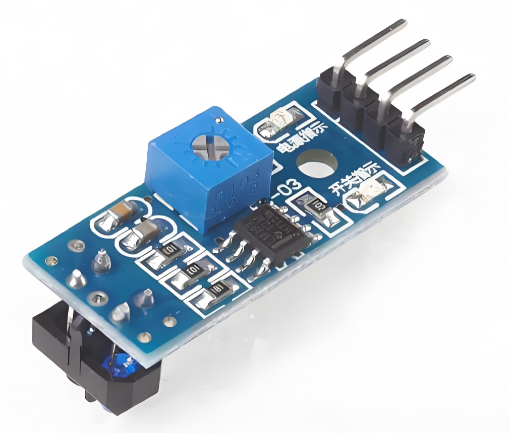

*图6-1反射式红外传感器-实物图*

如果考虑它的实际作用，它还被称之为红外避障传感器、红外接近传感器、反射式红外开关传感器等。

其电路设计，工作原理如下：

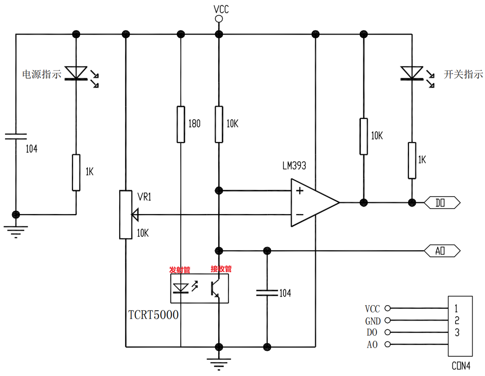

*图6-2反射式红外传感器-电路原理图*

这张原理图中，对我们而言相对陌生的就是元器件——TCRT5000下面介绍一下它。

#### 6.1 TCRT5000的原理

**传感器的核心元器件就是原理图中的TCRT5000，它由红外发射管和红外接收管组成。**

对应传感器模块实物中的：

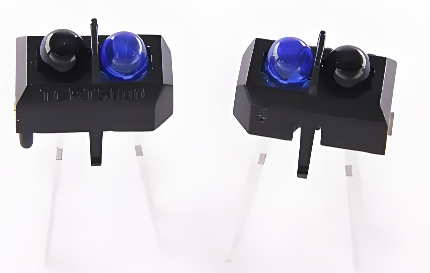

*图6.1-1TCRT5000-图*

其中：

1. 蓝紫色透明的，就是红外发射管。
   - a. 发射管要尽量把红外线发出去
   - b. 再加上材料本身带有蓝紫色，所以就呈现蓝紫色透明外观。
2. 黑色不透明的，就是红外接收管。
   - a. 接收管要尽量减少环境光干扰、稳定接收红外线，所以做成黑色外观。
   - b. **接收管仍然是一个基极带有光电效应的NPN型三极管，接收红外光三极管导通，否则三极管断开。**

TCRT5000的工作原理非常简单：

1. 发射管发出红外光线，接收管负责接收**反射回来**的红外光线。
2. 如果前方有物体，而且能把红外线反射回来，接收管三极管就会导通：
   - a. 反射回来的红外光越多，三极管导通程度越高，其电阻就会越小。
   - b. 反射回来的红外光越少，三极管导通程度越低，其电阻就会越大。
3. 如果前方没有物体，或者红外光线几乎没有反射回来，接收管几乎接收不到红外光：
   - a. 三极管就会接近截止断开
   - b. 相关的电路就可以近似看作断路状态。

#### 6.2 比较器正极输入电压分析

比较器正极输入电压，就是图中接收管三极管在串联电路中分得的电压：

1. 三极管本身的电阻越大，比较器正极输入电压就越大。
2. 三极管本身的电阻越小，比较器正极输入电压就越小。

结合前面的讲解，换句话说：

1. 当接收管三极管导通程度较高时，比较器正极输入电压就比较小。
2. 当接收管三极管导通程度较弱时，越接近完全断开，比较器正极输入电压就会越大。

如果考虑相关物理条件：

1. 当前方存在物体遮挡，并且能够将发射管发出的红外线较强地反射回来时，接收管三极管导通程度较高，因此比较器正极输入电压较小。
2. 当前方物体较远、反射能力较弱，或者反射回来的红外线较少时，接收管三极管导通程度会减弱，因此比较器正极输入电压会增大。
3. 当前方没有物体，或者几乎没有红外线反射回来时，接收管三极管几乎处于截止状态，此时比较器正极输入电压会接近上拉电压VCC。

所以，我可以得出这样的结论：

1. **比较器的正极输入电压，反映的是接收管当前接收到反射红外光的强弱属性。**
2. 接收到的反射红外光越强，接收管三极管导通程度越高，比较器正极输入电压越小。
3. 接收到的反射红外光越弱，接收管三极管导通程度越低，比较器正极输入电压越大。

或者说：

1. **比较器正极输入电压越大，说明接收反射红外光越少。**
2. **比较器正极输入电压越小，说明接收反射红外光越多。**

如果使用一个固定的遮挡物，并且尽量保持相同的遮挡角度，例如**用手**在传感器前方进行遮挡：

这意味着，遮挡物本身的反射率、表面材质、颜色以及遮挡角度等物理条件基本保持一致。

**在这种前提下，影响反射红外光强弱的主要变量，就变成了遮挡物与传感器之间的距离。**

于是可以得到如下关系：

1. 遮挡物越靠近传感器，反射回来的红外光通常就越多。
   - a. 反射回来的红外光越多，接收管三极管的导通程度就越高。
   - b. 接收管三极管导通程度越高，比较器正极输入电压就越小。
2. 遮挡物越远离传感器，反射回来的红外光就越少
   - a. 接收管三极管导通程度就越低。
   - b. 接收管三极管导通程度越低，比较器正极输入电压就越大。

也就是说，在遮挡物种类、表面特性和遮挡角度基本不变的条件下：

1. **目标越靠近传感器，比较器正极输入电压通常越小。**
2. **目标越远离传感器，比较器正极输入电压通常越大。**

因此可以认为：

**在固定遮挡物、固定角度的条件下，比较器正极输入电压的变化，可以在一定程度上反映目标距离的远近变化。**

#### 6.3 比较器负极输入电压分析

比较器的负极输入电压我们就非常熟悉了。

仍然是经典的电位器分压电路设计：

1. 顺时针拧动电位器，滑动变阻器的下半部分就越多，分到的电压就越大，比较器负极输入的电压就越大。
2. 逆时针拧动电位器，滑动变阻器的下半部分就越少，分到的电压就越小，比较器负极输入的电压就越小。

#### 6.4 比较器的输出状态

LM393电压比较器我们比较熟悉了：

1. 当正极输入电压大于负极，比较器输出1高阻态，再配合上拉电阻DO口输出高电平，DO指示灯熄灭。
2. 当正极输入电压小于负极，比较器输出0低电平，DO口输出低电平，DO指示灯点亮。

#### 6.5 用DO口来指示遮挡物的远近状态

前面已经分析过：

1. 遮挡物越靠近，反射回来的红外光越多，接收管导通程度越高，比较器正极输入电压越小。
2. 遮挡物越远离，反射回来的红外光越少，接收管导通程度越低，比较器正极输入电压越大。

所以，随着遮挡物距离变化，比较器正极输入电压也会不断变化。

而比较器负极的输入电压是一个可调节的固定输入电压，这样就形成了一个远近距离判断的阈值。

具体来说：

1. 当遮挡物比较远时，反射红外光较弱，比较器正极输入电压较大。
   - a. 如果此时**正极输入电压大于负极输入电压**
   - b. 那么比较器输出1高阻态
   - c. 在上拉电阻作用下，DO 口输出高电平，**DO指示灯熄灭**
   - d. **所以DO指示灯熄灭时，表示目标还没有进入设定的“近距离范围”**
2. 当遮挡物逐渐靠近时，反射红外光逐渐增强，比较器正极输入电压逐渐减小。
   - a. 一旦减小到**小于负极输入电压**
   - b. 比较器输出0低电平
   - c. DO 口输出低电平，DO指示灯点亮
   - d. **所以DO指示灯点亮时，表示目标进入设定的“近距离范围”**

总结：

**DO口由高电平到低电平，DO指示灯由熄灭到点亮，这个过程就指示了遮挡物靠近传感器。**

这个”近距离范围“的阈值如何调节呢？

显然，这个阈值就是由电位器调出来的比较器负极输入电压。

而“由远及近”的判断标准就是：看比较器正极输入电压有没有低于这个参考阈值。

结合电位器的调节方式，不难得出结论：

1. 越顺时针拧动电位器，比较器负极输入电压就会越大
   - a. 正极输入电压就越容易低于阈值。
   - b. 遮挡物就越可以在较远距离，使得正极输入电压小于负极。
   - c. **所以顺时针拧动电位器，就是拉远距离的阈值。**
2. 越逆时针拧动电位器，比较器负极输入电压就会越小
   - a. 正极输入电压就越不容易低于阈值。
   - b. 遮挡物就越需要在更近的距离，使得正极输入电压小于负极。
   - c. **所以逆时针拧动电位器，就是拉近距离的阈值。**

最终的结论是：

**顺时针调节电位器，会增大检测距离阈值；逆时针调节电位器，会减小检测距离阈值。**

#### 6.6 注意事项

**DO口的距离判断并不是线性的。**

在实际使用反射式红外传感器的 DO 口时，往往会发现这样一种现象：

1. 顺时针调节电位器到某一界限后，DO 口可能会始终输出低电平。
2. 逆时针调节电位器到某一界限后，DO 口可能会始终输出高电平。

这属于正常现象，其原因在于：

DO 口本质上不是距离的线性输出，而只是比较器阈值判断后的数字量输出。

也就是说，LM393 比较器只关心一件事：

比较器正极输入电压，究竟是大于还是小于负极输入电压。

其中：

1. 比较器正极输入电压，反映的是接收管接收到的反射红外光强弱。
2. 比较器负极输入电压，由电位器调节得到，作为一个可调的参考阈值。

因此，当电位器调节到某一极端位置时，就可能出现以下情况：

1. **阈值调得过高，此时比较器正极输入电压几乎不可能大于负极输入电压，于是 DO 口长时间保持低电平。**
2. **阈值调得过低，此时比较器正极输入电压几乎不可能小于负极输入电压，于是 DO 口长时间保持高电平。**

所以，DO 口在实际使用中，并不会随着距离变化而线性变化，而通常表现为：

1. 在某一段合适的阈值范围内，目标远近变化可以引起 DO 口翻转。
2. 一旦超出这段合适范围，DO 口就可能长期保持高电平或低电平，不再变化。

另外还要注意：

**目标距离与反射红外光强之间，本身通常也不是线性关系。**

因为反射红外光强除了和距离有关外，还会受到物体颜色、材质、表面粗糙程度、遮挡角度以及环境光等因素影响。

因此，DO 口更适合用于：

**判断目标是否进入某个设定范围内。**

而不适合用于：

线性表示目标具体有多远。

总之：

**DO 口本质上是距离阈值判断输出，而不是距离线性输出。**

**电位器也不是在线性调节检测距离，而是在调节比较器的参考阈值。**

**因此在调节过程中，出现某一界限后 DO 口始终保持高电平或低电平的现象，是正常的。**

### 7. 外部中断实验：按键切换LED状态

在讲GPIO输入时，我们已经完成了按键切换LED状态的实验。在那时，我们是这样做的：

```c
 // 只保留了核心处理逻辑，细节代码已省略

 /*
     返回按键的状态
     若返回PRESSED表示按键按下且已弹起，此时转换PA3引脚的高低电平，切换LED状态
     若返回UNPRESSED表示按键没有按下，则保持PA3引脚的输出电平
 */
 uint8_t KEY_GetState(void) {
     if (GPIO_ReadInputDataBit(GPIOB, GPIO_Pin_10) == Bit_RESET) {
        // ...
        return PRESSED;
     }
     return UNPRESSED;
 }
 int main(void) {
     while (1) {
        if (KEY_GetState() == PRESSED) {
            // 按键按下且已弹起,切换LED状态
        }
        // 若按键未按下，不执行任何操作
     }
 }
```

这么做会有什么缺点呢？

主要缺点在于使用**轮询方式**检测按键状态，这会导致：

1. `while(1)`中不断调用`KEY_GetState()`进行检测，会导致 CPU 资源浪费，影响系统其他任务执行。
2. 轮询的检测频率受`while`循环的执行效率影响，可能无法及时响应按键按下事件。
3. 即便外界很长时间都不会按下按键，CPU仍然需要不停轮询按键状态，无法进入低功耗模式。

总之，在实际的应用中，使用轮询来检测外界输入的可能性比较低，更普遍的做法是采用外部中断。

下面我们来完成一个简单的外部中断实验：按键切换LED状态。

#### 7.1 电路接线图

在之前的实验中我们只使用了一个按键，为了更好的演示实验效果和练习外部中断处理，我们这次直接使用三个按键。

电路接线图如下图所示：

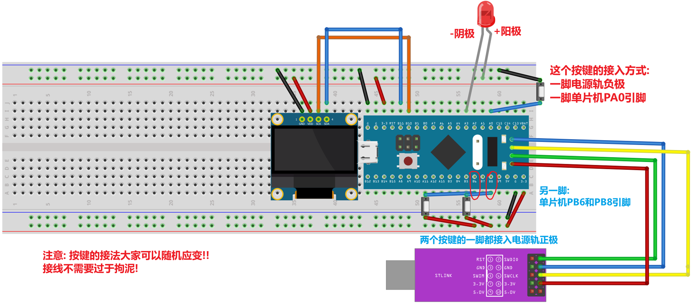

*图7.1-1按键外部中断实验-接线图*

**稍微需要注意的是：**

由于面包板电源轨正负极，可能与图中相反，所以按键在具体接入的时候可以灵活一点。

可以自行接按键，也可以使用飞线来接按键。

**大家也可以拿出按键，直接插入在电源导轨和引脚之间。如果按键接入电源轨正负与本文描述不同，则可以随机应变。**

**本文则依照，此接线图描述的接线方式，进行后续讲述。**

接线图中的设备是这么连接的：

1. LED的正极接入电源轨正极，负极接入引脚PA3。
2. 右上角的按键，一脚接入电源导轨负极，一脚接入PA0引脚。
3. 下面的两个按键：
   - a. 左边的一脚接入电源轨正极，一脚接入PB6引脚
   - b. 右边的一脚接入电源轨正极，一脚接入PB8引脚

实物接线图，以及三个按键的功能如下所示：

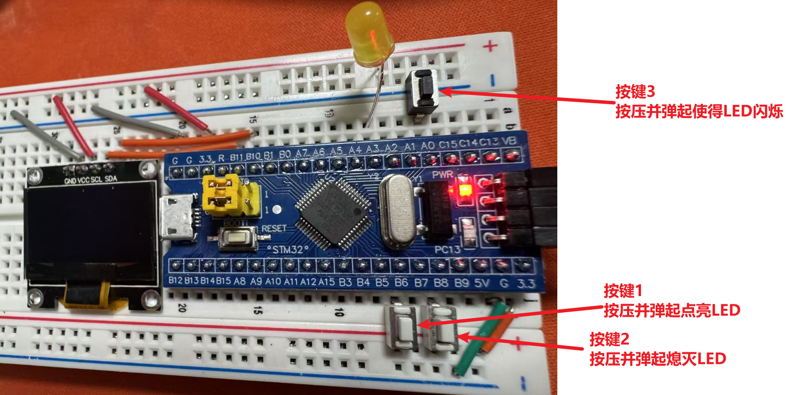

*图7.1-2按键外部中断实验-实物接线图*

总之接线的时候要仔细接，不要接错了。

这三个按键，分别控制LED的点亮、熄灭以及闪烁，具体功能分配图中已经说明了。

#### 7.2 思路分析

**首先分析三个按键的引脚工作模式：**

1. 按键1和按键2：
   - a. 在按压下去后，接通电源正极，按键按下时引脚输入高电平。
   - b. 所以它们需要设定为下拉输入模式，使得在松开状态下具有一个低电平输入，以区分按压和松开状态。
2. 按键3：
   - a. 在按压下去后，接通电源负极接地，按键按下时引脚输入低电平。
   - b. 所以它需要设定为上拉输入模式，使得在松开状态下具有一个高电平输入，以区分按压和松开状态。

**再分析三个按键需要映射的EXTI线：**

1. 按键1接入PB6引脚，映射的EXTI线是GPIO_PinSource6
2. 按键2接入PB8引脚，映射的EXTI线是GPIO_PinSource8
3. 按键3接入PA0引脚，映射的EXTI线是GPIO_PinSource0

**再分析三个按键各自触发触发外部中断的方式，初始化EXTI外设：**

1. 按键1和按键2，在没有按下时都默认具有低电平输入，按下按键时引脚输入电平变为高电平。所以它们需要采用上升沿触发。
2. 按键3，在没有按下时默认具有高电平输入，按下按键时引脚输入电平变为低电平。

所以它需要采用下降沿触发。

**再分析三个按键触发外部中断，对应的中断号：**

1. 按键1和按键2分别对应的EXTI线是GPIO_PinSource6和GPIO_PinSource8，它们共同触发一个中断号：EXTI9_5_IRQn
2. 按键3对应的EXTI线是GPIO_PinSource0，它单独触发一个中断号：EXTI0_IRQn

**再分析EXTI9_5_IRQn和EXTI0_IRQn中断优先级如何设定？**

对于按键来说，同时按下的意义不大，而且用人手同时按下两个按键来模拟同时发出中断请求，精确性不高。

所以我们可以直接将它们的抢占优先级设为一致的，互不打断不会出现中断嵌套。

子优先级则随意，也可以都设置为一样的。

**EXTI9_5_IRQn的中断处理函数怎么写？**

首先其函数声明如下：

```c
void EXTI9_5_IRQHandler(void);
```

该中断处理函数需要同时处理按键1和按键2的按压事件，所以需要在处理函数内部判断触发中断的EXTI线，以确定触发中断的是哪一个按键。

大体代码如下：

```c
// 检查是否是 PB6 触发的中断
if (EXTI_GetITStatus(EXTI_Line6) == SET) {
    // 按键1按下触发了中断，执行点亮LED以及相应中断处理逻辑
}

// 检查是否是 PB8 触发的中断
if (EXTI_GetITStatus(EXTI_Line8) == SET) {
    // 按键1按下触发了中断，执行熄灭LED以及相应中断处理逻辑
}
```

**EXTI0_IRQn的中断处理函数怎么写？**

首先其函数声明如下：

```c
void EXTI0_IRQHandler(void);
```

该中断处理函数只需要处理按键3的按压事件，但按照惯例仍然判断一下触发中断的EXTI线：

```c
if (EXTI_GetITStatus(EXTI_Line0) == SET) {
    // 按键3按下触发了中断，执行LED闪烁以及相应中断处理逻辑
}
```

**上面中断处理函数当中，都不要忘记清除 EXTI 中断标志位。**

以上，就分析完毕了。

#### 7.3 参考代码实现

总体的参考代码实现如下：

```c
  #include "stm32f10x.h"
  #include "Delay.h"

  #define LED_NORMAL 0 // LED 正常状态（熄灭或者点亮）
  #define LED_BLINK 1 // LED 闪烁状态

  uint8_t LED_State = LED_NORMAL; // LED 默认正常状态

  /**
  * @brief 按键初始化，配置 PB6, PB8 和 PA0 为外部中断
  * @param 无
  * @retval 无
  */
  void KEY_Init(void) {
     // 开启 GPIOB 和 AFIO 时钟
     RCC_APB2PeriphClockCmd(RCC_APB2Periph_GPIOB |RCC_APB2Periph_GPIOA|RCC_APB2Periph_AFIO,ENABLE);

     GPIO_InitTypeDef GPIO_InitStructure;

     // 配置 PB6 和 PB8 为下拉输入模式（因为 按键 接正极，按下时会变为高电平）
     GPIO_InitStructure.GPIO_Pin = GPIO_Pin_6 | GPIO_Pin_8;
     GPIO_InitStructure.GPIO_Mode = GPIO_Mode_IPD; // 下拉输入模式
     GPIO_Init(GPIOB, &GPIO_InitStructure);

     // 配置 PA0 为上拉输入模式（因为 按键 接负极，按下时会变为低电平）
     GPIO_InitStructure.GPIO_Pin = GPIO_Pin_0;
     GPIO_InitStructure.GPIO_Mode = GPIO_Mode_IPU; // 上拉输入模式
     GPIO_Init(GPIOA, &GPIO_InitStructure);

     // 使用AFIO外设将三个按键引脚映射到对应达到EXTI线
     GPIO_EXTILineConfig(GPIO_PortSourceGPIOB, GPIO_PinSource6);//PB6
     GPIO_EXTILineConfig(GPIO_PortSourceGPIOB, GPIO_PinSource8);//PB8
     GPIO_EXTILineConfig(GPIO_PortSourceGPIOA, GPIO_PinSource0);//PA0

     EXTI_InitTypeDef EXTI_InitStructure;

     // 配置 EXTI6 和 EXTI8（PB6 和 PB8）为上升沿触发
     EXTI_InitStructure.EXTI_Line = EXTI_Line6 | EXTI_Line8;
     EXTI_InitStructure.EXTI_Mode = EXTI_Mode_Interrupt;
     EXTI_InitStructure.EXTI_Trigger = EXTI_Trigger_Rising; // 上升沿触发
     EXTI_InitStructure.EXTI_LineCmd = ENABLE;
     EXTI_Init(&EXTI_InitStructure);

     // 配置 EXTI0（PA0）为下降沿触发
     EXTI_InitStructure.EXTI_Line = EXTI_Line0; // 选择 PA0 对应的EXTI0
     EXTI_InitStructure.EXTI_Trigger = EXTI_Trigger_Falling; // 下降沿触发
     EXTI_Init(&EXTI_InitStructure);

     // NVIC 配置初始化
     NVIC_PriorityGroupConfig(NVIC_PriorityGroup_2);

     NVIC_InitTypeDef NVIC_InitStructure;
     // 配置 NVIC，处理 EXTI6, EXTI8 和 EXTI0 的中断
     // 优先级都设置为相同的优先级
     NVIC_InitStructure.NVIC_IRQChannel = EXTI9_5_IRQn; // 处理EXTI6和EXTI8的中断
     NVIC_InitStructure.NVIC_IRQChannelPreemptionPriority = 0;
     NVIC_InitStructure.NVIC_IRQChannelSubPriority = 0;
     NVIC_InitStructure.NVIC_IRQChannelCmd = ENABLE;
     NVIC_Init(&NVIC_InitStructure);

     NVIC_InitStructure.NVIC_IRQChannel = EXTI0_IRQn; // 处理EXTI0的中断
     NVIC_InitStructure.NVIC_IRQChannelPreemptionPriority = 0;
     NVIC_InitStructure.NVIC_IRQChannelSubPriority = 0;
     NVIC_InitStructure.NVIC_IRQChannelCmd = ENABLE;
     NVIC_Init(&NVIC_InitStructure);
  }

  /**
  * @brief LED（PA3）初始化
  * @param 无
  * @retval 无
  */
  void LED_Init(void) {
     // 开启 GPIOA 时钟
     RCC_APB2PeriphClockCmd(RCC_APB2Periph_GPIOA, ENABLE);

     // 配置 PA3 为开漏输出模式
     GPIO_InitTypeDef GPIO_InitStructure;
     GPIO_InitStructure.GPIO_Pin = GPIO_Pin_3;
     GPIO_InitStructure.GPIO_Mode = GPIO_Mode_Out_OD;
     GPIO_InitStructure.GPIO_Speed = GPIO_Speed_50MHz;
     GPIO_Init(GPIOA, &GPIO_InitStructure);

     // 设定初始状态为 LED 关闭（PA3 高阻态）
     GPIO_SetBits(GPIOA, GPIO_Pin_3);
  }

  /**
  * @brief 外部中断服务函数（ISR），处理 PB6 和 PB8 按键中断
  * @param 无
  * @retval 无
  */
  void EXTI9_5_IRQHandler(void) {
     // 检查是否是 PB6 触发的中断
     if (EXTI_GetITStatus(EXTI_Line6) == SET) {
         // 清除 EXTI6 中断标志
         EXTI_ClearITPendingBit(EXTI_Line6);
         // 按键持续按下，等待弹起
         while (GPIO_ReadInputDataBit(GPIOB, GPIO_Pin_6) ==Bit_SET);
         // 点亮 LED，设置LED为正常模式
         LED_State = LED_NORMAL;
         GPIO_ResetBits(GPIOA, GPIO_Pin_3); // 低电平，点亮 LED
     }

     // 检查是否是 PB8 触发的中断
     if (EXTI_GetITStatus(EXTI_Line8) == SET) {
         // 清除 EXTI8 中断标志
         EXTI_ClearITPendingBit(EXTI_Line8);
         // 按键持续按下，等待弹起
         while (GPIO_ReadInputDataBit(GPIOB, GPIO_Pin_8) ==Bit_SET);
         // 点亮 LED，设置LED为正常模式
         LED_State = LED_NORMAL;
         GPIO_SetBits(GPIOA, GPIO_Pin_3); // 高电平，熄灭 LED
     }
  }

  /**
  * @brief 外部中断服务函数（ISR），处理 PA0 按键中断，LED闪烁
  * @param 无
  * @retval 无
  */
  void EXTI0_IRQHandler(void) {
     if (EXTI_GetITStatus(EXTI_Line0) == SET) {
         // 清除 EXTI0 中断标志
         EXTI_ClearITPendingBit(EXTI_Line0);

         while (GPIO_ReadInputDataBit(GPIOA, GPIO_Pin_0) ==Bit_RESET);

         LED_State = LED_BLINK;
     }
  }

  int main(void) {
     LED_Init(); // 初始化 LED
     KEY_Init(); // 初始化 PB6, PB8 和 PA0 按键

     while (1) {
         if (LED_State == LED_BLINK) {
             // LED 进入闪烁状态
             GPIO_ResetBits(GPIOA, GPIO_Pin_3); // 点亮 LED
             Delay_Ms(100); // 延时 100ms

             /*
                 Delay_Ms函数是通过轮询SysTick计数器标志位实现的
                 若LED在闪烁状态下，按压点亮LED按键时
                 恰好进入了上一个Delay_Ms函数
                 待点灯中断逻辑执行完毕后，会继续执行上一个Delay_Ms函数
                 随后还会将LED熄灭
                 这样点亮LED按键的功能就会失效，所以这里要加一个判断
                 随后跳过下面的熄灯逻辑
             */
             if (LED_State == LED_NORMAL) {
                 continue;
             }
             GPIO_SetBits(GPIOA, GPIO_Pin_3); // 熄灭 LED
             Delay_Ms(100); // 延时 100ms
         }
     }
  }

```

其中的各种逻辑细节，代码注释中都已经解释了，你可以直接阅读注释。若有问题，不妨互相讨论一下，或者直接问老师。

#### 7.4 扩展：中断优先级对实验结果的影响

**在上面的代码中，我们将两个中断的优先级都设置为一致的，抢占优先级和子优先级都是0。如下列代码所示：**

```c
 NVIC_InitTypeDef NVIC_InitStructure;
 // 配置 NVIC，处理 EXTI6, EXTI8 和 EXTI0 的中断
 // 优先级都设置为相同的优先级
 NVIC_InitStructure.NVIC_IRQChannel = EXTI9_5_IRQn; // 处理 EXTI6和EXTI8的中断
 NVIC_InitStructure.NVIC_IRQChannelPreemptionPriority = 0;
 NVIC_InitStructure.NVIC_IRQChannelSubPriority = 0;
 NVIC_InitStructure.NVIC_IRQChannelCmd = ENABLE;
 NVIC_Init(&NVIC_InitStructure);

 NVIC_InitStructure.NVIC_IRQChannel = EXTI0_IRQn; // 处理 EXTI0 的中断
 NVIC_InitStructure.NVIC_IRQChannelPreemptionPriority = 0;
 NVIC_InitStructure.NVIC_IRQChannelSubPriority = 0;
 NVIC_InitStructure.NVIC_IRQChannelCmd = ENABLE;
 NVIC_Init(&NVIC_InitStructure);
```

**此时如果"同时"按下点灯和闪烁两个按键（可以保持一段时间按下），最终的结果是闪烁还是点灯常亮呢？**

由于这两个中断的优先级是一致的，所以不存在中断嵌套，谁先触发就谁先执行完毕，最终LED的状态是后执行中断的状态。比如：

1. 如果点灯按键的中断先触发先执行，后执行闪烁中断逻辑，最终LED的状态是闪烁。
2. 如果闪烁按键的中断先触发先执行，后执行点灯中断逻辑，最终LED的状态是常亮。

由于手动的"同时按下"，再加上按键机械结构的影响，很难保证"真正"的同时，所以最终的结果表现会比较随机，两种结果都有。

**但是常亮的状态显然会更多一些，因为假如真的同时触发了两个中断，根据中断向量表：**

`EXTI0_IRQn`中断会比`EXTI9_5_IRQn`中断先执行，于是LED将表现出更多的常亮情况。

**现在我们将代码修改为以下优先级设置，现在闪烁中断逻辑具有更高的抢占优先级了：**

```c
 NVIC_InitTypeDef NVIC_InitStructure;
 // 配置 NVIC，处理 EXTI6, EXTI8 和 EXTI0 的中断
 // EXTI0闪烁逻辑具有更高的抢占优先级
 NVIC_InitStructure.NVIC_IRQChannel = EXTI9_5_IRQn; // 处理 EXTI6和EXTI8的中断
 NVIC_InitStructure.NVIC_IRQChannelPreemptionPriority = 1;
 NVIC_InitStructure.NVIC_IRQChannelSubPriority = 1;
 NVIC_InitStructure.NVIC_IRQChannelCmd = ENABLE;
 NVIC_Init(&NVIC_InitStructure);

 NVIC_InitStructure.NVIC_IRQChannel = EXTI0_IRQn; // 处理 EXTI0 的中断
 NVIC_InitStructure.NVIC_IRQChannelPreemptionPriority = 0;
 NVIC_InitStructure.NVIC_IRQChannelSubPriority = 0;
 NVIC_InitStructure.NVIC_IRQChannelCmd = ENABLE;
 NVIC_Init(&NVIC_InitStructure);
```

**此时如果"同时"按下点灯和闪烁两个按键（可以保持一段时间按下），最终的结果是闪烁还是点灯常亮呢？**

当然是常亮，由于闪烁逻辑的中断抢占优先级更高。

所以它总能先执行完毕（同时触发先执行，后触发可以中断嵌套先执行），于是后执行点灯中断逻辑，LED的状态总表现为常亮状态。

**现在我们将代码修改为以下优先级设置，现在点灯常亮中断逻辑具有更高的抢占优先级了：**

```c
 NVIC_InitTypeDef NVIC_InitStructure;
 // 配置 NVIC，处理 EXTI6, EXTI8 和 EXTI0 的中断
 // EXTI6点灯常亮中断逻辑具有更高的抢占优先级
 NVIC_InitStructure.NVIC_IRQChannel = EXTI9_5_IRQn; // 处理 EXTI6和EXTI8的中断
 NVIC_InitStructure.NVIC_IRQChannelPreemptionPriority = 0;
 NVIC_InitStructure.NVIC_IRQChannelSubPriority = 0;
 NVIC_InitStructure.NVIC_IRQChannelCmd = ENABLE;
 NVIC_Init(&NVIC_InitStructure);

 NVIC_InitStructure.NVIC_IRQChannel = EXTI0_IRQn; // 处理 EXTI0 的中断
 NVIC_InitStructure.NVIC_IRQChannelPreemptionPriority = 1;
 NVIC_InitStructure.NVIC_IRQChannelSubPriority = 1;
 NVIC_InitStructure.NVIC_IRQChannelCmd = ENABLE;
 NVIC_Init(&NVIC_InitStructure);
```

**此时如果"同时"按下点灯和闪烁两个按键（可以保持一段时间按下），最终的结果是闪烁还是点灯常亮呢？**

当然是闪烁，由于点灯常亮逻辑的中断抢占优先级更高，所以它总能先执行完毕（同时触发先执行，后触发可以中断嵌套先执行），于是后执行闪烁中断逻辑，LED的状态总表现为闪烁状态。

## 04 标志位总结

### 1. 标志位的分类

对于STM32的**SPL标准外设库开发方式**来说，标志位被分为两大类：

1. 状态标志位，也可以叫普通标志位：
   - a. 命名方式（宏定义）：**外设名_FLAG_标志位名**
   - b. 获取标志位取值的函数：**外设名_GetFlagStatus**
   - c. 手动复位标志位的函数：**外设名_ClearFlag**
2. 中断标志位，也可以叫中断挂起标志位：
   - a. 命名方式（宏定义）：**外设名_IT_标志位名**
   - b. 获取标志位取值的函数：**外设名_GetITStatus**
   - c. 手动复位标志位的函数：**外设名_ClearITPendingBit**

除此之外，EXTI外部中断的EXTI线状态标志位，也可以视为一种中断标志位，它的命名方式是：EXTI_LineX，获取值和手动复位函数则保持一致。

**两种标志位，在作用上也是存在区别的：**

1. 状态标志位，用于指示某个外设的运行情况、寄存器状态信息等。例如“是否发送完成”“接收寄存器是否非空”等。
2. 中断标志位，用于指示外设是否发送中断请求。中断标志位一旦置位，意味着中断源条件已满足，外设就会向NVIC发送中断请求。

**两种标志位，生效的时机是不同的：**

1. 状态标志位，不需要手动开启，它一直存在，始终用于指示外设的运行状态。
2. 中断标志位，需要手动开启对应中断源。中断标志位在不开启的情况下，不可能置位，也没有任何作用。

**两种标志位，置位时机比较类似：通常都是硬件自动置位，区别是中断标志位需要开启后才会置位，否则无效。**

**两种标志位，在复位机制上，则比较麻烦一点：**

1. 状态标志位，我们目前见到的状态标志位，大多都是硬件自动复位的，但也有些状态标志位的复位需要手动完成。
2. 中断标志位，它的复位有可能硬件自动复位，也可能手动软件复位。
   - a. **USART_IT_RXNE中断标志位，只需要读接收数据寄存器，即可实现硬件自动复位。**
   - b. EXTI_LineX外部中断线标志位，则需要手动调用函数，实现软件复位。
   - c. **切记：中断处理函数中需要考虑中断标志位的复位，尤其是需要手动复位时，不能忘记复位。**

**最后，我们可以直击本质，直接从寄存器的角度上来分析两种标志位。以下内容了解即可。**

状态标志位，中断标志位，这种分类只是STM32的SPL标准外设库开发方式的一种分类，只是SPL库基于标志位的功能，对标志位的一种分类。

但具体到本质，具体到外设的寄存器，这两种标志位的分类，又可能出现两种不同的情况：

第一种情况：

状态标志位和中断标志位实际上是单片机外设寄存器的同一位，只不过中断标志位需要额外开启一些配置，在SPL标志外设库中，此中断标志位才有可能置位。

这种情况很常见，大多数片上外设的中断标志位都是这种情况。

最典型的情况就是USART_IT_RXNE中断标志位，和USART_FLAG_RXNE状态标志位。

它们本质上都是USARTx外设的，SR寄存器（状态寄存器）当中的RXNE位（bit5）：

1. 只不过，状态标志位USART_FLAG_RXNE置位，只需要RXNE位为1就可以了。
2. 而USART_IT_RXNE中断标志位要想置位，需要在RXNE位为1的基础上，再加上USART_CR1寄存器的RXNEIE位也为1

**中断标志位置位多出来的一个条件，其实就是SPL库编程中，手动开启中断源的操作。**

这就是中断标志位需要开启才能够置位生效的原因！

第二种情况是，中断标志位单独存在，不与状态标志位共享。

这种情况下，存在一个单独的硬件寄存器，来记录中断产生的状态。

最典型的情况就是我们刚刚学过的EXTI外设。

EXTI外设的中断标志位，即EXTI线状态，即EXTI_LineX。

此中断标志位就直接对应了EXTI挂起寄存器(PR)的某一位，一旦某一位置位，就表示对应线触发中断请求，向NVIC发送中断请求。

该位的置位由硬件自动完成（需要满足触发条件），复位则需要手动完成。

**STM32的标志位大多都是上述情况，当然还可能出现一些特殊情况，但目前还不需要了解。**

### 2. 获取标志位状态和清零标志位的函数

在USART外设和EXTI这两个外设当中（其它外设也类似），有两对看起来非常类似的函数。

但其实它们的区别非常明显，下面我们分别讲一下这两个外设当中的这两个函数。

#### 2.1 USART外设获取标志位状态的一对函数

在USART外设中，有一对用于获取标志位状态的函数：`USART_GetFlagStatus`函数和`USART_GetITStatus`函数。

这两个函数的区别是什么呢？

其实很简单：

`USART_GetFlagStatus`函数，单纯用于获取某个标志位当前的状态，和中断没有任何关系。

1. 比如使用该函数，获取RXNE标志位的状态。
2. 如果接收数据寄存器是非空的，那么此函数的返回值就是`SET`，也就是RDR接收数据寄存器非空，可以将数据读出来。
3. 如果接收数据寄存器是空的，那么此函数的返回值就是`RESET`，也就是RDR接收数据寄存器是空的，没有数据可读。
4. 整个标志位的状态获取和中断是没有任何关系的。

使用方式，参考代码如下：

```c
// 该函数常用于轮询等待标志位置1，从而进行一些操作
while (USART_GetFlagStatus(USART1, USART_FLAG_RXNE) == RESET);
// USART_FLAG_RXNE标志位置为1，表示可以读USART外设接收到的数据了。
```

`USART_GetITStatus`函数，很明显函数名当中就带有"IT"字眼，所以此函数获取的标志位状态就是USART中断标志位的状态。

1. 比如使用该函数，获取RXNE中断标志位的状态。
2. 某个中断标志位必须使用函数`USART_ITConfig()`配置开启后，才有可能会被置为1。
3. 该函数用于判断某个标志位对应的中断是否触发，然后进行相关的中断处理逻辑，一般都会在中断处理函数的开头执行。

**由于USART外设只会产生一个全局中断，所以在USART外设中断的处理函数中，第一行就需要判断触发中断的标志位是否是当前需要的。**

比如下列参考代码：

```c
// USART外设全局中断的中断处理函数
void USART1_IRQHandler(void) {
    // 在中断服务函数中，检查是否触发了 RXNE（接收数据非空）中断
    if (USART_GetITStatus(USART1, USART_IT_RXNE) == SET) {
        uint8_t ReceiveData = USART_ReceiveData(USART1); // 读取数据
        // 后续其它处理逻辑
    }
}
```

总之，`USART_GetFlagStatus`函数只是单纯的获取某个标志位的状态，和中断没有关系。而`USART_GetITStatus`函数用于获取中断标志位的状态，从而判断出中断发生时，由哪个标志位触发中断。

#### 2.2 USART外设清零标志位的一对函数

在USART外设中，有一对用于清零标志位的函数：`USART_ClearFlag`函数和`USART_ClearITPendingBit`函数。

这两个函数其实我们都没有使用过，这主要是因为USART无论是普通标志位还是中断标志位，它们的管理置1还是置0都是由USART外设自动管理的，所以我们不需要使用这两个函数去手动置0标志位。

比如RXNE标志位，USART外设会在接收数据寄存器RDR非空时自动将该标志位置为1，在调用"USART_ReceiveData"函数接收数据后就会自动置为0。

包括RXNE中断标志位也有类似的规律，都会自动置1或置0，所以这两个函数就不作为我们讨论的重点。

但是大家还是可以记住它们的区别，一个是清零普通的标志位，一个是清零中断标志位。

#### 2.3 EXTI外设获取EXTI线状态的一对函数

EXTI（外部中断/事件控制器）提供了一对函数用于获取标志位的状态，这对函数就是：

1. `EXTI_GetFlagStatus(EXTI_LineX)`
2. `EXTI_GetITStatus(EXTI_LineX)`

其中，`EXTI_GetFlagStatus(EXTI_LineX)`函数用于查询对应的EXTI线是否触发了中断或者事件，无论是否提交中断请求给 NVIC，以及是否启用该 EXTI 线的中断，此函数都能用于查询EXTI线的状态。

比如设置了EXTI0为上升沿触发，那么通过此函数查询EXTI0的状态，就可以了解外部电路是否出现了上升沿。

该函数适用于不开启外部中断，仅想查询EXTI线触发状态的情况。

而`EXTI_GetITStatus(EXTI_LineX)`函数只能在NVIC 启用了该 EXTI 线中断时使用，只有在真正触发中断时才会被查询出结果`SET`。

该函数适用于**判断 EXTI线是否真正触发了中断!**。

在实际的应用中，常用此函数判断某个外部中断的触发线。

比如对于外部中断`EXTI9_5_IRQn`，它的中断处理函数是：

```c
void EXTI9_5_IRQHandler(void);
```

也就是说，线5到线9的这几条EXTI线共同触发同一个外部中断，在这个中断服务程序当中，必须要判断真正的触发线，这样才能够针对性的进行正确的处理。

参考代码如下：

```c
void EXTI9_5_IRQHandler(void){
    // 判断此中断是否为 EXTI8 触发的，从而执行相关的逻辑
    if (EXTI_GetITStatus(EXTI_Line8) == SET) {
        // 处理 EXTI8 触发的中断...
    }
}
```

以上。

#### 2.4 EXTI外设清除EXTI线状态的一对函数

EXTI 提供**两种方式**清除EXTI线的状态：

1. `EXTI_ClearFlag(EXTI_LineX)` —— 清除 EXTI 触发标志（无论是否触发中断）
2. `EXTI_ClearITPendingBit(EXTI_LineX)` —— 清除 EXTI 的中断挂起标志（需要在中断服务程序中执行，避免中断始终触发）

`EXTI_ClearFlag(EXTI_LineX)`用于清除对应EXTI线的触发标志，避免`EXTI_GetFlagStatus()`再次返回`SET`。

**注意，这个清理函数和中断没有任何关系，对外部中断系统没有任何影响。**

`EXTI_ClearITPendingBit(EXTI_LineX)`用于清除 EXTI 的中断挂起标志，防止重复触发中断进入死循环，程序陷入卡死。

**对于外部中断来说，必须在中断服务函数（ISR）里调用此函数，手动清除中断挂起标志位，否则中断不会停止触发！程序将卡死！**

当然此函数只清除`EXTI_GetITStatus()`相关的状态，对`EXTI_GetFlagStatus()`无影响。

总之两个清除函数也是清除各自的标志位状态，互相不会影响。

---
