# 嵌入式讲义（卷五 I2C通信）

> 拆分自 `1_嵌入式讲义汇总.md / 卷五 I2C通信`，共 5 份 PDF 讲义。所有插图保存在 `assets/` 目录，请保持相对位置不变。

## 目录

- 01 I2C相关概念

- 02 I2C通信协议

- 03 OLED的使用

- 04 软I2C

- 05 硬I2C以及总结

---

## 01 I2C相关概念

### 1. 串口通信回顾

在前面的课程中，我们已经学过UART串口通信了，它是一种简单易用的通信方式。

但在嵌入式编程中光学习一个串口通信，显然无法满足我们的需求。

现在我们再来回顾一下串口通信的特点，分析一下串口通信的**局限性**。

#### 1.1 串口通信的特点

串口（USART）通信是一种点对点的、全双工的、异步串行通信方式，它只需要两根线（Tx 和 Rx）就可以实现数据的发送和接收。

在通信过程中，发送方和接收方需要**事先约定好相同的波特率**，以此来保证数据能够被正确解析。

除此之外，串口通信还需要约定数据帧格式，比如起始位、数据位以及停止位等。

**由于串口通信结构简单、实现成本低，因此在 PC 与单片机通信、传感器数据采集、蓝牙 / Wi-Fi 模块通信等场景中被广泛使用。**

#### 1.2 串口通信的局限性

在串口通信中，通信双方通常是**一对一、点对点**的关系。

虽然在实践中，确实也可以通过增加多组 TX / RX 引脚，勉强实现一对多通信，但这种方式存在明显的问题：

1. 硬件接线会很复杂，复杂性高，可维护性差。
2. **单片机的引脚资源有限，这导致可连接的串口设备数量受限。**
   - a. 以我们使用的STM32F103C8T6单片机为例
   - b. 该款单片机一共有三个USART外设，分别是：USART1、USART2以及USART3
   - c. 实际可用的Tx和Rx引脚只有四对，其中有两对都属于USART1外设
   - d. 所以，即便不考虑引脚使用过多、接线复杂、软件实现繁琐等问题，**使用串口通信在多设备通信数量上，也存在显著瓶颈。**
3. 串口通用无法真正做到一对多通信。**在同一时刻，一个串口只能做到与一台设备进行通信。**

在嵌入式系统中，一对多通信的需求并不少见。

尤其是在资源紧张、引脚数量有限的情况下，实现一对多通信是嵌入式开发者必然面临的场景。

为了解决这个问题，我们需要学习一种新的通信方式，也就是I2C通信。

#### 1.3 I2C通信 VS 串口通信

虽然我们还没有学习I2C通信，但不妨碍我们先来比较一下I2C通信和串口通信的差异，大家权当先了解一下。

待到学完I2C通信后，相信大家会对下列表格的内容有更加深入的理解。

| 特性 | USART（串口通信） | I2C（I²C通信） |
|---|---|---|
| 连接方式 | 点对点 | 多设备总线连接 |
| 所需引脚 | 每一台设备都需要 2 个引脚（TX、RX） | 即便连接多台设备，也仅需 2个引脚（SCL、SDA） |
| 可连接设备数量 | 受 USART 引脚数量限制（通常2~3 个） | 理论支持多达 100+个设备 |
| 通信模式 | 一对一（点对点） | 一对多（支持主从模式） |
| 数据传输方式 | 异步串行传输 | 同步串行传输 |
| 数据传输速率 | 波特率9600 - 115200 bps | 标准模式 100 Kbps，高速模式400 Kbps |
| 设备寻址 | 无设备寻址，发送端和接收端点对点通信 | 支持设备寻址（7-bit 或 10-bit地址） |
| 全双工/半双工 | 全双工（可以同时发送和接收数据） | 半双工（同一时刻通信时只能单向传输） |
| 适用场景 | 单片机与PC调试通信、GPS、蓝牙Wi-Fi通信 | 传感器网络、EEPROM 存储、嵌入式设备之间通信 |

串口通信虽然简单易用，但由于需要独立的 TX/RX 线、端口数量受限、缺乏寻址能力，在多设备通信场景下并不适用。

因此，在嵌入式开发中，我们更倾向于使用 I2C 或者其它通信方式来进行一对多的通信。

**I2C 仅需两根信号线（SCL 和 SDA），即可实现一对多个设备的通信，同时实现简单易用性强、灵活和扩展性也非常不错。**

下面我们正式开始学习I2C通信！

### 2. I2C是什么？

按照老规矩，我们在学习一个新的技术模块时，还是先来了解一下与这个技术模块相关的一些概念。

比如一个很简单的问题：I2C是什么东西？

I2C通信最早由飞利浦（现恩智浦半导体）公司，在1982年左右开发提出。

I2C是英文词组**Inter-Integrated Circuit**的缩写，更准确的缩写是"I2C"，其中的2表示"I"字母的平方，即两个I。

**在中文语境下，不要把它读成"I 二 C"，而是要读成"I 方 C"，其中方表示平方的意思。**

如何理解Inter-Integrated Circuit这个词组呢？

1. Inter-：意为**"相互、互相"**，表示设备之间的交互通信。
2. Integrated Circuit（IC）：指**"集成电路"**，也就是各种芯片。

所以I2C通信就可以理解成：集成电路间的通信、芯片之间的通信。

I2C 正是为了解决**不同芯片、不同集成电路之间进行数据通信**这一需求而设计的一种通信协议。

直到今天，I2C 依然是嵌入式系统中**最常见的通信协议之一**。

I2C通信被广泛应用于**单片机与各类外设芯片（如OLED、传感器、EEPROM 等）之间的通信**。

### 3. 总线

经过上面的描述，再加上对串口通信的了解，你一定已经对 I2C 有了一个基本认识：

**I2C 是一种引脚资源占用少，但却能够实现多台设备通信的通信方式。**

那么问题就来了：

**多台设备，是如何在只使用极少引脚的情况下，实现通信的呢？**

**最起码的，接线是如何接的呢？**

要回答这个问题，就不得不先引入一个非常重要的概念——**总线**。

**什么是总线呢？**

其实前面讲单片机系统架构时，也提过这个概念。

**总线（Bus）是计算机系统中，多个设备之间共享的，数据传输通道。**

通过总线结构：

1. 多台设备不再需要**一对一单独连线**实现通信，而是统一将自身“挂在”总线上。这样就大幅度减少了引脚数量的使用，降低了接线复杂度。
2. 相同总线上连接的设备，可以共用同一套通信协议进行通信，进一步降低了系统的复杂性。

结合上面的描述，通俗一点，可以把总线理解成“高速公路”：

一条公共道路，多辆车都能上路，拥有统一的交通规则，这样大家都能顺利抵达目的地。

### 4. I2C总线

I2C通信，正是一种典型的总线式通信手段，所以很多地方也会直接把I2C通信，叫做I2C总线。

**I2C通信对引脚资源的占用很少，使用的接线也很少，只需要两条信号线就可以了。这是I2C通信的优势！**

在I2C通信中：

1. 所有设备，都将自身挂载在同一条I2C总线上。
2. **I2C总线，仅包含两条线，即SDA总线与SCL总线。**
3. **通信设备自身，也仅占用两个引脚，即SDA引脚和SCL引脚。**

其总线结构，如下图所示：

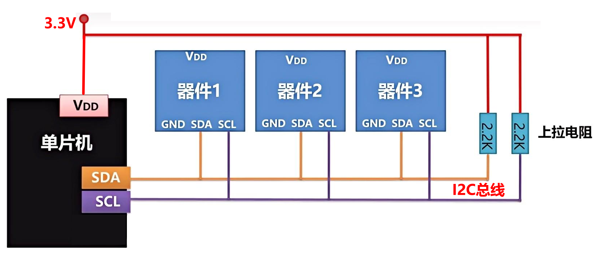

*图4-1I2C总线结构-图*

这两条总线分别是：

1. **SCL，Serial Clock Line，串行时钟信号线：I2C是同步串行通信方式，由SCL时钟信号线控制产生统一的时钟信号。**
2. **SDA，Serial Data Line，串行数据传输线：用于双向传输数据，总线上所有设备的数据通信，都通过这一条数据总线完成。**

关于这两条总线的详细作用以及工作原理，这些内容比较复杂，且都涉及I2C通信协议，我们留到后续小节再讲。

现在，仅看I2C总线结构，以及这两条总线的大体作用，你能得出什么结论呢？

这里，希望大家能够记住以下结论：

1. I2C仍然是一种串行通信，I2C总线就是"串行总线"。
2. 数据以 bit 为单位进行传输，通信时是 1 bit、1 bit 地依次传输。
3. 数字电平含义与串口通信一致：高电平代表1，低电平代表0。
4. **这种总线设计使得，即便单片机需要与多台设备通信，也仅需要占用两个引脚，大大减少了通信引脚资源的占用。**

5. **5. **这种总线设计使得，即便单片机需要与多台设备通信，其余设备也只需要将自身挂在总线上，大大降低电路设计复杂性。****

6. 通信双方，只能通过一条SDA总线进行传输数据，显然，I2C肯定不是一种全双工通信协议。
7. **I2C是典型的半双工通信协议，在同一时刻，I2C通信中，数据都只能单向传输。**
   - a. 比如单片机给设备1发数据时，设备1就只能接收，而不能发送。
   - b. 当然数据通信是双向的，在下一个时刻，设备1可以给单片机发数据，单片机此时只能接收。
   - c. 半双工，意味着数据不能同时双向传输，但仍然支持双向数据传输。

至此，我们已经对 I2C 的**总线式通信结构**有了一个整体认识。

那么，聪明的你，有没有产生这样的疑问：

总线式设计将所有的设备，都挂载在总线上。

这么多设备都在总线上，如果随便发数据，随意互相通信，势必乱了套。

**所以，I2C通信中，通信的过程是怎么控制的呢？由谁来控制呢？**

为了回答这个问题，我们就需要了解I2C通信中，最重要的、最核心的概念——主从模式。

### 5. 主从模式（重点！）

**在I2C通信中，最核心且最重要的特点就是：主从模式。**

通过 I2C 总线连接的多台设备，具有 "主-从"（Master-Slave）关系。

整个I2C总线上的设备，可以分为两大类：

1. **主机（Master）：负责控制时钟信号总线（SCL），生成时钟信号，控制通信时序，掌控整个通信的过程。**
2. **从机（Slave）：响应主设备的请求，执行数据发送或接收，本身不参与任何通信过程的控制。**

严格来说，I2C 通信协议支持的主从模式是：一主多从，并且支持主设备切换。

**在学习阶段，为了便于理解和实现，在后续课程中我们固定把单片机作为主机，其它通过 I2C 总线与单片机相连的设备，一律视为从机。**

在实际工程应用中，为了避免多设备竞争总线控制权而引发冲突，主设备切换这一功能也并不常用。

绝大多数实际场景中，I2C都是采用固定主机，一主多从式的通信方式。

该如何理解主从模式呢？

其实上面已经写得非常清楚了——I2C通信过程中，任何通信的操作都是由主机发起并控制的。

比如：

1. **主机可以主动将数据发给从机，从机被动接收数据。**
   - a. 这种操作，称之为**“I2C的写模式**”。
   - b. 站在主机的视角，将数据输出传递，这就是写！
2. 从机不可以主动擅自将数据发给主机！
3. **从机只能在主机的要求下，被动地将数据发给主机。**
   - a. 这种操作，称之为“I2C的读模式”。
   - b. 站在主机的视角，从机输入数据，这就是读。

或者我们举一个通俗的例子：

所谓主从模式，就是皇帝和太监。

皇上想做什么，就跟太监说，太监必须配合去做。

太监想做什么，那是不可能的，太监不能主动做事情。必须是皇上让他做，他才可以做。

总之：

**在I2C通信中，任何数据交互都必须由主机发起，任何通信过程都由主机控制，从机只能被动配合！这是I2C通信协议最重要且最核心的概念！！！**

### 6. 主从模式容易产生的误解

在理解了 I2C 的主从通信模式之后，有些同学可能会产生这样一种疑惑与误解：

既然主机完全控制通信过程，那么是不是意味着：

如果没有主机的控制，从机就什么也做不了？什么都不会做？

主机完全控制从机，如果没有主机控制，从机啥也做不了，啥也不会干。

是不是这样呢？

这显然是一种误解，主机虽然有“控制欲”，但肯定不会这么强。

从机需要配合主机完成通信，基于I2C通信协议，在这个过程中，从机有自身应当完成的工作，不是所有事情都由主机控制。

当然主机完全控制从机，这种事情也不可能做得到。

还是举例皇帝和太监。

皇上饿了，跟太监说“我饿了，弄点吃的来。”

太监于是去准备吃的，并且端过来。

这个过程，太监必然具有一定主观能动性，根据自身对皇帝喜好的了解，准备一些吃的，端上来。

但这个过程肯定不会是皇上亲自指导：

“我饿了，你去菜园子搞点西红柿，再去鸡窝里捡几颗鸡蛋，然后把西红柿洗好了，切好了，先炒好鸡蛋....”

总之：

**在I2C通信的过程中，主机具有绝对控制权，但主机只负责控制通信的重要节点，比如通信的开始，结束等。**

**从机需要按照通信协议，自主完成一些工作，比如数据接收和发送。**

实际上，I2C本身就是两颗芯片之间的通信。

既然双方都是芯片，那么芯片内部必然都存储了符合I2C通信协议的程序。

作为单片机开发者：

我们负责开发单片机的内部程序，而与单片机通信的从机设备，它们芯片上的程序已经在生产制造时烧录完成了。

只要你编写的，单片机上的程序，完全符合I2C通信协议，那么通信就会成功实现。

至此，有关I2C主从模式相关的概念，我们就讲完了。

下面就讲解I2C相关的最后一个重要概念：从机地址。

### 7. 从机地址

I²C 通信是一种**“一对多” 的主从式通信方式**。

在一条 I2C 总线上，主机可以连接多个从机设备。那么主机如何在多个从机中，找到目标从机设备呢？

这时就需要了解一个"从机地址"的概念。

**在 I²C 通信中，从机地址（Slave Address）是主机用来选择通信对象的唯一标识。**

**整条I2C总线上挂载的多台从机设备，每一台都需要拥有一个唯一的从机地址。**

**主机在控制通信开始时，会在总线上发送目标从机地址，只有匹配该地址的从机才会响应，从而建立通信关系。**

**在I2C通信中，这个过程被指为“寻址”。寻址对于I2C的任何通信过程而言，总是第一步需要完成的行为。**

#### 7.1 从机地址的确定

如何确定一台从机的从机地址呢?

**首先从机地址，从格式上来说，通常就是一个7位的二进制数。**

而具体到设备，大多数I2C从机设备，其从机地址在设备生产制造时就已经设定好了。

所以，获取从机地址，最准确的做法是：查阅厂商提供的官方数据手册除此之外，还可以：

1. 咨询设备的销售商。
2. 向有经验的同学 / 同事 / 工程师请教。
3. 借助 AI 工具，根据设备型号查询相关资料

当然无论你从什么渠道获取了从机地址，最终都需要验证一下再相信。

#### 7.2 从机数量的限制

在上面的表格中，我们提到：I2C通信，理论支持的最大设备数量是100+。

这个数据并不是胡编乱造的，而是根据从机地址计算得出。

既然 I2C 从机地址是一个**7 位的二进制数**，那么理论上可表示的从机地址数量就是：27= 128**I2C 通信协议中自保留了一部分特殊地址，不能分配给普通从设备**，例如：

1. 0000 000（7位0）：**通用呼叫地址**，广播地址，即主机广播式的向每一台从机发数据。
2. 1 1 1 1 1 1 1（7位1）：无特殊含义用途，但协议自保留，从机不能使用
3. ...等等

因此，在实际 I2C 系统中，**可用的从机地址数量并不是 128，而是大约 100+ 个**。

当然这个数量已经非常多了，在绝大多数嵌入式场景中，已经非常够用了。

#### 7.3 从机地址冲突的问题

每次讲到从机地址，总会有同学提出这样的问题：

从机设备那么多，生产的厂商也很多，不可能都事先商量好。

如果两家生产的从机设备，出现了从机地址冲突，该怎么办？

这个问题非常好，有时候确实也会碰到。

而且这还涉及到一个非常重要的问题：

如果I2C总线上，挂载着两台相同从机地址的从设备，会出现什么情况呢？

答：

1. **I2C 总线上，不能同时存在两台地址完全相同的从机。**
2. **一旦寻址出现了多从机响应，后续通信一定会失败！**
3. **任何一个时刻，主机都只能与一台从机设备，进行正常的双向数据通信。**

原因也很简单，I2C通信过程中，主机发送从机接收，从机发送主机接收。这个数据通信是双向，可切换的，只是不允许同时发生。

一旦通信过程允许超过1台从机参与，那么多台从机就会争抢同一条总线的使用权，就会出现总线冲突问题。

I2C通信是无法解决这种问题的，这在物理线路上就不可能实现。

**所以切记，I2C通信，同一条总线上只允许挂载从机地址不同的，多台从机设备。**

##### 7.3.1 从机地址的出厂特殊设计

为了避免从机地址冲突，设备的生产厂商在设置从机地址时，都会进行一些特殊的设计。

**大多数厂商生产的从机设备，其从机地址都不是绝对固定的7位二进制数。**

**最常见的情况是：7位从机地址的高几位固定不变，但低几位设置为可配置。**

举一个例子：

厂商生产了一种支持I2C通信的从机设备A，其从机地址的高6位固定为：011 110 而最低的1位可以在使用时，自由配置：可以配置为0，也可以配置为1。

那么，该设备在实际使用时，就可以切换两种不同的从机地址：

1. 011 1100
2. 011 1101

这种设计就增强了从机地址的灵活性，降低了从机地址冲突的可能性。

除此之外，这种设计还有一个明显的好处：

如果我想在嵌入式系统中，接入两台A设备作为从机，可以实现吗？

答：当然是可以实现的。只需要在接入总线时，将A1设备的从机地址设置为011 1100，A2设备的从机地址设置为011 1101。

**当然，如果你还是想问，两台从机地址一样的设备，就真的没有办法接入同一条I2C总线了吗？**

**答：确实是这样，这是 I2C 通信本身的局限性，或者说特性。**

##### 7.3.2 扩展：关于广播模式

部分同学在了解了**从机地址冲突的问题**之后，可能还会产生这样一个新的疑问：

I2C通信不是支持广播模式吗?

广播模式下，不就是一台主机与多台从机，同时进行通信吗？

这又是什么情况呢？

其实这个问题回答起来非常简单。

首先，我们要知道，I2C之所以不允许多台从机参与通信：

是因为在一般通信情况下，多台从机如果同时向主机发数据，会产生总线竞争，出现无法解决的冲突问题。

而广播模式，显然是没有这种烦恼的！

大家上中学的时候，教室里都有广播大喇叭。

这个大喇叭就是主机，所有学生都是从机。

这个过程中，大喇叭发声，学生只需要听着就行。

学生需要回复大喇叭吗？大喇叭关心学生的回复吗？

显然是不需要的。

**在I2C的广播模式下，虽然允许多台从机同时参与通信。但这些从机只负责接收主机数据，而不会向主机发送数据。**

**这些从机不需要竞争总线，不会产生冲突，自然就没有问题了。**

至此，有关 I2C 通信的**基本概念**，我们已经全部讲完。

相信你还有很多疑问，比如：

1. I2C为什么要采用这种总线设计？I2C总线对于实现通信有什么重要的作用？
2. I2C两条总线的详细具体作用是什么？
3. I2C通信整个流程是怎么样进行的？
4. ....

**为了解释这些问题，我们就进入I2C通信学习中，最重要、最核心的部分——I2C通信协议。**

---

## 02 I2C通信协议

### 1. 概述

本章节将系统讲解**I2C 通信协议**。大体上会讲解以下内容：

1. I2C通信协议的基础约定。
   - a. 引脚工作模式约定
   - b. I2C总线设计原理。
   - c. 主从设备，在通信中的引脚设置。
   - d. SDA总线和SCL总线，在通信过程中的作用。
2. I2C通信的时序结构，数据帧格式，也就是通信从开始到结束的流程。

### 2. I2C通信协议的基础约定

I2C总线的结构，如下图所示：


*图2-1I2C物理层电路结构-图*

我们在上一章节已经简略讲过这种总线设计了，现在我们详细讲解一下其中细节和约定。

了解这些细节和基础约定，是学习I2C通信协议，掌握I2C通信时序的前提。

#### 2.1 引脚工作模式约定

I2C通信中，所有设备都需要基于两个引脚，将自身挂在两条总线上，即SCL引脚和SDA引脚。

**那么这些引脚，应该设置为什么工作模式呢？**

以单片机作为主机为例，在I2C通信中，单片机需要：

1. 利用自身的SDA引脚，控制SDA总线的高低电平，从而控制将数据发送给从机。
2. 利用自身的SCL引脚，控制SCL总线的高低电平，从而控制通信过程当中的时序。

很显然，这个过程中，SDA引脚和SCL引脚执行的都是输出向的操作。

那么选择开漏输出还是推挽输出呢？

可以看到总线电路上，设置了上拉电阻。

**上拉电阻的作用是，在总线电路断路时，将总线电平上拉为高电平！**

而引脚能够输出断路，高阻态的工作模式，就是开漏输出模式！

实际上：

**I2C通信协议规定，所有接入I2C总线的设备，其SCL和SDA两个引脚，都必须设置为开漏输出模式！**

这种引脚工作模式的设置，配合上拉电阻，能够带来什么效果呢？

主机在通信的过程中，如何发挥它的控制作用呢？

为了说清楚这些问题，我们需要先了解一个概念：逻辑线与。

#### 2.2 逻辑线与（重点）

**什么是“逻辑线与”呢？**

逻辑线与指的是一种总线式的电路设计，需要所有设备都将自身引脚设置为开漏输出模式，再配合上拉电阻。

可以达成这样的效果：

1. 总线的电平状态在某一时刻是固定、确定的，但需要所有设备的引脚输出来共同决定。
2. **只有所有设备的引脚都输出1（高阻态）时，总线才表现为高电平！**
3. **任何一台设备的引脚输出0（低电平）时，总线就表现为低电平！**

也就是说，如果SDA总线表现为高电平：

SDA总线上，所有设备的SDA引脚，都必须输出高阻态，此时配合SDA总线上的上拉电阻，SDA总线表现为高电平状态。

而如果SCL总线表现为低电平：

SCL总线上，只需要有1台设备的SCL引脚，输出低电平即可。

你搞懂了吗？

那么这种设计，为什么叫做“逻辑线与”呢？

回想一下，逻辑运算符当中的与运算符"&"，它的特点是：

1. “&”运算符连接的所有表达式，结果都是1时，整体结果才是1。
2. “&”运算符连接的所有表达式，有任一表达式结果是0时，整体结果就是0！

I2C通信中，总线状态的结果值，和“&”运算符的效果完全一致，所以我们把这种总线机制称之为"逻辑线与"。

**I2C通信当中的逻辑线与是通过设置引脚为开漏输出模式，配合上拉电阻来共同实现的，这是一种硬件实现的逻辑线与。**

理解了逻辑线与，那么I2C两条总线的电平状态，就非常好理解了：

**某条线上的高低电平状态（1/0） = 主机该端口输出（1 / 0） & 从机1该端口输出（0 / 1） &....**

1. 只要有任意一个设备的端口输出了0（低电平），那么这整条线就是低电平状态。
2. 所有设备的此端口都输出了1（高阻态），那么整条线才是高电平状态。

了解了逻辑线与，那么剩下一系列I2C通信协议约定，就都很容易理解了。

#### 2.3 I2C通信的空闲状态

在学习串口通信时，我们知道：

两条数据线只要都保持高电平状态，就表示通信处于空闲状态。

那么I2C通信，怎么表示通信的空闲状态呢？

I2C通信协议规定：

**只有SCL和SDA总线，都处于高电平状态，通信才处于空闲状态。**

**只要任何一条总线拉低，就表示通信开始，或者通信正在进行。**

我们把所有设备都接入总线，此时通信必然还未开始，处于空闲状态。

再结合前面讲到的**逻辑线与机制**，我们可以自然地得到一个重要结论：

**I2C通信中的所有设备，在将自身挂在总线上时，会默认将自身所有的引脚输出设置为1高阻态！**

讲完了I2C通信的空闲状态，先不要着急学习通信如何开始，我们再来看最后一个概念：总线控制权！

#### 2.4 总线控制权（重要）

首先，我们要解释一下，什么叫做“拥有总线控制权”：

**拥有总线控制权的设备，可以通过控制自身对应引脚的输出电平，从而拉高或拉低总线电平。**

很明显：

1. 一开始，所有设备所有引脚都输出高阻态。
2. 拥有总线控制权的设备，可以通过拉低对应引脚输出，拉低对应总线电平。
3. 拥有总线控制权的设备，只要继续保持对应引脚输出高阻态，那么总线电平就会继续保持高电平。

两条总线的控制权归属是不同的，我们要分开讲。

##### 2.4.1 SCL总线控制权

**SCL线的作用是控制通信时序，而控制通信时序是主机的权力，所以SCL线的控制权必然始终归属主机。**

**由于我们约定单片机始终作为主机不切合，所以SCL线的控制权始终归属单片机！**

所有的从机都不具备SCL总线的控制权，所有从机的SCL引脚都始终保持高阻态输出状态！

主机发送时钟信号，也就是主机控制SCL总线，具体逻辑可以参考下图：

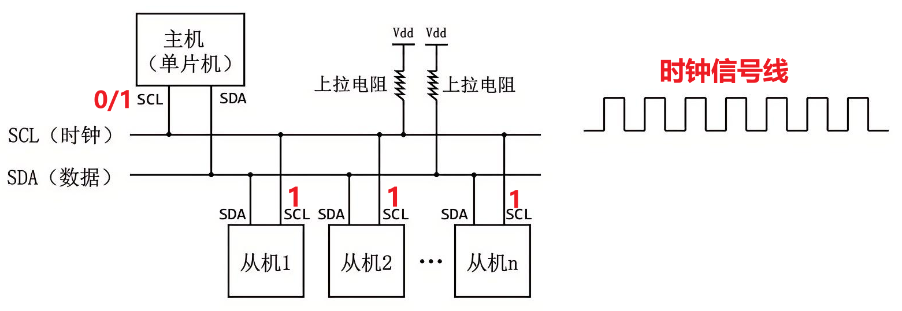

*图2.4.1-1主机发送时钟信号-图*

主机控制SCL总线状态的过程如下：

1. 只要主机的SCL引脚写1，也就是主机SCL引脚进入高阻抗状态，那么SCL总线的时钟信号就是高电平。
2. 只要主机的SCL引脚写0，也就是主机SCL引脚输出低电平，那么SCL总线的时钟信号就是低电平。

这就是主机发送时钟信号的原理，注意这个原理，我们后面要自己写代码实现它。

##### 2.4.2 SDA总线控制权

I2C通信是半双工通信协议，主机可以发数据给从机，从机也可以在主机控制下发数据给主机。

数据通信是双向的，且只通过一条SDA总线完成。

同样的，所有设备的SDA引脚一开始也都输出高阻态，所以：

1. SDA总线的控制权属于哪台设备，就表示该设备在发送数据。
2. SDA总线的控制权属于主机，就表示主机发送数据给从机。
3. SDA总线的控制权属于从机，就表示从机发送数据给主机。
4. **拥有SDA总线控制权的设备，可以控制自身SDA引脚的输出1/0（高阻态/低电平），从而控制SDA总线的高低电平。**
5. 没有SDA总线控制权的设备，自身SDA引脚必须保持输出1高阻态。

**对于I2C通信来说，任何通信总是由主机控制开始的，SDA总线的控制权在一开始必然归属主机！！！**

**主机控制SDA总线，主机向从机发数据，I2C的写模式，具体逻辑可以参考下图：**


*图2.4.2-1I2C写数据的实现-图*

主机控制SDA总线状态的过程如下：

1. 只要主机的SDA引脚写1，也就是主机SDA引脚进入高阻抗状态，那么SDA线就是高电平状态，主机发送数据1到从机。
2. 只要主机的SDA引脚写0，也就是主机SDA引脚输出低电平，那么SDA线就是低电平状态，主机发送数据0到从机。

这就是主机发送数据到从机，也就是I2C写数据的实现原理，注意这个原理，我们后面要自己写代码实现它。

**从机控制SDA总线，从机向主机发数据，I2C的读模式，具体逻辑可以参考下图：**

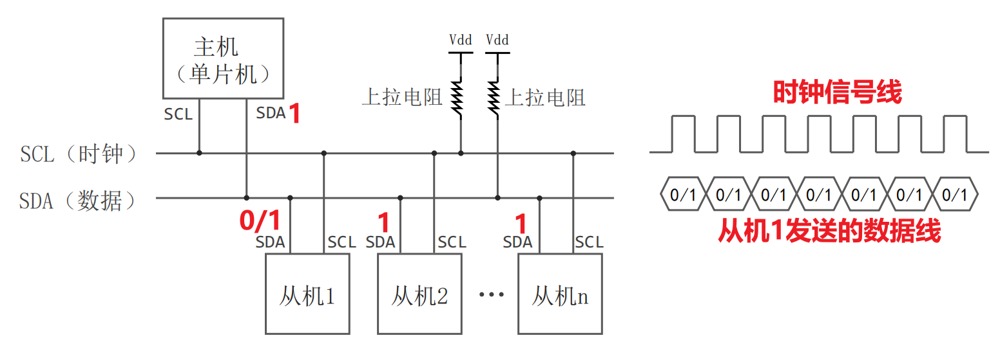

*图2.4.2-2I2C读数据的实现-图*

SDA总线的控制权一开始归属主机，现在要把权力“让渡”给从机。

怎么实现这个权力“让渡”呢？

很简单，只需要主机将自身SDA引脚设置为1高阻态即可！

同样的，从机也有机会把SDA总线控制权“再还给”主机，应该怎么做呢？

也只需要从机将自身SDA引脚设置为1高阻态即可！

从机控制SDA总线状态的过程如下：

1. 只要从机的SDA引脚写1，也就是从机SDA引脚进入高阻抗状态，那么SDA总线就是高电平状态，从机发送数据1到主机。
2. 只要从机的SDA引脚写0，也就是从机SDA引脚输出低电平，那么SDA总线就是低电平状态，从机发送数据0到主机。

这就是从机发送数据到主机，也就是I2C读数据的实现原理，注意这个原理，我们后面要自己写代码实现它。

结合前面讲到的**逻辑线与**和**总线控制权**，关于**SDA 总线的作用**，我们已经可以得出一个非常清晰的结论：

谁控制了SDA总线，就是谁向对方发数据。

那么SCL总线的具体作用是什么呢？

我们讲过：SCL总线由主机全程控制，为总线上的设备提供统一时钟信号，从而控制整个通信的时序。

所以下面我们就重点来讲解一个问题：

SCL总线的电平状态，时钟信号，如何掌控通信时序？

#### 2.5 SCL 总线对通信时序的控制（重点）

在I2C通信中，只有主机可以控制SCL时钟信号线，也就是只有单片机的SCL引脚可以切换0/1输出状态，从而控制SCL总线的高低电平。

主机控制SCL引脚改变SCL总线的高低电平，从而产生了一条高低电平切换的信号线图，这就是**"时钟信号线/时钟同步线"**。

如下图所示：

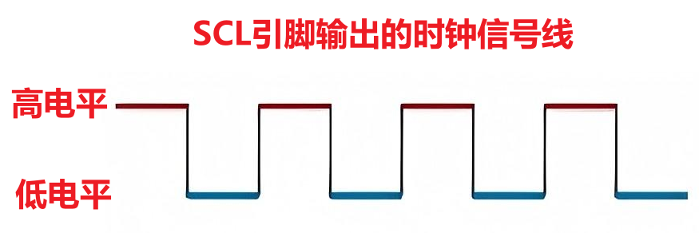

*图2.5-1时钟同步线-图*

这条时钟信号线，其实就是SCL总线电平切换随时间改变的一个"时序图"。

主机和所有从机们收到和使用的都是同一条时钟信号线，就由这条时钟信号线控制整个通信的过程，也就是控制通信的“时序”。

具体来说：

I2C通信不是异步通信，它不依赖于数据帧中的特殊起始位、或结束位以及设定相同的数据传输速率来实现通信。

**I2C通信，会根据时钟周期，来确定数据什么时候开始或结束传输，数据如何发送，以及如何接收等问题。**

什么是时钟周期呢？

**简单来说，一个时钟周期就是一个完整的“高电平 + 低电平”的组合。**

于是在I2C通信中，一个时钟周期被分成了两个部分：

1. 工作时间：一个时钟周期中的高电平部分属于工作时间。
   - a. **通信中的任何重要节点，一定发生在工作时间内！**
   - b. 比如通信的开始和结束，必须发生在工作时间内！
   - c. 比如通信的发送端发送数据，接收端采集接收数据，也必须发生在工作时间内！
2. 休息时间：一个时钟周期中的低电平部分属于休息时间。
   - a. 休息时间内，SDA总线无论是什么电平状态，都毫无意义！
   - b. **休息时间也叫“准备时间”，发送端可以趁休息时间，改变SDA总线电平，为下一个工作时间发送数据做准备！**

如下图所示：

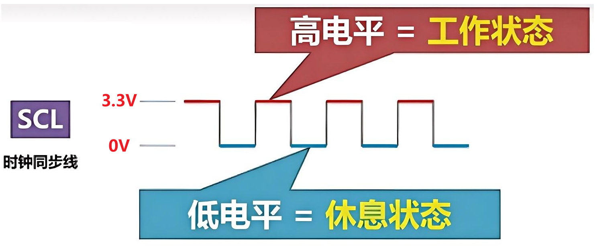

*图2.5-2工作时间和休息时间-图*

下面“时序图”，描述了主机控制SDA总线，发送数据给从机：

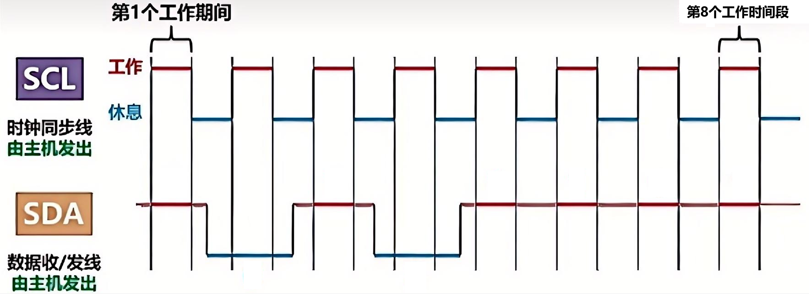

*图2.5-3I2C通信发数据-时序图*

分析一下，主机向从机发送了什么数据？

很简单，只需要数时钟周期的工作时间，也就是高电平时间段即可。

图中一共8个高电平时间段，也就是有8个工作时间段，也就是主机向从机发送了8个bit数据。

然后，再看一下8个工作时间段的SDA总线电平状态，主机发给从机的8个bit，1个字节的数据是：

1 0 1 0 1 1 1 1除此之外，我们还可以观察到一个非常重要的现象：

**在 SCL 总线处于高电平（工作时间）时，SDA 总线的电平状态始终保持稳定不变。**

这正是 I2C 通信协议中的一条**核心时序约定**：

**如果 SDA 总线正在用于发送数据，那么 SDA 的电平状态，必须在整个工作时间内都保持稳定，不能发生改变。**

也就是说，在**数据传输阶段**的工作时间内：

1. **发送端（当前拥有 SDA 总线控制权的设备）必须在整个工作时间内，保持SDA电平稳定不变。**
2. **接收端，则在工作时间内采集SDA电平状态，高电平表示接收bit数据1，低电平表示接收bit数据0。**

#### 2.6 SCL时钟信号线

**SCL线（Serial Clock Line），即串行时钟线。**

**作用：由主设备（单片机）产生时钟信号，控制数据传输的时序。**

所谓控制时序，就指的是主机严格控制整个通信的流程。

比如什么时候开始传输数据，和哪个从机传输数据，是读数据还是写数据，什么结束数据传输等等。

在I2C通信中，由单片机产生的时钟信号，通过I2C总线中的SCL线发送到每一台从设备。

这就好比，主机作为"老大"，它通过SCL线主动严格控制每一个"小弟"的工作节奏，并严格与主机保持一致。

**在I2C通信中，SCL线的控制权始终在主机手中，从机无法掌控SCL线。**

关于时钟信号线的作用，也就是主机究竟如何控制所谓的时序，待到下面我们再讲解。

#### 2.7 SDA数据总线

**SDA线（Serial Data Line，串行数据线）**

**作用：用于双向传输数据，主机和从机之间的数据交换全部是由这一条线完成的。**

主机可以控制SDA线向从机发送数据，从机也可以控制SDA线向主机发送数据。

**所以在I2C通信中，SDA总线的控制权可以在主机/从机之间转换，当然在通信一开始的时候，SDA总线的控制权属于主机。**

I2C是一种串行、同步、半双工的通信方式，它的这些特点就可以通过它的接线方式来推导出来。比如：

1. 串口是全双工的通信方式，是因为通信双方都各有一个发送端和接收端交叉连接，但I2C的数据通信显然不可能是全双工的：
   - a. I2C通信中的主机和从机之间的数据交互都是一条SDA线完成的。
   - b. 在同一时刻，SDA线的控制权只能是主机或者从机。
   - c. **若主机向从机发送数据，即I2C的写操作。**
   - d. **若从机向主机发送数据，即I2C的读操作。**
   - e. I2C通信是一种半双工的通信方式，主机和从机不能同时发送和接收数据。
2. I2C总线是一种串行通信总线，数据是**一位一位地**依次传输的，所以I2C通信自然就是串行通信手段。
3. I2C通信中，由主机通过SCL线严格控制数据传输的时序，任何数据的交互都需要双方同时"在线"，同时参与。
   - a. 比如：主机想向从机发送数据了，就必须通过I2C总线通知从机，从机"回答"了，才能继续下一步。
   - b. 所以I2C通信是一种同步的通信方式。
4. 与之相对应的UART串口通信，它通过规定相同的波特率，使用特定格式的数据帧来保证发送端和接收端的数据同步。这样串口就实现了异步的通信，通信双方不需要保证时刻同时"在线"。

#### 2.8 总结

到此为止，有关I2C通信硬件电路设计、以及一些相关的约定限制，我们就全部讲完结束了。

这里做一个要点总结：

1. I2C 总线由 SDA（数据线）与 SCL（时钟线）组成，所有主从设备共享这两条线，形成“多设备挂载”的总线结构。
2. **通信中所有设备的SDA和SCL引脚，都需要设置为开漏输出模式。**
3. 两条总线的电平状态，受所有设备引脚“逻辑线与”的共同决定——**任一拉低（0）即为低电平，全部释放（1）才为高电平**。
4. **SCL 总线由主机（单片机）独占控制**，用于产生时钟信号，严格控制通信时序。
5. SDA 总线控制权，在通信时根据发送端角色动态切换，主机写（主机发送）时主机控制SDA总线，主机读（从机发送）时从机控制SDA总线。

6. **所谓总线控制权，指的是某一设备具有对总线电平的主动控制能力，即其对应引脚可以在 0 和 1（低电平与高阻态）之间切换，而其他设备必须将对应引脚置为高阻态（输出 1），以释放总线控制权。**

7. I2C通信把两条总线都为高电平状态，设置为通信的空闲状态。任一总线被拉低，表示通信已开始，或通信正在进行中。
8. I2C 是同步通信协议，所有设备共享主机生成的时钟信号。
9. 每个时钟周期（高电平 + 低电平）被划分为：
   - a. **休息时间（SCL 低电平）**：为工作时间做准备，发送端控制拉高SDA总线（准备发1），也可以控制拉低SDA总线（准备发0）；
   - b. **工作时间（SCL 高电平）**：控制通信的关键节点。比如通信的开始与结束，数据发送与接收采集等重要节点，都必须在工作时间内发生。
10. **如果是发送接收数据，SDA总线必须在整个工作时间内，保持电平状态不变。**

下面，我们将从I2C通信时序、数据帧格式的角度，完整的走一遍I2C通信的整个流程。

### 3. I2C通信时序与数据帧格式

为了讲清楚I2C通信的时序和数据帧格式，我们就以**"主机向从机写数据"**这个最常见的场景为例子，描述一下I2C通信的过程。

所谓主机，即固定为单片机，不考虑主机切换。

#### 3.1 I2C通信的比特序

I2C和串口通信一样，都是串行通信方式，所以数据也是逐位发送的。

在串口通信中，数据逐位发送的顺序是从最低位发到最高位的，但I2C通信则完全与此相反！

注意：

**在I2C通信中，数据是逐位从最高有效位发送到，最低有效位！**

**I2C通信的比特序是MSB First，优先发送数据最高有效位！**

#### 3.2 I2C写数据时的数据帧格式

I2C写数据帧时的数据帧格式：

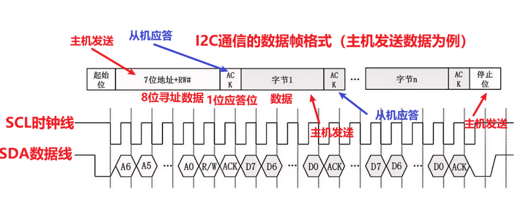

*图3.2-1I2C数据帧格式-图*

实际上这个数据帧格式，也揭示了I2C通信发送数据的流程（以主机发送数据为例，从机发送数据原理完全一致）：

1. 主机发送起始信号，表示开始主机发送数据的过程。
2. 主机发送设备地址 + 读/写标志位（寻址字节），表示主机寻址某台从机设备。若主机需要发送数据给从机，则需要使用"写"标志位。
3. 主机每发送1个字节（8位）数据，从机都必须应答1位，以表示收到数据。这就是应答位，应答位只占1位。
4. 再往后，就是主机继续1个字节1个字节的将数据逐位发出去。主机每发送1个字节，从机都需要回复一个应答位。
5. ...
6. 主机发送完毕所有数据，主机发送停止信号，表示结束主机发送数据的过程。

下面就针对这个过程，我们来逐一讲解一下每个过程是怎么做的。

#### 3.3 起始位和停止位

起始位和停止位决定了主机发送数据的开始和结束，那么起始位和停止位的实现原理是什么样的呢？

I2C通信中所有设备都依据时钟周期中的工作时间来发送数据0和1，那么该如何传达开始传输数据和停止传输数据的信号呢？

再来回顾一下SDA线发送数据的方式：

**SDA发送数据，一定是在时钟整个工作时间内都保持高低电平，才表示发送数据1和0。**

那么在一个工作时间内，若SDA总线的高低电平不是始终保持不变，而是发生了改变：

1. 由低电平变为高电平，即逻辑0变逻辑1。
2. 由高电平变为低电平，即逻辑1变逻辑0。

这两种新出现的情况，不就恰好可以用于表示起始位和停止位嘛？

于是I2C通信协议规定：

1. **在SCL高电平工作时间内，如果SDA总线从高电平变化为低电平，就表示主机发送起始信号，表示通信开始。**
2. **在SCL高电平工作时间内，如果SDA总线从低电平变化为高电平，就表示主机发送停止信号，表示通信结束。**

下面我们不着急看寻址字节，我们先来看一下应答位。

#### 3.4 应答位ACK

I2C通信是半双工的，意味着同一时刻下，数据只能沿一个方向传输。

在这种情况下，如果从机在整个数据传输过程中都不回应的话，那么主机就无法判断从机是否成功接收到数据。

于是I2C通信协议规定：

**从机每接收主机发送的1个字节数据，在下一个工作时间内，就必须向主机回复一个应答位，以表示自己已收到传输数据。**

那么应答位的格式是什么呢？从机是发送0还是发送1呢？

这里我们就要从新看一下主机发送数据的原理，如下图所示：

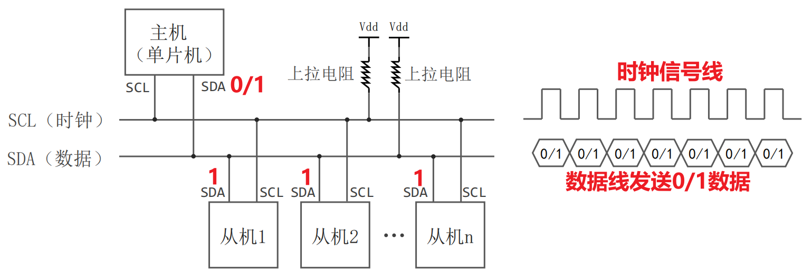

*图3.4-1I2C写数据的实现-图*

主机发送数据时，从机的SDA都只为1，SDA线的高低电平完全由主机控制。

每当主机发送完毕一个字节的数据后，主机就会将自身SDA引脚也置为1，**将自己从SDA线上断开，放弃SDA线的控制权：**

1. 如果从机确定收到了正确的数据，那么从机应该在此时主动将自己的SDA引脚置为0。
   - a. 如此从机在下个工作时间内，就实现了向主机发送0低电平的功能。
   - b. 此时从机**主动向主机发送**了一个低电平0，这就是ACK（Acknowledge）确认应答。
   - c. 只要主机收到了从机发送来的一个0，就表示这一个字节的数据传输工作完成了。
2. 反之若从机认为自己没有收到数据，或者数据有误，那么从机将不会做任何事情，从机的SDA引脚也置1挂起。
   - a. 于是整个SDA线的所有引脚都置为1（高阻态），依赖于上拉电阻，SDA表现为高电平。
   - b. 此时**相当于从机向主机发送**了一个高电平1，这就是NACK（Not Acknowledge）

非确认应答。

   - c. 只要主机收到了从机发送来的一个1，就表示这一个字节的数据传输工作有问题。

如此结合起始位、停止位以及应答位，主机发送1个字节数据的**时序图**如下所示：

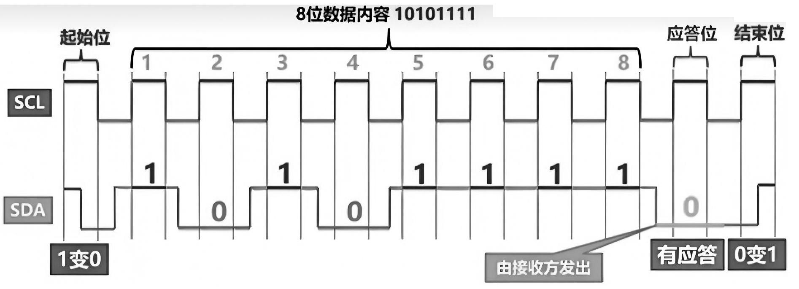

*图3.4-2主机发送数据的时序-图*

这张时序图，展示了随时间推进，SCL总线和SDA总线上，高低电平的变化情况。

下面这张图则更清晰的展示了"1个字节数据"，从主机发送到从机的过程：

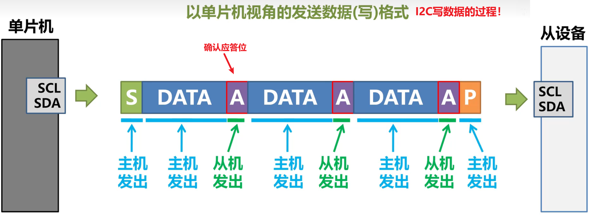

*图3.4-3发送数据的流程-图*

上面讲的是主机发送数据，也就是I2C写数据。主机接收数据，也就是I2C读数据，过程也完全类似。流程图如下所示：

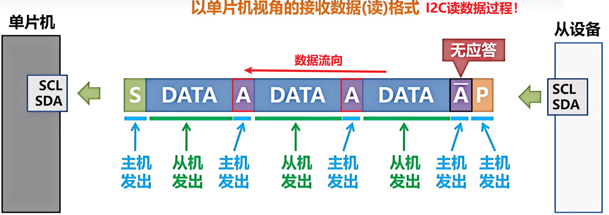

*图3.4-4主机接收数据的流程-图*

**特别需要注意的点是，I2C通信采用主从模式，即便是从机向主机发送数据，这个过程也是由主机"主动"发起的！！**

通过这里的讲解，我们就发现了，在I2C通信的过程中，数据的流向是始终变化的，主机发一段，从机就要响应一下，反之亦然。

应答位，本质上是数据发送完后的，第9个时钟周期的发送数据，只不过这位数据的发送者是前面8位数据的接收者。

#### 3.5 I2C读数据时的数据帧格式

I2C读数据时的数据帧格式，和写数据时没有本质区别。如下所示：

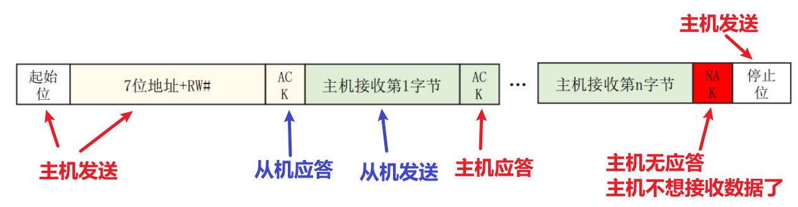

*图3.5-1I2C读数据时的数据帧格式-图*

总之，在I2C通信时，总是主从机交替发送数据的，要搞清楚到底是谁在发，谁在接，不要弄混淆了。

#### 3.6 寻址字节

**寻址字节始终是 I2C 通信中发送的第一个字节，任何I2C通信总是从主机寻址开始的。**

**这也是前面讲的，SDA总线的控制权在一开始必然属于主机，这是因为主机需要发送寻址字节！**

寻址字节数据相对比较复杂，因为它兼顾两个作用：

1. 前7位是接收数据的从机地址，唯一指示某个从机与主机进行通信。
2. 第8位是读写标志位。I2C通信协议规定：
   - a. 读写标志位是0时，表示主机向从机写数据。
   - b. 读写标志位是1时，表示从机发送数据到主机，也就是主机读从机数据。

**也就是说，只要知道了7位从机地址，然后再配合1位读写标志，我们就能够知道I2C通信中，数据帧的第一个字节应该如何发送了。**

到此为止，关于I2C软件通信协议部分，就全部结束了。

下面我们就以一款支持I2C通信协议的设备**"SSD1306 OLED显示屏"**为例子，来讲讲该硬件的使用。随后完成单片机与这款屏幕的I2C通信。

#### 3.7 采样和采样时机

对于采样和采样时机这两个概念，我们在讲解串口通信时其实已经接触过了。

简单来说：

1. 采样：接收端在某个时刻，采集电平高低，确定接收数据bit1还是bit0。
2. 采样时机：接收端究竟在什么时刻进行数据采样。

在串口通信中，接收端的采样过程具有以下特点：

1. 串口通信的接收端，以起始信号为时间基准起点。
2. 用约定好的波特率确定1个bit所需时间。
3. 最终在每个bit数据的附近进行多次采样，然后投票判决最终结果。

注意串口通信是异步串行通信，所以：

1. 必须约定波特率才能够确定时间，从而进行采样。
2. 由于没有严格时钟信号控制时序，所以必须采样多次，投票判决结果。

但I2C通信与串口通信不同，它属于拥有统一时钟信号的、同步串行通信方式。

所以：

1. I2C通信不需要通过约定波特率来对齐时间，I2C通信时序已经被SCL时钟信号线固定了。
2. 既然有时钟信号严格约定时序，在进行数据采样时，每1bit数据就不需要采样多次了，**I2C在进行数据采样时，只需要采样一次就可以了。**

经过上面I2C通信协议的学习，我们已经知道I2C通信的核心规则：

1. **对于发送端而言，当 SCL 为高电平工作时间时，SDA 必须保持稳定表示发送数据。**

2. **对于接收端而言，当 SCL 为高电平工作时间时，需要读取 SDA 总线上的电平状态，以确定接收到的数据。**

也就是说，对于接收端而言，SCL为高电平的工作时间内，都是可供采样的有效时间。

那么I2C 通信中，具体在 SCL 高电平的哪个位置进行数据采样呢？

**实际上，I2C通信协议，并没有明确规定必须在 SCL 高电平的哪一个具体时刻进行采样。**

**但从实际的应用出发，接收端通常都会在 SCL 高电平的中间点附近对 SDA 进行一次采样。**

当然，这里的“中点采样”和串口通信是完全不同的概念。

串口通信可以通过约定好的波特率，相对精确得计算半个 bit 时间。

而 I2C 并不是通过计算精确时间来得到中点，而是通过固定延时落在一个安全窗口内。

具体来说是这样的：

1. 接收端设备在芯片设计阶段：
   - a. 会根据 I2C 规范中常见的通信速率以及协议规定的最小高电平持续时间
   - b. 预设一个固定延时参数，并写死在芯片内部逻辑中。
2. 每当接收端检测到 SCL 的上升沿时：
   - a. 确认进入高电平工作时间后，就会通过内部时钟延时一个固定时间。
   - b. 这样就大体上可以确保，在SCL高电平工作时间的靠中点位置进行数据采样。
   - c. 这样采样的数据会更加稳定和准确。

**注意：在整个 SCL 高电平工作时间内，采样只会发生一次，而不是连续或重复采样。**

所以可以这么理解：

1. I2C通信协议没有说必须在工作时间的具体时刻进行采样。
2. 接收端可以自由实现采样时机，依靠自身的内部芯片中存储的程序。

3. **但为了避开时钟翻转瞬间的抖动，提高采样的可靠性，接收端大多都会在工作时间的靠中点进行仅一次的数据采样。**

所以I2C通信的采样和采样时机没有过多需要讲解的，大家了解即可。

---

## 03 OLED的使用

### 1. 概述

在讲完I2C相关所有概念、I2C通信协议、时序要求等问题后，我们再了解一下支持I2C通信的硬件从机设备——OLED。

这可以为后续我们做实验打下基础。

### 2. 使用I2C协议驱动OLED显示屏

若想使用I2C协议驱动OLED显示屏，你需要知道以下内容：

1. OLED显示屏的硬件从机地址。
2. OLED显示屏I2C通信的数据帧格式。
3. 常见OLED显示屏控制指令。

下面逐一讲解这些内容。

#### 2.1 OLED显示屏的硬件从机地址

通过查阅手册，我们知道OLED显示器的硬件从机地址是下面这样的：

0 1 1 1 1 0 SA0其中的SA0是什么呢？

手册中的原话是：

D/C# pin acts as SA0 for slave address selection.

D/C#引脚作为SA0用于从地址选择。

也就是说，D/C 引脚作为SA0用于从地址选择。那么D/C引脚在哪里呢？

我们可以直接查看OLED的硬件电路图，如下图所示：

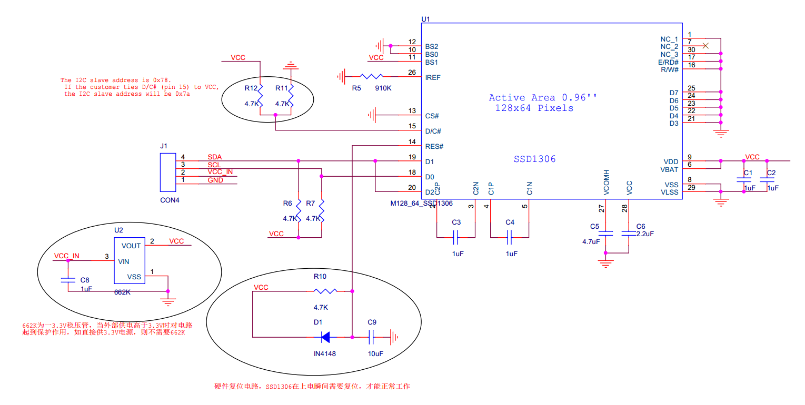

*图2.1-1OLED显示屏-硬件电路图*

其中D/C引脚部分的电路图如下所示：

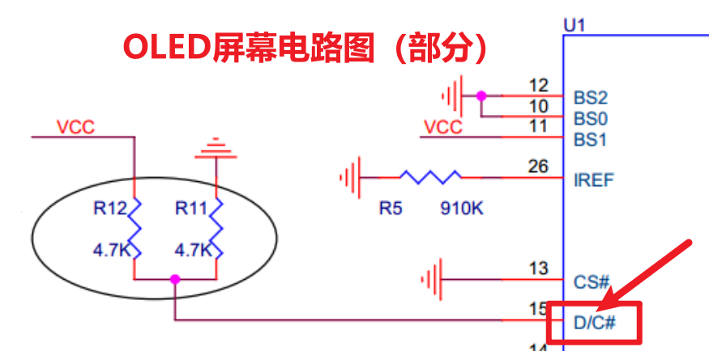

*图2.1-2OLED显示屏-硬件电路图2*

所以D/C引脚的电平值，可以是高电平的1，也可以是低电平的0，具体使用哪一个要看引脚被焊接到哪一个电阻上。

那这怎么看呢？把OLED屏幕反着放置在桌上，就能看到如下内容：

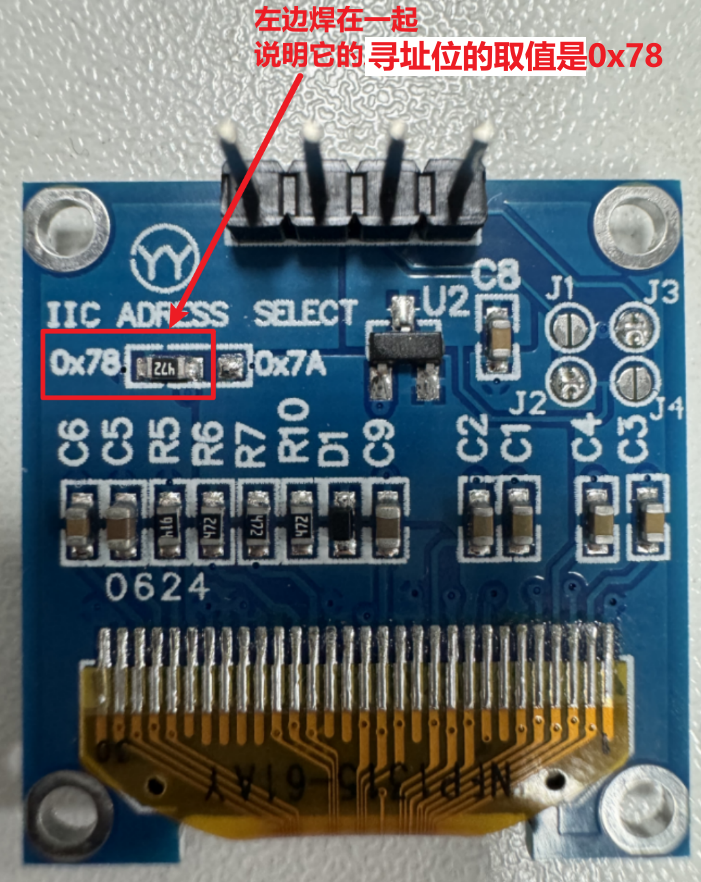

*图2.1-3OLED屏幕背面-图*

那么这张图表示SA0是低电平0还是高电平1呢？

首先这里的两个值Ox78和Ox7A，都不是它的从机地址，因为两位十六进制数表示8位二进制数，而从机地址是7位的。

这两个数是寻址字节的取值，也就是**"从机地址的7位二进制，再添上一个0（写标志）"**得到的8位数值。

0x78的二进制表示是：

0 1 1 1 1 0 0 0和上面的：

0 1 1 1 1 0 SA0这说明SA0的取值是0，我们使用的OLED屏幕D/C引脚实际是接地的。

除此之外，我们还需要注意这个电路图的这个部分：

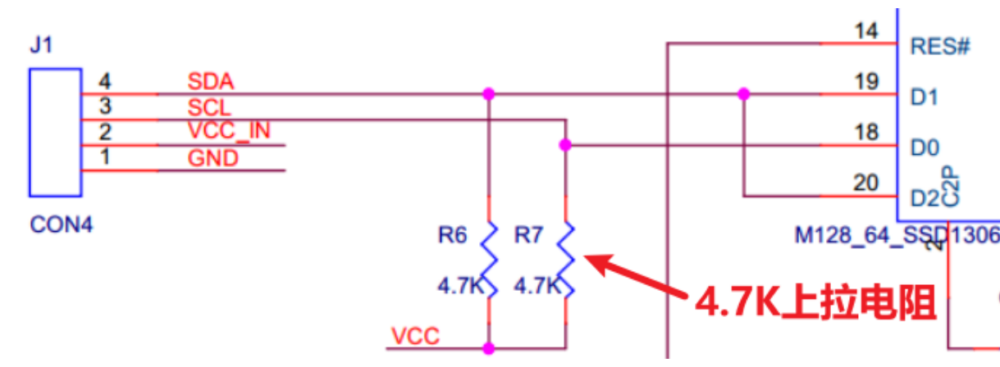

*图2.1-4OLED显示屏-硬件电路图3*

**OLED屏幕的SDA和SCL引脚都各自内置了一个4.7KΩ的上拉电阻，这就意味着OLED屏幕接入电路后，完全不需要再手动添加上拉电阻了。**

OLED内部电路中的上拉电阻就可以帮助我们实现，I2C通信中"逻辑线与"的功能。

想一想，我们早就使用过OLED屏幕了，使用的工具函数就是基于I2C通信协议实现的，但我们并没有在电路中接入上拉电阻，原因就在于此。

#### 2.2 OLED显示屏I2C通信的数据帧格式

I2C通信可以实现单片机和外部其它芯片/集成电路的数据通信，在上面我们讲解是通用的数据帧格式。

即先发起始位，再发寻址字节表示读/写某个从机，随后就是正常的数据交互过程。

但不同的外设，它们的数据帧，往往在**第二个字节的数据发送处**会有所不同。

比如像EEPROM（以字节为单位读写的非易失性存储器，类似一个小Falsh闪存），以及各类支持I2C通信的传感器。

主机与它们通信时，就需要通过发送的第二个字节的数据，指出读/写的寄存器的地址，从而实现数据存储，获取数据等功能。

所以这类设备的数据帧格式如下所示（以写数据为例）：

**[S] [寻址字节] [ACK] [寄存器地址] [ACK] ...[数据字节] [ACK] [P]**更详细的一个数据帧的格式就如下所示：

**[起始位] [从机地址][读写标志] 从机应答 [需要写的从机寄存器地址]从机应答[写到从机寄存器的1个字节数据]从机应答...从机应答[停止位]**所以在使用这些设备时，你还需要通过查阅手册，获取你想要实现功能所需的寄存器的地址，操作还是比较繁琐的。

但OLED屏幕使用时的数据帧格式相对比较简单，因为它本身不是用于存储数据的外设，所以寄存器设计简单。

总之OLED显示屏I2C通信的数据帧格式，如下所示：

**[起始位] OLED设备从机地址[读写标志] 从机应答 [控制字节]从机应答[后续指令/需要写的字节数据]从机应答...从机应答[停止位]**当然，使用OLED时你也需要查一查控制字节有哪些，控制指令有哪些，写字节数据时具体的写法。

其中第二个控制字节的选项只有两个：

| 控制字节 | 作用 |
|---|---|
| 0x00 | 发送 命令（如清屏、设置光标位置） |
| 0x40 | 发送 待显示数据（写入 OLED 显存） |

在向 OLED 发送数据时，必须在寻址字节后面**再发送一个控制字节**，告诉 OLED 如何处理后续的字节数据。

### 3. 部分OLED屏幕控制指令

由于我们本章节只用于I2C通信入门，所以我们只需要了解简单的控制指令用于实现I2C通信即可。

慢慢查阅手册比较麻烦，我这里就列出两个我们做实验会用到的指令字节序列。

**假如我想实现一个简单功能：开启OLED，并点亮全部像素。**

此时只需要控制主机向从机屏幕发送以下指令序列就可以了：

```c
uint8_t TunOnCmds[] = {
    0x00, // 下面的指令是命令流
    0x8D, 0x14, // 开启电荷泵
    0xAF, // 打开屏幕
    0xA5 // 让屏幕全亮，点亮所有像素点
};
```

这组指令流，可以控制让屏幕开启，并点亮所有的像素。

说明：

1. 0x00 : 表示发送的是命令流。
2. 0x8D,0x14 : 打开 OLED 的内部电荷泵，为 OLED 提供驱动电压。
3. 0xAF : 打开 OLED 显示。
4. 0xA5 : 让屏幕所有像素点亮。

**假如我想实现一个简单功能：完全关闭OLED。**

也就是上面操作的逆向操作，你只需要操作主机向OLED从机发送以下指令序列即可：

```c
uint8_t TunOffCmds[] = {
    0x00, // 下面的指令是命令流
    0xA4, // 普通显示模式
    0xAE, // 关闭 OLED 显示
    0x8D, 0x10 // 关闭电荷泵
};
```

说明：

1. 0x00 : 表示发送的是命令流。
2. 0xA4 : 将 OLED 从 "全屏像素点亮" 模式（0xA5 ）切换到全部像素熄灭状态。
3. 0xAE : 关闭 OLED 显示。
4. 0x8D,0x10 ：关闭电荷泵，停止为 OLED 提供驱动电压，彻底关闭OLED。

**主机读OLED。**

上面是实现了写OLED屏幕的功能，实际上OLED在I2C通信中几乎只需要主机写功能，OLED作为从机几乎没必要向主机发送数据。

毕竟OLED既不是存储器也不是传感器，但OLED仍然具有唯一一个向主机发送数据的功能：**返回状态字节**。

如下图所示：

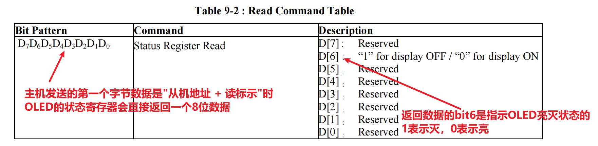

*图3-1读OLED状态寄存器-图*

SSD1306控制芯片的OLED屏幕没有提供明确的可读寄存器地址，主机读OLED从机时，会直接出现以下情况：

1. 主机发送起始信号。
2. **主机发送从机地址 + 读模式（**0x78|0x01**）。**
3. 从机OLED直接返回**状态字节**给主机。

状态字节中只有bit6是有效的，它用于指示当前OLED是否开启，比如刚刚执行完0xAE指令，OLED就处于关闭状态，bit6的值就是1。

所以我们在演示I2C主机读OLED时，可以使用这个操作，读一下OLED屏幕的当前亮灭状态。

### 4. OLED屏幕控制指令解释

通过查阅手册，可以找到上面我们使用的各个指令的含义。

仅供参考，了解即可。

#### 4.1 0x00控制字节选项

首先0x00 表示发送的是命令流。

手册上关于这部分内容描述，如下图所示：

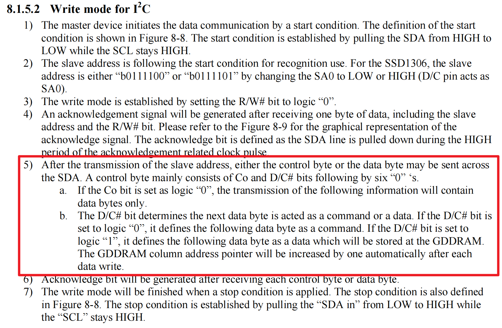

*图4.1-1手册中关于指令的讲解-图1*

解释一下：

控制字节选项主要由：CoD/C#000000 组成。

而且文档中实际上也说明了：Co位需要设置为0如此真正可变的只有D/C#位。

所以就有了两种不同的控制字节选项：

```c
Co D/C# 二进制 十六进制
0 0 0000 0000 0x00
0 1 0100 0000 0x40
```

可以分别这样理解：

```c
0x00
```

   - a. Co=0
   - b. D/C#=0
   - c. 表示：后续是**命令**

```c
0x40
```

   - a. Co=0
   - b. D/C#=1
   - c. 表示：后续是**数据**
   - d. 也就是后面的字节会写入显存用于显示数据。
   - e. 手册明确说，D/C#=1时，后续字节被当作数据，存入显存。

#### 4.2 开启关闭电荷泵

在手册中可以找到下列表格：

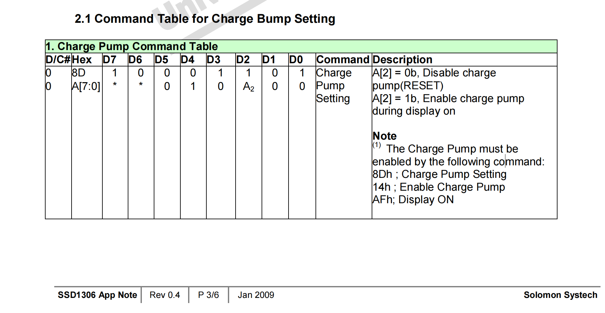

*图4.2-1手册中关于指令的讲解-图2*

解释一下：

0x8D是 SSD1306 的电荷泵设置命令。发送0x8D后，还需要再发送一个参数字节。

当参数为0x14时：

其二进制为00010100 ，其中关键位 A2 = 1，表示在显示开启时使能内部电荷泵；若参数为0x10 ，则 A2 = 0，表示关闭电荷泵。

因此，0x8D,0x14就表示开启电荷泵。

手册中还说明，通常再配合0xAF打开显示，即常见初始化顺序为：

0x8D,0x14,0xAF 。

**这个指令流就可以实现开启OLED屏幕。**

**当参数为 0x10 时，表示关闭内部电荷泵。因此，0x8D, 0x14 表示开启电荷泵**

#### 4.3 其它屏幕操作指令

上面指令流中还提到了一些指令。

如下图表格所示：

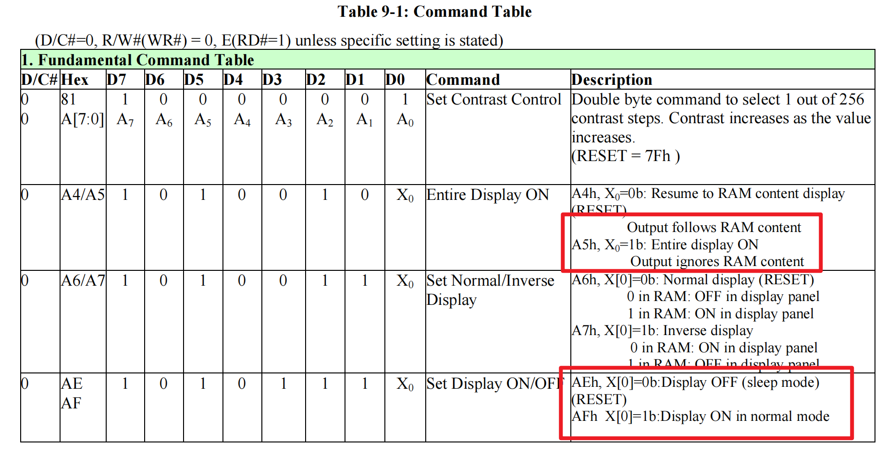

*图4.3-1手册中关于指令的讲解-图3*

解释如下：

1. 0xAF ：Display ON，表示以正常模式打开显示。
2. 0xAE ：Display OFF，表示关闭显示并进入睡眠模式。
3. 0xA5 ：Entire display ON，表示整屏点亮，输出忽略显存中的内容。
4. 0xA4 ：Resume to RAM content display，表示恢复按照显存中的内容显示。

### 5. 读写操作时序图举例

**举例一：主机向OLED显示屏中写两个字节0x66和Ox88。**

此时从机寻址字节是：从机地址 + 写标志位0，即0 1 1 1 1 0 0 0也就是0X78

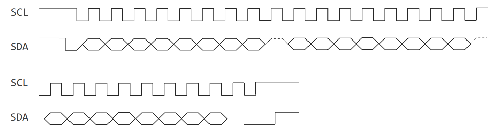

*图5-1时序图空白-图*

此时这个发送写过程完整的时序图就如下图所示：

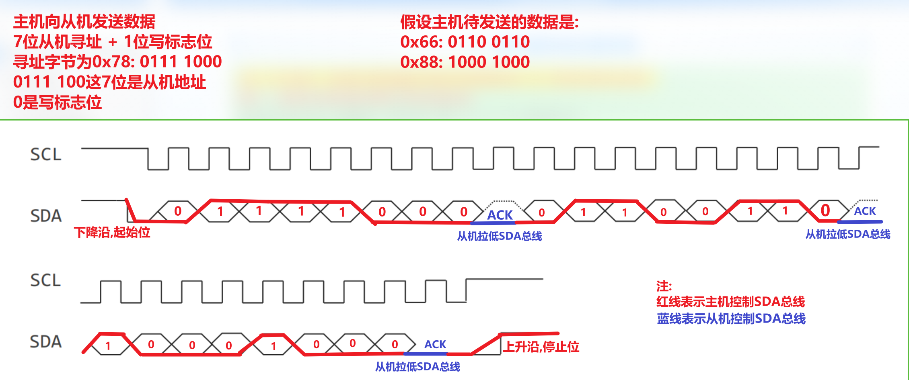

*图5-2发送数据时序图-图*

**举例二：主机从OLED显示屏中读状态字节，假设读到的是0x40。**

此时从机寻址字节是：从机地址 + 读标志位1，即0 1 1 1 1 0 0 1也就是0X79读到的数据是0x40，也就是0100 0000，即表示当前OLED处于关闭状态。

此时这个接收读过程完整的时序图就如下图所示：

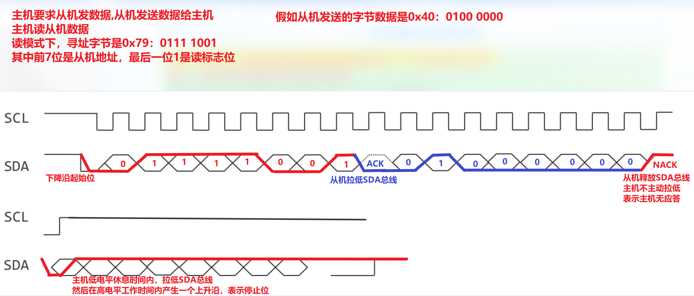

*图5-3读数据时序图-图*

以上我们万事具备，I2C通信所有概念相关的内容就都讲完结束了。

下面我们再来看一个概念——硬件I2C和软件I2C。

---

## 04 软I2C

### 1. 概述

当你看到这里，说明你已经对**I2C 通信的相关概念**有了整体认识。

并且已经在理论层面上，完整梳理并理解了 I2C 通信从开始到结束的时序过程。

同时，你也已经对**OLED 作为 I2C 从机设备**的通信方式，有了一个初步了解。

那么下面，我们就基于OLED作为从机，实际动手实现一次完整的 I2C 通信过程。

通过实践来加深对上述理论的理解。

### 2. 硬件I2C和软件I2C

本章节的标题叫做"软I2C"，那这里有一个非常重要的问题了：

什么是软件I2C，还有硬件I2C吗？

首先我们先来了解一下硬件I2C。

我们使用的STM32F10x系列单片机，其本身就内置了I2C外设模块，专门设计用于处理实现 I2C 通信，能够自动完成通信中的大部分操作。

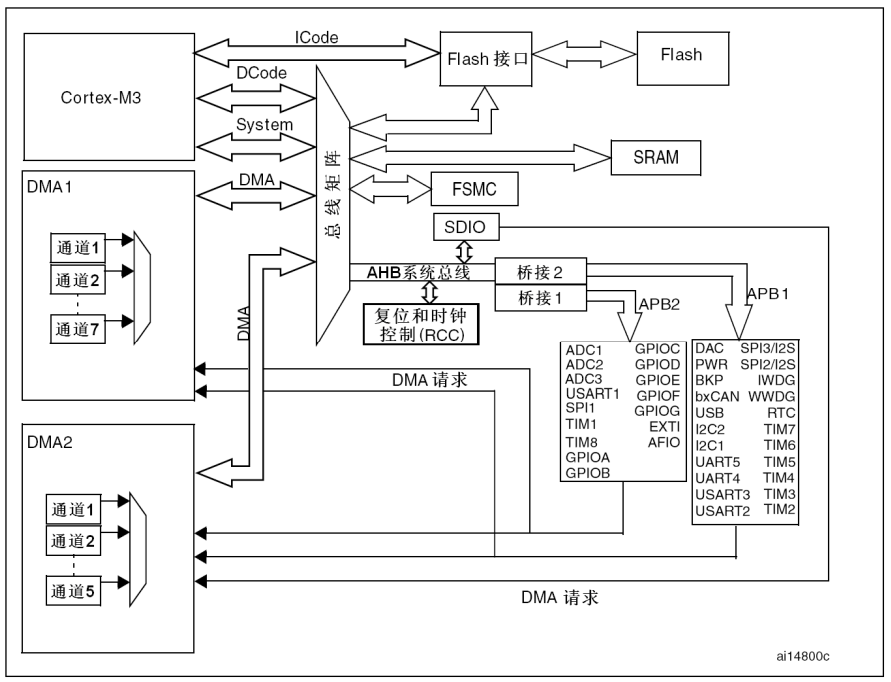

*图2-1STM32F103C8T6-系统结构图*

**如果选择使用单片机内置的I2C模块来实现I2C通信，这就是硬件I2C（简称硬I2C，HI2C）**

那什么是软件I2C呢？

在上述讲解的过程中，大家肯定不难发现：

I2C通信中主机的SDA和SCL引脚完全可以通过普通GPIO口来模拟实现。

**如果使用普通GPIO引脚，通过编写软件的方式模拟I2C的通信过程，实现I2C通信，这就是软件I2C（简称软I2C，SI2C）**

这里我们可以类比一下，前面学过的串口通信：

我们前面实现的串口通信，是借助单片机内部的USART外设来实现的。

回想一下，程序员需要手动完成的事情比较少，USART外设已经自动实现了串口通信中的绝大部分流程。

所以，我们可以把前面我们实现的串口通信，称之为“硬件串口通信”。

但实际上很少这么叫，因为串口通信很少也很难借助IO引脚软件模拟实现，软件串口通信基本见不到。

那自然就不需要叫“硬件串口通信”了。

那硬I2C和软I2C该怎么选择呢？

事实上两种方式，各有优缺点，各有适用的场景，我们都应该学习。

两种方式比较起来：

1. 硬I2C使用单片机I2C外设实现功能，数据传输速率会更高一些，但必须使用单片机指定引脚，所以灵活性差一些。
2. 软I2C依靠纯软件实现，没有相应硬件支持，数据传输速率会更慢一些，但可以使用任意两个普通IO引脚，所以灵活性好一些。

除此之外，对于STM32F10x系列这样早期的单片机，其 I2C 外设在设计和使用上相对复杂，不如USART外设简易好用。

**所以对于STM32F10x系列芯片而言，软I2C实现起来可能会更简单容易、灵活一些。**

**若通信的需求不是大量数据传输也不追求高性能，比如只是简单驱动OLED，使用软I2C其实是更好的选择。**

当然，如果是下面的场景：

1. 使用的是更新、更先进的芯片（比如F4系列），这些芯片的I2C外设设计更合理。
2. 需求更高的性能（高速传感器，频繁的存储器数据交互）
3. 使用HAL库编程。

那么硬I2C应该是更好的选择。

### 3. 软I2C驱动OLED实验

鉴于软I2C在我们所使用的STM32F10x系列芯片上，可能会更加简单易用一些。

我们先来完成软I2C驱动OLED的实验，借此来演示一下软I2C的使用。

电路接线图非常简单，在整个软硬I2C的学习中，我们都只简单驱动OLED屏幕完成实验。所以接线图都是一样的：

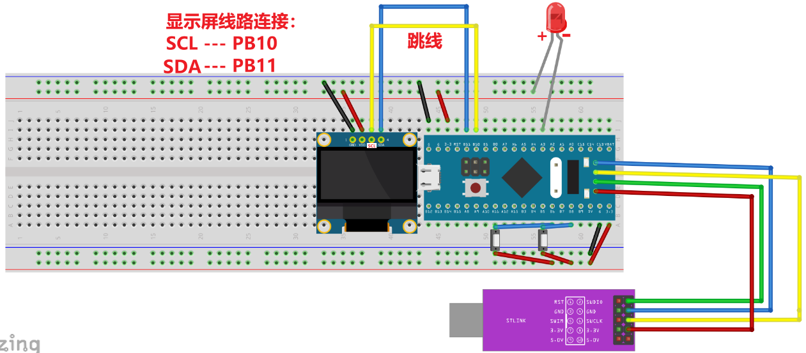

*图3-1软I2C驱动OLED实验-接线图*

实物接线图如下图所示：

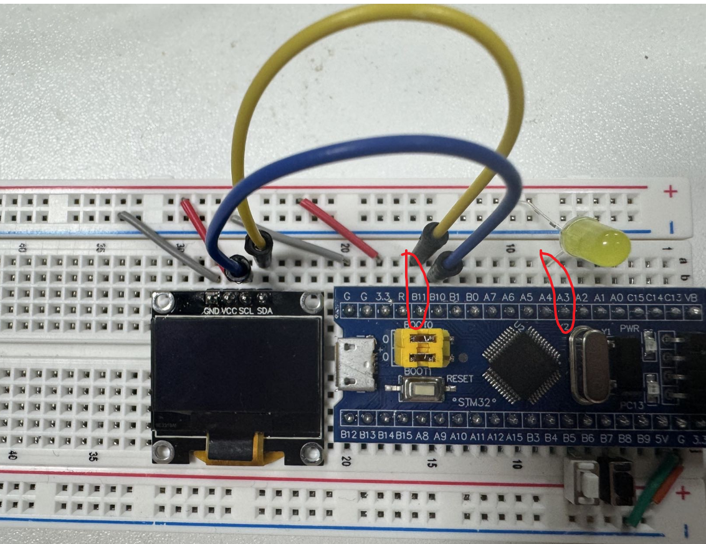

*图3-2软I2C驱动OLED实验-接线图2*

注意：

1. 这里OLED屏幕的接线方式和之前仍然是一样的，不需要做改动。需要使用跳线把OLED引脚和单片机引脚连接起来。接线方式是：
   - a. OLED屏幕的SCL -- PB10
   - b. OLED屏幕的SDA -- PB11
   - c. **需要使用跳线连接！**
2. 两个按键和LED仍然保留前面外部中断实验时的状态即可：
   - a. LED的正极接电源正极，负极接入PA3引脚
   - b. 两个按键一脚接入电源正极，另一脚分别接入PB6和PB8引脚。

实验目的：

利用外部中断机制：

1. 按下并弹起左边按键PB6，表示开启屏幕并点亮所有像素。
2. 按下并弹起右边按键PB8，表示关闭屏幕并熄灭所有像素。
3. 在中断处理中，读取OLED状态字节，若OLED屏幕点亮，则点亮PA3指示灯，否则熄灭。

要求使用软I2C来完成实验。

**由于此实验涉及到的外设相对多一些，代码也会更复杂一些，这里我们演示一下模块化编程，也就是使用头文件。**

在之前的C阶段，我们实现单链表时，就用到了模块化编程的思路，这里就不再赘述了。

首先，我们直接把工程目录"Tools"文件夹下的OLED相关文件删掉，再新建以下文件：

1. 按键模块的KEY.h和KEY.c文件
2. LED模块的LED.h和LED.c文件
3. 软I2C模块的sI2C.h和sI2C.c文件
4. OLED模块的sOLED.h和sOLED.c文件

随后你还需要在Keil5的Group中将它们添加进去，这些操作都比较简单之前都做过，不再赘述具体的流程。

**注意：不要在Keil5软件当中直接新建.c/或者.h文件，而是要去磁盘目录下手动新建文件，然后再添加到Keil5软件当中。**

外部中断处理函数（中断服务程序），则放到main.c文件中去实现，当然你也可以放到按键模块，毕竟是由按键触发的外部中断。

按照惯例，我们先来实现我们熟悉的、简单的模块，比如按键KEY模块。

#### 3.1 按键KEY模块的实现

按键模块没什么花里胡哨的东西，只需要初始化GPIO引脚、映射EXTI线、初始化EXTI外设以及最终初始化NVIC即可。

这些代码之前就已经都写过了。

**KEY.h头文件的参考代码如下：**

```c
#ifndef __KEY_H
#define __KEY_H

#include "stm32f10x.h"

// 初始化两个按键并设置外部中断
void KEY_Init(void);

#endif // !__KEY_H

```

注意头文件保护语法，由于实现中使用了外设标准库函数，所以还需要包含stm32f10x.h头文件。

**KEY.c源文件的实现也很简单，参考代码如下所示：**

```c
#include "KEY.h"

/**
  * @brief 配置两个按键的GPIO引脚以及它们的外部中断
  * @param 无
  * @retval 无
  * @note PB6和PB8设置为下拉输入
  */
void KEY_Init(void) {
    // 1.开启GPIOB以及AFIO外设时钟
    RCC_APB2PeriphClockCmd(RCC_APB2Periph_GPIOB |RCC_APB2Periph_AFIO,ENABLE);

    // 2.配置两个GPIO引脚，设置它们的工作模式
    GPIO_InitTypeDef GPIO_InitStruct;
    GPIO_InitStruct.GPIO_Pin = GPIO_Pin_6 | GPIO_Pin_8;
    GPIO_InitStruct.GPIO_Mode = GPIO_Mode_IPD; // 下拉输入模式
    GPIO_Init(GPIOB, &GPIO_InitStruct);

    // 3.映射GPIO引脚到对应的EXTI线
    GPIO_EXTILineConfig(GPIO_PortSourceGPIOB, GPIO_PinSource6);//映射PB6到EXTI线6
    GPIO_EXTILineConfig(GPIO_PortSourceGPIOB, GPIO_PinSource8);//映射PB8到EXTI线8

    // 4.配置EXTI，开启中断请求
    // 线6和线8一起处理
    EXTI_InitTypeDef EXTI_InitStruct;
    EXTI_InitStruct.EXTI_Line = EXTI_Line6 | EXTI_Line8;
    EXTI_InitStruct.EXTI_LineCmd = ENABLE;
    EXTI_InitStruct.EXTI_Mode = EXTI_Mode_Interrupt;
    EXTI_InitStruct.EXTI_Trigger = EXTI_Trigger_Rising; // 上升沿触发
    EXTI_Init(&EXTI_InitStruct);

    // 5.配置NVIC,配置中断的优先级以及最终开启中断
    NVIC_InitTypeDef NVIC_InitStruct;
    // 配置线6和线8的中断请求
    NVIC_InitStruct.NVIC_IRQChannel = EXTI9_5_IRQn;
    NVIC_InitStruct.NVIC_IRQChannelCmd = ENABLE;
    NVIC_InitStruct.NVIC_IRQChannelPreemptionPriority = 0;
    NVIC_InitStruct.NVIC_IRQChannelSubPriority = 0;
    NVIC_Init(&NVIC_InitStruct);
}

```

这段代码非常简单，只要按照既定的流程实现即可，不再赘述。

**注意，每写完一个模块建议都编译一下，这样可以及时的排查错误。**

#### 3.2 LED模块的实现

LED模块也很简单，它仅需要三个函数即可实现全部功能。

**LED.h头文件的参考代码如下：**

```c
#ifndef __LED_H
#define __LED_H

#include "stm32f10x.h"

// 初始化LED（开漏接法，PA3引脚）
void LED_Init(void);
// 点亮LED
void LED_ON(void);
// 熄灭LED
void LED_OFF(void);

#endif // !__LED_H

```

**LED.c源文件的实现也很简单，参考代码如下所示：**

```c
#include "LED.h"

/**
  * @brief 初始化PA3引脚，LED正极接电源正极，负极接PA3引脚
  * @param 无
  * @retval 无
  */
void LED_Init(void) {
    // 开启GPIOA时钟
    RCC_APB2PeriphClockCmd(RCC_APB2Periph_GPIOA, ENABLE);
    GPIO_InitTypeDef GPIO_InitStruct;
    GPIO_InitStruct.GPIO_Mode = GPIO_Mode_Out_PP; // 推挽输出模式
    GPIO_InitStruct.GPIO_Pin = GPIO_Pin_3;
    GPIO_InitStruct.GPIO_Speed = GPIO_Speed_2MHz;
    GPIO_Init(GPIOA, &GPIO_InitStruct);
    // LED默认熄灭状态
    GPIO_SetBits(GPIOA, GPIO_Pin_3);
}

/**
  * @brief PA3引脚设置为低电平,LED点亮
  * @param 无
  * @retval 无
  */
void LED_ON(void){
    GPIO_ResetBits(GPIOA, GPIO_Pin_3);
}

/**
  * @brief PA3引脚设置为高电平,LED熄灭
  * @param 无
  * @retval 无
  */
void LED_OFF(void){
    GPIO_SetBits(GPIOA, GPIO_Pin_3);
}

```

**注意，每写完一个模块建议都编译一下，这样可以及时的排查错误。**

### 4. 核心实现：软I2C模块

我们使用软件模拟I2C通信，实际上就是用一个个函数来模拟I2C通信的一个个小过程。

最终用这一个一个的函数调用，拼装起来，模拟2C通信的时序，实现I2C通信的过程。

那么I2C通信一共有哪些子过程呢？

假如是I2C主机向从机发送数据，流程是：

1. 主机发送起始位
2. 主机发送寻址字节（也就是主机发7位从机地址，加上1位读写标志给从机）
3. 从机发送ACK（也就是主机读从机的ACK）
4. 主机发送其它字节...从机发送ACK给主机
5. 主机发送停止位

假如是I2C主机读从机数据，流程是：

1. 主机发送起始位
2. 主机发送寻址字节（也就是主机发7位从机地址，加上1位读写标志给从机）
3. 从机发送ACK（也就是主机读从机的ACK）
4. 从机发送其它字节...主机发送ACK给从机
5. 主机发送NACK给从机，表示不再读从机数据
6. 主机发送停止位

总之对于I2C通信而言，我们只要实现下列7个函数，就足够模拟I2C通信的全部功能。

**sI2C.h头文件的参考代码如下：**

```c
#ifndef __SI2C_H
#define __SI2C_H

#include "stm32f10x.h"

// 软I2C的基本操作
void sI2C_Init(void); // 初始化软I2C的SDA和SCL两个引脚,实际这两个引脚可以是任意普通IO引脚
void sI2C_Start(void); // 主机发送起始位
void sI2C_Stop(void); // 主机发送停止位
void sI2C_WriteByte(uint8_t Data); // 主机发送1个字节数据到从机
uint8_t sI2C_ReadByte(void); // 主机读取从机的1个字节数据
void sI2C_WriteAck(uint8_t AckType); // 主机发送应答/非应答信号给从机
uint8_t sI2C_ReadAck(void); // 主机读取从机发送的应答/非应答信号,并返回读到的信号

#endif // !__SI2C_H
```

下面逐一来讲解实现这些函数的实现。

#### 4.1 设置必要的宏

为了提升代码可读性，灵活性，也使得代码写起来轻松一些，我们提取出一些反复使用的函数宏，以及必要的宏定义。

如下所示：

```c
#include "sI2C.h"
#include "Delay.h"

/*------------- 硬件引脚配置宏 ------------------*/
#define I2C_SCL_PIN GPIO_Pin_10
#define I2C_SDA_PIN GPIO_Pin_11
#define I2C_GPIO_PORT GPIOB

/*----------------- 主机读写两条总线的操作函数 -----------------*/
/**
  * @brief 主机通过SCL引脚控制时钟信号线
  * @param BitValue: 0-拉低SCL总线电平, 1-释放(拉高)SCL总线电平
  * @note 只有主机才拥有SCL总线的控制权
  */
static void sI2C_SCL_Write(uint8_t BitValue) {
    GPIO_WriteBit(I2C_GPIO_PORT, I2C_SCL_PIN,(BitAction)BitValue);
    Delay_Us(5); // 延迟一段时间, 保持电平稳定
}

/**
  * @brief 主机通过SCL引脚控制数据信号线, 以实现向从机发送数据
  * @param BitValue: 0-拉低SDA总线电平, 1-释放(拉高)SDA总线电平
  * @note 主机发送时,主机拥有对SDA总线的控制, 从机需要读SDA总线的状态以接收数据
  */
static void sI2C_SDA_Write(uint8_t BitValue) {
    GPIO_WriteBit(I2C_GPIO_PORT, I2C_SDA_PIN,(BitAction)BitValue);
    Delay_Us(5); // 延迟一段时间, 保持电平稳定
}

/**
  * @brief 主机读取SDA总线电平，用于实现读从机ACK或者读从机发送的数据并且返回这个数据
  * @retval Bit_RESET-低电平, Bit_SET-高电平
  */
static uint8_t sI2C_SDA_Read(void) {
    uint8_t Val = GPIO_ReadInputDataBit(I2C_GPIO_PORT,I2C_SDA_PIN);
    Delay_Us(5); // 保持采样稳定
    return Val;
}
```

可以看到在上述三个函数里，实现任何一个功能后，都会选择延时5us，这个5us的延时是什么意思呢？这个数值可以是别的吗？

在I2C通信中，将SCL时钟线的高电平视为工作时间，用于读写数据。

**时钟线上每存在一个高电平，就读写1个bit，也就是时钟线每1个周期，就能读写1个bit数据。**

**所以时钟线的时钟频率，也就是 SCL 信号每秒钟切换的次数（Hz）是决定I2C通信速率的核心要素。**

时钟频率越快，SCL信号切换高电平的次数就越多，1s内的工作时间越多，收发字节数量就越多。

I2C协议当中的规定了典型的三种SCL时钟线频率，如下表所示：

| 模式 | 最大 SCL 频率 | SCL 一个时钟周期 | 理论最大传输速率(单位:千字节每秒) |
|---|---|---|---|
| 标准模式 (SM) | 100 kHz (100,000 Hz) | 10 μs | 11.1KB/s |
| 快速模式 (FM) | 400 kHz (400,000 Hz) | 2.5 μs | 44.4KB/s |
| 高速模式 (HS) | 1 MHz (1,000,000 Hz) | 1 μs | 111.1KB/s |

拿标准模式举例，SCL时钟线频率是100kHz，也就是100 000Hz。

也就是1秒钟内，SCL线上有100 000个时钟周期**（1个时钟周期由1个高电平和1个低电平组成）**。

于是每一个时钟周期的时间就是：1 / 100 000 = 0.00001 = 0.01ms = 10us，如果平分这个时间，那就是高低电平各占5us。

由于软件I2C本身就不追求传输速率，所以我们可以在切换总线高低电平后统一延时5us，这样就软件**模拟了I2C通信当中的标准模式**。

当然你也可以减少这个延时，这样数据传输的速率就会更快一些，但一般没有必要，我们使用软件I2C更多是追求灵活和兼容性，而不是传输速率。

我们现在使用软件模拟 I²C来控制 OLED，需要手动翻转 SCL 线，并在每次翻转后进行延时，以保证 SCL 时钟能够满足通信的需求。

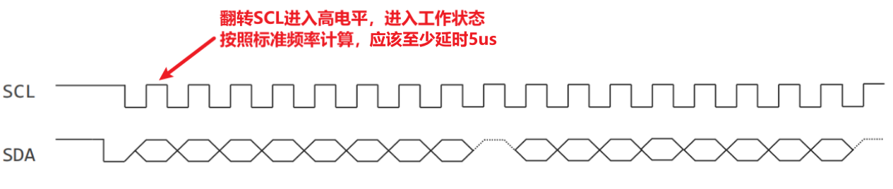

*图4.1-1延时时间设置-图*

如果不追求效率，我们可以直接用一个非常粗略的、保守的延迟策略，只要翻转电平或者执行了电平相关的操作，统一延时5us。

#### 4.2 细节补充1: I2C通信的传输速率如何计算

我们就以I2C通信的标准模式（时钟频率100kHz）为例。

时钟频率是100kHZ，那么理论数据传输速率是：100 000bit/s单位换算成字节，千字节：

100 000 / 8 / 1000 = 12.5KB/s**但这还不是实际数据传输速率，因为I2C通信的数据帧中存在无效bit数据。**

**在进行连续数据通信，不考虑起始位、停止位、寻址字节等出现较少的无效数据的影响，仅考虑频繁应答带来的影响。**

也就是说：每传输8bit数据，都需要应答1bit无效数据有效数据占比是：8 / 9所以I2C通信在标准模式，时钟频率为100kHZ的情况下，数据传输速率大约是：12.5 * 8 / 9 ≈ 11.11KB/s当然这是在协议层面，算出的理论最大传输速率。实际上还需要考虑：

1. 起始位、停止位、寻址字节等无效数据的影响
2. 软硬件层面的影响

实际的数据传输速率肯定比这个理论最大速度，要慢一些。

其余模式的理论最大传输速率，也都是这么计算出来的。

比如快速模式下，时钟线频率是400kHZ，算出来的理论最大传输速率：

400 000 / 8 / 1000 * 8 / 9 ≈ 44.44KB/s

#### 4.3 细节补充2: SDA引脚读SDA总线电平

在实现宏函数sI2C_SDA_Read 时，我们通过GPIO_ReadInputDataBit 函数读取了SDA引脚的输入电平，也就是获取此时SDA总线的高低电平状态。

在主机需要读从机数据（比如主机读从机ACK、或者主机读从机发送的一个字节数据）

时，单片机主机的SDA引脚是这样的状态：

1. 单片机主机的SDA引脚设置成了开漏输出模式。
2. 单片机主机的SDA引脚当前输出高阻态（因为主机释放SDA总线控制权，从机才能够发送）

那么，在这种状态下，为什么单片机还可以读SDA引脚的输入电平呢？

是不是需要将SDA引脚先切换到输入模式（比如浮空输入）然后再读引脚输入电平呢？

这是不需要的！！

**因为当IO引脚设置为开漏输出模式后，仍然可以直接读输入数据寄存器获取IO引脚输入电平的高低状态，在这里就是读SDA引脚的输入电平，从而获取SDA总线的高低电平状态。**

这个细节，在官方参考手册当中有明确的规定，如下图所示：

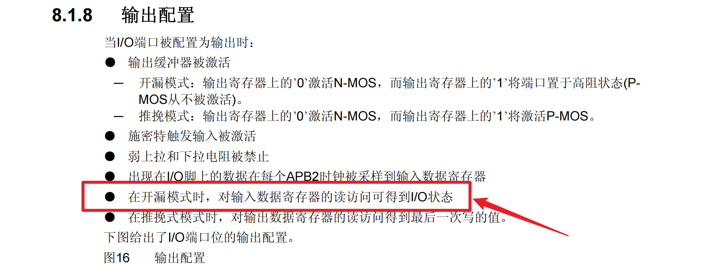

*图4.3-1开漏SDA引脚可以读总线状态-手册图*

需要注意的是：

有些同学可能会觉得，单片机的SDA引脚输出高阻态，相当于引脚和外部电路断开，那么此时它怎么会还有输入电平呢？

首先这句话是正确的，在SDA引脚输出高阻态时，SDA引脚的输出电路部分相当于和外界电路断路、断开了。

**但引脚的输入电路和输出电路是分开的，输出电路断开了，但输入电路仍然是接通的，如下图所示：**

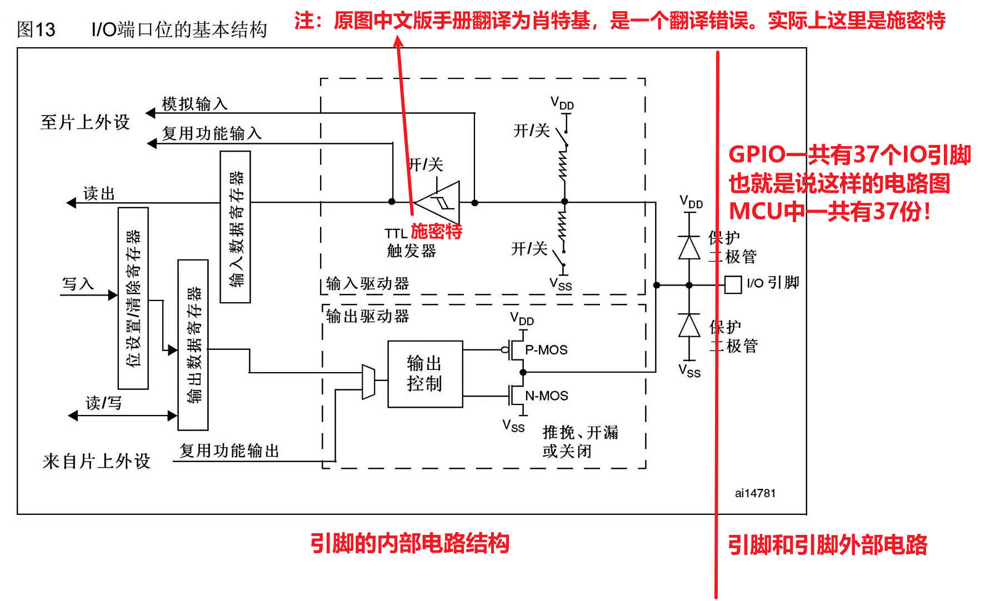

*图4.3-2IO引脚-电路图*

此时引脚的输入数据寄存器，仍然通过引脚和外部电路（也就是SDA总线）连接起来，而不是断路状态。

此时读输入数据寄存器，就仍然可以正常获取SDA总线的高低电平状态。

你听明白了吗？

#### 4.4 IO引脚初始化

引脚初始化非常简单，只需要将引脚设置为**"通用开漏输出模式"**即可。

为什么是通用呢？

**软件 I2C使用 GPIO引脚输出直接模拟 I2C通信的时序**，只需要让引脚输出高阻态和低电平两种状态就可以了。

除此之外，不要忘记SCL和SDA线默认用高电平表示空闲状态，所以初始化的末尾要将它们置为高电平。

Init函数的参考代码如下：

```c
/**
  * @brief I2C总线初始化
  * @param 无
  * @retval 无
  * @note 配置PB10和PB11为开漏输出模式
  * 初始化后总线处于空闲状态（SCL和SDA均为高电平）
  */
void sI2C_Init(void) {
    RCC_APB2PeriphClockCmd(RCC_APB2Periph_GPIOB, ENABLE); // 开启GPIOB时钟
    GPIO_InitTypeDef GPIO_InitStruct;
    GPIO_InitStruct.GPIO_Pin = I2C_SCL_PIN | I2C_SDA_PIN;
    GPIO_InitStruct.GPIO_Mode = GPIO_Mode_Out_OD; // 通用开漏输出模式
    GPIO_InitStruct.GPIO_Speed = GPIO_Speed_2MHz; // 2MHz的引脚输出速度足够了
    GPIO_Init(I2C_GPIO_PORT, &GPIO_InitStruct);

    sI2C_SCL_Write(1); // 初始化SCL总线为高电平空闲状态
    sI2C_SDA_Write(1); // 初始化SDA总线为高电平空闲状态
}
```

这个函数的实现应当是非常简单的。

#### 4.5 主机发送起始和终止位

**主机发送起始位的实现逻辑如下:**

1. 拉高 SDA 和 SCL 线：这一步是为了让 I2C 总线处于空闲状态，因为 I2C 协议规定在空闲时 SDA 和 SCL 都为高电平，为产生起始信号做准备。
2. 在SCL总线为高电平时，拉低 SDA 总线：这样在 SCL 高电平期间就产生了一个下降沿，这是 I2C 协议定义的起始信号标志，表明一次新的通信开始。
3. 最后，再拉低 SCL 总线，进入休息时间，主机开始准备下一位待发送的数据，即拉低/拉高SDA总线

**实际上，我们在设计实现软I2C的各个操作函数时，都遵循这样的原则：执行完一个操作后就拉低SCL总线，进入休息时间！！**

**主机发送终止位的实现逻辑如下:**

1. 拉低 SDA 总线：为下一个工作时间产生上升沿做准备，使 SDA 总线先处于低电平状态。
2. 拉高 SCL 总线：拉高 SCL 总线进入工作时间，为在 SCL 高电平期间产生上升沿创造条件。
3. SCL 总线为高电平时拉高 SDA总线：在 SCL 高电平期间拉高 SDA，产生上升沿，这是 I2C 协议规定的停止信号标志，用来表示本次通信结束。

参考代码代码如下所示：

```c
/**
  * @brief 主机发送I2C起始位，通信开始
  * @param 无
  * @retval 无
  * @note 时序要求：SCL高电平期间SDA产生下降沿
  */
void sI2C_Start(void) {
    // 两条总线全部拉高，表示两条总线都处于空闲状态
    sI2C_SDA_Write(1);
    sI2C_SCL_Write(1);

    // 此时SCL总线处于高电平状态, 将SDA总线拉低产生一个下降沿表示通信开始
    sI2C_SDA_Write(0);
    // 拉低SCL总线, 表示进入休息时间, 主机准备下一位待发送数据
    sI2C_SCL_Write(0);
}

/**
  * @brief 主机发送I2C终止位，通信结束
  * @param 无
  * @retval 无
  * @note 时序要求：SCL高电平期间SDA产生上升沿
  */
void sI2C_Stop(void) {
    sI2C_SDA_Write(0); // 先拉低SDA总线, 使得SDA总线上能够产生一个上升沿
    sI2C_SCL_Write(1); // 再拉高SCL总线，进入工作时间

    sI2C_SDA_Write(1); // SCL总线高电平状态时拉高SDA总线，产生上升沿，表示通信结束
}
```

只要理解了I2C协议的发送位和终止位的逻辑，那么这两个函数的实现还是非常简单的。

#### 4.6 主机发送单字节数据到从机

**在I2C通信中，主机发送1个字节的数据，总是从高地址发送到低地址的。**

所以它的大体步骤思路是：

**步骤 1：开启 8 次循环**

1. **操作**：启动一个循环，循环 8 次，用于逐位发送一个字节（8 位）的数据。
2. **原因**：一个字节由 8 位二进制数组成，I2C 协议规定每个时钟周期传输 1 位数据，因此需要循环 8 次才能完成一个字节数据的传输。

**步骤 2：判断并设置最高位数据**

1. **操作**：判断待发送数据的最高位是 0 还是 1，然后将 SDA 线电平设置为对应的 0 或1。
2. **原因**：在 I2C 协议中，SCL 低电平时 SDA 可以改变电平来准备数据。此时通过判断数据最高位并设置 SDA 电平，是为后续 SCL 高电平时从机采集数据做准备。也就是在准备时间里，SDA总线准备待发送的数据。

**步骤 3：数据左移一位**

1. **操作**：将待发送的数据左移一位，让之前的倒数第二位变成新的最高位。
2. **原因**：为了在下一次循环中发送下一位数据，通过左移操作使下一位数据成为最高位，方便后续继续按照从高位到低位的顺序逐位发送数据。

**步骤 4：拉高 SCL 线进入工作时间**

1. **操作**：将 SCL 线电平拉高。
2. **原因**：拉高 SCL 线进入工作时间，此时根据 I2C 协议要求，SDA 线电平要保持稳定，以便从机在 SCL 高电平期间采集 SDA 线上的数据。

**步骤 5：拉低 SCL 线进入休息时间**

1. **操作**：将 SCL 线电平拉低。
2. **原因**：拉低 SCL 线进入下一个时钟周期的休息时间，在 SCL 低电平时，SDA 线又可以改变电平，为发送下一位数据做准备，这样就可以继续循环发送后续的数据位。

参考实现代码如下所示：

```c
/**
  * @brief 主机发送1个字节的数据到从机
  * @param Data: 待发送的1个字节的数据
  * @retval 无
  * @note 每个时钟周期发送1位数据
  * SCL总线低电平时, 改变SDA总线的高低电平, 准备发送数据
  * SCL总线高电平时, SDA总线保持稳定的高低电平，主机发送数据, 从机采集数据
  */
void sI2C_WriteByte(uint8_t Data) {
    // 循环发送8位1个字节的数据, 从最高位发到最低位
    for (uint8_t i = 0; i < 8; i++) {
        /*
           当前SCL总线处于低电平状态, I2C通信处于休息时间
           此时拉低或者拉高SDA总线, 以准备待发送的1位数据
        */
        if (Data & 0x80) { // 0x80就是8位二进制数1000 0000
           // 相与的结果是非0的, 说明Data的最高位是1
           sI2C_SDA_Write(1); // 拉高SDA总线, 准备发送数据位1
        } else {
           // 相与的结果是0, 说明Data的最高位是0
           sI2C_SDA_Write(0); // 拉低SDA总线, 准备发送数据位0
        }
        Data <<= 1; // 将Data左移一位, 原本的最高位丢弃, 最低位补0,这样原本的倒数第二高位就成为了新的最高位

        // 待发送数据准备好了，拉高SCL总线，进入工作时间
        sI2C_SCL_Write(1); // 该函数在拉高SCL总线后延时5us，此时SDA总线状态保持不变，足够从机采集数据
        sI2C_SCL_Write(0); // 拉低SCL总线，进入休息时间
    }
}
```

还是要强调一下：

**软I2C通信的这些函数的设计都遵循同一个原则，每执行完成一个操作，都要拉低SCL总线进入休息时间！**

#### 4.7 主机读取从机的单字节数据

看完了I2C的写操作，再来实现I2C的读操作，也就是主机读取从机的单字节数据。

**在I2C通信中，主机发送数据是从高位发送到低位的，那么主机读取（接收）数据也自然是从高位接收到低位的。**

其大体的实现思路是这样的：

**步骤 1：初始化接收数据变量**

1. **操作**：定义一个无符号 8 位整型变量ReceiveData并初始化为 0。
2. **原因**：这个变量用于存储从从机读取到的一个字节的数据。初始化为 0 是因为当读到的数据位为低电平时，不需要对ReceiveData进行额外赋值操作。

**步骤 2：主机释放 SDA 线**

1. **操作**：调用sI2C_SDA_Write(1)函数将 SDA 线拉高，释放对 SDA 线的控制。
2. **原因**：在主机接收从机数据之前，需要确保释放 SDA 线，避免主机对 SDA 线的控制干扰从机的数据发送，这样从机才能在 SDA 线上输出要发送的数据。

**步骤 3：逐位读取数据（8 次循环）**

启动一个循环，循环 8 次，每次循环读取一位数据。

1. 拉高 SCL 线：调用sI2C_SCL_Write(1)函数将 SCL 线拉高，进入工作时间。
2. 读取 SDA 线电平：调用sI2C_SDA_Read()函数读取 SDA 线的电平。如果 SDA 线为高电平，说明当前读取的数据位是 1，将对应的位设置到ReceiveData变量中。
3. 拉低 SCL 线：调用sI2C_SCL_Write(0)函数将 SCL 线拉低，进入休息时间，为读取下一位数据做准备。

I2C 协议规定每个时钟周期传输 1 位数据，一个字节由 8 位组成，所以需要循环 8 次来完成一个字节数据的读取。

在 SCL 高电平期间，从机将数据放在 SDA 线上，主机读取 SDA 线的电平来获取数据位。拉低 SCL 线后，SDA 线可以准备下一位数据。

**步骤 4：返回读取到的数据**

1. **操作**：循环结束后，将存储读取数据的ReceiveData变量返回。
2. **原因**：函数的目的是读取从机的一个字节数据，循环结束后ReceiveData变量中已经存储了完整的一个字节数据，将其返回给调用者，以便后续使用。

参考实现代码如下所示：

```c
/**
  * @brief 主机读取从机发送的1个字节的数据
  * @param 无
  * @retval 从机发送, 主机读取到的1个字节的数据（uint8_t）
  * @note 在I2C通信中，主机发送数据是从高位发送到低位的，那么主机接收数据也是从高位接收到低位
  * 一开始主机具有SDA总线的控制权，所以主机要主动让自身SDA引脚输出高阻态，放弃SDA总线控制权
  * 随后在下一个工作时间里读SDA总线的高低电平，即可实现主机接收数据
  */
uint8_t sI2C_ReadByte(void) {
    // 初始化作为返回值的1字节变量，初始值设为0，如果某位读到低电平0则无需赋值
    uint8_t ReceiveData = 0;
    // 主机让自身SDA引脚进入高阻态，放弃SDA总线控制器，从机控制SDA总线开始发送数据
    sI2C_SDA_Write(1);

    // 用于构建接收数据的掩码,与这些掩码做|=运算,表示接收数据从最高位到最低位是1
    const uint8_t Masks[8] = {0x80, 0x40, 0x20, 0x10, 0x08, 0x04,0x02,0x01};

    // 主机接收从机发来的数据，逐位读取，循环8次，第一次读到的是最终数据的最高位
    for (uint8_t i = 0; i < 8; i++) {
        /*
           现在SCL总线处于低电平休息时间，这个时间是留给从机准备待发送数据的
           紧接着就拉高SCL总线，进入工作时间
           主机在工作时间里读SDA总线的电平状态，从而接收数据
        */
        sI2C_SCL_Write(1);
        if (sI2C_SDA_Read() == Bit_SET) {
           // 主机读到SDA总线为高电平状态,说明读到了最高位数据是1
           // 将第8-i位的值设置为1
           ReceiveData |= Masks[i];
        }
        // 主机每读完1位，就拉低SCL总线，进入休息时间，继续循环读下一位
        sI2C_SCL_Write(0);
    }
    // 循环结束，主机就读完了一整个字节的从机数据, 当然此时SCL总线是低电平的,处于休息时间
    return ReceiveData;
}
```

这部分实现当中，从最高位到最低位构建ReceiveData 的实现方式并不是唯一的，你也可以选择一些其它的实现方式。

**我这里给出的实现，是我个人认为最好理解的。**

#### 4.8 主机发送应答信号给从机

主机发送应答信号给从机，其实就是主机向从机发送一个bit的数据，可以是ACK（0），也可以是NACK（1）。

其实现思路是这样的：

**步骤 1：准备应答信号数据**

1. **操作**：根据传入的参数AckType的值，调用sI2C_SDA_Write(ack)函数设置SDA 线的电平。当AckType为 0 时，表示发送 ACK 信号，SDA 线被拉低；当AckType为非 0 时，表示发送 NACK 信号，SDA 线被拉高。
2. **原因**：此时 SCL 线处于低电平，根据 I2C 协议，在 SCL 低电平时，SDA 线可以改变电平，所以在这个时候准备好应答信号的数据。

**步骤 2：拉高 SCL 线**

1. **操作**：调用sI2C_SCL_Write(1)函数将 SCL 线拉高。
2. **原因**：拉高 SCL 线后进入工作时间，按照 I2C 协议，在 SCL 高电平期间，从机需要读取 SDA 线上的应答信号，以确定主机是否成功接收数据。

**步骤 3：拉低 SCL 线**

1. **操作**：调用sI2C_SCL_Write(0)函数将 SCL 线拉低。
2. **原因**：拉低 SCL 线后，进入下一个时钟周期的休息时间，SDA 线又可以进行电平的改变，为后续的通信操作做准备。

其参考代码如下所示:

```c
/**
 * @brief 主机发送应答信号给从机
  * @param AckType, 即应答类型: 0-ACK，1-NACK
  * @retval 无
  * @note 既然是主机发送应答信号,那么主机就拥有SDA总线控制权
  * ACK: 在SCL高电平期间, 保持SDA低电平, 表示主机应答
  * NACK: 在SCL高电平期间, 保持SDA高电平, 表示主机无应答
  */
void sI2C_WriteAck(uint8_t AckType) {
    // 只有主机读完从机1个字节数据后，才需要发送应答信号给从机
    // 所以此时SCL处于低电平状态，是休息时间，准备SDA数据
    sI2C_SDA_Write(AckType); // 主机把应答位数据准备好
    sI2C_SCL_Write(1); // 拉高SCL，进入工作时间，从机在SCL高电平期间，读取应答位
    sI2C_SCL_Write(0); // 拉低SCL，开始下一个休息时间
}
```

需要注意的小细节是：从机如何去读到这个ACK/NACK，然后如何进行处理，这是从机自身设定的问题，和我们主机的代码是无关的。

#### 4.9 主机读取从机发来的应答信号

主机读取从机发来的应答信号，其实就是主机读取从机中的一个bit的数据。

其思路是这样的：

**步骤 1：主机释放 SDA 线**

1. **操作**：调用sI2C_SDA_Write(1)函数将 SDA 线拉高，释放对 SDA 线的控制。
2. **原因**：在主机接收从机的应答信号之前，需要确保释放 SDA 线，避免主机对 SDA 线的控制干扰从机发送应答信号。释放 SDA 线后，从机才能在 SDA 线上输出自己的应答信号。

**步骤 2：拉高 SCL 线**

1. **操作**：调用sI2C_SCL_Write(1)函数将 SCL 线拉高。
2. **原因**：拉高 SCL 线进入工作时间，根据 I2C 协议，在 SCL 高电平期间，从机会将应答信号放在 SDA 线上，主机可以在这个时间段读取 SDA 线的电平来获取应答信号。

**步骤 3：读取 SDA 线电平**

1. **操作**：
   - a. 定义一个无符号 8 位整型变量ReceiveAckType ，用于存储从机发送的应答信号。
2. 调用sI2C_SDA_Read()函数读取 SDA 线的电平，并将读取到的结果存储到ReceiveAckType变量中。
3. **原因**：SDA 线的电平代表了从机的应答信号，低电平（0）表示 ACK（应答），高电平（1）表示 NACK（非应答）。通过读取 SDA 线电平，主机可以获取从机的应答信息。

**步骤 4：拉低 SCL 线**

1. **操作**：调用sI2C_SCL_Write(0)函数将 SCL 线拉低。
2. **原因**：拉低 SCL 线后，进入下一个时钟周期的休息时间，SDA 线又可以进行电平的改变，为后续的通信操作做准备。

**步骤 5：返回应答信号**

1. **操作**：将存储应答信号的ReceiveAckType变量作为函数的返回值返回。
2. **原因**：调用者可以根据返回的应答信号判断数据传输是否成功，并进行相应的处理。例如，如果返回值为 0，表示从机应答成功，数据传输正常；如果返回值为1，表示从机非应答，可能存在数据传输错误等问题。

具体的参考代码如下:

```c
/**
 * @brief 主机读取从机发来的应答信号, 可以是ACK(0), 也可以是NACK(1)
  * @param 无
 * @retval 返回收到的应答位，0表示ACK，1表示NACK
  */
uint8_t sI2C_ReadAck(void) {
    // 主机发送完1个字节数据, 从机才需要应答, 此时主机应该放弃SDA总线的控制权
    sI2C_SDA_Write(1);
    // 当前SCL总线处于低电平休息时间
    sI2C_SCL_Write(1); // 拉高SCL总线，进入工作时间，主机在SCL高电平期间，读取从机发送的应答位
    uint8_t ReceiveAckType = sI2C_SDA_Read(); // 主机接收从机应答并存储起来,用作返回值
    sI2C_SCL_Write(0); // 拉低SCL，开始下一个休息时间
    return ReceiveAckType; // 返回主机接收到的应答信号
}
```

需要注意其中的实现细节，更好的理解I2C通信的时序。

#### 4.10 整体参考代码

整个软I2C模块，其参考代码如下所示：

```c
#include "sI2C.h"
#include "Delay.h"

/*------------- 硬件引脚配置宏 ------------------*/
#define I2C_SCL_PIN GPIO_Pin_10
#define I2C_SDA_PIN GPIO_Pin_11
#define I2C_GPIO_PORT GPIOB

/*----------------- 主机读写两条总线的操作宏函数 -----------------*/
/**
  * @brief 主机通过SCL引脚控制时钟信号线
  * @param BitValue: 0-拉低SCL总线电平, 1-释放(拉高)SCL总线电平
  * @note 只有主机才拥有SCL总线的控制权
  */
static void sI2C_SCL_Write(uint8_t BitValue) {
    GPIO_WriteBit(I2C_GPIO_PORT, I2C_SCL_PIN,(BitAction)BitValue);
    Delay_Us(5); // 延迟一段时间, 保持电平稳定
}

/**
  * @brief 主机通过SDA引脚控制数据信号线, 以实现向从机发送数据
  * @param BitValue: 0-拉低SDA总线电平, 1-释放(拉高)SDA总线电平
  * @note 主机发送时,主机拥有对SDA总线的控制, 从机需要读SDA总线的状态以接收数据
  */
static void sI2C_SDA_Write(uint8_t BitValue) {
    GPIO_WriteBit(I2C_GPIO_PORT, I2C_SDA_PIN,(BitAction)BitValue);
    Delay_Us(5); // 延迟一段时间, 保持电平稳定
}

/**
  * @brief 主机读取SDA总线电平，用于实现读从机ACK或者读从机发送的1位数据并且返回这1位数据
  * @retval Bit_RESET-低电平, Bit_SET-高电平
  */
static uint8_t sI2C_SDA_Read(void) {
    uint8_t Val = GPIO_ReadInputDataBit(I2C_GPIO_PORT,I2C_SDA_PIN);
    Delay_Us(5); // 保持采样稳定
    return Val;
}

/**
  * @brief I2C总线初始化
  * @param 无
  * @retval 无
  * @note 配置PB10和PB11为开漏输出模式
  * 初始化后总线处于空闲状态（SCL和SDA均为高电平）
  */
void sI2C_Init(void) {
    RCC_APB2PeriphClockCmd(RCC_APB2Periph_GPIOB, ENABLE); // 开启GPIOB时钟
    GPIO_InitTypeDef GPIO_InitStruct;
    GPIO_InitStruct.GPIO_Pin = I2C_SCL_PIN | I2C_SDA_PIN;
    GPIO_InitStruct.GPIO_Mode = GPIO_Mode_Out_OD; // 通用开漏输出模式
    GPIO_InitStruct.GPIO_Speed = GPIO_Speed_2MHz; // 2MHz的引脚输出速度足够了
    GPIO_Init(I2C_GPIO_PORT, &GPIO_InitStruct);

    sI2C_SCL_Write(1); // 初始化SCL总线为高电平空闲状态
    sI2C_SDA_Write(1); // 初始化SCL总线为高电平空闲状态
}

/**
  * @brief 主机发送I2C起始位，通信开始
  * @param 无
  * @retval 无
  * @note 时序要求：SCL高电平期间SDA产生下降沿
  */
void sI2C_Start(void) {
    // 两条总线全部拉高，表示两条总线都处于空闲状态
    sI2C_SDA_Write(1);
    sI2C_SCL_Write(1);

    // 此时SCL总线处于高电平状态, 将SDA总线拉低产生一个下降沿表示通信开始
    sI2C_SDA_Write(0);
    // 拉低SCL总线, 表示进入休息时间, 主机准备下一位待发送数据
    sI2C_SCL_Write(0);
}

/**
  * @brief 主机发送I2C终止位，通信结束
  * @param 无
  * @retval 无
  * @note 时序要求：SCL高电平期间SDA产生上升沿
  */
void sI2C_Stop(void) {
    sI2C_SDA_Write(0); // 先拉低SDA总线, 使得SDA总线上能够产生一个上升沿
    sI2C_SCL_Write(1); // 再拉高SCL总线，进入工作时间

    sI2C_SDA_Write(1); // SCL总线高电平状态时拉高SDA总线，产生上升沿，表示通信结束
}

/**
  * @brief 主机发送1个字节的数据到从机
  * @param Data: 待发送的1个字节的数据
  * @retval 无
  * @note 每个时钟周期发送1位数据
  * SCL总线低电平时, 改变SDA总线的高低电平, 准备发送数据
  * SCL总线高电平时, SDA总线保持稳定的高低电平，主机发送数据, 从机采集数据
  */
void sI2C_WriteByte(uint8_t Data) {
    // 循环发送8位1个字节的数据, 从最高位发到最低位
    for (uint8_t i = 0; i < 8; i++) {
        /*
           当前SCL总线处于低电平状态, I2C通信处于休息时间
           此时拉低或者拉高SDA总线, 以准备待发送的1位数据
        */
        if (Data & 0x80) { // 0x80就是8位二进制数1000 0000
           // 相与的结果是非0的, 说明Data的最高位是1
           sI2C_SDA_Write(1); // 拉高SDA总线, 准备发送数据位1
        } else {
           // 相与的结果是0, 说明Data的最高位是0
           sI2C_SDA_Write(0); // 拉低SDA总线, 准备发送数据位0
        }
        Data <<= 1; // 将Data左移一位, 原本的最高位丢弃, 最低位补0,这样原本的倒数第二高位就成为了新的最高位

        // 待发送数据准备好了，拉高SCL总线，进入工作时间
        sI2C_SCL_Write(1); // 该函数在拉高SCL总线后延时5us，此时SDA总线状态保持不变，足够从机采集数据
        sI2C_SCL_Write(0); // 拉低SCL总线，进入休息时间
    }
}

/**
  * @brief 主机读取从机发送的1个字节的数据
  * @param 无
  * @retval 从机发送, 主机读取到的1个字节的数据（uint8_t）
  * @note 在I2C通信中，主机发送数据是从高位发送到低位的，那么主机接收数据也是从高位接收到低位
  * 一开始主机具有SDA总线的控制权，所以主机要主动让自身SDA引脚输出高阻态，放弃SDA总线控制权
  * 随后在下一个工作时间里读SDA总线的高低电平，即可实现主机接收数据
  */
uint8_t sI2C_ReadByte(void) {
    // 初始化作为返回值的1字节变量，初始值设为0，如果某位读到低电平0则无需赋值
    uint8_t ReceiveData = 0;
    // 主机让自身SDA引脚进入高阻态，放弃SDA总线控制器，从机控制SDA总线开始发送数据
    sI2C_SDA_Write(1);

    // 用于构建接收数据的掩码,与这些掩码做|=运算,表示接收数据从最高位到最低位是1
    const uint8_t Masks[8] = {0x80, 0x40, 0x20, 0x10, 0x08,0x04,0x02,0x01};

    // 主机接收从机发来的数据，逐位读取，循环8次，第一次读到的是最终数据的最高位
    for (uint8_t i = 0; i < 8; i++) {
        /*
           现在SCL总线处于低电平休息时间，这个时间是留给从机准备待发送数据的
           紧接着就拉高SCL总线，进入工作时间
           主机在工作时间里读SDA总线的电平状态，从而接收数据
        */
        sI2C_SCL_Write(1);
        if (sI2C_SDA_Read() == Bit_SET) {
           // 主机读到SDA总线为高电平状态,说明读到了最高位数据是1
           // 将第8-i位的值设置为1
           ReceiveData |= Masks[i];
        }
        // 主机每读完1位，就拉低SCL总线，进入休息时间，继续循环读下一位
        sI2C_SCL_Write(0);
    }
    // 循环结束，主机就读完了一整个字节的从机数据, 当然此时SCL总线是低电平的,处于休息时间
    return ReceiveData;
}

/**
  * @brief 主机发送应答信号给从机
  * @param AckType, 即应答类型: 0-ACK，1-NACK
  * @retval 无
  * @note 既然是主机发送应答信号,那么主机就拥有SDA总线控制权
  * ACK: 在SCL高电平期间, 保持SDA低电平, 表示主机应答
  * NACK: 在SCL高电平期间, 保持SDA高电平, 表示主机无应答
  */
void sI2C_WriteAck(uint8_t AckType) {
    // 只有主机读完从机1个字节数据后，才需要发送应答信号给从机
    // 所以此时SCL处于低电平状态，是休息时间，准备SDA数据
    sI2C_SDA_Write(AckType); // 主机把应答位数据准备好
    sI2C_SCL_Write(1); // 拉高SCL，进入工作时间，从机在SCL高电平期间，读取应答位
    sI2C_SCL_Write(0); // 拉低SCL，开始下一个休息时间
}

/**
  * @brief 主机读取从机发来的应答信号, 可以是ACK(0), 也可以是NACK(1)
  * @param 无
  * @retval 返回收到的应答位，0表示ACK，1表示NACK
  */
uint8_t sI2C_ReadAck(void) {
    // 主机发送完1个字节数据, 从机才需要应答, 此时主机应该放弃SDA总线的控制权
    sI2C_SDA_Write(1);
    // 当前SCL总线处于低电平休息时间
    sI2C_SCL_Write(1); // 拉高SCL总线，进入工作时间，主机在SCL高电平期间，读取从机发送的应答位
    uint8_t ReceiveAckType = sI2C_SDA_Read(); // 主机接收从机应答并存储起来,用作返回值
    sI2C_SCL_Write(0); // 拉低SCL，开始下一个休息时间
    return ReceiveAckType; // 返回主机接收到的应答信号
}

```

大家不妨参考一下上述代码与注释，自行手动实现一下。

### 5. 核心实现：sOLED模块

首先需要我们实现的函数有以下内容：

**sOLED.h头文件的参考代码如下：**

```c
#ifndef __OLED_H
#define __OLED_H

#include "stm32f10x.h"

// 基本功能
void OLED_On(void); // 全屏点亮像素
void OLED_Off(void); // 彻底关闭OLED
void OLED_ReadStatus(uint8_t *OLED_StatusPtr); // 读取显示状态（0关闭/1开启）

#endif // !__OLED_H

```

**sOLED.c源文件的参考代码如下：**

```c
#include "sOLED.h"
#include "sI2C.h"
#include "Delay.h"

/*----------------- OLED屏幕的硬件寻址字节 -----------------*/
#define OLED_ADDRESS_WRITE 0x78 // 写模式的OLED硬件的寻址字节
#define OLED_ADDRESS_READ 0x79 // 读模式的OLED硬件的寻址字节

/**
  * @brief 单片机向OLED发送多个字节数据, 包含控制字节和后续的控制指令
  * @param Cmds: 待发送指令的字节数组
  * @param Length: 待发送指令字节数组的长度, 也就是需要发送字节的数量
  * @retval 无
  */
static void OLED_WriteCmds(const uint8_t *Cmds, uint8_t Length) {
    // 1.发送起始位
    sI2C_Start();

    // 2.主机发送寻址字节, 和从机建立通信
    sI2C_WriteByte(OLED_ADDRESS_WRITE); // 发送 OLED 地址（写模式）

    // 3.主机读取从机发送的ACK
    if (sI2C_ReadAck() != 0) {
        // 从机无应答, 直接发送终止位停止通信
        sI2C_Stop();
        return;
    }

    // 4.主机向从机发送控制指令0x00,表示OLED进入指令控制模式
    sI2C_WriteByte(0x00);

    // 5.主机再次读取从机发送的ACK
    if (sI2C_ReadAck() != 0) {
        // 从机无应答, 直接发送终止位停止通信
        sI2C_Stop();
        return;
    }

    // 6.逐个字节的发送指令给从机OLED
    for (uint8_t i = 0; i < Length; i++) {
        sI2C_WriteByte(Cmds[i]);

        // 主机每发送1个字节, 从机就要应答1次
        // 主机读取从机ACK
        if (sI2C_ReadAck() != 0) {
           // 从机无应答, 直接发送终止位停止通信
           sI2C_Stop();
           return;
        }
    }

    // 7.所有指令都已发送,停止通信
    sI2C_Stop();
}

/**
  * @brief 开启OLED屏幕,并且点亮所有的像素
  * @param 无
  * @retval 无
  */
void OLED_On(void) {
    // 开启屏幕的指令
    uint8_t OLED_ONCmds[] = {
        0x8D, 0x14, // 开启电荷泵
        0xAF, // 打开屏幕
        0xA5 // 让屏幕全亮，点亮所有像素点
    };
    // 将开启屏幕的指令发送给从机OLED
    OLED_WriteCmds(OLED_ONCmds, sizeof(OLED_ONCmds));
}

/**
  * @brief 彻底关闭OLED屏幕
  * @param 无
  * @retval 无
  */
void OLED_Off(void) {
    // 关闭屏幕的指令
    uint8_t OLED_OFFCmds[] = {
        0xA4, // 普通显示模式
        0xAE, // 关闭 OLED 显示
        0x8D, 0x10 // 关闭电荷泵
    };
    // 将关闭屏幕的指令发送给从机OLED
    OLED_WriteCmds(OLED_OFFCmds, sizeof(OLED_OFFCmds));
}

/**
  * @brief 获取当前屏幕点亮的状态
  * @param OLED_StatusPtr是一个外部变量的指针,传入函数的目的是获取当前OLED屏幕的点亮状态,起着返回值的作用
  * @retval 无
  * @note 状态字节的bit6如果是1表示屏幕没有点亮, 如果是0表示屏幕已点亮
  */
void OLED_ReadStatus(uint8_t *OLED_StatusPtr) {
    // 1.发送起始位
    sI2C_Start();
    // 2.主机向从机发送寻址字节(读模式)
    sI2C_WriteByte(OLED_ADDRESS_READ);

    // 3.主机读从机发送的ACK
    if (sI2C_ReadAck() != 0) {
        // 从机无应答, 直接发送终止位停止通信
        sI2C_Stop();
       return;
    }

    // 4.主机读从机发送来的1个字节的数据(状态字节)
    uint8_t ReceiveData = sI2C_ReadByte(); // 主机获取状态字节
    *OLED_StatusPtr = ((ReceiveData >> 6) & 1); // 获取ReceiveData的bit6的取值(0/1)

    // 5.主机成功读到从机发送的状态字节,主机不再需要其它数据了
    // 主机发送NACK
    sI2C_WriteAck(1);

    // 6.通信结束
    sI2C_Stop();
}

```

需要注意的细节有:

1. 主机向OLED从机发数据后，从机会向主机发送应答信号。无应答可以选择像上面代码里一样处理，也完全可以不做任何处理。但一定要接收应答！
2. 在实现OLED_ReadStatus 函数时，通过一个传入传出的指针类型参数实现了返回值的效果。

### 6. 中断服务程序的编写

中断服务程序的写法也非常简单，首先确定此函数的声明如下：

```c
void EXTI9_5_IRQHandler(void);
```

其次中断服务程序就只做以下几件事情：

1. 先确定由哪条EXTI线，也就是哪个按键触发了外部中断。
2. 按键必须按下--弹起后才执行开启/关闭OLED和以及通过I2C读来控制LED的操作。

中断服务程序的参考代码如下所示：

```c
/**
  * @brief 获取当前OLED屏幕的状态,然后控制LED和OLED状态保持一致
  * @param 无
  * @retval 无
  */
void LED_ControlByOLEDStatus(void) {
    uint8_t OLED_Status;
    OLED_ReadStatus(&OLED_Status); // 获取当前OLED屏幕的开关状态
    if (OLED_Status == 1) {
        // OLED处于关闭状态,LED同步熄灭
        LED_Off();
    } else {
        // OLED处于开启状态,LED同步点亮
        LED_On();
    }
}

/**
  * @brief EXTI线6和线8触发中断时的中断处理函数
  * @param 无
  * @retval 无
  */
void EXTI9_5_IRQHandler(void) {
    // 检查触发此中断的是不是EXTI线6，也就是PB6按键按下了
    if (EXTI_GetITStatus(EXTI_Line6) == SET) {
        // 清零此中断挂起标志位
        EXTI_ClearITPendingBit(EXTI_Line6);

        // 等待按键弹起
        while (GPIO_ReadInputDataBit(GPIOB, GPIO_Pin_6) ==Bit_SET);

        OLED_On(); // 点亮屏幕
        // 获取当前OLED屏幕的状态,然后控制LED和OLED状态保持一致
        LED_ControlByOLEDStatus();
    }

    // 检查触发此中断的是不是EXTI线8，也就是PB8按键按下了
    if (EXTI_GetITStatus(EXTI_Line8) == SET) {
        // 清零此中断挂起标志位
        EXTI_ClearITPendingBit(EXTI_Line8);

        // 等待按键弹起
        while (GPIO_ReadInputDataBit(GPIOB, GPIO_Pin_8) ==Bit_SET);

        OLED_Off(); // 关闭屏幕
        // 获取当前OLED屏幕的状态,然后控制LED和OLED状态保持一致

        LED_ControlByOLEDStatus();
    }
}
```

相信学到这里，这个中断服务程序的编写，对大家而言还是相当容易和简单的。

### 7. 主程序的编写

主程序的编写也非常简单，只需要完成各种初始化即可，剩余逻辑交给按键的外部中断触发。

参考代码如下：

```c
int main(void) {
    NVIC_PriorityGroupConfig(NVIC_PriorityGroup_2); // 设置中断优先级分组为分组2

    KEY_Init(); // 初始化按键中断
    LED_Init(); // 配置LED控制引脚
    sI2C_Init(); // 配置I2C引脚，初始化软I2C

    // OLED和LED初始状态熄灭
    OLED_Off();
    LED_Off();

    while (1) {
        // 程序的具体执行全部依靠外部中断来完成
    }
}
```

编译和烧录程序，分别按下释放两个按键，若能够看到屏幕被点亮、熄灭，以及LED随之点亮熄灭，则说明程序执行成功。

### 8. 仅测试I2C通信参考代码

当然，上面的实验代码掺杂了诸如中断等内容，如果撇开这些额外内容，仅测试I2C通信。

直接基于OLED屏幕和PC13指示灯，测试它们的开启和关闭。

接线方式，可以直接参照下图：


*图8-1仅测试I2C通信-*

下面仍然逐模块的、将代码展示出来。

#### 8.1 LED模块

**头文件LED.h：**

```c
/*
    该模块用于驱动PC13指示灯
    该LED的状态需要读OLED屏幕状态后,然后和OLED屏幕保持同步
    OLED开启,LED也点亮
    OLED开闭,LED也熄灭
    但注意不要直接驱动PC13指示灯,而是读OLED状态字节获取OLED状态后再控制PC13的状态
*/

#ifndef __LED_H
#define __LED_H

#include "stm32f10x.h"

void LED_Init(void);

void LED_ControlByOLEDStatus(void);

#endif // !__LED_H

```

**实现代码文件LED.c：**

```c
#include "LED.h"
#include "sOLED.h"

/**
  * @brief 初始化PC13指示灯
  * @param 无
  * @retval 无
  */
void LED_Init(void) {
    RCC_APB2PeriphClockCmd(RCC_APB2Periph_GPIOC, ENABLE);

    GPIO_InitTypeDef GPIO_InitStruct;
    GPIO_InitStruct.GPIO_Mode = GPIO_Mode_Out_OD; // 通用开漏输出模式
    GPIO_InitStruct.GPIO_Pin = GPIO_Pin_13;
    GPIO_InitStruct.GPIO_Speed = GPIO_Speed_2MHz;
    GPIO_Init(GPIOC, &GPIO_InitStruct);

    // 默认熄灭LED
    GPIO_SetBits(GPIOC, GPIO_Pin_13);
}

/**
  * @brief 读OLED状态字节,通过OLED状态来控制LED
  * @param 无
  * @retval 无
  * @note 需要基于I2C读模式实现功能
  */
void LED_ControlByOLEDStatus(void) {
    // 1.获取OLED屏幕状态字节bit6的值
    uint8_t StatusBit6 = sOLED_GetStatusBit6();

    // 2.根据bit6位的值,控制LED的状态
    if (StatusBit6 == 1) {
        // OLED处于关闭状态,于是熄灭LED
        GPIO_SetBits(GPIOC, GPIO_Pin_13);
        return;
    }

    if (StatusBit6 == 0) {
        // OLED处于开启状态,于是点亮LED
        GPIO_ResetBits(GPIOC, GPIO_Pin_13);
        return;
    }
    // 程序如果运行到这里,说明读OLED屏幕通信失败了
    // 执行一些相关的处理....
}

```

#### 8.2 软I2C模块（核心实现）

**头文件sI2C.h：**

```c
/*
    软I2C模块,其实就是利用两个普通IO引脚模拟I2C通信的时序
    实现I2C通信的过程
    所以在此模块中,就需要根据I2C的时序要求,提供一系列时序控制函数
    (只需要实现主机相关的即可,从机芯片上的程序早在生产时就烧录好了)
    包括:
    1.主机发送起始位信号
    2.主机发送停止位信号
    3.主机发送1个字节数据给从机
    4.主机读从机ACK/NACK

    以上4个时序控制函数,就实现了I2C的写模式
    如果想要实现读模式操作,还需要实现:
    1.主机接收从机发送的1个字节数据
    2.主机要发送ACK/NACK给从机

    当然还需要一个函数,用于初始化两个普通IO引脚,作为I2C通信中的SCL和SDA引脚
    一共需要7个函数,在头文件中,把这7个函数声明出来即可
*/
#ifndef __SI2C_H
#define __SI2C_H
// 随后的实现中,需要用到SPL库GPIO外设库,所以需要包含此头文件
#include "stm32f10x.h"
#include "Delay.h" // 实现软件I2C必然需要延时

// 用于初始化两个普通IO引脚,作为单片机主机I2C通信过程中的SCL和SDA引脚
// 我们选择PB10作为SCL引脚,PB11作为SDA引脚
void sI2C_Init(void);

// 主机发送起始位信号
void sI2C_Start(void);

// 主机发送停止位信号
void sI2C_Stop(void);

// 主机发送1个字节数据给从机,Byte就是待发送的数据
void sI2C_SendByte(uint8_t Byte);

// 主机读从机发送的ACK/NACK
// 用1(高电平)表示表示NACK,0(低电平)表示ACK
uint8_t sI2C_ReceiveAck(void);

// 软I2C写模式,只需要实现上述4个函数
// 软I2C读模式,还需要再实现下面两个2函数

// 主机接收从机发送的1个字节数据,并且将接收到的字节数据作为函数的返回值
uint8_t sI2C_ReceiveByte(void);

// 主机发送ACK(0)/NACK(1)给从机
// 参数传参1表示主机发送NACK,参数传参0表示主机发送ACK
void sI2C_SendAck(uint8_t AckStatus);

#endif // !__SI2C_H

```

**实现源代码文件sI2C.c：**

1/*

```c
    此源文件用于实现软I2C模块中所有的函数
    如果需要使用软I2C驱动与其他设备通信,只需要包含sI2C.h头文件即可
*/
#include "sI2C.h"

/*
    软I2C很大的一个优势就是引脚使用灵活,可以选择任意两个普通IO引脚
    为了更充分的发挥这个优势,在初始化软I2C引脚时,可以使用宏定义来定义相关引脚
    使得切换引脚后,可以不用大幅度改变代码,提升代码的灵活性,扩展性和可维护性

    软I2C初始化,需要初始化SCL和SDA引脚,流程是什么样的?
    1.开启SCL和SDA引脚对应的GPIO外设时钟
    2.初始化SCL和SDA引脚,都设置为通用开漏输出模式
    3.初始化完成后,通信处于空闲状态,于是两个引脚都需要设置为1(高阻态)
    需要用到哪些宏呢?
    1.两个引脚对应的时钟宏
    2.两个引脚对应的引脚编号宏
    3.两个引脚对应的GPIOx宏

    当然:
    现在SCL引脚是PB10, SDA引脚是PB11
*/
#define SI2C_SCL_CLOCK RCC_APB2Periph_GPIOB
#define SI2C_SDA_CLOCK RCC_APB2Periph_GPIOB
#define SI2C_SCL_PIN GPIO_Pin_10
#define SI2C_SDA_PIN GPIO_Pin_11
#define SI2C_SCL_PORT GPIOB
#define SI2C_SDA_PORT GPIOB

/*
    在整个软I2C实现的过程中,所有的函数都需要通过控制IO引脚实现控制两条总线的高低电平
    代码需要复用
    于是我们可以提取出一系列的函数用于实现:
    通过控制主机单片机SCL和SDA引脚的输出状态,控制SCL和SDA总线
    当然在I2C读模式下以及主机读从机ACK/NACK的操作
    主机还需要读接收从机发送的数据
    此时主机需要读SDA总线的高低电平状态
    这里需要设计三个函数:
    1.主机通过控制SCL引脚输出,控制SCL总线
    2.主机通过控制SDA引脚输出,控制SDA总线
    3.主机读SDA总线状态,并返回高低电平的状态
*/

/**
  * @brief 主机通过控制SCL引脚输出,控制SCL总线
  * @param BitVal: 取值1,表示控制引脚输出1高阻态,使得SCL总线是高电平状态
  * 取值0,表示控制引脚输出0低电平,使得SCL总线是低电平状态
  * @retval 无
  * @note SCL总线切换高低电平后,需要加延时,等待SCL总线电平稳定
  */
static void sI2C_SCL_Write(uint8_t BitVal) {
    GPIO_WriteBit(SI2C_SCL_PORT, SI2C_SCL_PIN,(BitAction)BitVal);
    /*
        切换SCL总线电平状态后,需要延时5us,为什么呢?
        I2C通信协议设计最大的问题: 总线的高电平是依靠上拉电阻的弱上拉,拉升上去的
        所以这个上拉过程就比较缓慢
        软件层面切换SCL总线电平后,需要等待延时一会,确保SCL总线能够有充足的时间达到目标电平
        如果不加延时,那就有可能出现,SCL总线实际没有来得及切换到高电平,但SDA已经发数据的情况

        保守一点,为了通信更加的稳定,所以延时5us
    */
    Delay_Us(5);
}

/**
  * @brief 主机通过控制SDA引脚输出,控制SDA总线
  * @param BitVal: 取值1,表示控制引脚输出1高阻态,使得SDA总线是高电平状态
  * 取值0,表示控制引脚输出0低电平,使得SDA总线是低电平状态
  * @retval 无
  * @note
  */
static void sI2C_SDA_Write(uint8_t BitVal) {
    GPIO_WriteBit(SI2C_SDA_PORT, SI2C_SDA_PIN,(BitAction)BitVal);
    /*
        切换SDA总线后,需不需要加延时呢?
        保守一点,可以加
        但实际上完全可以不加,因为SDA总线不是控制线,它不控制时序
        只要SCL总线切换时,加延时,SDA总线肯定可以稳定电平状态
    */
    Delay_Us(5);
}

/**
  * @brief 主机读SDA总线的电平状态,返回1表示读到了高电平,返回0表示读到了低电平
  * @param 无
  * @retval 无
  */
static uint8_t sI2C_SDA_Read(void) {
    /*
        虽然SDA引脚是通用开漏输出模式
        但仍然可以直接读SDA引脚的输入数据寄存器获取引脚输入状态
        也就是获取SDA总线的高低电平状态
    */
    return GPIO_ReadInputDataBit(SI2C_SDA_PORT, SI2C_SDA_PIN);
}

/**
  * @brief 用于初始化两个普通IO引脚,作为单片机主机I2C通信过程中的SCL和SDA引脚
  * @param 无
  * @retval 无
  * @note 我们选择PB10作为SCL引脚,PB11作为SDA引脚
  */
void sI2C_Init(void) {
    // 1.开启SCL和SDA引脚对应的GPIO外设时钟
    RCC_APB2PeriphClockCmd(SI2C_SCL_CLOCK | SI2C_SDA_CLOCK,ENABLE);

    // 2.初始化SCL和SDA引脚,都设置为通用开漏输出模式
    // 先初始化SCL引脚
    GPIO_InitTypeDef GPIO_InitStruct;
    GPIO_InitStruct.GPIO_Mode = GPIO_Mode_Out_OD;
    GPIO_InitStruct.GPIO_Pin = SI2C_SCL_PIN;
    // 软I2C模拟实现通信,对标通信中的标准模式,SCL时钟线的频率是100kHz
    // 所以软I2C实现时,选择最低的引脚输出速度就够了
    GPIO_InitStruct.GPIO_Speed = GPIO_Speed_2MHz;
    GPIO_Init(SI2C_SCL_PORT, &GPIO_InitStruct);

    // 再初始化SDA引脚
    GPIO_InitStruct.GPIO_Pin = SI2C_SDA_PIN;
    GPIO_Init(SI2C_SDA_PORT, &GPIO_InitStruct);

    // 3.初始化完成后,通信处于空闲状态,于是两个引脚都需要设置为1(高阻态)
    // 拉高两条总线,表示通信处于空闲状态,通信还没有开始
    sI2C_SDA_Write(1);
    sI2C_SCL_Write(1);
}

/**
  * @brief 主机发送起始位信号
  * @param 无
  * @retval 无
  * @note 起始位信号,时序要求是: 在SCL总线高电平的工作时间内,产生一个下降沿
  */
void sI2C_Start(void) {
    // 1.保守起见,为了避免意外情况
    // 在产生起始信号之前,先让通信处于空闲状态
    // 再次拉高两条总线
    sI2C_SCL_Write(1);
    sI2C_SDA_Write(1);

    // 2.SCL总线此时已经处于高电平的工作时间了
    // 于是拉低SDA总线,产生一个下降沿,这就是起始信号
    sI2C_SDA_Write(0);

    /*
        约定:
           为了更加方便的编写时序控制函数
           时序的每一个小流程都以"SCL总线低电平,休息时间"作为结束
           除了停止信号
        这样约定的好处是:
        任意时序控制的小流程函数,在一开始时,我们就知道
        它一定处于SCL低电平休息时间
    */
    // 3.拉低SCL总线,进入休息时间
    sI2C_SCL_Write(0);
    // 起始信号发送后,通信处于休息时间
}

/**
  * @brief 主机发送停止位信号
  * @param 无
  * @retval 无
  * @note 停止位信号,时序要求是: 在SCL总线高电平的工作时间内,产生一个上升沿
  */
void sI2C_Stop(void) {
    // 现在是休息时间,休息时间干嘛?
    // 为了在下一个工作时间内,产生一个上升沿
    // 在当前休息时间内,主机要拉低SDA总线,SDA处于低电平,待会才能够拉高
    // 1.拉低SDA总线
    sI2C_SDA_Write(0);

    // 2.拉高SCL总线,进入工作时间
    sI2C_SCL_Write(1);

    // 3.此时SCL总线是高电平工作时间,于是拉高SDA总线,产生一个上升沿
    sI2C_SDA_Write(1);

    // 此时停止位信号发送完成,通信结束了,两条总线都回到了高电平的空闲状态
    // 通信回到了空闲状态
}

/**
  * @brief 主机发送1个字节数据给从机
  * @param Byte: 主机待发送的1个字节数据
  * @retval 无
  */
void sI2C_SendByte(uint8_t Byte) {
    /*
        I2C通信发送数据,是从字节数据的最高位发送到最低位
        1个bit位,1个bit位的将Byte字节数据发送出去

        思考一下,这个过程是什么样的呢?
        1.函数调用一开始时,通信处于休息时间
           作为主机,作为数据的发送端
           主机需要根据待发送的bit位数据是0,还是1,拉低或者拉高SDA总线
           于是主机准备好了待发送的数据

        2.主机拉高SCL总线,进入工作时间
           工作时间内,主机作为发送端,什么都不做
           只需要保持SDA总线稳定电平即可
           接收端根据I2C通信协议,会在此时采集SDA总线电平接收数据(这不是你应该操心的事情)

        3.I2C通信是串行通信,数据是1个bit位,1个bit位的发送出去的
           上1个bit位数据发送完毕了
           主机拉低SCL总线,进入休息时间

        重复上述操作8次,就完成了1个字节数据的发送
    */
    for (uint8_t i = 0; i < 8; i++) {
        // 1.主机需要根据待发送的bit位数据是0,还是1,拉低或者拉高SDA总线
        if (Byte & 0x80) {
           // Byte & 0x80的结果是非0的,说明此时Byte的最高位是1
           // 于是拉高SDA总线,表示下一个工作时间要发送的比特位数据是1
           sI2C_SDA_Write(1);
        } else {
           // Byte & 0x80的结果就是0,说明此时Byte的最高位是0
           // 于是拉低SDA总线,表示下一个工作时间要发送的比特位数据是0
           sI2C_SDA_Write(0);
        }

        // 此时最高位的数据,已经准备好发送了
        // 下一次循环,应该发送当前倒数第二高位的比特位数据
        // 所以直接将Byte左移等1位
        Byte <<= 1;
        // 以上就准备好了当前发送的数据,以及也给下一次发送数据做了准备

        // 2.拉高SCL总线,进入工作时间,将数据发送出去
        // 该过程主机什么事情都不干
        sI2C_SCL_Write(1); // SCL拉高后延时了5us,这个时间既是等待SCL拉高,也给了从机采集数据的时间

        // 3.当前比特位的数据发送完成了,接下来进入休息时间
        // 准备下一个待发送的比特位数据
        sI2C_SCL_Write(0);
    }

    // 代码执行到这里,说明Byte这1个字节数据,已经发送完成了
    // 当前SCL已经拉低了,处于休息时间
}

/**
  * @brief 主机读从机发送的ACK/NACK
  * @param 无
  * @retval uint8_t: 用1(高电平)表示表示NACK,0(低电平)表示ACK
  */
uint8_t sI2C_ReceiveAck(void) {
    // 1.当前是休息时间,主机需要放弃SDA总线的控制权
    // 主机主动将自身SDA引脚设置为高阻态
    sI2C_SDA_Write(1);

    // 2.主机放弃SDA总线的控制权后,从机自动获取控制权
    // 从机会在休息时间内,拉低SDA总线表示应答成功(ACK)
    // 于是主机控制SCL拉高,进入工作时间
    sI2C_SCL_Write(1);

    // 3.主机需要在工作时间内,采集SDA总线电平状态
    // 此时SDA总线的电平状态就是ACK(0,低电平)/NACK(1,高电平)
    uint8_t ReceiveAck = sI2C_SDA_Read();

    // 4.拉低SCL总线,进入休息时间
    sI2C_SCL_Write(0);

    return ReceiveAck;
}

// 软I2C写模式,只需要实现上述4个函数
// 软I2C读模式,还需要再实现下面两个2函数

/**
  * @brief 主机接收从机发送的1个字节数据,并且将接收到的字节数据作为函数的返回值
  * @param 无
  * @retval uint8_t: 就是主机读到的从机发送的1个字节的数据
  */
uint8_t sI2C_ReceiveByte(void) {
    /*
        1.在函数一开始时,处于休息时间,主机等待从机发送数据,主机需要放弃SDA总线的控制权
        2.休息时间从机会准备好待发送的比特位数据,主机控制SCL总线进入高电平工作时间
        3.在工作时间内,从机只需要保持SDA总线电平稳定即可,而主机需要采集SDA总线的高低电平状态
           如果读到SDA总线是高电平(1),就表示主机接收到了从机发送的比特位数据是1
           如果读到SDA总线是低电平(0),就表示主机接收到了从机发送的比特位数据是0
        4.主机完成1个比特位数据的采集工作,主机控制SCL总线进入休息时间,从机继续准备待发送数据

        以上步骤2~4,重复8次,主机就接收到了从机发送的1个字节数据
        当然这个过程中,主机需要将这1个字节的数据构建出来,需要作为函数的返回值
    */
    // 1.现在是休息时间,主机放弃SDA总线控制权
    sI2C_SDA_Write(1);

    // 2.在栈上创建1个字节的内存空间,用于存放主机接收从机发送的1个字节数据
    // 初始值是0,所以随后如果接收到从机发送的比特位数据是0,则不需要操作这个内存块
    uint8_t ReceiveByte = 0x00;

    // 定义一个十六进制的整型数组,用于或连接ReceiveByte用于将它的某1位设置为1
    const uint8_t ReceiveMasks[] = {0x80, 0x40, 0x20, 0x10,0x08,0x04,0x02,0x01};

    // 3.定义一个for循环,循环8次,每循环一次主机就接收1个比特位数据
    // 最终构建成1个字节的数据,作为函数的返回值
    for (uint8_t i = 0; i < 8; i++) {
        // 4.主机控制SCL总线进入高电平的工作时间,从机保持SDA总线电平稳定表示发送数据
        // 主机则趁机读SDA总线电平状态,表示接收数据
        sI2C_SCL_Write(1);

        // 5.调用Read函数,读SDA总线电平状态,只有在读到高电平时才给ReceiveByte的该位赋值1
        if (sI2C_SDA_Read()) {
           // 将ReceiveByte的当前位赋值为1
           ReceiveByte |= ReceiveMasks[i];
        }

        // else就不用加了,如果读到了低电平则什么都不需要做
        // 6.主机已经成功读到了1个比特位数据,随之进入休息时间
        sI2C_SCL_Write(0);
    }

    // for循环结束时,ReceiveByte的数据就是主机接收到的从机发送的1个字节数据
    // 当然主机接收完毕时,当前处于通信的SCL低电平休息时间
    return ReceiveByte;
}

/**
  * @brief 主机发送ACK(0)/NACK(1)给从机
  * @param AckStatus: 传参1表示主机发送NACK,传参0表示主机发送ACK
  * @retval 无
  * @note
  */
void sI2C_SendAck(uint8_t AckStatus) {
    // 1.当前是休息时间,主机需要给从机发送ACK/NACK,此时SDA总线的控制权在主机手上
    // 所以在休息时间,主机需要根据AckStatus拉低/拉高SDA总线,准备发送的数据
    sI2C_SDA_Write(AckStatus);

    // 2.主机已经准备完成了,接下来进入工作时间,主机将ACK/NACK发送给从机
    sI2C_SCL_Write(1);

    // 3.从机已经接收到了主机发送的ACK/NACK,接下来进入休息时间
    sI2C_SCL_Write(0);
}

```

以上。

#### 8.3 OLED驱动模块

**头文件sOLED.h：**

```c
/*
    软件I2C驱动OLED屏幕模块,实现单片机主机和OLED从机之间的通信操作
    需要实现的I2C写操作有:
    1.开启和点亮OLED屏幕所有的像素
    2.彻底关闭OLED屏幕

    需要实现的I2C读操作有:
    获取OLED的状态字节,并且直接返回bit6(因为只有这一位有效)
*/
#ifndef __SOLED_H
#define __SOLED_H

#include "stm32f10x.h"

// 开启和点亮OLED屏幕所有的像素
void sOLED_TurnOn(void);

// 彻底关闭OLED屏幕
void sOLED_TurnOff(void);

// 读获取OLED的状态字节,并且直接返回bit6(因为只有这一位有效)
uint8_t sOLED_GetStatusBit6(void);

#endif // !__SOLED_H

```

**实现源代码文件sOLED.c：**

```c
#include "sOLED.h"
#include "sI2C.h"

#define SOLED_SLAVE_ADDRESS_WRITE 0x78
#define SOLED_SLAVE_ADDRESS_READ 0x79

/**
  * @brief 单片机主机发送多个字节数据给OLED从机,实现OLED屏幕的控制操作
  * @param Cmds: 待发送的多个字节控制指令,包含0x00这个字节数据
  * @param Length: 待发送的多个字节控制指令的数量
  * @retval 无
  * @note 软I2C模块当前已经实现了,所有的写模式下的时序控制函数都已经实现了
  * 那么利用这个软I2C模块,实现驱动控制OLED屏幕
  * 就是利用这些自己实现的时序控制函数,模拟时序图,实现I2C通信过程
  */
static void sOLED_SendCmds(const uint8_t *Cmds, uint8_t Length) {
    // 1.主机发送起始位信号,通信开始
    sI2C_Start();

    // 2.主机发送寻址字节(写模式)给从机
    sI2C_SendByte(SOLED_SLAVE_ADDRESS_WRITE);

    // 3.判断寻址是否成功,也就是主机读从机ACK
    // 如果读到了ACK说明寻址完成,主机继续发送后续的字节数据
    // 如果读到了NACK说明寻址失败,主机可以直接结束通信
    if (sI2C_ReceiveAck() == 1) {
        // 从机应答失败,从机无响应
        // 主机直接结束通信,函数直接退出
        sI2C_Stop();
        return;
    }

    // 代码运行到这里,说明寻址成功了,再后续的数据就是控制字节指令了
    // 4.后续待发送的所有字节数据,都需要在循环中完成
    // 每发送1个字节,就检查一次ACK,如果ACK成功就继续发,如果读到NACK就结束通信
    for (uint8_t i = 0; i < Length; i++) {
        // 将Cmds字节数组中的数据逐字节的发送出去
        sI2C_SendByte(Cmds[i]);

        // 每发送1个字节,都应答一次
        if (sI2C_ReceiveAck() == 1) {
           // 从机应答失败,从机无响应
           // 主机直接结束通信,函数直接退出
           sI2C_Stop();
           return;
        }
    }

    // 5.主机已经把所有的数据发给从机了,主机发送停止信号,结束通信
    sI2C_Stop();
}

// 开启和点亮OLED屏幕所有的像素
void sOLED_TurnOn(void) {
    const uint8_t TurnOnCmds[] = {
        0x00, // 下面的指令是命令流
        0x8D, 0x14, // 开启电荷泵
        0xAF, // 打开屏幕
        0xA5 // 让屏幕全亮，点亮所有像素点
    };
    sOLED_SendCmds(TurnOnCmds, sizeof(TurnOnCmds));
}

// 彻底关闭OLED屏幕
void sOLED_TurnOff(void) {
    uint8_t TurnOffCmds[] = {
        0x00, // 下面的指令是命令流
        0xA4, // 普通显示模式
        0xAE, // 关闭 OLED 显示
        0x8D, 0x10 // 关闭电荷泵
    };
    sOLED_SendCmds(TurnOffCmds, sizeof(TurnOffCmds));
}

/**
  * @brief 读获取OLED的状态字节,并且直接返回bit6(因为只有这一位有效)
  * @param 无
  * @retval uint8_t: 返回值是OLED状态字节的bit6
  * 如果是0表示OLED开启,如果是1表示OLED熄灭
  * 如果函数的返回值是2,说明通信失败,没有读到状态字节
  * @note 利用软I2C已经实现好的时序控制函数,模拟I2C读OLED屏幕的时序图,实现I2C读通信流程
  */
uint8_t sOLED_GetStatusBit6(void) {
    // 1.主机发送起始位信号,通信开始
    sI2C_Start();

    // 2.主机发送读模式寻址字节(0x79)
    sI2C_SendByte(SOLED_SLAVE_ADDRESS_READ);

    // 3.主机读从机ACK/NACK,如果读到了从机NACK,直接结束通信
    // 如果主机读到了ACK,则继续进行后续通信过程
    if (sI2C_ReceiveAck()) {
        // 主机读到了从机NACK,从机无响应,寻址失败,直接结束通信
        sI2C_Stop();
        return 2;
    }

    // 主机寻址从机成功了,接下来OLED从机就会发送状态字节给主机
   // 4.主机接收从机发送的1个字节数据
    uint8_t ReceiveStatusByte = sI2C_ReceiveByte();

   // 5.主机已经成功接收了OLED状态字节,主机直接发送NACK给从机,表示不需要从机再发送数据了
   sI2C_SendAck(1);

   // 6.主机发送停止位信号,结束通信,当然也不要忘记将状态字节bit6作为函数的返回值返回
   sI2C_Stop();
   uint8_t StatusBit6 = (ReceiveStatusByte >> 6) & 0x01;
   return StatusBit6;
}

```

以上。

#### 8.4 测试代码

main.c测试文件的代码如下：

```c
#include "stm32f10x.h"
#include "Delay.h"
#include "sI2C.h"
#include "sOLED.h"
#include "LED.h"

int main(void) {
    // 初始化软I2C模块,初始化对应引脚(SCL-PB10,SDA-PB11)
    sI2C_Init();
    LED_Init();

    // 调用软件I2C实现的OLED屏幕驱动代码,点亮或关闭屏幕
    sOLED_TurnOn();
    LED_ControlByOLEDStatus();

    Delay_S(3);
    sOLED_TurnOff();
    LED_ControlByOLEDStatus();

 while (1) {

 }
}

```

大家可以自己写一写代码，自行测试一下。

### 9. 扩展：软I2C初始化引脚的细节问题

在上述实现软I2C的代码中，两个引脚都被初始化为通用开漏输出模式。代码如下所示：

```c
/**
  * @brief 用于初始化两个普通IO引脚,作为单片机主机I2C通信过程中的SCL和SDA引脚
  * @param 无
  * @retval 无
  * @note 我们选择PB10作为SCL引脚,PB11作为SDA引脚
  */
void sI2C_Init(void) {
    // 1.开启SCL和SDA引脚对应的GPIO外设时钟
    RCC_APB2PeriphClockCmd(SI2C_SCL_CLOCK | SI2C_SDA_CLOCK,ENABLE);

    // 2.初始化SCL和SDA引脚,都设置为通用开漏输出模式
    // 先初始化SCL引脚
    GPIO_InitTypeDef GPIO_InitStruct;
    GPIO_InitStruct.GPIO_Mode = GPIO_Mode_Out_OD;
    GPIO_InitStruct.GPIO_Pin = SI2C_SCL_PIN;
    // 软I2C模拟实现通信,对标通信中的标准模式,SCL时钟线的频率是100kHz
    // 所以软I2C实现时,选择最低的引脚输出速度就够了
    GPIO_InitStruct.GPIO_Speed = GPIO_Speed_2MHz;
    GPIO_Init(SI2C_SCL_PORT, &GPIO_InitStruct);

    // 再初始化SDA引脚
    GPIO_InitStruct.GPIO_Pin = SI2C_SDA_PIN;
    GPIO_Init(SI2C_SDA_PORT, &GPIO_InitStruct);

    // 3.初始化完成后,通信处于空闲状态,于是两个引脚都需要设置为1(高阻态)
    // 拉高两条总线,表示通信处于空闲状态,通信还没有开始
    sI2C_SDA_Write(1);
    sI2C_SCL_Write(1);
}
```

这段代码看起来没有任何问题，很普通的一段代码。

现在我们只需要做以下变动：

先初始化SDA引脚，再初始化SCL引脚。

此函数的实现变成下面形式：

```c
void sI2C_Init(void) {
    // 1.开启SCL和SDA引脚对应的GPIO外设时钟
    RCC_APB2PeriphClockCmd(SI2C_SCL_CLOCK | SI2C_SDA_CLOCK,ENABLE);

    // 2.初始化SCL和SDA引脚,都设置为通用开漏输出模式
    // 先初始化SDA引脚
    GPIO_InitTypeDef GPIO_InitStruct;
    GPIO_InitStruct.GPIO_Mode = GPIO_Mode_Out_OD;
    GPIO_InitStruct.GPIO_Pin = SI2C_SDA_PIN;
    // 软I2C模拟实现通信,对标通信中的标准模式,SCL时钟线的频率是100kHz
    // 所以软I2C实现时,选择最低的引脚输出速度就够了
    GPIO_InitStruct.GPIO_Speed = GPIO_Speed_2MHz;
    GPIO_Init(SI2C_SDA_PORT, &GPIO_InitStruct);

    // 再初始化SCL引脚
    GPIO_InitStruct.GPIO_Pin = SI2C_SCL_PIN;
    GPIO_Init(SI2C_SCL_PORT, &GPIO_InitStruct);

    // 3.初始化完成后,通信处于空闲状态,于是两个引脚都需要设置为1(高阻态)
    // 拉高两条总线,表示通信处于空闲状态,通信还没有开始
    sI2C_SDA_Write(1);
    sI2C_SCL_Write(1);
}
```

看起来仍然没有任何问题，只是引脚的初始化顺序变化了，应该也没啥影响。

但实际上，这么改之后，OLED和LED都不会点亮了。

这是为什么呢？

下面的解释属于扩展内容，了解即可。

首先，我们需要知道，单片机在上电启动后，单片机的所有IO引脚默认设置为浮空输入模式。

此时引脚对外输出的状态类似开漏输出的高阻态，也就是说：

**在单片机上电启动后，SDA和SCL引脚初始化前的这段时间里，SDA和SCL总线都保持默认的高电平状态。**

随后先初始化SDA引脚，引脚初始化后，默认输出数据寄存器的值是0，于是SDA引脚输出低电平。

如此，触发了I2C通信的起始位时序：

在SCL总线的高电平工作时间内，SDA总线上产生了一个下降沿。

所以这样的一个简单的初始化工作，无意中竟然触发了Start时序，于是I2C通信的后续时序就完全乱套，通信自然失败了。

如下图描述：

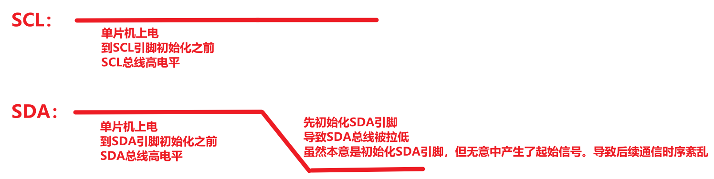

*图9-1软I2C初始化引脚的细节问题-图1*

所以为了避免出现这种情况，可以选择先初始化SCL引脚。

除此之外，还可以选择下列做法：

方式一：在初始化引脚完成后，调用时序控制函数，主动生成一个停止信号，抵消因引脚初始化产生的起始信号。

方式二，不改变初始化顺序，但改变拉高总线电平的操作顺序。将初始化函数修改成下列：

```c
void sI2C_Init(void) {
    // 1.开启SCL和SDA引脚对应的GPIO外设时钟
    RCC_APB2PeriphClockCmd(SI2C_SCL_CLOCK | SI2C_SDA_CLOCK,ENABLE);

    // 2.初始化SCL和SDA引脚,都设置为通用开漏输出模式
    // 先初始化SDA引脚
    GPIO_InitTypeDef GPIO_InitStruct;
    GPIO_InitStruct.GPIO_Mode = GPIO_Mode_Out_OD;
    GPIO_InitStruct.GPIO_Pin = SI2C_SDA_PIN;
    // 软I2C模拟实现通信,对标通信中的标准模式,SCL时钟线的频率是100kHz
    // 所以软I2C实现时,选择最低的引脚输出速度就够了
    GPIO_InitStruct.GPIO_Speed = GPIO_Speed_2MHz;
    GPIO_Init(SI2C_SDA_PORT, &GPIO_InitStruct);

    // 再初始化SCL引脚
    GPIO_InitStruct.GPIO_Pin = SI2C_SCL_PIN;
    GPIO_Init(SI2C_SCL_PORT, &GPIO_InitStruct);

    // 3.初始化完成后,通信处于空闲状态,于是两个引脚都需要设置为1(高阻态)
    // 拉高两条总线,表示通信处于空闲状态,通信还没有开始

    // ！！！修改点：先拉高SCL总线,在拉高SDA总线
    sI2C_SCL_Write(1);
    sI2C_SDA_Write(1);
}
```

只是修改了总线拉高电平的顺序，为什么就能够通信成功呢？

如下图所示：


*图9-2软I2C初始化引脚的细节问题-图2*

原来，先拉高SCL总线，再拉高SDA总线，无意之间，产生了一个停止位信号，和前面的起始信号抵消了。

你搞懂了吗？

---

## 05 硬I2C以及总结

### 1. 硬件I2C驱动OLED实验

**所谓硬件I2C，指的就是利用单片机内部自带的I2C硬件来完成I2C通信的过程，关于I2C通信的过程，我们已经学过了。**

所以基本上所有原理性的东西我们都已经了解了，使用硬件I2C无非就是调用外设标准库函数，基于单片机的I2C外设来实现I2C通信的过程。


*图1-1STM32F103C8T6-系统结构图*

由于我们也已经使用过软件I2C了，所以对我们而言，硬件I2C的使用难度并不会很大，最多就是调用标准外设库函数的过程会比较繁琐。

我们仍然以一个实验案例来讲解学习硬件I2C，并且在这里我们将I2C和串口两种通信结合起来。

于是实验的电路接线图，就如下图所示：

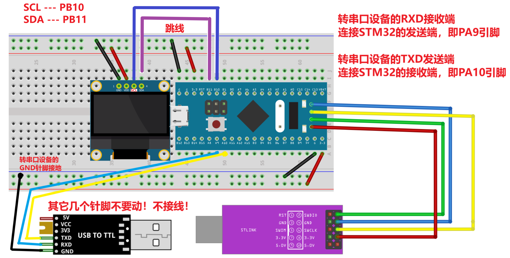

*图1-2串口通信接线-图*

学习I2C，顺带再复习一下串口通信。**当然单片机USART外设接收数据的方式也要使用中断，而不是一般的轮询方式。**

#### 1.1 单片机I2C外设的系统框图

使用引脚I2C通信，就需要使用单片机的I2C硬件外设。

其系统框图如下图所示：

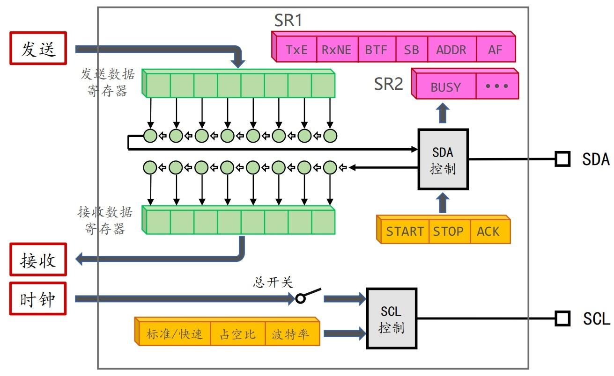

*图1.1-1单片机I2C外设的系统框图*

这个框图将在后续的内容讲解中起到重要作用。

#### 1.2 实验目的

**实验目的：**

在PC端，使用串口调试工具向STM32单片机发送指令：

1. 发送指令'0'，表示关闭OLED屏幕，同时单片机向PC端回复消息："OLED-TurnOff:

Success"

2. 发送指令'1'，表示开启OLED屏幕并点亮所有像素，同时单片机向PC端回复消息："OLED-TurnOn: Success"
3. 发送指令'2'，表示询问OLED屏幕当前点亮状态，并回复PC端。比如："OLED-Status: OFF"或者"OLED-Status: ON"

所以本质上和软件I2C实现的功能是差不多的，只不过把串口通信模块加进来了。

**当然这里我们继续使用模块化编程的思想，我们先来实现简单的模块。**

### 2. USART模块实现

串口通信我们已经学过了，像上述实验目的中的串口通信功能对我们而言，已经可以说是手拿把掐了。

**在工程的"Tools"目录下新建两个文件："USART1.c"和"USART1.h"，然后把它们加入Keil5软件的Tools Group组当中。**

串口通信模块，我们只需要实现下列两个功能就可以了:

1. 配置USART1外设。包括: 初始化引脚，初始化USART1外设，开启RXNE标志位中断以及初始化NVIC。
2. 单片机向PC端发送字符串。

注：单片机接收PC端发送的控制指令，没有必要单独作为一个函数去定义，可以直接在中断服务程序当中接收数据。

**"USART.h"文件的参考代码如下:**

```c
#ifndef __USART_H
#define __USART_H

#include "stm32f10x.h"

// 配置USART1外设,包括: 初始化引脚,初始化USART1外设,开启RXNE标志位中断等
void USART1_Config(void);

// 单片机向PC端发送字符串消息
void USART1_SendString(const char *Message);

#endif // !__USART_H

```

**"USART.c"文件的参考代码如下:**

```c
#include "USART.h"

/**
  * @brief 配置USART1外设,包括:
  * 包括: 初始化引脚,初始化USART1外设,开启RXNE标志位中断以及初始化NVIC外设。
  * @param 无
  * @retval 无
  */
void USART1_Config(void) {
    // 1.开启 GPIOA和USART1 外设时钟
    RCC_APB2PeriphClockCmd(RCC_APB2Periph_GPIOA |RCC_APB2Periph_USART1,ENABLE);

    // 2.配置 PA9 引脚的工作模式是复用推挽输出模式
    GPIO_InitTypeDef GPIO_InitStructure;
    GPIO_InitStructure.GPIO_Pin = GPIO_Pin_9;
    GPIO_InitStructure.GPIO_Mode = GPIO_Mode_AF_PP; // 复用推挽输出
    GPIO_InitStructure.GPIO_Speed = GPIO_Speed_2MHz;
    GPIO_Init(GPIOA, &GPIO_InitStructure);

    // 3.配置 PA10 引脚的工作模式是浮空输入模式
    GPIO_InitStructure.GPIO_Pin = GPIO_Pin_10;
    GPIO_InitStructure.GPIO_Mode = GPIO_Mode_IN_FLOATING; // 浮空输入模式
    GPIO_Init(GPIOA, &GPIO_InitStructure);

    // 4.初始化USART1外设, 设置USART1外设的各项参数
    USART_InitTypeDef USART_InitStruct;
    USART_InitStruct.USART_BaudRate = 115200; // 波特率设置为115200
    USART_InitStruct.USART_HardwareFlowControl =USART_HardwareFlowControl_None;//不使用硬件流控
    USART_InitStruct.USART_Mode = USART_Mode_Rx | USART_Mode_Tx;//可发可接模式
    USART_InitStruct.USART_Parity = USART_Parity_No; // 不使用校验位
    USART_InitStruct.USART_StopBits = USART_StopBits_1; // 停止位1位
    USART_InitStruct.USART_WordLength = USART_WordLength_8b; //数据位1个字节
    USART_Init(USART1, &USART_InitStruct);

    // 5.开启USART1外设
    USART_Cmd(USART1, ENABLE);

    // 6.开启USART1外设RXNE标志位中断
    USART_ITConfig(USART1, USART_IT_RXNE, ENABLE);

    // 7.初始化NVIC外设
    NVIC_PriorityGroupConfig(NVIC_PriorityGroup_2); // 设置优先级分组
    NVIC_InitTypeDef NVIC_InitStruct;
    NVIC_InitStruct.NVIC_IRQChannel = USART1_IRQn; // 中断号即USART1外设全局中断
    NVIC_InitStruct.NVIC_IRQChannelPreemptionPriority = 0; // 抢占优先级0
    NVIC_InitStruct.NVIC_IRQChannelSubPriority = 0; // 子优先级 0
    NVIC_InitStruct.NVIC_IRQChannelCmd = ENABLE; // 开启中断
    NVIC_Init(&NVIC_InitStruct);
}

/**
 * @brief 通过USART发送字符串
 * @param str 待发送的字符串
 * @retval None
 */
void USART1_SendString(const char *Message) {
    while (*Message) {
        // 等待发送数据寄存器为空,才可以继续发送下一个字符
        while (USART_GetFlagStatus(USART1, USART_FLAG_TXE) ==RESET);
        USART_SendData(USART1, *Message++);
    }
}

```

上面这部分实现都非常简单，不再赘述。

中断处理相关的中断服务程序，放到下面实现了OLED屏幕的操作后再去实现，直接放在main.c文件中。

### 3. 实现分析：hOLED模块

**在工程的"Tools"目录下新建两个文件："hOLED.c"和"hOLED.h"，然后把它们加入Keil5软件的Tools group组当中。**

首先硬件IC2在实现时，直接使用了STM32的I2C外设，采用的编程手段是标准外设库函数实现。

所以我们没有必要再去弄一个"hI2C"模块，可以直接在hOLED模块中调用标准库函数，实现我们需要的功能。

**hOLED模块需要的功能一共有四个，"hOLED.h"的参考代码如下：**

```c
#ifndef __HOLED_H
#define __HOLED_H

#include "stm32f10x.h"

// OLED模块基本功能

// 初始化OLED引脚以及I2C外设
void hOLED_Init(void);

// 开启屏幕，点亮全部像素并返回执行结果。0表示成功，其他值表示失败
int8_t hOLED_On(void);

// 彻底关闭OLED并返回执行结果。0表示成功，其他值表示失败
int8_t hOLED_Off(void);

// 读取OLED开关状态利用指针传参获取这个状态，函数返回值返回查询的结果。0表示查询成功，其他值表示失败
int8_t hOLED_ReadStatus(uint8_t *OLED_StatusPtr);

#endif // !__HOLED_H

```

注意下方三个涉及到和OLED屏幕通信的函数，都是具有返回值的。

这是因为我们通过标准库来实现I2C通信时，可以通过I2C外设内置的各种标志位进行错误校验和处理，所以这几个函数我们给定了int8_t 类型的返回值。

下面看一下具体的每一个函数的实现。

#### 3.1 引脚和I2C外设初始化

在上述实验中，STM32单片机中我们使用的I2C引脚是：

1. SCL --- PB10
2. SDA --- PB11

在一般情况下，PB10和PB11两个引脚都只是一般的、普通IO引脚。那么这两个引脚可以作为实现硬件I2C通信的引脚吗？

我们可以通过查表来获取这两个引脚的复用和重定义功能，以确定如何初始化这两个引脚。

具体的引脚定义表可以参考之前的文档：引脚定义表通过查表，我们可以得出下列信息，STM32F103C8T6共有下列**三对**可用为I2C通信的引脚：

假如使用引脚的复用功能的话：

**第一对:**

1. PB6的复用功能是: I2C1_SCL，即I2C1外设的SCL引脚。
2. PB7的复用功能是: I2C1_SDA，即I2C1外设的SDA引脚。

**第二对：**

1. PB10的复用功能是： I2C2_SCL，即**I2C2**外设的SCL引脚。
2. PB11的复用功能是: I2C2_SDA，即**I2C2**外设的SDA引脚。

**根据我们选择的接线方式，我们使用的I2C硬件外设是I2C2，PB10作为SCL引脚，PB11作为SDA引脚。**

**当然，这两个引脚都需要设置为复用开漏输出模式。**

**第三对：**

1. PB8的重定义功能是: I2C1_SCL，即I2C1外设的SCL引脚。
2. PB9的重定义功能是: I2C1_SDA，即I2C1外设的SDA引脚。

总之，有三对实现硬件I2C的引脚可以选择，但我们选择其中的第二对。

**hOLED_Init函数的参考实现代码如下：**

```c
/**
 * @brief 初始化OLED接入单片机的SCL引脚(PB10)和SDA引脚(PB11)
 * 初始化I2C2外设
 * @param 无
 * @retval 无
 */
void hOLED_Init(void) {
    // 1.初始化PB10 和 PB11 为复用开漏输出
    RCC_APB2PeriphClockCmd(RCC_APB2Periph_GPIOB, ENABLE); // 开启GPIOB时钟
    GPIO_InitTypeDef GPIO_InitStruct;
    GPIO_InitStruct.GPIO_Pin = GPIO_Pin_10 | GPIO_Pin_11;
    GPIO_InitStruct.GPIO_Mode = GPIO_Mode_AF_OD; // 复用开漏输出模式
    GPIO_InitStruct.GPIO_Speed = GPIO_Speed_2MHz; // 2MHz引脚输出速度足够
    GPIO_Init(GPIOB, &GPIO_InitStruct);

    // 2.复位I2C2外设
    // 初始化I2C2外设之前,先复位此外设,以清除上一次I2C通信导致的错误
    RCC_APB1PeriphResetCmd(RCC_APB1Periph_I2C2, ENABLE); //施加复位信号,类似按下单片机复位按键
    RCC_APB1PeriphResetCmd(RCC_APB1Periph_I2C2, DISABLE); //释放复位信号,类似释放单片机复位按键

    // 3.初始化I2C2外设模块
    // 开启I2C2外设时钟,注意此外设挂载在APB1外设总线上
    RCC_APB1PeriphClockCmd(RCC_APB1Periph_I2C2, ENABLE);
    // 初始化 I2C2 模块
    I2C_InitTypeDef I2C_InitStruct;
    I2C_InitStruct.I2C_Ack = I2C_Ack_Enable; // 开启主机ACK,主机应答从机发送数据
    I2C_InitStruct.I2C_ClockSpeed = 400000; // 设置 I2C 时钟线频率为400kHz,也就是快速模式
    I2C_InitStruct.I2C_Mode = I2C_Mode_I2C; // 设置为 标准I2C 模式
    I2C_InitStruct.I2C_DutyCycle = I2C_DutyCycle_2; // 设置占空比为2,即低电平:高电平=2
    I2C_Init(I2C2, &I2C_InitStruct);

    // 4.开启I2C2外设
    I2C_Cmd(I2C2, ENABLE);
}
```

这里有三处我们之前没有学过的内容，这里简单说一下。

#### 3.2 I2C外设复位操作

**I2C外设的复位：**

代码中出现的下面两行代码：

```c
RCC_APB1PeriphResetCmd(RCC_APB1Periph_I2C2, ENABLE); // 施加复位信号
RCC_APB1PeriphResetCmd(RCC_APB1Periph_I2C2, DISABLE); // 释放复位信号
```

它们的作用就是复位I2C外设，类似最小系统板上的复位按钮，它的主要作用是：

1. **清除 I2C2 可能存在的错误状态**（如 BUSY、ARBLOST 等）。
2. **确保 I2C2 处于一个已知的初始状态**，避免软件初始化后仍然异常。
3. **重新初始化 I2C2 的内部寄存器**，避免上一次的残留配置影响新初始化。

如果I2C外设之前被启动过，而且存在一些错误没有被清除，直接调用**I2C_Init函数初始化**它有可能无法重新工作。

所以利用**硬件复位操作**，让I2C外设彻底清空并重新开始工作是初始化I2C外设的常见做法.

**但是一定要注意，该操作会清空重置I2C外设的一切配置，所以应该在I2C_Init函数初始化之前调用。**

由于I2C外设的特殊性，所以在初始化I2C外设之前初始化它，是一个推荐的做法！

注（了解）：

为什么I2C具有独特的复位机制，而其它的通信外设（USART、SPI等）往往不需要呢？

简单来说：

1. I2C外设设计更复杂，实现的功能也更多。比如I2C外设实际支持多主多从模式，这使得I2C外设在通信时更容易出错导致外设卡死，从而就需要复位后再使用。
2. I2C通信过程中，严格依赖双方的"互动"流程。比如单片机给从机设备发送数据，从机断开连接无响应，此时单片机的I2C外设就会卡死，这时如果不复位I2C外设就直接初始化使用是不行的。

再通俗点说："单片机的I2C外设，是一个精密复杂的仪器，一旦某个流程没有完成它就会卡死在原地，需要重启（复位）它才会重新开始工作"。

#### 3.3 I2C_Init函数和I2C_Cmd函数

**I2C_Init函数和I2C_Cmd函数：**

这一对函数同时都要调用，用于初始化I2C外设。类似的操作，我们之前也见过，和初始化USART外设是一样的。

通俗点说这两个函数的作用是：

1. I2C_Init函数用于配置I2C外设。
2. I2C_Cmd函数相当于一个控制此外设的总开关，用于开启和关闭此I2C外设。

下面来简单介绍一下这两个函数：

**I2C_Cmd函数：**

其函数声明如下：

```c
void I2C_Cmd(I2C_TypeDef* I2Cx, FunctionalState NewState);
```

其传参的选择十分简单，如下所示：

| 参数 | 类型 | 说明 |
|---|---|---|
| I2Cx | I2C_TypeDef* | 指定要控制的 I2C 外设，取值范围： I2C1或 I2C2 （STM32F103） |
| NewState | FunctionalState | 开启或禁用 I2C 外设，取值： ENABLE （开启） 或 DISABLE （禁用）。 |

**I2C_Init函数：**

I2C_Init是 STM32 标准外设库提供的一个函数，用于初始化和配置 I2C 外设，包括时钟速度、地址模式、应答模式等。

其函数声明如下：

```c
void I2C_Init(I2C_TypeDef* I2Cx, I2C_InitTypeDef* I2C_InitStruct);
```

其第一个参数很简单，传参想要初始化的I2C外设，对于STM32F103系列来说就只有两个I2C外设，即I2C1或I2C2其核心参数是第二个参数，和以往学习的所有Init函数一样，需要传入一个I2C_InitTypeDef 类型的结构图对象指针。

这个结构体的类型定义如下：

```c
typedef struct{
    uint32_t I2C_ClockSpeed; // 设置 I2C 时钟频率（单位：Hz）
    uint16_t I2C_Mode; // 设置 I2C 工作模式
    uint16_t I2C_DutyCycle; // 配置 I2C 时钟的占空比
    uint16_t I2C_OwnAddress1; // 配置设备自身的 I2C 地址
    uint16_t I2C_Ack; // 启用或禁用 I2C 硬件的应答（ACK）
    uint16_t I2C_AcknowledgedAddress; // 配置 I2C 的应答地址模式
} I2C_InitTypeDef;
```

逐一来解释一下这些成员：

**I2C_ClockSpeed成员：**

该成员需要传参一个32位无符号整数，用于设置 I2C 的时钟频率。

I2C的时钟频率是衡量I2C通信数据传输速率的核心要素，在上面软I2C的实现中我们已经讲了这个概念。

I2C协议当中的规定了典型的三种时钟线频率，如下表所示：

| 模式 | 最大 SCL 频率 | SCL 一个时钟周期 | 理论最大传输速率(单位:千字节每秒) |
|---|---|---|---|
| 标准模式 (SM) | 100 kHz (100,000 Hz) | 10 μs | 11.1KB/s |
| 快速模式 (FM) | 400 kHz (400,000 Hz) | 2.5 μs | 44.4KB/s |
| 高速模式 (HS) | 1 MHz (1,000,000 Hz) | 1 μs | 111.1KB/s |

**我们使用的STM32F10x系列芯片最大只支持快速模式，也就是只能选择标准模式和快速模式，高速模式乃至于更高速度的模式只有更高性能、更贵的芯片才支持（比如F4系列）。**

在实际传参时，我们可以直接手动传参400000 这个整数，来表示选择使用I2C通信的快速模式，即SCL线时钟频率是400kHz。

**既然选择使用硬件I2C，就要发挥其通信速率高的优势，而且快速模式大多数从机设备也都是支持的，通常都不会担心兼容性问题。**

**I2C_Mode成员:**

用于设置I2C外设的工作模式。

标准库中给定了三个可以选择的取值：

```c
#define I2C_Mode_I2C ((uint16_t)0x0000)
#define I2C_Mode_SMBusDevice ((uint16_t)0x0002)
#define I2C_Mode_SMBusHost ((uint16_t)0x000A)
```

I2C_Mode_I2C ：最常用的 I2C 模式，也是标准的 I2C 模式，通常用于正常的 I2C 数据传输。

I2C_Mode_SMBusDevice ：SMBus 从机模式。

I2C_Mode_SMBusHost ：SMBus 主机模式。

SMBus（系统管理总线）是一种在 I2C 基础上进行扩展的协议，当前我们就选择使用标准I2C通信模式即可。

**所以此成员只需要直接设置成I2C_Mode_I2C即可。**

**I2C_DutyCycle成员:**

I2C_DutyCycle成员是用于设置 I2C 通信中SCL时钟周期的**占空比**的一个配置项。

**所谓占空比，是描述1个时钟周期内高电平与低电平时间比例的参数。**也就是说占空比影响 SCL 时钟信号线上的高电平和低电平的持续时间比。

占空比有啥用呢？

**在一个时钟周期内低电平的比例越大，高电平比例就越小：**

1. 此时发送端准备数据的时间就会更长，通信抗干扰的能力会更强一些。
2. 但由于高电平的时间占比更小了，工作时间变短，接收端采集数据的响应速度就会变短。这就要求接收端需要更快响应数据接收。

**在一个时钟周期内高电平的比例越大，低电平比例就越小：**

1. 此时接收端采集数据的响应时间就变长了，对接收端设备的要求就会降低。
2. 但发送端发送数据的准备时间更短，通信就更容易受到干扰。

注意：占空比和通信速率没什么关系，只要SCL信号线频率固定，时钟周期就是固定的数量，高低电平的比例不影响通信速率。

SPL标准库为程序员配置I2C时，提供了两个占空比选项：

1. I2C_DutyCycle_16_9表示"低电平:高电平"的比值为 16:9：
   - a. 高电平占比大概36%
   - b. 低电平占比大概64%
2. I2C_DutyCycle_2表示"低电平:高电平"的比值为 2:1：
   - a. 高电平占比大概33%
   - b. 低电平占比大概67%

所以这两个占空比其实差距不大，相对而言，I2C_DutyCycle_2 的低电平占比更高，通信的抗干扰能够更好，支持这种占空比的从机设备也更多，是硬件I2C通信更常见的选择。

**当你选择使用I2C通信的快速模式时，占空比属于必须要配置的一个成员属性，不能省略！！！**

**I2C_OwnAddress1成员：**

I2C通信是主从模式的，一般情况下单片机都被视为主机，但I2C也支持将单片机作为从机使用。

若选择单片机作为从机的模式，为了让外部主机寻址到该从机单片机，就需要提供此单片机的地址。

这个参数就用于表示这个地址。

**但我们不会选择将单片机作为从机使用，所以该成员可以忽略，不进行配置。**

**I2C_Ack成员：**

I2C_Ack 用于配置单片机作为接收端时（也就是单片机读从机数据时），是否向发送端回复ACK。

它的传参选项有两个：

1. I2C_Ack_Enable ：启用应答，单片机收到数据后会发送 ACK，表示数据成功接收。
2. I2C_Ack_Disable ：禁用应答，单片机收到数据后会直接发送 NACK。

如果你希望开启主机应答就配置开始，当然也可以选择禁用主机应答。

主机应答通常是开启的，所以我们可以直接给该成员配置为I2C_Ack_Enable 取值。

**I2C_AcknowledgedAddress成员：**

配置单片机在作为从机时，其从机设备地址的长度是7位还是10位。

**但我们不会选择将单片机作为从机使用，所以该成员可以忽略，不进行配置。**

### 4. 核心实现：主机发送多个控制指令

在单片机与OLED屏幕进行I2C通信的过程中，单片机需要向OLED从机发送多个控制指令，从而实现控制OLED的功能。

这里需要实现的核心函数就是：

```c
static int8_t hOLED_I2CWriteCmds(const uint8_t *Cmds, uint8_t Length);
```

该函数我们在软I2C中也实现过类似的，现在我们改用STM32标准外设库来实现这个函数。

#### 4.1 I2C外设状态标志位

使用硬件I2C实现通信的过程中，不得不提的一个概念就是——I2C外设状态标志位。

**利用单片机的USART外设实现串口通信时，我们是通过USART外设标志位来完成通信过程的，那么I2C外设也不例外。**

STM32的I2C外设中，存在两个用于存储表示当前I2C通信状态、硬件状态的寄存器：

1. **SR1，即Status Register1**
2. **SR2，即Status Register2**

通过这些状态标志位，用户可以了解 I2C 通信的进展，检查错误状态，或者确保数据传输的每个步骤正确执行。

**以下是 STM32 的 I2C 外设常用状态标志位的表格描述：**

| 标志位宏定义 | 英文词组含义 | 标志位含义 | 标志位置为 1时的条件 | 用途 |
|---|---|---|---|---|
| I2C_FLAG_BUSY | BUSY flag | 总线忙碌标志 | 当 I2C 总线正在传输数据时，标志位置为 1 | 用于判断总线是否空闲，确保在总线空闲时开始通信 |
| I2C_FLAG_SB | START Bit flag | 起始位发送完成标志 | 起始位（START）发送完成时，标志位置为 1 | 用于判断起始信号是否成功发送，确保后续步骤可进行 |
| I2C_FLAG_ADDR | Address flag | 从机地址匹配成功标志 | 主机地址与从机地址匹配时，标志位置为 1 | 确保主从机地址匹配完成，可以进入数据传输阶段 |
| I2C_FLAG_AF | Acknowledge Failure flag | 主机收到从机NACK标志 | 从机发送 NACK时，标志位置为1 | 用于检测 ACK错误，通常表示接收失败或通信中断 |
| I2C_FLAG_TXE | Transmit Empty flag | 发送数据寄存器空标志 | 发送寄存器为空时，标志位置为 1 | 用于判断是否可以向数据寄存器写入新的数据(不能用于发地址) |
| I2C_FLAG_RXNE | Receive Not Empty flag | 接收数据寄存器非空标志 | 接收寄存器中有数据时，标志位置为 1 | 用于判断接收寄存器是否有数据，确保可以读取数据 |
| I2C_FLAG_BTF | Byte Transfer Finished flag | 字节传输完成标志 | 当前字节传输完成，标志位置为1 | 用于判断发送和移位寄存器都为空，确保数据传输已成功结束 |
| I2C_FLAG_STOPF | STOP flag | 停止位发送完成标志 | 停止位已发送完成时，标志位置为 1 | 用于判断通信是否完全结束，确认 I2C 总线空闲 |

那么如何来获取和清零这些状态标志位呢？

这就需要使用两个标准库函数了，即**I2C_GetFlagStatus函数**和**I2C_ClearFlag函数**。

**I2C_GetFlagStatus函数:**用于获取某个I2C外设的某个状态标志位的取值。

其函数声明如下：

```c
FlagStatus I2C_GetFlagStatus(I2C_TypeDef* I2Cx, uint32_t I2C_FLAG);
```

**函数的两个形参：**

1. I2Cx : 指示要获取标志位的IC2外设名，可以传参I2C1 或者I2C2
2. I2C_FLAG : 要检查的状态标志位。状态标志位可以是各种 I2C 状态寄存器中的标志。例如：I2C_FLAG_SB 、I2C_FLAG_ADDR 、I2C_FLAG_RXNE等，具体的内容可以参考上面表格的第一列。

**函数的返回值：**

1. 函数返回SET 也就是1，表示标志位已被设置，状态标志位的条件已经满足。
2. 函数返回RESET 也就是0，表示标志位已被清零，状态标志位的条件未满足。

**I2C_ClearFlag函数：**用于清零某个I2C外设的某个状态标志位。

其函数声明如下：

```c
void I2C_ClearFlag(I2C_TypeDef* I2Cx, uint32_t I2C_FLAG);
```

这个函数没有返回值，形参的使用和上面的函数完全一致，不再赘述。

**了解了I2C外设的状态标志位概念后，下面我们就按照软I2C的实现思路，来一一找到我们需要的库函数：**

1. 主机发送起始位信号
2. 主机发送寻址字节
3. 主机读取从机发送的ACK确认
4. 主机向从机发送多个字节的控制字节和其它控制指令。
5. 主机读取从机发送的ACK确认
6. .....
7. 主机发送停止位信号

#### 4.2 起始位发送函数

若想实现主机发送起始位信号，需要调用：**I2C_GenerateSTART函数**。

这个函数非常简单，就表示主机发送起始位信号，其函数形参如下：

```c
void I2C_GenerateSTART(I2C_TypeDef* I2Cx, FunctionalState NewState);
```

第一个参数指示生成起始信号的I2C外设，可以传参I2C1 或者I2C2第二个参数我们也很熟悉，它可以传参以下枚举类型：

```c
typedef enum {DISABLE = 0, ENABLE = !DISABLE} FunctionalState;
```

传参ENABLE 即表示主机发送了一个起始位信号。

调用完这个函数后，不要着急继续发送寻址字节，标志位中的I2C_FLAG_SB 用于指示发送起始信号完成。

**该函数的调用表示通信开始，建议采用以下方式来调用这个函数：**

调用该函数之前，先检查总线是否忙碌，若总线处于忙碌状态，即总线正在传输数据，则无法开始新的通信数据传输。

所以需要等待总线空闲：

```c
while (I2C_GetFlagStatus(I2C2, I2C_FLAG_BUSY) == SET); // 等待I2C2外设总线空闲，也就是等待BUSY标志位复位
```

除此之外，在调用此函数发送起始信号后，还需要调用：

```c
while (I2C_GetFlagStatus(I2C2, I2C_FLAG_SB) == RESET); // 等待I2C2外设作为主机,发送完毕起始位
```

用于等待SB标志位置位，即表示主机发送起始信号结束。

**上面两个状态标志位处理加在一起，所以在硬件I2C实现主机发送起始位的推荐方式是：**

```c
// 等待 I2C2 外设总线空闲
while (I2C_GetFlagStatus(I2C2, I2C_FLAG_BUSY) == SET);

// 主机发送起始位信号
I2C_GenerateSTART(I2C2, ENABLE);

// 等待确认起始位发送完成
while (I2C_GetFlagStatus(I2C2, I2C_FLAG_SB) == RESET);
```

**不要忘记使用I2C外设寄存器的状态标志位！依靠状态标志位指示通信状态，完成通信流程，是硬件I2C和软I2C非常显著的区别。**

#### 4.3 BUSY状态标志位的置位复位机制

I2C_FLAG_BUSY （BUSY 总线忙标志位）**全程由硬件自动置位与自动清除**，**不需要也不允许软件手动干预**。

参考手册中是这样描述的：

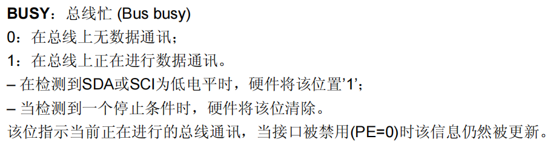

*图4.3-1BUSY状态标志位的机制-图*

举一些例子：

1. 主机发送起始位成功（START 成功），BUSY状态标志位就会自动置位，表示总线处于忙碌通信状态...
2. 通信结束，主机发送停止位，两条总线都回归高电平，总线进入空闲状态，BUSY标志位自动复位。

**所以我们完全不需要操作BUSY标志位的置位和复位问题，可以放心的使用这个标志位。**

除了BUSY状态标志位，我们还使用了SB状态标志位，那么它的置位与复位是如何处理的呢？

这一点，我们放到下面的小节来进行讲解。

#### 4.4 停止位发送函数

起始位和停止位发送函数的名字非常类似，所以我们直接一起看。

**只需要把I2C_GenerateSTART函数名，改成I2C_GenerateSTOP即可表示主机发送停止位。**

其函数声明如下：

```c
void I2C_GenerateSTOP(I2C_TypeDef* I2Cx, FunctionalState NewState);
```

停止位发送函数在发送时，通常不需要对标志位进行处理判断，可以直接调用表示结束通信。具体代码这里就不再赘述了。

#### 4.5 I2C_Send7bitAddress函数

主机发送起始位完成后，接下来就轮到主机发送寻址字节了。

在实现软件I2C时，我们没有专门编写函数实现主机发送寻址字节，而是直接将寻址字节、普通数据字节的发送共用了一个函数。

但是硬件I2C的SPL标准外设库，却将这两个发送操作分开了：

1. I2C_Send7bitAddress函数，专门用于表示主机发送寻址字节。
2. I2C_SendData函数，专门用于表示主机发送普通数据字节。

**注意这两个函数不要混用，既然使用SPL标准外设库，操作单片机的I2C外设实现I2C通信，就需要严格遵守SPL库设计好的通信流程，这是由底层硬件的控制逻辑决定的，不像软件 I2C 可以自由处理。**

那么该如何使用I2C_Send7bitAddress函数，完成主机寻址字节的发送呢？

此函数声明如下：

```c
void I2C_Send7bitAddress(I2C_TypeDef* I2Cx, uint8_t Address, uint8_t Direction);
```

一共有三个参数：

**第一个参数I2Cx：**

这个参数非常简单，用于指定哪个 I2C 外设发送寻址字节，传参取值比如I2C1或I2C2 。

**第二个参数Address：**

第二个参数是该函数在调用传参时最需要注意的。

应该来说，这是ST公司设计I2C外设的SPL标准库时，非常坑爹的一个参数设计！！！

SPL库源码中的注释如下：

Address: specifies the slave address which will be transmitted翻译成中文，意为：

Address: 指定了将要传输的从机地址。

这个注释简直就是一句彻头彻尾的废话，因为它根本就没有说清楚。现在Address的传参可以有以下可能：

1. 像软I2C一样，传入一个带有7位从机地址，加上一位读写标志位的寻址字节。
2. 直接传参7位从机地址，但是最高位补一个0
3. 直接传参7位从机地址，但是最低位补一个0
4. ...

那么到底该如何传参呢？

这就需要结合这个函数的源码来分析了，分析过程如下图所示：

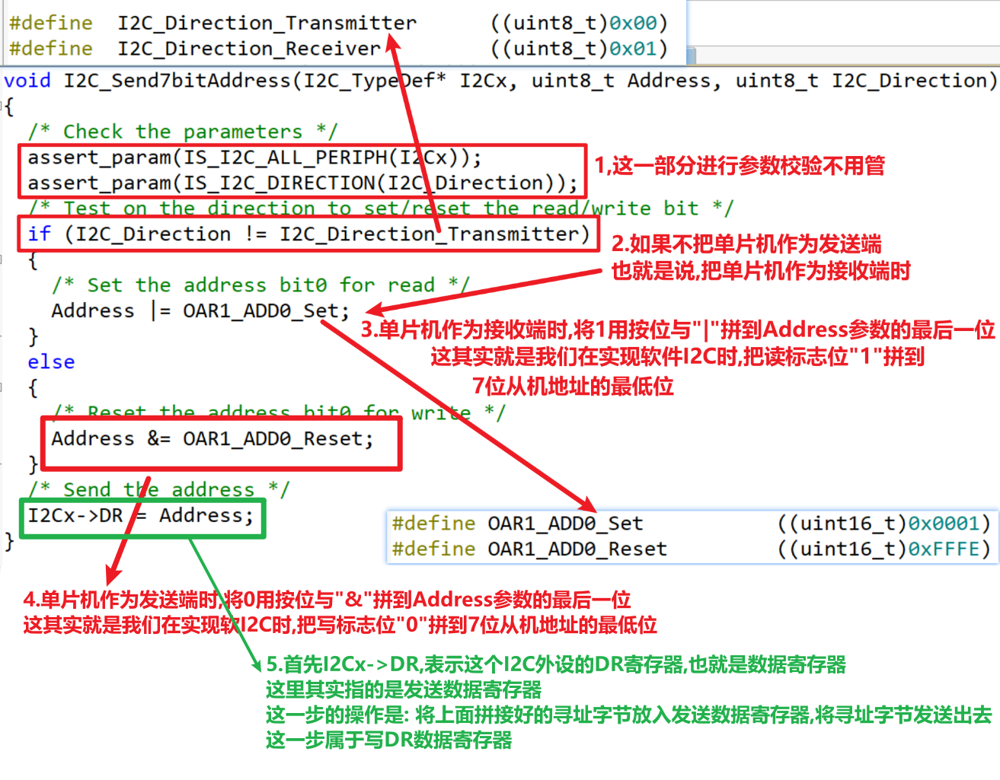

*图4.5-1发送寻址字节函数-源码分析图*

经过这样一段分析，你知道Address参数应该如何传参了嘛？

很简单：

**只需要用7位从机地址，然后在末尾低位随便加一个0或者1都可以！！！**

**注意仍然要传参1个字节寻址字节，只不过最低位的0或1随便填！！！**

举个例子：

OLED从机设备的7位从机地址是：

011 1100在实际传参Address时，可以传参：

0111 1000：0x780111 1001：0x79为什么呢？

**因为I2C_Send7bitAddress函数在实现时，最终发送的寻址字节的最低位是由参数Direction来确定的，不管之前是0还是1，最终都能根据Direction参数的传入获得一个正确读写标志位。**

**所以程序员只需要保证高7位的从机地址传参正确即可，至于最低位实际上是无所谓的。**

**第三个参数Direction：**

参数名的含义是方向，实际上这个参数就表示寻址字节当中的读写标志位，该参数的取值通过查看注释可以得知有两个：

1. I2C_Direction_Transmitter：表示单片机主机作为发送端，发送数据给从机，也就是读写当中的写。
2. I2C_Direction_Receiver：表示单片机主机作为接收端，从机发送数据给主机，也就是读写当中的读。

这个参数的传参还是非常简单。

现在如果你想向从机OLED屏幕发送数据，你只需要这样调用函数，发送寻址字节：

```c
I2C_Send7bitAddress(I2C2, 0x78, I2C_Direction_Transmitter); // 这里也可以传参Ox79
```

现在如果你想读从机OLED屏幕发送的状态字节，你只需要这样调用函数，发送寻址字节：

```c
I2C_Send7bitAddress(I2C2, 0x79, I2C_Direction_Receiver); // 这里也可以传参Ox78
```

注意，寻址字节一定要在发送起始位完成，并且成功后，才可以调用此函数发送。

以上。

#### 4.6 SB状态标志位的置位复位机制

现在已经完成了寻址字节的发送，我们先不考虑后续的处理（比如从机应答处理），我们先来考虑一下：SB状态标志位的置位复位机制。

SB标志位，用于指示主机发送起始位完成，它的置位和复位机制，参考手册中是这么描述的：

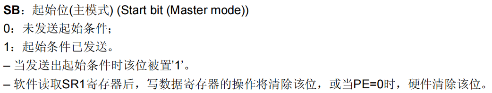

*图4.6-1SB状态标志位的机制-图*

所以当主机发送完成起始位后，硬件会自动置位SB ，表明主机发送起始位完成、通信已经开始了，接下来主机可以发送寻址字节了。

所以SB标志位的置位由硬件自动置位，那么它什么时候复位呢？

**它复位依赖于软件自动复位：**

**软件读取SR1寄存器后，写数据寄存器的操作将清除该位。**

这样的操作如何实现呢？

我们实现的代码中是这么写的：

```c
// 等待 I2C2 外设总线空闲
while (I2C_GetFlagStatus(I2C2, I2C_FLAG_BUSY) == SET);

// 主机发送起始位信号
I2C_GenerateSTART(I2C2, ENABLE);

// 等待确认起始位发送完成
while (I2C_GetFlagStatus(I2C2, I2C_FLAG_SB) == RESET);

// 主机发送寻址字节
I2C_Send7bitAddress(I2C2, 0x78, I2C_Direction_Transmitter);

// 代码执行到这里，依赖于软件自动复位，SB标志位复位
```

其中：

1. while(I2C_GetFlagStatus(I2C2,I2C_FLAG_SB)==RESET); 用于获取SB状态标志位的状态，而SB标志位就存储在SR1寄存器当中，这样就完成了读SR1寄存器。
2. I2C_Send7bitAddress(I2C2,0x79,I2C_Direction_Transmitter); 用于主机发送寻址字节给从机，这个过程中显然写了（发送）数据寄存器。

于是这样在"无形中"，就完成了SB状态标志位的软件自动复位。

**代码写到这里，我们使用的两个状态标志位：SB和BUSY，置位和复位都可以算得上自动管理，程序员不需要额外考虑手动复位问题。**

#### 4.7 主机发送寻址字节后的处理

主机发送寻址字节后，从机如果收到会应答ACK，主机则需要读这个从机ACK，从而确定寻址是否成功。

这个操作在我们自己实现的软件I2C当中，非常简单，但硬件I2C关于主机发送寻址字节后的处理就麻烦多了。

首先，主机发送寻址字节后的处理，仍然依赖标志位完成，这里就需要用到两个标志位了：

1. ADDR标志位，宏定义为I2C_FLAG_ADDR ，复位时表示寻址字节尚未发送完成，置位时表示寻址成功，即主机收到从机应答。
2. AF标志位，宏定义为I2C_FLAG_AF ，复位状态表示应答没有失败，置位时表示未收到从机应答，应答失败，即从机无应答。

**很明显这两个标志位是互斥的，而且寻址字节发送后一定会有一个标志位置位：**

1. 一旦寻址成功，ADDR标志位置位，AF标志位一定不会置位。
2. 如果寻址失败，AF标志位置位，ADD标志位则一定不会置位。

所以我们可以写一个循环，来等待这两个标志位中的某一个置位：

```c
// 等待AF和ADDR两个标志位的其中一个置位,也就是等待寻址成功亦或者失败
while (I2C_GetFlagStatus(I2C2, I2C_FLAG_ADDR) == RESET
       && I2C_GetFlagStatus(I2C2, I2C_FLAG_AF) == RESET
      );
// 代码执行到这里说明两个标志位一定有一个置位了,接下来进行处理
```

**寻址成功后的处理：**

寻址成功后，ADDR标志位会被置位，**按照ST公司的I2C外设设计，当ADDR标志置为1后，总线会等待手动复位此标志位，否则I2C外设将始终等待无法进行后续的数据传输工作。**

**如何复位ADDR标志位呢？**

ST公司关于复位ADDR标志位的设计比较繁琐，要求必须使用I2C_ReadRegister 函数先读SR1寄存器，后读SR2寄存器才能够完全清除ADDR标志位。

具体的函数调用代码就是：

```c
// 如果ADDR标志位置位,寻址成功
if (I2C_GetFlagStatus(I2C2, I2C_FLAG_ADDR) == SET) {
    // 复位 ADDR 状态标志位
    I2C_ReadRegister(I2C2, I2C_Register_SR1); // 读取 SR1 寄存器
    I2C_ReadRegister(I2C2, I2C_Register_SR2); // 读取 SR2 寄存器
}
```

ADDR标志位被ST公司设计为必须依赖读SR1和SR2两个硬件寄存器才能被复位（清零），无法通过手动调用函数软件复位！

**一定要注意，寻址成功后，要及时按照手册中的说明来复位ADDR标志位，如果忘记了复位，那么后续通信将无法继续进行。**

**寻址失败后的处理：**

寻址失败后，AF标志位会被置位，表示应答失败。

ST公司在设计I2C外设的AF标志位时，做了这样的设定：

1. **AF标志位一旦置位，必须由程序员手动调用函数，手动软件复位！！**
2. **AF标志位一旦置位，I2C通信就一定无法继续，通信将处于卡死状态！！**
3. **如果不进行AF标志位的手动软件复位，那么AF标志位将持续保持置位状态，乃至于影响下一次I2C通信过程！！！**

AF标志位的这种强制设定，使得程序员不能忽视通信过程中的应答错误，避免了通信在"带病、异常"的情况下继续强行进行，也能够使得程序员必须专注于解决通信中的问题，从而实现更健壮、更可用的通信。

当然，这么设计也会有一些缺点：

**AF标志位如果忘记了手动复位，将会始终保持置位，影响后续的通信，这也是我们初始化I2C外设时，最好先复位外设的原因。**

基于上述描述，一旦寻址失败，我们应该仅需下述处理：

```c
// 如果AF标志位置位,在这里表示寻址失败
if (I2C_GetFlagStatus(I2C2, I2C_FLAG_AF) == SET) {
    // 手动软件复位AF标志位
    I2C_ClearFlag(I2C2, I2C_FLAG_AF);
    // 直接发送停止位, 表示终止通信
    I2C_GenerateSTOP(I2C2, ENABLE);
    // 可以继续其它处理,这里函数返回-1表示寻址失败
    return -1;
}
```

到这里，我们就完成了寻址字节发送后的处理，相信你已经感受到了硬件I2C使用的繁琐和不便，不过这也没什么办法，别人怎么设计，我们就必须怎么用。

#### 4.8 I2C_SendData函数

寻址成功后，下面主机向从机发送普通数据字节，这时就需要使用函数：

**I2C_SendData函数。**

该函数的声明如下：

```c
void I2C_SendData(I2C_TypeDef* I2Cx, uint8_t Data);
```

这个函数的调用十分的简单，第一个参数就表示主机的I2Cx外设，第二个参数表示向从机发送的1个字节的数据Data。

#### 4.9 主机发送普通字节数据后的处理

在主机发送数据到从机的过程中，除了第一个字节的寻址字节外，其余要发送的数据都是普通的字节数据。

发送普通字节后，应该进行什么处理呢？

肯定和发送寻址字节的处理不同。

**主机发送普通字节后，有以下两种可能性：**

1. 若从机应答ACK，表示主机发送数据成功：
   - a. I2C_FLAG_TXE 和I2C_FLAG_BTF 这两个标志位都会被置为1
   - b. 其中TXE表示发送数据寄存器为空，BTF表示数据传输已完成
   - c. **我们可以使用BTF这个标志位，是否置1，来判断1个字节的数据是否发送完成。**
2. 若从机无应答，也就是应答NACK，则表示从机拒收，主机发送数据失败：
   - a. I2C_FLAG_AF**会被置1**，表示ACK失败，从机发送NACK非确认应答。
   - b. 注意，不要忘记手动复位AF标志位。

主机发送普通字节数据后的处理逻辑是这样的：

**等待BTF标志位为空，即等待主机发送全部数据，然后再判断AF标志位处理从机ACK。**

参考的处理方式如下：

```c
// 主机发送非寻址字节数据后的处理逻辑(重点)
// 等待此1个字节的数据发送完成
while (I2C_GetFlagStatus(I2C2, I2C_FLAG_BTF) == RESET);

// 再检查AF标志位是否置1, 判断从机是否应当成功
if (I2C_GetFlagStatus(I2C2, I2C_FLAG_AF) == SET) {
    // 从机无应答, 拒收此数据
    I2C_GenerateSTOP(I2C2, ENABLE); // 停止通信
    I2C_ClearFlag(I2C2, I2C_FLAG_AF); // 手动清零AF标志位
    return -2;
}
```

注意:

在上面的操作中，我们手动清零了AF标志位，但并没有手动清零TXE和BTF标志位。

**这是因为：根据ST公司的I2C外设设计，这两个标志位的置位和复位都可以认为是硬件/软件自动完成的，不需要程序员手动操作！**

#### 4.10 参考实现代码

综上所示参考的实现代码如下：

```c
#define OLED_SLAVE_ADDRESS 0x78 // 硬件I2C发送寻址字节时,函数的Address参数传参,无需区分读写模式

/**
  * @brief 通过 I2C2 向 OLED 从机发送一组控制字节指令（多字节）
  * @param Cmds 指向待发送的指令字节数组。
  * @param Length 待发送的字节数。
  * @retval 返回发送状态：
  * - 1 表示全部指令发送成功；
  * - -1 表示寻址阶段未收到从机应答（NACK）；
  * - -2 表示数据传输过程中从机未应答。
  */
static int8_t hOLED_I2CWriteCmds(const uint8_t *Cmds, uint8_t Length) {
    // 1. 等待 I2C 总线空闲（BUSY 位复位）
    while (I2C_GetFlagStatus(I2C2, I2C_FLAG_BUSY) == SET);

    // 2. 发送起始信号（START），开启通信
    I2C_GenerateSTART(I2C2, ENABLE);

    // 3. 等待起始条件发送完成（SB 位置位）
    while (I2C_GetFlagStatus(I2C2, I2C_FLAG_SB) == RESET);

    // 4. 发送寻址字节(由第三个参数确定为写模式)
    I2C_Send7bitAddress(I2C2, OLED_SLAVE_ADDRESS,I2C_Direction_Transmitter);

    // 5. 等待寻址阶段结束：要么收到应答（ADDR），要么发生应答失败（AF）
    // 注意这两个标志位最多有一个置位, 也必然有一个置位
    // 因为寻址成功和失败总会发生一个, 也只会发生一个
    while (
        I2C_GetFlagStatus(I2C2, I2C_FLAG_ADDR) == RESET &&
        I2C_GetFlagStatus(I2C2, I2C_FLAG_AF) == RESET
    );

    // 6. 检查是否发生寻址失败（AF），如果失败，发送停止位退出通信
    // 但是不要忘记手动软件清除AF标志位
    if (I2C_GetFlagStatus(I2C2, I2C_FLAG_AF) == SET) {
        I2C_ClearFlag(I2C2, I2C_FLAG_AF); // 清除 AF 标志
        I2C_GenerateSTOP(I2C2, ENABLE); // 发送 STOP 释放总线
        return -1;
    }

    // 7. 读取 SR1 和 SR2 两个寄存器,手动复位 ADDR 标志，使得通信能够继续进行
    I2C_ReadRegister(I2C2, I2C_Register_SR1);
    I2C_ReadRegister(I2C2, I2C_Register_SR2);

    // 8. 循环发送控制指令数组中的每个字节
    for (uint8_t i = 0; i < Length; i++) {
        I2C_SendData(I2C2, Cmds[i]); // 写入发送数据寄存器发送数据

        // 等待当前字节发送完成（移位寄存器与数据寄存器都空，BTF 置位）
        while (I2C_GetFlagStatus(I2C2, I2C_FLAG_BTF) == RESET);

        // 检查是否收到从机的 NACK
        if (I2C_GetFlagStatus(I2C2, I2C_FLAG_AF) == SET) {
           I2C_ClearFlag(I2C2, I2C_FLAG_AF); // 清除 AF
           I2C_GenerateSTOP(I2C2, ENABLE); // 通信失败，发送STOP
           return -2;
        }
    }

    // 9. 所有数据发送完毕，发送 STOP 终止通信
    I2C_GenerateSTOP(I2C2, ENABLE);
    return 1;
}
```

你自己能全部写出来吗？

#### 4.11 点亮和熄灭OLED

把单片机发送指令的hOLED_WriteCommand 函数实现后，相应的点亮和熄灭OLED这两个函数就可以直接写出来了：

```c
/**
 * @brief 启动 OLED 显示并点亮全屏像素
 * 该函数通过一系列命令启动 OLED，并全屏点亮显示。
 * @retval 1 表示成功，-1表示寻址失败, 返回-2表示OLED拒收
 * @note 此函数的返回值和hOLED_I2CWriteCmds保持一致
 */
int8_t hOLED_TurnOn(void) {
    uint8_t OLED_TurnOnCmds[] = {
        0x00, // 下面的指令是命令流
        0x8D, 0x14, // 开启电荷泵
        0xAF, // 打开屏幕
        0xA5 // 让屏幕全亮，点亮所有像素点
    };
    return hOLED_I2CWriteCmds(OLED_TurnOnCmds,sizeof(OLED_TurnOnCmds));
}

/**
 * @brief 关闭熄灭OLED屏幕,并返回执行的结果
 * @retval 1 表示成功，-1表示寻址失败, 返回-2表示OLED拒收
 * @note 此函数的返回值和hOLED_I2CWriteCmds保持一致
 */
int8_t hOLED_TurnOff(void) {
    uint8_t OLED_TurnOffCmds[] = {
        0x00, // 下面的指令是命令流
        0xA4, // 普通显示模式
        0xAE, // 关闭 OLED 显示
        0x8D, 0x10 // 关闭电荷泵
    };
    return hOLED_I2CWriteCmds(OLED_TurnOffCmds,sizeof(OLED_TurnOffCmds));
}
```

以上。

### 5. 核心实现：读取OLED状态字节

现在只剩下最后一个核心函数没有实现了，它就是：

```c
int8_t hOLED_ReadStatus(uint8_t *oled_flag);
```

有了上面的基础上，这个函数实现起来也非常的容易。

这里我们再来学习几个函数：

**I2C_ReceiveData函数：**

有上面的I2C_SendData函数，就有相应的接收函数。此函数的声明如下：

```c
uint8_t I2C_ReceiveData(I2C_TypeDef* I2Cx);
```

此函数的形参只需要填入要接收数据的外设，可以是I2C1或I2C2 。

它的返回值是一个8位的无符号数，也就是返回接收到的1个字节数据。

这个函数非常简单，但需要注意：最好在I2C_FLAG_RXNE 接收数据寄存器非空标志位置为1时再调用，也就是有数据了再去读数据。

所以此函数的一般调用方式如下：

```c
// 等待接收数据
while (I2C_GetFlagStatus(OLED_I2Cx, I2C_FLAG_RXNE) == RESET); //等待接收缓冲区非空

// 读取数据
uint8_t status = I2C_ReceiveData(OLED_I2Cx); // 读取 OLED 状态数据
```

紧接着，我们还需要知道主机如何发送NACK给从机，表示主机不再希望接收从机数据。

这就需要使用函数I2C_AcknowledgeConfig 了。

**I2C_AcknowledgeConfig函数：**

在硬件I2C当中，主机发送ACK还是NACK是自动的，而且是在配置初始化I2C外设时就决定了。

就是调用I2C_Init 函数时，I2C_Ack 成员的设置。

在前面我们已经将该成员设置为I2C_Ack_Enable ，这表示：主机收到从机数据时回复ACK给从机。

而我们现在不需要主机发送ACK了，所以只需要改一下这个配置即可。

I2C_AcknowledgeConfig函数的声明如下:

```c
void I2C_AcknowledgeConfig(I2C_TypeDef* I2Cx, FunctionalState NewState);
```

调用它的参数格式如下:

| 参数 | 类型 | 说明 |
|---|---|---|
| I2Cx | I2C_TypeDef* | 选择 I2C 外设（如 I2C1 或 I2C2 ） |
| NewState | FunctionalState | ENABLE （发送 ACK）或 DISABLE （禁用ACK，发送NACK） |

所以只需要调用：

```c
I2C_AcknowledgeConfig(OLED_I2Cx, DISABLE); // 禁用ACK, 主机发送NACK
```

即可让主机在接收到数据后，发送NACK。

整体的参考实现代码如下：

```c
/**
  * @brief 读取 OLED 屏幕的状态字节，用于判断 OLED 当前是否点亮。
  * @param OLED_StatusPtr: 指向接收状态结果的变量地址。
  * - *OLED_StatusPtr = 1 表示 OLED 熄灭；
  * - *OLED_StatusPtr = 0 表示 OLED 点亮；
  * @retval 返回读取结果：
  * - 1 表示读取成功；
  * - 0 表示寻址失败（从机未应答）。
  */
int8_t hOLED_ReadStatus(uint8_t *OLED_StatusPtr) {
    // 1. 等待 I2C 总线空闲
    while (I2C_GetFlagStatus(I2C2, I2C_FLAG_BUSY) == SET);

    // 2. 主机发送起始位
    I2C_GenerateSTART(I2C2, ENABLE);

    // 3. 等待起始位发送完成
    while (I2C_GetFlagStatus(I2C2, I2C_FLAG_SB) == RESET);

    // 4. 主机发送寻址字节
    I2C_Send7bitAddress(I2C2, OLED_SLAVE_ADDRESS,I2C_Direction_Receiver);//读操作

    // 5. 等待寻址响应（ADDR 或 AF 至少有一个置位）
    while (
       I2C_GetFlagStatus(I2C2, I2C_FLAG_ADDR) == RESET &&
        I2C_GetFlagStatus(I2C2, I2C_FLAG_AF) == RESET
    );

    // 6. 如果发生应答失败（AF），发送 STOP 并返回失败
    // 不要忘记手动软件复位AF标志位
    if (I2C_GetFlagStatus(I2C2, I2C_FLAG_AF) == SET) {
       I2C_ClearFlag(I2C2, I2C_FLAG_AF);
       I2C_GenerateSTOP(I2C2, ENABLE);
       return 0;
    }

    // 7. 读取 SR1 和 SR2 寄存器以复位 ADDR标志位，以进行通信后续流程
    I2C_ReadRegister(I2C2, I2C_Register_SR1);
    I2C_ReadRegister(I2C2, I2C_Register_SR2);

    // 寻址成功了,接下来从机OLED就会发送状态字节从主机
    // 单片机的I2C外设中的接收数据寄存器会自动接收这个状态字节
    // 这个接收过程不需要程序员手动完成
    // 程序员只需要等待接收数据寄存器非空,然后调用函数把数据读出来即可

    // 8. 从机发送状态字节后,主机就不再需要从机发送了
    // 于是直接禁用主机 ACK，主机接收数据后会给从机发送NACK
    I2C_AcknowledgeConfig(I2C2, DISABLE);

    // 9. 等待接收寄存器非空（RXNE 置位）
    while (I2C_GetFlagStatus(I2C2, I2C_FLAG_RXNE) == RESET);

    // 10. 读取接收到的状态字节
    uint8_t ReceiveByte = I2C_ReceiveData(I2C2);
    *OLED_StatusPtr = ((ReceiveByte >> 6) & 0x01); // 解析状态位

    // 11. 发送 STOP 结束通信
    I2C_GenerateSTOP(I2C2, ENABLE);

    return 1;
}
```

以上。

### 6. hOLED模块整体实现

hOLED模块整体实现参考以下代码：

```c
#include "hOLED.h"
#include "Delay.h"

#define OLED_SLAVE_ADDRESS 0x78 // 硬件I2C发送寻址字节的数据

/**
  * @brief 初始化OLED与单片机相连的引脚,初始化相关的I2C外设
  * @param 无
  * @retval 无
  * @note OLED屏幕的SCL引脚接入单片机的PB10引脚,SDA引脚接入单片机的PB11引脚
  * 这样的接线方式PB10是SCL引脚,PB11是SDA引脚,而且要使用I2C2外设
  */
void hOLED_Init(void) {
    // 1.开启GPIOB时钟
    RCC_APB2PeriphClockCmd(RCC_APB2Periph_GPIOB, ENABLE);

    // 2.初始化PB10和PB11两个引脚,设置为复用开漏输出模式
    GPIO_InitTypeDef GPIO_InitStruct;
    GPIO_InitStruct.GPIO_Mode = GPIO_Mode_AF_OD;
    GPIO_InitStruct.GPIO_Pin = GPIO_Pin_10 | GPIO_Pin_11;
    GPIO_InitStruct.GPIO_Speed = GPIO_Speed_2MHz;
    GPIO_Init(GPIOB, &GPIO_InitStruct);

    // 3.在初始化I2C外设之前,需要先复位I2C外设
    // 否则上一次通信中产生的错误会影响到这一次通信
    RCC_APB1PeriphResetCmd(RCC_APB1Periph_I2C2, ENABLE); // 施加复位信号
    RCC_APB1PeriphResetCmd(RCC_APB1Periph_I2C2, DISABLE); // 释放复位信号
    // 注意: 复位操作会将I2C2外设的所有配置全部归零,所以一定要在初始化之前复位

    // 4.开启I2C2外设时钟
    RCC_APB1PeriphClockCmd(RCC_APB1Periph_I2C2, ENABLE);
    // 5.初始化I2C2外设
    I2C_InitTypeDef I2C_InitStruct;
    I2C_InitStruct.I2C_ClockSpeed = 400000; // SCL时钟信号线的频率是400KHz
    I2C_InitStruct.I2C_Mode = I2C_Mode_I2C; // 使用标准I2C模式
    I2C_InitStruct.I2C_DutyCycle = I2C_DutyCycle_2; // 低电平:高电平=2:1
    I2C_InitStruct.I2C_Ack = I2C_Ack_Enable; // 开启主机应答模式
    I2C_Init(I2C2, &I2C_InitStruct);

    // 5.开启I2C外设
    I2C_Cmd(I2C2, ENABLE);
}

/**
  * @brief 通过 I2C2 向 OLED 从机发送一组控制字节指令（多字节）
  * @param Cmds 指向待发送的指令字节数组。
  * @param Length 待发送的字节数。
  * @retval 返回发送状态：
  * - 1 表示全部指令发送成功；
  * - -1 表示寻址阶段未收到从机应答（NACK）；
  * - -2 表示数据传输过程中从机未应答。
  */
static int8_t hOLED_I2CWriteCmds(const uint8_t *Cmds, uint8_t Length) {
    // 1. 等待 I2C 总线空闲（BUSY 位复位）
    while (I2C_GetFlagStatus(I2C2, I2C_FLAG_BUSY) == SET);

    // 2. 发送起始信号（START），开启通信
    I2C_GenerateSTART(I2C2, ENABLE);

    // 3. 等待起始条件发送完成（SB 位置位）
    while (I2C_GetFlagStatus(I2C2, I2C_FLAG_SB) == RESET);

    // 4. 发送寻址字节
    I2C_Send7bitAddress(I2C2, 0x78, I2C_Direction_Transmitter);

    // 5. 等待寻址阶段结束：要么收到应答（ADDR），要么发生应答失败（AF）
    // 注意这两个标志位最多有一个置位, 也必然有一个置位
    // 因为寻址成功和失败总会发生一个, 也只会发生一个
    while (
        I2C_GetFlagStatus(I2C2, I2C_FLAG_ADDR) == RESET &&
        I2C_GetFlagStatus(I2C2, I2C_FLAG_AF) == RESET
    );

    // 6. 检查是否发生寻址失败（AF），如果失败，发送停止位退出通信
    // 但是不要忘记手动软件清除AF标志位
    if (I2C_GetFlagStatus(I2C2, I2C_FLAG_AF) == SET) {
        I2C_ClearFlag(I2C2, I2C_FLAG_AF); // 清除 AF 标志
        I2C_GenerateSTOP(I2C2, ENABLE); // 发送 STOP 释放总线
        return -1;
    }

    // 7. 读取 SR1 和 SR2 两个寄存器,手动复位 ADDR 标志，使得通信能够继续进行
    I2C_ReadRegister(I2C2, I2C_Register_SR1);
    I2C_ReadRegister(I2C2, I2C_Register_SR2);

    // 8. 循环发送控制指令数组中的每个字节
    for (uint8_t i = 0; i < Length; i++) {
        I2C_SendData(I2C2, Cmds[i]); // 写入发送数据寄存器发送数据

        // 等待当前字节发送完成（移位寄存器与数据寄存器都空，BTF 置位）
        while (I2C_GetFlagStatus(I2C2, I2C_FLAG_BTF) == RESET);

        // 检查是否收到从机的 NACK
        if (I2C_GetFlagStatus(I2C2, I2C_FLAG_AF) == SET) {
           I2C_ClearFlag(I2C2, I2C_FLAG_AF); // 清除 AF
           I2C_GenerateSTOP(I2C2, ENABLE); // 通信失败，发送STOP
           return -2;
        }
    }

    // 9. 所有数据发送完毕，发送 STOP 终止通信
    I2C_GenerateSTOP(I2C2, ENABLE);
    return 1;
}

/**
 * @brief 启动 OLED 显示并点亮全屏像素
 * 该函数通过一系列命令启动 OLED，并全屏点亮显示。
 * @retval 0 表示成功，-1表示寻址失败, 返回-2表示OLED拒收
 */
int8_t hOLED_TurnOn(void) {
    uint8_t OLED_TurnOnCmds[] = {
        0x00, // 下面的指令是命令流
        0x8D, 0x14, // 开启电荷泵
        0xAF, // 打开屏幕
        0xA5 // 让屏幕全亮，点亮所有像素点
    };
    return hOLED_I2CWriteCmds(OLED_TurnOnCmds,sizeof(OLED_TurnOnCmds));
}

// 关闭熄灭OLED屏幕,并返回执行的结果
int8_t hOLED_TurnOff(void) {
    uint8_t OLED_TurnOffCmds[] = {
        0x00, // 下面的指令是命令流
        0xA4, // 普通显示模式
        0xAE, // 关闭 OLED 显示
        0x8D, 0x10 // 关闭电荷泵
    };
    return hOLED_I2CWriteCmds(OLED_TurnOffCmds,sizeof(OLED_TurnOffCmds));
}

/**
  * @brief 读取 OLED 屏幕的状态字节，用于判断 OLED 当前是否点亮。
  * @param OLED_StatusPtr: 指向接收状态结果的变量地址。
  * - *OLED_StatusPtr = 1 表示 OLED 熄灭；
  * - *OLED_StatusPtr = 0 表示 OLED 点亮；
  * @retval 返回读取结果：
  * - 1 表示读取成功；
  * - 0 表示寻址失败（从机未应答）。
  */
int8_t hOLED_ReadStatus(uint8_t *OLED_StatusPtr) {
    // 1. 等待 I2C 总线空闲
    while (I2C_GetFlagStatus(I2C2, I2C_FLAG_BUSY) == SET);

    // 2. 主机发送起始位
    I2C_GenerateSTART(I2C2, ENABLE);

    // 3. 等待起始位发送完成
    while (I2C_GetFlagStatus(I2C2, I2C_FLAG_SB) == RESET);

    // 4. 主机发送寻址字节
    I2C_Send7bitAddress(I2C2, OLED_SLAVE_ADDRESS,I2C_Direction_Receiver);//读操作

    // 5. 等待寻址响应（ADDR 或 AF 至少有一个置位）
    while (
        I2C_GetFlagStatus(I2C2, I2C_FLAG_ADDR) == RESET &&
        I2C_GetFlagStatus(I2C2, I2C_FLAG_AF) == RESET
    );

    // 6. 如果发生应答失败（AF），发送 STOP 并返回失败
    // 不要忘记手动软件复位AF标志位
    if (I2C_GetFlagStatus(I2C2, I2C_FLAG_AF) == SET) {
        I2C_ClearFlag(I2C2, I2C_FLAG_AF);
        I2C_GenerateSTOP(I2C2, ENABLE);
        return 0;
    }

    // 7. 读取 SR1 和 SR2 寄存器以复位 ADDR标志位，以进行通信后续流程
    I2C_ReadRegister(I2C2, I2C_Register_SR1);
    I2C_ReadRegister(I2C2, I2C_Register_SR2);

    // 寻址成功了,接下来从机OLED就会发送状态字节从主机
    // 单片机的I2C外设中的接收数据寄存器会自动接收这个状态字节
    // 这个接收过程不需要程序员手动完成
    // 程序员只需要等待接收数据寄存器非空,然后调用函数把数据读出来即可

    // 8. 从机发送状态字节后,主机就不再需要从机发送了
    // 于是直接禁用主机 ACK，主机接收数据后会给从机发送NACK
    I2C_AcknowledgeConfig(I2C2, DISABLE);

    // 9. 等待接收寄存器非空（RXNE 置位）
    while (I2C_GetFlagStatus(I2C2, I2C_FLAG_RXNE) == RESET);

    // 10. 读取接收到的状态字节
    uint8_t ReceiveByte = I2C_ReceiveData(I2C2);
    *OLED_StatusPtr = ((ReceiveByte >> 6) & 0x01); // 解析状态位

    // 11. 发送 STOP 结束通信
    I2C_GenerateSTOP(I2C2, ENABLE);

    return 1;
}

```

以上。

### 7. USART中断处理函数

为了实现外部中断的处理函数，需要声明以下函数：

```c
// 开启屏幕并发送开启成功与否给PC端
void hOLED_HandleOn(void);
// 关闭屏幕并发送关闭成功与否给PC端
void hOLED_HandleOff(void);
// 读取屏幕开启状态并把这个状态发送给PC端
void hOLED_HandleStatus(void);
// USART外设全局中断处理函数, 在这里我们处理RXNE标志位中断
void USART1_IRQHandler(void);
```

它们的实现也非常简单，如下所示：

```c
// USART外设全局中断处理函数, 在这里我们处理RXNE标志位中断
void USART1_IRQHandler(void) {
    if (USART_GetITStatus(USART1, USART_IT_RXNE) != RESET) {
        uint8_t receivedData = USART_ReceiveData(USART1); // 读取接收数据
        // 根据命令执行相应操作
        switch (receivedData) {
           case '1': // 打开OLED
               hOLED_HandleOn();
               break;

           case '0': // 关闭OLED
               hOLED_HandleOff();
               break;

           case '2': // 查询OLED状态
               hOLED_HandleStatus();
               break;

           default:
               USART1_SendString("Command Error: Invalidcommand");
               break;
        }
    }
}

// 打开OLED的处理函数
void hOLED_HandleOn(void) {
    if (hOLED_TurnOn() == 0) {
        USART1_SendString("OLED-TurnOn: Success");
    } else {
        USART1_SendString("OLED-TurnOff: Failed");
    }
}

// 关闭OLED的处理函数
void hOLED_HandleOff(void) {
    if (hOLED_TurnOff() == 0) {
        USART1_SendString("OLED-TurnOFF: Success");
    } else {
        USART1_SendString("OLED-TurnOFF: Failed");
    }
}

// 查询OLED状态的处理函数
void hOLED_HandleStatus(void) {
    uint8_t OLED_Status;
    if (hOLED_ReadStatus(&OLED_Status) == 0) {
        if (OLED_Status == 0) {
           USART1_SendString("OLED-Status: ON");
        } else {
           USART1_SendString("OLED-Status: OFF");
        }
    } else {
        USART1_SendString("OLED-Status: Failed to read");
    }
}
```

以上。

### 8. 测试代码

**测试代码，整个main.c文件的完整代码如下：**

```c
#include "stm32f10x.h"
#include "USART.h"
#include "hOLED.h"
#include "Delay.h"

// 开启屏幕并发送开启成功与否给PC端
void hOLED_HandleOn(void);
// 关闭屏幕并发送关闭成功与否给PC端
void hOLED_HandleOff(void);
// 读取屏幕开启状态并把这个状态发送给PC端
void hOLED_HandleStatus(void);
// USART外设全局中断处理函数, 在这里我们处理RXNE标志位中断
void USART1_IRQHandler(void);

int main(void) {
    // 初始化 USART 和 OLED
    USART1_Config();
    hOLED_Init();

    while (1) {
        // 所有处理逻辑都交给中断触发处理
    }
}

void USART1_IRQHandler(void) {
    if (USART_GetITStatus(USART1, USART_IT_RXNE) != RESET) {
        uint8_t receivedData = USART_ReceiveData(USART1); // 读取接收数据
       // 根据命令执行相应操作
       switch (receivedData) {
           case '1': // 打开OLED
               hOLED_HandleOn();
               break;

           case '0': // 关闭OLED
               hOLED_HandleOff();
               break;

           case '2': // 查询OLED状态
               hOLED_HandleStatus();
               break;

           default:
               USART1_SendString("Command Error: Invalidcommand");
               break;
       }
    }
}

// 打开OLED的处理函数
void hOLED_HandleOn(void) {
    if (hOLED_TurnOn() == 0) {
       USART1_SendString("OLED-TurnOn: Success");
    } else {
       USART1_SendString("OLED-TurnOff: Failed");
    }
}

// 关闭OLED的处理函数
void hOLED_HandleOff(void) {
    if (hOLED_TurnOff() == 0) {
       USART1_SendString("OLED-TurnOFF: Success");
    } else {
       USART1_SendString("OLED-TurnOFF: Failed");
    }
}

// 查询OLED状态的处理函数
void hOLED_HandleStatus(void) {
    uint8_t OLED_Status;
    if (hOLED_ReadStatus(&OLED_Status) == 0) {
        if (OLED_Status == 0) {
           USART1_SendString("OLED-Status: ON");
       } else {
           USART1_SendString("OLED-Status: OFF");
        }
    } else {
       USART1_SendString("OLED-Status: Failed to read");
    }
}

```

以上关于I2C通信的部分，就暂时告一段落了，大家可以自行好好练习一下。

### 9. 仅测试I2C通信参考代码

当然，上面的实验代码掺杂了诸如中断等内容，如果撇开这些额外内容，仅测试I2C通信。

直接基于OLED屏幕和PC13指示灯，测试它们的开启和关闭。

接线方式，可以直接参照下图：

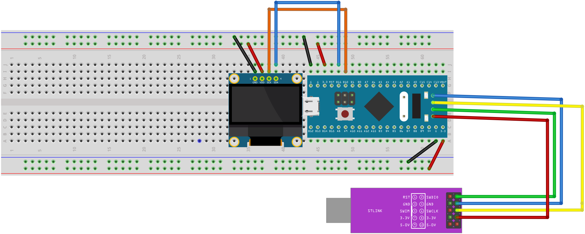

*图9-1仅测试I2C通信-*

下面仍然逐模块的、将代码展示出来。

#### 9.1 LED模块

**头文件LED.h：**

```c
/*
    该模块用于驱动PC13指示灯
    该LED的状态需要读OLED屏幕状态后,然后和OLED屏幕保持同步
    OLED开启,LED也点亮
    OLED开闭,LED也熄灭
    但注意不要直接驱动PC13指示灯,而是读OLED状态字节获取OLED状态后再控制PC13的状态
*/

#ifndef __LED_H
#define __LED_H

#include "stm32f10x.h"

void LED_Init(void);

void LED_ControlByOLEDStatus(void);

#endif // !__LED_H

```

**实现源代码文件LED.c：**

```c
#include "LED.h"
#include "hOLED.h"

/**
  * @brief 初始化PC13指示灯
  * @param 无
  * @retval 无
  */
void LED_Init(void) {
    RCC_APB2PeriphClockCmd(RCC_APB2Periph_GPIOC, ENABLE);

    GPIO_InitTypeDef GPIO_InitStruct;
    GPIO_InitStruct.GPIO_Mode = GPIO_Mode_Out_OD; // 通用开漏输出模式
    GPIO_InitStruct.GPIO_Pin = GPIO_Pin_13;
    GPIO_InitStruct.GPIO_Speed = GPIO_Speed_2MHz;
    GPIO_Init(GPIOC, &GPIO_InitStruct);

    // 默认熄灭LED
    GPIO_SetBits(GPIOC, GPIO_Pin_13);
}

/**
  * @brief 通过OLED状态来控制LED
  * @param 无
  * @retval 无
  */
void LED_ControlByOLEDStatus(void) {
    // 1.获取OLED屏幕状态字节bit6的值
    uint8_t StatusBit6 = hOLED_GetStatusBit6();

    // 2.根据bit6位的值,控制LED的状态
    if (StatusBit6 == 1) {
        // OLED处于关闭状态,于是熄灭LED
        GPIO_SetBits(GPIOC, GPIO_Pin_13);
        return;
    }

    if (StatusBit6 == 0) {
        // OLED处于开启状态,于是点亮LED
        GPIO_ResetBits(GPIOC, GPIO_Pin_13);
        return;
    }

    // 程序如果运行到这里,说明读OLED屏幕通信失败了
    // 执行一些相关的处理....
}

```

以上。

#### 9.2 硬I2C驱动OLED模块

**头文件hOLED.h：**

```c
/*
    硬件I2C驱动OLED屏幕模块,实现单片机主机和OLED从机之间的通信操作
    需要实现的I2C写操作有:
    1.开启和点亮OLED屏幕所有的像素
    2.彻底关闭OLED屏幕

    需要实现的I2C读操作有:
    获取OLED的状态字节,并且直接返回bit6(因为只有这一位有效)

    由于借助单片机的I2C外设实现I2C通信,需要初始化特定引脚,初始化I2C外设
    所以还需要声明一个初始化函数,使用SPL标准库来完成初始化
*/
#ifndef __HOLED_H
#define __HOLED_H

#include "stm32f10x.h"

// 初始化硬件I2C选择的引脚,PB10(SCL),PB11(SDA),选择的I2C外设是I2C2
void hOLED_Init(void);

// 开启和点亮OLED屏幕所有的像素
void hOLED_TurnOn(void);

// 彻底关闭OLED屏幕
void hOLED_TurnOff(void);

// 读获取OLED的状态字节,并且直接返回bit6(因为只有这一位有效)
uint8_t hOLED_GetStatusBit6(void);

#endif // !__HOLED_H

```

**实现源代码文件hOLED.c：**

1/*

```c
    借助SPL标准外设库中I2C模块,直接调用ST官方编写好的时序控制函数
    模拟I2C通信的时序图,实现I2C通信的过程
*/

#include "hOLED.h"

#define HOLED_SLAVE_ADDRESS 0x78

/**
  * @brief 初始化硬件I2C选择的引脚
  * PB10(SCL),PB11(SDA),选择的I2C外设是I2C2
  * @param 无
  * @retval 无
  */
void hOLED_Init(void) {
    // 先初始化IO引脚PB10(SCL),PB11(SDA),然后再初始化I2C2外设
    // 1.开启GPIOB外设时钟,该外设挂载在APB2外设总线上
    RCC_APB2PeriphClockCmd(RCC_APB2Periph_GPIOB, ENABLE);

    // 2.初始化两个引脚PB10(SCL),PB11(SDA)
    // 两个都需要设置为复用开漏输出模式,把引脚的输出控制权交给I2C2外设
    // 引脚的输出速度仍然可以选择2MHz
    // 因为我们使用的单片机硬件I2C,支持最大400kHz的SCL时钟信号线
    GPIO_InitTypeDef GPIO_InitStruct;
    GPIO_InitStruct.GPIO_Mode = GPIO_Mode_AF_OD; // 两个引脚都需要设置为复用开漏输出
    GPIO_InitStruct.GPIO_Pin = GPIO_Pin_10 | GPIO_Pin_11; //同时初始化两个引脚
    GPIO_InitStruct.GPIO_Speed = GPIO_Speed_2MHz;
    GPIO_Init(GPIOB, &GPIO_InitStruct);

    // 3.下面开始初始化I2C2外设
    // 4.不要忘记需要开启I2C2外设时钟,该外设挂载在APB1外设总线上
    RCC_APB1PeriphClockCmd(RCC_APB1Periph_I2C2, ENABLE);
    /*
        5.I2C外设由于其复杂性,比较容易卡死,而且这种卡死状态不会自动复位
        所以在初始化I2C外设之前,建议手动复位此外设
        将上一次/之前的通信过程中的,异常状态清楚
        这是I2C外设使用比较繁琐的体现点之一!

        此时需要手动将某个外设进行复位,怎么办?
        SPL标准库怎么办呢?
        掌管其它外设复位的外设是谁?
        是RCC,它是复位和时钟控制器
        去RCC对应的模块中,寻找需要的函数
    */
    // 发送外设复位信号,类似按下最小系统板上的复位按键
    RCC_APB1PeriphResetCmd(RCC_APB1Periph_I2C2, ENABLE);
    // 关闭外设复位信号,类似弹起/释放最小系统板上的复位按键
    RCC_APB1PeriphResetCmd(RCC_APB1Periph_I2C2, DISABLE);

    // 6.复位I2C外设后,初始化I2C2外设,完成I2C相关的配置
    I2C_InitTypeDef I2C_InitStruct;
    // 用于开启单片机应答功能
    // 在单片机作为主机时,开启ACK功能,主机会自动ACK应答从机
    // 如果关闭单片机ACK功能,主机会发送NACK给从机
    // 在一开始,开启主机单片机的应答功能
    I2C_InitStruct.I2C_Ack = I2C_Ack_Enable;
    I2C_InitStruct.I2C_ClockSpeed = 400000; // 设置SCL时钟信号频率是400kHz,也就是I2C通信的快速模式
    // 占空比选择2:1,低电平:高电平 = 2:1 这样的话,通信更加稳定,不易受到干扰
    // 占空比只对400kHz的快速模式起效,如果是标准模式(100kHz),那么此参数可以不设置
    I2C_InitStruct.I2C_DutyCycle = I2C_DutyCycle_2;
    I2C_InitStruct.I2C_Mode = I2C_Mode_I2C; // 设置I2C2外设为普通I2C模式,不使用扩展协议模式
    // I2C_OwnAddress1成员是单片机作为从机时,给单片机设置从机地址
    // I2C_AcknowledgedAddress成员设置单片机作为从机时,从机地址是7位还是10位
    // 但我们并不把单片机作为从机使用,只作为主机使用,所以这两个成员都可以不设置
    // I2C_InitStruct.I2C_OwnAddress1 = ;
    // I2C_InitStruct.I2C_AcknowledgedAddress = ;
    I2C_Init(I2C2, &I2C_InitStruct);

    // 7.不要忘记开启I2C2外设
    I2C_Cmd(I2C2, ENABLE);
}

/**
  * @brief 利用单片机的I2C2外设
  * 将多个控制字节数据发送给OLED从机,控制OLED屏幕开启和关闭
  * @param Cmds： 待发送的多个字节控制字节
  * @param Length： 待发送的控制字节的数量
  * @retval 无
  * @note 硬件I2C的实现
  * 需要调用SPL库中已经编写好的时序控制函数,模拟I2C通信的写时序,实现I2C写通信操作
  * (重点!!!)
  * 硬I2C实现的繁琐点在于:
  * 每当执行一个操作,都需要判断一下I2C外设的运行状态,如果状态正常则可以进行下一步
  * 如果状态不正常,则进行异常处理
  */
static void hOLED_WriteCmds(const uint8_t *Cmds, uint8_t Length) {
    // 1.等待I2C2外设处于空闲状态,也就是I2C2外设连接的两条总线都处于高电平状态
    // 如何获取I2C2外设通信是否处于空闲状态呢?
    // 答: 通过I2C2外设的状态标志位
    // BUSY状态标志位是SR2状态寄存器的某1位,它置位时说明I2C外设处于通信忙碌状态
    // 所以,等待I2C2外设处于空闲状态,就是等待BUSY标志位复位
    while (I2C_GetFlagStatus(I2C2, I2C_FLAG_BUSY) == SET);

    // BUSY标志位是硬件自动置位的,在检测到两条总线有任意一条是低电平状态时
    // BUSY标志位是硬件自动复位的,在检测到停止信号时,引脚自动复位
    // 该标志位不需要程序员手动管理
    // 代码执行到这里,BUSY标志位是复位状态,I2C2外设处于通信空闲状态
    // 可以开始新一轮通信了

    // 2.主机发送起始位信号,表示通信开始了
    I2C_GenerateSTART(I2C2, ENABLE); // I2C2外设发送起始信号

    // 起始信号发送成功了嘛?
    // 3.等待起始位信号发送完成,同样依靠状态标志位来判断,这就是SB标志位
    // SB状态标志位在起始位信号发送完成后,会硬件自动置位
    while (I2C_GetFlagStatus(I2C2, I2C_FLAG_SB) == RESET);

    // 该标志位用于指示起始信号有没有发送完成,如果该位持续置位,就表示起始信号一直发送完成
    // 如果它一直置位,就会影响下一次通信的开始
    // 它怎么复位呢?
    // 它的复位需要两个条件:
    // 1.读SR1寄存器,I2C_GetFlagStatus(I2C2, I2C_FLAG_SB)函数调用,就已经读了SR1寄存器
    // 2.写(发送)数据寄存器
    // 以上两个条件满足,就会自动复位SB状态标志位
    // 所以接下来只要写(发送)数据寄存器,SB状态标志位就会自动复位
    // 下面会调用函数发送寻址字节,该函数一调用就会写发送数据寄存器
    // 所以SB状态标志位也会自动复位,也不需要考虑它的手动复位问题

    // 4.起始信号已经发送完毕了,接下来主机发送寻址字节
    /*
        此函数的第三个参数决定了这次通信,单片机主机作为发送端还是作为接收端
        也就是,指出这是I2C写模式,还是I2C读模式
        当前是I2C写模式,主机将数据发送从机OLED

        通过分析查看此函数的源码
        我们发现第二个参数:
        只要传参正确的前7位从机地址,读写标志位完全由第三个参数来决定
        比如:
        OLED从机地址写模式是:0X78
        OLED从机地址读模式是:0X79
        在这里,以上两个取值,都可以传参,都没有问题

        扩展:
        I2C_Send7bitAddress最终会把(根据参数3)构建好的寻址字节,写入数据寄存器
           将寻址字节发送出去
        这和I2C_SendData函数没有区别
        所以I2C_SendData函数也可以用于发寻址字节
        只不过用这个函数就需要注意写模式和读模式,发送的寻址字节不同
    */
    I2C_Send7bitAddress(I2C2, HOLED_SLAVE_ADDRESS,I2C_Direction_Transmitter);
    // I2C_SendData(I2C2, 0x78);

    // 代码执行到这里,寻址字节被发送出去了,那么寻址到底有没有成功呢?
    // 需要相关的标志位来判断寻址是否成功
    /*
        5.以下两个状态标志位用于主机发送寻址字节后,判断寻址有没有成功:
        1.I2C_FLAG_ADDR: 寻址一旦成功,硬件自动置位(读到了从机ACK)
        2.I2C_FLAG_AF: 寻址一旦失败,读到了从机NACK,硬件自动置位
           除此之外
           AF标志位可以用于任意读从机ACK的位置,只要它置位,都表示从机NACK,从机无应答

        这两个标志位,有没有可能同时置位?
        显然是不可能的,寻址成功时I2C_FLAG_ADDR置位,寻址失败时I2C_FLAG_AF置位
        不会同时置位

        寻址字节已经发送了,接下来怎么办呢?
        需要等待寻址成功或者寻址失败
        也就是等待ADDR或者AF标志位之一置位
    */
    while (I2C_GetFlagStatus(I2C2, I2C_FLAG_ADDR) == RESET
          && I2C_GetFlagStatus(I2C2, I2C_FLAG_AF) == RESET);

    // 需要用&&,因为对于并且而言,只要有1个false结果就是false

    // 也就是两个标志位之一,有任意1个置位,都会结束循环

    // 代码运行到这里,寻址成功了,ADDR标志位置位
    // 寻址失败了,AF标志位置位
    // 6.需要对两种情况都做出处理,优先处理AF标志位置位,寻址失败的情况
    // 寻址失败,后续通信也没有必要继续进行了,直接结束通信
    if (I2C_GetFlagStatus(I2C2, I2C_FLAG_AF) == SET) {
        /*
           AF标志位在从机NACK时,硬件自动置位
           一旦它置位,就表示从机无应答
           如果不复位它,不论什么情况下,从机都始终处于无应答状态
           这显然不行的
           所以在处理AF置位,从机无应答时,需要手动复位AF标志位

           使用SPL库开发,直接调用相关的Clear函数即可
        */
        I2C_ClearFlag(I2C2, I2C_FLAG_AF);
        // 既然寻址都失败了,直接发停止位信号,结束通信
        I2C_GenerateSTOP(I2C2, ENABLE);
        return; // 不要忘记return,函数需要结束
    }

    // 代码运行到这里,说明AF标志位没有置位,那一定是ADDR标志位置位了
    // 7.这意味着寻址成功了,于是针对寻址成功进行处理
    // ADDR标志位需要手动复位,通信才可以继续进行
    // 根据手册的描述,需要先读SR1寄存器,再读SR2寄存器,ADDR标志位才会复位
    I2C_ReadRegister(I2C2, I2C_Register_SR1); // 先读SR1
    I2C_ReadRegister(I2C2, I2C_Register_SR2); // 再读SR2
    // I2C_GetFlagStatus(I2C2, I2C_FLAG_BUSY); // 这一步操作会读SR2寄存器

    // 代码运行到这里,寻址成功了,所有的处理都结束了
    // 主机开始发送后续的控制字节指令
    // Cmds字节数组中的所有字节数据,直接用一个for循环全部发送出去
    for (uint8_t i = 0; i < Length; i++) {
        /*
           需不需要判断发送数据寄存器为空呢?
           也就是需不需要判断TXE标志位?

           如果此for循环是第一次循环的话,发送数据寄存器肯定是空的
           不需要判断,因为寻址字节肯定发送完成了

           除此之外,每一个for循环都会判读BTF置位,都会等到1个字节数据发送完毕
           才会进行下一次循环

           结论就是:
           I2C_SendData函数不需要等TXE标志位置位,因为一直都是置位的
           在I2C_SendData函数调用时,发送数据寄存器肯定是空的
        */
        // 8.将当前Cmds数组中的1个字节数据发送出去
        I2C_SendData(I2C2, Cmds[i]);

        // 9.等待BTF标志位置位,也就是等待这1个字节完全发送出去
        // BTF硬件自动置位,调用Send函数自动复位,不需要手动管理
        while (I2C_GetFlagStatus(I2C2, I2C_FLAG_BTF) == RESET);

        // 10.代码运行到这里,BTF标志位置位,上1个字节的数据完全发送出去了
        // 如果从机NACK,那么AF标志位就会置位,此时可以判断一下AF标志位状态
        // 需要对应答失败NACK进行处理
        if (I2C_GetFlagStatus(I2C2, I2C_FLAG_AF) == SET) {
           I2C_ClearFlag(I2C2, I2C_FLAG_AF);
           I2C_GenerateSTOP(I2C2, ENABLE);
           return;
        }
    }

    // 11.所有数据发送完毕,主机发送停止信号
    I2C_GenerateSTOP(I2C2, ENABLE);
}

// 开启和点亮OLED屏幕所有的像素
void hOLED_TurnOn(void) {
    const uint8_t TurnOnCmds[] = {
        0x00, // 下面的指令是命令流
        0x8D, 0x14, // 开启电荷泵
        0xAF, // 打开屏幕
        0xA5 // 让屏幕全亮，点亮所有像素点
    };
    hOLED_WriteCmds(TurnOnCmds, sizeof(TurnOnCmds));
}

// 彻底关闭OLED屏幕
void hOLED_TurnOff(void) {
    uint8_t TurnOffCmds[] = {
        0x00, // 下面的指令是命令流
        0xA4, // 普通显示模式
        0xAE, // 关闭 OLED 显示
        0x8D, 0x10 // 关闭电荷泵
    };
    hOLED_WriteCmds(TurnOffCmds, sizeof(TurnOffCmds));
}

/**
  * @brief 读获取OLED的状态字节,并且直接返回bit6(因为只有这一位有效)
  * @param 无
  * @retval uint8_t: 返回状态字节的bit6,
  * 0返回值表示OLED屏幕开启状态,1返回值表示OLED屏幕关闭状态
  * 2表示与OLED屏幕通信失败
  */
uint8_t hOLED_GetStatusBit6(void) {
    // 1.等待I2C2外设处于空闲状态,也就是I2C2外设连接的两条总线都处于高电平状态
    while (I2C_GetFlagStatus(I2C2, I2C_FLAG_BUSY) == SET);

    // 2.主机发送起始位信号,表示通信开始了
    I2C_GenerateSTART(I2C2, ENABLE);

    // 3.等待SB标志位置位,等待起始信号发送完成
    while (I2C_GetFlagStatus(I2C2, I2C_FLAG_SB) == RESET);

    // 4.发送寻址字节(读模式)
    I2C_Send7bitAddress(I2C2, HOLED_SLAVE_ADDRESS,I2C_Direction_Receiver);

    // 5.等待寻址成功或寻址失败
    while (I2C_GetFlagStatus(I2C2, I2C_FLAG_ADDR) == RESET
          && I2C_GetFlagStatus(I2C2, I2C_FLAG_AF) == RESET);

    // 6.处理寻址失败的情况
    if (I2C_GetFlagStatus(I2C2, I2C_FLAG_AF) == SET) {
        I2C_ClearFlag(I2C2, I2C_FLAG_AF);
        I2C_GenerateSTOP(I2C2, ENABLE);
        return 2; // 寻址失败,通信失败
    }

    // 7.处理寻址成功的情况,手动复位ADDR标志位
    I2C_ReadRegister(I2C2, I2C_Register_SR1); // 先读SR1
    I2C_ReadRegister(I2C2, I2C_Register_SR2); // 再读SR2

    // 8.禁用主机ACK功能,主机接收从机状态字节后,直接无应答,发送NACK给从机
    I2C_AcknowledgeConfig(I2C2, DISABLE); // 临时关闭I2C2外设的主机应答功能,不应答从机

    // 9.等待接收数据寄存器非空,准备接收数据
    while (I2C_GetFlagStatus(I2C2, I2C_FLAG_RXNE) == RESET);

    // 代码运行到这里,RXNE标志位置位,接收数据寄存器非空
    // 10.于是把从机发送的状态字节读出来
    uint8_t ReceiveStatusByte = I2C_ReceiveData(I2C2);
    uint8_t StatusBit6 = (ReceiveStatusByte >> 6) & 0x01;

    // 11.所有数据接收完毕,主机发送停止信号
    I2C_GenerateSTOP(I2C2, ENABLE);
    return StatusBit6; // 不要忘记函数有返回值
}

```

以上。

#### 9.3 测试代码

**main.c文件的参考代码如下：**

```c
#include "stm32f10x.h"
#include "Delay.h"
#include "hOLED.h"
#include "LED.h"

int main(void) {
 // 初始化OLED屏幕硬件I2C驱动
 hOLED_Init();
 LED_Init();

 // 测试开启和关闭屏幕
 hOLED_TurnOn();
 LED_ControlByOLEDStatus();

 Delay_S(3);
 hOLED_TurnOff();
 LED_ControlByOLEDStatus();

    while (1) {

    }
}

```

大家可以自行查阅代码，结合注释，有问题可以直接询问老师。

### 10. I2C通信的优缺点总结

至此，我们已经掌握了 I2C 通信的原理与基本用法。最后，我们来系统地总结一下 I2C 的优势与局限。

首先来看一下I2C通信的优势：

1. **只需两根信号线**（SCL、SDA），节省引脚、简化布线，适合板载多设备芯片之间的通信；
2. **支持多主机与多从机架构**，具有高度灵活性；
3. 软件和硬件实现皆可，可以根据不同的需求，选择不同的实现；
4. 功能完善强大，支持寻址，应答，主机切换，主从数据发送等功能；
5. **成本低廉**，无需专用通信器件，仅依赖通用 IO 与上拉电阻即可构建完整通信系统，性价比极高。

I2C的劣势如下：

1. **通信距离有限**，由于总线结构为开漏+上拉电阻，抗干扰能力弱，不适合长距离数据传输。
2. **通信速度相对较低，上拉电阻导致 SDA/SCL 上升沿缓慢，严重制约通信速率，典型速率为 100kHz ~ 400kHz。**
3. **功耗略高**，相比推挽结构，I²C 持续存在上拉通路，产生静态功耗。
4. 如果选择多主机模式，容易出现总线冲突，通信过程比较复杂，出错几率高。
5. 由于I2C通信协议的复杂性，再加上STM32部分单片机在I2C外设设计上的固有缺陷，使得硬件I2C在不在乎性能时反而不如软件I2C。

I²C 通信协议正是为了**以最少的引脚、最低的成本，提供多设备互联的能力**而设计的。

它的确做到了“小投入，强功能”的设计目标。

**I2C是一种性价比极高、强大且灵活的通信协议，是嵌入式系统中必学且最常用的通信方式之一。**

---
