# 嵌入式讲义（卷六 SPI通信）

> 拆分自 `1_嵌入式讲义汇总.md / 卷六 SPI通信`，共 5 份 PDF 讲义。所有插图保存在 `assets/` 目录，请保持相对位置不变。

## 目录

- 01 SPI相关概念

- 02 STM32的SPI外设

- 03 引脚和外设初始化

- 04 W25Q64的使用

- 05 Flash编程

---

## 01 SPI相关概念

### 1. 概述

在以前的课程内容中，我们已经学习过两种STM32通信接口了，它们就是I2C总线通信以及USART串口通信。

本卷我们再来学习一种全新的通信方式——SPI通信。

首先，我们要先建立一种正确的认知——SPI 并不是比串口 / I2C 更高级的通信方式，只是设计的思路不同，解决的问题不同罢了。

**在《SPI相关概念》这一章节中，我们所讲的内容，既和单片机的SPI外设没有关系，也和与单片机进行SPI通信的从机设备没有关系。**

**这一章节，仅仅涉及与SPI通信本身、通信协议本身相关的一些设定和概念。**

#### 1.1 SPI通信的核心特性

SPI是什么呢？

SPI（Serial Peripheral Interface，串行外设接口）是Motorola（摩托罗拉）公司于1980年代中期提出的同步、全双工、主从模式的串行通信协议。

SPI具有以下核心特性：

1. **串行通信。**数据仍然是1个bit位，1个bit位的串行发送和接收的。
2. **同步通信。**通信双方通过共享的时钟信号实现时序同步，而不是依赖波特率。
3. **严格的主从模式通信。**
   - a. SPI 采用固定主从结构，一主多从，仅允许主机发起通信。
   - b. **SPI没有I2C通信那一套“主机切换”的复杂设计，SPI通信就是一台固定主机和多台从机通信。**
   - c. 在本课程中，我们就固定STM32单片机为主机，不需要考虑主机的切换
4. **全双工通信。**主机和从机可以同时收发数据。
5. **总线式物理接线。**多设备都将自身挂载在总线上，但SPI通信在总线外还需要依赖其它信号线。
6. **在总线外，基于独立的“片选线”机制来确定通信的从机。**从机设备越多，片选线就越多。
7. **无寻址、无应答机制。**说人话就是：SPI通信不管对方是谁，不管收到没有，只依照时钟信号驱动进行通信。
8. **同一时刻，只有一台从机与主机通信，且不支持广播模式。**
9. **引脚资源占用多，但通信速率相比较于其它通信协议提升显著。**
   - a. **SPI通信，相比较于串口、I2C等通信协议，通信速率快是其最显著的特点与优势！**
   - b. 当然SPI的这种优势是用“高资源占用”为代价换取的。
10. **SPI比I2C功能更少，但灵活性显著高于I2C，很多地方都不像I2C一样是完全规定死的。**主要体现在两方面：
   - a. **时序结构可灵活配置，拥有多样化的时序结构，以适配不同的从机设备。**
   - b. **数据帧格式也非常灵活，需要从设备根据自身情况定义，不同的从设备通信的数据帧格式会大不相同。**

11. **数据传输是以时钟信号为驱动的双向移位过程，每一个时钟周期内，主机和从机都会同时发送 1 bit、接收 1 bit。**

   - a. 标准SPI通信是真正意义上的，必须同时发和同时收，没有单纯的发送和接收过程。
   - b. 当然，在发送数据时，自身接收到的数据可能无意义，但必须接收。
   - c. 同样的，在接收数据时，自身发送的数据也可能无意义，但必须发送。
   - d. **SPI 通信本质上是在时钟信号驱动下，主从双方移位寄存器进行同步移位操作，从而完成串行数据的交换。**
   - e. **SPI通信的过程是数据交换的过程！**

上述这11条，基本囊括了SPI通信的绝大部分特性，有些特性我们已经学过搞明白了，但有些则还比较陌生。

下面我们就逐一来介绍这些特性。

SPI通信专为短距离高速通信设计，是一种用于微控制器与外设芯片（如Flash存储器、传感器、显示屏等）之间进行数据传输的通信方式。

从使用场景来说，它和I2C通信非常类似，但它们各有各的优缺点，有些外设使用I2C通信更好，有些外设则使用SPI通信更好。

#### 1.2 I2C和SPI的简单对比

我们刚刚学完I2C通信，现在要学习SPI通信，恰好两种通信方式有很多类似的地方，将它们做一个简单对比，有利于我们学习SPI通信。

对于I2C通信而言，无论硬件电路、软件协议还是通信时序控制，它们的设计都是比较复杂的。

I2C通过这些复杂的、精心的设计，利用最少的硬件资源，实现了最多的软件功能，可以说：

**"I2C通信是一个非常具有性价比的通信方式，资源占用少，但功能却非常完善"。**

但I2C通信也并非没有缺点。

I2C最大的缺点源自于其硬件电路的开漏接法，使得其**"低电平 -> 高电平"**的过程会比较缓慢，进而拖累了整体的通信速率。

大多数情况下的I2C通信，也就能够支持400kHz的时钟线频率，这个通信速率还是比较慢的。

总之：

**"I2C通信通过精打细算的精心设计，用最少的硬件资源，实现了最多的软件功能，但缺点是通信速率较慢。"（关于I2C通信的总结，其优缺点的详细解释，请参考之前I2C通信文档的末尾）**

那么SPI通信呢?

如果确实需要用一句话来概括SPI通信，那么我会说：

**"SPI通信通过简单粗暴的设计，用更多的硬件资源，甚至是资源浪费，实现了速率更高、更简单也更直接的通信。"**总得来说，在已经学会I2C通信的前提下，再来学习SPI通信，其实难度是有一定降低的，所以大家也不要太害怕。

#### 1.3 一道基础面试问题

在 25 年的嵌入式班级中，有同学在面试嵌入式软件开发岗位时，被问到过这样一个问题：

你用过SPI通信吗？你怎么看待这个SPI通信？

这是一个看似基础、但实际上**非常开放**的问题。

它并不考察你是否记住了 SPI 的定义，而是考察你**是否真正理解 SPI 的设计思想和使用场景**。

当然这个问题的答案不唯一，允许大家有自己的理解。

**下面给大家一个直击 SPI 本质、同时非常符合面试场景的回答思路。**

**第一，相比较于串口和I2C，SPI最大、最直观的优势是通信速度快，SPI是MCU常用通信中最快的。**

**第二，与串口和 I2C 固定的通信时序和数据帧格式不同：**

1. **SPI在时序结构上表现为灵活多变可配置。**
2. **SPI在数据帧格式上表现为“从机可自定义通信数据帧格式，从设备不同数据帧格式通常也不同”。**

**第三，SPI通信本质是：在时钟信号的驱动下，主从设备的移位寄存器进行同步移位，从而完成数据交换。**

只要答出这三条，足够让面试官确定你是研究过SPI通信的。

如果还能够应付后续面试官的追问拷打，那么足够让面试官确定你是熟练使用过SPI通信的。

#### 1.4 SPI学习的补充说明

最后，关于SPI的学习，需要补充说明的是：

**本文中讲解的SPI通信指的是标准的、传统意义上的SPI通信，不考虑各种SPI的变种、扩展或"魔改"版本。**

比如上文提到的SPI通信的一主多从模式、采用单一固定主机，标准SPI就是这么设计的，但如果考虑SPI的各种变种扩展版本，则会有所不同。

实际的应用中也大多使用标准SPI通信协议，所以我们专心学习标准SPI通信即可。

在本章节中，我们来学习一些SPI相关的最基本概念。

### 2. SPI硬件电路设计

SPI和I2C通信同样都是总线通信协议，而且SPI采用**固定一主机、多从机**的通信方式。

在下文中我们统一把STM32单片机作为这个固定主机。

SPI通信的总线电路设计，如下图所示：

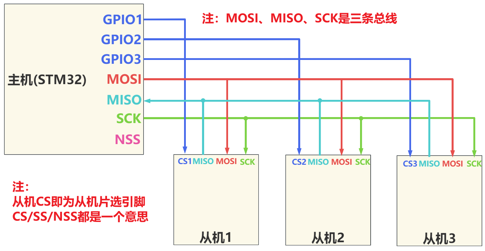

*图2-1SPI总线设计-图*

显然SPI的总线设计要比I2C复杂一些，使用的引脚也会更多，下面来详细介绍一下这几条通信线。

#### 2.1 SPI的四条通信线

在标准SPI通信中，一般都需要至少四条通信线**（有些简化的SPI通信可能使用更少的通信线）**，如下表格所示：

| 通信线简称 | 全称 | 功能 |
|---|---|---|
| SLK/SCK/SCL | Serial Clock | 主机输出时钟信号，从机接收。用于同步数据传输 |
| MOSI/DI | Master Out Slave In | 数据线，用于主机发送数据，从机接收数据 |
| MISO/DO | Master In Slave Out | 数据线，用于从机发送数据，主机接收数据 |
| SS/CS/NSS | Slave Select/Chip Select | 片选线，用于主机确认和哪一台从机通信 |

表格中的**上面三条线都属于主机和从机共享使用的总线**，它们都比较简单，如下所示：

1. SLK线，时钟信号线，SPI和时钟信号线和I2C的时钟信号线作用完全一致。
   - a. 它的简写丝印由于硬件生产厂商不同，有很多的简写。如：SLK/SCK/SCL等。
   - b. **SPI通信中，由STM32单片机生成同步时钟信号，从机接收此信号。**
   - c. 单片机通过生成并发送时钟信号，从而控制数据传输的时序和速率。
2. MOSI线，数据线，用于主机发送数据，从机接收数据。
   - a. 很多外设的生产厂商出于简化考虑，会直接使用丝印**"DI"**，即"Data Input"表示此引脚为数据输入口。
   - b. 和串口、I2C通信一样，主机发送数据仍然遵循"TTL"电平原则。即高电平表示发送数据"1"，低电平表示发送数据"0"。
3. MISO线，数据线，用于从机发送数据，主机接收数据。
   - a. 很多外设的生产厂商出于简化考虑，会直接使用丝印**"DO"**，即"Data Output"表示此引脚为数据输出口。
   - b. 和串口、I2C通信一样，从机发送数据仍然遵循"TTL"电平原则。即高电平表示发送数据"1"，低电平表示发送数据"0"。

我们已经学过I2C和串口通信了，通信是否支持全双工或半双工，本质上由通信的电路结构决定。

SPI 使用两条独立的单向数据总线（MOSI 和 MISO）分别负责主机发送和接收，以及从机接收和发送。

**所以，SPI 支持主从设备在同一时刻、同时进行数据发送与接收，属于全双工通信协议。**

串口通信同样采用发送线（TX）和接收线（RX）分离的结构，因此也具备**全双工通信能力**。

而 I²C 通信中，通信双方共用一条双向数据线（SDA），同一时刻只能由一端进行数据发送，因此 I²C 属于半双工通信协议。

#### 2.2 SPI通信的片选线

SPI通信的片选线比较特殊，下面单独讲解一下它。

SS/CS线，称之为**片选线（Chip Select，CS）**或者**从机选择线（Slave Select，SS）**

1. 所谓"片选"，即**选择芯片**的意思，SPI通信本质上还是芯片之间的通信，选择从机就是选择某个芯片，所以称之为"片选"。
2. SS和CS都是常见的称呼，在SPI通信中它们意思相同。
3. 每个从机都有一条独立的片选线和主机相连接，由**主机的引脚输出高低电平**来决定是否与此从机通信。

所以STM32单片机在作为主机时，需要选择任一GPIO引脚来连接从机的片选引脚。

通过片选线，主机引脚输出高低电平决定与某台从机通信。

那么到底是输出低电平表示与从机通信，还是高电平呢？

##### 2.2.1 低电平选中

标准SPI通信规定，**CS线为低电平有效，主机通过拉低某条CS线的电平，表示与此从设备进行通信。**

但SPI并未定死此规定，某些特殊的硬件也可以自行设定为高电平有效。

但这不属于标准SPI的设计，如果遇到这样的设备，需要查阅其硬件手册了解相关信息。

总之，我们可以默认CS线低电平表示与此从机通信，常见的硬件都是这么设定的，只有极少数特殊硬件需要查阅手册、区别对待。

**在很多文档/原理图中，SPI的片选线都会直接标记为"NSS"。**

**其中的"N"表示低电平有效（Negative/Negated），这也进一步说明SPI通信中的片选普遍都是低电平选中的模式。**

##### 2.2.2 不支持广播通信

SPI 是否支持与多台从机，进行同时的通信呢？

在 I2C 通信中，协议标准中定义了一个特殊的广播地址0x00 ，主机通过它可以向所有从机广播数据。具体来说是：

1. 从机们只需要按照时序读取SDA数据线上的高低电平，就可以同时接收主机发送的数据了。
2. 在广播模式下，主机并不关心从机的应答，从机也不需要应答。
3. 同时I2C还规定，任何通信都由主机主动发起。所以I2C通信，不存在多台从机同时发送数据给主机的情况。

那么SPI通信时，也和这类似吗？

**答案是：No，SPI不支持广播通信。**

SPI选择从机通信的方式和I2C完全不同，SPI是通过硬件片选线实现的从机选择。

对于SPI通信来说，同一时刻仅会拉低某台从机的片选线，从而使得该从机处于激活状态。

**SPI通信在同一时刻只能和某一台从机通信，SPI不支持广播通信形式，不支持同时和多台从机通信。**

### 3. SPI通信的时序结构（重点）

在前面的总结中，我们提到过：**SPI在时序结构上表现为灵活多变可配置。**

于是在这一小节，我们就来看一看，SPI的通信时序，是如何的灵活多变可配置。

#### 3.1 SPI通信的比特序

到目前为止，我们学习过的通信方式，**全部都是串行通信**。

既然是串行通信，那么在通信过程中，bit 位的发送顺序，也就是**比特序**，就是一个必须首先关注的重要问题。

在这里我们不妨再复习总结一下——比特序：

**比特序，用于在串行通信中，描述一个数据单元内部，bit位逐位发送的顺序。**

比特序有两种最常见的形式：

1. **LSB First**，即Least Significant Bit First，最低有效位优先。此时数据会从**一个数据单元内部**的最低有效位，发送到最高有效位结束。
2. **MSB First**，即Most Significant Bit First，最高有效位优先。此时数据会从**一个数据单元内部**的最高有效位，发送到最低有效位结束。

具体来说，I2C和串口通信，它们的比特序是固定的：

1. I2C通信的比特序是MSB First，固定从数据的最高有效位发送到最低有效位。
2. 串口通信的比特序是LSB First，固定从数据的最低有效位发送到最高有效位。

**那么SPI通信的比特序呢？**

在回答这个问题之前，我们先回到一句之前提到过的话：

SPI 的一个显著特点是：时序灵活多变、可配置。

既然是灵活多变可配置的时序，那么比特序显然也是可配置的：

既然比特序有两种选择，那么SPI的比特序那就交给程序员自己选择，自己配置吧。

所以：

**SPI通信的比特序是由程序员自己配置的，可以选择LSB First，也可以选择MSB First。**

当然，具体选择什么样的比特序，以及如何完成比特序的配置，我们在后续小节中再讲。

实际工程中，SPI的比特序多数会选择MSB First。

#### 3.2 通信空闲状态，SPI时钟极性

在讲I2C和串口通信时，我们知道：

接线完成后，通信并不是立刻开始的，而是先处于一种“空闲状态”。

**因此，任何一种通信协议，都必须明确规定：当通信处于空闲状态时，信号线应该处于什么样的电平状态。**

例如：

1. I2C通信规定，当SCL和SDA总线都处于高电平状态时，表示通信处于空闲状态。任一总线被拉低，都表示通信开始，或通信处于正在进行时。
2. 串口通信规定，当信号线持续处于高电平时，表示通信处于空闲状态。

那么SPI呢，它是如何表示通信的空闲状态呢？

在回答这个问题之前，我们仍然需要记住 SPI 的一个显著特点：

SPI的时序灵活多变、可配置。

**所以，SPI 通信的空闲状态同样不是固定不变的，也是允许进行配置选择的。**

SPI和I2C同属于同步通信，但与I2C不同的是，SPI仅通过一条时钟信号线来确定通信的空闲状态。

这里就需要引入SPI一个重要的概念——SPI极性或者叫SPI时钟极性。

**SPI 极性（Clock Polarity，CPOL）用于规定：当 SPI 总线处于空闲状态时，时钟信号SCK 的电平状态。**

SPI极性是可配置的，具体来说有两个选择：

1. CPOL = 0，规定当SCK时钟信号线为低电平时，表示通信处于空闲状态。通信开始时，时钟信号翻转到高电平。
2. CPOL = 1，规定当SCK时钟信号线为高电平时，表示通信处于空闲状态。通信开始时，时钟信号翻转到低电平。

当然，具体选择什么样的时钟极性，以及如何完成时钟极性的配置，我们在后续小节中再讲。

#### 3.3 采样时机，SPI时钟相位

关于**采样**和**采样时机**这两个概念，我们在前面的通信课程中已经多次讲过了。

在这里，我们先对这两个概念再做一次简要的复习和总结。

1. 采样：接收端在某一确定时刻，对信号线上的电平状态进行读取，并将其判定为逻辑 0 或逻辑 1 的过程。
2. 采样时机：通信协议所规定的，接收端执行采样操作的具体时刻、时间点。

我们先回顾一下以往学过的通信方式，它们各自是如何规定采样时机的。

1. 串口通信以起始位为时间基准，用波特率确定一个bit所占用的时间，然后在每个bit的中点附近进行多次采样，最终投票判决结果。
2. I2C 通信中，接收端在 SCL 时钟为高电平的工作时间内采集数据，通常会选择在这一段工作时间的中点完成采样。

那么SPI通信呢？SPI 通信的数据采样时机又是如何规定的呢？

和“通信空闲状态”一样，SPI通信的采样时机也是灵活可配置的。

**并且相比串口和 I2C，SPI 的采样时机设计也更加“独特”。**

同样的，SPI通信的采样时机，也有一个专业的术语，这就是**SPI时钟相位**。

**SPI 时钟相位（Clock Phase，CPHA）用于规定SPI通信的采样时机，具体来说是：在一个 SPI 时钟周期内，数据应该在第几边沿被采样。**

时钟相位仍然有两种选择：

1. CPHA = 0，表示数据采样时机是在时钟周期的第一边沿采集。
2. CPHA = 1，表示数据采样时机是在时钟周期的第二边沿采集。

#### 3.4 SPI四种时钟模式（重点）

在上一小节中我们讲到了时钟的两种相位选择，提到了第一和第二边沿采集。

那么什么是“第一边沿”、“第二边沿”呢？

为了讲清楚这个问题，我们需要把时钟极性和时钟相位结合在一起，进行排列组合。

如此，我们得到了**四种SPI时钟模式（SPI Clock Mode，简称SPI Mode）：**

1. **Mode0，模式0，CPOL = 0，CPHA = 0，低电平空闲状态，第一边沿采集。**
2. **Mode1，模式1，CPOL = 0，CPHA = 1，低电平空闲状态，第二边沿采集。**
3. **Mode2，模式2，CPOL = 1，CPHA = 0，高电平空闲状态，第一边沿采集。**
4. **Mode3，模式3，CPOL = 1，CPHA = 1，高电平空闲状态，第二边沿采集。**

接下来，我们将重点围绕这四种 SPI 时钟模式展开讲解。

##### 3.4.1 Mode0，模式0

首先，我们来看下面这张**SPI 时序图：**

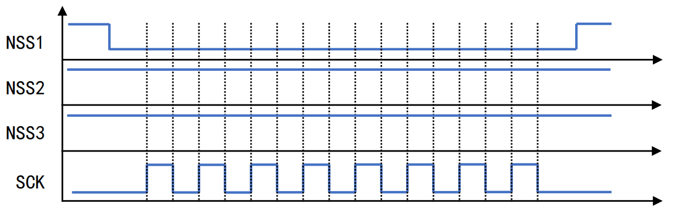

*图3.4.1-1Mode0-图*

这张时序图没有带上任何数据线，因为我们现在还不需要考虑数据收发的问题。

那么你在上述图中能看出什么问题呢？

如果你搞懂了上面讲的内容，你应该至少能够看出下面几条：

1. **从机1的NSS1线低电平，表示从机1与主机进行通信。**
2. 从机2和从机3的NSS线全程拉高，表示它们作为从机没有和主机进行通信。当然SPI在同一时刻，只能有一台从机和主机进行通信。
3. SCK时钟信号线在一开始，处于低电平状态，说明通信的空闲状态是：低电平空闲。
4. 所以SPI通信选择的时钟极性是0，低电平空闲。

那么时钟相位呢？哪里是第一边沿，哪里是第二边沿？

实际上，只要时钟极性确定了，那么第几边沿，也就确定了。如下图所示：

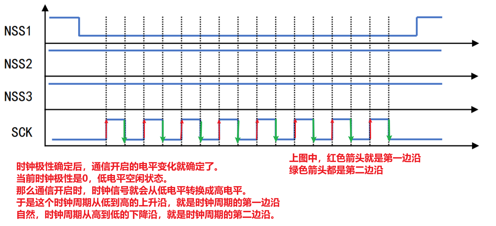

*图3.4.1-2Mode0-图2*

在模式0，低电平空闲状态，第一边沿采集，其时钟信号的波形就如上图所示，并且采样时机是红色箭头。

现在，我们已经明确了**数据采样发生在什么时刻**，那么下一个问题自然就出现了：

在进行数据采样时，对数据线有没有要求？

当然是有要求的。

**在理想情况下，和I2C通信类似，接收端在时钟边沿进行数据采样时，数据线在该边沿附近处于“电平稳定区间的中点”。**

**换句话说：采样数据的边沿来临时，数据最好已经稳定一段时间了，而不是正在变化。**

接下来，我们在时序图中加入数据线，得到如下所示的波形。


*图3.4.1-3Mode0-图3*

在Mode0的前提下，分析这张时序图，过程如下所示：

1. **NSS线拉低，表示主机选中从机进行通信，但此时观察SCK总线还处于低电平空闲状态，所以第一个bit数据还未发送。**
2. **Mode0时，时钟线低电平表示空闲状态，所以当时钟线出现第一个上升沿时，才表示发送第一个bit数据。**
3. 当时钟信号线上的“时钟周期”消失，呈现完全低电平的状态，就表示通信已经回归空闲状态。
4. **分析SPI通信的过程，只分析拥有完整时钟周期的部分，其余没有时钟周期的部分，都表示通信处于空闲状态，未收发数据。**
5. 当然在最终，NSS片选线被重新拉高，表示主机断开与从机联系，通信彻底结束了。
6. 这张图上，一共存在8个完整时钟周期，也就是说通过MOSI数据线，主机一共向从机发送了8个bit数据。
7. 从机会在所有的第一边沿采集数据，也就是上升沿采集数据，一共有8个上升沿，所以从机会收到主机发送的8个bit数据。

最终我们可以得出：

主机给从机发送了8个bit数据，按照接收的顺序是：1011 1000，也就是说，主机给从机发送了一个字节数据：0xB8是这样吗？

当然不是。

从机按照顺序接收的数据是：1011 1000，这是没有问题的。

但这并不意味着，主机发送的数据就是：1011 1000（0xB8）

因为Mode0，只约定了时钟极性和相位，比特序还没有约定。

所以：

1. 如果通信双方约定的比特序是MSB First，那么主机发送的数据就是0xB8，即1011 1000
2. 如果通信双方约定的比特序是LSB First，那么主机发送的数据就是0x1D，即0001 1101

**扩展：**

实际上从这张时序图中，我们还能得出SPI通信的一些重要特点，总结在下面：

1. NSS片选线的低电平时间段，意味着主机和从机正在进行通信。
2. 在NSS拉低生效的时间段内，SCK上每产生一个时钟周期，就表示收发一个bit数据。
3. **在一次SPI通信的过程中，允许传输任意的bit数量，甚至可以传输非8整数倍的bit数量。这就是SPI通信数据帧的灵活之处！**
4. 片选线的状态决定一次通信的开始与结束，时钟信号的时钟周期数量决定了实际收发bit数据的数量。

你搞懂了吗？

##### 3.4.2 Mode1，模式1

在已经搞懂 SPI Mode 0 的前提下，Mode 1 的理解其实就会变得非常自然。

Mode1和Mode0的差距仅限于第几边沿采样，Mode0第一边沿采样，Mode1则第二边沿采样。

如下图所示：


*图3.4.2-1Mode1-图*

时钟信号中的绿色箭头就是第二边沿，Mode1时，在这些下降沿进行数据采样。

再看下面一个带数据线的时序图：

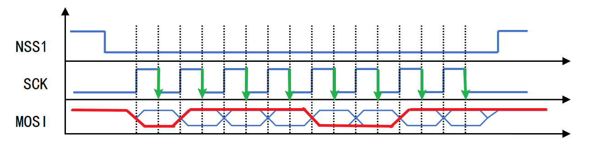

*图3.4.2-2Mode1-图2*

主机通信MOSI线，发数据给从机，一共发了8个bit，依照顺序是：0111 0011。那么：

1. 如果约定MSB First比特序，那么主机给从机发送的1个字节数据是0x73，即0111 0011
2. 如果约定LSB First比特序，那么主机给从机发送的1个字节数据是0xCE，即1100 1110

你搞懂了吗？

##### 3.4.3 Mode2，模式2

模式2，时钟信号高电平表示通信空闲，并且在第一边沿进行数据采集。

不带数据线，时序图如下图所示：

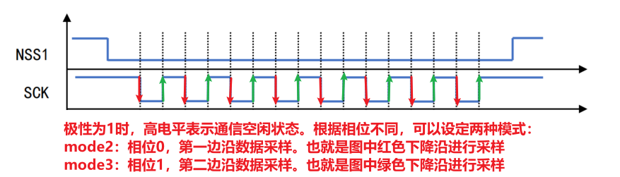

*图3.4.3-1Mode2-图*

图中的红色箭头，就是第一边沿，也就是全部下降沿，mode2在此时进行数据采样。

再看下面一个带数据线的时序图：

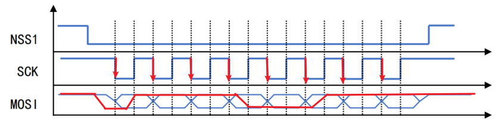

*图3.4.3-2Mode2-图2*

如此，从机接收到的比特序列是：0111 0011如果采用MSB First比特序，那么主机发送的1个字节数据就是0111 0011，即0x73如果采用LSB First比特序，那么主机发送的1个字节数据就是1100 1110，即0xCE

##### 3.4.4 Mode3，模式3

模式3，时钟信号高电平表示通信空闲，并且在第二边沿进行数据采集。

在下图中：


*图3.4.4-1Mode3-图*

图中的绿色箭头，就是第二边沿，也就是全部上升沿，mode3在此时进行数据采样。

再看一个带数据线的时序图：

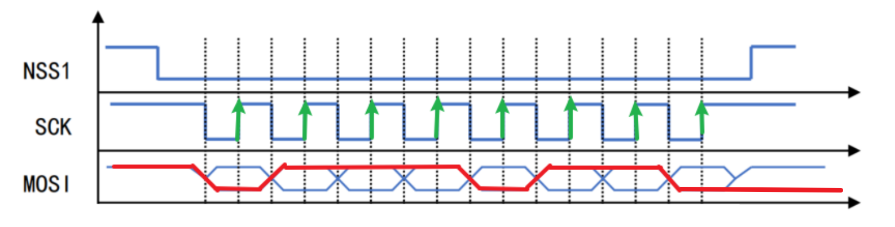

*图3.4.4-2Mode3-图2*

如此，从机接收到的比特序列是：0111 0110如果采用MSB First比特序，那么主机发送的1个字节数据就是0111 0110，即0x76如果采用LSB First比特序，那么主机发送的1个字节数据就是0110 1110，即0x6E**注意/扩展：**

在**Mode 3**的最后一张时序图中，我们**刻意做了一个与前面不同的设定**：

1. 在通信尚未开始时，**MOSI 数据线保持为高电平**
2. 在通信结束之后，**MOSI 数据线最终停留在低电平**

这个设定和之前的时序图不同，这合理吗？是不是有问题啊？

进而，我们就要提出一个非常重要的问题：

前面我们所讲述的时钟极性以及相位，这两个概念都是描述时钟信号线的，它们决定了通信开始传输数据，还决定了采样机制。

那么：SPI通信协议，有没有对数据线在通信时的电平做什么约束呢？

比如：数据线高电平时表示通信未开始？

有没有这种设计呢？

答：完全没有。

1. 对于SPI通信而言，主机拉低片选线（NSS拉低），代表主从机通信关系建立，通信正式开始。
2. 通信开始不意味着立刻传输数据，只有SCK时钟信号线上出现了第一个有效边沿时，第一个bit数据才开始传输。
3. SPI的模式决定了接收端在何时进行数据采样。
4. 在接收端进行数据采样时，数据线上的高低电平是有效的：
   - a. 并且最好是保持一段时间后的稳定电平。
   - b. 而不是刚刚变化过来，或马上要变化的不稳定电平。
5. **除此之外的任何时刻，SPI通信都不关心数据线的电平状态。通信未开始，或已结束时的数据线电平状态就更不需要关心了。**

你想明白了吗？

### 4. 总结与补充

到此为止，关于**SPI 通信本身**、以及**SPI 通信协议相关的设定与概念**，我们已经全部讲清楚了。

再回过头来看，在本章节一开始，我们曾对 SPI 通信做过 11 条总体性的总结。

其中有一部分内容，随着前面串口和 I2C 的学习，其实大家已经具备了相应的理解基础，因此没有再单独赘述。

在本章节中，我们重点讲解了 SPI 通信——**通信时序的灵活可配置性。**

相信到现在为止，你已经对这一点有所理解了。

那么，在这 11 条总结中，还有哪些问题是目前还需要进一步讲解、加深理解的呢？

主要有以下三个问题：

1. 第一，SPI通信为什么显著的优势是快？
2. 第二，SPI通信的本质是主从双方的移位寄存器移位所导致的数据交换，这是什么意思呢？
3. 第三，SPI通信的数据帧格式与从机有关，那具体是什么情况呢？

**第一个题，需要在我们完整理解 SPI 所有核心概念之后，再进行一次整体性的总结。**

**第二个问题，由于移位寄存器的操作和硬件外设的具体实现强相关，所以需要在下一章节《STM32的SPI外设》中讲清楚。**

**第三个问题，则放到第四个章节《W25Q64的使用》中，通过讲解具体的 SPI 从机设备，来详细分析其通信数据帧的组织方式。**

以上。

---

## 02 STM32的SPI外设

### 1. 概述

在上一章节《SPI 相关概念》中，我们已经从通信协议本身出发，系统讲解了 SPI 通信在时序结构上的**灵活可配置性**。

包括：

1. 比特序的选择。
2. 时钟极性（CPOL），也就是通信空闲状态的选择。
3. 时钟相位（CPHA），也就是采用时机的选择。
4. 四种时钟模式选择。

至此，我们已经大体了解了SPI通信的基本规则。

结合我们学习I2C通信的经验，距离我们实现SPI通信，还有一个很重要的问题需要解决：

我们实现软件SPI，还是实现硬件SPI呢？

事实上，和 I2C 通信类似，SPI 通信同样可以采用两种实现方式：

1. **软件 SPI**：通过普通 GPIO 引脚，由软件控制引脚电平变化，手动模拟 SPI 的时序过程。
2. **硬件 SPI**：由单片机内部集成的 SPI 外设模块，在硬件层面自动完成时序控制和数据移位。

在实现I2C时，两种方式我们都实现过了。对于I2C而言，它们的差异在于：

1. 软件I2C实现，更灵活简单，但通信效率低，时序控制不稳定。
2. 硬件I2C实现，通信效率更高，时序控制稳定。但相对配置多更繁琐，引脚选择也不灵活。

由于I2C本身就不是高速通信协议（快速模式时钟频率不过400kHz），不以性能著称，主打性价比，所以软I2C是应用更广泛的实现。

SPI以性能著称，通信速率快是其最核心的优势，采用软件SPI则会放弃这最大优势，而且软件SPI实现起来会很繁琐。

所以在实际工程应用中，硬件SPI是决定的主流。

**在后续的SPI章节内容中，我们所讲的SPI实现都是基于STM32的SPI外设实现的，也就是硬件SPI，后续内容不再单独强调这一点。**

在本章节内容中，我们会讲解单片机SPI外设的核心工作原理，并且还会带着大家完成SPL库相关代码的编写。

我们就分两个大部分来讲解这一章节：

1. SPI通信的移位机制。
2. STM32的SPI外设框图。

主要讲解SPI框图，来看一下STM32的SPI外设是如何工作的。

### 2. SPI通信的移位机制（以bit为单位）

早在SPI通信讲解的开头，我们就提出关于SPI通信的重要特性：

**SPI 通信本质上是在时钟信号驱动下，主从双方移位寄存器进行同步移位操作，从而完成串行数据的交换。**

**SPI通信的过程是数据交换的过程！**

那么SPI通信究竟如何完成这个数据交换的过程呢？

在单主单从的前提下，《参考手册》的SPI章节为我们提供了一个简易的、移位机制示意图。

如下所示：

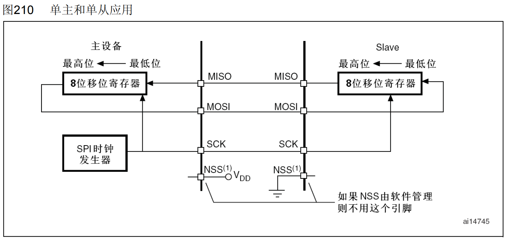

*图2-1SPI通信的移位机制-图*

我们可以把图中无关的内容去掉，然后在移位寄存器中增添数据，一个简化的SPI移位机制示意图。

如下所示：

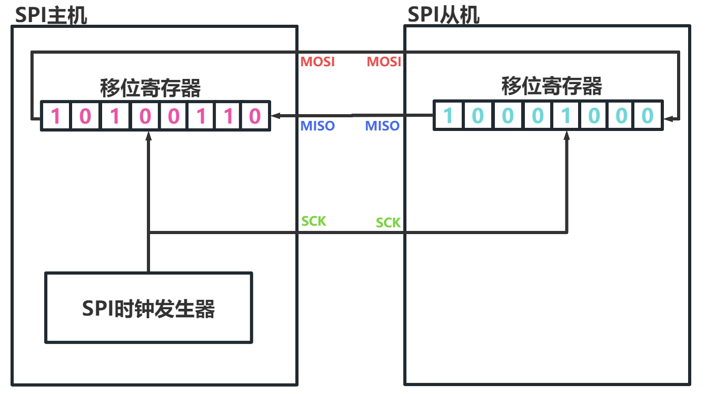

*图2-2SPI通信的移位机制-图2*

解释一下这张图：

1. 主机控制SCK时钟信号线，主机掌握时序，SPI是严格的主从通信模型。
2. **主机每移位发送1个bit数据，也同时移位接收1个bit数据。**
3. **从机每移位接收1个bit数据，也同时移位发送1个bit数据。**

在这张示意图中，主机发送1个字节数据给从机，从机接收这1个字节的过程，也会发送1个字节给主机。

**总之，SPI通信的过程，实际上就是主从双方移位寄存器移位，进而实现数据交换的过程。**

上面这张图，双方完成移位1个bit数据后，如下图所示：

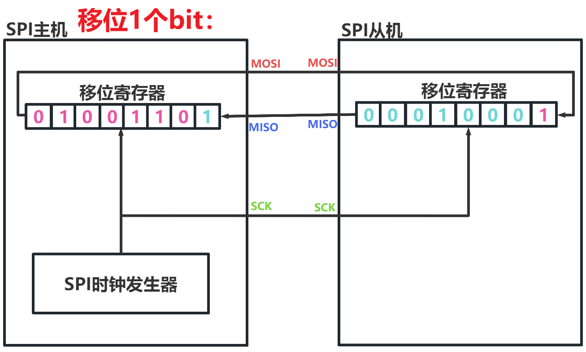

*图2-3SPI通信的移位机制-图3*

最终移位全部完成，移位交换8个bit后：

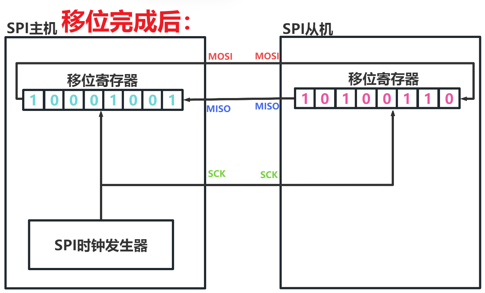

*图2-4SPI通信的移位机制-图4*

现在，你应当可以理解，什么叫做**“数据交换”**了吧？

当然，这个图中还涉及一个小问题：

如果按照图中的移位寄存器，向左移位的方向，逐bit收发数据，这是什么比特序呢？

当然是MSB First。

如果移位的方向反过来，则又变成了另一种比特序——LSB First。

如此，关于SPI的移位机制，我们就搞懂了。

**所以 SPI 通信的本质是：**

1. 主从双方各自拥有一个移位寄存器。
2. 在时钟信号的驱动下，每来一个时钟沿，双方同时移出一位、移入一位
3. **SPI通信本质上是一次“数据交换”，而不是单向发送。**

**这种设计，把通信简化为一个最纯粹的动作——在时钟驱动下的、互相持续移位。**

只要主机产生时钟，数据就必须流动。

每一个时钟周期都必须完成一次 bit 交换，既不会浪费时钟资源，也无需额外的方向控制逻辑。

**因此，SPI 的核心思想不是“发送”或“接收”，而是“同步移位交换”。**

SPI通信的高速，就是这种结构高效、简单所带来的自然结果。

下面我们要进一步来看一下，单片机SPI外设是如何工作的。

我们来研究一下SPI外设框图。

### 3. SPI外设框图

《参考手册》的SPI章节，给出了单片机SPI的外设框图，如下：

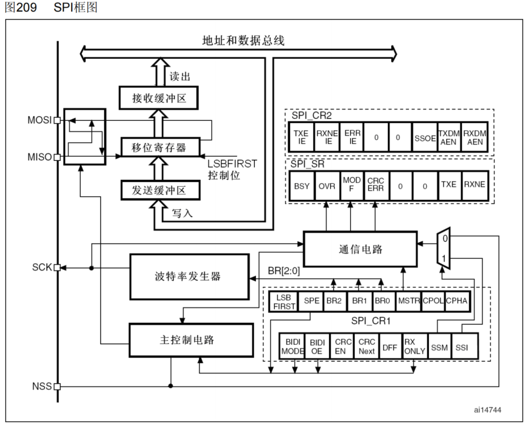

*图3-1SPI外设框图*

我们学STM32已经有一段时间了，再加上我们前面对SPI相关知识的讲解，相信有些同学能够看懂这张图。

但应该也有相当多同学看不懂。

我们应对这种框图，最好的办法还是按照功能进行切割分区，然后每个分区单独进行理解。

其中寄存器部分不进行单独讲解，在其它功能部分中用到了，我们就会提。

这个框图，我把它分解成**三个功能区域**来进行讲解。

#### 3.1 第一部分：数据通路

首先，我们先来看一下这个图左上角部分，也就是SPI外设实现移位通信过程。

把图进行一下裁剪，得到如下图内容：


*图3.1-1SPI数据通路：移位机制-图*

这部分功能框图，涉及的标志位如下：

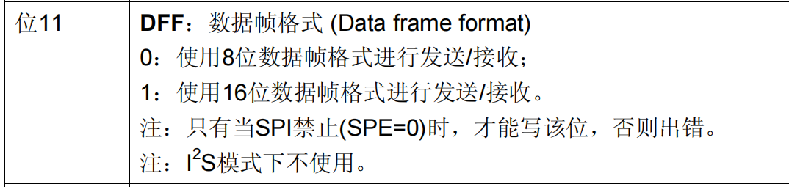

*图3.1-2CR1寄存器描述-图1*

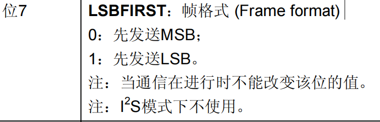

*图3.1-3CR1寄存器描述-图2*

解释说明一下这个图：

1. STM32的SPI外设，其移位寄存器的位数是可以配置的。
   - a. 实际上是通过配置**SPI_CR1寄存器的DFF（Data frame format）位**来实现的。
   - b. 有两种选择，可以配置成8位，也可以配置成16位。
   - c. 也就是说，基于SPI外设实现通信时，可以一次性交换1个字节或2个字节数据。
   - d. **大多数情况下，程序员处理数据都是以字节为单位的，所以8位移位寄存器是最常见的选择！**
   - e. **如果选择8位移位寄存器长度，那么SPI通信一次性移位、收发数据的基本长度就是1个字节。**
2. 配置SPI外设时，可以通过配置**"SPI_CR1寄存器的LSBFIRST位"**，来确定SPI通信的比特序。
3. **图中的“发送缓冲区“，其实就是我们之前讲通信时的发送数据寄存器，它是一个真实存在于SPI外设当中的寄存器。**
4. **图中的“接收缓冲区“，其实就是我们之前讲通信时的接收数据寄存器，它是一个真实存在于SPI外设当中的寄存器。**
5. 图中展示的核心机制就是上一小节的中的，以bit为单位的“数据移位”机制，这里不再赘述。

#### 3.2 SPI通信的数据帧格式

数据帧格式是我们学习串口和I2C通信时，最最核心的概念，没有之一。

下面的图展示了串口通信的数据帧格式：

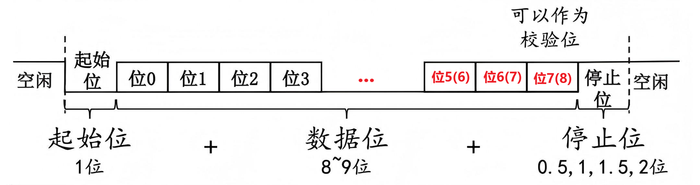

*图3.2-1串口数据帧格式-图*

I2C通信的数据帧格式：

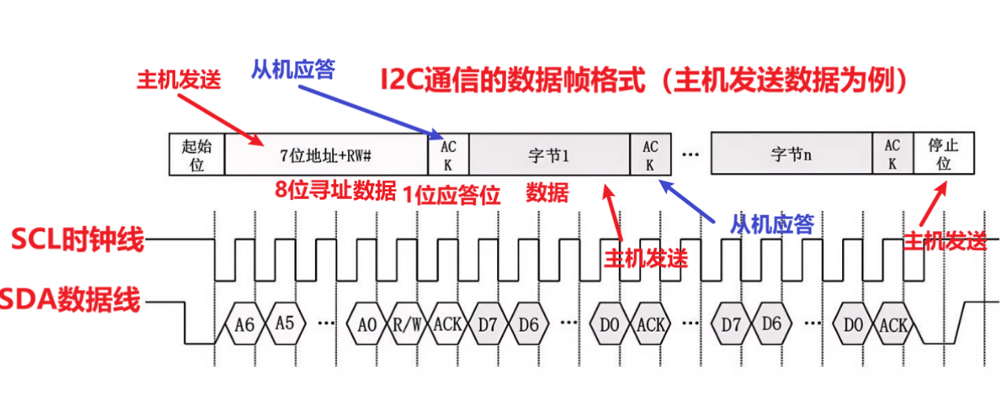

*图3.2-2I2C数据帧格式-图*

1. 很显然串口通信的数据帧格式最固定，固定长度，且每1个bit位做什么也都是固定的。
2. I2C通信的数据帧长度虽然不固定，但也仍然具有起始位、停止位、寻址字节等这些相对比较固定的格式

那么关于SPI，SPI通信的数据帧格式，到底是什么样的呢？有多长啊？起始位停止位有没有？

**为了回答这个问题，我们不妨先思考下面的问题：**

就在上一章节《SPI相关概念》中，我们看过下面的时序图：

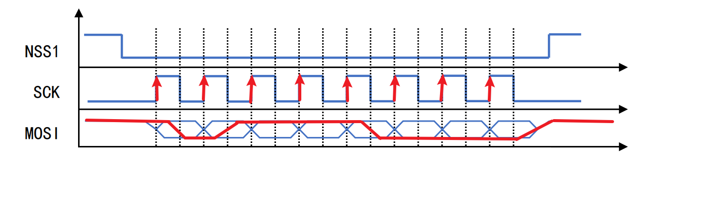

*图3.2-3SPI通信时序-图*

当时我们还得到了这样的一个结论：

SPI通信是非常灵活的，在NSS拉低有效期间，主从双方在1个时钟周期内交换1bit数据，有多少个时钟周期就能交换多少个bit数据。

**SPI通信不受固定的数据帧格式限制，一次通信可以交换不固定数量个bit数据，而且也不需要是必须是8整数倍个bit数据。**

在上一章节中，我们讲过这是SPI的一个优势，数据帧的格式不受限，比较灵活。

但是到了这一章节，我们发现：SPI外设的移位寄存器是8位或16位的，这也就意味着：

使用单片机的SPI外设，进行数据处理交换时，以字节为基本单元，或以半字（2个字节）为基本单元。

这样灵活性不就丧失了吗？

这是什么情况？

之所以会产生这样的疑问，主要的原因是混淆了SPI协议和SPI外设硬件实现上的差异：

1. 从SPI通信协议上来讲，NSS拉低通信时间内，产生多少个时钟周期就能够收发多少bit数据。从协议上确实非常灵活，没有任何限制。
2. 但到了具体硬件实现时，移位寄存器总得确定一个长度，那么8位1个字节，16位2个字节就是最常见的选择了。

也就是说：

1. **SPI协议层面对于数据帧长度的限制是没有的。**
2. 但到了单片机SPI外设硬件实现时，处理数据的基本单元是1个字节或2个字节。

3. **所以有些人会认为配置移位寄存器的长度就是配置数据帧格式的长度，这也有一定道理。**

4. **把移位寄存器的长度，叫做“1帧”，这在很多官方文档、官方库代码中都能够见到。**

上面聊完了，SPI数据帧的长度，那么其它格式限制有吗？

答：完全没有。为什么一直没讲，就是因为没有限制。

至此，关于SPI通信的数据帧格式，我们做以下总结：

1. **从SPI通信协议层面讲：SPI没有数据帧格式的概念，只要符合通信的时序，可以随意进行通信收发交换数据。**
2. **从SPI硬件外设实现层面讲：移位寄存器的长度经常被设置为8位1个字节，所以很多人会认定SPI通信的“1帧”是一个字节。**

3. **具体到通信的从机设备，不同从机设备在通信时，有不同的指令、数据以及行为约束，但这本身和SPI协议没有关系。**

举一个通俗的例子就是：

全球任何国家都是有货币的，你花钱的时候，可以花1元、8元、2.5元、10.8元……

但具体到这个国家的货币体系，印纸币时，总不能所有金额都印一种纸币，所以就选择一些常用金额来印刷纸币。

不同的国家有不同货币，美国总不能花人民币，这就是从机不同，通信方式行为有些许区别，但不是根本区别，因为大家都使用货币。

这是通信的软件协议和硬件实现上的差异性。

**扩展/思考**其实讲完SPI数据帧的问题，SPI为什么快，就可以总结第一个核心因素了：

1. SPI通信中收发的数据几乎100%都是有效数据，没有起始和停止位，没有应答，更没有什么寻址等乱七八糟的内容。
2. SPI通信本身就是交换数据，通信一直都是全双工的，也没有切换通信方向的消耗。

#### 3.3 SPI外设移位机制（以字节为单位）

第一次讲移位机制时，我们是以bit为单位的。

站在整个SPI外设的角度，处理数据是以"整个移位寄存器"为基本单位的：可以一次性处理1个字节，也可以一次性处理2个字节。

一次性处理1个字节是最常见的选择，接下来，以字节为单位，看一下SPI外设的移位机制，是如何运行的。

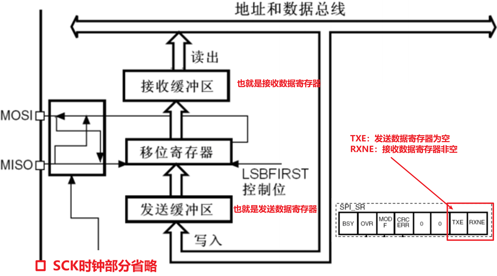

*图3.3-1以字节为单位移位-图*

这一次分析，我们要带上SR寄存器中的标志位，TXE和RXNE。

这两个标志位大家都很熟悉了，这里不再赘述。

SPI外设收发处理一个字节数据的过程是这样的：

1. 主机判断和等待TXE标志位置位，也就是等待发送数据寄存器为空。
2. 在 TXE = 1 的前提下，主机将 1 个字节写入发送数据寄存器（TDR）
3. 该1个字节的数据进入主机移位寄存器，被逐bit移除发送。
4. 与此同时，从机也会逐bit发送数据，主机的移位寄存器也会同步接收这些bit数据。
5. 等待主机接收数据寄存器非空，当主机接收数据寄存器非空时：
   - a. 意味着主机已经将1个字节数据完全发给从机。
   - b. 意味着从机已经将1个字节数据完全发给主机。
6. 主机读接收数据寄存器。

如此一轮操作下来，主机就完成了发送1个字节数据，同时也收到1个字节数据。

#### 3.4 第二部分：主机时钟生成器

SPI外设框图的第二核心区域是，SPI外设主机时钟生成器，如下图所示：

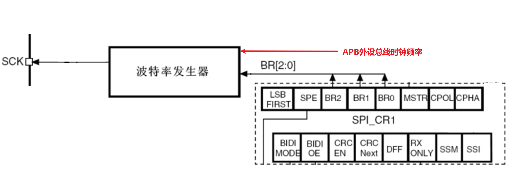

*图3.4-1主机时钟生成器-图*

**SCK 引脚输出时钟信号的时钟频率，是由 APB 外设总线时钟频率，经过“波特率发生器”分频后得到的。**

解释一下这句话。

**第一，APB外设总线的时钟频率是多少？**

这个概念早在串口通信讲波特率时就已经详细讲过了，APB外设总线的时钟频率在默认情况下：

1. APB2外设总线的时钟频率是72MHz。
2. APB1外设总线的时钟频率是36MHz。

参考下列STM32系统结构框图：

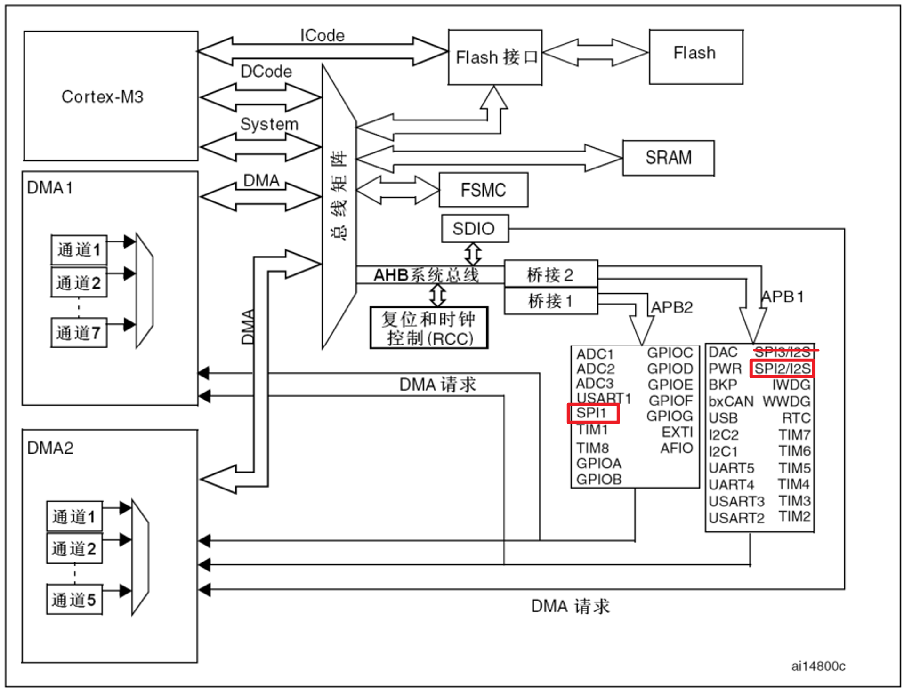

*图3.4-2STM32系统结构框图*

我们所使用的STM32F103C8T6单片机，一共有两个SPI外设，即SPI1和SPI2。

其中SPI1挂载在APB2外设总线上，SPI2挂载在APB1外设总线上。

综上所述：

1. 如果你使用SPI1外设，那么默认情况下，通信的时钟频率是分频72MHz得到的。
2. 如果你使用SPI2外设，那么默认情况下，通信的时钟频率是分频36MHz得到的。

**第二，波特率发生器是什么意思？SPI还有波特率的概念？**

**首先，SPI一定没有波特率这个概念。**

在串口通信中，由于是异步通信，没有时钟信号统一时序，所以才需要通信双方约定波特率来确定每bit数据的时长。

但SPI是同步通信，由时钟信号严格控制时序，完全没必要使用波特率。

那这里的波特率发生器是什么呢？

这里实际上只是一个名称的沿用，就像马路上没有马，波特率发生器也不是生成波特率的。

**波特率发生器，更贴近其功能的叫法应该是“时钟生成器”，它通过对APB外设总线频率进行分频，最终得到SPI通信的时钟频率。**

**第三，波特率生成器的分频系数如何设定呢？**

图上已经展示的非常清楚了，SPI外设的CR1寄存器的三位BR0、BR1、BR2用于确定分频系数。

具体来说，如下图所示：

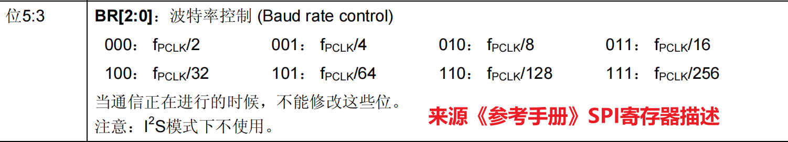

*图3.4-3分频系数设置-图*

从1/2分频，到1/4分频，最高还可以做到1/256分频。

举一个例子：

使用SPI1外设实现SPI通信时，波特率生成器采用1/4分频，那么此时通信中的时钟频率是：72 / 4 = 18MHz那么通信的时钟频率有什么用呢？

#### 3.5 SPI通信时钟频率与传输速率

**I2C和SPI都是同步通信，通信的时序由时钟信号完全控制，通信的速率则由时钟线的时钟频率决定。**

对于SPI通信来说，假设SPI时钟频率是18MHz：

1. 这意味着，每秒钟有18 000 000个时钟周期。
2. 这意味着，在连续传输的情况下，理论上每秒钟能传输有效数据18 000 000 bit。

所以数据的传输速率是：18 000 000 / 8 / 1000 / 1000 = 2.25 MB/s**这是18MHz的SPI通信，在协议层面上的理论最大传输速率。**

在实际工程中，由于各种软硬件因素影响，18MHz时钟频率下，SPI通信通常也能稳定在2MB/s左右的数据传输速率。

这对于串行通信而言，已经是一个非常快的传输速率了。

相比较而言：

1. 串口通信，比较常见的通信速率是115200波特率，折算下来通信速率大约是11KB/s
2. I2C通信的快速模式，时钟频率是400kHz，连续数据传输，折算下来通信速率大约是44KB/s

可以看到，在中低速通信场景中，SPI 的数据传输能力相比 UART 和 I2C 具有数量级上的优势。

扩展/了解：

那这是为什么呢？为什么SPI通信的速度优势这么明显呢？

首先对于串口通信这种异步通信，双方没有统一时钟信号来确定时序，这种设计先天就不可能是高速通信。

串口通信只能靠双方约定波特率后，依靠起始位对齐时间，然后再逐bit的进行过采样判决结果。

某种程度上来说，串口通信的采样过程是一种“盲人摸象”式的采样，本身出错的风险就是存在的。

如果波特率设置过大，那么采样难度就会显著提升，采样的准确度就很难以保证了，那样通信就会完全失败。

而对于I2C来说，它的硬件电路设计天然就是有短板的。

信号线电平的上拉依赖于上拉电阻，这个过程注定是很慢的。

所以I2C通信一旦将时钟频率设置过高，就很容易出现上拉过慢，时序异常的问题。

最后回到SPI通信，它在通信时是完全的一对一，有确定时钟信号统一时序，电平上拉下拉也都是直接完成的。

所以SPI通信的时钟频率可以设置得很高，通信速率非常快。

**如果用通俗的语言来描述，那这三种通信：**

1. 串口就是写信读信，而且还要靠掐表来完成，注定不可能快。
2. I2C就像普通的马路，从设计上来说，就不支持让你飙车。
3. SPI则像高速公路，而且还是一对一的专线高速公路，设计的目的就是跑得快。

#### 3.6 第三部分：主从控制与NSS管理电路

在前面的内容中，我们已经分别讲清楚了 SPI 外设中的数据通路，以及主机模式下的时钟生成电路。

到这里为止，SPI 通信中“数据怎么走”“时钟从哪来”这两件最核心的事情，其实已经解决了。

接下来这部分电路，我们统一称之为**SPI 主从控制与 NSS 管理电路。**

主要解决的都是一个核心问题：此SPI外设在通信中，究竟做主机还是做从机。

**当然我们早就已经确定了，STM32作为通信中的主机，所以我们需要把此SPI外设设置为主机模式。**

这部分电路内容稍多一些，简化后如下图所示：

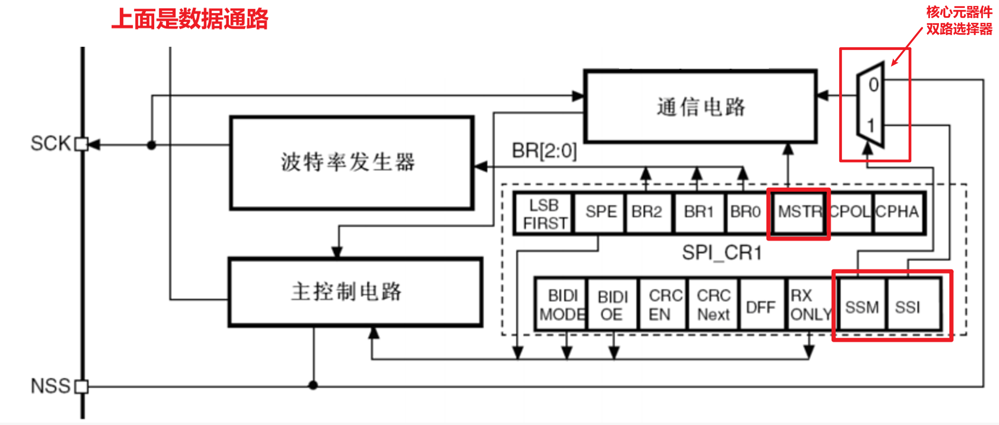

*图3.6-1主从控制与NSS管理电路-图*

**首先，在 STM32 的 SPI 外设中，由 SPI_CR1 寄存器中的 MSTR 位决定其主从身份：**

1. 当 MSTR 被配置为 1 时，SPI 外设工作在主机模式。
2. 当 MSTR 为 0 时，SPI 外设工作在从机模式。

这张图中，我还把上一节讲过的**“时钟发生器”**电路放进来了，这是因为：

1. 主机模式下 SPI 会启用内部的波特率发生器产生 SCK 时钟，对外输出时钟信号。
2. 从机模式下 SPI 则完全依赖外部 SCK 引脚输入的时钟信号，这时候“波特率发生器”

就不工作了。

**然后我们重点来讲一下，NSS引脚及其相关电路。**

首先，在前面的内容中，我们几乎没有刻意提及单片机的 NSS 引脚。

原因很简单，NSS引脚是从机片选使用的，STM32做主机，看起来用不到NSS引脚。

是这样的吗？

**当然不是，这是很明显的误解。**

SPI通信是一种：

完全没有总线仲裁、严格一主机、主机不切换的同步总线通信协议，这固然带来了通信的简洁性和便利性。

但也不可避免带来了一个问题：

如果总线上，确实出现了多台设备竞争主机，怎么办？

从SPI通信协议上来说，不用考虑这个问题，你不符合协议要求，通信失败就是了。

但从硬件设计和工程实用性的角度出发，这样不管不顾就不合理了。

至少需要有一种方式，能够检测并暴露这种非法状态，从而提醒使用者及时发现并解决问题。

**STM32的SPI外设，其NSS引脚以及相关电路，就是被设计用于确认：当前SPI外设作为主机，其身份是否合法。**

也就是说：

从SPI软件协议上来说，不关心什么主机从机冲突问题，但具体到硬件实现时，从实用性出发必须防范这种问题。

那么具体怎么做呢？

要想理解NSS相关电路，首先需要理解右上角的梯形电路符号，这是一个双路选择器：

1. **如果SSM标志位是0，则表示选择上面的0，也就是把NSS引脚的输入电平，送入SPI主控制电路。这种方式，叫做“硬件NSS”。**
2. **如果SSM标志位是1，则表示选择下面的1，也就是把SSI标志位确定的内部电平信号，送入SPI主控制电路。这种方式，叫做“软件NSS”。**

下面展开讲解NSS的两种模式——硬件NSS和软件NSS。

##### 3.6.1 硬件NSS

在CR1寄存器，SSM标志位设置为0的情况下：

此时单片机的 NSS 引脚输入的电平会被直接送入 SPI 主控制电路，用于裁决判断当前STM32的主机身份是否合法。

通俗的讲，此时SPI外设会这么来进行判断：

1. 如果我被配置为主机（MSTR = 1）
2. 那么 NSS 引脚的输入电平必须持续保持为高电平。
3. 而如果发现，NSS引脚的输入电平变成了低电平，则说明总线上“有其它设备试图做主机，选我做从机”
4. 如果出现NSS引脚输入低电平，就表示出现了主机竞争冲突。
5. 此时SPI外设会自动置位SR状态寄存器中的MODF（模式错误）位，也就是说NSS设置与实际情况不符合。
6. 最终SPI外设会自动清除 MSTR 位，强制退出主机模式。

需要注意的是：

**使用硬件NSS必须选择引脚定义表中的固定NSS引脚，不能选择随意引脚。**

比如：

| 引脚号 | 引脚名称 | 类型 | I/O 口电平 | 主功能 | 默认复用功能 |
|---|---|---|---|---|---|
| 14 | PA4 | I/O | / | PA4 | SPI1_NSS/USART2_C |

下面再介绍一下软件NSS。

##### 3.6.2 软件NSS

在CR1寄存器，SSM标志位设置为1的情况下，此时SSI标志位的值决定主控制电路的输入电平：

1. 如果SSI标志位设置为0（复位），那么主控制电路的输入电平就固定是低电平。
2. 如果SSI标志位设置为1（置位），那么主控制电路的输入电平就固定是高电平。

所以：

**在MSTR = 1，单片机SPI外设被设置为主机时，只需要设置SSM = 1，SSI = 1，就是告诉SPI外设：**

**我一直都是主机，你别操心我的主机身份了，我是神圣且合法的主机。**

当然：

在MSTR = 1，单片机SPI外设被设置为主机，且SSM = 1选择软件NSS的前提下，如果SSI = 0，则依然表示模式错误。

##### 3.6.3 硬件NSS和软件NSS如何选择？

现在我们的需求是：STM32始终做主机不切换。

所以如果选择使用硬件NSS，会有以下麻烦：需要将固定的NSS引脚，接入3.3V，表示NSS引脚始终输入高电平，从而固定STM32主机身份。

但如果选择软件NSS，则只需要设置三个标志位就行了：

**设置MSTR = 1，SSM = 1，SSI = 1**从编程角度来说，只需要一个函数调用即可解决，无需任何额外操作和接线。

很显然，在我们当前的需求中，直接用软件NSS是最合适的。

##### 3.6.4 总结

总得来说，在STM32做主机时，建议大家选择软件NSS，直接固定自身主机身份。

如果需要STM32做从机，则可以选择硬件NSS。

如下图所示：

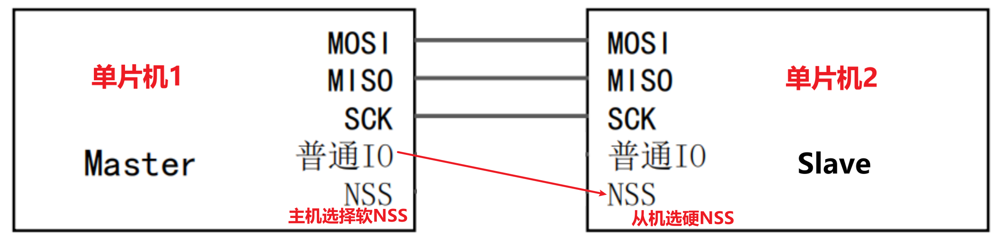

*图3.6.4-1单片机做从机-图*

你搞懂了吗？

---

## 03 引脚和外设初始化

### 1. 概述

到此为止，关于SPI通信的时序，STM32的SPI外设，这些内容，我们都基本搞清楚了。

一直讲理论未免太枯燥，所以我们先来写一部分代码。

这一章节，我们按照顺序来完成：

1. 单片机SPI通信的引脚和工作模式选择
2. 单片机与W25Q64通信实验接线
3. SPI通信引脚和外设的初始化

除此之外，我们还需要来实现一个“与从机无关的、通用的”SPI通信数据交换函数。

### 2. 引脚和工作模式选择

首先我们选择的SPI外设是：SPI1它挂载在时钟频率默认是72MHz的APB2外设总线上。

《参考手册》的AFIO模块提供了各个外设的引脚复用、重定义选择。

比如SPI1外设，如下图所示：

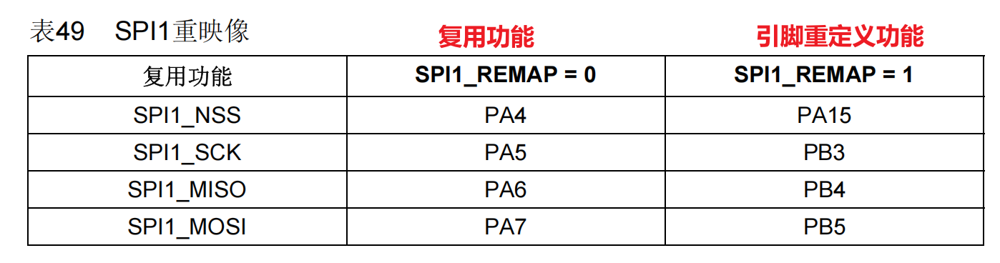

*图2-1引脚和工作模式选择-图*

直接查手册，而不是查引脚定义表，更方便一些。

所以我们选择的引脚是：

SPI1_SCK ---- PA5SPI1_MISO ---- PA6SPI1_MOSI ---- PA7SPI1_NSS ---- 不使用，直接配置软件NSS即可那么这些引脚都需要配置成什么工作模式呢？

《参考手册》的"GPIO外设配置"小节中，也对外设使用GPIO引脚时，设置的工作模式做了推荐。

SPI外设的推荐工作模式，如下图所示：

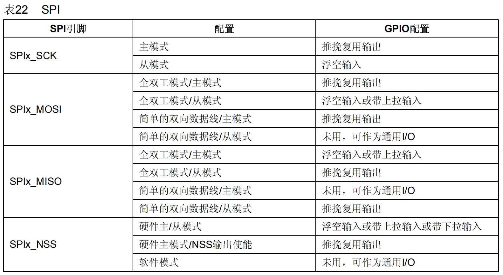

*图2-2引脚和工作模式选择-图2*

最终结论是：

SPI1_SCK，即单片机的PA5引脚，设置工作模式为推挽复用输出模式。

SPI1_MISO，即单片机的PA6引脚，设置工作模式为浮空输入模式。

SPI1_MOSI，即单片机的PA7引脚，设置工作模式为推挽复用输出模式。

其中SCK和MOSI引脚，都需要强推输出高低电平，所以选择推挽输出模式，将输出控制权交给SPI1外设，所以是复用推挽输出模式。

**MISO引脚需要接收从机的输入，所以选择浮空输入模式是最常见、最推荐的。**

上拉输入模式也可以选择的，和浮空输入区别不大。

但不能选择下拉输入模式，下拉输入模式中的下拉电阻对整个通信的过程是有害的。

最后还需要选择一个普通GPIO引脚，作为单片机连接从机片选NSS引脚的控制引脚。

### 3. W25Q64通信实验接线

首先，拿出设备盒中的W25Q64，如下图所示：

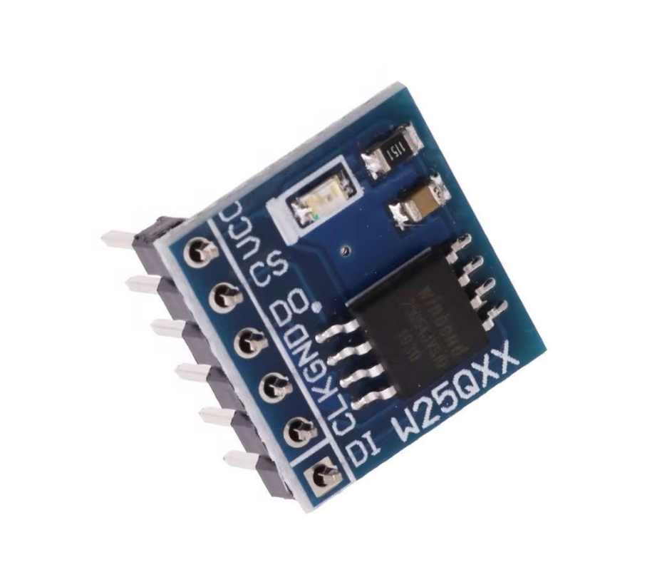

*图3-1W25Q64实物-图*

然后按照下列方式进行接线：

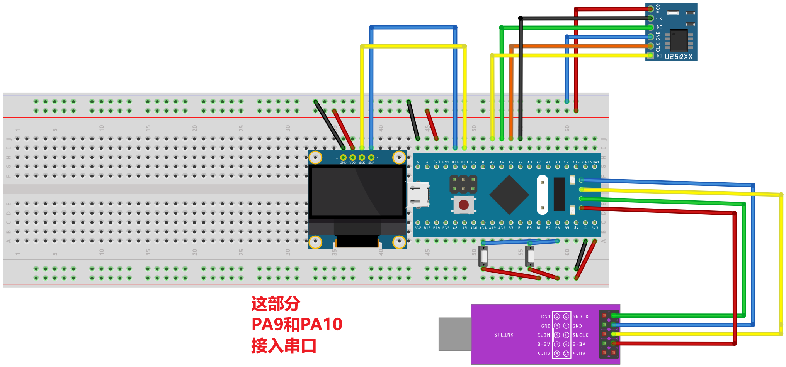

*图3-2W25Q64通信实验接线-图*

说明一下这张图：

1. PA9和PA10是用于接入PC端USB转串口设备的，图中没有画出，但你要把线接好，我们做实验会用到串口。
2. 关于W25Q64是什么，怎么用，下一小节再讲。
3. W25Q64的6个引脚都需要接入面包板，需要用六根“公对母”杜邦线。
4. 接线的时候要认真仔细，不要接错了。

**W25Q64的CS片选引脚 ---- 单片机PA4引脚（普通IO引脚）**

**W25Q64的DO输出引脚 ---- 单片机PA6引脚（MISO）**

**W25Q64的CLK时钟引脚 ---- 单片机PA5引脚（CLK）**

**W25Q64的DI输入引脚 ---- 单片机PA7引脚（MOSI）**

### 4. SPI通信引脚和外设的初始化

到这里，我们就可以开始进行通信引脚的初始化工作，以及SPI外设的初始化工作。

当然，本章节还无法看到实验现象，只能完成一些基础的、关于SPI的初始化配置的工作。

具体做实验，还需要到下一章节《W25Q64的使用》。

首先我们在工程模版的基础上，新建一个"W25Q64"模块，创建对应头文件和实现源文件。

#### 4.1 引脚初始化

首先我们在"W25Q64.h"头文件中新增以下内容：

```c
#ifndef __W25Q64_H
#define __W25Q64_H

#include "stm32f10x.h"
#include <stdint.h>

/**
 * @brief 初始化 W25Q64 模块（SPI1 GPIO部分）
 */
void W25Q64_GPIO_Init(void);

/**
 * @brief 初始化 W25Q64 模块（SPI1外设初始化）
 */
void W25Q64_SPI1_Init(void);

#endif
```

注意，由于是第一次写，所以我们把GPIO引脚初始化，和SPI1外设初始化分开了。

但实际上它们完全可以合并成同一个初始化函数。

其中引脚初始化的函数，实现代码如下所示：

```c
#include "W25Q64.h"

/*
 * W25Q64 与 STM32 的硬件连接关系如下：
 *
 * W25Q64_CS —— PA4 （普通 GPIO 推挽输出，软件片选）
 * W25Q64_DO —— PA6 （SPI1_MISO，从机输出 / 主机输入）
 * W25Q64_CLK —— PA5 （SPI1_SCK，时钟信号）
 * W25Q64_DI —— PA7 （SPI1_MOSI，主机输出 / 从机输入）
 *
 * SPI 外设使用：SPI1
 */

/**
 * @brief 初始化 W25Q64 相关的 GPIO 引脚
 * @param 无
 * @retval 无
 * @note
 * 1. PA5 配置为 SPI1_SCK —— 复用推挽输出模式
 * 2. PA7 配置为 SPI1_MOSI —— 复用推挽输出模式
 * 3. PA6 配置为 SPI1_MISO —— 浮空输入模式
 * 4. PA4 配置为 W25Q64_CS —— 通用推挽输出模式
 * 5. PA4 引脚默认输出高电平，表示不选中从机
 */
void W25Q64_GPIO_Init(void) {
    // 1. 开启 GPIOA 外设时钟
    RCC_APB2PeriphClockCmd(RCC_APB2Periph_GPIOA, ENABLE);

    // 2. SPI1_SCK —— PA5，设置为复用推挽输出
    // SPI1_MOSI —— PA7，设置为复用推挽输出
    GPIO_InitTypeDef GPIO_InitStructure;
    GPIO_InitStructure.GPIO_Pin = GPIO_Pin_5 | GPIO_Pin_7;
    GPIO_InitStructure.GPIO_Mode = GPIO_Mode_AF_PP;
    // SPI是高速通信协议，选择较快的引脚输出速度，快速翻转电平以满足通信需求
    GPIO_InitStructure.GPIO_Speed = GPIO_Speed_50MHz;
    GPIO_Init(GPIOA, &GPIO_InitStructure);

    // 3. SPI1_MISO —— PA6，浮空输入模式
    GPIO_InitStructure.GPIO_Pin = GPIO_Pin_6;
    GPIO_InitStructure.GPIO_Mode = GPIO_Mode_IN_FLOATING;
    GPIO_Init(GPIOA, &GPIO_InitStructure);

    // 5. W25Q64_CS —— PA4，通用推挽输出
    GPIO_InitStructure.GPIO_Pin = GPIO_Pin_4;
    GPIO_InitStructure.GPIO_Mode = GPIO_Mode_Out_PP;
    GPIO_Init(GPIOA, &GPIO_InitStructure);

    // 6. PA4引脚默认输出高电平，默认不选中从机（CS = 高电平）
    GPIO_SetBits(GPIOA, GPIO_Pin_4);
}

```

稍微需要注意的就是：

**单片机主机与从机连接的片选线，在初始化完成后，建议手动拉高，以表示未片选从机。**

#### 4.2 初始化SPI1外设

初始化SPI1外设，其函数实现参考代码如下：

```c
#include "W25Q64.h"

/**
  * @brief 初始化 SPI1 外设，用于与 W25Q64 进行通信
  * @param 无
  * @retval 无
  * @note
  * 1. SPI1 工作在主机模式
  * 2. 数据位宽为 8 bit
  * 3. SPI 模式选择 Mode 0（CPOL=0，CPHA=0）
  * 4. 采用软件方式管理 NSS（SSM=1，SSI=1）
  * 5. SPI 时钟频率为 PCLK2 / 4（默认为 18MHz）
  * 实际上也可以将分频系数选更大一些，SCK时钟频率更大一些
  */
void W25Q64_SPI1_Init(void) {
    // 1. 开启 SPI1 外设时钟（SPI1 挂载在 APB2 总线上）
    RCC_APB2PeriphClockCmd(RCC_APB2Periph_SPI1, ENABLE);

    // 2.设置SPI通信基本参数
    SPI_InitTypeDef SPI_InitStructure;

    // 选择通信方式为SPI全双工，2线模式
    SPI_InitStructure.SPI_Direction =SPI_Direction_2Lines_FullDuplex;
    // 设置STM32为主机模式
    SPI_InitStructure.SPI_Mode = SPI_Mode_Master;
    // 设置SPI1外设移位寄存器长度是8bit
    SPI_InitStructure.SPI_DataSize = SPI_DataSize_8b;

    // 时序结构选择SPI Mode 0：空闲时钟为低电平，第一个边沿采样
    SPI_InitStructure.SPI_CPOL = SPI_CPOL_Low;
    SPI_InitStructure.SPI_CPHA = SPI_CPHA_1Edge;
    // 比特序选择MSB First，优先发最高有效位
    SPI_InitStructure.SPI_FirstBit = SPI_FirstBit_MSB;

    // CRC校验功能没有开启，可以不管这个成员
    // 启动CRC校验功能会使得数据发送时附加额外信息，但W25Q64从机通常不会处理这些附加信息，使用CRC校验反而会导致通信失败
    // CRC校验功能只在双方约定好都使用时才有意义，否则不要随意启用它
    // SPI_InitStruct.SPI_CRCPolynomial = ;

    // 采用软件NSS
    SPI_InitStructure.SPI_NSS = SPI_NSS_Soft;

    // SPI1时钟线分频系数：当前选择1/4分频
    // 时钟线频率为：72 / 4 = 18MHz
    SPI_InitStructure.SPI_BaudRatePrescaler =SPI_BaudRatePrescaler_4;

    // 3.调用函数，初始化 SPI1 外设
    SPI_Init(SPI1, &SPI_InitStructure);

    // 4.选择软件NSS时，需要额外调用此函数，用于设置SSI为1，代表输入高电平
    SPI_NSSInternalSoftwareConfig(SPI1, SPI_NSSInternalSoft_Set);

    // 5. 真正开启 SPI1 外设
    SPI_Cmd(SPI1, ENABLE);
}

```

代码当中都有注释，如果有疑惑可以直接阅读注释，基本都能搞懂。

先讲一个函数调用：

```c
SPI_NSSInternalSoftwareConfig(SPI1, SPI_NSSInternalSoft_Set);
```

**在单片机作为主机，采用软件NSS的前提下，需要手动置位SSI位（设置为1）表示不校验主机身份。**

此函数调用就是实现这个功能的。

然后还有下面这一段代码：

```c
// 时序结构选择SPI Mode 0：空闲时钟为低电平，第一个边沿采样
SPI_InitStructure.SPI_CPOL = SPI_CPOL_Low;
SPI_InitStructure.SPI_CPHA = SPI_CPHA_1Edge;
// 比特序选择MSB First，优先发最高有效位
SPI_InitStructure.SPI_FirstBit = SPI_FirstBit_MSB;
```

为什么把SPI通信的时序结构，设置为Mode0，MSB First呢？

**我们在前面讲时序结构时，提到过：SPI通信协议提供了多种时序结构可选择，主要目的就是为了适配不同从机对时序的要求。**

所以，之所以这么设置时序结构，都是从机W25Q64 的要求。

那我怎么知道这是W25Q64 从机的要求呢？

当然不是我猜的，而是通过查阅W25Q64 的官方文档得知的。

你可以从下面位置找到这个W25Q64的相关手册：


*图4.2-1W25Q64官方文档-图*

对于W25Q64支持的SPI通信的各项参数，文档中都有详细的交代，如下图所示：

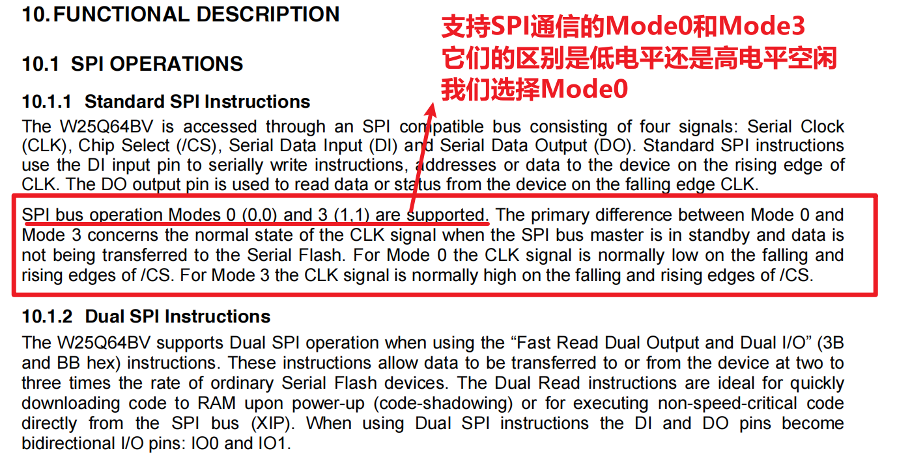

*图4.2-2W25Q64官方文档-图2*

比特序的相关描述，如下图所示：

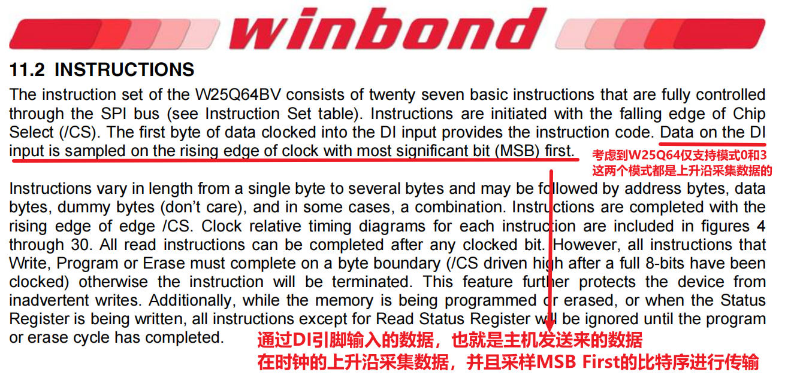

*图4.2-3W25Q64官方文档-图3*

**STM32的SPI1外设，其SCK时钟信号分频可以设置为4分频（时钟信号频率是18MHz）**

**这个设置相对比较保守，主要考虑到我们使用面包板接线，电路不是很稳定，所以稍微降降速，避免出问题。**

实际上你完全可以设置得更高一些（2分频、36MHz），因为W25Q64 的官方文档中，有如下内容：

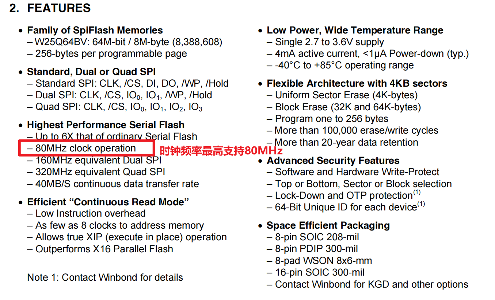

*图4.2-4W25Q64官方文档-图5*

至此，我们的W25Q64实验代码的第一部分就完成了。

#### 4.3 数据收发函数

在串口和I2C通信中，完成基础的初始化配置工作后，紧接着就需要编写基本的发送和接收数据的函数了。

SPI通信也不例外，但稍有区别的是：

SPI通信是全双工，且发送1个字节，就要收到1个字节。

**整个过程在上一章节已经分析过了，SPI外设收发处理一个字节数据的过程是这样的：**

1.主机判断和等待TXE标志位置位，也就是等待发送数据寄存器为空。

2.在 TXE = 1 的前提下，主机将 1 个字节写入发送数据寄存器（TDR）

3.该1个字节的数据进入主机移位寄存器，被逐bit移除发送。

4.与此同时，从机也会逐bit发送数据，主机的移位寄存器也会同步接收这些bit数据。

5.等待主机接收数据寄存器非空，当主机接收数据寄存器非空时：

6.意味着主机已经将1个字节数据完全发给从机。

7.意味着从机已经将1个字节数据完全发给主机。

8.主机读接收数据寄存器。

如此一轮操作下来，主机就完成了发送1个字节数据，同时也收到1个字节数据。

现在我们要写代码实现这个函数。

比较简单，不再过多分析，直接上参考代码：

```c
/**
  * @brief SPI1 发送并接收 1 个字节数据
  * @param data：待发送的数据
  * @retval 接收到的数据
  * @note
  * SPI 为全双工通信：
  * 发送 1 个字节的同时，必然会接收 1 个字节
  */
static uint8_t SPI1_TransferByte(uint8_t data) {
    // 1. 等待发送数据寄存器为空（TXE = 1）
    while (SPI_I2S_GetFlagStatus(SPI1, SPI_I2S_FLAG_TXE) == RESET);

    // 2. 待发送1个字节数据写入发送数据寄存器，主机发送1个字节数据给从机
    SPI_I2S_SendData(SPI1, data);

    // 3. 等待接收数据寄存器非空（RXNE = 1）
    while (SPI_I2S_GetFlagStatus(SPI1, SPI_I2S_FLAG_RXNE) ==RESET);

    // 4. 读接收数据寄存器，获取从机发送的1个字节数据
    return SPI_I2S_ReceiveData(SPI1);
}

```

此函数用于W25Q64内部逻辑实现，所以不需要将它暴露在外界，它不需要将声明写入头文件。

可以在源文件中实现它，并用static修饰函数。

下面我们再提供两个用于选中/取消选中W25Q64从机通信。

#### 4.4 从机片选与取消片选函数

选中就是拉低CS，取消选中就是拉高CS。

这两个函数用于W25Q64内部逻辑实现，所以不需要将它们暴露在外界，它们不需要写入头文件。

可以在源文件中实现它们，并用static修饰它们的函数。

参考代码如下：

```c
/**
 * @brief 选中 W25Q64（CS = 0）
 * @param 无
 * @retval 无
 */
static void W25Q64_Select(void) {
    GPIO_ResetBits(GPIOA, GPIO_Pin_4);
}

/**
 * @brief 取消选中 W25Q64（CS = 1）
 * @param 无
 * @retval 无
 */
static void W25Q64_Deselect(void) {
    GPIO_SetBits(GPIOA, GPIO_Pin_4);
}

```

以上，所有的准备工作都搞定了，下一章节我们来学习一个W25Q64的使用，并完成相关实验。

#### 4.5 初始化配置部分完整参考代码

此时**W25Q64.h**的完整代码如下：

```c
#ifndef __W25Q64_H
#define __W25Q64_H

#include "stm32f10x.h"
#include <stdint.h>

/**
 * @brief 初始化 W25Q64 模块（SPI1 GPIO部分）
 */
void W25Q64_GPIO_Init(void);

/**
 * @brief 初始化 W25Q64 模块（SPI1外设初始化）
 */
void W25Q64_SPI1_Init(void);

#endif

```

**W25Q64.c**的完整参考代码如下：

```c
#include "W25Q64.h"

/*
 * W25Q64 与 STM32 的硬件连接关系如下：
*
 * W25Q64_CS —— PA4 （普通 GPIO 推挽输出，软件片选）
 * W25Q64_DO —— PA6 （SPI1_MISO，从机输出 / 主机输入）
 * W25Q64_CLK —— PA5 （SPI1_SCK，时钟信号）
 * W25Q64_DI —— PA7 （SPI1_MOSI，主机输出 / 从机输入）
 *
 * SPI 外设使用：SPI1
 */

/**
 * @brief 初始化 W25Q64 相关的 GPIO 引脚
 * @param 无
 * @retval 无
 * @note
 * 1. PA5 配置为 SPI1_SCK —— 复用推挽输出模式
 * 2. PA7 配置为 SPI1_MOSI —— 复用推挽输出模式
 * 3. PA6 配置为 SPI1_MISO —— 浮空输入模式
 * 4. PA4 配置为 W25Q64_CS —— 通用推挽输出模式
 * 5. PA4 引脚默认输出高电平，表示不选中从机
 */
void W25Q64_GPIO_Init(void) {
    // 1. 开启 GPIOA 外设时钟
    RCC_APB2PeriphClockCmd(RCC_APB2Periph_GPIOA, ENABLE);

    // 2. SPI1_SCK —— PA5，设置为复用推挽输出
    // SPI1_MOSI —— PA7，设置为复用推挽输出
    GPIO_InitTypeDef GPIO_InitStructure;
    GPIO_InitStructure.GPIO_Pin = GPIO_Pin_5 | GPIO_Pin_7;
    GPIO_InitStructure.GPIO_Mode = GPIO_Mode_AF_PP;
    // SPI是高速通信协议，选择较快的引脚输出速度，快速翻转电平以满足通信需求
    GPIO_InitStructure.GPIO_Speed = GPIO_Speed_50MHz;
    GPIO_Init(GPIOA, &GPIO_InitStructure);

    // 3. SPI1_MISO —— PA6，浮空输入模式
    GPIO_InitStructure.GPIO_Pin = GPIO_Pin_6;
    GPIO_InitStructure.GPIO_Mode = GPIO_Mode_IN_FLOATING;
    GPIO_Init(GPIOA, &GPIO_InitStructure);

    // 5. W25Q64_CS —— PA4，通用推挽输出
    GPIO_InitStructure.GPIO_Pin = GPIO_Pin_4;
    GPIO_InitStructure.GPIO_Mode = GPIO_Mode_Out_PP;
    GPIO_Init(GPIOA, &GPIO_InitStructure);

    // 6. PA4引脚默认输出高电平，默认不选中从机（CS = 高电平）
    GPIO_SetBits(GPIOA, GPIO_Pin_4);
}

/**
  * @brief 初始化 SPI1 外设，用于与 W25Q64 进行通信
  * @param 无
  * @retval 无
  * @note
  * 1. SPI1 工作在主机模式
  * 2. 数据位宽为 8 bit
  * 3. SPI 模式选择 Mode 0（CPOL=0，CPHA=0）
  * 4. 采用软件方式管理 NSS（SSM=1，SSI=1）
  * 5. SPI 时钟频率为 PCLK2 / 4（默认为 18MHz）
  * 实际上也可以将分频系数选更大一些，SCK时钟频率更大一些
  */
void W25Q64_SPI1_Init(void) {
    // 1. 开启 SPI1 外设时钟（SPI1 挂载在 APB2 总线上）
    RCC_APB2PeriphClockCmd(RCC_APB2Periph_SPI1, ENABLE);

    // 2.设置SPI通信基本参数
    SPI_InitTypeDef SPI_InitStructure;

    // 选择通信方式为SPI全双工，2线模式
    SPI_InitStructure.SPI_Direction =SPI_Direction_2Lines_FullDuplex;
    // 设置STM32为主机模式
    SPI_InitStructure.SPI_Mode = SPI_Mode_Master;
    // 设置SPI1外设移位寄存器长度是8bit
    SPI_InitStructure.SPI_DataSize = SPI_DataSize_8b;

    // 时序结构选择SPI Mode 0：空闲时钟为低电平，第一个边沿采样
    SPI_InitStructure.SPI_CPOL = SPI_CPOL_Low;
    SPI_InitStructure.SPI_CPHA = SPI_CPHA_1Edge;
    // 比特序选择MSB First，优先发最高有效位
    SPI_InitStructure.SPI_FirstBit = SPI_FirstBit_MSB;

    // 采用软件NSS
    SPI_InitStructure.SPI_NSS = SPI_NSS_Soft;

    // SPI1时钟线分频系数：当前选择1/4分频
    // 时钟线频率为：72 / 4 = 18MHz
    SPI_InitStructure.SPI_BaudRatePrescaler =SPI_BaudRatePrescaler_4;

    // 3.调用函数，初始化 SPI1 外设
    SPI_Init(SPI1, &SPI_InitStructure);

    // 4.选择软件NSS时，需要额外调用此函数，用于设置SSI为1，代表输入高电平
    SPI_NSSInternalSoftwareConfig(SPI1, SPI_NSSInternalSoft_Set);

    // 5. 真正开启 SPI1 外设
    SPI_Cmd(SPI1, ENABLE);
}

/**
  * @brief SPI1 发送并接收 1 个字节数据
  * @param data：待发送的数据
  * @retval 接收到的数据
  * @note
  * SPI 为全双工通信：
  * 发送 1 个字节的同时，必然会接收 1 个字节
  */
static uint8_t SPI1_TransferByte(uint8_t data) {
    // 1. 等待发送数据寄存器为空（TXE = 1）
    while (SPI_I2S_GetFlagStatus(SPI1, SPI_I2S_FLAG_TXE) ==RESET);

    // 2. 待发送1个字节数据写入发送数据寄存器，主机发送1个字节数据给从机
    SPI_I2S_SendData(SPI1, data);

    // 3. 等待接收数据寄存器非空（RXNE = 1）
    while (SPI_I2S_GetFlagStatus(SPI1, SPI_I2S_FLAG_RXNE) ==RESET);

    // 4. 读接收数据寄存器，获取从机发送的1个字节数据
    return SPI_I2S_ReceiveData(SPI1);
}

/**
 * @brief 选中 W25Q64（CS = 0）
 * @param 无
 * @retval 无
 */
static void W25Q64_Select(void) {
    GPIO_ResetBits(GPIOA, GPIO_Pin_4);
}

/**
 * @brief 取消选中 W25Q64（CS = 1）
 * @param 无
 * @retval 无
 */
static void W25Q64_Deselect(void) {
    GPIO_SetBits(GPIOA, GPIO_Pin_4);
}

```

当然：

你完全可以把初始化引脚和初始化SPI1外设的两个函数合并成一个函数，即初始化W25Q64：W25Q64_Init()函数。

完全没有问题。

---

## 04 W25Q64的使用

### 1. W25Q64简介

W25Qxx 系列是**台湾Winbond（华邦电子）**设计生产的，一种低成本、小型化、使用简单的**非易失性存储器**。

通常来说，这种**基于 SPI 接口进行通信**的非易失性存储器，被统称为**SPI Flash**。

它们常应用于数据存储、字库存储、图片资源存储、固件程序存储等场景。

STM32F103C8T6 单片机内部仅集成了 64 KB 的 Flash 闪存，如果觉得还不够用，此时可以通过外挂 W25Qxx 系列 SPI Flash 来实现存储扩容。

**通俗地说，W25Qxx 就是给单片机外挂的一个“U盘”，用于存放那些内部 Flash 放不下、但又需要长期保存的数据。**

W25Q64中的"W"，华邦电子公司名Winbond的缩写简写。

25. ：通常表示这是**Serial Flash / SPI Flash**这一类器件

Q ：通常表示它支持**Quad SPI（四线 SPI）**这一类扩展能力**W25Qxx中的 “xx”，表示该芯片的容量为：xx Mbit。**

**注意单位是 Mbit，而不是 MByte（MB），换算关系是：8Mbit = 1MByte（MB）**

常见的容量有：

| 型号 | 容量（Mbit） | 容量（MB） | 说明 |
|---|---|---|---|
| W25Q16 | 16Mbit | 2 MB | 容量过小，基本不会使用，除非特别缺钱且容量需求特别小。 |
| W25Q32 | 32Mbit | 4 MB | 偶尔使用，容量有限，可以存少量图片资源或简单字库等内容。 |
| W25Q64 | 64Mbit | 8 MB | 最常见、最常用，综合性价比最高。容量适中，使用广泛。 |
| W25Q128 | 128Mbit | 16 MB | 使用较多。适合存储较多资源，常见于中高端产品。 |
| W25Q256 | 256Mbit | 32 MB | 使用相对较少，成本比较高，特别需要大容量时可以考虑使用。 |

更高容量的，比如W25Q512也是存在的，但由于成本和使用不方便等问题，可以说几乎没人使用。

**在实际工程和教学中，W25Q64 是最具代表性的型号，它在容量、成本和使用复杂度之间取得了非常好的平衡。**

除了容量以外，W25Q64 还具有以下特点：

1. 基于标准SPI通信接口，传输速率快。支持SPI Mode0和Mode3，采用MSB First比特序。
2. 最大支持80MHz时钟线频率，还可以通过接入多条数据线，等效实现更高的时钟频率。
3. **主机通过 SPI 向 W25Q64 发送不同的操作指令，再配合地址空间，进而实现各种操作。**

当然这三条不足以完全描述W25Q64 的使用，我们暂时先了解这些，下面我们一边使用，一边来详细了解W25Q64 。

### 2. 实验1：读取JEDEC ID

JEDEC ID是什么？

JEDEC ID 是 SPI Flash 提供的一种**芯片身份标识信息**，具体来说，由“厂商ID + 存储类型代码 + 容量代码”三部分组成。

通过读取JEDEC ID，一方面可以让我们了解使用的芯片，更重要的是：

**一旦读取成功，说明电路的接线，引脚和外设的配置，以及基础的SPI通信流程，都是完全没问题的。**

所以，读取 JEDEC ID属于SPI Flash驱动中的基本操作，点火测试操作。

W25Q64 官方手册中，对此操作的流程与结果都有详细描述，如下图所示：

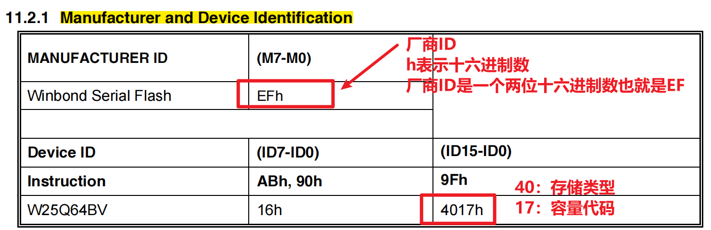

*图2-1读取JEDECID-图*

相关操作的手册内容如下：

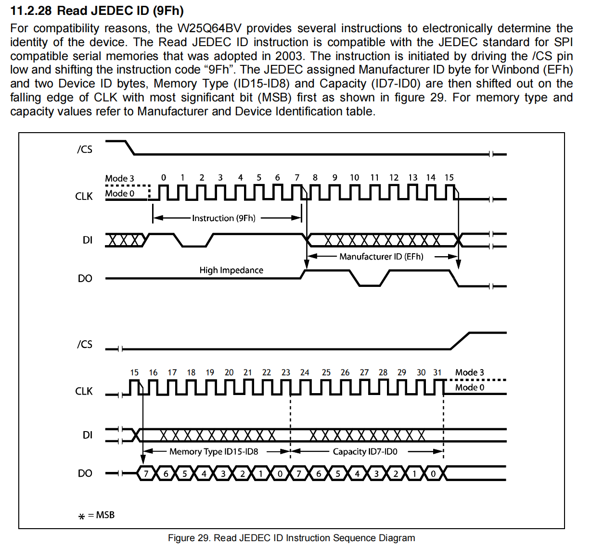

*图2-2读取JEDECID-图2*

如果使用的是台湾华邦电子生产的W25Q64，那么读出来的这三个字节数据是：

1. 厂商ID是0xEF，表示生产厂商为**Winbond（华邦电子）**
2. 存储类型代码是0x40，表示这是3.3V的SPI NOR Flash 存储器
3. 存储容量代码是0x17，代表64Mbit的存储容量，即8MB的存储容量。

当然，你实际拿到的器件不一定都是华邦原厂的，也可能是其它厂商生产的兼容芯片。

**这样你读JEDEC ID就会读出一些不同的数据，比如可能读出下面的三个字节数据：**

0x20、0x70、0x17其中：

1. 厂商ID是0x20：
   - a. 这代表SPI Flash的生产厂商是XMC，武汉新芯集成电路股份有限公司
   - b. 这家公司生产一种W25Q64的兼容芯片，操作使用的方式和W25Q64几乎完全一致。
2. 存储类型代码是0x70，配合厂商ID是0x20，代表这是XMC公司早期生产的一种SPI Flash设备——XM25QH64A
3. 存储容量代码是0x17，代表64Mbit的存储容量，即8MB的存储容量。

当然，存储容量代码比较常见的还有0x16这个数据，代表存储容量是32Mbit，4MB。

**读取 JEDEC ID 的完整通信流程：**

1. 主机拉低 CS，主导开始一次与从机的 SPI 通信。
2. 主机发送 JEDEC ID 读取指令：0x9F。
3. 主机继续发送1个字节“空数据”，换取从机返回第一个字节，即厂商ID。
4. 主机继续发送1个字节“空数据”，换取从机返回第二个字节，即存储类型代码。
5. 主机继续发送1个字节“空数据”，换取从机返回第三个字节，即容量代码。
6. 主机拉高 CS，结束本次 SPI 通信。

这个流程中的函数基本全部都实现了，调用一下就可以了。

参考代码如下图所示：

```c
/**
 * @brief 读取 W25Q64 的 JEDEC ID
 */
void W25Q64_ReadJEDECID(uint8_t *ManufacturerID,
                      uint8_t *MemoryType,
                      uint8_t *Capacity);

/**
 * @brief 读取 W25Q64 的 JEDEC ID
 * @param *ManufacturerID ：获取厂商 ID
 * @param *MemoryTypeID ：获取存储类型
 * @param *CapacityID ：获取容量代码
 * @retval 无
 */
void W25Q64_ReadJEDECID(uint8_t *ManufacturerID,
                      uint8_t *MemoryTypeID,
                      uint8_t *CapacityID) {
    // 1. 选中 W25Q64，从机片选拉低
    W25Q64_Select();

    // 2. 发送 JEDEC ID 指令 0x9F（接收数据无意义，返回值无需接收）
    SPI1_TransferByte(0x9F);

    // 3. 连续发送3个无意义字节，读取W25Q64返回的 3 个字节
    // 0xFF位置可以填任意1字节数据
    *ManufacturerID = SPI1_TransferByte(0xFF);
    *MemoryTypeID = SPI1_TransferByte(0xFF);
    *CapacityID = SPI1_TransferByte(0xFF);

    // 4. 取消片选，结束本次 SPI 通信
    W25Q64_Deselect();
}

```

测试代码如下：

```c
#include "stm32f10x.h"
#include "OLED.h"
#include "W25Q64.h"

int main(void) {
    uint8_t ManufacturerID;
    uint8_t MemoryTypeID;
    uint8_t CapacityID;

    // 1. OLED 初始化
    OLED_Init();
    OLED_Clear();
    OLED_ShowString(1, 1, "W25Q64 JEDECID:");

    // 2. W25Q64 SPI1 GPIO + SPI1 外设初始化
    W25Q64_GPIO_Init();
    W25Q64_SPI1_Init();

    // 3. 读取 JEDEC ID（0x9F）
    W25Q64_ReadJEDECID(&ManufacturerID, &MemoryTypeID, &CapacityID);

    // 4. OLED 显示结果（十六进制）
    // 第2行显示厂商ID
    OLED_ShowString(2, 1, "MID :");
    OLED_ShowHexNum(2, 7, ManufacturerID, 2);

    // 第3行显示存储类型代码
    OLED_ShowString(3, 1, "TYPE:");
    OLED_ShowHexNum(3, 7, MemoryTypeID, 2);

    // 第4行显示容量代码
    OLED_ShowString(4, 1, "CAP :");
    OLED_ShowHexNum(4, 7, CapacityID, 2);

    while (1) {
    }
}

```

OLED相关接线与驱动代码，仍然使用之前已有内容。

**当然，你也可以使用串口打印调试信息的方式来输出这三个ID，基于你之前实现的printf函数或者printf1函数。**

注意，这段代码并没有涉及到任何读写/擦除等存储操作。

**最大的作用在于验证：电路接线、引脚配置、SPI外设初始化与基础收发流程是否成功。**

### 3. 实验2：W25Q64 断电记录 PC13 指示灯状态

下面我们就要深入了解W25Q64的使用方式，需要了解以下内容：

1. 存储空间按页（Page）、扇区（Sector）、块（Block）组织。
2. 支持读 / 写 / 擦除操作。
3. 地址空间长度为 24 位，使用 3 字节地址即可完成寻址。
4. **擦除操作必须以块/扇区为基本单位。**
5. **写入数据之前必须先完成擦除操作。**
6. **写入和擦除前，必须发送写使能指令**

在前一个实验中：

我们通过读取 W25Q64 的 JEDEC ID，验证了 SPI Flash 的电路接线、引脚配置以及 SPI 基础通信流程都是正确的。

但需要注意的是：能读 ID，只能说明“能通信”，但SPI Flash 的真正价值，在于掉电不丢失数据。

因此，从本实验开始，我们将不再“只读不写”，而是让 W25Q64 真正参与到系统逻辑中。

本实验的目标是：

**在 W25Q64 中存储一个标志位，用于记录 PC13 指示灯的状态，使该状态在单片机掉电后仍然能够被恢复。**

#### 3.1 W25Q64的存储地址范围

W25Q64 作为一个存储器，对其进行操作也有类似内存地址一样的概念，也就是W25Q64的存储地址。

W25Q64 的容量是**64 Mbit**。

先进行容量换算：

1. 64 Mbit = 64 ÷ 8 MB = 8 MB
2. 8 MB = 8 × 1024 × 1024 Byte = 8388608 Byte
3. 也就是说，W25Q64 一共有 8388608 个字节单元

如果按**字节编址**来看：

1. 起始地址是：0x000000
2. 总字节数是：8388608，所以最后一个地址是：8388608 - 1 = 8388607
3. 结束地址是：0x7FFFFF

所以，W25Q64 的内存地址范围为：

**0x000000 ~ 0x7FFFFF**由此可见：

W25Q64 采用 24 位地址即可覆盖整个存储空间。

**也就是说，在对 W25Q64 进行各种操作时，使用 3 个字节的地址值就足够了。**

这一点是W25Q64操作相对简单，更常用的重要原因之一。

如果继续往更大容量的型号看，就会发现这个问题开始发生变化。

**W25Q128：**

1. 容量为**128Mbit = 16MB**
2. 地址范围为：0x000000~0xFFFFFF
3. 仍然可以使用**24 位地址**，也就是**3 字节地址**

可以看到W25Q128就是3字节地址的极限了，再往上，更大容量的W25Q256、W25Q512都需要使用4字节地址值。

**W25Q256**：

1. 容量为**256Mbit = 32MB**
2. 地址范围为：0x0000000~0x1FFFFFF
3. 这时**24 位地址已经不够用了**，必须使用4字节地址值。

**W25Q512**：

1. 容量为**512Mbit = 64MB**
2. 地址范围为：0x0000000~0x3FFFFFF
3. 显然也必须使用**32 位地址**，也就是**4 字节地址**

#### 3.2 W25Q64 的存储空间组织方式

在C语言阶段我们操作过虚拟内存空间，我们将内存视为一块连续的存储空间，可以便捷的进行连续的读写操作。

**但W25Q64 并不是一块随便“操作的连续存储空间”，而是按固定层级进行组织，读写等操作需要按区域进行的存储空间。**

从小到大，W25Q64 存储空间被划分为三个层级：**页（Page）**、**扇区（Sector）**、**块（Block）**。

在W25Q64 官方手册中，有如下框图：

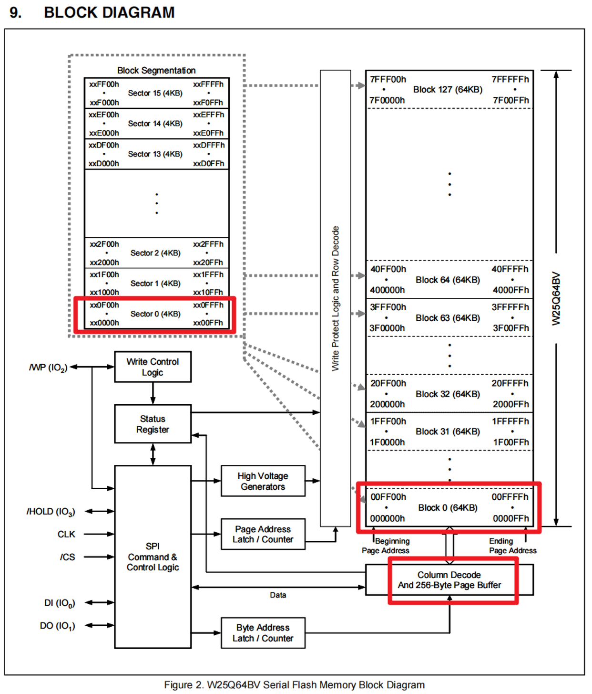

*图3.2-1W25Q64存储结构框图*

从这张图中，我们了解到如下存储空间组织信息：

1. W25Q64 的总容量为 8MB，其内部地址空间是连续的，地址范围为0x000000~0x7FFFFF ，采用 24 位（3字节）地址进行寻址。
2. 整个 8MB 的存储空间被划分为 128 个 Block（块）：
   - a. 每个 Block 的大小为 64KB。
   - b. 其中，第 0 个 Block 的地址范围为0x000000~0x00FFFF ，之后每增加一个Block，地址顺延 64KB。
3. 每个 64KB 的 Block 内部，又进一步划分为 16 个 Sector（扇区）：
   - a. 每个 Sector 的大小为 4KB。
   - b. 例如：Block 0 中的 Sector 0，其地址范围为0x000000~0x000FFF 。
4. 每个 4KB 的 Sector 内部，再被划分为 16 个 Page（页）：
   - a. 每个 Page 的大小为 256 字节。
   - b. 例如：Block 0 → Sector 0 → Page 0，其地址范围为0x000000~0x0000FF 。

也就是说整个W25Q64芯片，总存储空间是8MB：

1. **这8MB空间，首先分为128个块，每个块是64KB。**
2. **每一块64KB空间，又分为16个扇区，每个扇区是4KB。**
3. **每一扇区4KB空间，又分为16个页，每个页是256字节。**

#### 3.3 W25Q64 的操作及其规则

了解了以上芯片的存储空间组织方式后，我们不妨来统一讲解一下W25Q64 能够执行的操作，以及相关限制。

以下这些内容总结自W25Q64官方手册：

1. 首先是读操作，我们已经做过读ID的操作了，但实际上读存储空间也是一样的。
   - a. 读操作几乎没有任何限制。
   - b. 可以从任意地址开始读取，可以连续读取任意长度的数据。
   - c. **也就是说读操作时，可以把W25Q64看成一段连续的存储空间。**
2. **写使能操作。**
   - a. W25Q64 内部设计了一道写保护机制：默认情况下，写入操作无效，擦除操作无效。
   - b. **只有在执行写使能指令之后，芯片才允许接收写入或擦除命令。**
   - c. 注意：写使能操作是一次性的，从新上电复位、一次写/擦除操作后，都会禁用写使能。
   - d. **总之，每一次写入或擦除操作之前，都必须重新发送写使能指令。**
3. **通过BUSY状态标志位确认W25Q64 能否执行写/擦除操作。**
   - a. 和单片机外设内部存在状态寄存器指示单片机外设运行状态一样，W25Q64 内部也存在一个状态寄存器。
   - b. W25Q64 的状态寄存器存在很多状态标志位，但最重要的是BUSY标志位。
   - c. 芯片的写/擦除操作是需要时间完成的，如果不等待上一个操作完成，就直接开始下一轮新的写/擦除操作，操作结果就无法预测了。
   - d. BUSY标志位就用于指示 Flash 当前是否正在执行写入或擦除操作。
   - e. **所以每一次执行写和擦除操作之前，都需要询问BUSY标志位的状态。确定芯片空闲时，再写使能，进而开始写/擦除操作。**
4. 擦除操作。**擦除操作的最小单位是扇区，也可以整块擦除，但不能擦除页。**
   - a. 扇区是最小、也是最常用的擦除单位。
   - b. **一次扇区擦除操作，会将该扇区内一共4KB的所有bit位都恢复成1。**
   - c. 也可以擦除一整个块，一次性将64KB的所有bit位恢复成1。
   - d. 但擦除一整块，耗时较长，通常不会使用。
   - e. **若想执行擦除操作，首先需要进行写使能。**
5. 写操作。写操作的唯一单位是页，一次性写操作只能在一页内完成，不能实现跨页写操作。
   - a. 写操作执行的前提是：
   - b. 第一，目标页所在的扇区已经完成了擦除。
   - c. 第二，具体写之前需要先进行写使能。
   - d. **写操作，只能将某bit位数据从1改为0！不能从0改为1！**
   - e. 当然写的前提是擦除，擦除后所有bit位数据都是1，可以直接通过写操作将需要的1改为0，实现写操作。

**至此，在不涉及具体 SPI 指令细节的前提下，我们已经完整梳理了 W25Q64 在使用层面的全部规则与限制。**

**后续所有具体操作指令（如读、写、擦除指令），本质上都是在遵守上述规则的前提下，对这些操作流程的具体实现。**

#### 3.4 BUSY标志位检查

在前面的内容中我们提到，W25Q64 支持**读 / 写 / 擦除**三类操作。但需要注意的是：

写入和擦除操作，都不是瞬时完成的。

也就是说，当主机向 W25Q64 发送“写入”或“擦除”指令后，Flash 并不会立刻完成操作，而是需要一段内部处理时间。

在这段时间内，如果主机继续向 Flash 发送新的写或擦指令，很可能会导致操作失败或数据异常。

**因此，在进行任何写入或擦除操作前后，主机都必须确认 Flash 是否处于忙状态（BUSY）。**

官方手册是这么描述标志位寄存器及其相关标志位的：

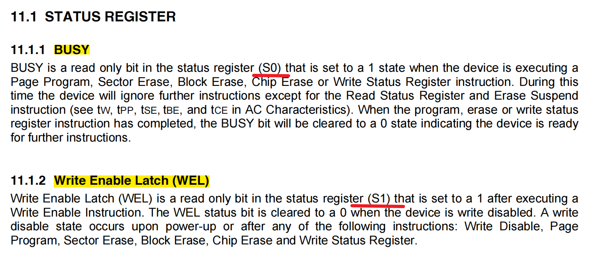

*图3.4-1BUSY标志位检查-图*

BUSY标志位：读SR1返回的状态字节的bit0位。

WEL标志位：读SR1返回的状态字节的bit1位。

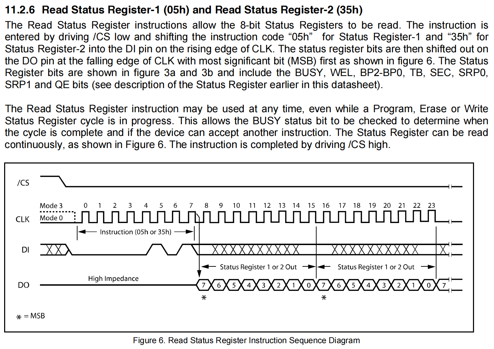

*图3.4-2BUSY标志位检查-图2*

手册比较晦涩，很多内容需要前后一起对照才能够得出结论，但总得来说，关于BUSY标志位，有以下结论：

1. **向 W25Q64 发送 05h 指令后，随后再与芯片交换数据，会输出状态寄存器 SR1 的8 位状态字节。**
2. SR1 的 8 位状态字节的bit0位是BUSY标志位，该位为1则表示W25Q64忙碌，无法进行写/擦除操作。
3. BUSY标志位由硬件自动置位，也会自动复位，使用者无需管理BUSY标志位的状态值。
4. 只要CS不拉高，在整个片选有效期间内，该状态字节可以被连续读取，其中 bit0 固定表示 BUSY 状态，用于判断写入或擦除操作是否完成。

如此，我们就可以完成一个等待空闲的函数：

W25Q64_WaitFree()函数。

**该函数会持续获取W25Q64返回的状态寄存器1的字节状态值，直到这1个字节的状态值bit0位复位为止。**

**注意，上述操作的原理是：W25Q64在接收指令后，只要片选不拉高，W25Q64会持续发送1个字节的状态值。**

很显然，这个操作属于W25Q64的内部操作，不需要提供给外界使用，所以不要将它们放入头文件中。

只需要加"static"修饰，然后实现在源文件中就可以了。

**等待BUSY标志位复位，等待W25Q64空闲，这个操作的具体实现步骤是：**

1. 主机拉低 CS，选中W25Q64，开始一次SPI通信。
2. 主机发送读状态寄存器1的控制指令：0x05。
3. 随后，主机可以持续发送1个字节无意义数据，换取W25Q64发送的1个字节状态值。
   - a. 判断bit0位是否复位（0），如果仍然是置位（1），就继续循环接收W25Q64发送的状态字节。
   - b. 直到bit0位复位，表示W25Q64空闲。
4. 主机拉高 CS，结束本次 SPI 通信，此时W25Q64已经空闲。

参考实现代码如下：

```c
/**
  * @brief 等待W25Q64空闲，等待BUSY标志位复位，等待W25Q64可以接收新的指令
  */
static void W25Q64_WaitFree(void) {
    // 1.片选从机，开始通信
    W25Q64_Select();
    // 2.第一个字节是单片机发送指令0x05，这是读状态寄存器1的指令
    W25Q64_SwapByte(0x05);

    // 3.获取后续W25Q64的返回字节结果，等待bit0位复位
    while ((W25Q64_SwapByte(0xFF) & 0x01) == 0x01);

    // while循环结束时，bit0就是复位状态，BUSY标志位复位，W25Q64不再忙碌，已经空闲了
    W25Q64_Deselect();
}
```

下面开始写使能操作。

#### 3.5 写使能

在上一小节中，我们已经封装了 BUSY 标志位检查，用于判断 W25Q64 是否处于忙碌状态。

接下来就可以进入真正的“修改存储内容”操作了。

**但在开始写入或擦除之前，还必须先通过一道“门禁”：写使能（Write Enable）。**

W25Q64 为了防止误写、误擦，设计了一套写保护机制：

默认情况下，芯片并不允许主机随意执行写入或擦除操作。只有当主机明确发送了“写使能”指令后，芯片才会允许后续的**一次**写/擦行为。

下面是关于写使能的相关手册内容：

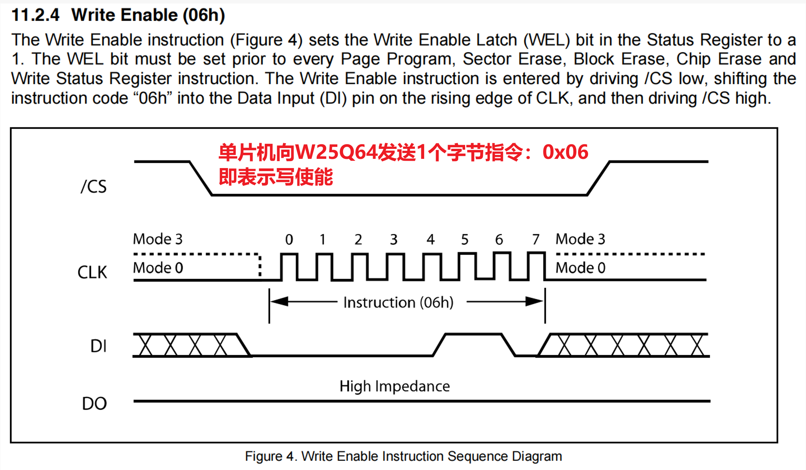

*图3.5-1写使能-手册图*

写使能的反向操作，就是写禁止，如下图所示：

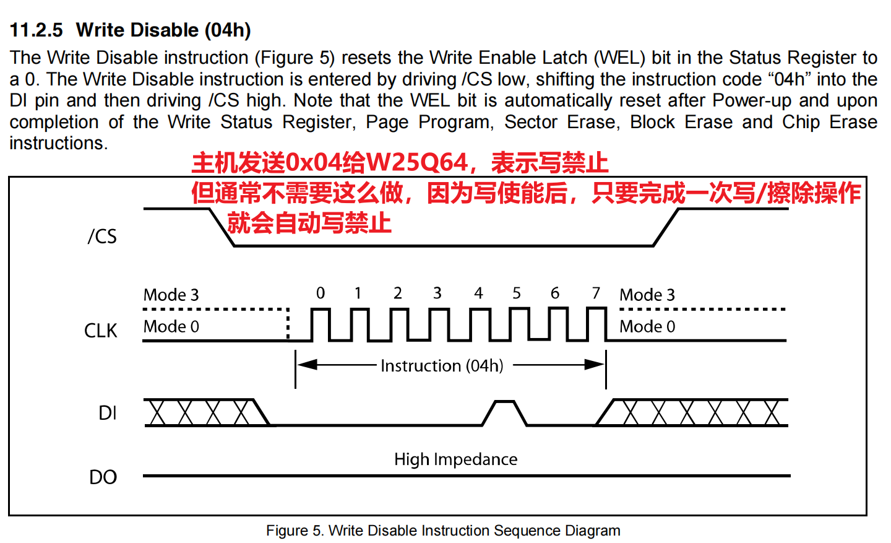

*图3.5-2写禁止-手册图*

总之，你记住四条结论就可以了：

1. 写和擦除操作之前，必须先发送写使能指令，否则写/擦不会生效。
2. 写使能指令是06h ，它本身不携带地址，也不传输数据，本质就是“开权限”。
3. 写使能是否成功，可以通过读取状态寄存器 SR1 的 bit1位，即**WEL 位（Write Enable Latch）**来判断：
   - a. WEL=1 ：表示写使能已开启。
   - b. WEL=0 ：表示写使能未开启或已被硬件清除。
   - c. **但通常没必要检查，大多数工程实践中也都不会检查WEL。标志位中一定要用的几乎只有BUSY。**
4. **写使能成功后，执行任何一次写/擦除操作都会由硬件自动关闭写使能。所以写使能不是“一次开启永久有效”，而是“每次写/擦之前都要再来一次”。**

写使能是后面写/擦除操作的前提，所以有必要单独提取一个函数。

且同样属于W25Q64的内部操作，不需要提供给外界使用，所以不要将它们放入头文件中。

只需要加"static"修饰，然后实现在源文件中就可以了。

**控制W25Q64开启写使能的通信流程如下：**

1. 等待芯片空闲。
2. 主机拉低 CS，选中 W25Q64 开始进行通信。
3. 主机发送 0x06。
4. 主机拉高 CS，结束通信。

参考实现代码如下：

```c
/**
 * @brief 写使能（Write Enable）
 * @param 无
 * @retval 无
 */
static void W25Q64_WriteEnable(void) {
    // 1. 等待芯片空闲
    W25Q64_WaitFree();

    // 2. 选中从机
    W25Q64_Select();

    // 3. 发送写使能指令 0x06
    SPI1_TransferByte(0x06);

    // 4. 取消片选
    W25Q64_Deselect();
}
```

这里稍微要讲一下的地方就是：

为什么写使能之前，也需要等待芯片空闲呢？

芯片空闲不是写/擦除操作的前提吗？和写使能这个操作也有关系吗？

这里要讲一个W25Q64的设定：

在W25Q64执行写/擦除操作时，芯片会忽略除**“查询寄存器状态指令“**外的几乎所有指令，包括写使能的指令，也是会被忽略的。

如果写使能时，芯片处于忙碌状态，会知道忽略这个指令，将会导致写使能失败。

**所以保险起见，在写使能之前，也先等待芯片进入空闲后，再发送写使能指令。**

**这对性能影响微乎其微，但却提升了操作的安全性，是实际工程中的推荐做法。**

写使能完成后，下面就可以开始考虑擦除操作了，因为擦除是写的前提。

写要放到最后面讲。

#### 3.6 擦除扇区

在前面的内容中，我们已经完成了两个非常重要的基础准备：

1. **BUSY 标志位检查** —— 确保 W25Q64 当前不忙；
2. **写使能（Write Enable）** —— 打开写/擦操作的权限。

到这里，才具备了真正“修改 Flash 内容”的前提条件。

接下来要讲的就是：**擦除（Erase）操作**。

##### 3.6.1 为什么要擦除

**为什么要在写之前，先进行擦除操作呢？**

这其实是由W25Q64的硬件特性决定的，如果感兴趣可以自己查查资料，下面是通俗的说明讲解：

1. 对内存SRAM的写操作可以直接写1或0。这是因为在进行写操作时，就像往对应位写入电平，写0还是写1就像切换电平一样都可以实现。
2. **W25Q64这样的Flash存储器和SRAM不同，在进行写操作时，可以理解成“往模具里灌水泥”。**
   - a. “灌水泥”的操作就是写0的过程。
   - b. 但水泥都灌进模具了，想像“切换电平那样“非常容易的直接抠（将0改为1）出来，就不太现实了。
   - c. 必须要执行专门的操作才能把水泥从模具中取出（将0改为1），这就是擦除操作（当然擦除操作很耗时）。
3. **所以在执行写操作（“灌水泥”，写0）之前，必须先进行擦除（“把水泥抠出来，保证模具是空的”，将所有bit恢复成1）。**

总之，我们再强调一下如下结论：

1. **Flash 的写入操作，只能把 bit 从 1 写成 0，无法把 bit 从 0 再写回 1。**
2. **写操作之前，必须先擦除，擦除的本质是把所有bit都统一恢复成1。**
3. **一块W25Q64，整个芯片在出厂时就是“擦除态”，所有的数据都是0xFF，全部都是1。**

##### 3.6.2 擦除的基本单位

W25Q64 存储空间被划分为三个层级：**页（Page）**、**扇区（Sector）**、**块（Block）**。

擦除的最小单位是扇区（4KB），也可以擦除块（64KB），但擦除块不太常用。

擦除块的主要问题是：

1. 大多数情况下没有必要一次性擦除那么多空间数据。
2. 块是比较大的单位，一次性擦除64KB，容易不小心误删数据。
3. 擦除块的时间比较长，通常是擦除扇区时间的十倍，甚至几十倍，容易影响系统的实时性。
4. Flash的寿命用擦除次数计，通常每个扇区可擦除10w次，所以一次性擦除整个块，影响Flash的使用寿命。

总之，在实际工程使用中，最常用、也最安全的是扇区擦除。在下面，我们也仅考虑实现扇区擦除。

##### 3.6.3 擦除扇区

从 SPI 通信的角度来看，擦除和写操作都遵循共同一个基本模型：

指令 + 地址也就是说，**擦除指令**本身只说明“我要擦”，而具体擦哪一片区域，则由**地址**决定。

官方手册中对擦除扇区的描述如下：

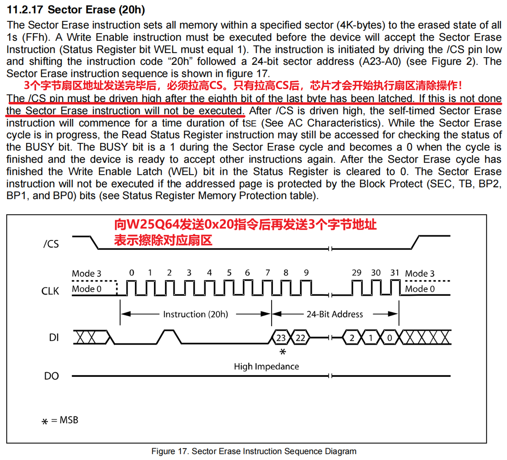

*图3.6.3-1擦除官方手册-图*

解释一下手册中对扇区擦除的说明：

1. 扇区擦除指令是：0X20
2. 发送扇区擦除指令后，紧接着要发送3个字节的代表扇区的地址。
3. 这个地址只要落在该扇区范围内即可，Flash 会自动对齐到对应扇区的起始位置进行擦除。
4. 比如第0块，第0扇区的地址范围是：0x000000 ~ 0x000FFF，只要随便选这个范围内的地址，都可以表示擦除此扇区。
5. **但实际上最好不要随便给一个地址用于擦除扇区，强烈建议用该扇区的起始地址作为擦除地址传入。**这样做的好处是：
   - a. 使用扇区起始地址，对于程序员而言更容易辨识属于哪个扇区，不需要过多思考，也不会存在歧义。
   - b. 几乎所有的手册，在地址分布时，都会标志扇区起始地址。使用起始地址也方便查阅使用。
   - c. 统一约定，避免出现混乱。
6. **Flash在接收3个字节地址时，会默认先接收到的字节为地址最高字节，所以发地址时，也需要从地址最高字节发到最低字节。**

于是，我们总结出扇区擦除操作的统一流程，如下：

1. 等待 W25Q64 空闲（BUSY = 0）；
2. 发送写使能指令（Write Enable）；
3. 拉低 CS，开始擦除通信。
4. 发送擦除指令0x20；
5. 发送 3 字节的某扇区起始地址，用于指定要擦除的扇区；
6. 轮询 BUSY 标志位，等待擦除完成。
7. 拉高CS结束片选，结束通信。

有没有问题呢？

为了解释这个问题，我们需要了解W25Q64对于指令执行的时机问题，了解W25Q64究竟何时开始执行指令。

##### 3.6.4 W25Q64指令执行时机（重点）

**在 SPI Flash 中，CS 的一次“拉低到拉高”，定义了一条完整指令的边界。**

什么意思呢？

通俗点说：

1. CS拉低，Flash开始接收指令。
2. CS拉高，Flash认为所有指令都接收完毕，此时可以开始对这些指令进行内部处理或执行了。

**也就是说：Flash会在一次通信结束后（CS拉高），才开始执行它接收到的指令！（读除外）**

**也就是说：Flash会在一次通信结束后（CS拉高），才开始执行它接收到的指令！（读除外）**

**也就是说：Flash会在一次通信结束后（CS拉高），才开始执行它接收到的指令！（读除外）**

这个细节，即W25Q64指令执行时机，我们前面没有讲。

为什么呢？

因为所有的读操作（包括读ID，读状态寄存器）和写使能操作，都不需要注意这个细节。

因为：

1. 读操作时，发读取的指令，紧接着Flash就返回信息，整个过程没有延时，同步完成，不需要CS拉高后才返回数据。
2. 写使能指令，满足上述指令执行时机，需要等到CS拉高后才会真正执行写使能。
3. 但芯片执行写使能的速度非常迅速（其实就是一个标志位置位的操作），时间非常短暂，实际工程中不需要考虑这个时间。

那什么时候需要考虑这个细节呢？

**当然是在指令的执行与处理需要耗费大量时间时，需要考虑这个细节。**

什么指令执行需要耗费大量时间呢？

答：擦除和写操作。

比如上述擦除扇区流程的末尾：

1.....

2.轮询 BUSY 标志位，等待擦除完成。

3.拉高CS结束片选，结束通信。

和前面的操作一样，我们都是在最后才拉高CS结束片选，结束通信。

看起来没有问题，实际上是有问题的：

1. 拉高CS结束片选后，才会真正开始执行擦除扇区的操作。
2. 也就是说，前面“轮询 BUSY 标志位，等待擦除完成”的操作是完全无作用的，多余的。

3. **你以为扇区擦除已经完成了，但实际上在你以为的结束后，芯片还需要执行大约几十ms的时间来真正实现擦除。**

4. 不要小看这几十ms，如果用来写操作页，足够写十页了！

所以正确的做法是：

1. ....
2. 拉高CS结束片选，结束通信。
3. 轮询 BUSY 标志位，等待擦除完成。（新一轮通信）

##### 3.6.5 擦除扇区的流程与实现

扇区擦除操作的统一流程如下：

1. 等待 W25Q64 空闲（BUSY = 0）；
2. 发送写使能指令（Write Enable）；
3. 拉低 CS，开始擦除通信。
4. 发送擦除指令0x20；
5. 发送 3 字节的某扇区起始地址，用于指定要擦除的扇区；
6. 拉高CS结束片选，结束通信，让芯片开始执行擦除操作。
7. 轮询 BUSY 标志位，等待擦除完成。（新一轮通信）

擦除扇区操作在外界可能被使用，所以需要在头文件中声明它。

参考代码如下：

```c
/**
 * @brief 擦除指定扇区（4KB）
 */
void W25Q64_SectorErase(uint32_t Address);

/**
 * @brief 擦除指定扇区（4KB）
 * @param Address 待擦除扇区的3字节起始地址
 * @retval 无
 * @note SPI采用MSB First比特序，所以3字节起始地址要从最高字节发到最低字节
 */
void W25Q64_SectorErase(uint32_t Address) {
    // 1. 等待芯片空闲
    W25Q64_WaitFree();

    // 2. 写使能
    W25Q64_WriteEnable();

    // 3. 选中从机
    W25Q64_Select();

    // 4. 发送扇区擦除指令（4KB 扇区）
    SPI1_TransferByte(0x20);

    // 5. 发送 24 位地址
    SPI1_TransferByte((Address >> 16) & 0xFF); // 发送最高1个字节
    SPI1_TransferByte((Address >> 8) & 0xFF); // 发送倒数第二高1个字节
    SPI1_TransferByte(Address & 0xFF); // 发送最低1个字节

    // 6. 取消片选，让芯片开始执行擦除操作
    W25Q64_Deselect();

    // 7. 等待擦除完成
    W25Q64_WaitFree();
}

```

注意我们仍然将擦除扇区的操作隐藏在内部，没有暴露在外界，作为内部实现。

现在我们万事俱备，终于可以开始我们的写操作了。

#### 3.7 写操作/页编程

在完成擦除操作之后，Flash 存储区域已经被统一恢复为 0xFF，也就是说：所有 bit 均为 1，具备了被写成 0 的条件。

此时才可以开始真正的写操作。

**在 W25Q64 中，写操作的官方名称叫做：页编程（Page Program）。**

下面不再区分写操作和页编程两种说法，可能会混用，大家知道就行。

##### 3.7.1 写操作注意事项

在开始考虑写操作的流程之前，必须明确以下几条规则：

1. **写操作以“页（Page）”为基本单位，也只能以“页”为单位写，不存在写“扇区和块”。**
   - a. 1页是256个字节。
   - b. 单次写操作最多只能写 256 个字节。
2. **写操作无法跨页，不管怎么写数据都会在同一页。**
   - a. 如果写入的数据超过了256个字节或者出现了跨页。
   - b. 那么多出的字节不会自动写到下一页，而是覆盖写入到这一页的开头，如果你不是故意需要这种效果，请不要跨页执行写操作。
3. **写操作前，必须先完成擦除。**
   - a. 写操作只能把1变成0，无法实现将0变成1。
   - b. 所以写之前，必须先擦除都变成1后，再写。
   - c. 擦除的基本单位是扇区，写的基本单位是页。
   - d. **所以擦除时可能会把不需要写的页也擦除掉，这一点尤其要注意，避免删除有用数据！**
4. **写操作前，必须先写使能。**
   - a. 注意：一次写使能对应一次擦除和写操作
   - b. 虽然前面擦除时，也写使能过一次，但对写操作而言，它需要自己再写使能一次。
5. **和擦除一样，必须先拉高CS结束通信，让芯片开始执行写操作，然后再轮询等待写操作执行完成。**

##### 3.7.2 写操作指令

官方手册中，写操作相关内容，如下所示：

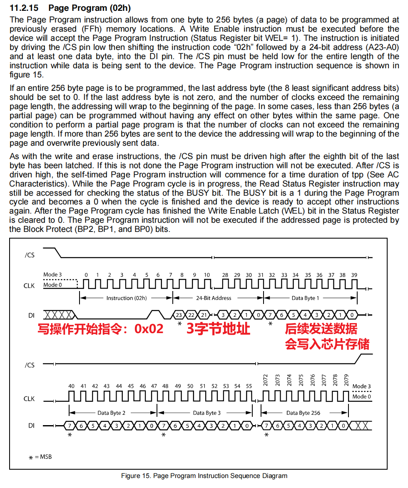

*图3.7.2-1写操作指令-官方手册图*

这个手册内容大家可以自己去看一下，这里不再多赘述。

整个写操作的工作模式和擦除非常类似，写操作时与W25Q64的交互结构是：

**0x02指令 + 3字节写入地址 + N 字节需要写入的数据**其中：

1. 0x02指令是写操作的指令。
2. 写操作指令发送后，再发送3个字节的写入地址。**该写入地址，用于指示“从哪一个存储位置开始写”。**
3. 写入地址确定后，紧跟着主机再发送N个字节需要写入的数据。

**注意：从写入地址开始，加上N个字节，都要在某一页内部，否则多出来的数据会从覆盖到这一页的开头。**

##### 3.7.3 写操作的通信流程与实现

综合前面的所有规则，一个完整、规范的写操作流程如下：

1. 等待 W25Q64 空闲（BUSY = 0）；
2. 发送写使能指令（Write Enable）；
3. 拉低 CS，选中 W25Q64；
4. 发送页编程指令0x02 ；
5. 发送 3 字节写入地址；
6. 依次发送要写入的数据字节；
7. 拉高 CS，触发写操作；
8. 轮询 BUSY 标志位，等待写入完成。

你会发现：

**写操作，本质上就是在“擦除流程“的基础上，再加上发送写入地址，以及发送写入数据的过程。**

整体参考代码如下所示：

```c
/**
 * @brief 页编程（写多个字节）
 */
void W25Q64_WriteBytes(uint32_t Address,
                     uint8_t *Bytes,
                     uint16_t Length);

/**
 * @brief 页编程（写1个字节）
 */
static void W25Q64_WriteByte(uint32_t Address, uint8_t Byte);

/**
 * @brief 页编程（写多个字节）
 * @param Address 写入的3字节起始地址
 * @param Bytes 指向待写入数据的指针（通常是一个字节数组）
 * @param Length 写入数据长度（1~256，且需要避免跨页）
 * @retval 无
 */
void W25Q64_WriteBytes(uint32_t Address,
                     uint8_t *Bytes,
                     uint16_t Length) {
    // 1. 等待芯片空闲
    W25Q64_WaitFree();

    // 2. 写使能
    W25Q64_WriteEnable();

    // 3. 选中从机
    W25Q64_Select();

    // 4. 发送页编程指令
    SPI1_TransferByte(0x02);

    // 5. 发送 24 位地址（高字节先发）
    SPI1_TransferByte((Address >> 16) & 0xFF);
    SPI1_TransferByte((Address >> 8) & 0xFF);
    SPI1_TransferByte(Address & 0xFF);

    // 7. 将待发送数据逐字节发送出去，先发送的字节会先写入芯片起始位置
    for (uint16_t i = 0; i < Length; i++) {
       SPI1_TransferByte(Bytes[i]);
    }

    // 8. 取消片选，芯片开始写入数据
    W25Q64_Deselect();

    // 9. 等待写入完成
    W25Q64_WaitFree();
}

/**
 * @brief 页编程（写1个字节）
 * @param Address 写入的3字节起始地址
 * @param Byte 待写入的1个字节数据
 * @retval 无
 */
void W25Q64_WriteByte(uint32_t Address, uint8_t Byte) {
    // 直接调用已实现函数，完成1个字节数据写入
    W25Q64_WriteBytes(Address, &Byte, 1);
}

```

提供了两个写入操作，可以写入多个字节，也能够一次性写入1个字节。

这两个函数直接提供给外界使用。

#### 3.8 读操作：读一个字节

在前面的内容中，我们已经完成了写使能、擦除以及页编程等操作，至此，已经具备了对 W25Q64 进行完整写入的能力。

写是可以做了，那么读呢？

实际上，你一开始就可以直接实现读操作。

因为读操作非常简单，不需要写使能（没有读使能）、不需要提前擦除（肯定不能擦除，擦除了你还读什么）。

**只有一个限制：BUSY忙碌状态下不可读。**

**只需要在W25Q64空闲的状态下，确定要读取的地址，以及读取的数据长度，就可以直接发起读操作。**

官方手册中，有关读操作的内容，如下所示：

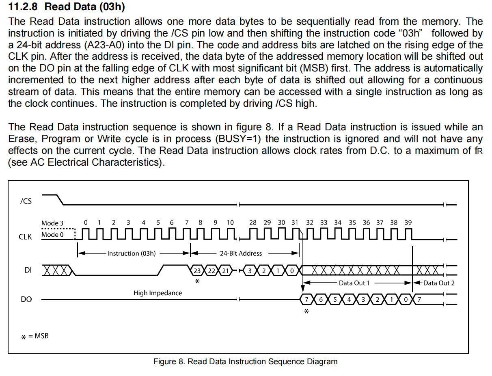

*图3.8-1读操作-手册图*

读操作时与W25Q64的交互结构是：

**0x03指令 + 3字节读取地址 + 连续读需要的字节数据**其中：

1. 0x03指令是读操作的指令。
2. 读操作指令发送后，再发送3个字节的读取地址。**该读取地址，用于指示“从哪一个存储位置开始读”。**
3. 后续可以发送多个无效字节数据，以换取W25Q64发送的有效存储数据。

读1个字节，整体的通信流程是：

1. 拉低 CS，选中 W25Q64；
2. 发送读取指令0x03 ；
3. 发送 3 字节读取地址；
4. 主机继续发送 1 个字节无效数据，换取W25Q64发送“读取地址”位置1个字节有效数据。
5. 拉高 CS，结束通信。

参考实现代码如下：

```c
/**
 * @brief 从 W25Q64 中读取 1 个字节数据
 */
uint8_t W25Q64_ReadByte(uint32_t Address);

/**
 * @brief 从 W25Q64 中读取 1 个字节数据
 * @param Address 读取地址
 * @retval 读取到的 1 个字节数据
 */
uint8_t W25Q64_ReadByte(uint32_t Address) {

    // 1. 选中从机，开始一次 SPI 通信
    W25Q64_Select();

    // 2. 发送读数据指令 0x03
    SPI1_TransferByte(0x03);

    // 3. 发送 24 位地址（高字节先发）
    SPI1_TransferByte((Address >> 16) & 0xFF);
    SPI1_TransferByte((Address >> 8) & 0xFF);
    SPI1_TransferByte(Address & 0xFF);

    // 4. 发送无效字节，换取从机返回的 1 个字节数据
    uint8_t Data = SPI1_TransferByte(0xFF);

    // 5. 取消片选，结束本次 SPI 通信
    W25Q64_Deselect();

    return Data;
}

```

读一个字节的操作，也暴露在外界供使用。

#### 3.9 实现W25Q64断电记录 PC13 指示灯状态

以下代码都写在"main.c"文件中，用于测试W25Q64的功能。

**首先**我们要约定一个PC13State 枚举类型，用来标记PC13的状态，也用于写入W25Q64存储PC13的状态。

如下：

```c
typedef enum {
    PC13_STATE_OFF = 0x00, // 指示灯熄灭
    PC13_STATE_ON = 0x01 // 指示灯点亮
} PC13State;
```

**随后**我们还需要约定一个存储位置，将1个字节的PC13状态标志，存进W25Q64中。

为了简单方便，我们直接选择第0块、第0扇区的第一页，从头开始存储。

地址为：0x000000直接用一个宏来表示它：

```c
#define PC13_FLAG_ADDRESS 0x000000
```

**然后**PC13指示灯的初始化，这个比较简单：

```c
/**
 * @brief 初始化 PC13 指示灯引脚
 * @param 无
 * @retval 无
 * @note PC13 常见为板载 LED：低电平点亮，高电平熄灭
 */
static void PC13_Init(void) {
    RCC_APB2PeriphClockCmd(RCC_APB2Periph_GPIOC, ENABLE);

    GPIO_InitTypeDef GPIO_InitStructure;
    GPIO_InitStructure.GPIO_Pin = GPIO_Pin_13;
    GPIO_InitStructure.GPIO_Mode = GPIO_Mode_Out_PP;

    // PC13 翻转不需要太快，2MHz 足够
    GPIO_InitStructure.GPIO_Speed = GPIO_Speed_2MHz;
    GPIO_Init(GPIOC, &GPIO_InitStructure);

    // 默认先熄灭（高电平）
    GPIO_SetBits(GPIOC, GPIO_Pin_13);
}
```

**然后**再编写一个函数，用于在W25Q64中存储PC13的状态，如下：

```c
/**
 * @brief 在 W25Q64 中存储 PC13 的状态（断电保持）
 * @param State PC13 的逻辑状态（枚举值）
 * @retval 无
 * @note 写入前必须擦除；擦除以扇区为单位（4KB），因此需要先对齐扇区首地址
 */
static void W25Q64_SavePC13State(PC13State State) {
    // 1. 擦除所在扇区（4KB）
    W25Q64_SectorErase(PC13_FLAG_ADDRESS);

    // 2. 写入 1 个字节状态值
    W25Q64_WriteByte(PC13_FLAG_ADDRESS, (uint8_t)State);
}
```

**最后**再编写一个函数，用于读W25Q64中存储PC13的状态，并还原PC13的状态，如下：

```c
/**
 * @brief 从 W25Q64 中读取 PC13 状态，并还原 PC13 指示灯状态
 * @param 无
 * @retval 返回读取到的 PC13 状态（枚举值）
 */
static PC13State W25Q64_RestorePC13State(void) {
    // 1.读取存储的PC13状态字节
    uint8_t SavedPC13State = W25Q64_ReadByte(PC13_FLAG_ADDRESS);

    // 2.还原PC13状态
    if ((PC13State)SavedPC13State == PC13_STATE_ON) {
       GPIO_ResetBits(GPIOC, GPIO_Pin_13); // 点亮
    } else {
       GPIO_SetBits(GPIOC, GPIO_Pin_13); // 熄灭
    }
    return (PC13State)SavedPC13State;
}
```

**整体main.c文件的参考代码如下所示：**

```c
#include "stm32f10x.h"
#include "OLED.h"
#include "W25Q64.h"

#define PC13_FLAG_ADDRESS 0x000000

typedef enum {
    PC13_STATE_OFF = 0x00, // 指示灯熄灭
    PC13_STATE_ON = 0x01 // 指示灯点亮
} PC13State;

/**
 * @brief 初始化 PC13 指示灯引脚
 * @param 无
 * @retval 无
 * @note PC13 常见为板载 LED：低电平点亮，高电平熄灭
 */
static void PC13_Init(void) {
    RCC_APB2PeriphClockCmd(RCC_APB2Periph_GPIOC, ENABLE);

    GPIO_InitTypeDef GPIO_InitStructure;
    GPIO_InitStructure.GPIO_Pin = GPIO_Pin_13;
    GPIO_InitStructure.GPIO_Mode = GPIO_Mode_Out_PP;

    // PC13 翻转不需要太快，2MHz 足够
    GPIO_InitStructure.GPIO_Speed = GPIO_Speed_2MHz;
    GPIO_Init(GPIOC, &GPIO_InitStructure);

    // 默认先熄灭（高电平）
    GPIO_SetBits(GPIOC, GPIO_Pin_13);
}

/**
 * @brief 在 W25Q64 中存储 PC13 的状态（断电保持）
 * @param State PC13 的逻辑状态（枚举值）
 * @retval 无
 * @note 写入前必须擦除；擦除以扇区为单位（4KB），因此需要先对齐扇区首地址
 */
static void W25Q64_SavePC13State(PC13State State) {
    // 1. 擦除所在扇区（4KB）
    W25Q64_SectorErase(PC13_FLAG_ADDRESS);

    // 2. 写入 1 个字节状态值
    W25Q64_WriteByte(PC13_FLAG_ADDRESS, (uint8_t)State);
}

/**
 * @brief 从 W25Q64 中读取 PC13 状态，并还原 PC13 指示灯状态
 * @param 无
 * @retval 返回读取到的 PC13 状态（枚举值）
 */
static PC13State W25Q64_RestorePC13State(void) {
    // 1.读取存储的PC13状态字节
    uint8_t SavedPC13State = W25Q64_ReadByte(PC13_FLAG_ADDRESS);

    // 2.还原PC13状态
    if ((PC13State)SavedPC13State == PC13_STATE_ON) {
       GPIO_ResetBits(GPIOC, GPIO_Pin_13); // 点亮
    } else {
       GPIO_SetBits(GPIOC, GPIO_Pin_13); // 熄灭
    }
    return (PC13State)SavedPC13State;
}

int main(void) {

    // 1.执行所有初始化工作
    OLED_Init();
    OLED_Clear();

    W25Q64_GPIO_Init();
    W25Q64_SPI1_Init();
    PC13_Init();

    // 2.记录一次PC13的状态
    // 执行一次后，注释掉该行代码，然后断电后再上电，最后执行下面的还原函数进行测试。
    // W25Q64_SavePC13State(PC13_STATE_ON);

    // 3.根据存储的状态，还原PC13的状态
    OLED_ShowString(1, 1, "PC13:");
    PC13State SavedPC13State = W25Q64_RestorePC13State();
    if(SavedPC13State == PC13_STATE_ON){
       OLED_ShowString(1, 7, "ON");
    }else{
       OLED_ShowString(1, 7, "OFF");
    }

    while (1) {
    }
}

```

编译时可能会提醒几个警告，这一般是由于某些函数定义了却没有使用导致的。

你可以暂时不用管这些警告，这些函数我们将在后续的实验中用到。

#### 3.10 整体参考代码

**W25Q64.h头文件：**

```c
#ifndef __W25Q64_H
#define __W25Q64_H

#include "stm32f10x.h"
#include <stdint.h>

/**
* @brief 初始化 W25Q64 模块（SPI1 GPIO部分）
*/
void W25Q64_GPIO_Init(void);

/**
* @brief 初始化 W25Q64 模块（SPI1外设初始化）
*/
void W25Q64_SPI1_Init(void);

/**
* @brief 读取 W25Q64 的 JEDEC ID
*/
void W25Q64_ReadJEDECID(uint8_t *ManufacturerID,
                      uint8_t *MemoryType,
                      uint8_t *Capacity);

/**
* @brief 擦除指定扇区（4KB）
*/
void W25Q64_SectorErase(uint32_t Address);

/**
* @brief 页编程（写多个字节）
*/
void W25Q64_WriteBytes(uint32_t Address,
                     uint8_t *Bytes,
                     uint16_t Length);

/**
* @brief 页编程（写1个字节）
*/
void W25Q64_WriteByte(uint32_t Address, uint8_t Byte);

/**
* @brief 从 W25Q64 中读取 1 个字节数据
*/
uint8_t W25Q64_ReadByte(uint32_t Address);

#endif

```

**W25Q64.c实现源文件：**

```c
#include "W25Q64.h"

/*
 * W25Q64 与 STM32 的硬件连接关系如下：
 *
 * W25Q64_CS —— PA4 （普通 GPIO 推挽输出，软件片选）
 * W25Q64_DO —— PA6 （SPI1_MISO，从机输出 / 主机输入）
 * W25Q64_CLK —— PA5 （SPI1_SCK，时钟信号）
 * W25Q64_DI —— PA7 （SPI1_MOSI，主机输出 / 从机输入）
 *
 * SPI 外设使用：SPI1
 */

/**
 * @brief 初始化 W25Q64 相关的 GPIO 引脚
 * @param 无
 * @retval 无
 * @note
 * 1. PA5 配置为 SPI1_SCK —— 复用推挽输出模式
 * 2. PA7 配置为 SPI1_MOSI —— 复用推挽输出模式
 * 3. PA6 配置为 SPI1_MISO —— 浮空输入模式
 * 4. PA4 配置为 W25Q64_CS —— 通用推挽输出模式
 * 5. PA4 引脚默认输出高电平，表示不选中从机
 */
void W25Q64_GPIO_Init(void) {
    // 1. 开启 GPIOA 外设时钟
    RCC_APB2PeriphClockCmd(RCC_APB2Periph_GPIOA, ENABLE);

    // 2. SPI1_SCK —— PA5，设置为复用推挽输出
    // SPI1_MOSI —— PA7，设置为复用推挽输出
    GPIO_InitTypeDef GPIO_InitStructure;
    GPIO_InitStructure.GPIO_Pin = GPIO_Pin_5 | GPIO_Pin_7;
    GPIO_InitStructure.GPIO_Mode = GPIO_Mode_AF_PP;
    // SPI是高速通信协议，选择较快的引脚输出速度，快速翻转电平以满足通信需求
    GPIO_InitStructure.GPIO_Speed = GPIO_Speed_50MHz;
    GPIO_Init(GPIOA, &GPIO_InitStructure);

    // 3. SPI1_MISO —— PA6，浮空输入模式
    GPIO_InitStructure.GPIO_Pin = GPIO_Pin_6;
    GPIO_InitStructure.GPIO_Mode = GPIO_Mode_IN_FLOATING;
    GPIO_Init(GPIOA, &GPIO_InitStructure);

    // 5. W25Q64_CS —— PA4，通用推挽输出
    GPIO_InitStructure.GPIO_Pin = GPIO_Pin_4;
    GPIO_InitStructure.GPIO_Mode = GPIO_Mode_Out_PP;
    GPIO_Init(GPIOA, &GPIO_InitStructure);

    // 6. PA4引脚默认输出高电平，默认不选中从机（CS = 高电平）
    GPIO_SetBits(GPIOA, GPIO_Pin_4);
}

/**
  * @brief 初始化 SPI1 外设，用于与 W25Q64 进行通信
  * @param 无
  * @retval 无
  * @note
  * 1. SPI1 工作在主机模式
  * 2. 数据位宽为 8 bit
  * 3. SPI 模式选择 Mode 0（CPOL=0，CPHA=0）
  * 4. 采用软件方式管理 NSS（SSM=1，SSI=1）
  * 5. SPI 时钟频率为 PCLK2 / 4（默认为 18MHz）
  * 实际上也可以将分频系数选更大一些，SCK时钟频率更大一些
  */
void W25Q64_SPI1_Init(void) {
    // 1. 开启 SPI1 外设时钟（SPI1 挂载在 APB2 总线上）
    RCC_APB2PeriphClockCmd(RCC_APB2Periph_SPI1, ENABLE);

    // 2.设置SPI通信基本参数
    SPI_InitTypeDef SPI_InitStructure;

    // 选择通信方式为SPI全双工，2线模式
    SPI_InitStructure.SPI_Direction =SPI_Direction_2Lines_FullDuplex;
    // 设置STM32为主机模式
    SPI_InitStructure.SPI_Mode = SPI_Mode_Master;
    // 设置SPI1外设移位寄存器长度是8bit
    SPI_InitStructure.SPI_DataSize = SPI_DataSize_8b;

    // 时序结构选择SPI Mode 0：空闲时钟为低电平，第一个边沿采样
    SPI_InitStructure.SPI_CPOL = SPI_CPOL_Low;
    SPI_InitStructure.SPI_CPHA = SPI_CPHA_1Edge;
    // 比特序选择MSB First，优先发最高有效位
    SPI_InitStructure.SPI_FirstBit = SPI_FirstBit_MSB;

    // 采用软件NSS
    SPI_InitStructure.SPI_NSS = SPI_NSS_Soft;

    // SPI1时钟线分频系数：当前选择1/4分频
    // 时钟线频率为：72 / 4 = 18MHz
    SPI_InitStructure.SPI_BaudRatePrescaler =SPI_BaudRatePrescaler_4;

    // 3.调用函数，初始化 SPI1 外设
    SPI_Init(SPI1, &SPI_InitStructure);

    // 4.选择软件NSS时，需要额外调用此函数，用于设置SSI为1，代表输入高电平
    SPI_NSSInternalSoftwareConfig(SPI1, SPI_NSSInternalSoft_Set);

    // 5. 真正开启 SPI1 外设
    SPI_Cmd(SPI1, ENABLE);
}

/**
  * @brief SPI1 发送并接收 1 个字节数据
  * @param data：待发送的数据
  * @retval 接收到的数据
  * @note
  * SPI 为全双工通信：
  * 发送 1 个字节的同时，必然会接收 1 个字节
  */
static uint8_t SPI1_TransferByte(uint8_t data) {
    // 1. 等待发送数据寄存器为空（TXE = 1）
    while (SPI_I2S_GetFlagStatus(SPI1, SPI_I2S_FLAG_TXE) ==RESET);

    // 2. 待发送1个字节数据写入发送数据寄存器，主机发送1个字节数据给从机
    SPI_I2S_SendData(SPI1, data);

    // 3. 等待接收数据寄存器非空（RXNE = 1）
    while (SPI_I2S_GetFlagStatus(SPI1, SPI_I2S_FLAG_RXNE) ==RESET);

    // 4. 读接收数据寄存器，获取从机发送的1个字节数据
    return SPI_I2S_ReceiveData(SPI1);
}

/**
 * @brief 选中 W25Q64（CS = 0）
 * @param 无
 * @retval 无
 */
static void W25Q64_Select(void) {
    GPIO_ResetBits(GPIOA, GPIO_Pin_4);
}

/**
 * @brief 取消选中 W25Q64（CS = 1）
 * @param 无
 * @retval 无
 */
static void W25Q64_Deselect(void) {
    GPIO_SetBits(GPIOA, GPIO_Pin_4);
}

/**
 * @brief 读取 W25Q64 的 JEDEC ID
 * @param *ManufacturerID：获取厂商 ID
 * @param *MemoryType ：获取存储类型
 * @param *Capacity ：获取容量代码
 * @retval 无
 */
void W25Q64_ReadJEDECID(uint8_t *ManufacturerID,
                      uint8_t *MemoryType,
                      uint8_t *Capacity) {
    // 1. 选中 W25Q64，从机片选拉低
    W25Q64_Select();

    // 2. 发送 JEDEC ID 指令 0x9F（接收数据无意义，返回值无需接收）
    SPI1_TransferByte(0x9F);

    // 3. 连续发送3个无意义字节，读取W25Q64返回的 3 个字节
    // 0xFF位置可以填任意1字节数据
    *ManufacturerID = SPI1_TransferByte(0xFF);
    *MemoryType = SPI1_TransferByte(0xFF);
    *Capacity = SPI1_TransferByte(0xFF);

    // 4. 取消片选，结束本次 SPI 通信
    W25Q64_Deselect();
}

/**
  * @brief 等待W25Q64空闲，等待BUSY标志位复位，等待W25Q64可以接收新的指令
  */
static void W25Q64_WaitFree(void) {
    // 1.片选从机，开始通信
    W25Q64_Select();
    // 2.第一个字节是单片机发送指令0x05，这是读状态寄存器1的指令
    W25Q64_SwapByte(0x05);

    // 3.获取后续W25Q64的返回字节结果，等待bit0位复位
    while ((W25Q64_SwapByte(0xFF) & 0x01) == 0x01);

    // while循环结束时，bit0就是复位状态，BUSY标志位复位，W25Q64不再忙碌，已经空闲了
    W25Q64_Deselect();
}

/**
 * @brief 写使能（Write Enable）
 * @param 无
 * @retval 无
 */
static void W25Q64_WriteEnable(void) {
    // 1. 等待芯片空闲
    W25Q64_WaitFree();

    // 2. 选中从机

    W25Q64_Select();

    // 3. 发送写使能指令 0x06
    SPI1_TransferByte(0x06);

    // 4. 取消片选
    W25Q64_Deselect();
}

/**
 * @brief 擦除指定扇区（4KB）
 * @param Address 待擦除扇区的3字节起始地址
 * @retval 无
 * @note SPI采用MSB First比特序，所以3字节起始地址要从最高字节发到最低字节
 */
void W25Q64_SectorErase(uint32_t Address) {
    // 1. 等待芯片空闲
    W25Q64_WaitFree();

    // 2. 写使能
    W25Q64_WriteEnable();

    // 3. 选中从机
    W25Q64_Select();

    // 4. 发送扇区擦除指令（4KB 扇区）
    SPI1_TransferByte(0x20);

    // 5. 发送 24 位地址
    SPI1_TransferByte((Address >> 16) & 0xFF); // 发送最高1个字节
    SPI1_TransferByte((Address >> 8) & 0xFF); // 发送倒数第二高1个字节
    SPI1_TransferByte(Address & 0xFF); // 发送最低1个字节

    // 6. 取消片选，让芯片开始执行擦除操作
    W25Q64_Deselect();

    // 7. 等待擦除完成
    W25Q64_WaitFree();
}

/**
 * @brief 页编程（写多个字节）
 * @param Address 写入的3字节起始地址
 * @param Bytes 指向待写入数据的指针（通常是一个字节数组）
 * @param Length 写入数据长度（1~256，且需要避免跨页）
 * @retval 无
 */
void W25Q64_WriteBytes(uint32_t Address,
                     uint8_t *Bytes,

                     uint16_t Length) {
    // 1. 等待芯片空闲
    W25Q64_WaitFree();

    // 2. 写使能
    W25Q64_WriteEnable();

    // 3. 选中从机
    W25Q64_Select();

    // 4. 发送页编程指令
    SPI1_TransferByte(0x02);

    // 5. 发送 24 位地址（高字节先发）
    SPI1_TransferByte((Address >> 16) & 0xFF);
    SPI1_TransferByte((Address >> 8) & 0xFF);
    SPI1_TransferByte(Address & 0xFF);

    // 7. 将待发送数据逐字节发送出去，先发送的字节会先写入芯片起始位置
    for (uint16_t i = 0; i < Length; i++) {
       SPI1_TransferByte(Bytes[i]);
    }

    // 8. 取消片选，芯片开始写入数据
    W25Q64_Deselect();

    // 9. 等待写入完成
    W25Q64_WaitFree();
}

/**
 * @brief 页编程（写1个字节）
 * @param Address 写入的3字节起始地址
 * @param Byte 待写入的1个字节数据
 * @retval 无
 */
void W25Q64_WriteByte(uint32_t Address, uint8_t Byte) {
    // 直接调用已实现函数，完成1个字节数据写入
    W25Q64_WriteBytes(Address, &Byte, 1);
}

/**
 * @brief 从 W25Q64 中读取 1 个字节数据
 * @param Address 读取地址
 * @retval 读取到的 1 个字节数据
 */
uint8_t W25Q64_ReadByte(uint32_t Address) {

    // 1. 选中从机，开始一次 SPI 通信
    W25Q64_Select();

    // 2. 发送读数据指令 0x03
    SPI1_TransferByte(0x03);

    // 3. 发送 24 位地址（高字节先发）
    SPI1_TransferByte((Address >> 16) & 0xFF);
    SPI1_TransferByte((Address >> 8) & 0xFF);
    SPI1_TransferByte(Address & 0xFF);

    // 4. 发送无效字节，换取从机返回的 1 个字节数据
    uint8_t Data = SPI1_TransferByte(0xFF);

    // 5. 取消片选，结束本次 SPI 通信
    W25Q64_Deselect();

    return Data;
}

```

**main.c测试文件：**

```c
#include "stm32f10x.h"
#include "OLED.h"
#include "W25Q64.h"

#define PC13_FLAG_ADDRESS 0x000000

typedef enum {
    PC13_STATE_OFF = 0x00, // 指示灯熄灭
    PC13_STATE_ON = 0x01 // 指示灯点亮
} PC13State;

/**
 * @brief 初始化 PC13 指示灯引脚
 * @param 无
 * @retval 无
 * @note PC13 常见为板载 LED：低电平点亮，高电平熄灭
 */
static void PC13_Init(void) {
    RCC_APB2PeriphClockCmd(RCC_APB2Periph_GPIOC, ENABLE);

    GPIO_InitTypeDef GPIO_InitStructure;
    GPIO_InitStructure.GPIO_Pin = GPIO_Pin_13;
    GPIO_InitStructure.GPIO_Mode = GPIO_Mode_Out_PP;

    // PC13 翻转不需要太快，2MHz 足够
    GPIO_InitStructure.GPIO_Speed = GPIO_Speed_2MHz;
    GPIO_Init(GPIOC, &GPIO_InitStructure);

    // 默认先熄灭（高电平）
    GPIO_SetBits(GPIOC, GPIO_Pin_13);
}

/**
 * @brief 在 W25Q64 中存储 PC13 的状态（断电保持）
 * @param State PC13 的逻辑状态（枚举值）
 * @retval 无
 * @note 写入前必须擦除；擦除以扇区为单位（4KB），因此需要先对齐扇区首地址
 */
static void W25Q64_SavePC13State(PC13State State) {
    // 1. 擦除所在扇区（4KB）
    W25Q64_SectorErase(PC13_FLAG_ADDRESS);

    // 2. 写入 1 个字节状态值
    W25Q64_WriteByte(PC13_FLAG_ADDRESS, (uint8_t)State);
}

/**
 * @brief 从 W25Q64 中读取 PC13 状态，并还原 PC13 指示灯状态
 * @param 无
 * @retval 返回读取到的 PC13 状态（枚举值）
 */
static PC13State W25Q64_RestorePC13State(void) {
    // 1.读取存储的PC13状态字节
    uint8_t SavedPC13State = W25Q64_ReadByte(PC13_FLAG_ADDRESS);

    // 2.还原PC13状态
    if ((PC13State)SavedPC13State == PC13_STATE_ON) {
       GPIO_ResetBits(GPIOC, GPIO_Pin_13); // 点亮
    } else {
       GPIO_SetBits(GPIOC, GPIO_Pin_13); // 熄灭
    }
    return (PC13State)SavedPC13State;
}

int main(void) {
    // 1.执行所有初始化工作
    OLED_Init();
    OLED_Clear();

    W25Q64_GPIO_Init();
    W25Q64_SPI1_Init();
    PC13_Init();

    // 2.记录一次PC13的状态
    // 执行一次后，注释掉该行代码
    // W25Q64_SavePC13State(PC13_STATE_ON);

    // 3.根据存储的状态，还原PC13的状态
    OLED_ShowString(1, 1, "PC13:");
    PC13State SavedPC13State = W25Q64_RestorePC13State();
    if(SavedPC13State == PC13_STATE_ON){
       OLED_ShowString(1, 7, "ON");
    }else{
       OLED_ShowString(1, 7, "OFF");
    }

    while (1) {
    }
}

```

以上。

### 4. 实验3：向第一页写一个字符串

本实验仅完成一件事情：

向 W25Q64 的第一页（Page 0）写入一个字符串，然后再读出来进行串口打印验证。

实验思路：

1. 先设置一个写指针W25Q64_PAGE0_ADDR=0x000000 ，表示从第一扇区的Page 0开始写。
2. 写字符串时：
   - a. 需要先擦除第 0 扇区
   - b. **写字符串时，建议空字符不要写入，因为扇区擦除后，0xFF就是现成的结束标志。**
3. 从W25Q64中读字符串时，读到0xFF 标志位读完了，接下来进行字符串拼接即可。

就这么简单。

但是需要注意：暂时不考虑跨页，所以字符串的长度不要超过一页（256字节）。

#### 4.1 调试串口模块的参考代码

用于打印调试信息的串口模块，其代码我们之前写过了。

如果你找不到，这里仍然给你提供一份：

**DebugUSART1.h头文件，代码如下：**

```c
#ifndef __DEBUG_USART1_H
#define __DEBUG_USART1_H

#include "stm32f10x.h"
#include <stdio.h>

void DebugUSART1_Init(void);

#endif // !__DEBUG_USART1_H

```

**DebugUSART1.c源代码文件，代码如下：**

```c
#include "DebugUSART1.h"

/**
  * @brief 配置 USART1 的 TX（PA9）和 RX（PA10）引脚
  * @param 无
  * @retval 无
  */
static void DebugUSART1_TxRx_Init(void) {
    // 开启 GPIOA 时钟
    RCC_APB2PeriphClockCmd(RCC_APB2Periph_GPIOA, ENABLE);

    GPIO_InitTypeDef GPIO_InitStruct;

    // PA9 -> USART1_TX（复用推挽输出）
    GPIO_InitStruct.GPIO_Pin = GPIO_Pin_9;
    GPIO_InitStruct.GPIO_Mode = GPIO_Mode_AF_PP;
    GPIO_InitStruct.GPIO_Speed = GPIO_Speed_50MHz;
    GPIO_Init(GPIOA, &GPIO_InitStruct);

    // PA10 -> USART1_RX（浮空输入）
    GPIO_InitStruct.GPIO_Pin = GPIO_Pin_10;
    GPIO_InitStruct.GPIO_Mode = GPIO_Mode_IN_FLOATING;
    GPIO_Init(GPIOA, &GPIO_InitStruct);
}

/**
  * @brief 初始化 USART1 外设
  * 默认配置：115200，8位数据位，无校验，1位停止位（8N1）
  * @param 无
  * @retval 无
  */
void DebugUSART1_Init(void) {
    // 1. 初始化 TX/RX 引脚
    DebugUSART1_TxRx_Init();

    // 2. 开启 USART1 外设时钟
    RCC_APB2PeriphClockCmd(RCC_APB2Periph_USART1, ENABLE);

    // 3. 配置 USART1 参数
    USART_InitTypeDef USART_InitStruct;
    USART_InitStruct.USART_BaudRate = 115200;//波特率
    USART_InitStruct.USART_HardwareFlowControl =USART_HardwareFlowControl_None;//无硬件流控
    USART_InitStruct.USART_Mode = USART_Mode_Rx | USART_Mode_Tx;//可收可发
    USART_InitStruct.USART_Parity = USART_Parity_No;//无校验位
    USART_InitStruct.USART_StopBits = USART_StopBits_1;// 1位停止位
    USART_InitStruct.USART_WordLength = USART_WordLength_8b;//8位数据位
    USART_Init(USART1, &USART_InitStruct);

    // 4. 开启 USART1 外设
    USART_Cmd(USART1, ENABLE);
}

/**
  * @brief 重定向 printf() 输出到 USART1（轮询方式）
  * @param ch 需要发送的字符
  * @param f 文件流指针（当前函数中无实际作用）
  * @retval 返回发送的字符
  */
int fputc(int ch, FILE *f) {
    // 等待发送数据寄存器为空（TXE = 1）
    while (USART_GetFlagStatus(USART1, USART_FLAG_TXE) == RESET);

    // 将数据写入发送寄存器
    USART_SendData(USART1, (uint8_t)ch);
    return ch;
}

```

以上。

#### 4.2 W25Q64读写参考代码

整个main.c 测试代码，如下所示：

```c
#include "stm32f10x.h"
#include "OLED.h"
#include "Delay.h"
#include "W25Q64.h"
#include <string.h>
#include "DebugUSART1.h"

#define W25Q64_PAGE0_ADDR 0x000000

void Page0_WriteString(const char *Str);
void Page0_ReadString(char *Buffer);

int main(void) {

    // 调用各种初始化
    W25Q64_GPIO_Init();
    W25Q64_SPI1_Init();
    DebugUSART1_Init();

    // 延时一下等待稳定
    Delay_Ms(10);

    // 存一个字符串进去
    // const char *Str = "Hello W25Q64!";
    // Page0_WriteString(Str);
    // printf("Write: %s\r\n", Str);

    // 将字符串读出来
    // 测试时，可以先执行上述写代码，断电一次再执行读
    char ReadBuffer[256];
    Page0_ReadString(ReadBuffer);
    printf("Read : %s\r\n", ReadBuffer);

    while (1) {
    }
}

/**
 * @brief 向第一页（Page0）写入一个字符串
 * @param Str：待写入字符串（长度不要超过 256 字节）
 * @retval 无
 * @note 1) 写前先擦除第 0 扇区
 * 2) 不写入 '\0'，因为擦除后 0xFF 可作为结束标志
 */
void Page0_WriteString(const char *Str) {
    // 1.计算一下待写入字符串的长度
    uint16_t StrLen = (uint16_t)strlen(Str);

    // 2. 写之前，先擦除第 0 扇区（确保第一扇区数据都设置成 0xFF）
    W25Q64_SectorErase(W25Q64_PAGE0_ADDR);

    // 3. 从 Page0 起始地址写入字符串（不写 '\0'）
    W25Q64_WriteBytes(W25Q64_PAGE0_ADDR, (uint8_t *)Str, StrLen);
}

/**
 * @brief 从第一页（Page0）读出字符串（读到 0xFF 停止）
 * @param Buffer 存储读到字符串的缓冲区（建议长度>=256）
 * @retval 无
 */
void Page0_ReadString(char *ReadBuffer) {
    uint16_t BufferIndex = 0;
    uint8_t SingleChar;

    while (1) {
       // 从 Page0 起始地址开始逐字节读取
       SingleChar = W25Q64_ReadByte(0x000000 + BufferIndex);

       // 读到 0xFF，标志字符串结束
       if (SingleChar == 0xFF) {
           break;
       }

       ReadBuffer[BufferIndex] = (char)SingleChar;
       BufferIndex++;

       // 为了保险，最多读 256 字节（避免越界）
       if (BufferIndex >= 256) {
           break;
       }
    }

    // Buffer末尾添加空字符，构建字符串
    ReadBuffer[BufferIndex] = '\0';
}

```

以上。

---

## 05 Flash编程

### 1. STM32的Flash存储器的内存映射

STM32 单片机是一台微型计算机，麻雀虽小、五脏俱全，CPU、存储器、外设等核心组成部分一应俱全。

在整个系统中，CPU 处于核心控制地位：

1. 无论是程序的执行、数据的读写，
2. 还是对 GPIO、USART、SPI 等外设的操作，
3. 最终都必须由 CPU 来完成。

那么问题就来了：

1. CPU 本身不可能直接“认识”外设
2. CPU也不可能知道某一次操作到底是操作SRAM内存，还是Flash闪存
3. 亦或者是操控某个外设

**CPU 唯一能够识别和使用的东西，只有——地址。**

为了让 CPU 能够统一、有效地管理整个片上系统。

STM32 引入了一个极其重要的核心机制：**内存映射（Memory Mapping）。**

**所谓内存映射，就是将片上存储器和外设的寄存器，统一映射到同一片连续地址空间中。**

**使 CPU 可以通过访问指定地址的方式，来完成对内存或外设的各种操作。**

从 CPU 的角度来看：

**访问操作RAM 和Flash这种存储器，亦或者访问操作外设寄存器，都只是访问这段连续映射空间的某个地址罢了。**

CPU 并不需要区分这些地址背后连接的是哪一类硬件，所有硬件层面上的差异，都由芯片内部的构造和设计自动来完成解析。

这正是 STM32 采用内存映射机制的核心意义。

实际上，不论是 STM32 这类单片机，还是传统的通用计算机系统，底层都采用了内存映射（Memory-Mapped）的设计机制。

通过这种机制，CPU 可以使用统一地址来访问 RAM、Flash 以及各类外设资源。

可以说，内存映射已经成为现代计算机体系结构中一种必不可少、且被广泛采用的资源管理机制。

**当然，单片机毕竟要简陋简单很多。**

**STM32的内存映射机制是直接暴露给程序员的，程序员可以直接看到。**

而通用计算机这些底层细节，被操作系统封装是看不见的。

我们所使用的单片机是STM32F103C8T6，打开《数据手册》，找到内存映射章节。

首先映入眼帘的就是下面这张图：

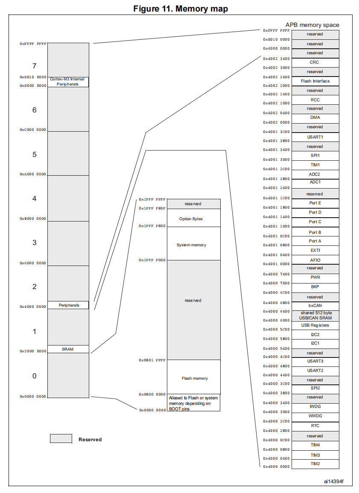

*图1-1STM32存储器映射-图*

限于目前的学习进度，我们暂时先不需要将这张图完全搞明白。

我们只需要知道以下信息就足够了：

在内存映射图中可以看到如下地址范围：

0x0800_0000 ~ 0x0801_FFFF这属于单片机Flash闪存映射的内存区域。

可以计算一下，这段区域的大小是：128KB在前面的课程中，我们已经知道：

这张图是STM32F103系列中等密度（64~128KB）芯片的内存映射，所以图中展示的是128KB的Flash闪存容量。

我们所使用的STM32F103C8T6只有64KB的Flash闪存容量，实际映射区域是：

**0x0800_0000 ~ 0x0800_FFFF**单片机在运行程序时，CPU 正是从 Flash 闪存中顺序读取下一条需要执行的程序指令，并加以执行。

那CPU 知道它自己访问的是 Flash 存储器吗？

答：CPU 并不知道自己访问的是 Flash 存储器，它只是在对某个地址进行访问操作。

也就是说：

**CPU 只知道它当前访问的是 0x08xx_xxxx 这一段地址空间，具体这个访问到底对应什么位置是内存映射机制决定的。**

### 2. Flash编程是什么？

本章节的标题叫做：Flash编程。

**那么什么是Flash编程呢？**

所谓 Flash 编程，就是通过编程的方式对 STM32 单片机的内置 Flash 存储器进行读写操作，从而实现数据的**掉电保存**。

实际上，ST 公司在设计 STM32 时，也将内置 Flash 作为一个专门的功能模块来管理。

SPL 库中提供了专门的 Flash 操作模块。

**那么，为什么要放在 SPI 章节讲解 Flash 编程呢？STM32 的内置 Flash 支持 SPI 通信吗？**

并不是。

STM32 的内置 Flash 本身并不通过 SPI 与 CPU 通信。

之所以放在 SPI 章节一起讲，是因为：

**SPI Flash——W25Q64 和 STM32 的内置 Flash 同属于 Flash 存储器。**

二者在存储特性和操作思想上有一定的相似之处，因此放在一起讲解，便于对比和理解。

但是需要注意的是：

**内置Flash和W25Q64相比，要简单得多得多，所以放心学，no压力。**

### 3. STM32的Flash编程

首先我们来复习一下STM32内置Flash的一些特点。

STM32F103C8T6的Flash闪存容量是：64KB，也就是说容量是65536个字节，0x1 0000个字节。

其内存映射的起始地址是：0x0800 0000也就是说，整个Flash存储器，它的地址映射范围是：**[0x0800 0000, 0x0800 FFFF]（闭区间）**

内置 Flash 闪存主要用于存储以下内容：

1. 工程编译后生成的程序代码（指令）
2. 程序中使用的只读常量数据

特点是：掉电不丢失，但不能像SRAM那样随意写（擦除写入，只能将1写成0）

**所以程序员也可以把一些希望持久保存的数据存入内置Flash，但由于内置Flash通常不大，且主要用于存储程序代码指令，所以通常不要把过多的数据存入内置Flash。**

#### 3.1 Flash存储空间的查看

为了更直接的看到STM32内置Flash的使用情况。

我们可以使用一款简单查看Flash存储情况的软件——STM32 ST-LINK Utility**你可以在嵌入式软件环境中，找到这个软件的安装包。**

如下图所示：

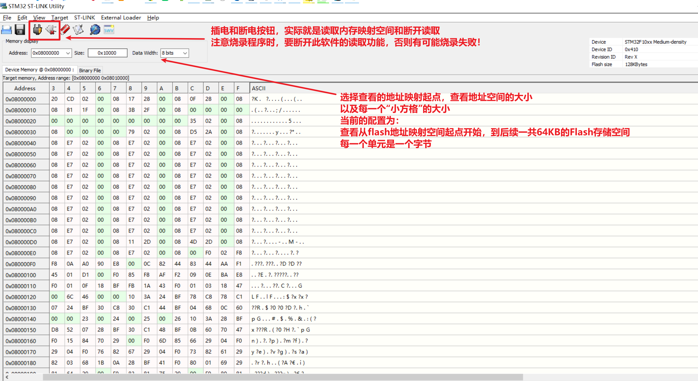

*图3.1-1Utility软件使用截图*

这款软件提供了图形化界面的方式来查看与操作内置Flash，也就是说：

你甚至可以直接在这个软件界面中，修改Flash存储器的数据内容。

**当然，我们不建议大家直接在这个软件上手动修改Flash存储数据！**

修改Flash存储器的数据最好还是用Flash编程的方式！

基于上述软件，我们往下查看Flash存储器的数据内容，很容易就能够发现如下图所示的**“隔断“**：

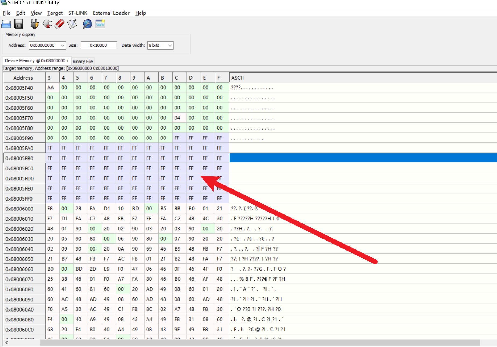

*图3.1-2Utility软件使用截图2*

这是什么意思呢？

为了解释这个问题，我们要明确一些基本原理。

前面我们学过SPI通信，使用过基于SPI通信的存储器W25Q64。

STM32 内置 Flash 和 W25Q64 本质上是同一种存储介质，都属于：NOR Flash（非易失性闪存）

也就是说：它们底层的物理结构是一样的，存储原理也是一样的。

所以 STM32 的内置 Flash **也有**以下特点：

1. 非易失性存储，断电后数据不会丢失，很适合用于存储重要参数，配置信息等。
2. **存储空间的组织划分都是分区域的。**
3. Flash 都不能直接覆盖写，而是必须先擦除（Erase）再写入（Program）：
   - a. 所谓擦除就是将“0 -> 1”
   - b. Flash 的写入操作，只能将“1 -> 0”，反之则无法进行。
4. **擦除和写的操作必然都不是以“字节”为单位，而是以某个最小区域为基本单位。**

所以，我们至少应该明白一件事情：

Flash 存储空间中，如果出现大片连续的0xFF ，通常说明该区域已经被擦除。

对于一个全新、未被写入过的单片机，其内部 Flash 在出厂时已经完成擦除操作，所以：

**整个 Flash 空间通常全部为 0xFF**

#### 3.2 Flash的存储空间组织形式

整个W25Q64 Flash存储器芯片，总存储空间是8MB：

1. 这8MB空间，首先分为128个块，每个块是64KB。
2. 每一块64KB空间，又分为16个扇区，每个扇区是4KB。
3. 每一扇区4KB空间，又分为16个页，每个页是256字节。

STM32内置Flash存储器，也有类似的存储空间划分，但它要**简单的多**：

**整个64KB的内置Flash存储器，被直接分为64个页（Page），每个页1KB。**

如下图所示：

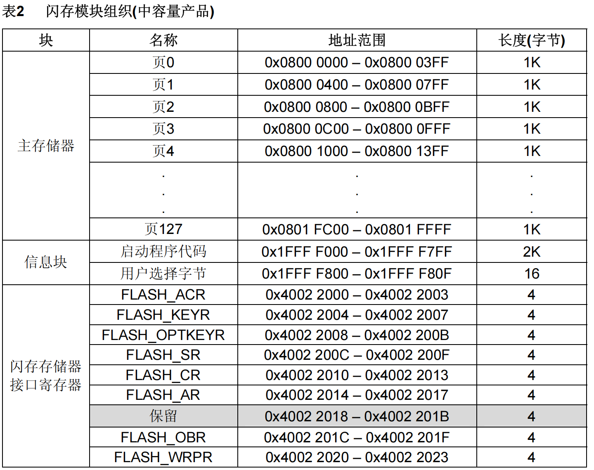

*图3.2-1Flash存储空间组织形式-图*

简单直接，没有了，只划分了一层。

#### 3.3 Flash的三种操作

首先，Flash 在执行写操作之前，通常需要先进行擦除操作。

这是因为 Flash 这种存储介质决定了：

1. 它不能通过“写”的方式将**0 → 1**，只能通过写操作，将**1 → 0**
2. 因此在写入前，需要先将所有位擦除为“1”（即0xFF ）
3. 这样才能进行后续写操作

对于W25Q64 Flash存储器芯片来说：

1. 它进行擦除的最小单位是**扇区（Sector，4KB）**
   - a. 还可以擦除更大的单位，比如块
   - b. 甚至支持整个芯片的擦除
2. 它进行写操作的单位是**页（Page，256字节）**
   - a. **一次写入不能跨页**
   - b. 但并不要求一次写入就写满一页
3. 读操作几乎没有任何限制，通过地址映射可以读任意区域数据。

那么 STM32 的内置 Flash 呢？

和W25Q64很类似，但又有所不同，它更简单：

1. **Flash进行擦除的最小单位是页（Page）**
   - a. 每页是1KB
   - b. 擦除的最小单位是页，且必须整页擦除
   - c. STM32F103C8T6 也支持“整片擦除（Mass Erase）”，但本质上仍是内部按页依次完成擦除
2. **Flash进行写操作的单位是半字（16位）**
   - a. 每一次写入操作都必须写入半字，2个字节数据。
   - b. 写入地址必须**2 字节对齐**
   - c. 若想实现一次性写1个字节，则可以先把写位置的半字数据读出来，修改目标字节后，再整体写回该半字。
   - d. 如果想要实现写一个字，则可以执行两次写入操作。
   - e. 若想写入更大的数据（如字、数组、结构体等），本质上都是：**拆分为多个“半字写入”操作依次完成**
3. 读操作仍然没有限制，通过内存映射地址，就可以读任意位置的任意个字节数据。

#### 3.4 Flash存储空间隔断出现的原因

我们之前对Flash的使用，就是使用Keil5软件，烧录程序。

Keil 在烧录程序时，并不是把整个 Flash 写满，而是只把“程序实际用到的部分”写进去。

它烧录程序时，会首先基于程序实际占用的空间，进行擦除操作再从Flash的起始地址（0x8000 0000）开始写入**程序的空间占用大概率不会完整占满一页，所以擦除后的“0xFF”就被保留了。**

之所以出现由“0xFF”组成的隔断，这说明：

**曾经烧录过更大的程序。**

Keil5在烧录程序时，并不会擦除整个Flash存储空间，只会擦除它需要使用的页。

于是这些没用到的页，它们的垃圾数据就被保留了。

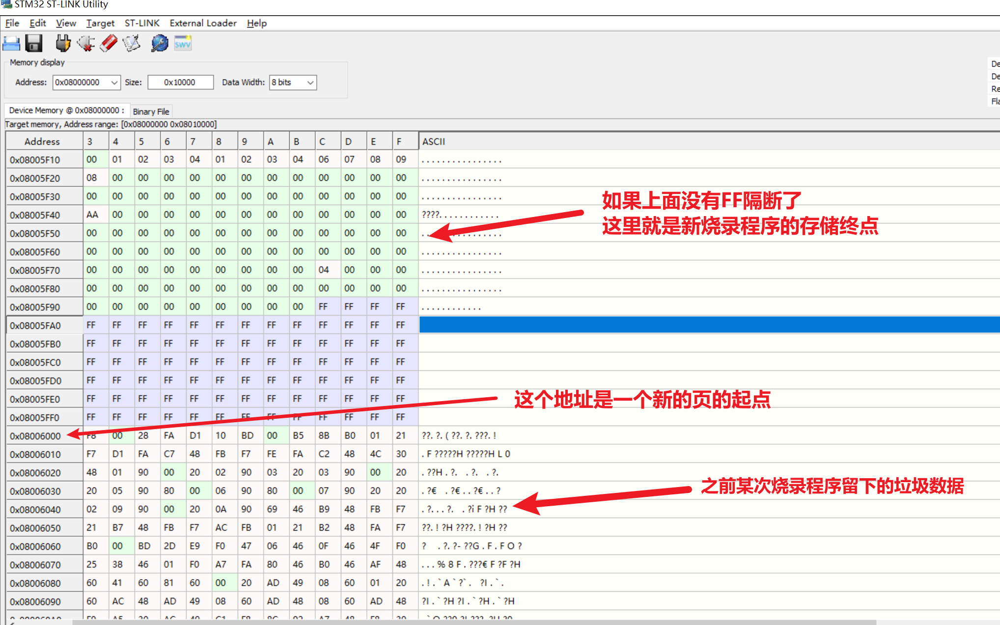

*图3.4-1Utility软件使用截图3*

如上图描述所示。

#### 3.5 Flash空间最大使用情况

我们可以继续向后查看 Flash 内容，跳过中间所有**非连续到底**的0xFF区域。

在扫描过程中，可以找到一个明显的分界点：在该地址之前存在有效数据，而从该地址开始之后，全部为0xFF 。

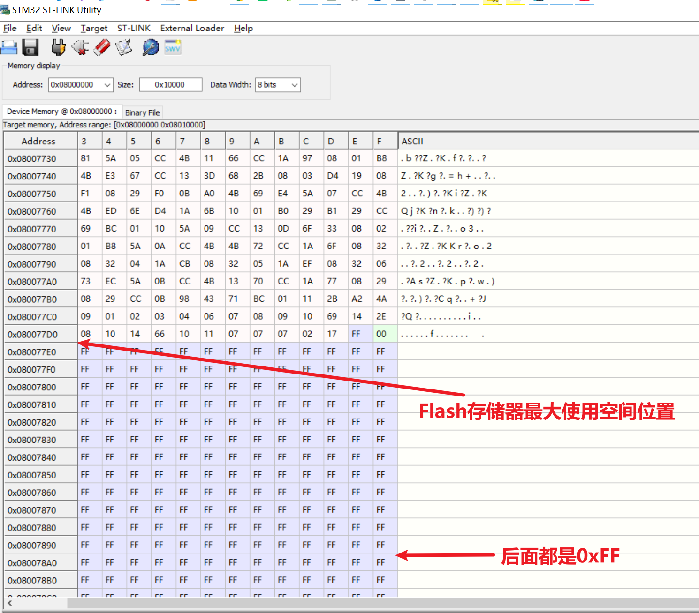

*图3.5-1Utility软件使用截图4*

最后一个非擦除数据地址在 0x080077D0 左右，这说明：

1. 之前烧录的所有程序，最多大约使用到了 0x080077D0 左右的位置。
2. 从该地址之后的空间，从未被程序使用过（保持擦除状态 0xFF）

也就是说，我们之前的程序，最多也就使用了Flash存储器接近0x77D0个字节，接近30KB的空间。

于是就有了一个自然而然的问题：

**我们能不能直接在这个地址的后面直接存储数据呢？**

最好不要。

虽然之前最多使用到了这里，但保不准哪一次就越过了这个区域。

如果直接在这后面存储我们想要的数据，很容易就被覆盖了。

那么我们把想要存储的信息存在哪里呢？

建议采用如下原则：

1. 选择一个**固定地址**
2. 尽量靠近 Flash 尾部，以避免与程序区发生重叠覆盖

**推荐直接存储在整个Flash空间的最后一页。**

最后一页的映射起始地址是：

**0x0800 0000 + 63 * 1024 = 0x0800 0FC00**结论：

**将我们想要存储的少量数据，直接固定存储在 Flash 最后一页（0x0800FC00）中，并从该页的起始地址开始存放。**

#### 3.6 Flash编程的流程

有了前面的铺垫，下面我们来讲一下如何实现Flash编程，如何将我们想要写的数据，写入Flash的目标位置。

W25Q64在执行擦除和写操作之前，需要先进行写使能，而且一次写使能对应一次擦除或写操作。

Flash也有类似的限制：

**为了避免用户误修改Flash区域，擦除和写操作之前都需要先解锁保护、解锁，完成操作后还需要重新恢复保护、加锁。**

但是要注意：

**解锁本质上就是把 Flash 控制器的门打开，打开后你可以连续做若干个合法操作，最后只要不要忘记关门就行。**

所以不需要一次操作就解锁、加锁一次。（这一点和写使能完全不同）

当然，读操作没有限制，通过地址值可以随意读取。

#### 3.7 Flash编程的寄存器实现（了解）

ST公司将Flash视为一个片上外设，在SPL库中也提供了Flash模块，封装了用于完成Flash编程的各个操作。

但我们仍然有必要了解一下基于寄存器开发的实现方式，这样做可以让我们更清楚地理解 Flash 编程的本质流程。

**解锁操作：**

在 STM32 中，Flash 控制寄存器FLASH->CR在上电后默认处于锁定状态。

这样设计的目的是为了防止程序误操作，避免在运行过程中意外修改或擦除 Flash 中的数据。

**因此，在进行任何擦除或写入操作之前，必须先完成解锁。**

解锁的寄存器操作代码如下：

```c
FLASH->KEYR = 0x45670123; // KEY1
FLASH->KEYR = 0xCDEF89AB; // KEY2
```

这里需要注意以下几点：

1. 必须按照固定顺序依次写入 KEY1 和 KEY2
2. 如果顺序错误，或者只写入其中一个 Key，Flash 仍然保持锁定状态
3. 在未解锁的情况下，后续所有擦除和写入操作都会失败

**加锁操作：**

加锁的方法很简单，只需要把CR控制寄存器当中的位FLASH_CR_LOCK置 1 即可。

代码如下：

```c
FLASH->CR |= FLASH_CR_LOCK;
```

这样做的目的，是为了防止后续程序误操作 Flash，进一步提高系统运行的安全性和稳定性。

这一步虽然代码很简单，但它是一个非常好的编程习惯。

**每次 Flash 擦除或写操作完成后，都应主动重新加锁。**

**页擦除操作：**

由于 Flash 单元不能直接把 0 改回 1，因此在写入新数据之前，必须先对目标区域进行擦除。

对于 STM32F103 来说，擦除是以“页”为单位进行的，每页大小是 1KB。

也就是说，哪怕你只想修改其中 2 个字节，也不能只擦这 2 个字节，而是必须把整个页全部擦掉。

页擦除的大体过程如下：

1. 先等待 Flash 空闲
2. 在控制寄存器中开启页擦除模式
3. 在地址寄存器中写入要擦除的页起始地址**（虽然不写起始地址也可以，但为了代码可读性建议使用起始地址）**
4. 启动擦除
5. 等待擦除完成
6. 关闭页擦除模式

其参考代码如下：

```c
while (FLASH->SR & FLASH_SR_BSY); // 等待Flash空闲

FLASH->CR |= FLASH_CR_PER; // 进入页擦除模式
FLASH->AR = 0x08000FC00; // 指定页起始地址
FLASH->CR |= FLASH_CR_STRT; // 启动擦除

while (FLASH->SR & FLASH_SR_BSY); // 等待擦除完成

FLASH->CR &= ~FLASH_CR_PER; // 退出页擦除模式
```

这里需要重点强调几点。

1. FLASH->AR中写入的地址建议使用页的起始地址，这样可读性会更好，更容易判断出当前擦除页。
2. 擦除完成之后，这一整页中的所有数据都会变成0xFF 。这说明该页已经回到了“可重新写入”的初始状态。
3. 擦除操作具有破坏性。如果某一页中原本还存有其他有用数据，而你又对这一页执行了擦除，那么这些数据都会一起被清空。
4. 在实际项目中，擦除前往往还要先考虑数据备份和页管理的问题。

**写入操作：**

在 STM32F1 系列中，内部 Flash 的最小编程单位是半字，也就是 16 位，2 个字节。

这意味着：

1. 不能直接按 8 位字节写入
2. 也不能直接一次按 32 位整字写入
3. 必须按半字为单位进行编程

写入流程与擦除类似，也要先等待 Flash 空闲，然后进入编程模式，写入数据，等待完成，最后退出编程模式。

参考代码如下：

```c
while (FLASH->SR & FLASH_SR_BSY); // 等待Flash空闲

FLASH->CR |= FLASH_CR_PG; // 进入编程模式，即开始写入数据

*(volatile uint16_t *)0x08004000 = 0x1234; // 写入半字数据

while (FLASH->SR & FLASH_SR_BSY); // 等待写入完成

FLASH->CR &= ~FLASH_CR_PG; // 退出编程模式
```

这里也有几个**非常关键**的点。

1. 写入地址必须是**偶数地址**，也就是 2 字节对齐。因为最小写入单位是半字，如果地址不是 2 字节对齐，就不符合硬件要求。
2. 每次写入的数据必须是 16 位，例如0x1234 ，这正好是一个半字的数据。

Flash 写入并不是一个“任意宽度写入”的机制，而是一个很明确的“半字编程模式”。

**完整流程总结**最后，一次完整的从擦除到写入的过程，流程如下：

1. 先向FLASH->KEYR写入 KEY1 和 KEY2，完成解锁
2. 检查FLASH->SR中的 BSY 位，确认 Flash 当前空闲
3. 先执行页擦除
4. 再次等待 Flash 空闲
5. 开启编程模式，按半字依次写入数据
6. 每次写入后等待 BSY 清零，等待空闲
7. 写入结束后关闭编程模式
8. 最后重新加锁

下面给出一个最小的寄存器开发示例，用来演示完整的解锁、擦除、写入、加锁流程：

```c
void Flash_Write_Test(void) {
    /*
     * STM32F103C8T6 的最后一页起始地址
     * Flash 总大小为 64KB，页大小为 1KB
     * 最后一页地址 = 0x08000000 + 63 * 1024 = 0x0800FC00
     */
    uint32_t Addr = 0x0800FC00;

    /*
     * 第一步：解锁 Flash 控制器
     *
     * STM32 内部 Flash 在上电后默认处于锁定状态，
     * 如果不先解锁，则后续的擦除和写入操作都无法执行。
     *
     * 解锁时，必须按顺序向 KEYR 寄存器写入两个固定密钥：
     * 1. 先写 KEY1 = 0x45670123
     * 2. 再写 KEY2 = 0xCDEF89AB
     */
    FLASH->KEYR = 0x45670123;
    FLASH->KEYR = 0xCDEF89AB;

    /*
     * 第二步：等待 Flash 空闲
     *
     * FLASH->SR 中的 BSY 位表示 Flash 控制器当前是否忙碌。
     * 如果 BSY = 1，说明前面的操作还没有完成，
     * 此时不能立即开始新的擦除或写入操作。
     *
     * 所以每次操作前，都要先等待 BSY 清零。
     */
    while (FLASH->SR & FLASH_SR_BSY);

    /*
     * 第三步：页擦除
     *
     * STM32 内部 Flash 不能直接把 0 改回 1，
     * 所以在重新写入之前，通常需要先擦除目标页。
     *
     * 擦除的最小单位是页，STM32F103 中每页大小为 1KB。
     * 这里擦除的是最后一页，即从 0x0800FC00 开始的这一页。
     */

    /* 使能页擦除模式 PER（Page Erase） */
    FLASH->CR |= FLASH_CR_PER;

    /*
     * 在地址寄存器 AR 中写入目标页地址
     * 表示选择要擦除的页
     * 实际开发中，通常统一写页起始地址
     */
    FLASH->AR = Addr;

    /* 启动擦除操作 */
    FLASH->CR |= FLASH_CR_STRT;

    /* 等待擦除完成，直到 BSY 清零 */
    while (FLASH->SR & FLASH_SR_BSY);

    /*
     * 擦除完成后，关闭页擦除模式
     * 避免后续误操作
     */
    FLASH->CR &= ~FLASH_CR_PER;

    /*
     * 第四步：半字写入
     *
     * STM32F1 系列内部 Flash 的最小编程单位是半字，
     * 也就是 16 位，2 个字节。
     *
     * 因此，不能像普通内存那样随意按字节写入，
     * 而是必须按半字进行编程。
     */

    /* 使能编程模式 PG（Program） */
    FLASH->CR |= FLASH_CR_PG;

    /*
     * 向目标地址写入一个半字数据 0x1234
     *
     * 这里的地址 Addr 必须满足 2 字节对齐，
     * 也就是必须为偶数地址。
     *
     * 写入本质上是通过对该地址执行半字存储操作完成的。
     */
    *(volatile uint16_t *)Addr = 0x1234;

    /* 等待写入完成，直到 BSY 清零 */
    while (FLASH->SR & FLASH_SR_BSY);

    /*
     * 写入完成后，关闭编程模式
     * 防止后续代码误写 Flash
     */
    FLASH->CR &= ~FLASH_CR_PG;

    /*
     * 第五步：重新加锁
     *
     * Flash 操作完成后，建议及时重新加锁，
     * 这样可以防止程序跑飞或误操作时破坏 Flash 数据。
     *
     * 后续如果还要再次擦除或写入，
     * 则需要重新执行解锁流程。
     */
    FLASH->CR |= FLASH_CR_LOCK;
}

```

当然，寄存器的开发代码我们了解即可，真正写代码编程还是建议大家使用SPL库来实现。

### 4. Flash编程的SPL库实现

ST 在 STM32 的标准外设库 SPL 中，对 Flash 编程相关操作进行了封装，提供了一组可以直接调用的函数接口。

常用的 Flash 相关 SPL 库函数如下表所示：

| 函数名 | 形参列表 | 返回值 | 功能 |
|---|---|---|---|
| FLASH_Unlock() | 无 | 无 | 解锁 Flash，使能后续写入和擦除操作 |
| FLASH_Lock() | 无 | 无 | 锁定 Flash，防止误修改 |
| FLASH_ErasePage(uint32_t Page_Address) | uint32_t Page_Address | FLASH_Status | 擦除 1 个 Flash 页， STM32F1 中通常为1KB |
| FLASH_EraseAllPages() | 无 | FLASH_Status | 擦除整个 Flash，破坏性很强，应谨慎使用 |
| FLASH_ProgramHalfWord(uint32_t Address, uint16_t Data) | uint32_t Address, uint16_t Data | FLASH_Status | 以 16 位半字为单位写入 Flash |
| FLASH_ProgramWord(uint32_t Address, uint32_t Data) | uint32_t Address, uint32_t Data | FLASH_Status | 以 32 位全字为单位写入 Flash，实际上仍然是两次半字写入 |

其中：

表中的FLASH_Status是 Flash 操作函数的返回状态值，用于表示本次操作是否成功完成。

常见返回结果通常包括以下几种：

1. FLASH_COMPLETE ，表示 Flash 操作成功完成。
2. FLASH_BUSY ，表示 Flash 控制器当前正忙。
3. FLASH_ERROR_PG ，表示编程过程中发生错误。
4. FLASH_ERROR_WRP ，表示写保护错误。
5. FLASH_TIMEOUT ，表示操作超时。

**通常这些函数的返回值，我们都不需要接收处理，前提是操作的流程正确得当。**

SPL库的底层也是寄存器开发，所以即便使用这些函数来完成Flash编程，操作流程和原理也不会改变。

下面提供几个常用的封装函数：

#### 4.1 第一个函数：Flash 页擦除函数

**第一个函数：Flash 页擦除函数**该函数用于擦除指定的 1 个 Flash 页。

这里传入的 Addr 建议应当是目标页的页首地址。

```c
/**
  * @brief 擦除指定 Flash 地址所在的页
  * @note Flash 写入前通常需要先擦除，擦除后该页内容变为 0xFF
  * @param Address: 目标 Flash 页内的任意地址
  */
void Flash_ErasePage(uint32_t Address) {
    // 1.解锁
    FLASH_Unlock();

    // 2.擦除指定页
    FLASH_ErasePage(Address);

    // 3.重新上锁
    FLASH_Lock();
}
```

这个函数的流程很清晰：

1. 先解锁 Flash。
2. 再调用页擦除函数。
3. 最后重新加锁。

#### 4.2 第二个函数：Flash 半字写入函数

**第二个函数：Flash 半字写入函数**

```c
/**
  * @brief 向指定 Flash 地址写入 1 个半字数据
  * @note 1 个半字为 16 位，即 2 个字节
  * @param Address: 目标 Flash 地址
  * @param Data: 要写入的 16 位数据
  */
void Flash_WriteHalfWord(uint32_t Address, uint16_t Data) {
    // 1.解锁
    FLASH_Unlock();

    // 2.向目标地址写半个字数据
    FLASH_ProgramHalfWord(Address, Data);

    // 3.重新上锁
    FLASH_Lock();
}
```

这个函数的作用是：向指定的 Flash 地址写入一个 16 位数据。

这里要注意以下两点：

1. Addr 必须满足 2 字节对齐。
2. 写入前应保证目标位置已经擦除过。

#### 4.3 第三个函数：Flash 一个字写入函数

**第三个函数：Flash 一个字写入函数**

```c
/**
  * @brief 向指定 Flash 地址写入 1 个字数据
  * @note 1 个字为 32 位，即 4 个字节
  * @param Address: 目标 Flash 地址
  * @param Data: 要写入的 32 位数据
  */
void Flash_WriteWord(uint32_t Address, uint32_t Data) {
    // 1.解锁
    FLASH_Unlock();

    // 2.向目标地址写1个字数据
    FLASH_ProgramWord(Address, Data);

    // 3.重新上锁
    FLASH_Lock();
}
```

说明：

1. Addr建议满足对齐到4字节
2. 从标准库底层实现来看，本质上仍然是两个半字写入
3. 写入前应保证目标区域已经擦除过

#### 4.4 Flash编程拼半字的方式（重点）

内置 Flash 的最小编程单位是半字（16 位），因此不能直接按单个字节写入。

而是需要先将两个字节拼接成一个半字，再写入 Flash。

同时，STM32 采用**小端存储方式**：

1. **低地址存放低字节**
2. **高地址存放高字节**

因此，在拼接半字时，应遵循下面的规则：

1. **低地址对应的字节放到半字的低 8 位**
2. **高地址对应的字节放到半字的高 8 位**

下面举一些具体的例子来说明一下这个拼接方式。

**例 1：两个字节拼成一个半字**假设有两个字节数据：

```c
Bytes[0] = 0x34; // 低地址的1个字节，这是数据的低有效字节
Bytes[1] = 0x12; // 高地址的1个字节，这是数据的高有效字节
```

则拼接后得到：

```c
HalfWord = 0x1234;
```

如果将这个半字写入地址Addr ，最终 Flash 中的数据分布为：

1. Addr存放0x34
2. Addr+1存放0x12

这正好符合：低地址放低字节，高地址放高字节。

**例 2：连续写入 4 个字节**假设要连续写入下面 4 个字节：

```c
0x11 0x22 0x33 0x44
```

则应先拼成两个半字：

1. 第一个半字：0x2211
2. 第二个半字：0x4433

写入后，Flash 中地址内容如下：

1. Addr+0存放0x11
2. Addr+1存放0x22
3. Addr+2存放0x33
4. Addr+3存放0x44

这样就实现了按原始字节顺序连续写入。

**例 3：对一个字节数组拼半字发送**假设现在有一个字节数组：

```c
uint8_t Bytes[5] = {0x11, 0x22, 0x33, 0x44, 0x55};
```

不能直接按单个字节写入，而是需要每两个字节拼成一个半字后再写入。

这个长度为 5 的字节数组，可以按下面方式拼接：

1. 第 1 个半字：0x2211
2. 第 2 个半字：0x4433
3. 第 3 个半字：0xFF55 （不足半字，补0xFF）

对应代码如下：

```c
uint16_t HalfWord1 = Bytes[0] | (Bytes[1] << 8); // 0x2211
uint16_t HalfWord2 = Bytes[2] | (Bytes[3] << 8); // 0x4433
uint16_t HalfWord3 = Bytes[4] | (0xFF << 8); // 0xFF55
```

这里前 4 个字节可以正常两两拼接。

但最后只剩下 1 个字节0x55 ，不足 2 个字节，因此需要将它补成一个完整的半字后再写入。

补齐规则如下：

1. 低 8 位放有效字节0x55
2. 高 8 位补0xFF

之所以补0xFF ，是因为**Flash 擦除后的默认值就是**0xFF ，这样处理更符合 Flash 的存储特性。

如果将这 3 个半字依次写入 Flash，最终地址中的数据分布如下：

1. Addr+0存放0x11
2. Addr+1存放0x22
3. Addr+2存放0x33
4. Addr+3存放0x44
5. Addr+4存放0x55
6. Addr+5存放0xFF

这样就实现了：

**虽然 Flash 按半字编程，但最终仍然可以按原始字节顺序，将整个字节数组连续写入Flash 中。**

**结论：**

Flash 按半字编程，小端模式下低地址放低字节、高地址放高字节。

**因此拼接半字时，应将低地址字节放在低 8 位，高地址字节放在高 8 位。**

#### 4.5 第四个函数：写一个字节数据

**第四个函数：写一个字节数据**首先不可能只写一个字节，还是需要写两个字节的。只不过写入的另一个字节数据是无意义的，是擦除后的数据0xFF。

所以只需要把你想要写入的1个字节数据 + 0xFF，拼成一个半字，然后写入就可以了由于小端存储法，所以0xFF应该拼到高8位，这样才能保证存入Flash时，0xFF在目标地址的下一个字节，而Data在目标地址处参考代码如下：

```c
/**
  * @brief 向指定 Flash 地址写入 1 个字节
  * @note 实际写入时仍然按半字写入，另一个字节使用 0xFF 填充
  * @param Address: 目标 Flash 地址
  * @param Data: 要写入的 1 字节数据
  */
void Flash_WriteByte(uint32_t Address, uint8_t Data) {
    // 1.解锁
    FLASH_Unlock();

    // 3.拼半字，然后写半字
    uint16_t HalfWord = ((0xFF << 8) | Data);
    FLASH_ProgramHalfWord(Address, HalfWord);

    // 3.重新上锁
    FLASH_Lock();
}
```

**牢记一个原则：该数据之前如何存储，利用SPL库函数，写入Flash后还是如何存储。**

#### 4.6 第五个函数：写一个字节数组

**第五个函数：写一个字节数组**由于 Flash 不能按**字节**直接编程，所以这里采用**“每两个字节拼成一个半字”**再写入的方式。

参考代码如下：

```c
/**
  * @brief 向指定 Flash 地址连续写入多个字节
  * @note STM32F1 Flash 最小写入单位为半字，因此函数内部会将字节两两拼成半字写入
  * @param Address: 目标 Flash 起始地址
  * @param Bytes: 要写入的字节数组首地址
  * @param Length: 要写入的字节数量
  */
void Flash_WriteBytes(uint32_t Address, const uint8_t *Bytes, uint16_t Length) {
    // 1.解锁
    FLASH_Unlock();

    /*
       2.Flash不可以直接写入多个字节，所以仍然需要把这多个字节的数据拼半字写入Flash
       Bytes字节数组当中的数据，每两个字节拼成一个半字，然后写入Flash
    */
    for (uint16_t i = 0; i < Length; i += 2) {
       /*
           数组这种数据结构在存储时，本身就是按照下标从低地址存储到高地址
           比如数组是[0, 1, 2, 3, 4, 5]
           那么在存储时，低地址到高地址就是[0, 1, 2, 3, 4, 5]
           所以存入Flash时，也应该是低地址到高地址[0, 1, 2, 3, 4, 5]

           Bytes字节数组拼半字的方式，i是它的下标
           Bytes[i] 作为低八位
           Bytes[i + 1] 作为高八位
           比如：
           Bytes[i] = 0x12
           Bytes[i + 1] = 0x34
           拼得的半字就应该是：
           HalfWord在存储时是0x1234，如果按照小端解析这个HalfWord，这个数据是0x3412

           除此之外，还需要考虑数组的长度：
           1.如果数组的长度是奇数，那么最后一次拼半字，需要拼上0xFF（0xFF在存储时，应该在高地址处）
           2.如果数组的长度是偶数，那么每一次都是完整的拼半字
       */
       uint16_t HalfWord;

       if (i + 1 < Length) {
           // 如果i + 1 < Length代表是一次完整的拼半字
           HalfWord = (Bytes[i + 1] << 8) | Bytes[i];
       } else {
           /**
               代表数组长度是奇数，而且是最后一次拼半字，需要拼一个0xFF
               我们希望最终Falsh中存储的数据，从低地址到高地址是：Bytes[i] 0xFF
               但是由于存储数据时，采用小端存储法
               从低地址到高地址存储是：Bytes[i] 0xFF
               但这个数据实际上是：0xFF Bytes[i]
               所以0xFF应该拼在高8位
           */
           HalfWord = (0xFF << 8) | Bytes[i];
       }

       // 3.将拼好的半字写入Flash当中
       FLASH_ProgramHalfWord(Address + i, HalfWord);
    }

    // 4.重新上锁
    FLASH_Lock();
}
```

说明：

1. Length可以是任意长度，不一定非得是偶数（奇数最后一次拼半字就需要补0xFF）
2. 如果最后只剩 1 个字节（数组长度是奇数），就补一个0xFF
3. 写字节数组时，虽然逻辑上看是按字节写，但底层真正执行时，仍然是按半字写入。

#### 4.7 扩展：数组与小端存储的关系

首先要明确一点：

数组元素之间的排列顺序，和大小端存储没有关系。

数组在内存中是一块连续空间，数组元素会按照下标顺序依次存放。

例如：

```c
int arr[3] = {1, 2, 3};
```

它在内存中的整体顺序一定是：

```c
arr[0] -> arr[1] -> arr[2]
```

也就是说，元素1 、2 、3会按照数组下标顺序连续存放，不会因为小端存储而变成3,2,1 。

但是，如果数组元素本身是多字节类型，例如int通常占 4 个字节，那么每一个int元素的内部字节顺序，就会受到大小端影响。

在小端存储的机器上，低位字节存放在低地址处。

例如：

```c
int arr[3] = {1, 2, 3};
```

可以理解为：

1. arr[0]、arr[1]、arr[2] 按顺序连续存放；
2. 但每个 int 元素内部，按小端方式存放自己的 4 个字节。

所以结论是：

**小端存储影响的是“多字节数据内部的字节顺序”，不影响数组元素之间的排列顺序。**

再看字符串：

```c
char str[] = "abc";
```

字符串本质上是char数组，而char只占 1 个字节。

因为每个元素只有 1 个字节，不存在“字节内部再排序”的问题，所以字符串的存储和大小端没有关系。

因此可以简单总结为：

1. 数组元素按下标顺序连续存放；
2. 如果元素是多字节类型，元素内部才会受到大小端影响；
3. 如果元素是char这种单字节类型，就和大小端无关。

#### 4.8 第六个函数：写一个字符串

**第五个函数：写一个字符串**字符串本质上也是一段按\0结尾的字符数组，而字符本身在内存中也是按字节存储的。

因此，写字符串时，完全可以在前面“写字节数组”的基础上继续封装。

```c
/**
  * @brief 向指定 Flash 地址写入一个字符串
  * @note 写入时会连同字符串结束符 '\0' 一起写入，方便后续按 C 字符串读取
  * @param Address: 目标 Flash 起始地址
  * @param Str: 要写入的字符串首地址
  */
void Flash_WriteString(uint32_t Address, const char *Str) {
    // 存储字符串时连带空字符一起存储
    uint16_t Length = strlen(Str) + 1;
    Flash_WriteBytes(Address, (const uint8_t*)Str, Length);
}
```

说明：

1. strlen(Str)得到的是字符串中有效字符的长度，不包含结尾的'\0'
2. 这里再加1 ，就是为了把字符串结束符'\0'也一起写入 Flash
3. 这样后续从 Flash 中读出后，才能直接当作 C 字符串使用。

#### 4.9 第七个函数：Flash 读取一段数据函数

**第六个函数：Flash 读取一段数据函数**相比于擦除和写入，Flash 的读取要简单得多。

这是因为 STM32 内部 Flash 在地址空间上已经映射为普通存储区。

**所以读取时，本质上就和访问普通内存一样，可以直接按地址取值。**

```c
/**
  * @brief 从指定的目标地址开始，读取多个字节的数据
  * @param Address: 读取的指定目标地址
  * @param Buffer：用于存放从Flash中读取的Length个字节数据
  * @retval Length：一次性从目标地址开始，连续读取多少个字节数据
  * @note 拿到Flash的映射地址后
  * 把它转换成一个指针，接下来的操作和利用指针访问连续内存空间是一样的
  */
void Flash_ReadBytes(uint32_t Address, uint8_t *Buffer, uint16_t Length) {
    // 1.利用Address构建一个指针
    volatile uint8_t *ReadPtr = (uint8_t *)Address;

    // 2.利用这个指针读Flash，并且把数据存入Buffer
    for(uint16_t i = 0; i < Length; i++){
       Buffer[i] = *(ReadPtr + i);
    }
}
```

这个函数的作用是：

从指定地址开始，连续读取Length个字节，并将读取到的数据依次保存到Buffer缓冲区中。

注意：

1. 这是一个通用的按字节读取Flash的函数
2. Length用于指定从目标地址开始，读取Flash的字节数量。
3. 读出来的数据就是单纯的原始字节数据，随后通常还需要对这些原始数据做处理。

这里还要顺带强调一个知识点：读取 Flash 不需要先解锁。

因为解锁只针对擦除和编程操作，而读取本身并不会修改 Flash 内容，所以可以直接访问。

**举一个例子：**

假设从地址0x0800FC00开始，Flash 中依次存放了以下 5 个字节数据：

```c
0x11 0x22 0x33 0x44 0x55
```

现在定义一个缓冲区：

```c
uint8_t Buffer[5];
```

调用读取函数：

```c
Flash_ReadBytes(0x0800FC00, Buffer, 5);
```

读取完成后，Buffer中保存的数据就是：

```c
Buffer[0] = 0x11
Buffer[1] = 0x22
Buffer[2] = 0x33
Buffer[3] = 0x44
Buffer[4] = 0x55
```

这说明：

**Flash_ReadBytes() 会从指定起始地址开始，按字节顺序连续读取数据，并依次保存到目标缓冲区中。**

#### 4.10 第八个函数：Flash读一个字符串

字符串本质上就是一个char数组，并且以空字符'\0'作为结束标志。

因此，读取 Flash 中保存的字符串，本质上就是：

从指定 Flash 地址开始，逐字节读取数据，并依次保存到目标字符数组中，直到读到字符串结束符'\0' 。

完整参考代码如下：

```c
/**
  * @brief 从指定 Flash 地址开始读取字符串
  * @note 字符串必须以 '\0' 结尾，Buffer 必须有足够空间
  * @param Address: 字符串在 Flash 中的起始地址
  * @param Buffer: 用于保存读取结果的字符数组
  */
void Flash_ReadString(uint32_t Address, char *Buffer) {
    // 根据 Flash 起始地址，构造一个字符指针
    volatile const char *ReadPtr = (volatile const char *)Address;

    // 从 Flash 中逐字节读取，并依次写入 Buffer
    // 当读到 '\0' 时，赋值表达式结果为 0，循环结束
    while(*Buffer++ = *ReadPtr++);
}
```

这段代码的核心是：

```c
while ((*Buffer++ = *ReadPtr++) != '\0');
```

它可以拆开理解为：

1. *ReadPtr ：从 Flash 当前地址读取一个字符。
2. *Buffer=*ReadPtr ：把读取到的字符保存到目标数组。
3. ReadPtr++ ：Flash 读取地址向后移动一个字节。
4. Buffer++ ：目标数组写入位置向后移动一个字节。
5. 如果本次读到的是'\0' ，循环结束。

**举一个例子：**

假设从地址0x0800FC00开始，Flash 中依次存放了：

```c
'h' 'e' 'l' 'l' 'o' '\0'
```

对应十六进制为：

```c
0x68 0x65 0x6C 0x6C 0x6F 0x00
```

定义字符数组：

```c
char Str[6];
```

调用读取函数：

```c
Flash_ReadString(0x0800FC00, Str);
```

读取完成后，Str中保存的内容就是：

```c
"hello"
```

也就是：

```c
Str[0] = 'h'
Str[1] = 'e'
Str[2] = 'l'
Str[3] = 'l'
Str[4] = 'o'
Str[5] = '\0'
```

此时，Str就是一个合法的 C 字符串，可以直接用于打印：

```c
printf("%s\r\n", Str);
```

需要注意：

这个函数和strcpy类似，默认 Flash 中存放的数据必须包含字符串结束符'\0'，并且目标数组Buffer必须有足够空间。

否则就可能一直读下去（直到找到空字符），导致数组越界操作。

#### 4.11 完整演示代码

**Flash.h头文件：**

```c
#ifndef __FLASH_H
#define __FLASH_H

#include "stm32f10x.h"

void Flash_ErasePage(uint32_t Address);

void Flash_WriteHalfWord(uint32_t Address, uint16_t Data);
void Flash_WriteWord(uint32_t Address, uint32_t Data);
void Flash_WriteByte(uint32_t Address, uint8_t Data);
void Flash_WriteBytes(uint32_t Address, const uint8_t *Bytes, uint16_t Length);
void Flash_WriteString(uint32_t Address, const char *Str);

void Flash_ReadBytes(uint32_t Address, uint8_t *Buffer, uint16_t Length);
void Flash_ReadString(uint32_t Address, char *Buffer);

#endif // !__FLASH_H

```

**Flash.c源文件：**

```c
#include "Flash.h"
#include <string.h>

/**
  * @brief 擦除指定 Flash 地址所在的页
  * @note Flash 写入前通常需要先擦除，擦除后该页内容变为 0xFF
  * @param Address: 目标 Flash 页内的任意地址
  */
void Flash_ErasePage(uint32_t Address) {
    // 1.解锁
    FLASH_Unlock();

    // 2.擦除指定页
    FLASH_ErasePage(Address);

    // 3.重新上锁
    FLASH_Lock();
}

/**
  * @brief 向指定 Flash 地址写入 1 个半字数据
  * @note 1 个半字为 16 位，即 2 个字节
  * @param Address: 目标 Flash 地址
  * @param Data: 要写入的 16 位数据
  */
void Flash_WriteHalfWord(uint32_t Address, uint16_t Data) {
    // 1.解锁
    FLASH_Unlock();

    // 2.向目标地址写半个字数据
    FLASH_ProgramHalfWord(Address, Data);

    // 3.重新上锁
    FLASH_Lock();
}

/**
  * @brief 向指定 Flash 地址写入 1 个字数据
  * @note 1 个字为 32 位，即 4 个字节
  * @param Address: 目标 Flash 地址
  * @param Data: 要写入的 32 位数据
  */
void Flash_WriteWord(uint32_t Address, uint32_t Data) {
    // 1.解锁
    FLASH_Unlock();

    // 2.向目标地址写1个字数据
    FLASH_ProgramWord(Address, Data);

    // 3.重新上锁
    FLASH_Lock();
}

/**
  * @brief 向指定 Flash 地址写入 1 个字节
  * @note 实际写入时仍然按半字写入，另一个字节使用 0xFF 填充
  * @param Address: 目标 Flash 地址
  * @param Data: 要写入的 1 字节数据
  */
void Flash_WriteByte(uint32_t Address, uint8_t Data) {
    // 1.解锁
    FLASH_Unlock();

    // 3.拼半字，然后写半字
    uint16_t HalfWord = ((0xFF << 8) | Data);
    FLASH_ProgramHalfWord(Address, HalfWord);

    // 3.重新上锁
    FLASH_Lock();
}

/**
  * @brief 向指定 Flash 地址连续写入多个字节
  * @note STM32F1 Flash 最小写入单位为半字，因此函数内部会将字节两两拼成半字写入
  * @param Address: 目标 Flash 起始地址
  * @param Bytes: 要写入的字节数组首地址
  * @param Length: 要写入的字节数量
  */
void Flash_WriteBytes(uint32_t Address, const uint8_t *Bytes, uint16_t Length) {
    // 1.解锁
    FLASH_Unlock();

    /*
       2.Flash不可以直接写入多个字节，所以仍然需要把这多个字节的数据拼半字写入Flash
       Bytes字节数组当中的数据，每两个字节拼成一个半字，然后写入Flash
    */
    for (uint16_t i = 0; i < Length; i += 2) {
       /*
           数组这种数据结构在存储时，本身就是按照下标从低地址存储到高地址
           比如数组是[0, 1, 2, 3, 4, 5]
           那么在存储时，低地址到高地址就是[0, 1, 2, 3, 4, 5]
           所以存入Flash时，也应该是低地址到高地址[0, 1, 2, 3, 4, 5]

           Bytes字节数组拼半字的方式，i是它的下标
           Bytes[i] 作为低八位
           Bytes[i + 1] 作为高八位
           比如：
           Bytes[i] = 0x12
           Bytes[i + 1] = 0x34
           拼得的半字就应该是：
           HalfWord在存储时是0x1234，如果按照小端解析这个HalfWord，这个数据是0x3412

           除此之外，还需要考虑数组的长度：
           1.如果数组的长度是奇数，那么最后一次拼半字，需要拼上0xFF（0xFF在存储时，应该在高地址处）
           2.如果数组的长度是偶数，那么每一次都是完整的拼半字
       */
       uint16_t HalfWord;

       if (i + 1 < Length) {
           // 如果i + 1 < Length代表是一次完整的拼半字
           HalfWord = (Bytes[i + 1] << 8) | Bytes[i];
       } else {
           /**
               代表数组长度是奇数，而且是最后一次拼半字，需要拼一个0xFF
               我们希望最终Falsh中存储的数据，从低地址到高地址是：Bytes[i] 0xFF
               但是由于存储数据时，采用小端存储法
               从低地址到高地址存储是：Bytes[i] 0xFF
               但这个数据实际上是：0xFF Bytes[i]
               所以0xFF应该拼在高8位
           */
           HalfWord = (0xFF << 8) | Bytes[i];
       }

       // 3.将拼好的半字写入Flash当中
       FLASH_ProgramHalfWord(Address + i, HalfWord);
    }

    // 4.重新上锁
    FLASH_Lock();
}

/**
  * @brief 向指定 Flash 地址写入一个字符串
  * @note 写入时会连同字符串结束符 '\0' 一起写入，方便后续按 C 字符串读取
  * @param Address: 目标 Flash 起始地址
  * @param Str: 要写入的字符串首地址
  */
void Flash_WriteString(uint32_t Address, const char *Str) {
    // 存储字符串时连带空字符一起存储
    uint16_t Length = strlen(Str) + 1;
    Flash_WriteBytes(Address, (const uint8_t*)Str, Length);
}

/**
  * @brief 从指定的目标地址开始，读取多个字节的数据
  * @param Address: 读取的指定目标地址
  * @param Buffer：用于存放从Flash中读取的Length个字节数据
  * @retval Length：一次性从目标地址开始，连续读取多少个字节数据
  * @note 拿到Flash的映射地址后
  * 把它转换成一个指针，接下来的操作和利用指针访问连续内存空间是一样的
  */
void Flash_ReadBytes(uint32_t Address, uint8_t *Buffer, uint16_t Length) {
    // 1.利用Address构建一个指针
    volatile uint8_t *ReadPtr = (uint8_t *)Address;

    // 2.利用这个指针读Flash，并且把数据存入Buffer
    for(uint16_t i = 0; i < Length; i++){
       Buffer[i] = *(ReadPtr + i);
    }
}

/**
  * @brief 从指定 Flash 地址开始读取字符串
  * @note 字符串必须以 '\0' 结尾，Buffer 必须有足够空间
  * @param Address: 字符串在 Flash 中的起始地址
  * @param Buffer: 用于保存读取结果的字符数组
  */
void Flash_ReadString(uint32_t Address, char *Buffer) {
    // 根据 Flash 起始地址，构造一个字符指针
    volatile const char *ReadPtr = (volatile const char *)Address;

    // 从 Flash 中逐字节读取，并依次写入 Buffer
    // 当读到 '\0' 时，赋值表达式结果为 0，循环结束
    while(*Buffer++ = *ReadPtr++);
}

```

**main.c测试代码：**

```c
#include "stm32f10x.h"
#include "DebugUSART1.h"
#include "Flash.h"

#define FLASH_LAST_PAGE_ADDR 0x0800FC00

int main(void) {
    // 初始化调试串口
    DebugUSART1_Init();

    printf1("Flash test start\r\n");

    // 写 Flash 前，先擦除目标页
    Flash_ErasePage(FLASH_LAST_PAGE_ADDR);
    printf1("Erase page done\r\n");

    // ================= 1. 测试存 1 个字符 =================
    char WriteChar = 'A';
    char ReadChar = 0;

    Flash_WriteBytes(FLASH_LAST_PAGE_ADDR, (uint8_t *)&WriteChar,1);
    Flash_ReadBytes(FLASH_LAST_PAGE_ADDR, (uint8_t *)&ReadChar, 1);

    printf1("Char write: %c\r\n", WriteChar);
    printf1("Char read : %c\r\n", ReadChar);

    // ================= 2. 测试存 1 个半字 =================
    uint16_t WriteHalfWord = 0x1234;
    uint16_t ReadHalfWord = 0;

    Flash_WriteBytes(FLASH_LAST_PAGE_ADDR + 2, (uint8_t*)&WriteHalfWord,2);
    Flash_ReadBytes(FLASH_LAST_PAGE_ADDR + 2, (uint8_t*)&ReadHalfWord,2);

    printf1("HalfWord write: 0x%04X\r\n", WriteHalfWord);
    printf1("HalfWord read : 0x%04X\r\n", ReadHalfWord);

    // ================= 3. 测试存 1 个字 =================
    uint32_t WriteWord = 0x12345678;
    uint32_t ReadWord = 0;

    Flash_WriteBytes(FLASH_LAST_PAGE_ADDR + 4, (uint8_t*)&WriteWord,4);
    Flash_ReadBytes(FLASH_LAST_PAGE_ADDR + 4, (uint8_t *)&ReadWord,4);

    printf1("Word write: 0x%08X\r\n", WriteWord);
    printf1("Word read : 0x%08X\r\n", ReadWord);

    // ================= 4. 测试存 1 个字符串 =================
    char WriteStr[] = "hello";
    char ReadStr[6] = {0};

    Flash_WriteString(FLASH_LAST_PAGE_ADDR + 8, WriteStr);
    Flash_ReadString(FLASH_LAST_PAGE_ADDR + 8, ReadStr);

    printf1("String write: %s\r\n", WriteStr);
    printf1("String read : %s\r\n", ReadStr);

    printf1("Flash test end\r\n");

    while (1) {
    }
}

```

以上，你可以自行测试这段代码。
