# FreeRTOS讲义（卷一）

> 拆分自 `2_FreeRTOS讲义汇总.md / 卷一`，共 3 份 PDF 讲义。所有插图保存在 `FreeRTOS_assets/` 目录，请保持相对位置不变。

## 目录

- 01 裸机开发与操作系统

- 02 FreeRTOS的任务调度

- 03 FreeRTOS的移植与剪裁

---

## 01 裸机开发与操作系统

### 1. 裸机开发概述

裸机开发（Bare-metal），在嵌入式领域中指：

1. 在没有操作系统（OS）作为中间层的情况下，应用程序直接运行在 MCU 硬件之上。
2. 开发者需要直接操作寄存器，或者使用外设库（如 SPL / HAL）来完成外设初始化、控制和业务逻辑实现。

也就是说：

程序没有操作系统调度，一切代码都由开发者自己控制。

一个典型的裸机操作是：初始化（时钟/引脚/外设）→ 主循环前执行的操作 →while(1) 主循环 → 中断服务程序（ISR）响应外部事件。

裸机开发，说白了就是：**所有事情都要程序员自己安排。**

所以你在 STM32 上写的这些代码：

1. 开 RCC 时钟
2. 配 GPIO 模式
3. 配 NVIC 优先级，开中断，编写中断处理函数
4. SPI 发几个字节，CS 拉低拉高
5. USART 收到数据进中断，自己拼字符串、自己处理溢出
6. ....

这些都属于典型的裸机开发操作。

裸机开发的世界观特别朴素：

MCU：我的硬件就在这里，你来开发我吧。

你：我来了，你按照我的指示一步步行动工作。

因此，只要程序**没有操作系统参与调度**，不管你是：

1. 直接操作寄存器
2. 使用 SPL 外设库
3. 使用 HAL 库

本质上都属于：**裸机开发（Bare-metal Programming）。**

#### 1.1 一个裸机开发的案例

裸机开发的优点，像极了你刚拿到一块新板子的时候那种快乐。

首先说优点，说实话：**爽，是真的爽。**

你想让它亮，它就能亮。你一句GPIO_SetBits() ，LED 立马发光。

没有“系统正在忙”，没有“请稍后再试”，也没有“权限不足”。

裸机开发的体验就是一句话：**没有中间商赚差价。**

资源占用也非常清楚，像翻账本一样明白。你用了多少 RAM，栈多大，Flash 多大，几乎都能算出来。

不像通用操作系统：装一个程序，顺便给你起十几个后台服务，还问你一句——“是否允许它开机自启”。

而且，在裸机环境下，你真的能搞明白硬件是怎么工作的。

比如 SPI：

1. 你知道 SCK 是第几个边沿采样，
2. MOSI 在哪一拍必须稳定，
3. CS 拉低到底代表“通信开始”还是“设备选中”。
4. 这些“硬件的特性，在裸机阶段学得最扎实。

但裸机的缺点也很真实，甚至可以说：**是真折磨，是真坐牢。**

裸机的痛点并不是“写不出来代码”，而是——写着写着，就开始崩坏。

一开始，功能少的时候，一切都很美好。

1. LED 闪烁：OK
2. 按键检测：OK
3. 串口收发：也行

一个while(1) ，世界清净。

可一旦功能多起来，while(1)很快就会变成“剩饭大杂烩”。

你会看到这种典型场景：

1. 主循环里要刷 OLED
2. 还要处理串口接收数据
3. 还要把数据写进 W25Q64
4. 还要采 ADC
5. 还要做超时重传
6. 还要处理按键的长按、短按、双击
7. 还要加个蜂鸣器报警

最后的主循环逻辑基本就是：

这也得管，那也得管，谁都不能饿着。

于是你开始写各种东西：

1. 标志位
2. 计数器
3. 状态机
4. 软定时器
5. ....

写着写着你会突然意识到一件事：

**你已经不是在写业务逻辑了，你是在手搓一个“调度器”。**

最要命的问题还不在这儿，而在于—— 忙等 / 阻塞会把 CPU “焊死”。

裸机开发里最常见的“性能问题”，并不是 MCU 算不动，而是你自己把 CPU 按在椅子上罚站。

比如你写了一个：

```c
Delay_Ms(1000);
```

这一秒钟里，MCU 的状态基本是：

“我就站在这儿，谁也别想让我干别的。”

你以为它在“休息”，其实它是在“发呆占座”。

这时候如果：

1. 另一个按键被按下了 —— 不好意思，等罚站结束再说
2. 串口数据来了 —— 不好意思，缓冲区溢出再说
3. 需要紧急响应 —— 你只能祈祷中断优先级够高

于是到了裸机开发的后期，经常会出现一些非常典型的现象：

1. **牵一发动全身**：改一个功能，另一个功能开始抽风。
2. **调试像破案**：LED 不亮不是 LED 的问题，也不是 GPIO 的问题，而是你在某个角落改了个标志位。
3. **代码越来越像“硬编码艺术展”**：只可远观，不可维护。

到这个阶段，几乎所有人都会产生一个非常朴素、非常真实的愿望：

能不能来个东西，帮我管一管：谁先跑、谁后跑、谁该让路？

而这，正是我们引入操作系统 / RTOS 的真实需求来源。

#### 1.2 裸机开发的优缺点

**裸机开发的好处是：**

1. **控制直接：**程序直接控制硬件资源（寄存器/外设），执行路径短。
2. **通常具有更好的实时性与性能：**由于没有操作系统作中间层，所以性能通常会更好，但也取决于设计。
3. **减少资源开销：**无操作系统管理开销，Flash/RAM 占用更可控。
4. **便于理解底层：**适合学习硬件工作机制与通信时序。

总之：

裸机开发更适合在简单应用、业务不复杂的情况下使用。

尤其是在资源严重受限的场景下，直接裸机开发不仅资源占用少，还能够做到更好的实时性。

**裸机开发的缺点是：**

1. **可维护性差：**前期业务简单可以使用裸机开发，但后期业务复杂后，主循环与中断逻辑交织，耦合度上升，代码将很难维护。
2. **并发处理困难：**多任务“同时做”通常靠轮询、标志位等硬扛。由于单片机多是单核心硬件，裸机开发很难做到同时处理多任务。
3. **开发难度大且效率低：**实际开发总会面临业务复杂的场景，直接裸机开发对程序员能力要求高，且开发速度也会严重低下。

总之：

裸机开发在应对实际工作中，高复杂度的项目是“心有余而力不足”的。

这就好比：

一开始公司比较小，业务简单，人也很少，这时候老板自己下场亲自干活，事必躬亲，公司各方面的效率很高，而且也省钱。

但随着公司规模增大，业务变得复杂，人员众多。

此时老板再想事必躬亲，不仅是“麻烦和累”的问题了，而是“很多事情做不到”，钱是省了，但是会严重脱离公司的运行效率，得不偿失。

那怎么办呢？

很简单，引入中间领导层，让中间领导层做一部分事情。

所以：

**当裸机开发不足以应对实际开发的复杂业务时，引入中间层操作系统就是必然的了。**

#### 1.3 引入中间层

中间层（Middleware / Abstraction Layer）：位于应用层业务逻辑与底层硬件之间，用于提供封装、抽象、复用能力的代码层。

在嵌入式领域，中间层常见形式包括：

1. **外设库/驱动层（如 SPL/HAL/或手搓驱动等）**：封装寄存器操作细节，提供统一API。
2. **RTOS，实时操作系统内核层（如 FreeRTOS）**：提供任务调度、延时管理、同步互斥、通信机制等。

“中间层”这三个字，听着像管理层开会用的词：“我们要引入中间层，以提升整体协同效率。”

翻译成人话就是：

“别什么都让一个人干，得分工，得有规矩。”

我们可以把中间层分成两类，别搞混了：

**第一类：库/驱动层：**

1. 任何单片机的操作都一定起源于寄存器，而库/驱动可以帮你把一系列寄存器操作封装起来，形成一个统一的、好用的功能库。
2. 典型的，如：SPL库、HAL库等。
3. 包括我们以后自己工作了，也难免会写这种中间层库或驱动。

**外设库、驱动层的核心作用是，减少我们编程时的体力劳动、重复劳动。**

这就像我想吃饭就去饭店花钱买，而不需要从种地开始才能吃上饭。

但这种中间层的作用不是非用不可的，因为你裸机开发写到后期，最大的问题不是“不会操作硬件”，不是功能难以实现。

而是：

硬件越来越多、事情越来越多，谁先做？谁后做？谁能插队？

现在的问题不是这些功能开发不出来，而是究竟怎么管理这些复杂功能。

**于是，在嵌入式开发中，就引入了另一种更重要的中间层——实时操作系统，RTOS。**

下面从操作系统的历史开始讲起，让大家了解一下什么是操作系统，以及实时操作系统。

### 2. 操作系统的发展历史（了解）

在前面的内容中，我们已经引入了这样一个概念：

**当业务越来越复杂，仅靠裸机方式已经很难高效、可靠地管理程序运行时，就需要引入操作系统来进行统一管理。**

为了理解这一点，我们有必要非常简要地回顾一下操作系统的发展历史。

看看操作系统，到底是在解决什么问题的过程中一步步演化出来的。

操作系统的定义是：

操作系统是一种系统软件，作为中间层，向下管理计算机的一切硬件资源，向上为用户程序提供运行环境。

如果你看过《操作系统》教科书，很容易了解到下列内容：

操作系统发展历史（简要概述）

从计算机发展的历史来看，操作系统并不是一开始就存在的，其演进大致经历了以下几个阶段：

1. **无操作系统阶段（1940s–1950s）**：
   - a. 程序直接运行在硬件之上，无操作系统中间层。
   - b. 程序员需要手动控制硬件资源，处理任务一次只能处理一个。
2. **批处理操作系统阶段（1950s–1960s）**：
   - a. 多个程序被组织成“作业”，由系统按顺序自动加载和执行。
   - b. 提高了计算机利用率，但任务仍然是**串行执行**。
3. **分时操作系统阶段（1960s–1970s）**：
   - a. 通过**时间片轮转**等机制，让多个程序“轮流”占用 CPU，提高了交互性和响应速度。
   - b. 有了时间片轮转等机制后，操作系统中的任务就不再是“串行”执行了，而是**“并发”**执行。
4. **现代通用操作系统阶段**：
   - a. 在分时系统基础上，引入了优先级调度、抢占式调度、多用户、多进程、多核支持以及完善的资源管理与安全机制。
   - b. 现代通用操作系统，功能复杂完善，但同时资源占用也更多。

下面我们用更“人话”的讲述方式，带大家理解操作系统的发展历史。

早期的计算机，其实和我们写裸机程序的 MCU 很像—— 没有操作系统，一切全靠人。

在最早期的计算机上：

1. 没有操作系统
2. 没有任务管理
3. 甚至没有“程序”这个今天非常熟悉的概念

程序员需要通过插拔电缆、拨动开关、喂纸带的方式来“写程序”。

**想换个计算任务？不好意思，先关机、再重新接线。**

这时候的计算机，就是一台体型庞大，耗电惊人，非常昂贵、实际非常不好用的电子计算器。

这就是早期没有操作系统的计算机。

这样的境况没有持续太久，计算机是很昂贵的，用一次不容易，之前在用的时候计算机一直在等人给任务执行。

于是就出现了最早的操作系统——批处理操作系统。

使用批处理操作系统的计算机，允许程序员把要干的活提前写好。

然后由操作员把一堆任务一次性丢给计算机，计算机就一个接一个地执行，**串行**执行任务。

这样确实比之前先进了不少。

但还是不够狠，不够压榨，因为程序员很快发现：

1. 计算机看起来一直在串行执行任务，但核心器件CPU在大多时间处于空闲状态。
2. 这是因为CPU的效率很快，一个程序的瓶颈并不在CPU而是在IO接口。
3. 程序需要等待IO输入才能出结果，在等待IO输入的过程中，CPU就一直在发呆。
4. **但批处理操作系统串行执行任务，就算CPU空闲也不能去执行下一个任务。**

CPU：我很好，我闲得无聊，我还能干，我还能打十个。

程序员：很好，很有精神。看着你没事干，比我干活累猝死都难受。

CPU这么贵，不能让它闲着啊。

于是在双方一拍即合下，聪明的人类就想出了一个绝佳的“点子”，来“压榨”CPU：

**既然一个程序，用不到一直占用CPU时间，那我们可不可以让多个程序来轮流使用CPU呢？**

在这个设计思想指引下，**分时操作系统**就出现了。

分时操作系统的核心机制是**时间片轮转**：

1. 操作系统把CPU 时间切成一小段一小段的“时间片”。
2. 每个程序跑一会儿就被请下来，换下一个程序上。

只要“时间片”足够小，对用户来说，看起来就像是：

好几个程序在同时运行但实际上，只不过是一块CPU，快速切换工作任务。

**这种通过时间片轮转机制，使得多任务“看似一起执行”，实则轮番执行的现象，称之为“并发”或者叫“并发执行”。**

注意：单核心CPU最多实现并发，若想要实现真正的并行，则需要多个CPU或者多核心CPU。

**时间片轮转机制是现代操作系统最核心、最重要的机制，它的出现是操作系统发展史上的一次质变。**

到了现代，通用操作系统（**如 Windows、Linux、Mac、安卓等**）在分时系统的基础上继续疯狂加料：

1. 多进程、多线程
2. 优先级与抢占式调度
3. 内存管理、虚拟内存
4. 文件系统、网络协议栈
5. 多用户与权限隔离
6. 多核、多处理器支持
7. ....

结果就是：

现代通用操作系统，功能极其强大，但结构也极其复杂，资源占用很大。

现代通用操作系统的设计目标主要是：**“功能丰富 + 用户体验 + 通用性”**。

对于大多数嵌入式场景而言，都不太可能用到通用操作系统，核心问题就是：

**既用不到那么花哨复杂的功能，也没有那么多资源供其占用。**

简单来说，就是养不起！也更用不着！

那嵌入式领域就用不到这些通用操作系统吗？

当然也不是！

嵌入式开发也不是都很穷，也有资源相对充足的开发场景。

有相当多我们日常生活中使用的嵌入式设备，它们通常都是基于Linux内核的：

1. 智能汽车的中控娱乐系统。
2. 大型无人机的非飞控处理部分，比如是图像处理、地面站交互部分。
3. 某些功能复杂强大的智能手表，可能不采用实时操作系统，而采用通用操作系统（比如AppleWatch）。
4. 几乎所有的网络、通信设备。比如路由器、交换机。

所以，嵌入式开发，有一个方向就是Linux开发方向。

**除此之外，像一般的传感器开发需求、简易通信、实时控制场景，使用通用操作系统是没有必要的。**

比如：

1. 车机系统中的实时控制系统，比如刹车、转向、发动机控制等部分。
2. 大型无人机的飞控系统，比如姿态控制，电机控制、传感器采样。
3. 一般的智能手环和手表。
4. ...

在这些场景中，我们对功能的需求是不同的。不需要也不可能使用通用操作系统，我们转而使用实时操作系统（RTOS）

RTOS 和通用操作系统解决的问题，根本不是同一类问题。

**那么到底什么是实时操作系统呢？它到底“实时”在什么地方呢？它解决的是什么问题呢？**

### 3. 实时操作系统

首先，一个在初学阶段非常常见、也非常大的误解是：

“RTOS 不就是 Linux 砍掉一大堆功能剩下的吗？”

或者换句话说：

RTOS 就是 Linux 的弱化版/阉割版？

这个理解是完全错误的。

RTOS 和 Linux / Windows 之间的区别，不是功能多少的问题，而是：

**设计目标从一开始就不一样。**

我们先来看通用操作系统。

通用操作系统的核心目标，用一句话概括就是：

功能丰富 + 通用性 + 用户体验Linux / Windows 等通用操作系统的设计重点在于：

1. 能运行很多、各种各样的程序
2. 能服务各种各样的用户
3. 能长期演进，不断叠加新功能
4. 能容忍“偶尔慢一点，但整体更强大”

这里存在一个非常核心的问题：

**通用操作系统的主要服务对象，是“人”，而人，对“时间”其实是非常不敏感的。**

举几个例子：

1. 一个任务，本来应该执行10ms，但实际执行了20ms，对人影响是微乎其微的。
   - a. 只要系统整体，长期稳定，功能多强大，操作简单。
   - b. 对人这种用户来说，有点小延时，小卡顿都是可以接受的。
2. 某个任务按理说具有最高的执行优先级，它来了就应该立刻处理。
   - a. 但是对于通用操作系统而言，它可能觉得立刻切换任务影响用户体验，于是先花100ms做点别的事情，转而再处理紧急任务。
   - b. 对于人来说，别说100ms的影响，就是1s，大体上都是没有太多影响的。

**基于上述原因，通用操作系统不是一种具有“确定性”的系统。**

它优先保证系统整体的功能强大和稳定，然后才保证任务依照秩序时间执行。

但如果我们把视角放回嵌入式开发中，现在试想一下这些情况：

1. 车机系统正在处理一些事情，驾驶员踩下了刹车。系统说：别急，等我100ms，我干完这件事马上刹车。这合理吗？
2. USART串口发数据来了，系统正在处理别的事情，无法保证立刻处理数据，等回来处理，发现数据溢出了。能这么干吗？
3. ....

在这些嵌入式场景中，我们对操作系统的要求是：

**行为必须是确定的。**

具体来说：

1. 说 10ms 响应，就必须保证 10ms 内响应。
2. 高优先级事情一旦来了，不管系统在干什么，都应当立刻响应执行
3. 系统的调度行为必须是可预测的、可分析的

也就是说，在这种嵌入式场景下：

**“确定性”比“功能多不多、功能强不强大”重要得多。**

所以什么是实时操作系统呢？

RTOS 在设计上：

1. 主动放弃了很多“看起来很高级”的机制
2. 主动限制了系统的复杂度

但它换来的，并不仅仅是：

1. 更简单
2. 更省资源

而是最关键的一点：

**时间上的可靠性与可预测性。**

从这个角度上来说，用现在比较时髦的话来说：

实时操作系统不是通用操作系统的弱化版，它们只是赛道不同，彼此不是竞争关系，只是在解决完全不同的问题。

于是，我们给实时操作系统下一个完整的定义（了解即可）：

**实时操作系统（Real-Time Operating System，RTOS）是一种以时间确定性为核心设计目标的操作系统。**

它能够在可预测、可分析、可保证的时间约束内，对系统中的任务进行调度和资源管理，从而确保关键任务在规定时间内得到执行。

实时操作系统，广泛应用于嵌入式环境中，是嵌入式开发必须掌握的技能。

#### 3.1 实时操作系统举例（了解）

虽然我们已经明确：

在嵌入式开发中，引入实时操作系统（RTOS）是一个非常现实、也非常合理的选择，**但需要注意的是——RTOS 并不是只有一种。**

RTOS 并不是只有一种，它们在设计目标、功能侧重点、资源占用、使用场景等方面，都存在不小的差异。

也就是说：RTOS 不是“谁都一样能用”，而是“各有各的地盘”。

下面我们对几种常见的 RTOS 做一个工程视角下的简要了解即可，不追求记忆细节，只需要知道：**有这么回事，它们大致适合用在什么地方。**

其中，FreeRTOS放在最后单独讲。

首先是**RTEMS**。

RTEMS 同样是一个开源 RTOS，但它的设计目标明显更偏向于：

高可靠性 + 复杂实时系统。

RTEMS 的特点包括：

1. 支持多处理器和多核系统
2. 提供较完整的实时操作系统功能
3. 支持 POSIX 标准接口
4. 可运行在多种硬件平台上

RTEMS 更多出现在：

1. 航天
2. 军工
3. 医疗设备
4. 对可靠性要求极高的嵌入式系统

它并不是为了“轻量”而生，而是为了“足够稳、足够严谨”。

**Zephyr**是一个由 Linux 基金会托管的开源 RTOS。

它的核心特点是：

高度模块化 + 面向物联网。

Zephyr 的典型特征包括：

1. 支持多种架构（ARM、x86、RISC-V 等）
2. 提供较完善的硬件抽象层（HAL）和驱动支持
3. 对低功耗、电池供电设备支持较好

常见应用场景包括：

1. 物联网设备
2. 智能家居
3. 可穿戴设备
4. 车载辅助设备

Zephyr 更像是一个： “为 IoT 物联网场景精心打包好的 RTOS 平台”。

接下来是一些**商用 RTOS**，它们在工业和高端领域非常常见。

例如**VxWorks**。

VxWorks 是由 Wind River 开发的商用 RTOS。

其核心优势在于：

1. 极高的可靠性
2. 强大的实时性能
3. 成熟的网络和通信能力
4. 对多核、多处理器系统支持完善

VxWorks 广泛应用于：

1. 航空航天
2. 汽车电子
3. 军事系统
4. 高端工业控制

这类系统通常**价格昂贵，但可靠性极高**。

再如**QNX**。

QNX 是一个基于**微内核架构**的商用实时操作系统，其设计理念非常鲜明：

模块化 + 强隔离 + 强实时。

QNX 在以下领域非常常见：

1. 汽车电子（尤其是车载系统）
2. 工业自动化
3. 医疗设备
4. 航空航天

在汽车领域，QNX 几乎已经成为事实上的行业标准之一。

此外，还有一些常见但相对轻量或偏向特定厂商生态的 RTOS，例如：

1. **Micrium OS**：强调完善的中间件支持，常见于工业、医疗、汽车领域
2. **ChibiOS**：轻量级、适合资源有限的 MCU 项目
3. **RTX（Keil RTX）**：与 ARM / Keil 工具链结合紧密
4. **embOS**、**Nucleus RTOS**：多用于商业产品和特定行业

#### 3.2 FreeRTOS

FreeRTOS 是一个开源、轻量级的实时操作系统，也是目前使用最广泛的 RTOS 之一。

**它的设计目标非常明确：服务于资源受限的微控制器系统。**

FreeRTOS 的典型特点包括：

1. **完全开源免费**，开源协议为MIT，即便商用也几乎没有任何限制。
2. **实时性强，行为可预测，符合我们对实时操作系统的需求。**
3. 提供任务调度、内存管理、队列、信号量等基础实时功能，但又不冗余，没有额外复杂功能。
4. 极其轻量，内核极小，资源耗费很少。一般场景下，FreeRTOS通常只会占十几KB的Flash，以及大概几KB的SRAM。
5. API简单，学习和使用都比较容易。
6. 支持主流MCU芯片架构（比如ARM、NXP、TI等），移植性强，主流平台都支持。
7. 高度可剪裁，可配置，FreeRTOS的很多功能都由你自行决定要不要使用。
8. 生态成熟、社区稳定发展，应用广泛。

在工程实践中，FreeRTOS 常见于：

1. 工业控制
2. 物联网（IoT）设备
3. 家电产品
4. 汽车电子中的 MCU 控制单元

**可以说，FreeRTOS 是“MCU 世界里的标准 RTOS”。**

最后，我们给这一部分一个**工程视角的总结**：

不同的 RTOS，并不是“好坏之分”，而是**适不适合的问题**。

在选择 RTOS 时，通常需要综合考虑：

1. 硬件资源条件
2. 实时性要求
3. 系统复杂度
4. 可靠性等级
5. 开发成本与工具链支持

**对于资源受限、以 MCU 为核心的嵌入式系统而言， FreeRTOS 往往是最具性价比、也最常见的选择。**

而像 VxWorks、QNX 这类商用 RTOS，则更适合用于**高可靠性、高复杂度的嵌入式系统**。

这也是为什么，在本课程中，我们将以**FreeRTOS**作为主要学习对象。

### 4. FreeRTOS的发展历史

如果你感兴趣FreeRTOS的发展历史，可以随便看一下这部分内容，或者自己上网查一查。

**起源阶段（2003年前后）**

FreeRTOS 由**Richard Barry**创建。

最初目标非常明确：

做一个小巧、可移植、适合资源受限 MCU 的实时操作系统内核。

当时主流 MCU 只有几十 KB Flash、几 KB RAM，大型 RTOS 根本跑不动。

FreeRTOS 在创立之初的定位就是：

1. 体积小
2. 接口简单
3. 易移植
4. 开源免费

**快速发展阶段（2005–2016）**

在这一阶段，FreeRTOS：

1. 支持大量 MCU 架构（ARM、AVR、MSP430 等）
2. 被大量嵌入式项目采用
3. 成为“中小型 MCU 的事实标准 RTOS”

特别是在 ARM Cortex-M 系列流行之后，FreeRTOS 几乎成为：

Cortex-M 上最常见、常用的实时操作系统内核在这一时期，很多芯片厂商在自己的官方示例中，都集成使用了 FreeRTOS。

**关键转折点（2017）**

2017 年，FreeRTOS 被**Amazon Web Services（AWS，亚马逊云）**收购。

这是一个重要节点。

从此：

1. FreeRTOS 不再只是“单纯的内核”
2. 开始与 IoT（物联网）、云服务、安全机制等相结合

出现了：

1. FreeRTOS + TCP
2. FreeRTOS + FAT
3. 以及面向云的扩展组件

**云化与 IoT 阶段（2018年至今）**

AWS 推出了：**AWS IoT**并将 FreeRTOS 作为：

连接嵌入式设备与云平台的轻量级操作系统核心FreeRTOS 逐渐形成两个层面：

1. FreeRTOS Kernel（纯内核）
2. AWS 扩展组件（云、安全、TLS、OTA 等）

但核心内核仍保持：

1. 体积小
2. 可裁剪
3. 独立可用

**FreeRTOS现状**目前 FreeRTOS：

1. 是全球最流行的 MCU 实时操作系统之一
2. 广泛用于工业、消费电子、IoT 设备
3. 仍保持 MIT 开源协议

在 STM32、ESP32、NXP 等平台上都非常常见。

---

## 02 FreeRTOS的任务调度

### 1. 前言

本章节的内容标题叫做《FreeRTOS的任务调度》，这是一章纯粹的理论课程，但本章节是重点中的重点。

FreeRTOS 的任务调度，是整个 RTOS 学习中最核心、最需要理解的一部分。

如果这部分内容不求甚解，那么到后续学习FreeRTOS的使用，就会彻底变成“API Caller”，**而且将完全无法调试FreeRTOS**。

本章节的内容，将围绕两个关键字展开：

1. 调度
2. 任务

这两个中文名词非常简单，大家都知道它们啥意思。

但是在FreeRTOS中，它们是核心的专业术语，下面我们将逐一解释它们。

**在 FreeRTOS 中，任务是调度机制的核心。**

换句话说，FreeRTOS 正是以任务为基本单位来实现调度的。

因此，在讨论调度机制之前，首先必须弄清楚什么是任务。

### 2. 任务

什么是任务呢？

在 FreeRTOS 中，“任务”是一个非常核心的概念。如果这一点理解错了，后面所有内容都会跟着歪。

我们先给一个**标准、规范、不带情绪的定义**：

**在 FreeRTOS 中，任务（Task）是操作系统进行调度的基本单位。**

FreeRTOS的内核调度器不会直接调度函数，也不会调度中断，而是调度任务。

也就是说，FreeRTOS 的一切“并发运行”“切换执行”，本质上都是围绕任务展开的。

这是标准的定义讲法。

下面分两个角度，具体来讲述一下，什么叫做任务。

#### 2.1 任务与函数相比

在没有 FreeRTOS 的情况下，进行裸机开发时，如果系统中存在下列需求：

1. LED 闪烁
2. 串口接收
3. 传感器采样
4. ……

这些“事情”，通常都会被我们封装成一个个函数。

然后这些函数：

1. 要么放在while(1)循环中轮流执行
2. 要么靠一些手动设定的标志位，在某些时机执行
3. 要么放到中断服务函数中，在特定事件发生时执行。

总之不管采用哪种方式，在裸机开发的前提下，有一点是共通的：

这些“事情”之间的执行顺序、执行时机、是否需要等待，全部需要程序员自己来管理。

1. 谁先执行
2. 谁后执行
3. 谁该多跑一会
4. 谁该让一让
5. ....

这些原本和“业务无关”的问题，在裸机开发时，全都落到了程序员头上。

而现在引入了 FreeRTOS 之后，情况发生了变化。

在前面我们已经反复强调过一点：

**FreeRTOS 的核心价值，就是帮助我们管理多件“事情”的执行关系。**

也就是说，程序员不再需要亲自安排这些“事情”什么时候执行、执行多久、什么时候暂停。

那么问题就来了：

既然这些“事情”本质上就是一个函数。

现在把这些“事情”交给 FreeRTOS 管理，是不是就等价于：把一个个函数，交给FreeRTOS 管理？

**我们自然就会产生一个疑惑：一个任务，是不是就是一个函数呢？**

**FreeRTOS 的任务调度，是不是就是在安排函数的先后执行？**

从表面现象上看，这种理解**并不是错误**的。

因为，从代码上看，一个 FreeRTOS 的任务，就是一个函数，就是一段要执行的代码。

只不过这个函数稍微有点特殊：

1. 函数内部需要加一个死循环。
2. 函数不能使用return，不允许有返回值，任务的函数不允许自然结束。

所以，把任务看成函数，FreeRTOS调度任务的执行顺序，其实就是决定函数的调用顺序。

表现上这么理解是没问题的。

**但如果仅仅把任务理解成“函数”，那这个理解就太停留在表面了。**

**可以说：任务≈函数，任务实际上不完全等于函数。**

任务实际上要比函数拥有更多的特质，为了讲清楚这些特质，我们不妨来谈一谈通用操作系统中的进程和线程。

#### 2.2 任务与进程线程相比

通用操作系统中，存在进程与线程的概念。

如果大家学过《操作系统》这门课程，肯定对进程和线程都不陌生。

如果你没学过，也没有关系，我们这里简单谈一谈线程与进程，将它们和任务做一下类比。

##### 2.2.1 任务与进程类比

在通用操作系统中，什么是进程呢？

这个概念我们并不陌生，因为早在 C 语言阶段，我们就已经接触过它。

所谓进程：

可执行程序被加载到内存中，运行中的、受操作系统调度执行的程序就是一个进程。

**在通用操作系统中，进程是操作系统进行资源分配与隔离的基本单元。**

那什么叫“资源分配与隔离的基本单元”？

意思是：

1. 操作系统在分配资源时，并不是随便给“一段代码”或者“一个函数”分配资源。
2. 而是以进程为最小载体，统一管理和分配资源。
3. 而且不同的进程之间是隔离的，它们的资源是各自独立拥有的。

那具体分配管理哪些资源呢？

操作系统为进程分配资源，最主要的、最核心的资源就是：**内存资源。**

进程在执行过程中必然要占用内存资源，而这些内存资源正是由操作系统以进程为单位进行分配和管理的。

比如我们之前C阶段学过的虚拟内存空间，我们称之为**“进程的”**虚拟内存空间：

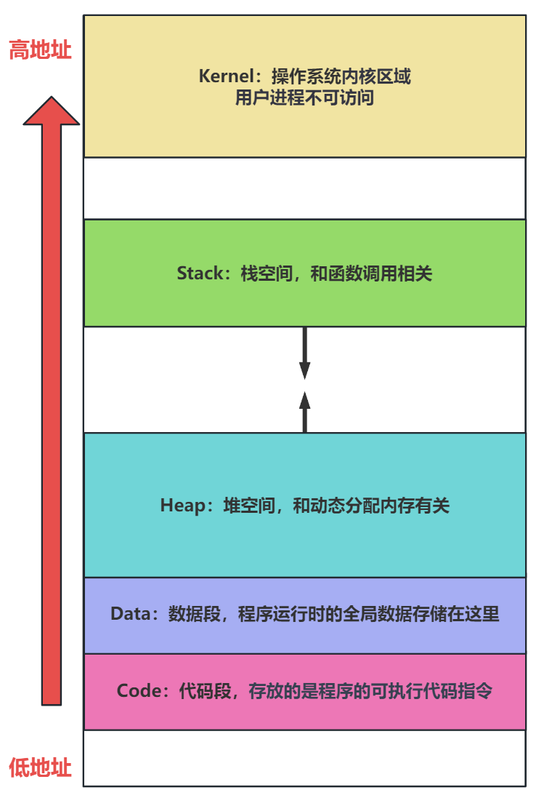

*图2.2.1-1进程的虚拟内存空间-图*

通用操作系统为每一个进程都分配独立的虚拟内存空间，这个过程实际上就是以进程为基本单元，分配内存资源，而且相互独立隔离。

进程隔离，是一个非常有意思、也非常有工程价值的设计。

我们先抛一个问题给大家思考：

一个程序，一定只对应一个进程吗？

当然不是。

一个程序，完全可以由多个进程组成。一个软件，本身就可以被设计成多进程架构。

那为什么一款软件需要设计成多进程呢？

先说缺点。

进程是操作系统分配资源的基本单位，它的创建、销毁、切换成本都比较高。

因此，多进程的软件通常会表现出这些特点：

1. 进程数量多
2. 内存占用大
3. 整体显得比较“臃肿”
4. 在性能上，通常也表现平庸

所以从纯性能角度看，多进程并不是一个“讨喜”的选择。

那它的优点是什么呢？

一句话概括就是：**隔离**。

进程之间的内存空间是**完全独立、完全隔离**的，这意味着：

1. 某一个进程崩溃
2. 不会直接影响到其他进程
3. 不会出现“牵一发而动全身”的情况

也就是说：

即便软件内部有一个模块进程出问题，整个软件也不至于直接崩掉。

除此之外，由于进程之间互相隔离、互不干扰，多进程架构在安全性方面也具有天然优势。

如果你设计一款软件时，核心目标是：稳定性和安全性，而不是极限性能。

那么，多进程架构就是一个非常值得考虑的方案。

一个最典型、也最容易理解的案例，就是：浏览器。

以 Windows 平台上的主流浏览器为例：

1. 每一个标签页，往往对应一个独立的进程
2. 插件、渲染模块，也可能运行在独立进程中

这直接导致了一个结果：

1. 浏览器整体显得比较臃肿
2. 占用内存较多
3. 运行体验谈不上“轻快迅速”

但换来的好处是什么呢？

1. 某个网页卡死，只影响当前标签页
2. 某个页面崩溃，不会拖垮整个浏览器
3. 即便访问恶意网页，破坏范围也被限制在单个进程内

而这，正是浏览器最看重的东西。

毕竟：

一个天天崩溃的浏览器，肯定没人用；

一个不安全的浏览器，更是不可接受。

这就是通用操作系统中的进程，大家简单了解一番即可。

接下来，我们把视角重新拉回到 FreeRTOS。

FreeRTOS 是一种面向MCU的实时操作系统，它并不提供通用操作系统中那样复杂的进程机制。

**但操作系统的本质是一个中间层，向下管理硬件资源，向上为程序运行提供运行环境，FreeRTOS 也不例外。**

也就是说，FreeRTOS 同样需要管理单片机有限的内存资源（C8T6的 20KB RAM），那么它进行资源管理的基本单元是什么呢？

没错。

**在 FreeRTOS 中，管理资源的基本单元是任务（Task）。**

当我们在 FreeRTOS 中创建一个任务时，操作系统会为该任务分配一段专属的内存区域，用于保存该任务的数据与信息。

这片专属的内存区域，内存资源，用以支撑任务的独立运行。

关于任务的内存区域具体如何划分、各自都存什么内容、都有哪些作用。

这些东西并非三言两语可以讲清楚，我们将在后续章节中详细展开。

在这里，我们只需要先记住一个结论：

**在 FreeRTOS 中，任务不仅仅是代码的执行载体（函数），也是操作系统进行资源管理的基本单元。**

##### 2.2.2 任务与线程类比

在线程这个概念出现之前，通用操作系统中，进程是资源管理的基本单元。

这里的资源，除了内存资源之外，还有一个同样重要、甚至更加核心的资源，那就是**CPU 资源**。

操作系统可以决定：哪一个进程能够上 CPU，能够在某一个时刻获得 CPU 的执行权。

但进程相比较而言还是太“重量级”了。进程在创建、销毁以及切换时，都需要付出较大的系统开销。

如果仅仅为了在一个程序内部实现多条执行路径，使用多进程的方式，在追求性能时，显然并不是一个理想的选择。

如果使用多进程的程序来实现多条执行路径，在追求性能时，必然不是一个好的选择。

于是，线程便应运而生了。

从某种意义上来说，线程可以看作是一个**轻量级的进程执行单元**，它具有以下几个典型特点：

1. **线程是操作系统调度和管理 CPU 资源的基本单元。**
2. 线程依托于进程存在，且一个进程至少有一个线程。
3. 线程本身并不独立拥有内存资源，内存资源分配的基本单元仍然是进程。
4. 同一个进程内部可以同时存在多个线程，这就是多线程。
5. 一个线程本质上就是一条独立的执行路径，在多线程环境下：
   - a. 进程的代码段、数据段、堆等内存区域，通常由线程共享。
   - b. **每一个线程都拥有各自独立的栈。**
6. 线程之间共享数据，线程之间的相互影响远大于进程之间，其安全性和隔离性不如进程。
7. 当然由于线程间的数据共享，再加上其轻量化的设计，线程的使用性能要远好于进程。

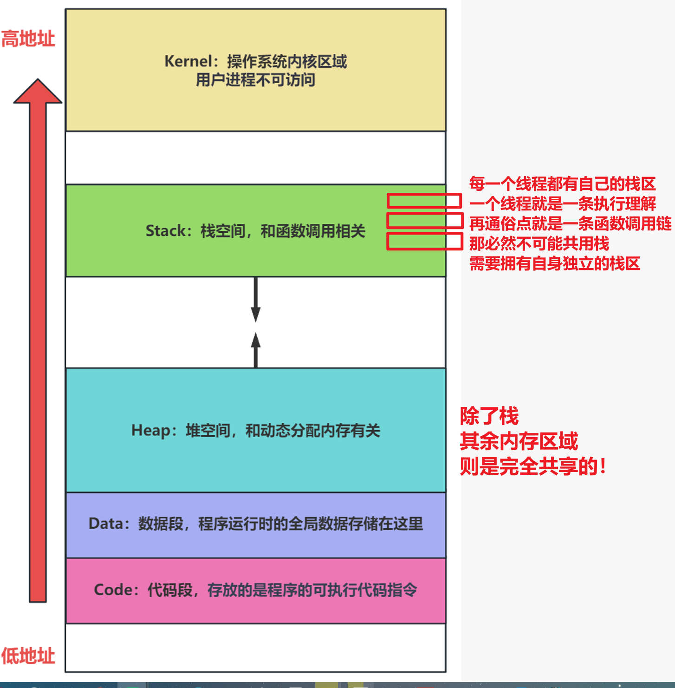

*图2.2.2-1线程的虚拟内存空间-图*

CPU 的资源分配，决定谁上CPU，由操作系统**调度器**统一管理。

**调度器的职责，就是在多个线程之间进行调度，决定在某一个时刻，哪一个线程可以获得 CPU 执行权。**

通过对多个线程进行快速切换，让它们轮流占用 CPU，只要切换的速度足够快，那么对于人来说，就几乎无法察觉时间上的差异。

这就是所谓的**并发执行**。

在多线程系统中，CPU 在同一时刻只能执行一个线程的指令。

当系统需要从A线程切换到另一个线程B执行时，就会面临一个问题：

A线程下一次再执行时，怎么知道自己执行到哪里了呢？

总不能A线程再次执行时，从头再来吧？

**为了解决这个问题，操作系统在进行线程切换时，会把当前线程的执行状态，或者说执行瞬间的快照完整保存下来。**

这套用于描述线程“当前执行状态”的完整信息，在操作系统术语中，被称之为**“上下文”**。

所以，这里需要注意的是：

线程在发生切换（上下文切换）时，会完整保存当前的执行状态（上下文状态）。

当该线程再次获得 CPU 执行权时：

系统会恢复它之前保存的执行状态（上下文），使线程能够从上一次被切换的位置继续执行，而不是从头重新开始执行。

**也就是说，线程的切换，实际上就是线程上下文的保存与恢复。**

也正是由于线程具备轻量、数据共享、并发执行等特点，多线程程序往往能够获得极高的执行效率。

**因此，在后端服务器、游戏服务器等对性能要求极高的场景中，通常都会采用多线程的设计方式，以追求系统的整体性能。**

那么，现在我们把视角从通用操作系统，切换到 FreeRTOS。

FreeRTOS 同样需要管理 CPU 资源，同样需要决定：

**在某一个时刻，哪一段代码可以上 CPU 执行。**

那么，在 FreeRTOS 中，管理 CPU 资源的基本单元是什么呢？

那么FreeRTOS管理CPU资源的基本单元是什么呢？

没错，还是任务。

**任务，是 FreeRTOS 调度 CPU 的基本单元。**

在 FreeRTOS 中，同样存在一个调度器，用来统一管理 CPU 的执行权，而调度器所直接管理的对象，正是任务。

也就是说，在 FreeRTOS 中：

1. 谁能上 CPU
2. 谁要暂时让出 CPU
3. 谁需要等待
4. 谁可以继续执行

**全部都是围绕“任务”来进行的。**

从行为的角度来看，FreeRTOS 中的任务，与通用操作系统中的线程是高度相似的。

具体表现在：

1. **任务是一条独立的执行路径，所以任务也有自身的独立栈区。**
2. 任务可以被调度、被切换
3. 同一时刻，CPU 上只会执行一个任务
4. 多个任务通过快速切换，实现“并发执行”的效果

5. 任务切换与线程切换在机制上是完全一致的，本质上都涉及执行上下文的保存与恢复：

   - a. 在发生切换时，保存当前的上下文状态；
   - b. 再次获得 CPU 执行权时，恢复上下文状态，从上一次被切换的位置继续执行。

这一点，与线程在通用操作系统中的运行方式几乎一致。

所以，讲到这里，你会发现：任务和线程非常类似，它具有线程很多特点。

##### 2.2.3 总结

**总结：如何正确理解 FreeRTOS 中的任务**在通用操作系统中：

1. 进程主要负责资源管理
2. 线程主要负责 CPU 执行与调度

而在 FreeRTOS 中，并不存在进程与线程的概念，只有任务（Task）。

我们类比进程和线程，可以给任务下一个相对完整、专业的术语定义：

**在 FreeRTOS 中，任务是操作系统进行资源管理和 CPU 调度的基本单元。**

**操作系统会为每一个任务分配其运行所需的资源，同时由调度器统一决定每一个任务是否能够获得 CPU 的执行权。**

以上描述，属于相对标准、偏术语化的表述。

如果在面试中被问到“FreeRTOS 中的任务是什么”，用这样的回答是完全没有问题的。

但如果从更通俗的角度来理解任务，可以这么理解：

**任务，可以看作是一个拥有独立运行资源的线程。**

为什么这么说呢？

一方面，从资源管理的角度看：

1. FreeRTOS 会以任务为单位对系统资源进行管理
2. 每一个任务确实都有自身独立的一块内存区域，用于存储自身信息与数据。
3. 这是线程所没有的特点，这一点任务更类似进程。

但另一方面，从任务的实际使用上来说：

1. 任务由FreeRTOS内核调度器统一调度执行
2. 任务之间可以并发执行
3. 任务之间可以进行上下文切换

**FreeRTOS中的任务，都与通用操作系统中的线程行为高度一致。**

从资源分配上来说，任务没有真正意义上独立隔离的内存区域，本质上所有任务还是共享同一个SRAM空间使用。

所以，FreeRTOS 中的任务更接近于线程（Thread），而不是进程（Process）。

比如说：

一块生姜切成丝，这一盘子生姜丝，怎么看都像土豆丝，但实际吃起来却满口姜味，那它是姜丝还是土豆丝呢？

可以说：

在 MCU 上运行的是一个程序（类似一个进程），FreeRTOS 在这个程序内部创建多个任务（类似线程）来实现并发执行。

当然，即便讲到这里，我们对任务的理解也只是一个起点。

随着后续课程中对任务的深入学习，我们会不断加深对这一核心概念的认识。

学习 FreeRTOS，本身就是一个逐步构建理解的过程，不必急于一步到位。

### 3. 什么是调度

在前面的内容中，我们已经对 FreeRTOS 中的任务有了一个**粗略、初步的认识**。

接下来，我们开始进入另一个核心的话题——FreeRTOS 的调度机制。

首先，我们要搞清楚一个问题：**什么叫做“调度”？**

我们已经学习过任务，那么对于 FreeRTOS 来说，调度的含义就非常简单：

**调度就是决定，某一个时刻，哪一个任务来上CPU，哪一个任务获得CPU的执行权。**

CPU 很强，但它有一个致命缺点：**同一时刻，只能干一件事。**

无论是 STM32 这样的单片机，还是 PC、服务器，本质上都是如此。

一个 CPU 核心，在某一个“瞬间”，只能执行一段代码。

如果是通用计算机系统中的多核心CPU，它可以真正实现“并行执行”。

但嵌入式开发的MCU，显然没有这种条件，只有一个CPU核心。

假如我们要面临下面这些需求：

1. LED 要闪
2. 串口要收
3. 传感器要采
4. 通信要跑
5. 报警要响应
6. ...

这些功能同时存在，而且看起来都很着急，都希望立刻获得 CPU 去执行。

于是就产生了一个重要的问题：

谁先跑？谁后跑？谁等一等？谁必须马上插队？

**解决这些问题的一整套规则，决定某个时刻谁在CPU上，这就是操作系统的调度机制。**

在操作系统汇总，调度通常由专门的调度器完成，由调度器根据既定规则，“选”中某个执行实体上CPU，获取执行权。

### 4. 通用操作系统的调度机制（了解）

通用操作系统中的调度机制，大致是什么样的呢？

以 Windows、Linux 这类通用操作系统为例，调度器每天面对的对象，往往非常庞杂：

1. 几十个正在运行的进程
2. 上百个线程
3. 各种后台服务
4. 驱动程序
5. 系统守护进程
6. ...

调度对象数量多、类型复杂，这是通用操作系统最显著的特点之一。

管理这么多对象，就像管理一个国家，就不能再在意一个两个“进程”的得失了，而是整体体验。

通用操作系统的调度目标，通常可以概括为三点：

1. 尽量让用户感觉系统运行得很流畅
2. 尽量提高 CPU 等系统资源的整体利用率
3. 尽量让多个程序“看起来在同时运行”

**关键字是：整体体验。**

为了实现整体体验良好这个目标，通用操作系统采用了非常复杂且灵活多变的调度策略。

常见的调度策略/实现有：

1. 时间片轮转
2. 优先级调度
3. 抢占式调度
4. 先来先服务
5. 多级反馈队列
6. ...

这些策略的具体细节并不重要，也不要求大家记住。

在这里，我们只需要记住一个核心结论：

**通用操作系统的调度目标是，整体体验优先，而不是绝对保证实时。**

也就是说，在通用操作系统中：

1. 某个程序晚**10ms、20ms**才获得 CPU，通常没什么大问题
2. 因为用户感觉不出来，系统就认为这是**完全可以接受的**
3. 甚至说，就算偶尔用户感觉出明显卡顿，也属于可容忍的范畴。

对于通用操作系统的调度器而言，它关注的是整体公平性和交互体验，而不是对某一个程序给出严格的时间保证。

**但这样的调度机制策略，显然是不适合嵌入式系统的。**

在一般嵌入式系统中，资源紧张，调度对象少，通常只有少数几个，但对实时性要求很高。

此时调度策略就不是关注整体体验了，而是：

1. 必须重视个体
2. 必须关注个体能否在确定时间内完成特点任务
3. 整个系统高度重视实时性与确定性。

为了实现这些目标，在嵌入式系统中如果需要引入操作系统，我们通常会选择RTOS，也就是实时操作系统。

而将实时性与确定性作为调度的首要目标，这正是通用操作系统与实时操作系统的本质区别。

**下面，我们就来重点看看：FreeRTOS 的调度机制是如何设计的。**

### 5. 进程的三种状态

为了讲清楚FreeRTOS的任务调度机制，我们首先要补充一个非常经典、非常基础的概念：**进程的三种状态**。

在408课程《操作系统》这门课程中，这是一个经典的、必学的概念。

#### 5.1 三状态模式的经典表述

在传统操作系统教科书中，是这么表述三状态模式的。

一个进程在生命周期中，一定会处于三种状态之一：

1. **运行态（Running）**
2. **就绪态（Ready）**
3. **阻塞态（Blocked）**

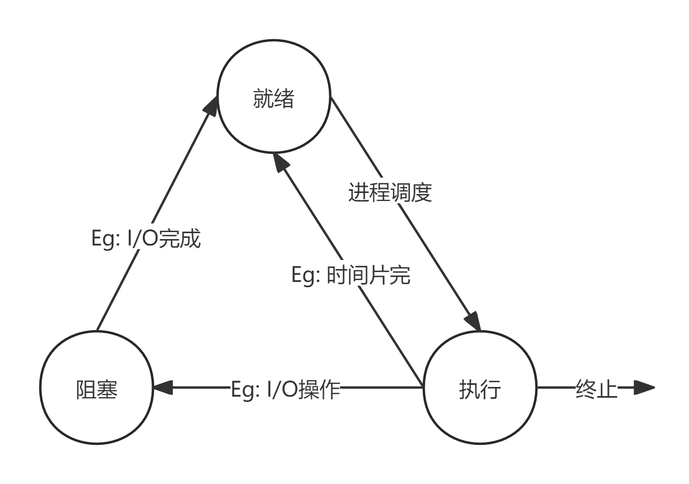

*图5.1-1进程的三种状态-图*

我们分别用一句人话来解释它们。

**运行态，表示：**

该进程当前正在占用 CPU，正在执行代码。

需要强调的是：在单核 CPU 上，同一时刻，只能有一个进程处于运行态，这是 CPU 的物理限制决定的。

**就绪态，表示：**

进程已经具备了运行的一切条件，但暂时还没有获得 CPU。

通俗一点说就是：代码没问题，数据准备好了，不缺资源，就差 CPU 没轮到我。

所以，就绪态的进程：随时可以运行只要调度器把 CPU 分配给它，就能立刻进入运行态。

**阻塞态，表示：**

进程暂时无法继续执行，需要等待某个条件满足。

比如：

1. 等待 IO 完成。
2. 等待某个事件。
3. 等待某个资源。
4. 等待时间到期。

在阻塞态下，进程即使想运行，也没有资格参与 CPU 的竞争。

**关于进程三种状态的结论：**

1. 在这三种状态中，只有“就绪态”的进程，才有资格参与调度，去竞争 CPU。
   - a. 运行态：已经在 CPU 上了
   - b. 阻塞态：没资格上 CPU
   - c. 就绪态：处在“候选人”池中。
2. 进程在这三种状态之间，会不断切换：
   - a. 运行 → 阻塞（主动等待下CPU）
   - b. 阻塞 → 就绪（条件满足，随时可以上CPU）
   - c. 就绪 → 运行（被调度器选中，上CPU）
   - d. 运行 → 就绪（被抢占，“被迫”下CPU）
3. **调度器的核心职责，是在所有就绪态任务中，根据规则选出当前应当运行的任务，让它上CPU。**

总之：

阻塞态没有资格竞争CPU，运行态已经占着 CPU，真正参与博弈的只有就绪态。

调度器所做的全部工作，就是在这些“候选人”中选出当前应该上 CPU 的那一个。

#### 5.2 三状态模型的现代意义

当我们理解了运行态、就绪态、阻塞态这三个状态之后，很容易产生以下疑问：

现代操作系统，早就不是只有进程这种单一概念的早期操作系统了，还能够用三状态模型来描述吗？

如此复杂的现代操作系统，三状态模型是不是有点过时了？

事实上，三状态模型确实是上世纪60年代，批处理操作系统时期提出来的概念模型。

那么它对现代操作系统还有指导意义吗？

这个问题的答案，其实和下面这个问题的答案是一致的：

现代通用计算机系统，还能够用冯诺依曼体系来解释吗？

这两个问题的答案，显然都是肯定的。

现代通用计算机，从微观构成上，早就不符合冯诺依曼体系结构了，要更复杂的多得多。

但从设计哲学而言，冯诺依曼体系结构仍然是指导理论，基石理论，并没有过时。

三状态模型也是如此。

它诞生于批处理操作系统时代，但它所描述的并不是“当年的操作系统实现方式”，而是：

**在多个执行实体共享 CPU 的前提下，CPU资源竞争所必然形成的三种基本逻辑状态。**

只要满足两个条件：

1. CPU 是有限资源；
2. 存在多个执行实体同时竞争它；

那么每一个执行实体，在任意时刻，都只可能处于三种状态之一：

1. 正在占用 CPU；
2. 具备运行条件，但还没有获得 CPU；
3. 暂时不具备获取CPU运行的资格。

无论操作系统如何进化，这三种状态逻辑位置始终存在。

现代操作系统，尤其是通用操作系统要比早期操作系统复杂的多，很多情况确实发生了改变：

1. 现代操作系统提出了线程的概念，竞争CPU的实体从进程变成了线程。
2. 线程的实际状态也早就不止3种，而是多达5~9种。

但根本上、本质上，所有复杂状态都可以被压缩回三类：

1. 是否正在运行；
2. 是否具备运行资格；
3. 是否暂时失去运行资格。

**这三类，本质上仍然对应：运行态、就绪态、阻塞态。**

因此，三状态模型并没有被推翻，它只是被细化、被扩展、被工程化。

就像冯诺依曼体系并没有被推翻，只是微观硬件技术明显进步罢了。

理解这一点非常重要，因为后续我们讨论任何调度机制时，无论规则多么复杂，本质上都是在回答一个问题：

**在所有“具备运行资格”的执行实体中，谁应该获得 CPU？**

这就是调度的核心问题。

**至于实体到底是进程还是线程，亦或者别的，都只是一个命名。**

**包括状态，就算再多复杂的状态设计，也不会脱离三状态的本质范畴。**

而这个问题，正是建立在三状态模型之上的。

因此，三状态模型的价值，不在于它有多少状态，而在于它揭示了调度问题的逻辑骨架。

**调度机制的实现可以变化，调度的策略可以复杂化，但指导哲学，骨架是不会改变的。**

回到FreeRTOS这个简易、轻量化实时操作系统当中。

FreeRTOS没有进程，也没有线程，CPU资源竞争的实体是任务。

而实际上任务也不止三种状态，但这并不重要，并不影响其根本逻辑。

我们只需要记住：

FreeRTOS中，所有任务从根本逻辑上来说，实际上仍然具有三种核心状态：

运行态（Running）、就绪态（Ready）、阻塞态（Blocked）。

**FreeRTOS的调度器，本质上也是在所有“就绪态”的任务中，挑选一个，让它进入运行态。**

**在操作系统教材中，这张状态图被称为“进程的三种状态”。**

#### 5.3 总结

实际上，我们完全可以给“三状态模型、进程的三种基本状态”换一个名字，换一个更贴切的名字：

**CPU 资源调度问题的逻辑结构模型。**

这张图描述的并不是某一具体操作系统的调度实现方式，而是CPU资源竞争所必然形成的三种逻辑状态。

而具体到实际的操作系统实现：

竞争CPU资源的实体名称可以改变，状态的名字也可以改变，状态可以更多样化，状态切换的结构可以更复杂化....

但不管怎么样，本质逻辑是不会改变的。

当然，如果你参加 408，还是要按教科书标准写：

“进程的三种状态”。

### 6. FreeRTOS的调度机制

在FreeRTOS中，调度的机制是什么样的呢？

FreeRTOS中，如何决定这一刻，哪一个任务能来上“CPU”呢？

简单直接的说，FreeRTOS的任务调度机制是：

**FreeRTOS 是一个以“优先级”为核心的抢占式实时调度系统。**

这句话里有三个关键词：

1. 优先级
2. 抢占式
3. 实时

后面的内容，我们就一条一条把它拆开。

#### 6.1 FreeRTOS提供的延时函数

为了更好的演示FreeRTOS的任务调度机制，借着讲完了任务的三种状态。我们需要提前了解一下FreeRTOS的延时函数。

在以往我们使用的延时操作诸如：

```c
Delay_ms(1000);
// 或者
for (i = 0; i < xxx; i++);
```

这些延时的本质都是：CPU空转等待时间过去。

说人话就是：把CPU霸占着，然后睡觉，把时间睡过去。

在裸机开发时，这是无所谓的，因为反正也没有“别人”，CPU都是我的，我想睡觉就睡。

但到了 FreeRTOS，情况完全变了。此时系统里：

1. 不止一个任务
2. CPU 是“公共资源”
3. 由调度器统一分配

如果你在某个任务里写：

```c
Delay_ms(1000);
```

等价于什么？

**这个任务霸占 CPU 1 秒钟，调度器完全失效，你不干活，其他任务也不能上CPU干活。**

为了解决这个问题，FreeRTOS 为我们提供了一个现成的延时实现函数：

```c
void vTaskDelay(const TickType_t xTicksToDelay);
```

**注意：该函数只能用于任务内部，其余位置禁止使用它。**

**实际上，相当多FreeRTOS提供的函数，都只能在任务环境当中使用，主程序或中断中能够使用的函数比较少。**

该延时函数的延时操作，和任务的状态是有关系的，具体来说是这样做的：

1. 当前任务从“运行态”切换为“阻塞态”。
2. **当前任务进入阻塞态后会让出 CPU，如果系统中存在其他就绪任务，则调度器会选择一个就绪任务进入执行态。**
3. **从不严格、不规范的理解角度来说：该函数会让任务在阻塞状态下，等待xTicksToDelay 个系统节拍后再重新进入就绪态。**
4. 1个系统节拍究竟多长时间，是可以设置的。

大多数情况下，我们都会在FreeRTOS的配置文件中写下面这条配置：

```c
#define configTICK_RATE_HZ ( ( TickType_t ) 1000 )
```

这条配置设定1秒钟产生1000个**Tick（系统节拍）**，所以一个系统节拍就是1ms。

**所以vTaskDelay函数在这种默认设置下，不规范的理解，可以认为该函数是一个“以毫秒”为单位的延时函数。**

关于这个延时函数，尤其是它的具体规范含义，我们后面会再详谈，今天我们只需要了解它的一些基本特点就足够了。

#### 6.2 任务的优先级调度

在前面我们已经反复强调过一句话：

调度器，只在“就绪态”的任务中做选择。

那么问题就变得非常具体了：

在FreeRTOS当中，如果同时存在多个就绪态任务，调度器凭什么决定，这一刻，谁能上 CPU？

答案只有一个：**任务的优先级**。

在 FreeRTOS 中，创建任务时，都需要为任务指定一个优先级数值。

**需要注意的是，这里的任务优先级，和之前学过的中断优先级不同：**

**任务优先级数值越大，优先级越高。**

优先级越高的任务，越紧急，在诸多进入就绪态的任务中，会被调度器优先调度执行。

通常情况下，FreeRTOS的任务在创建时，可选优先级为0~4，数值越大代表优先级越高。

站在调度器的视角，它是这样根据优先级来选择任务的：

1. 如果某一时刻有多个任务同时处于就绪态，那么调度器会选择优先级最高的任务进入运行态，占用 CPU。

2. 在没有更高优先级任务变为就绪态之前，当前优先级最高的就绪任务将持续获得CPU 执行权，优先级较低的就绪任务不会被调度执行。
3. 处于阻塞态的任务不参与 CPU 的竞争，即便它的优先级非常高，也必须等到阻塞条件解除，重新进入就绪态之后，才有资格参与调度。

**FreeRTOS的优先级调度机制是任务调度的基本策略，核心策略，后续的其它策略都是在优先级之上发展而来的。**

比如，我们来试想一种情况：

现在一个优先级为1的任务，执行一个死循环，持续占据CPU。

如果调度机制只看优先级，那么问题就来了：

这个任务既不阻塞，也不主动让出 CPU，那它是不是可以一直霸占 CPU？

其他任务是不是就永远没有机会执行了？

答案取决于一个非常关键的机制：是否开启抢占式调度。

#### 6.3 任务的抢占式调度

**是否开启抢占式调度，FreeRTOS要求必须明确在配置文件中进行设置：**

```c
#define configUSE_PREEMPTION 1
```

如果不明确配置这个宏，FreeRTOS会编译报错。

上述宏定义为1表示开启抢占式调度，若为0则表示关闭抢占式调度。

**一般情况下，我们使用官网下载模板中的FreeRTOS配置文件，抢占式调度是默认开启的。**

那什么是抢占式调度呢？

在 FreeRTOS 中，如果开启了抢占式调度，那么调度规则会发生一个根本性的变化：

正在运行的任务，并不一定能一直运行下去。

只要在系统运行过程中，出现了一个优先级更高的任务进入就绪态。

调度器就会在合适的时机，强制让当前任务让出 CPU，并立即切换到这个更高优先级的任务上执行。

被抢占的任务，会重新回到就绪态，继续等待竞争CPU。

也就是说：

**CPU 的控制权，不完全掌握在“当前任务”手里，而是随时可能被更高优先级的任务抢走。**

这就是“抢占”这两个字的真正含义。

回到刚才那个例子：

即便优先级为 1 的任务在死循环中不停地运行，只要系统中出现了一个优先级高于 1 的任务，并且该任务进入了就绪态。

调度器会尽快打断当前任务的执行，让高优先级任务获得 CPU。

于是，一个非常重要的结论就出现了：

**在抢占式调度机制下，高优先级任务永远不会被低优先级任务“饿死”。**

这正是 FreeRTOS 能够满足实时性要求的核心原因之一。

当然，需要注意的是：

抢占并不是“随时、无条件”发生的，它的发生是存在条件的，它的任务切换是需要时机的。

关于这些具体的细节，我们后面会再单独展开讲。

在这一节中，只需要牢牢记住一句话就够了：

**抢占式调度，保证了：一旦更高优先级任务准备好运行，就一定能尽快获得 CPU。**

现在关于优先级，我们已经了解到：

1. 高优先级的任务，在就绪态时，会优先进入执行态。
2. 如果开启抢占式调度，那么高优先级的任务，在就绪态时，可以抢占低优先级任务的执行。

那么问题来了：

如果两个任务优先级是一样的，也同时进入了就绪状态，那么会发生什么情况呢？

#### 6.4 时间片轮转机制

如果两个任务的优先级是一样的，那么事情就和前面讲的情况不一样了。

因为此时，调度器已经无法再通过优先级高低来做选择。

那么问题就变成了：

如果两个（或多个）任务优先级完全相同，而且它们又同时处于就绪态，调度器该怎么办？

**FreeRTOS 给出的解决方式是：时间片轮转（Time Slicing）。**

**在开启时间片轮转的情况下，处于同一优先级的多个就绪态任务，会轮流获得 CPU 的执行权。**

具体来说，调度行为表现为：

同一优先级的任务，被组织成一个就绪队列，调度器从队列头部选出一个任务运行。

该任务运行一个时间片之后，就会被切换到队列尾部下一个同优先级任务获得 CPU这样一来，每个同优先级任务都可以“轮流跑一会儿”，不会出现某一个任务长期独占CPU，也不会出现同优先级任务被饿死的情况。

那么一个时间片，到底多长时间呢？

**1个时间片的长度，其实就是1个系统节拍的长度。**

在FreeRTOS配置文件中，必须定义下面的一个宏：

```c
#define configTICK_RATE_HZ ( ( TickType_t ) 1000 )
```

这个宏的意思是：1秒钟内，系统产生1000个系统节拍。

那么1个系统节拍就是1ms，如果开启时间片轮转，那么1个时间片也就是1ms。

于是，在时间片轮转机制下，多个优先级相同的就绪任务，它们轮流上CPU，每一个任务执行1个时间片（1ms）

当然，如果人肉眼来看，通常很难分辨这1ms的时间差距，人会觉得多个任务是“同时”

执行的。

实际上它们是并发执行，而不是并行执行。

关于时间片轮转，最后还是要强调几点：

**第一，与抢占式调度需要手动配置开启不同的是，时间片轮转机制在FreeRTOS中是默认开启的。**

如果你不喜欢这种默认开启，喜欢追求确定性。

可以手动在FreeRTOS配置文件中，加下面的一条配置：

```c
// 手动配置，确定开启时间片轮转机制
#define configUSE_TIME_SLICING 1
```

这样就可以用配置的方式，手动配置开启时间片轮转。

当然，如果你不希望采取时间片轮转机机制，只需要将这个宏手动配置为0。

假如关闭时间片轮转（虽然实践中几乎不会这么做），如果存在多个同优先级的就绪任务，那么：

1. FreeRTOS 不会在它们之间自动切换。
2. 哪个任务先运行，就会一直执行
3. 直到它主动进入阻塞状态或被更高优先级任务抢占（前提是开启抢占式调度）。

**第二，时间片轮转，只发生在“同优先级任务之间”。**

如果优先级都不相同，时间片轮转机制是不适用的。

### 7. 总结：FreeRTOS的任务调度机制

FreeRTOS 任务调度机制总结：

1. **调度器只在就绪态任务中进行选择，阻塞态任务不参与调度。**
2. **优先级是调度的核心依据：就绪态任务中，优先级最高的任务一定先获得 CPU。**
3. 开启抢占式调度时：更高优先级任务一旦就绪，会在调度点打断低优先级任务。
4. 关闭抢占式调度时：当前任务不阻塞、不让出 CPU，就不会被切换。
5. 时间片轮转只作用于同优先级任务：
   - a. 开启时间片轮转：同优先级任务按时间片（系统节拍）轮流执行。
   - b. 关闭时间片轮转：同优先级任务不会自动切换。

或者，再精简一些：

**就绪状态下的任务们，先比优先级，优先级不同，优先级高的先跑，优先级相同，按时间片轮转、轮流上CPU。**

---

## 03 FreeRTOS的移植与剪裁

### 1. 获取资料

本小节所需要的所有安装包、资料都可以在以下百度网盘中获取：

通过网盘分享的文件：000_王道嵌入式软件环境链接: https://pan.baidu.com/s/1Lnssq2nza3UAUBe6wdxqXQ?pwd=k87j提取码: k87j 当然WinSCP内网共享服务器上，也会存放一份资料，大家可以从内网下载比较快速。

### 2. 概述

了解完FreeRTOS的任务调度机制，关于FreeRTOS的前置理论，我们就大体上搞定了。

虽然还有很多理论需要学习，但我们暂缓一下脚步，在这一章节中，我们先把FreeRTOS集成到我们的项目中。

先跑起来再说。

这里我们主要介绍：

**基于SPL标准外设库模板工程，集成FreeRTOS，形成一个新的带FreeRTOS的标准库开发工程模板。**

再顺便，我们来讲一讲HAL库的开发方式，也讲一讲在HAL库开发工程中集成FreeRTOS，当然这些内容了解即可。

我们后续还是以标准库开发方式为主要手段。

### 3. 准备工作和下载FreeRTOS源码

首先，我们要准备好面包板，然后按照下面的方式完成接线：

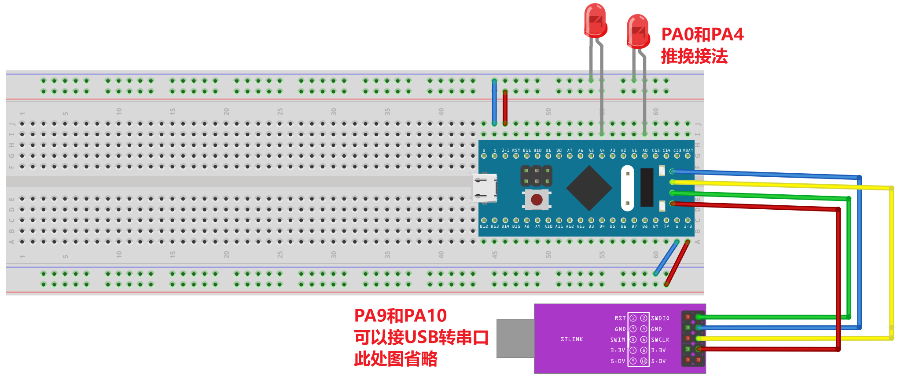

*图3-1FreeRTOS准备接线-图*

在FreeRTOS的学习前几天，我们就使用这种简单的接线就足够了。

**FreeRTOS是完全开源免费的，我们可以直接进入它的官方，直接下载FreeRTOS的源码。**

FreeRTOS官网

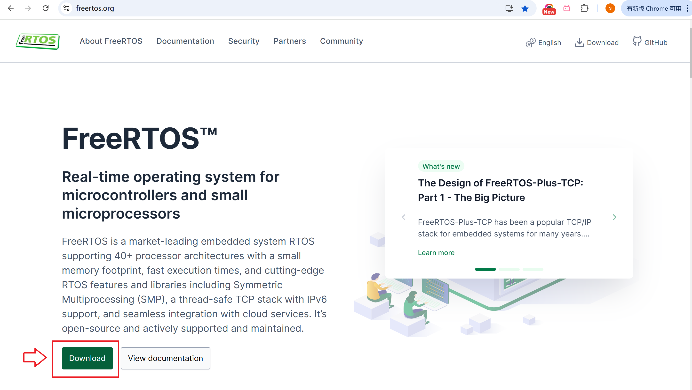

*图3-2下载FreeRTOS-图*

直接点击下载按钮即可：

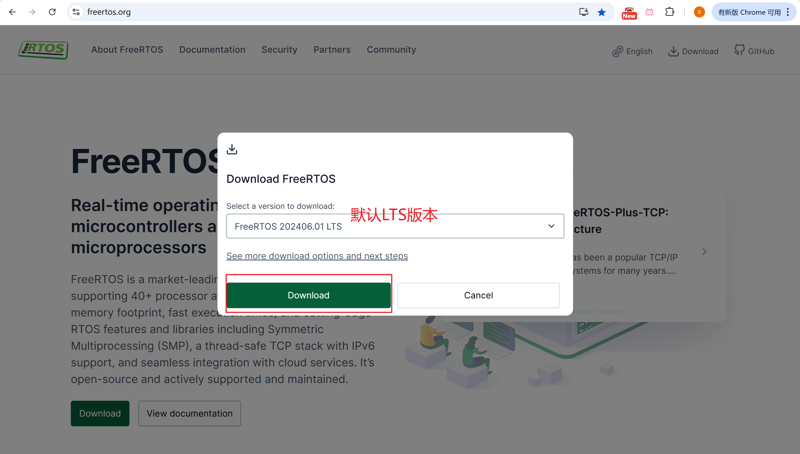

*图3-3下载FreeRTOS-图2*

下载后将会得到一个压缩包，这个压缩包就是全部FreeRTOS的源码，解压后大约只有几十MB，由此可见，FreeRTOS只是一个轻量级的小型实时操作系统。

**这个FreeRTOS源码文件夹如何使用，我们放到下面再说。**

首先，我们先来了解一下，什么叫做FreeRTOS的移植。

### 4. 什么叫做FreeRTOS的移植

FreeRTOS 被广泛应用于各个领域，可适配的 MCU 芯片种类也各不相同。

然而，我们刚刚从官网上下载的 FreeRTOS 内核源码，却只有**一份**。

那么问题就来了：

这一份代码，是如何同时适配如此多不同的处理器架构与平台的？

从源码层面来看，FreeRTOS 内核主要使用 C 语言编写。

整体上这份源码，可以分为两个部分：

1. 绝大部分代码属于通用代码。这一部分与具体的 MCU 架构无关，各种平台可以共用同一份源码。
2. 少量代码用于处理不同架构和平台之间的差异。针对不同 CPU 架构、编译器和硬件特性，FreeRTOS 官方提供了对应的适配代码。

**因此，在实际使用 FreeRTOS 时，并不是将所有源码一股脑地拷贝进工程中，而是：**

1. **先引入 FreeRTOS 的通用核心代码**
2. 再根据所使用的 MCU 和编译器，选择对应的架构适配代码

通过这种方式，FreeRTOS 才能够在满足具体硬件条件的前提下，正常运行起来。

**上述这一整套“选择并组合代码，使 FreeRTOS 能够在目标 MCU 上运行”的过程，就称为 FreeRTOS 的移植。**

所以，关于什么是FreeRTOS的移植，这里给出一个定义：

**FreeRTOS 的移植，指的是让 FreeRTOS 操作系统内核能够在某一具体 CPU 架构和编译器环境下正确运行的适配过程。**

大家要小记一下这句话，起码也要理解移植的作用，如果面试被问到回答不出来，就稍显尴尬了。

### 5. 基于SPL库的FreeRTOS移植

首先准备好一个Keil5下，基于SPL库的标准库模板工程。

只要你前面上过STM32的课程，这个模板你肯定不陌生。

下面我们先来介绍一下FreeRTOS源码文件夹下，各个文件夹的作用，了解一下。

#### 5.1 根目录文件夹介绍

FreeRTOS源码文件夹，最外层根目录内容，如下图所示：

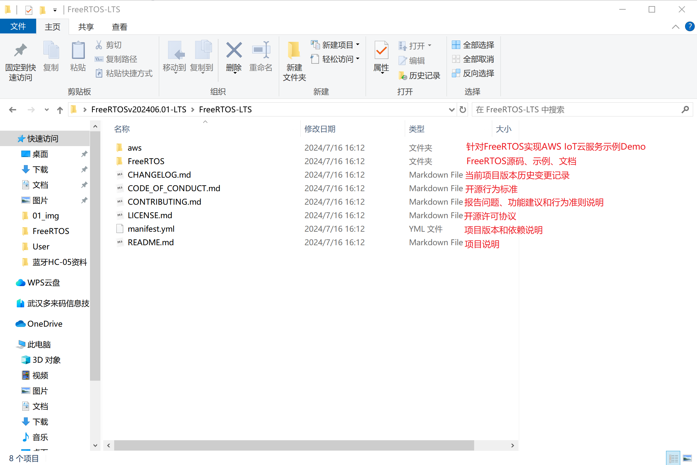

*图5.1-1FreeRTOS源码文件夹-图*

最核心的文件夹是其中的"FreeRTOS"文件夹，该文件夹下用于存放FreeRTOS的内核源码、演示示例以及各种文档。

2017年的时候，Amazon（亚马逊）收购了FreeRTOS项目组。

所以FreeRTOS 成为 AWS（亚马逊云）官方 IoT 操作系统方案，这里根目录下放了一个"aws"的演示示例，实属正常。

当然亚马逊的收购不影响FreeRTOS开源免费的特点，我们仍然可以放心使用。

#### 5.2 源码文件夹内容介绍

打开根目录下的FreeRTOS文件夹，这就是源码文件夹，其内容如下图所示：

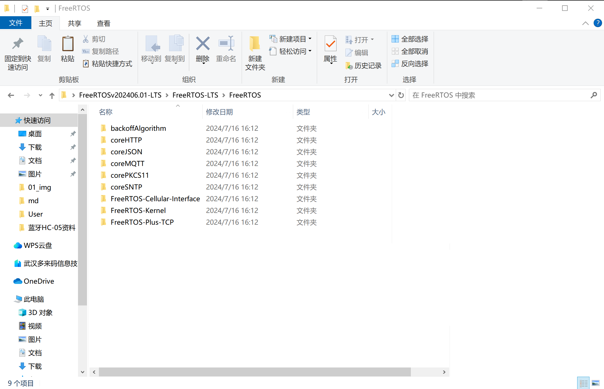

*图5.2-1源码文件夹-图*

在这个源码目录中，对我们当前学习和使用最直接相关的，只有 FreeRTOS-Kernel 文件夹。

它是FreeRTOS操作系统的核心部分，它为嵌入式系统提供了一个轻量级的、实时的操作系统内核。

**我们在移植FreeRTOS时，我们只需要将 FreeRTOS-Kernel 目录下的相关源码引入工程即可。**

关于 Kernel 文件夹内部的结构与作用，我们将在后面的内容中再进行详细介绍。

这里我们不妨来讲一下，其他的这么多文件夹，它们为什么没有用。

**1.backoffAlgorithm**：提供网络通信失败后的重试退避算法，通常用于需要网络重连机制的系统。

**2.coreHTTP**：用于在 MCU 上实现 HTTP 协议通信，需要 MCU 具备 TCP/IP 网络通信能力。

**3.coreJSON**：提供轻量级 JSON 数据解析功能，常用于与云端或网络服务进行数据交互的场景。

**4.coreMQTT**：实现 MQTT 物联网通信协议，通常需要 MCU 具备网络接口并运行TCP/IP 协议栈**5.corePKCS11**：提供密钥与证书管理接口，用于加密与安全通信，常见于支持TLS/HTTPS 的系统。

**6.coreSNTP**：用于通过网络进行时间同步（SNTP 协议），需要 MCU 具备网络通信能力。

**7.FreeRTOS-Cellular-Interface**：面向蜂窝通信模块（如 4G/LTE）的统一接口层，通常需要 MCU 外接蜂窝通信模块。

**8.FreeRTOS-Plus-TCP**：FreeRTOS 官方 TCP/IP 协议栈，通常用于具备以太网或WiFi 硬件支持的 MCU 平台。

可以看到这些组件都是服务于网络通信的，那我们的MCU，即STM32F103C8T6，具备网络通信能力吗？

STM32F103C8T6可以实现串口通信、I2C通信、SPI通信等等，但是很显然，它不具备以太网、WiFi、蜂窝数据等网络通信能力。

既然我们使用的单片机不具备网络通信能力，那么上述的文件夹也就没有使用的必要了。

小Tips：

当然你可能会问，我们后面做项目，需要进入网络通信，那怎么办呢？

很简单，既然自身单片机不集成网络通信模块，那么外挂接入一个网络通信模块就好了。

我们使用的是ESP-01S模块，它是一款基于ESP8266芯片的Wi-Fi网络通信模块。

我们的单片机通过外接这个网络通信模块，实现网络通信。

在这种方案下：

1. STM32 负责业务逻辑和实时控制
2. ESP-01S 负责 Wi-Fi 协议栈和网络通信

STM32 只需要通过串口通信与ESP-01S模块交互数据，就可以了。

不需要自己在 STM32 上实现完整的 TCP/IP 或 Wi-Fi 协议栈。

所以，我们依然还是用不到上面这些文件夹。

#### 5.3 Kernel文件夹介绍（重点）

Kernel文件夹是我们移植FreeRTOS的核心，首先该文件夹根目录下有很多无关的文件，我们直接删除：

1. HTML文件，主要用于链接官方文档或相关网站，对编程本身没有作用。
2. txt文件和md文件，用于说明、文档或版本信息，不参与代码编译。
3. yaml文件，配置文件，不属于内核源码。
4. ...

也就是说，根目录下所有文件夹先保留，仅保留.c和.h源文件，其余文件直接删除。

如此，我们得到下面的文件夹内容：

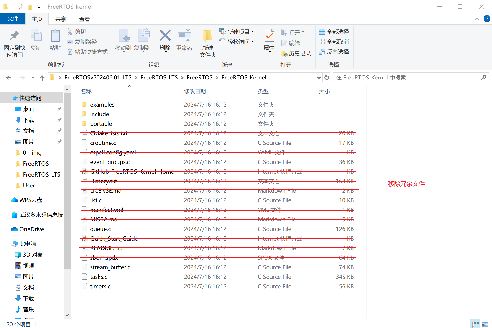

*图5.3-1Kernel文件夹-图*

可以看到大多数文件都是一些文档，对于移植而言，这些文件是无意义的，所以可以直接删掉。

仅保留以下文件：

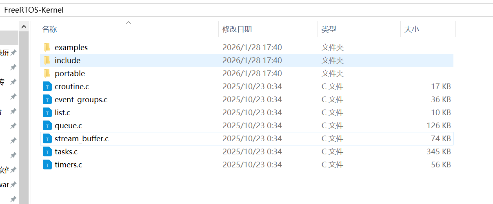

*图5.3-2Kernel文件夹-图2*

逐一来解释一下这个文件夹内容：

1. examples文件夹，示例代码。用于存放官方的演示示例，对FreeRTOS来说，暂时是无用的。
2. include文件夹，include有包含的意思，所以该文件夹下存放所有的头文件，用于提供声明接口。
3. **portable文件夹，portable本身的含义是“可移植的“，该文件夹下存放与 CPU 架构、编译器强相关的文件内容。**
4. 根目录下所有的".c"文件，都是FreeRTOS内核核心源代码文件。

整个FreeRTOS移植过程，我们将源码分为三部分加入工程中：

**其一，通用代码，根目录下所有的源文件，以及include文件夹下的所有头文件。**

**其二，Cortex-M3架构适用的部分源代码。如下图所示：**

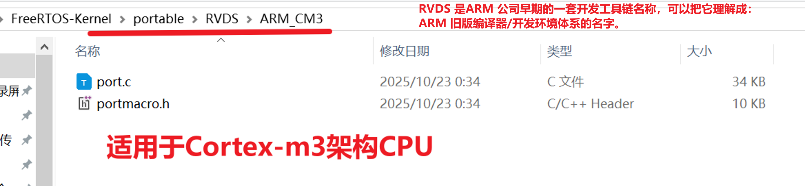

*图5.3-3Cortex-M3架构-图*

其中RVDS是**RealView Development Suite**的缩写。

它是 ARM 公司以前推出的一套嵌入式开发工具链，可以理解为早期的 ARM 官方编译器套件。

portable/RVDS/ARM_CM3 表示：

**给 Keil/ARMCC 编译器 + Cortex-M3 内核使用的 FreeRTOS 移植层代码。**

**其三，需要指定FreeRTOS内存管理方案。**

**portable/MemMang文件夹**下存在五个heap_x.c 源文件，本质上代表五种FreeRTOS管理内存的策略方案。

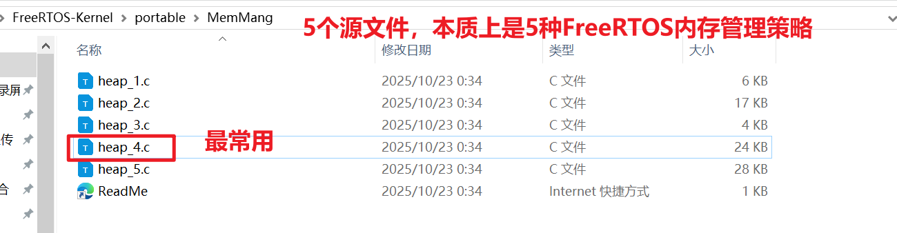

*图5.3-4FreeRTOS内存管理策略选择-图*

其中第四种，也就是heap_4.c 源文件代表的内存管理方案是最常用，最方便使用的。

在一般的学习和项目中，大多都直接选择这种内存管理策略。关于这个策略，我们后期再讲，这里不增加大家负担。

所以大家直接选择heap_4.c 源文件这个文件，加入工程即可。

如此，我们就已经挑选好了，要加入工程的FreeRTOS文件。

在王道嵌入式软件环境（百度网盘/内网WinSCP）中，存在下面一个文件夹：

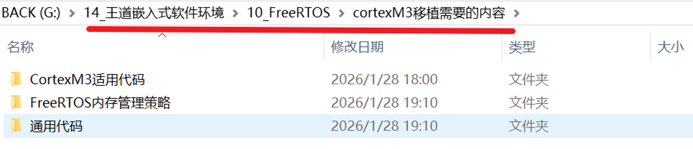

*图5.3-5FreeRTOS移植需要内容-图*

该文件夹下，已经帮你选好了需要的文件。

#### 5.4 回顾SPL库开发LED闪烁

现在我们的面包板上，PA0和PA4两个引脚上都接入了一盏LED。

现在我们打开标准库模板，只需要在main.c文件中写下面代码：

```c
#include "stm32f10x.h"

int main(void) {
    // 1. 开启 GPIOA 外设时钟
    RCC_APB2PeriphClockCmd(RCC_APB2Periph_GPIOA, ENABLE);

    // 2. 配置 PA0 和 PA4 为推挽输出
    GPIO_InitTypeDef GPIO_InitStructure;
    GPIO_InitStructure.GPIO_Pin = GPIO_Pin_0 | GPIO_Pin_4;
    GPIO_InitStructure.GPIO_Mode = GPIO_Mode_Out_PP;
    GPIO_InitStructure.GPIO_Speed = GPIO_Speed_2MHz;
    GPIO_Init(GPIOA, &GPIO_InitStructure);
    // 3. 默认关闭 LED
    GPIO_ResetBits(GPIOA, GPIO_Pin_0 | GPIO_Pin_4);

    // 4. 主循环：两盏 LED 闪烁
    while (1) {
       // PA0 和 PA4 点亮
       GPIO_SetBits(GPIOA, GPIO_Pin_0 | GPIO_Pin_4);

       // for 循环延时
       for (uint32_t i = 0; i < 2000000; i++);

       // PA0 和 PA4 熄灭
       GPIO_ResetBits(GPIOA, GPIO_Pin_0 | GPIO_Pin_4);

       // for 循环延时
       for (uint32_t i = 0; i < 2000000; i++);
    }
}

```

这段代码非常简单，稍微需要注意的是：

从今天开始，丢掉我们之前使用的“Delay”函数。在使用FreeRTOS后，之前的Delay函数变得无法使用了。

关于这一点，在后续讲定时器时，我们再详谈。

在上述的基础上，在引入FreeRTOS之前，我们不妨思考两个问题：

**问题1：FreeRTOS的使用一定基于标准库吗？基于寄存器开发可不可以？基于HAL库的开发可不可以？**

答：

FreeRTOS 的运行基础是**MCU 硬件本身**，而不是某一种具体的软件库。

至于如何对 MCU 进行开：

是直接使用寄存器、使用标准外设库（SPL），还是使用 HAL 库——属于用户的工程选择，与 FreeRTOS 本身无关。

无论采用哪种开发方式，都可以在工程中引入并使用 FreeRTOS。

**问题2：现在使用两个FreeRTOS任务，分别控制两盏LED闪烁，**

#### 5.5 小细节：FreeRTOS的头文件问题

我们在基于 SPL 库的 Keil5 开发环境中，已经集成了 FreeRTOS 实时操作系统。

当程序需要使用 FreeRTOS 的任何功能时，都必须包含头文件：

```c
#include "FreeRTOS.h"
```

**这个头文件是 FreeRTOS 的核心头文件。**

**并且，FreeRTOS 的所有功能模块，都是在这个头文件基础上建立的。**

在实际开发中，通常还会包含其它 FreeRTOS 模块头文件，以使用FreeRTOS各种功能，例如：

```c
#include "FreeRTOS.h"
#include "task.h"
#include "queue.h"
#include "semphr.h"
```

其中：

| 头文件 | 功能 |
|---|---|
| task.h | 任务创建与管理相关函数 |
| queue.h | 消息队列相关函数 |
| semphr.h | 信号量 / 互斥锁相关函数 |
| event_groups.h | 事件标志组相关函数 |
| timers.h | 软件定时器相关函数 |

需要特别注意的是：

**FreeRTOS 其他模块的头文件，必须写在 FreeRTOS.h 之后。**

**FreeRTOS 其他模块的头文件，必须写在 FreeRTOS.h 之后。**

**FreeRTOS 其他模块的头文件，必须写在 FreeRTOS.h 之后。**

例如，正确的写法是：

```c
#include "FreeRTOS.h"
#include "queue.h"
```

错误的写法是：

```c
#include "queue.h"
#include "FreeRTOS.h"
```

如果写错顺序，编译器会直接报错：

#error "include FreeRTOS.h must appear in source files before include queue.h"之所以有这种限制，是因为：

**FreeRTOS.h 中定义了很多基础类型和配置宏。**

例如：

```c
BaseType_t
UBaseType_t
TickType_t
```

以及各种配置宏：

```c
configMAX_PRIORITIES
configTICK_RATE_HZ
configUSE_PREEMPTION
```

而其它模块头文件（例如queue.h 、task.h ），在声明函数时都会使用这些类型。

如果没有先包含FreeRTOS.h ，这些类型就不存在，编译器就无法解析这些函数声明。

如果你没听明白，举一个简单的例子：

```c
typedef int NumType; // 这是FreeRTOS.h中的类型别名
NumType a; // 这是其他头文件中，会使用FreeRTOS.h中的类型别名
```

显然写成下面的形式肯定是不对的：

```c
NumType a; // 这是其他头文件中，会使用FreeRTOS.h中的类型别名
typedef int NumType; // 这是FreeRTOS.h中的类型别名
```

**因此必须记住一个简单的规则：FreeRTOS.h 必须最先包含。**

随后再包含各个功能模块的头文件。

例如一个比较标准的写法是：

```c
#include "stm32f10x.h"

#include "FreeRTOS.h"
#include "task.h"
#include "queue.h"
#include "semphr.h"
```

这种顺序在 FreeRTOS 项目中非常常见，也是比较规范的一种写法。

#### 5.6 在工程中集成FreeRTOS

首先，我们需要在工程根目录下创建一个"FreeRTOS"文件夹，然后将上面移植选中的文件都复制到文件夹下。

这些FreeRTOS的源码文件，都不应该手动被修改，所以应当给它们设置为只读，也就是Keil5中会显示加锁。

如下图所示：

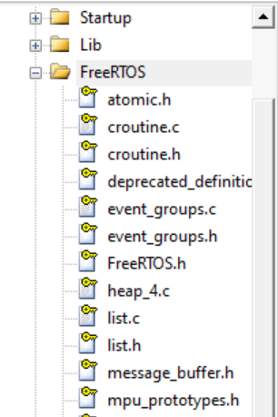

*图5.6-1在工程中集成FreeRTOS-图*

除此之外，我们还需要将一段代码，彻底覆盖到“main.c”文件中。如下所示：

```c
#include "stm32f10x.h" // STM32F10x 标准外设库头文件

#include "FreeRTOS.h" // FreeRTOS 核心头文件
#include "task.h" // FreeRTOS 任务相关 API

// 任务1：控制 PA0 上的 LED 闪烁
void vTask1(void *arg) {
    while (1) {
       // 点亮 PA0 LED
       GPIO_SetBits(GPIOA, GPIO_Pin_0);

       // 延时 1000 个系统节拍，也就是1s
       vTaskDelay(1000);

       // 熄灭 PA0 LED
       GPIO_ResetBits(GPIOA, GPIO_Pin_0);

       // 再次延时 1000 个系统节拍，也就是1s
       vTaskDelay(1000);
    }
}

// 任务2：控制 PA4 上的 LED 闪烁
void vTask2(void *arg) {
    while (1) {
       // 点亮 PA4 LED
       GPIO_SetBits(GPIOA, GPIO_Pin_4);

       // 延时 1000 个系统节拍，也就是1s
       vTaskDelay(1000);

       // 熄灭 PA4 LED
       GPIO_ResetBits(GPIOA, GPIO_Pin_4);

       // 再次延时 1000 个系统节拍，也就是1s
       vTaskDelay(1000);
    }
}

int main(void) {
    // 使用优先级分组4，FreeRTOS要求Cortex-M3内核使用FreeRTOS必须选择中断优先级分组4
    NVIC_PriorityGroupConfig(NVIC_PriorityGroup_4);

    // 两盏LED引脚初始化
    RCC_APB2PeriphClockCmd(RCC_APB2Periph_GPIOA, ENABLE);
    GPIO_InitTypeDef GPIO_InitStruct;
    GPIO_InitStruct.GPIO_Mode = GPIO_Mode_Out_PP;
    GPIO_InitStruct.GPIO_Speed = GPIO_Speed_2MHz;
    GPIO_InitStruct.GPIO_Pin = GPIO_Pin_0 | GPIO_Pin_4;
    GPIO_Init(GPIOA, &GPIO_InitStruct);

    // 3. 默认关闭 LED
    GPIO_ResetBits(GPIOA, GPIO_Pin_0);
    GPIO_ResetBits(GPIOA, GPIO_Pin_4);

    // 4. 创建任务1
    xTaskCreate(vTask1, "Task1", configMINIMAL_STACK_SIZE, NULL,tskIDLE_PRIORITY + 1,NULL);

    // 5. 创建任务2（与任务1优先级相同）
    xTaskCreate(vTask2, "Task2", configMINIMAL_STACK_SIZE, NULL,tskIDLE_PRIORITY + 1,NULL);

    // 6. 启动 FreeRTOS 调度器
    vTaskStartScheduler();

    // 理论上不会运行到这里
    while (1) {
    }
}

```

其中：

**建议在main函数第一行选择使用中断优先级分组4，这是FreeRTOS对Cortex-M3内核的强制要求。**

官方说明：FreeRTOS-CM3使用注意

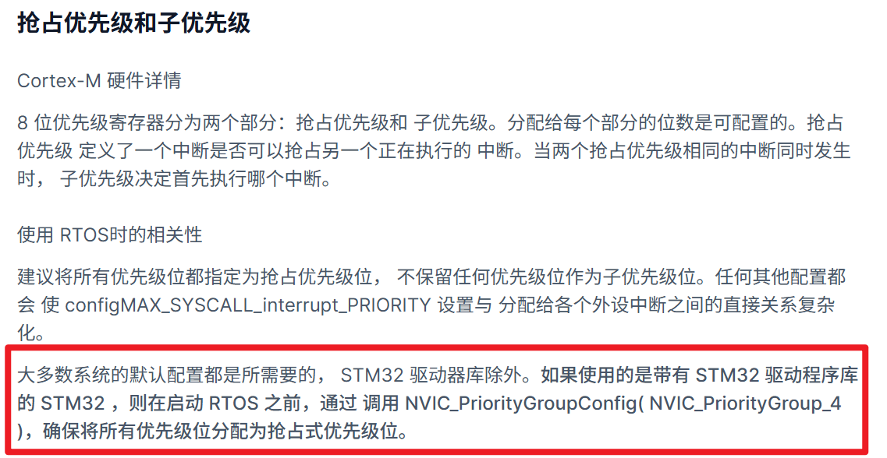

*图5.6-2FreeRTOS采用优先级分组4-图*

将这段代码，和FreeRTOS文件夹都添加到Keil5工程中，并且不要忘记将FreeRTOS文件夹添加到头文件包含目录。

如此，我们直接启动编译这个工程，会出现以下明显的报错：

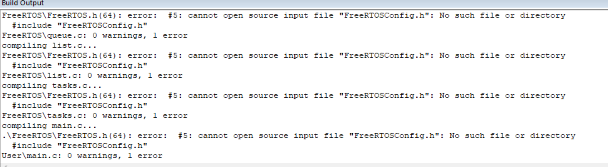

*图5.6-3在工程中集成FreeRTOS-图2*

**这段报错非常清楚，意思就是：缺少了FreeRTOSConfig.h头文件。**

这非常明显是一个配置文件，那么这个配置文件用来做什么呢？

简单介绍一下这个配置文件：

不同项目，对 FreeRTOS 的需求是完全不一样。

哪怕是同一个FreeRTOS，不同人使用，用出来的效果也是不一样的。

简单来说，FreeRTOSConfig.h 是 FreeRTOS 的“用户配置文件”，用来告诉FreeRTOS：这个系统该怎么跑。

FreeRTOS内核的功能很丰富，但不是所有功能你都用的上，甚至有些功能根本就是冲突的，只能多选一。

FreeRTOS内核是功能大全，FreeRTOSConfig.h配置文件是告诉它做哪些，怎么做。

**没有FreeRTOSConfig.h配置文件，FreeRTOS 就不知道你要什么样的操作系统，也就无法运行了。**

关于FreeRTOSConfig.h配置文件的使用，我们会在后续课程中再不断补充讲解，目前知道这些就足够了。

那么问题来了，这个配置文件去哪里找呢？

很简单，既然启动FreeRTOS，一定要这个配置文件。那么我们就去官方的Demo案例中抄一个过来就好了。

**所以，我们只需要找到关于STM32F103C8T6相关的FreeRTOS官方示例，就可以拿到我们需要的配置文件了。**

那么去哪里找STM32F103C8T6相关的FreeRTOS官方示例？

首先，我们下载的FreeRTOS源码中是没有的。

毕竟各种架构、各种MCU种类太多，示例也太多了，都放进去会导致源码包的大小增大。

所以需要我们自己去GitHub上下载示例。

在**"examples文件夹"**下，有一个"README.md"文件，其中就有这个链接：

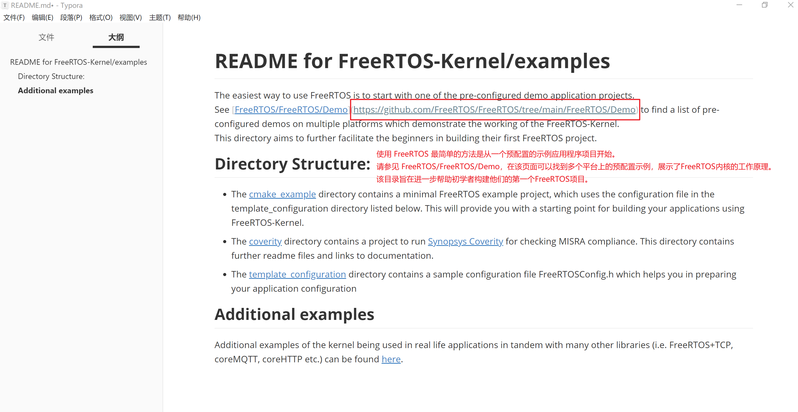

*图5.6-4在工程中集成FreeRTOS-图3*

打开这个网站后，找到下面的位置，找到配置文件。

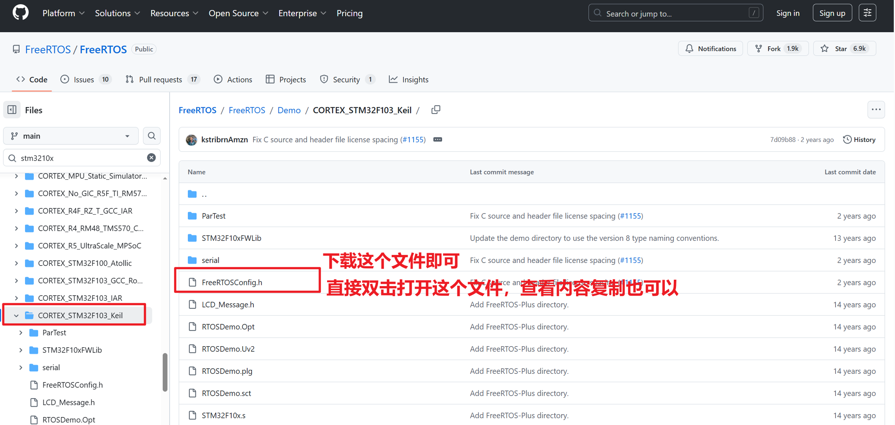

*图5.6-5在工程中集成FreeRTOS-图4*

当然，如果你无法打开这个网站下载，在百度网盘/WinSCP内网中，我也准备好了这个文件，你直接去拿过来就可以了。

当然你可以直接自己创建这个文件，然后完整复制下面的内容：

```c
/*
 * FreeRTOS V202212.00
 * Copyright (C) 2020 Amazon.com, Inc. or its affiliates. AllRightsReserved.
 *
 * Permission is hereby granted, free of charge, to any personobtainingacopyof
 * this software and associated documentation files (the"Software"),todealin
 * the Software without restriction, including without limitationtherightsto
 * use, copy, modify, merge, publish, distribute, sublicense,and/orsellcopiesof
 * the Software, and to permit persons to whom the Software isfurnishedtodoso,
 * subject to the following conditions:
 *
 * The above copyright notice and this permission notice shall beincludedinall
 * copies or substantial portions of the Software.
 *
 * THE SOFTWARE IS PROVIDED "AS IS", WITHOUT WARRANTY OF ANY KIND,EXPRESSOR
 * IMPLIED, INCLUDING BUT NOT LIMITED TO THE WARRANTIES OFMERCHANTABILITY,FITNESS
 * FOR A PARTICULAR PURPOSE AND NONINFRINGEMENT. IN NO EVENT SHALLTHEAUTHORSOR
 * COPYRIGHT HOLDERS BE LIABLE FOR ANY CLAIM, DAMAGES OR OTHERLIABILITY,WHETHER
 * IN AN ACTION OF CONTRACT, TORT OR OTHERWISE, ARISING FROM, OUTOFORIN
 * CONNECTION WITH THE SOFTWARE OR THE USE OR OTHER DEALINGS IN THESOFTWARE.
 *
 * https://www.FreeRTOS.org
 * https://github.com/FreeRTOS
 *
 */

#ifndef FREERTOS_CONFIG_H
#define FREERTOS_CONFIG_H

/*-----------------------------------------------------------
 * Application specific definitions.
 *
 * These definitions should be adjusted for your particularhardwareand
 * application requirements.
 *
 * THESE PARAMETERS ARE DESCRIBED WITHIN THE 'CONFIGURATION' SECTION OF THE
 * FreeRTOS API DOCUMENTATION AVAILABLE ON THE FreeRTOS.org WEBSITE.
 *
 * See http://www.freertos.org/a00110.html
 *----------------------------------------------------------*/

#define configUSE_PREEMPTION 1
#define configUSE_IDLE_HOOK 0
#define configUSE_TICK_HOOK 0
#define configCPU_CLOCK_HZ ( ( unsigned long ) 72000000 )
#define configTICK_RATE_HZ ( ( TickType_t ) 1000 )
#define configMAX_PRIORITIES ( 5 )
#define configMINIMAL_STACK_SIZE ( ( unsigned short ) 128 )
#define configTOTAL_HEAP_SIZE ( ( size_t ) ( 17 * 1024 ) )
#define configMAX_TASK_NAME_LEN ( 16 )
#define configUSE_TRACE_FACILITY 0
#define configUSE_16_BIT_TICKS 0
#define configIDLE_SHOULD_YIELD 1

/* Co-routine definitions. */
#define configUSE_CO_ROUTINES 0
#define configMAX_CO_ROUTINE_PRIORITIES ( 2 )

/* Set the following definitions to 1 to include the API function,orzero
to exclude the API function. */

#define INCLUDE_vTaskPrioritySet 1
#define INCLUDE_uxTaskPriorityGet 1
#define INCLUDE_vTaskDelete 1
#define INCLUDE_vTaskCleanUpResources 0
#define INCLUDE_vTaskSuspend 1
#define INCLUDE_vTaskDelayUntil 1
#define INCLUDE_vTaskDelay 1

/* This is the raw value as per the Cortex-M3 NVIC. Values can be255
(lowest) to 0 (1?) (highest). */
#define configKERNEL_INTERRUPT_PRIORITY 255
/* !!!! configMAX_SYSCALL_INTERRUPT_PRIORITY must not be set tozero!!!!
See http://www.FreeRTOS.org/RTOS-Cortex-M3-M4.html. */
#define configMAX_SYSCALL_INTERRUPT_PRIORITY 191 /* equivalentto0xb0,orpriority11.*/

/* This is the value being used as per the ST library which permits16
priority values, 0 to 15. This must correspond to the
configKERNEL_INTERRUPT_PRIORITY setting. Here 15 corresponds tothelowest
NVIC value of 255. */
#define configLIBRARY_KERNEL_INTERRUPT_PRIORITY 15

#endif /* FREERTOS_CONFIG_H */

```

注意，既然这个文件是一个配置文件，那么它存在的目的就是为了被程序员修改。

所以我们把它放入“User”目录下。

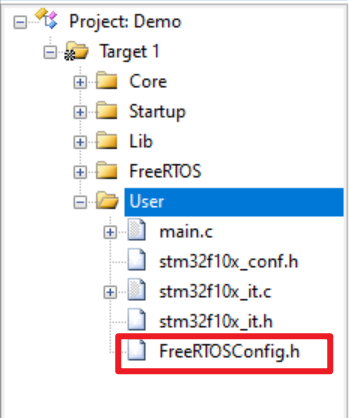

*图5.6-6image-20260313135542593*

如此就完成了吗？

我们再次编译工程，发现编译通过了。

烧录一下，看看能不能执行成功呢？

发现无法成功。

这是正常的，因为我们还缺一步重要的步骤没有完成。

首先，我们打开"stm32f10x.c"文件，如果你的标准库工程和之前讲的一样配置，那么它就在User目录下。

然后将SVC、PendSV、以及SysTick这三个中断服务程序注释掉。

如下一段代码所示：

```c
/**
  * @brief This function handles SVCall exception.
  * @param None
  * @retval None
  */
//void SVC_Handler(void)
//{
//}

/**
  * @brief This function handles Debug Monitor exception.
  * @param None
  * @retval None
  */
void DebugMon_Handler(void)
{
}

/**
  * @brief This function handles PendSVC exception.
  * @param None
  * @retval None
  */
//void PendSV_Handler(void)
//{
//}

/**
  * @brief This function handles SysTick Handler.
  * @param None
  * @retval None
  */
//void SysTick_Handler(void)
//{
//}
```

然后再在FreeRTOSConfig.h配置文件的下面，加上这一段内容：

```c
// --------------- 个人修改FreeRTOS配置文件 ---------------------

// 让FreeRTOS接管这三个中断服务程序，使得FreeRTOS可以正常运行
#define xPortPendSVHandler PendSV_Handler
#define vPortSVCHandler SVC_Handler
#define xPortSysTickHandler SysTick_Handler

// --------------- 个人修改FreeRTOS配置文件 ---------------------
```

注意，不要把上面的内容放到“头文件保护”下面去了。

最终的效果如下图所示：

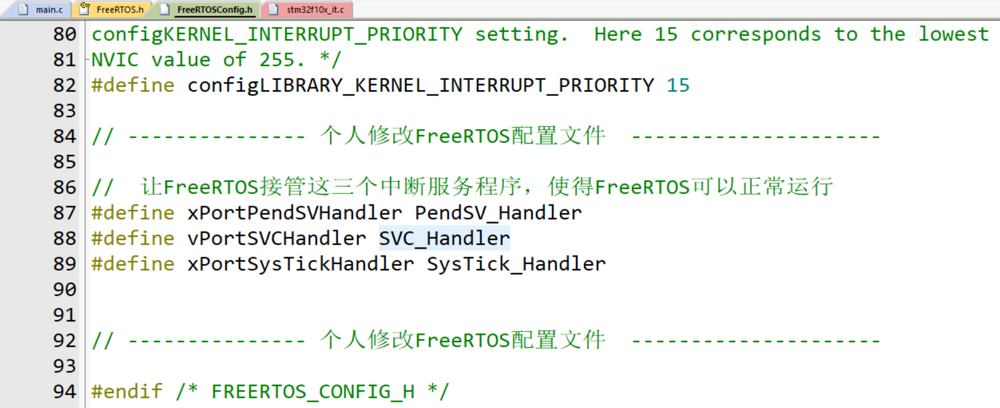

*图5.6-7在工程中集成FreeRTOS-图6*

这一连串操作的目的只有一个：

**让FreeRTOS接管SVC、PendSV以及SysTick三个系统中断的处理。**

实际上之前它们的默认处理是空壳，这会导致FreeRTOS调度卡死，任务永远不会开始执行。

关于这一部分，FreeRTOS是如何启动调度的，详细内容仍然放到后面讲，目前大家先这么操作就好了。

如此，再编译代码烧录，你就会发现两盏LED做到了和之前不使用FreeRTOS一样的效果：一起闪烁。

这是什么原因导致的呢？

结合我们上一个章节，讲过的任务调度机制，分析结果如下：

1. vTaskDelay() 会让任务进入阻塞态，期间不占用 CPU，而不是原地空转。
2. 两个任务优先级相同，被调度器公平对待，谁进入就绪状态，谁就能运行。
3. 任务每次延时结束，进入就绪状态，只做极短的 GPIO 操作，随后立刻再次vTaskDelay()进入阻塞状态。
4. 所以两个任务，轮流就绪上CPU点灯熄灯，轮流阻塞下CPU。
5. 点灯熄灯操作的速度非常快，再加上任务之间的切换非常快，人肉眼察觉不到这种差异。
6. 所以人的感觉就是两盏灯都同时在闪烁。

**思考一下：让两个任务的优先级不一致，LED闪烁的现象会改变吗？**

现在把两个任务的执行函数，改成下面的形式：

```c
// 任务1：控制 PA0 上的 LED 闪烁
void task1(void *arg) {
    while (1) {
       // 点亮 PA0 LED
       GPIO_SetBits(GPIOA, GPIO_Pin_0);

       // 使用for循环延时
       for(uint32_t i = 1000000; i > 0; i--);

       // 熄灭 PA0 LED
       GPIO_ResetBits(GPIOA, GPIO_Pin_0);

       // 使用for循环延时
       for(uint32_t i = 1000000; i > 0; i--);
    }
}

// 任务2：控制 PA4 上的 LED 闪烁
void task2(void *arg) {
    while (1) {
       // 点亮 PA4 LED
       GPIO_SetBits(GPIOA, GPIO_Pin_4);

       // 使用for循环延时
       for(uint32_t i = 1000000; i > 0; i--);

       // 熄灭 PA4 LED
       GPIO_ResetBits(GPIOA, GPIO_Pin_4);

       // 使用for循环延时
       for(uint32_t i = 1000000; i > 0; i--);
    }
}
```

在两个任务优先级一致、开启时间片轮转的情况下：

```c
// 时间片轮转机制默认就是开启的，但你也可以显式配置开启，只需要将下面宏放入FreeRTOS配置文件中
#define configUSE_TIME_SLICING 1
```

此时，这两个LED又是什么情况呢？

和之前的状态是一致的：仍然是两盏LED同时闪烁。

虽然现象一致，但实际情况已经大不相同了：

1. 此时两个任务优先级是一致的
2. 两个任务中都没有主动进入阻塞的Delay函数。
3. 所以此时两个任务采用时间片轮转，轮流上CPU，并发执行。
4. 人肉眼察觉不出这种时间差距，所以人的感觉是两个LED同时闪烁。

**再思考一下：让两个任务的优先级不一致，LED闪烁的现象会改变吗？**

#### 5.7 创建FreeRTOS模板工程

在你完成上述FreeRTOS移植，并完成两个LED闪烁实验后，可以将main.c文件中的多余内容删除。

main.c文件内容如下：

```c
#include "stm32f10x.h" // STM32F10x 标准外设库头文件

#include "FreeRTOS.h" // FreeRTOS 核心头文件
#include "task.h" // FreeRTOS 任务相关 API

// 任务1：
void vTask1(void *arg) {
    while (1) {
       vTaskDelay(1);
       // 任务不能空转，所以延时1ms
    }
}

// 任务2：
void vTask2(void *arg) {
    while (1) {
       vTaskDelay(1);
       // 任务不能空转，所以延时1ms
    }
}

int main(void) {
    // 使用优先级分组4
    NVIC_PriorityGroupConfig(NVIC_PriorityGroup_4);
    // 1. 创建任务1
    xTaskCreate(vTask1, "Task1", configMINIMAL_STACK_SIZE, NULL,tskIDLE_PRIORITY + 1,NULL);

    // 2. 创建任务2（与任务1优先级相同）
    xTaskCreate(vTask2, "Task2", configMINIMAL_STACK_SIZE, NULL,tskIDLE_PRIORITY + 1,NULL);

    // 3. 启动 FreeRTOS 调度器
    vTaskStartScheduler();

    // 理论上不会运行到这里
    while (1) {
    }
}

```

然后打开FreeRTOS配置文件，保留一些个人配置。

FreeRTOSConfig.h文件内容如下：

```c
/*
 * FreeRTOS V202212.00
 * Copyright (C) 2020 Amazon.com, Inc. or its affiliates. AllRightsReserved.
 *
 * Permission is hereby granted, free of charge, to any personobtainingacopyof
 * this software and associated documentation files (the"Software"),todealin
 * the Software without restriction, including without limitationtherightsto
 * use, copy, modify, merge, publish, distribute, sublicense,and/orsellcopiesof
 * the Software, and to permit persons to whom the Software isfurnishedtodoso,
 * subject to the following conditions:
 *
 * The above copyright notice and this permission notice shall beincludedinall
 * copies or substantial portions of the Software.
 *
 * THE SOFTWARE IS PROVIDED "AS IS", WITHOUT WARRANTY OF ANY KIND,EXPRESSOR
 * IMPLIED, INCLUDING BUT NOT LIMITED TO THE WARRANTIES OFMERCHANTABILITY,FITNESS
 * FOR A PARTICULAR PURPOSE AND NONINFRINGEMENT. IN NO EVENT SHALLTHEAUTHORSOR
 * COPYRIGHT HOLDERS BE LIABLE FOR ANY CLAIM, DAMAGES OR OTHERLIABILITY,WHETHER
 * IN AN ACTION OF CONTRACT, TORT OR OTHERWISE, ARISING FROM, OUTOFORIN
 * CONNECTION WITH THE SOFTWARE OR THE USE OR OTHER DEALINGS IN THESOFTWARE.
 *
 * https://www.FreeRTOS.org
 * https://github.com/FreeRTOS
 *
 */

#ifndef FREERTOS_CONFIG_H
#define FREERTOS_CONFIG_H

/*-----------------------------------------------------------
 * Application specific definitions.
 *
 * These definitions should be adjusted for your particularhardwareand
 * application requirements.
 *
 * THESE PARAMETERS ARE DESCRIBED WITHIN THE 'CONFIGURATION' SECTION OF THE
 * FreeRTOS API DOCUMENTATION AVAILABLE ON THE FreeRTOS.org WEBSITE.
 *
 * See http://www.freertos.org/a00110.html
 *----------------------------------------------------------*/

#define configUSE_PREEMPTION 1
#define configUSE_IDLE_HOOK 0
#define configUSE_TICK_HOOK 0
#define configCPU_CLOCK_HZ ( ( unsigned long ) 72000000 )
#define configTICK_RATE_HZ ( ( TickType_t ) 1000 )
#define configMAX_PRIORITIES ( 5 )
#define configMINIMAL_STACK_SIZE ( ( unsigned short ) 128 )
#define configTOTAL_HEAP_SIZE ( ( size_t ) ( 17 * 1024 ) )
#define configMAX_TASK_NAME_LEN ( 16 )
#define configUSE_TRACE_FACILITY 0
#define configUSE_16_BIT_TICKS 0
#define configIDLE_SHOULD_YIELD 1

/* Co-routine definitions. */
#define configUSE_CO_ROUTINES 0
#define configMAX_CO_ROUTINE_PRIORITIES ( 2 )

/* Set the following definitions to 1 to include the API function,orzero
to exclude the API function. */

#define INCLUDE_vTaskPrioritySet 1
#define INCLUDE_uxTaskPriorityGet 1
#define INCLUDE_vTaskDelete 1
#define INCLUDE_vTaskCleanUpResources 0
#define INCLUDE_vTaskSuspend 1
#define INCLUDE_vTaskDelayUntil 1
#define INCLUDE_vTaskDelay 1

/* This is the raw value as per the Cortex-M3 NVIC. Values can be255
(lowest) to 0 (1?) (highest). */
#define configKERNEL_INTERRUPT_PRIORITY 255
/* !!!! configMAX_SYSCALL_INTERRUPT_PRIORITY must not be set tozero!!!!
See http://www.FreeRTOS.org/RTOS-Cortex-M3-M4.html. */
#define configMAX_SYSCALL_INTERRUPT_PRIORITY 191 /* equivalentto0xb0,orpriority11.*/

/* This is the value being used as per the ST library which permits16
priority values, 0 to 15. This must correspond to the
configKERNEL_INTERRUPT_PRIORITY setting. Here 15 corresponds tothelowest
NVIC value of 255. */
#define configLIBRARY_KERNEL_INTERRUPT_PRIORITY 15

// --------------- 个人修改FreeRTOS配置文件 ---------------------

// 让FreeRTOS接管这三个中断服务程序，使得FreeRTOS可以正常运行
#define xPortPendSVHandler PendSV_Handler
#define vPortSVCHandler SVC_Handler
#define xPortSysTickHandler SysTick_Handler

// 显式配置，启用时间片轮转机制
#define configUSE_TIME_SLICING 1

// --------------- 个人修改FreeRTOS配置文件 ---------------------

#endif /* FREERTOS_CONFIG_H */

```

如此，这样的一个SPL库集成FreeRTOS的Keil5工程，就可以称得上是一个FreeRTOS标准模板工程了。

**当然，后续随着我们对FreeRTOS的深入学习，我们还会在这个标准模版下面，再增加一些内容，以适应我们的需求。**

建议大家都手动配置一下这个标准模板，当然“王道嵌入式软件环境”中，也给你准备好了这个标准模版。

### 6. FreeRTOS的剪裁

关于 FreeRTOS 的移植，上面已经讲清楚了。

**说白了，所谓的移植，解决的是 FreeRTOS 能不能在这颗芯片上跑起来。**

那什么叫FreeRTOS的剪裁呢？

FreeRTOS 本身提供的功能非常多，但具体到某一个项目中：

1. 并不是所有功能都会用到，用不到的功能就没有必要保留。
2. 有些功能存在多种实现方式，这些实现方式之间可能互斥，需要选择其中一种。
3. 有些功能默认是关闭的，如果项目需要，就必须手动开启。
4. ...

为了解决这些问题，在使用 FreeRTOS 时，必须通过配置FreeRTOSConfig.h这个头文件，来明确：

1. 哪些功能需要使用，让它们参与编译
2. 哪些功能被关闭
3. 采用哪一种功能实现方式
4. ....

**这种通过配置宏来决定功能取舍的过程，就称为 FreeRTOS 的剪裁。**

说白了，FreeRTOS 原本给你的是一整块布，剪裁就是把这块布按你的身材剪一剪，做成一件能穿、合身、而且还不浪费布料的衣服。

**移植解决的是能不能跑的问题，那么剪裁解决的是 “跑的时候，用哪些功能”。**

#### 6.1 几个剪裁的案例

举几个例子：

第一，是否要启动抢占式调度：

```c
#define configUSE_PREEMPTION 1
```

1. ：开启抢占式调度（高优先级任务可立即抢 CPU）
0. ：关闭抢占，只能协作式调度

第二，是否启用时间片轮转：

```c
#define configUSE_TIME_SLICING 1
```

FreeRTOS默认开启时间片轮转机制。

1. ：开启时间片轮转，同优先级任务轮流运行
0. ：关闭时间片轮转，同优先级任务不轮转，谁先跑谁一直跑到阻塞

**第三，配置创建任务的方式（动态任务）：**

FreeRTOS默认开启动态创建任务的方式，类似时间片轮转。

但也可以手动配置开启与否。

```c
#define configSUPPORT_DYNAMIC_ALLOCATION 1
```

1. ：允许使用**动态内存方式**创建任务，可以用xTaskCreate() 函数创建任务
0. ：禁止动态创建任务，xTaskCreate()**禁止使用。**

**第四，配置创建任务的方式（静态任务）：**

FreeRTOS默认关闭静态任务的创建方式。

xTaskCreateStatic() 函数，在默认情况下是无法使用的。

如果需要这种方式创建任务，可以手动开启：

```c
#define configSUPPORT_STATIC_ALLOCATION 1
```

1. ：允许使用**静态内存方式**创建任务，可以用xTaskCreateStatic() 函数创建任务
0. ：禁止静态创建任务，xTaskCreateStatic()**禁止使用。**

**关于这两种创建任务的方式，是后续课程要讲解的内容，这里大家先知道一下即可。**

#### 6.2 关于裁剪的使用建议

首先我们要明确一点：

**在 FreeRTOS 的剪裁中，最重要、最直观的一件事，就是决定：哪些 API 要参与编译并使用，哪些 API 会直接被移除。**

实际上，在FreeRTOS中：

**几乎所有的对外开放的API，即用户可以直接调用的函数，都可以在配置文件中配置保留使用或直接移除。**

因此，在后续学习 FreeRTOS 各类 API 时，我们可以先暂时不去关心该函数“具体是干什么的”，而是优先关注与剪裁相关的几个问题：

1. 该函数是不是默认开启，或者默认关闭
2. **如果需要使用该函数，建议在配置文件中显式配置对应宏，即便它默认是开启的。**
3. 如果不使用该函数，且该函数默认就是关闭的，通常不需要进行额外的宏配置。

也就是说：

**我们实际使用了哪些 API，建议通过宏配置的方式明确标注出来。**

这样的操作在功能上来说，有可能毫无意义，毕竟有些API可能是默认开启的。

但从工程的角度出发，这增强了软件系统的确定性，清晰地界定了工程中 API 的使用边界。

#### 6.3 剪裁的好处

那么，在 FreeRTOS 剪裁中，将不需要的函数/代码片段移除，具体有哪些好处呢？

需要明确的是：

通过宏配置去掉某些函数/代码片段，这个操作发生在预处理阶段。

这意味着，一旦某一段代码被裁剪掉：

1. 对应的源码片段不会参与后续的编译与链接，相应参与构建目标文件的有效代码规模就随之减少。
2. 最终生成的可执行程序体积也会相应减少，从而降低 Flash 占用。
3. 除了降低 Flash 占用，源码中还可能包含全局/静态变量或扩展结构体成员，裁剪这些功能也可能减少运行时 RAM 的占用。

**除了减少资源占用外，还有以下两点对工程而言，更加重要的收益：**

1. 被裁剪的API不会被编译，即便你想误调用也不可能，因为会编译报错。

2. 通过剪裁明确了工程使用API的边界，哪些可用，哪些不可用，系统的确定性更强，更加利于维护管理工程。

### 7. 基于HAL库的FreeRTOS移植

上面讲完了，基于标准库的FreeRTOS移植。

而基于HAL库的STM32开发方式，我们早就有所耳闻了，但从来没有实践过。

**因此，在这一小节，我们不妨手动实践一下， HAL 库的基本开发方式，并进一步完成在 HAL 工程中集成 FreeRTOS**

#### 7.1 创建基于HAL库的开发工程

在正式动手之前，我们还是先简单回顾一下 HAL 库开发方式的优缺点。

HAL库的开发方式有以下优点：

1. 硬件抽象程度高，可移植性强。
   - a. 通俗的说，HAL库开发方式将底层细节都进行了深度封装，使得不同型号的STM32单片机几乎可以采用相同的API进行开发。
   - b. 你在 F1、F4、F7等不同型号的STM32单片机上写 HAL库开发代码，写法几乎一样，换芯片时不需要大张旗鼓的重新开发。
2. 官方主推，生态完善。
   - a. 通俗的说，HAL库是官方的亲儿子，主推的开发方式，生态完善成熟。
   - b. 实际上，标准库的开发方式，早在2016年左右就停止更新了。
3. 开发简单易上手，开发效率高。
4. STM32的F0、F3、F4、F7等系列，这些较新款的单片机，没有SPL库支持，只能使用HAL库进行开发。
5. HAL库与FreeRTOS这样的中间层实时操作系统天然适配，HAL 在设计时就考虑了RTOS 场景，已经进行了统一封装。

HAL库的开发方式有以下缺点：

1. 封装层次太高，导致代码执行效率低下。不适用于追求性能的场景。
2. 封装层次太高，中间层过多，导致代码体积臃肿。不适用于资源紧张的场景。
3. 封装层次太高，隐藏了底层细节，降低了开发者对硬件细节的感知。
   - a. 开发者无需关注硬件细节，在正常使用HAL库时是一件好事。
   - b. 但一旦出现了Bug，定位Bug，修正Bug，将会是一场灾难。

了解了HAL库开发方式的优缺点，下面我们来实践一下创建基于HAL库的开发工程。

首先，我们需要使用一款软件**——STM32CubeMX**。

它是 ST 官方围绕 HAL 库开发体系打造的一款核心配置与代码生成工具。

STM32CubeMX 采用图形化配置 + 自动代码生成的方式：

通过引脚分配、外设参数及时钟系统的可视化配置，就可以快速生成一个基于 HAL 库的工程框架。

简单来说，只需要“点点点”，就能把一个 HAL 工程的骨架先搭起来，是一款在实际工程中非常实用的工具。

##### 7.1.1 安装STM32CubeMX

你可以在“王道嵌入式软件环境”中找到这个软件的安装包。

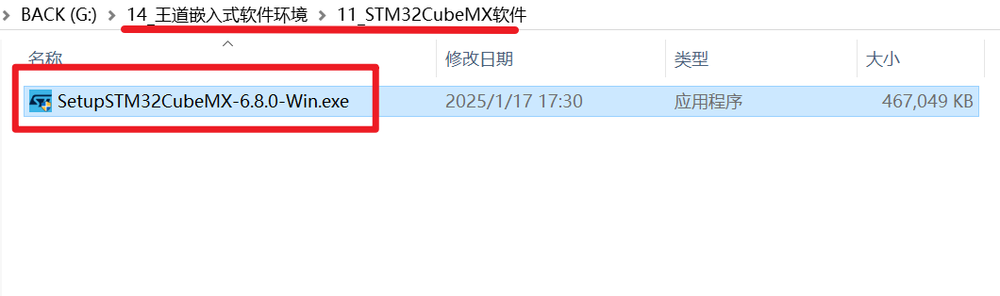

*图7.1.1-1安装STM32CubeMX-图*

整个安装的过程，下一步下一步即可，傻瓜式安装。

##### 7.1.2 创建新项目

安装好软件后，开始创建新项目。如下图所示：

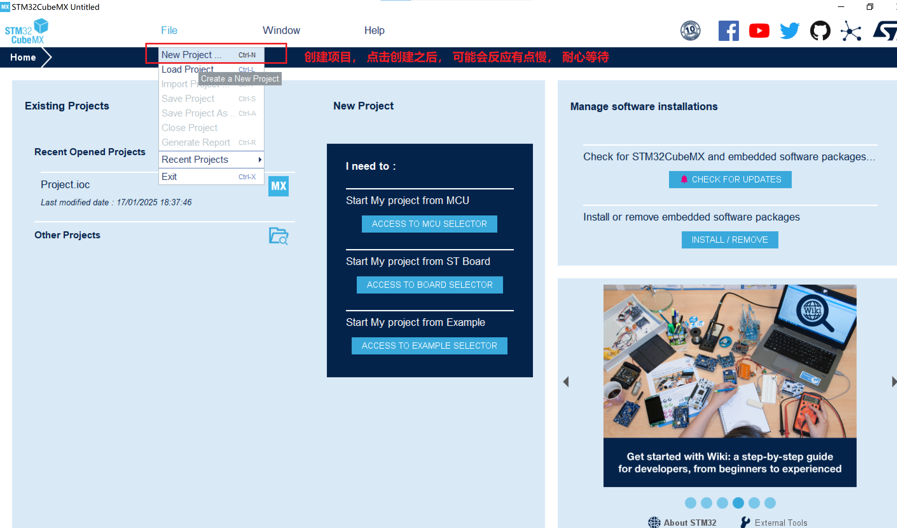

*图7.1.2-1创建新项目-图*

点击New创建后，第一次使用，会要求你下载资源。

这个过程可能比较慢，耐心等待即可。

如果出现下载不动的情况，可能就是IP地址被ST官网服务器限流了：

1. 要么就等明天再试试
2. 要么换个网络环境试一试
3. 要么考虑用一些科技手段

后续的过程中，如果还需要下载资源，都有可能出现这种下载不动的情况，如果遇到了，可以自己尝试排除一下。

加载好资源，会进入下图中的界面，会让你选择使用的单片机。

请按照下图的顺序进行选择即可：

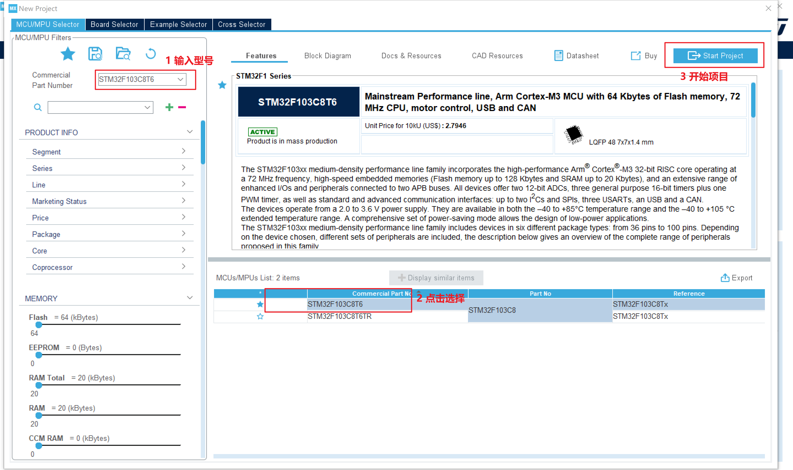

*图7.1.2-2创建新项目-图2*

选择好单片机后，进入下一步。

首先，我们对"SYS"系统选项卡进行选择，如下图所示：

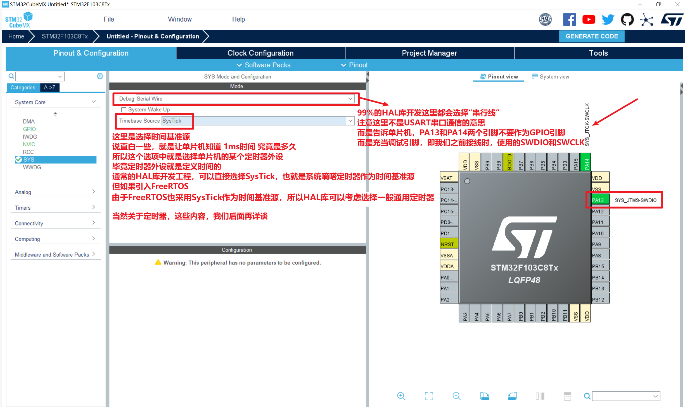

*图7.1.2-3创建新项目-图3*

紧接着，我们要对“RCC”选项卡，进行选择。按照下图的方式进行选择：

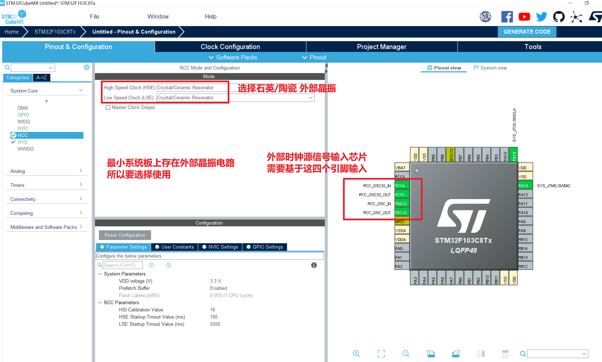

*图7.1.2-4创建新项目-图4*

首先，RCC选项卡用于确定单片机是否使用外部时钟信号源。

关于时钟信号源，早在STM32基本概述时，我们就讲过了。到了今天，我们已经对时钟信号有了一定的了解。

所以我们这里详细讲一下**“最小系统板的四种时钟信号源”**。

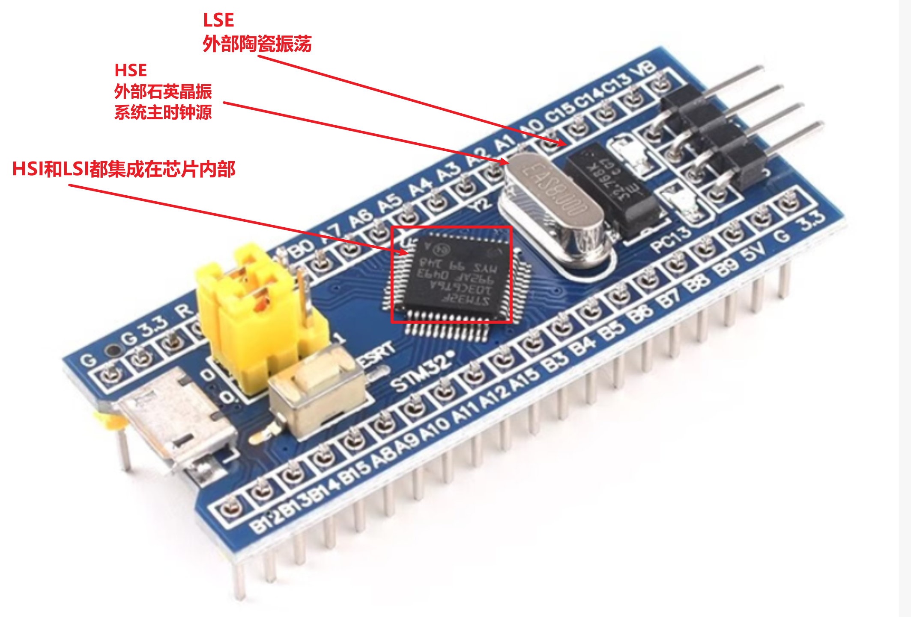

*图7.1.2-5四种时钟源-图*

用一张表格来简单描述一下这四种时钟信号源：

| 时钟源 | 全称 | 中文全称 | 来源说明 | 时钟源频率 |
|---|---|---|---|---|
| HSI | High Speed Internal | 内部高速时钟源 | 内部 RC 振荡器 | 8 MHz |
| LSI | Low Speed Internal | 内部低速时钟源 | 内部 RC 振荡器 | 40 kHz |
| HSE | High Speed External | 外部高速时钟源 | 外部石英晶振 | 8 MHz |
| LSE | Low Speed External | 外部低速时钟源 | 外部陶瓷谐振器 | 32.768 kHz |

你可以先记住以下结论，这些内容我们会在后续专门讲解时钟系统时再详细展开。

1. HSI，内部高速时钟源，主要靠内部电路中的电阻和电容产生时钟源频率。时钟源频率通常是8MHz。
   - a. 优点是体积小，启动迅速，上电即用。启动时间通常在微秒级别。
   - b. 缺点是极其不准，强烈受温度、电压等外部条件影响。**时钟频率的误差通常在1% ~ 3%之间。**
   - c. 基于上述特点，HSI 一般只用于**系统上电启动阶段**，通常是在main函数执行之前，为单片机提供最初的运行时钟。
   - d. 在系统初始化完成后，通常会切换到精度和稳定性更高的外部时钟源。
   - e. 这也是最小系统板，通常都需要集成外部晶振电路的根本原因。
2. HSE，外部高速时钟信号源，通常是石英材质的晶振，时钟源频率通常也为8MHz。
   - a. 优点是准度高，稳定性强。**时钟频率的误差通常只有十万分之一到十万分之五。**
   - b. 缺点是体积较大，启动比较慢。启动时间通常在毫秒级别。

因此，在 STM32 等单片机中，系统的启动流程通常是：

**先使用 HSI 完成上电启动和基础初始化再等待 HSE 稳定后，将系统主时钟切换到 HSE。**

这种设计方式兼顾了启动速度与运行精度，是嵌入式开发中非常经典，常用的时钟使用策略。

随后，假如我们想要点亮/熄灭PC13指示灯，就需要配置“GPIO”选项卡。

如下图所示：

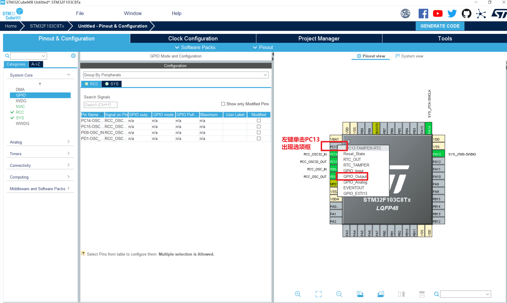

*图7.1.2-6创建新项目-图5*

随后再配置引脚的工作模式等属性：

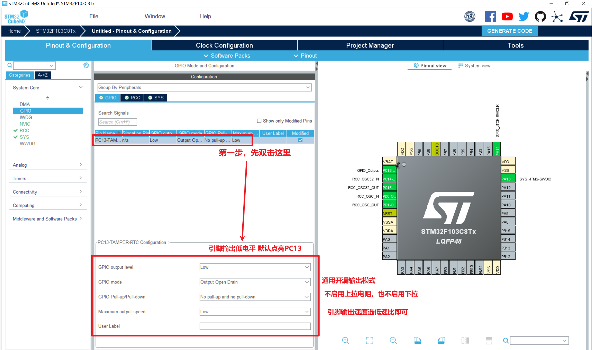

*图7.1.2-7创建新项目-图6*

如此，完成GPIO的相关配置。

**这些配置，在随后创建工程时，都会自动生成相关的代码，这就是使用STM32CubeMX的便利之处。**

随后对系统时钟进行相关的配置，如下图所示：

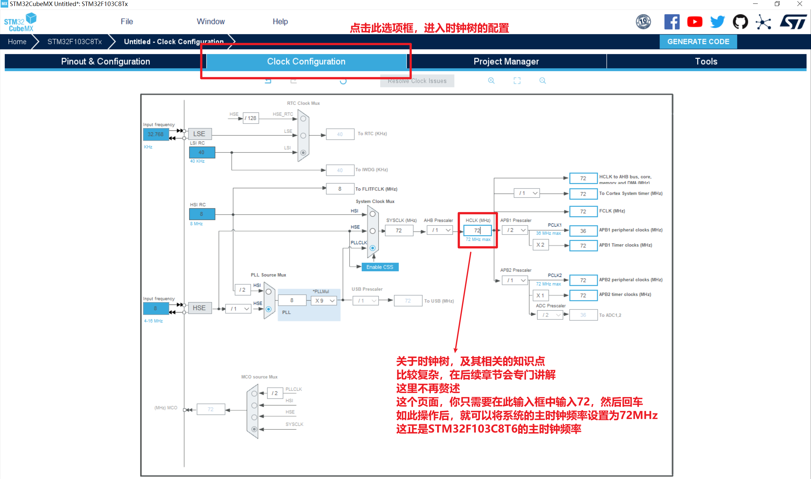

*图7.1.2-8创建新项目-图7*

此界面展示了一种叫做“时钟树”的知识点概念，在后续课程我们再详谈，今天暂且先不赘述了。

随后配置一下工程的管理属性，如下图所示：

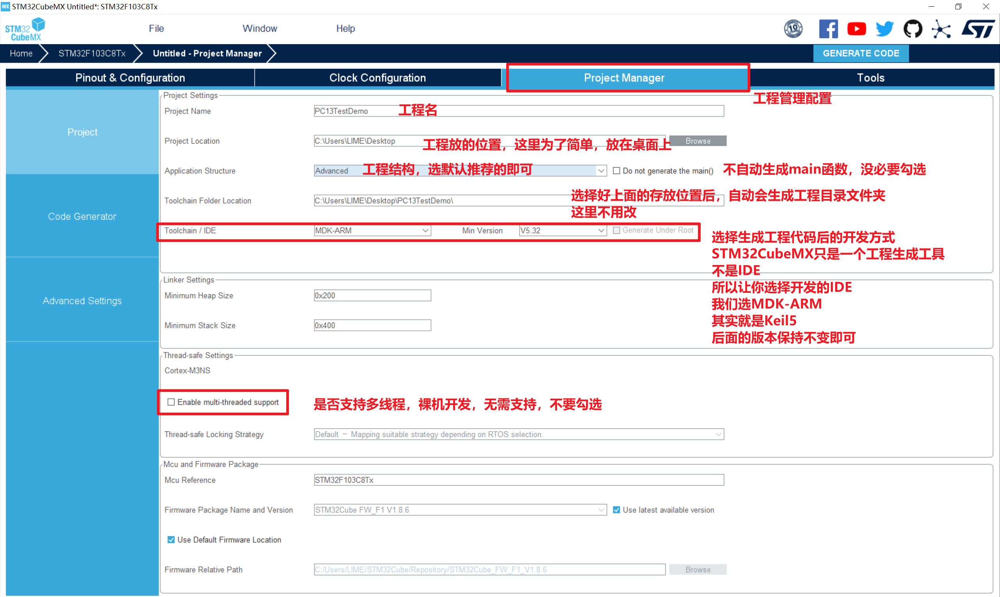

*图7.1.2-9创建新项目-图8*

最后选择生成代码，如下图所示：

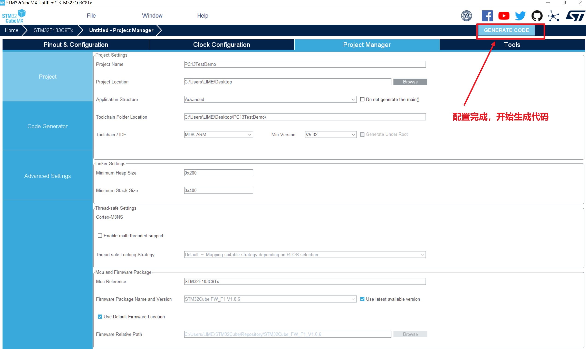

*图7.1.2-10创建新项目-图9*

第一次使用STM32CubeMX生成代码时，会要求你从官方下载HAL库开发包，直接点击是即可。

如下图所示：

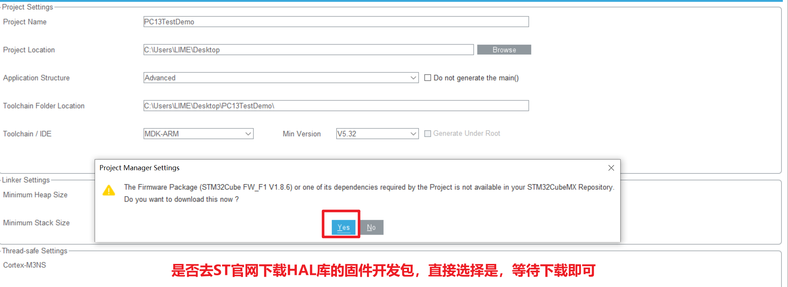

*图7.1.2-11创建新项目-图10*

等待下载成功后，会出现下列选项框：

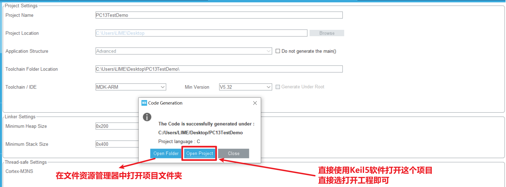

*图7.1.2-12创建新项目-图11*

如此，你将打开这个HAL库开发工程，这样整个创建HAL库工程的过程就完成了。

如下图所示：

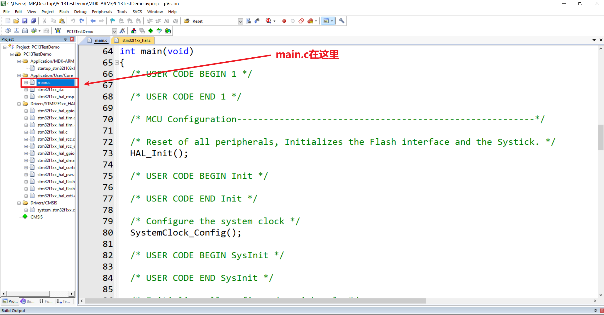

*图7.1.2-13创建新项目-图12*

以上。

##### 7.1.3 编写代码与调试程序

到了这一步，就是我们比较熟悉的Keil5的操作环节了。

但毕竟开发的方式从SPL标准库，变成了HAL库，所以使用的函数不一样了。

但很多代码，我们仍然能够认出来。比如下面的代码：

```c
/**
  * @brief GPIO Initialization Function
  * @param None
  * @retval None
  */
static void MX_GPIO_Init(void) {
    GPIO_InitTypeDef GPIO_InitStruct = {0};
    /* USER CODE BEGIN MX_GPIO_Init_1 */
    /* USER CODE END MX_GPIO_Init_1 */

    /* GPIO Ports Clock Enable */
    __HAL_RCC_GPIOC_CLK_ENABLE();
    __HAL_RCC_GPIOD_CLK_ENABLE();
    __HAL_RCC_GPIOA_CLK_ENABLE();

    /*Configure GPIO pin Output Level */
    HAL_GPIO_WritePin(GPIOC, GPIO_PIN_13, GPIO_PIN_RESET);

    /*Configure GPIO pin : PC13 */
    GPIO_InitStruct.Pin = GPIO_PIN_13;
    GPIO_InitStruct.Mode = GPIO_MODE_OUTPUT_OD;
    GPIO_InitStruct.Pull = GPIO_NOPULL;
    GPIO_InitStruct.Speed = GPIO_SPEED_FREQ_LOW;
    HAL_GPIO_Init(GPIOC, &GPIO_InitStruct);

    /* USER CODE BEGIN MX_GPIO_Init_2 */
    /* USER CODE END MX_GPIO_Init_2 */
}
```

这段代码就是我们熟悉的GPIO引脚初始化，这段代码完成：

1. 初始化PC13引脚
2. PC13引脚的工作模式，设置为通用开漏输出模式
3. PC13引脚的引脚输出速度采用低速比
4. PC13引脚，设置默认输出低电平，PC13指示灯点亮

上述代码，都是使用STM32CubeMX自动生成代码的。

我们直接编译链接，然后烧录。**（这里就可以发现HAL库工程的编译明显较慢）**

**这时大概率PC13指示灯并不会点亮，这是因为HAL库工程默认没有开启“烧录自动复位”功能。**

此时你可以将“烧录自动复位”功能打开，或者手动按最小系统板的复位按键进行复位。

**除此之外，还需要注意所有程序员的代码，都必须写在User Begin和User End之间，否则后续CubeMX自动生成代码就会将你的代码覆盖掉。**

```c
/* USER CODE BEGIN MX_GPIO_Init_2 */

/* USER CODE END MX_GPIO_Init_2 */

/* USER CODE BEGIN 4 */

/* USER CODE END 4 */
```

其他的，关于HAL代码究竟如何编写，这不是我们目前需要探究的问题。

大家如果以后工作需要用到，自行学习一下API即可，难度并不大。

#### 7.2 HAL库集成FreeRTOS

首先，我们已经有了一个基于HAL库开发方式的Keil5工程。

既然已经有了Keil5工程，那么我们再进行手动的挑选FreeRTOS源码文件，手动进行FreeRTOS的移植，可不可以呢？

答：当然是可以的。

但这样做，显然有点侮辱STM32CubeMX这个工具了。

STM32CubeMX完全可以采用自动化配置“点点点”的方式，来完成创建一个集成FreeRTOS的HAL库工程。

流程如下：

其他流程保持一致，只有SYS选项卡稍作变动。

为了更好演示任务，我们使用PA1和PA2两个引脚来驱动LED：

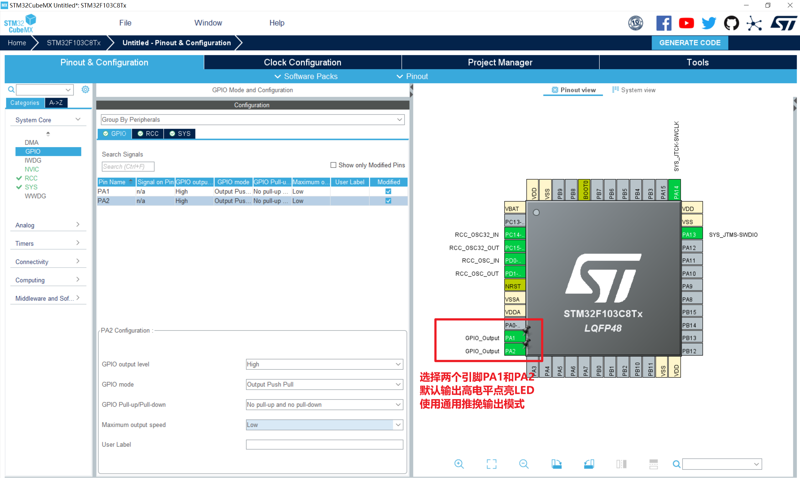

*图7.2-1HAL库集成FreeRTOS-图*

下面的操作就稍有变化，如下图所示：

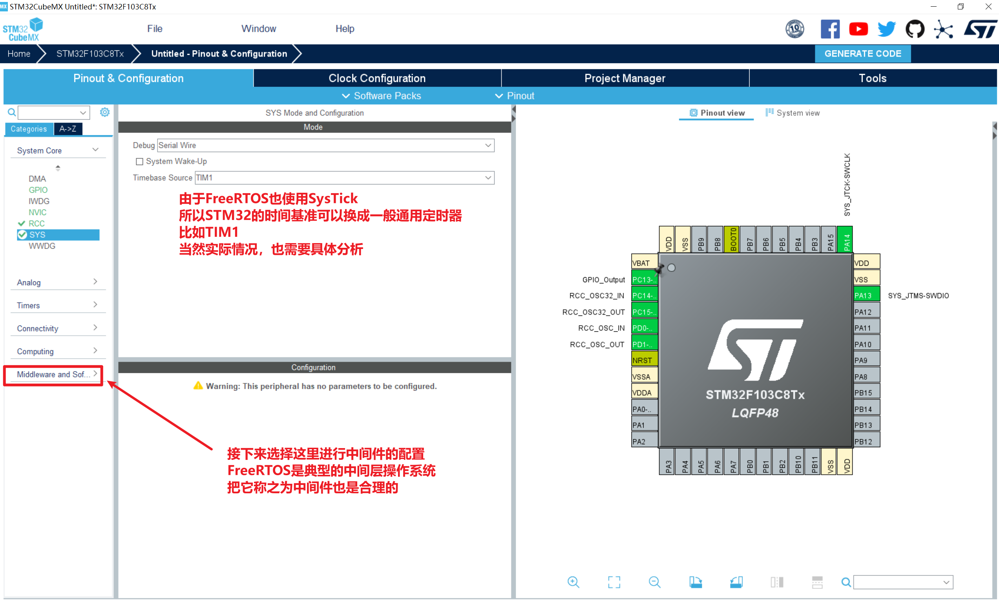

*图7.2-2HAL库集成FreeRTOS-图2*

随后我们对FreeRTOS进行相关配置：

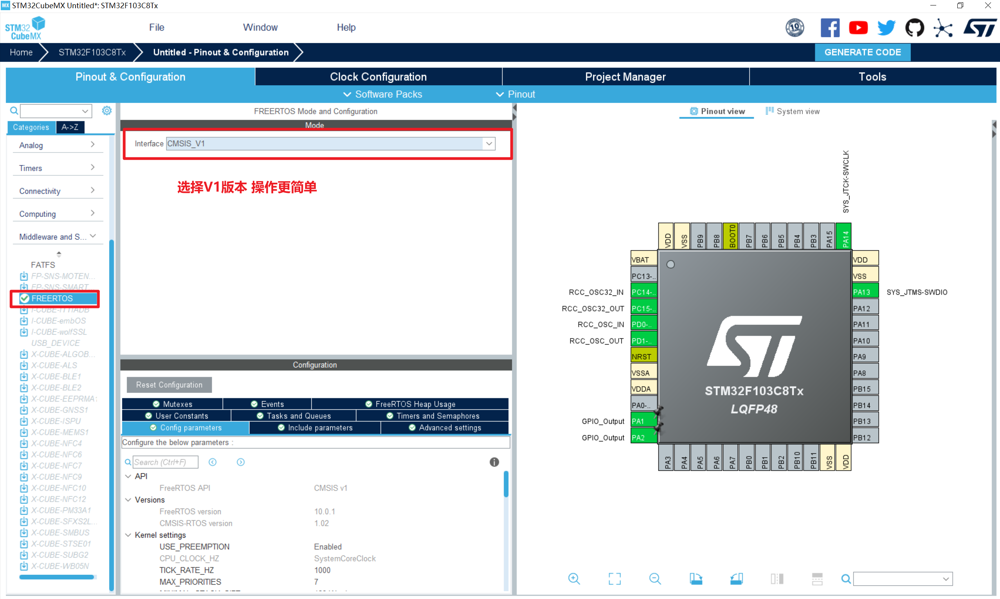

*图7.2-3HAL库集成FreeRTOS-图3*

随后设置任务的创建相关选项，如下图所示：

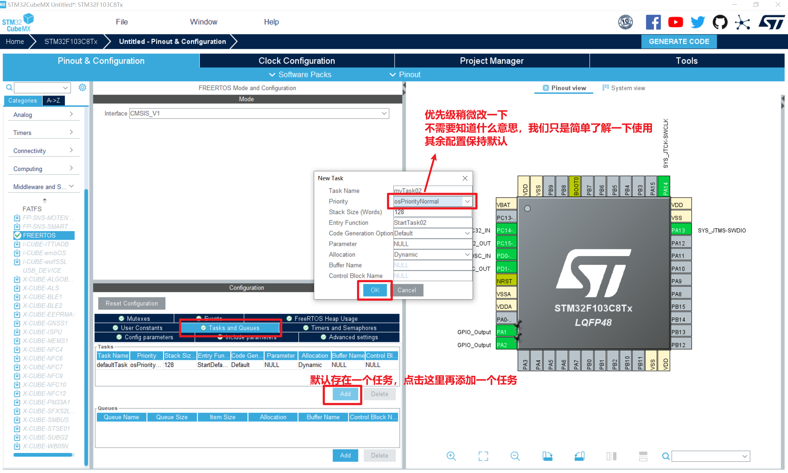

*图7.2-4HAL库集成FreeRTOS-图4*

注意几点细节：

1. STM32CubeMX软件通常是自带集成FreeRTOS的，不需要再次手动下载。
2. 在使用FreeRTOS时，有两个版本可选择：
   - a. CMSIS_V1，老版本。兼容老项目，但可读性和扩展性一般，建议只在维护老项目时使用。
   - b. CMSIS_V1，新版本。ST公司的主推版本，可读性和扩展性都更好，推荐学习和做新项目时使用。
3. **注意，不管是选择上面的哪一个版本。HAL库都对FreeRTOS源码做了一层封装，使其更符合HAL库的API风格。**
4. 所以，使用HAL库集成FreeRTOS进行开发，和标准库集成FreeRTOS进行开发，使用的函数也完全不同：
   - a. 标准库是直接基于FreeRTOS源码开发，直接使用FreeRTOS提供的函数。
   - b. HAL则是对FreeRTOS源码进行了二次封装，使其用起来更简便。
5. **推荐使用CMSIS_V1版本，它使用起来更简单，V2版本使用起来配置很复杂，很可能跑不起来。**

主时钟频率要选择成72MHz，不要忘记了：

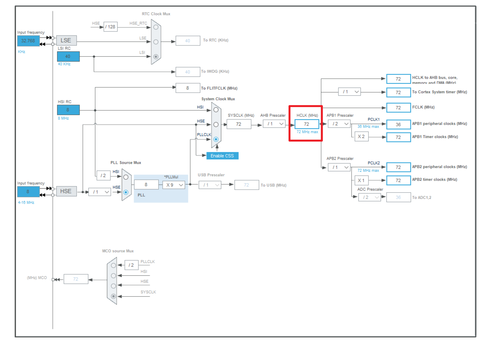

*图7.2-5HAL库集成FreeRTOS-图5*

其余设置保持不变，点击生成代码，并打开工程。

如下图所示：

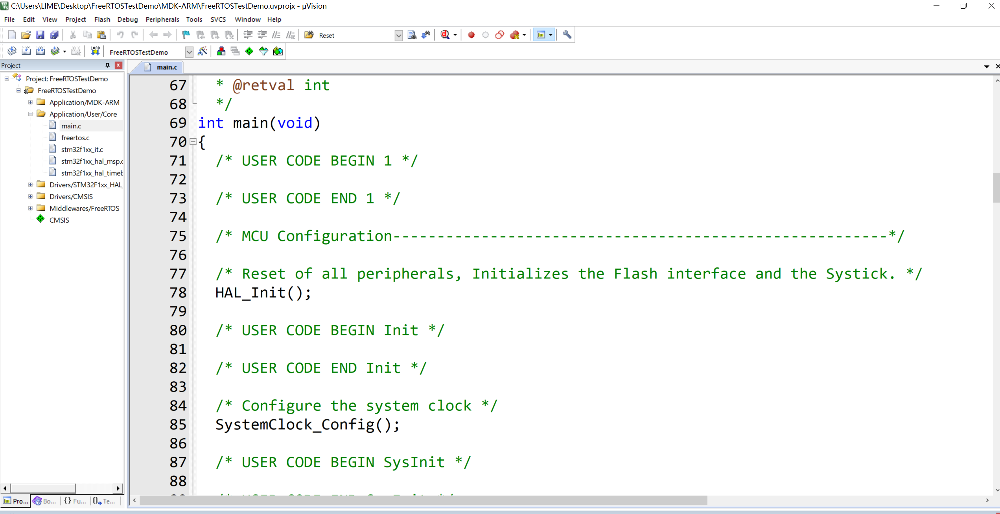

*图7.2-6HAL库集成FreeRTOS-图6*

直接点击编译，此时应当可以成功编译。

两个引脚PA1和PA2的配置如下：

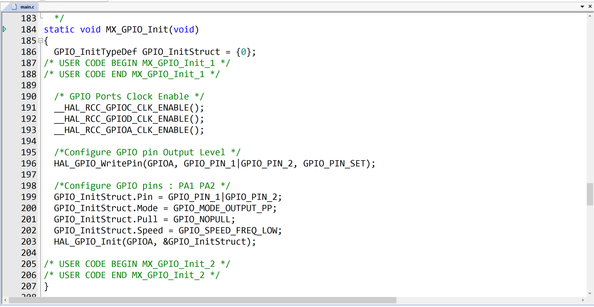

*图7.2-7HAL库集成FreeRTOS-图7*

两个任务执行的函数，代码如下：

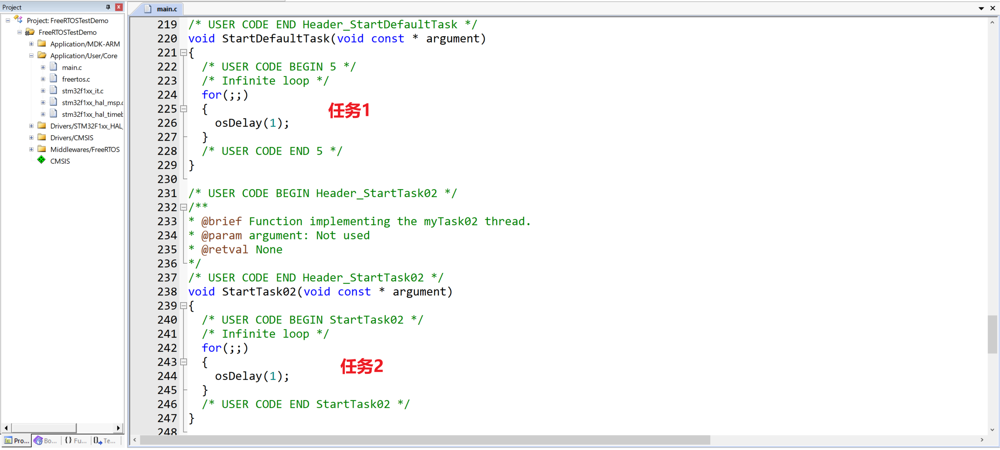

*图7.2-8HAL库集成FreeRTOS-图8*

随后，我们将下面的代码复制到**任务1**的，Begin和End之间（死循环内部）。

```c
HAL_GPIO_WritePin(GPIOA, GPIO_PIN_1, GPIO_PIN_RESET);
osDelay(1000);
HAL_GPIO_WritePin(GPIOA, GPIO_PIN_1, GPIO_PIN_SET);
osDelay(1000);
```

如下图所示：

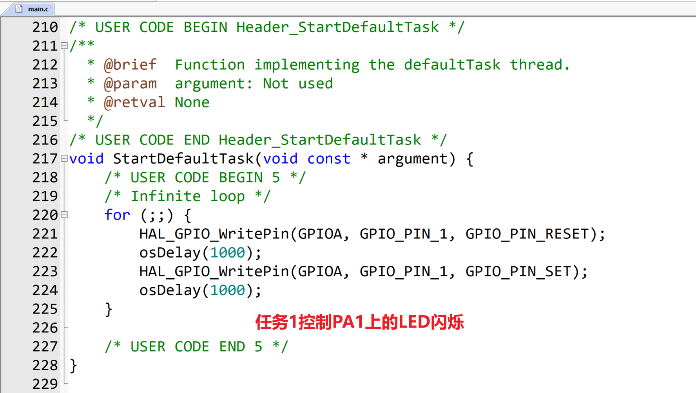

*图7.2-9HAL库集成FreeRTOS-图9*

随后，再把下面的代码复制到**任务2**的，Begin和End之间（死循环内部）。

```c
HAL_GPIO_WritePin(GPIOA, GPIO_PIN_2, GPIO_PIN_RESET);
osDelay(1000);
HAL_GPIO_WritePin(GPIOA, GPIO_PIN_2, GPIO_PIN_SET);
osDelay(1000);
```

如下图所示：

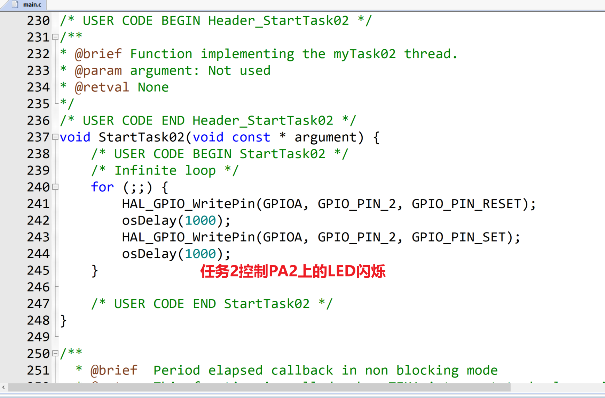

*图7.2-10HAL库集成FreeRTOS-图10*

如此，代码写完后，我们编译工程，然后烧录代码，查看实验的现象。

**注意，还是不要忘记了，HAL库的工程并不会默认开启“烧录自动复位”功能。**

---
