# FreeRTOS讲义（卷二）

> 拆分自 `2_FreeRTOS讲义汇总.md / 卷二`，共 6 份 PDF 讲义。所有插图保存在 `FreeRTOS_assets/` 目录，请保持相对位置不变。

## 目录

- 01 STM32内存映射

- 02 任务的内存布局

- 03 两种创建任务的方式

- 04 任务列表

- 05 获取任务信息API

- 06 临界区

---

## 01 STM32内存映射

### 1. 前言

在上一阶段的课程中，我们对 FreeRTOS 中的任务是这样理解的：

1. 任务是 FreeRTOS 进行资源分配的基本单元，每一个任务都拥有一套相对独立的内存空间；
2. 任务是 FreeRTOS 进行 CPU 调度的基本单元，调度器通过在不同任务之间切换，实现 CPU 的合理使用。

那么聪明的你，想必已经产生了很多疑惑：

1. **任务所拥有的“独立内存空间”究竟包含哪些内容？**
2. **任务之间切换时，上下文又是如何被保存与恢复的？**

要想搞清楚这些问题，我们就要从STM32的内存映射机制入手，来看一看STM32的内存使用究竟是一个什么情况。

### 2. 什么是内存映射

STM32 单片机是一台微型计算机，麻雀虽小、五脏俱全，CPU、存储器、外设等核心组成部分一应俱全。

在整个系统中，CPU 处于核心控制地位：

1. 无论是程序的执行、数据的读写，
2. 还是对 GPIO、USART、SPI 等外设的操作，
3. 最终都必须由 CPU 来完成。

那么问题就来了：

1. CPU 本身不可能直接“认识”外设
2. CPU也不可能知道某一次操作到底是操作SRAM内存，还是Flash闪存
3. 亦或者是操控某个外设

**CPU 唯一能够识别和使用的东西，只有——地址。**

为了让 CPU 能够统一、有效地管理整个片上系统。

STM32 引入了一个极其重要的核心机制：**内存映射（Memory Mapping）。**

**所谓内存映射，就是将片上存储器和外设的寄存器，统一映射到同一片连续地址空间中。**

**使 CPU 可以通过访问指定地址的方式，来完成对内存或外设的各种操作。**

从 CPU 的角度来看：

**访问操作RAM 和Flash这种存储器，亦或者访问操作外设寄存器，都只是访问这段连续映射空间的某个地址罢了。**

CPU 并不需要区分这些地址背后连接的是哪一类硬件，所有硬件层面上的差异，都由芯片内部的构造和设计自动来完成解析。

这正是 STM32 采用内存映射机制的核心意义。

实际上，不论是 STM32 这类单片机，还是传统的通用计算机系统，底层都采用了内存映射（Memory-Mapped）的设计机制。

通过这种机制，CPU 可以使用统一地址来访问 RAM、Flash 以及各类外设资源。

可以说，内存映射已经成为现代计算机体系结构中一种必不可少、且被广泛采用的资源管理机制。

**当然，单片机毕竟要简陋简单很多。**

STM32的内存映射机制是直接暴露给程序员的，程序员可以直接看到。

而通用计算机这些底层细节，被操作系统封装是看不见的。

我们所使用的单片机是STM32F103C8T6，打开《数据手册》，找到内存映射章节。

首先映入眼帘的就是下面这张图：

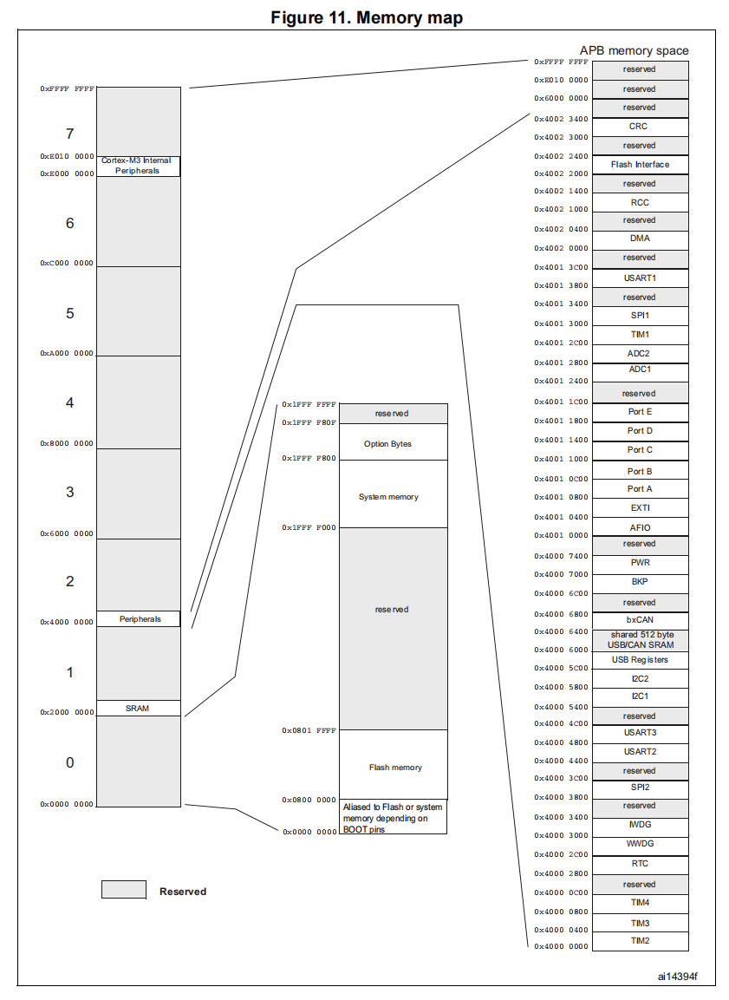

*图2-1STM32存储器映射-图*

下面，我们来详细解释一下这张图。

### 3. STM32F103系列中等密度芯片内存映射

从上面的内存映射图中可以看到：

**STM32F103 系列中等密度芯片的整体内存映射布局，以及各类存储区域和外设在地址空间中的分布情况。**

当然，这张图还展示了STM32F103中等密度芯片所集成的外设。

所以如果你想知道STM32F103C8T6具体有哪些片上外设，除了查引脚定义表，查这一张图也是可以的。

#### 3.1 总地址空间

STM32是32位单片机，这不仅意味着寄存器是32位的，其地址空间也是32位的。

从图中可以看到，内存映射的地址范围是：

0x0000_0000 ~ 0xFFFF_FFFF**每一个地址对应1个字节，总共4GB的连续地址空间。**

当然，这 4GB 的地址空间只是“逻辑上的映射空间”，并不等同于芯片中真实存在的物理存储容量。

实际上，STM32F103C8T6只有64KB的Flash闪存容量，以及20KB的RAM内存容量。

也就是说，在这整整 4GB 的地址空间中，只有极小的一部分被实际的存储器和外设所占用。

并且从图中，我们可以明显看出，这4G的映射地址空间，一大部分都是保留空置的。

#### 3.2 Flash映射区域

在内存映射图中可以看到如下地址范围：

0x0800_0000 ~ 0x0801_FFFF这属于单片机Flash闪存映射的内存区域。

可以计算一下，这段区域的大小是：128KB上面已经讲过了，这张图是STM32F103系列中等密度（64~128KB）芯片的内存映射，所以图中展示的是128KB的Flash闪存容量。

我们所使用的STM32F103C8T6只有64KB的Flash闪存容量，实际映射区域是：

**0x0800_0000 ~ 0x0800_FFFF**Flash 闪存主要用于存储以下内容：

1. 工程编译后生成的程序代码（指令）
2. 程序中使用的只读常量数据

特点是：掉电不丢失，但不能像SRAM那样随意写（擦除写入，只能将1写成0）

单片机在运行程序时，CPU 正是从 Flash 闪存中，顺序读取下一条需要执行的程序指令并加以执行。

#### 3.3 SRAM映射区域

STM32F103 系列芯片，其 SRAM 的映射起始地址是：

0x2000_0000再加上，STM32F103C8T6的实际SRAM容量是20KB。

**所以STM32F103C8T6 的 SRAM 实际有效映射范围是：**

**0x2000_0000 ~ 0x2000_4FFF**SRAM可以理解成通用计算机的内存，存储以下内容：

1. 全局变量
2. 静态变量
3. 栈
4. 堆

特点是：断电即失，速度快，随意读写，容量小。

SRAM是程序运行时，用于保存运行时数据的区域，是程序运行的“施工现场”。

无论是裸机应用，还是基于FreeRTOS，运行时产生的数据都需要放入SRAM中。

**从这个角度出发，任务的内存分配必然是在SRAM中进行的。**

#### 3.4 其余外设映射区域

从图中，以下面地址开头的映射区域：

0x4000_0000 ~就是各类外设的寄存器映射地址。

在STM32阶段，我们讲过基于寄存器的开发方式，实际上已经使用过外设寄存器地址了。

除此之外，还有一块小区域，也可以留意一下：

图中靠左上的一块区域，起始地址是：

0xE000_0000 ~标注为**Cortex-M3 Internal Peripherals**这些地址区域，就是内核外设的寄存器映射区域。

比如NVIC、SysTick等组件的寄存器映射。

### 4. STM32的CPU内核寄存器

在前面学习 STM32 内存映射时，我们已经明确了一点：

CPU 通过访问映射地址来使用 Flash、SRAM 和各类外设。

但需要注意的是，CPU 并不仅仅是一个“访问内存的机器”。

**CPU 的核心职责是进行运算，按照程序指令的顺序完成一系列计算与控制操作。**

在指令执行的过程中，CPU 需要频繁地：

1. 暂存正在参与运算的数据
2. 保存中间计算结果
3. 记录当前执行到哪一条指令
4. ...

如果这些数据都通过访问 SRAM 来完成，不仅效率低下，也无法满足指令执行过程对速度和时序的要求。

因此：

**在 CPU 内部，还存在着一组速度最快、距离运算单元最近的存储单元，用于辅助指令的执行与运算过程，这些存储单元，便是 CPU 内核寄存器。**

简单来说：

内存（Flash / SRAM）解决的是“数据和程序放在哪”的问题而 CPU 内核寄存器解决的是“指令如何被高效执行”的问题。

在 STM32 所采用的 Cortex-M 内核中，这些寄存器由内核直接管理。

既不属于 Flash，也不属于 SRAM，而是 CPU 内部结构中不可或缺的一部分。

需要注意的是：

**CPU内核寄存器属于CPU的一部分，由CPU直接管理，所以就不再需要映射地址空间了。**

#### 4.1 内核寄存器的分类

我们可以使用Keil5软件的调试模式，随便调试一段普通代码（不引入FreeRTOS）

如下图所示：

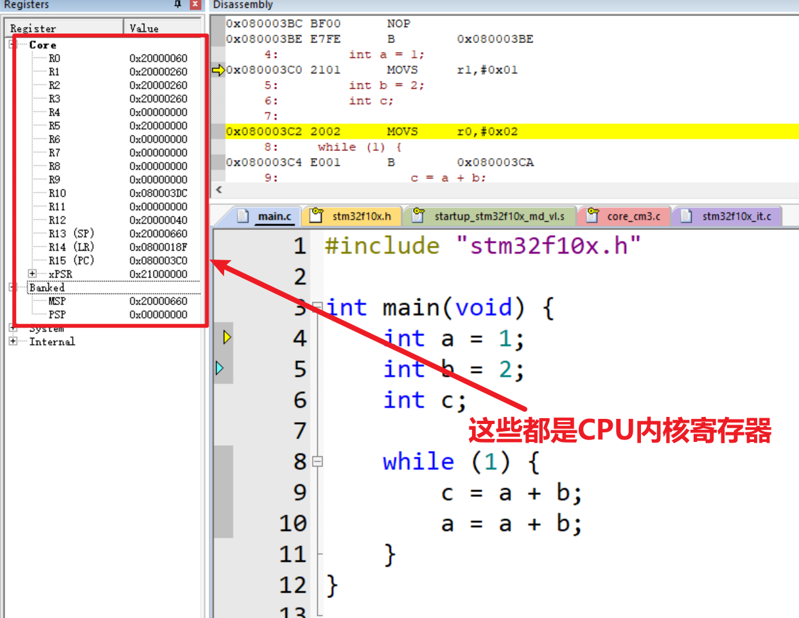

*图4.1-1内核寄存器的分类-图*

**其中，R0 ~ R12 这13个寄存器，被称之为“通用寄存器”，用作：**

1. 保存临时数据
2. 保存运算结果
3. 存放函数参数和返回值
4. ...

在 C 语言层面：

1. 所有的局部变量
2. 所有的中间计算结果

最终都会被编译器安排到这些寄存器中使用。

你可以用下面这段代码，来演示一下通用寄存器的作用：

```c
#include "stm32f10x.h"

volatile int result = 0;

int main(void) {
    int a = 10;
    int b = 20;
    int c = 30;
    int d = 40;
    // 使用一下这些变量，避免被编译器优化去掉
    result = a + b + c + d;
    while (1) {
    }
}

```

可以把断点打在第一行，然后进入调试模式，查看通用寄存器的取值变化。

**R13 ~ R15这三个属于特殊寄存器：**

**第一个特殊寄存器：SP寄存器。**

SP（Stack Pointer，栈指针），SP 用来指向，当前正在使用栈的栈顶地址。

1. 在不引入RTOS的情况下，系统只有一条执行路径，SP就始终指向SRAM中栈的栈顶，也就是**主栈（Main Stack）**的栈顶。
   - a. 如果你仔细看图的话，会发现下面还有一个MSP，这就是MSP（Main Stack Pointer）主栈栈指针。
   - b. 可以看到图中，它的值和SP是一样的，因为当前工程只是一个标准库工程，只存在主栈，SP就是MSP。
2. 如果引入RTOS，系统中存在多任务，每个任务都有自身独立的任务栈。
   - a. CPU 在运行某个任务时，SP 会指向当前正在执行任务的**任务栈栈顶**。
   - b. 此时SP将会和图中的“PSP（Process Stack Pointer）”保持一致。（当前PSP是空的，因为系统中不存在任务）
   - c. PSP直译过来是“进程栈指针”，但在RTOS场景下，应该把它理解成TSP（Thread/Task Stack Pointer），建议直接理解成任务栈指针。
3. 关于SP、MSP、PSP三个栈顶指针，待到下一章节讲完任务的内存布局后，我们再详谈。

**第二个特殊寄存器：LR寄存器。**

LR（Link Register，链接寄存器），是内核中的一个特殊寄存器。**作用是在函数调用过程中保存返回地址。**

具体来说，当发生函数调用时：

1. CPU 会将函数调用点之后的下一条指令地址保存到 LR 寄存器中
2. 被调用函数执行完毕后，通过 LR 中保存的地址返回到调用点，继续执行后续指令

因此，在函数调用的场景下，LR 中保存的是一条程序指令的地址。

而程序指令都存储在Flash闪存中，正如图中所示：

LR寄存器，存储的地址是：0x0800_xxxx这正好位于 Flash 闪存的映射地址范围内，说明 LR 指向的是一条存放在 Flash 中的程序指令。

**第三个特殊寄存器：PC寄存器。**

PC（Program Counter，程序计数器），作用是在程序运行时，保存下一条将要执行指令的地址。

程序能顺序执行、跳转、循环，本质上都是 PC 的变化。

**PC 决定了 CPU 下一步“干什么”。**

三个特殊寄存器的下面，还有一个xPSR寄存器，该寄存器用于保存 CPU 的运行状态信息，可以通过该寄存器了解CPU是否正常工作。

对于一般应用层程序员而言，该寄存器不需要深入了解。

#### 4.2 CPU与SRAM的数据交互

在程序运行过程中，CPU 并不会直接在 SRAM 中对数据进行运算。

例如：

```c
int num = 10;
num++;
```

实际执行过程可以简单理解为：

CPU 先从 SRAM 中，把变量 num 的值读入某个通用寄存器（如 R0）

CPU 在通用寄存器中完成 +1 运算CPU 再将运算后的结果，从通用寄存器写回到 SRAM 中 num 对应的位置也就是说：

SRAM 负责存数据，CPU 负责算数据，而内核寄存器充当CPU运算过程中的“草稿纸”，用于保存临时数据。

### 5. 上下文切换的原理

经过前面的讲解，大家已经对**STM32 的内存映射机制**以及**CPU 内核寄存器**有了基本认识。

在此基础上，我们就可以进一步深入，来讲解**上下文切换（Context Switch）**的工作原理。

#### 5.1 什么是上下文

首先，我们要解释一下什么叫上下文（Context）。

**所谓上下文（Context），也称为 CPU 的执行上下文，指的是某一时刻 CPU 内部整套寄存器所保存的数据状态。**

说得通俗一些：

CPU 内核寄存器中那一整套寄存器的取值，就完整描述了 CPU 在某一时刻的执行状态。

**这一套通过寄存器快照，所描述的CPU运行状态，就是上下文。**

#### 5.2 上下文切换要做什么

以FreeRTOS为例，在多任务系统中，CPU 并不是只为某一个任务服务，而是在多个任务之间不断切换执行。

当CPU切换到另一个任务时，考虑到可能重新回到该任务：

所以不可能直接不管不顾，直接切换CPU。

当 CPU 从一个任务切换到另一个任务时，必须完成上下文的切换：

需要先保存旧任务的上下文状态，然后再切换CPU，并且在任务需要重新上CPU时，恢复上下文状态。

#### 5.3 上下文切换的基本流程

我们以两个任务 A 和 B 为例，来看上下文切换是如何发生的。

当 CPU 正在执行任务 A 时，如果任务 A 因故进入阻塞状态，CPU就需要切换到另一个可运行（就绪态）的任务B。

此时需要做任务A的**上下文保存**：

1. 将当前通用寄存器（用到的部分）、SP、LR、PC 等关键寄存器的值
2. 写入到SRAM中一块**该任务的专用区域**内。

完成任务 A 的上下文保存后，任务B上CPU：

1. CPU 的寄存器内容被切换为任务 B 对应的寄存器状态，也就是将B任务保存的上下文信息恢复到CPU中。
2. CPU 开始执行任务 B 的函数指令。

如果任务 B 在执行过程中也进入阻塞状态：

1. 同样需要将任务 B 当前的寄存器状态
2. 保存到 SRAM 中，完成一次新的上下文保存。

假如任务A此时结束阻塞，进入就绪态，于是调度器就会让任务A上CPU：

1. CPU 会从 SRAM 中，将之前保存的**任务 A 的寄存器数据**读回；
2. 覆盖当前 CPU 内核寄存器的内容；
3. **CPU 从任务 A 上一次被切换的位置继续执行。**

这就是**上下文恢复**的过程。

在系统运行过程中：

1. 任务 A、任务 B、甚至更多任务
2. 会不断经历**保存上下文 → 恢复上下文**的过程

从而实现多任务“并发”运行的效果。

#### 5.4 总结

上下文切换过程，可以概括为三个核心步骤：

1. **保存当前任务的上下文：将当前任务运行时寄存器中的关键内容保存到SRAM中，本质上就是把当前任务的运行现场保存到 SRAM 中。**
2. **切换当前任务对象：调度器根据就绪任务情况，选择下一个要运行的任务，这个过程由FreeRTOS任务调度器基于调度机制完成。**
3. **恢复新任务的上下文：从SRAM中找到新任务的上下文信息，恢复到 CPU 寄存器中，使 CPU 从该任务上次暂停的位置继续执行；**

总之，所谓上下文切换，本质上就是：

**总之，所谓上下文切换，本质上就是 CPU 在不同的寄存器快照之间来回切换，而这些寄存器快照都保存在SRAM中。**

#### 5.5 思考

在 FreeRTOS 系统中，任务往往不止一个。

这也意味着，系统在运行过程中，可能需要在不同任务之间频繁进行上下文切换。

而在上下文切换过程中：

**每一个任务，都需要将当下 CPU 寄存器中的瞬时状态（快照），保存到 SRAM 中，以便后续能够准确恢复。**

那么问题就来了：

多个任务，能否把各自的上下文状态，都保存到同一块 SRAM 区域中？

答案显然是否定的。

如果所有任务都把寄存器快照保存在同一个位置，那么一旦发生切换：

新任务的上下文状态，就会直接覆盖掉旧任务的上下文信息。

这样一来，之前任务的执行状态将彻底丢失，上下文保存也就失去了意义。

因此，一个非常明确的结论是：

**每一个任务，都必须拥有一块独立的、专属的 SRAM 区域，用来保存与该任务相关的运行状态和工作数据。**

那么问题又来了：

1. 任务在 SRAM 中的这块专属区域究竟长什么样？
2. 这块专属区域，究竟是如何工作的呢？

这就是下一个章节《任务的内存布局》需要讲解的内容了。

---

## 02 任务的内存布局

### 1. 前言

在前面的内容中，我们已经明确了一点：

**CPU 在进行上下文切换时，需要将寄存器中的执行状态保存到 SRAM 中。**

而在 FreeRTOS 系统中，系统往往同时存在多个任务。

为了保证每个任务在被切换回来时，都能够继续从原来的位置正确执行，这些上下文信息显然不能混在一起保存。

**因此，FreeRTOS 为每一个任务，在 SRAM 中划分出一块独立且专属的内存区域，用于保存该任务的运行状态以及相关的工作数据。**

那么，这块属于“任务”的内存区域具体包含哪些内容？又是如何组织和管理的？

这正是本章节**《任务的内存布局》**将要重点讲解的内容。

### 2. .map文件

在Keil5的STM32开发工程中，所有代码和数据在编译链接完成之后，都会被精确地放置到具体的内存地址上。

而这些“最终的内存分布结果”，都被完整的记录在一个文件当中：

**链接映射文件（.map 文件）**

在该文件中，详细列出了 SRAM 的实际分段情况，包括 .bss段、堆（Heap）、栈（Stack）。

如果系统中，使用了FreeRTOS，那么也会列出任务相关结构在内存中的占用位置和大小。

**在Keil5工程中，编译链接成功后，你可以在"工程根目录\Listings"目录下，找到该.map文件。**

通过阅读该文件，我们可以直观地看到：STM32 的 SRAM 是如何划分和使用的。

当然，FreeRTOS 中任务的专属内存布局，同样可以借助 .map 文件进行分析和验证。

### 3. 标准库工程的 SRAM 内存布局

找一个标准库模板工程，然后将以下代码，直接复制替换到mian.c文件中：

```c
#include "stm32f10x.h"

/*
 * arr 没有显式初始化，arr2 显式初始化为 0。
 * 由于它们都是初始化默认零值0，所以这两个全局变量数组会被放入.bss段
 *
 * .bss 段只在 SRAM 中占用运行空间，不需要在 Flash 中保存初始值，
 * 启动时也不需要从Flash中读取数据，直接统一初始化为默认0值。
 */
uint32_t arr[3];
uint32_t arr2[7] = { 0 };

/*
 * arr3 和 arr4 都包含非 0 初始值，是一个需要手动初始化的数组全局变量
 * 这两个全局变量数组会被放入.data段
 *
 * .data 段变量运行时在 SRAM 中，但初始值需要保存在 Flash 中，
 * 比如arr3在Flash当中保存的数据是[1, 0, 0...]
 * 启动时再从 Flash 拷贝到 SRAM，启动时会消耗一些额外的时间。
 */
uint32_t arr3[11] = { 1 };
uint32_t arr4[9] = { 2 };

int main(void) {
    // 使用一下这些数组，避免被编译器或链接器优化掉。
    arr[0] = 100;
    arr2[0] = 100;
    arr3[0] = 100;
    arr4[0] = 100;

    while (1) {
    }
}

```

编译链接完成后，找到.map 文件。

打开此文件后，一直往下面翻，就可以找到在不集成FreeRTOS的情况下，一个经典的STM32裸机应用的SRAM内存布局。

文字内容如下所示：

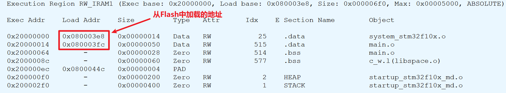

*图3-1裸机开发SRAM内存布局-图*

其中**.bss段**，是两个未手动初始化的，具有默认零值的数组，即arr和arr2数组。

其中**.data段**，是两个具有手动初始化的，需要把初始化值存入Flash，加载时再读取Flash的数组，即arr3和arr4数组。

根据这张段文字描述，我们可以画出以下，SRAM内存分段布局：

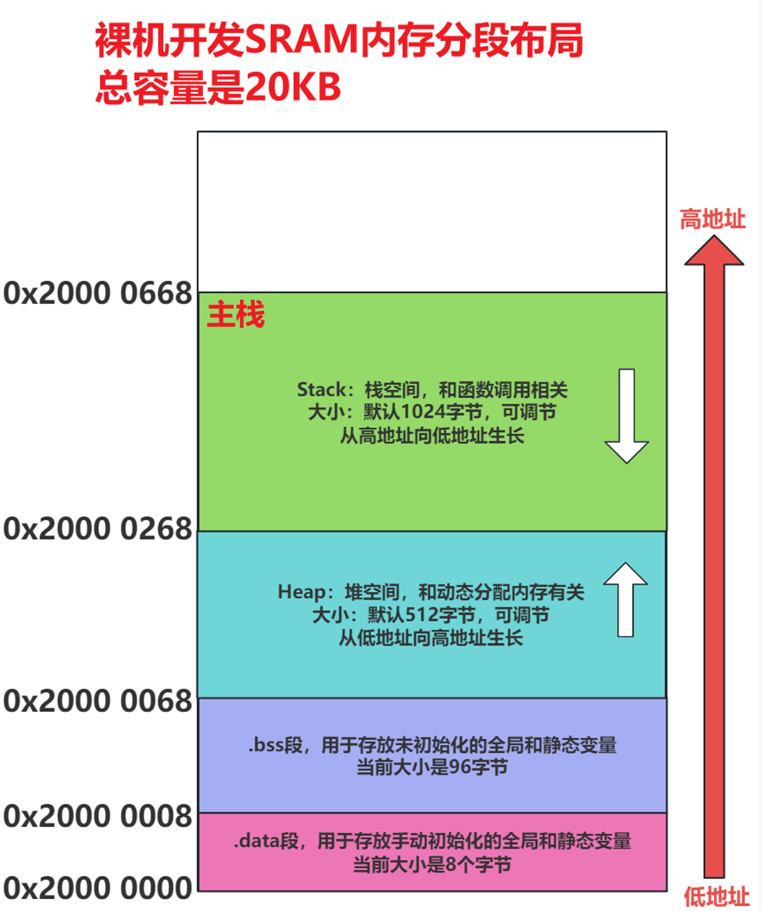

*图3-2裸机开发SRAM内存布局-图2*

其中.bss段和.data段共同组成了SRAM中的全局和静态变量区域。

下面来逐一讲解这些区域。

#### 3.1 全局和静态变量区域（数据段）

.bss段和.data段共同组成了SRAM中的全局和静态变量区域。

这两个段在命名时，比较显著的特点就是：名字的前面都存在一个"."点，这个点有用吗？

当然是有用的：

1. 这个点表示这两个段都属于链接器管理的内存区域。
2. 链接器会在链接阶段，自动根据工程中使用全局和静态变量的情况，自动分配这两个段的大小。
3. 如果使用的全局和静态变量多，就会分配大一些，反之则会分配小一些。

在之前讲解进程的虚拟内存空间时，我们讲过数据段，用于存放全局和静态数据。

实际上数据段也可以进一步分段，即.bss段和.data段。

那么.bss段和.data段的区别是什么呢？

它们是有明显区别的。

##### 3.1.1 .bss段

**.bss段当中存储的全局或静态变量，会在系统启动时自动清零。**

所以通常来说：

1. 未手动初始化的全局或静态变量
2. 手动初始化为默认零值的全局或静态变量

都会被存放于.bss段。

比如上述代码中的：

```c
static int b;
```

它的内存空间就分配在.bss段内。

**.bss段会在系统启动时自动清零，这也是未手动初始化的全局和静态变量，仍然具有初始化零值的原因。**

##### 3.1.2 .data段

**.data 段用于存放已手动初始化的全局变量和静态变量。**

比如上述代码中的：

```c
int a = 10;
```

变量 a 是一个已初始化的全局变量，因此它的运行时内存空间会被分配在 .data 段中。

手动初始化的全局变量和静态变量，具有一个显著特点是：

在程序启动时，它们就应当被初始化为初始值。

比如上面的a变量，它的初始化值是10这就意味着：

**在系统启动时，必须将初始值赋值给存储在.data段中的全局和静态变量。**

那么问题来了：

系统启动的时候，去哪里找这个初始值呢？

如果这个初始值不存储起来，找得到它吗？

显然，手动初始化的全局和静态变量，其初始值需要找一个位置存储起来。

存在哪里呢？

实际上存在了单片机的Flash闪存中。

因为Flash闪存主要的作用就两个：

1. 存放程序的代码指令
2. 存放只读常量，比如手动初始化的全局和静态变量的初始值。

因此，对于存放在 .data 段中的变量，系统在启动阶段会执行如下操作：

**将 Flash 中保存的初始值，拷贝到 SRAM 中对应的 .data 段内存区域。**

这一步操作，通常由启动代码在进入 main() 函数之前自动完成。

讲到这里，你就会发现，一个手动初始化的全局或静态变量，它其实占用了两片存储空间：

1. 常量初始值，存放在 Flash 中
2. 自身内存空间，在SRAM的.data段中

##### 3.1.3 一个小思考

请查看下面的代码：

```c
// num和num2都是全局变量
int nums[1000] = { 1 };
int nums2[1000] = { 0 };
```

这两句代码，从最终执行的效果来看，区别不大，只不过第一个数组的首元素是1，第二个数组的元素全部都是0。

但这两个全局变量数组，在数据段上的存储位置却是不同。

**nums全局变量会存放在.data段中，会额外占用Flash存储空间，加载时需要读取Flash，需要额外的加载拷贝时间。**

**但nums2全局变量会存放在.bass段中，不会占用额外的Flash空间，无需从Flash中加载数据。**

你搞懂它们的区别了吗？

#### 3.2 堆区域（HEAP）/C库堆

SRAM中的堆，和我们以往认知中的堆，作用都是一致的。

**堆（HEAP）是一块用于手动动态内存分配的内存区域。**

堆通常在.bss之后（高地址），随着使用，堆空间会从低地址向高地址“生长”。

默认情况下，堆的大小是512字节。

堆空间的大小是可以手动调节的，打开启动文件，在汇编代码的最上面。

如下图所示：

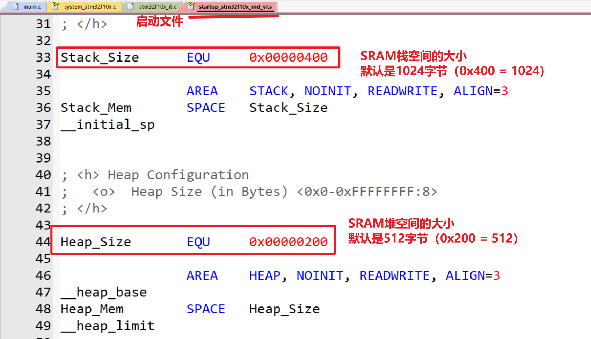

*图3.2-1手动调整堆和栈的大小-图*

对于STM32中堆的使用，我们还是和之前保持一样的态度：

**堆尽量不要使用！（即便集成FreeRTOS，此观点依然保持不变）**

在 STM32 中，一旦使用堆，如果出现问题，将会非常隐蔽（STM32中没人会告诉你到底怎么回事）

甚至很多关于堆的问题，一旦出现，难以复现，更不用说去进行调试解决。

总之，使用堆，收益不明显，风险却很高。

并且在绝大多数 STM32 应用场景中，也很少会遇到**非用堆不可**的情况。

因此，在实际编程中，如果遇到需要申请内存并在多个地方共享使用的场景。

应优先考虑使用全局变量或静态变量，而不是依赖堆内存。

这里讲到的**堆**，其作用非常明确：

它主要用于配合 malloc、calloc、free 等 C 语言标准库函数，完成动态内存的申请、使用与释放。

为了避免与后续将要讲到的**FreeRTOS 内核堆**产生混淆，同时也为了更明确的体现它的作用：

**我们将这个堆，称之为“C库堆”。**

#### 3.3 栈区域（STACK）/主栈

在裸机开发的前提下，SRAM中的栈，主要用于：

1. 函数调用时保存局部变量
2. 函数嵌套调用时保存返回地址，以便函数调用结束后，返回调用点。

3. 在裸机开发的前提下，栈还用于在中断响应过程中保存上下文信息，以及保存中断处理函数执行过程中产生的相关函数调用数据。

除此之外，STM32中的栈，和以往我们使用过的通用计算机编程中的栈，没有什么区别：

1. 先进后出，后进先出
2. 生命周期自动管理，自动创建，自动销毁
3. 性能高，效率快
4. 从高地址向低地址生长

**正因为如此，栈是嵌入式系统中最安全、也是最可靠的一种内存使用方式。**

当然，在通用计算机中编程时，栈也具备这种特点。

注意，在裸机开发的前提下，整个系统只有一个CPU，只能一条执行路径永远执行下去。

**在裸机开发的前提下时，整个系统只有一个栈，也就是我们前面讲过的主栈。**

在 STM32 中，主栈由 MSP（Main Stack Pointer）寄存器进行管理，该寄存器中存储的，是当前主栈的栈顶地址。

注意事项：

主栈的大小也是可以手动调整的，如下图所示：


*图3.3-1手动调整堆和栈的大小-图*

在裸机开发的前提下，可以根据实际需求，适当将栈设置得大一些。

毕竟在不使用 RTOS 的情况下，SRAM 的使用相对宽松，栈空间过小反而更容易埋下隐患。

需要特别强调的是：

栈是我们日常开发中使用频率最高的一块内存区域，同时也是最容易被忽视的一块内存区域。

**在使用栈时，必须时刻警惕栈溢出问题。**

例如，在main函数中写下如下代码：

```c
char buf[1024 * 30];
```

这句代码写下后，编译链接烧录，一气呵成，没有任何问题。

真的没有问题吗？

显然是有的，buf数组占的空间太大了，别说栈溢出了，整个SRAM都装不下它。

但是我们没有看到任何警告，更没有报错，也没有任何提示。

甚至，原本工程的点灯代码依然执行成功了，LED依然被点亮了。

这说明什么呢？

这说明在 STM32 编程中，一旦发生内存空间使用越界或溢出：

1. 系统不会告诉你哪里错了
2. 程序的行为也将变得完全不可预测

**可能“现在看起来没事”，但地雷已经埋下，什么时候爆炸，全凭运气。**

**因此，在使用任何一类内存空间时，都必须对其空间占用情况有清晰认知，合理规划资源。**

尤其是栈，因为栈用的是最多的，也是最容易产生栈溢出的。

一旦发生栈溢出，程序的行为是完全未知的，测试阶段可能毫无异常，上线后却给你来一次“大的”。

如果出现这种情况，那就只能自求多福了~看到这里，你可能会产生这样的一个问题：

栈在使用时，需要严格考量空间占用，避免出现栈溢出那我如何来估算栈的当前大小呢？

如果你能产生这样的疑问，说明你是一个善于思考的优秀学习者。

但考虑到目前我们的代码量比较少，所以我们把这个问题放到后面，再来给大家讲解。

### 4. 引入 FreeRTOS 后的 SRAM 内存布局

下面我们以**前面已经创建并使用过的一个 FreeRTOS 工程**为例进行说明。

该工程中包含**两个任务**，用于演示多任务运行场景。

代码如下：

```c
#include "stm32f10x.h" // STM32F10x 标准外设库头文件

#include "FreeRTOS.h" // FreeRTOS 核心头文件
#include "task.h" // FreeRTOS 任务相关 API

// 任务1入口函数
void task1(void *arg) {
    while (1) {
       vTaskDelay(1);
    }
}

// 任务2入口函数
void task2(void *arg) {
    while (1) {
       vTaskDelay(1);
    }
}

int main(void) {
    // 1. 创建任务1
    xTaskCreate(task1, "Task1", configMINIMAL_STACK_SIZE, NULL,tskIDLE_PRIORITY + 1,NULL);

    // 2. 创建任务2（与任务1优先级相同）
    xTaskCreate(task2, "Task2", configMINIMAL_STACK_SIZE, NULL,tskIDLE_PRIORITY + 1,NULL);

    // 3. 启动 FreeRTOS 调度器
    vTaskStartScheduler();

    // 理论上不会运行到这里
    while (1) {
    }
}

```

注意，最好保持代码一致，否则查看map文件的内存布局可能会不同。

在完成工程的**编译与链接**之后，进入工程目录下的 Listing 文件夹，找到链接器生成的.map 文件。

往最下面翻，就可以看到如下图所示的SRAM文字内容布局：

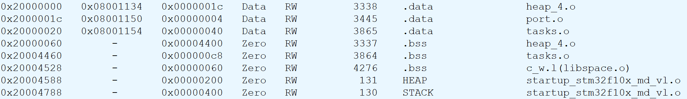

*图4-1引入FreeRTOS后SRAM内存布局-图*

根据这段文字描述，我们可以画出如下图所示的SRAM内存分段布局：


*图4-2引入FreeRTOS后SRAM内存布局-图2*

集成FreeRTOS后，内存布局就要复杂一些，我们逐一分段进行讲解。

仍然从低地址向高地址进行讲解。

**备注：**

**某个任务的TCB与任务栈，在内存中实际上并不是“连续的一整块”。**

或者说，FreeRTOS不会保证某一个任务的TCB和任务栈，在内存空间使用上必然连续。

你可以这么理解：

FreeRTOS在创建任务时：

1. 一次malloc用于分配任务栈的内存区域
2. 另一次malloc用于分配TCB的内存区域。

既然是两次不同的malloc内存分配，那么大概率来说这两片空间是不连续的。

**但是从逻辑上而言，某个任务的TCB和任务栈，同属于一个任务，将它们画在一起便于理解，也并没有错误之处。**

#### 4.1 .data段

.data段用于存储已手动初始化的全局变量或静态变量。

需要注意的是：

我们自己的代码中是没有这种变量的，说明这些已初始化的全局或静态变量，来自FreeRTOS 的源码。

.data段中的数据，在编译阶段会将“常量初始化值”存放在 Flash 闪存中。

当系统上电启动时，启动代码会负责将这些初始化值，从 Flash 拷贝到 SRAM 中对应的.data 段区域。

从而保证程序一开始运行时，这些变量就已经具备正确的初始值。

下面我们先看一下图中的堆和栈，.bss段我们放到最后再讲。

#### 4.2 C库堆和主栈空间

关于 C 语言库堆，这里不再赘述。

总的来说，在嵌入式系统中，并不推荐使用C库堆，而且在大多数场景下，也并不存在“非用不可”的理由。

相比之下，主栈空间（MSP）仍然是一个非常重要且高频使用的内存区域。

在系统启动阶段，以及在进入 FreeRTOS 调度之前：

1. **程序仍然使用主栈（MSP）来完成函数调用。**
2. 例如在main函数执行之前，单片机启动阶段的一系列函数调用（如系统初始化等），都是在主栈中完成的。
3. 在调用vTaskStartScheduler()启动调度器之前，main函数本身的执行过程也都是在主栈上完成的。

因此，在 FreeRTOS 调度器启动之前，主程序的执行流程仍然完全依赖主栈完成。

当 FreeRTOS 任务调度器启动之后，主程序通常不会再继续执行，此时主栈的主要作用就转变为处理中断相关的工作。

**在FreeRTOS运行过程中，只要产生中断，其ISR中断服务程序的调用过程一定是在主栈（MSP）上完成的，这是 Cortex-M3 内核架构所规定的行为。**

但需要注意的是：

**FreeRTOS当中的任务，一旦被切换（包括切换到任务或被中断打断），其任务的上下文信息都会被保存到任务栈当中。**

举一个例子：

1. 假设任务1正在执行，此时发生了中断。
2. Cortex-M3 内核会首先将任务1的上下文信息压入到**任务栈**中。
3. 随后处理器切换到主栈（MSP），并在主栈上执行中断服务函数。
4. 当中断处理完成后，再根据**任务栈**中保存的上下文信息恢复任务1的执行现场，继续执行任务1。

**总的来说，即使系统引入了 FreeRTOS，主栈仍然具有非常重要的作用。**

**像中断处理这样的内核级功能，中断服务程序ISR的调用，仍然必须依赖主栈才能完成。**

因此，在工程实践中，仍然需要为主栈预留足够的空间，以避免在中断嵌套或复杂中断处理场景下出现栈溢出问题。

当然，在大多数工程中，默认约 1KB 左右的主栈空间通常已经足够用于中断处理。

如果系统中为主栈预留了 1KB 的空间：

但在运行过程中仍然出现主栈不足的情况，那么往往说明中断服务程序中执行了过于复杂或重量级的操作。

**这就是设计问题，应该优化设计问题，而不是继续扩大主栈空间。**

#### 4.3 .bss段（包含FreeRTOS内核堆）

可以看到，在这张图中，整个 .bss 段所占的空间非常大。

.bss 段用于存储未初始化的全局变量或静态变量。

在 FreeRTOS 以及 SPL 库的源码中，都会存在一些未初始化的全局或静态变量，这些变量我们就不关注了。

真正需要我们关注的是：

**在整个 .bss 段中，占据绝大部分空间的是FreeRTOS内核堆。**

接下来，我们就要把注意力从 .bss 段整体，聚焦到其中这一块最核心的区域 —— FreeRTOS 内核堆。

##### 4.3.1 FreeRTOS内核堆的大小

首先我们来看一下，整个 FreeRTOS 内核堆的大小。

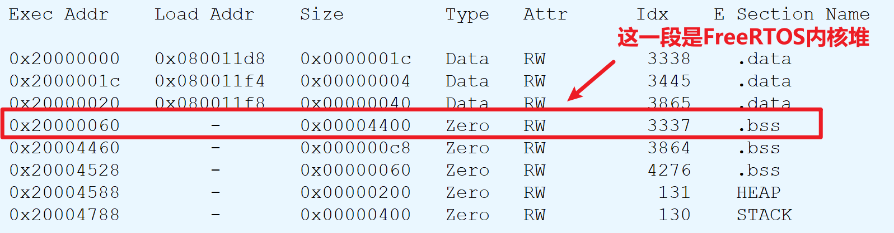

*图4.3.1-1FreeRTOS内核堆-图*

从图中可以看到，**整个FreeRTOS内核堆，当前的大小是17KB。**

那么问题就来了：

1. 这个 17KB 是怎么来的？为什么是 17KB 呢？
2. 整个 FreeRTOS 内核堆，又到底是“从哪儿冒出来的”？

FreeRTOS 内核堆本质上，其实就是一个未初始化的全局或静态变量。

所以，我们可以尝试去FreeRTOS源码中找到这个变量。

**还记得在最开始进行 FreeRTOS 移植时，我们曾经选择过一个文件，叫做 heap_4.c。**

**它的作用就是：决定 FreeRTOS 使用哪一种内存管理策略。**

在这个文件中，可以找到下面的一段代码：

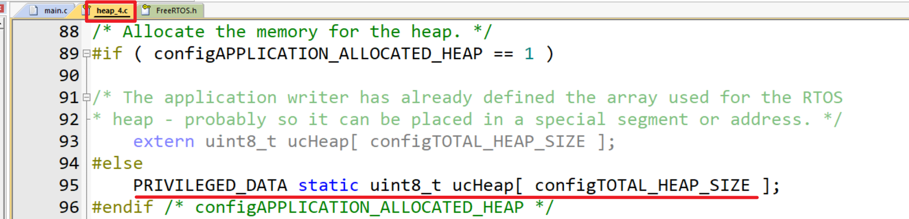

*图4.3.1-2FreeRTOS内核堆的大小-图*

其中宏configAPPLICATION_ALLOCATED_HEAP 的默认值就是0：

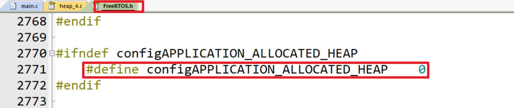

*图4.3.1-3FreeRTOS内核堆的大小-图2*

于是这一段代码，就是定义了一个静态全局变量数组：ucHeap这个全局变量数据就是FreeRTOS内核堆，这一点在.map文件中也有所体现：

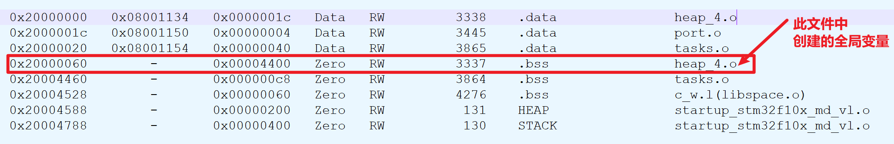

*图4.3.1-4FreeRTOS内核堆map文件-图*

而这个数组的长度configTOTAL_HEAP_SIZE ，它定义在FreeRTOS的配置文件中。

如下所示：

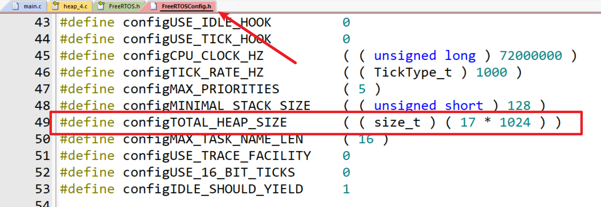

*图4.3.1-5FreeRTOS内核堆的大小-图3*

也就是说：

**FreeRTOS的内核堆，其实就是FreeRTOS源代码中，申请创建的一个大小为17KB的静态全局变量字节数组。**

##### 4.3.2 FreeRTOS内核堆的作用

前面我们已经明确了一点：

FreeRTOS 的内核堆，本质上就是一块大小固定的、由 FreeRTOS 源码主动申请创建的静态全局字节数组。

那么接下来，一个非常关键的问题就来了：

**这块 FreeRTOS 内核堆，到底是干什么用的？**

FreeRTOS 的内核堆，并不是给用户代码随意 malloc 使用的，而是专门为 FreeRTOS 内核自身服务的一块内存区域。

在当前这个学习阶段，我们可以这么看待FreeRTOS内核堆的作用：

**第一，FreeRTOS中每创建一个任务，都会在FreeRTOS内核堆上分配分配一块专属于该任务的内存区域。**

**第二，每个任务的内存区域内部，又可以再细分为两个部分：**

1. 任务栈是任务在运行过程中使用的栈，其作用与主栈类似：
   - a. 在任务执行过程中，如果出现函数嵌套调用，那么任务栈中会存储返回地址，以便于函数结束后返回调用点。
   - b. 在任务执行过程中，任务相关函数的调用栈帧以及函数中的局部变量，均存储在该任务自己的任务栈中。
   - c. **当任务被切换出去（包括切到任务或被中断打断），当前任务的运行上下文会被保存到任务栈中，以便后续恢复上下文使用。**
   - d. 任务栈的生长方向与主栈一致，均为从高地址向低地址生长。
2. 任务控制块（TCB，Task Control Block），任务控制块用于描述和管理一个任务：
   - a. 其中保存了该任务的各种关键信息。比如：任务名，任务的状态、任务的优先级、**任务栈的栈基地址、任务栈的栈顶地址**等信息。
   - b. FreeRTOS 的调度器，正是通过访问和维护这些任务控制块，才能够完成任务的切换与调度。

总得来说，当我们创建一个任务时，FreeRTOS 实际上是在内核堆中，一次性为这个任务“划出”了一整块专属空间。

这块空间内部，同时包含了任务栈和TCB（任务控制块）。

除此之外，我们在前面讲过CPU的内核寄存器，如下图所示：


*图4.3.2-1CPU的内核寄存器-图*

其中关于栈顶指针SP寄存器，其数据来源有两个：

1. **MSP（Main Stack Pointer，主栈栈顶指针）**
   - a. MSP 用于始终保存主栈的栈顶地址。
   - b. 主栈始终是存在的，即便引入FreeRTOS，main函数也仍然是要执行的。
   - c. 裸机开发时，SP就等价于MSP，因为系统中只存在主栈，没有其余栈。
2. **PSP（Process Stack Pointer，实际上的任务栈栈顶指针）**
   - a. PSP 用于记录当前正在执行任务的，任务栈栈顶地址。
   - b. 当系统引入 FreeRTOS 后，每个任务都会拥有自己独立的任务栈。
   - c. 如果FreeRTOS在多个任务之间切换，你会发现PSP存储的栈顶地址，就会在多个任务栈栈顶切换。
   - d. 在任务的执行过程中，SP等价于PSP，因为此时的栈顶是任务栈的栈顶。

### 5. FreeRTOS内核堆细节杂谈

关于FreeRTOS内核堆空间的划分和使用，我们把它从整个内存空间中单独拎出来。

得到如下图所示的结构：

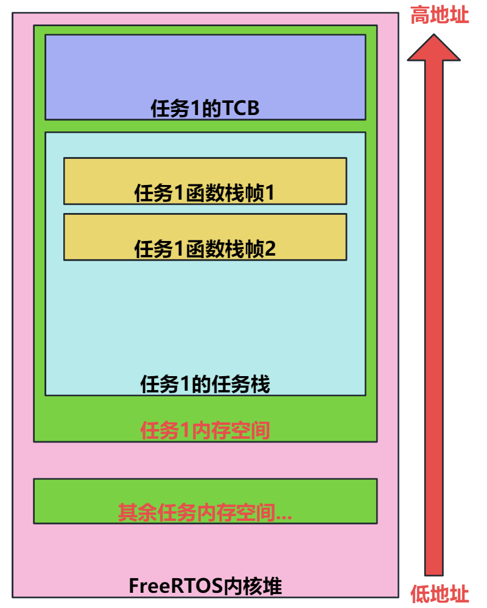

*图5-1FreeRTOS内核堆-图*

下面我们针对这张模型图，讲解一些细节上的问题。

#### 5.1 为什么叫这个名字

**第一个问题：FreeRTOS内核堆，为什么叫这个名字？**

首先，从实现和存储位置上来说，FreeRTOS内核堆其实是SRAM中.bss段，也就是存放全局和静态变量的区域。

但从使用上来说，它更具有堆的特点：

1. FreeRTOS内核，会在运行过程中按需动态分配内存给任务使用
2. 不同任务，fFreeRTOS分配彼此独立的内存空间

除此之外，FreeRTOS内核堆中还分配了每个任务的任务栈，所以在使用时它还具备栈的一些特点。

所以有些人还会把FreeRTOS内核堆，称之为**“FreeRTOS堆栈**”，也是有道理的。

总之，FreeRTOS内核：

1. 在存储实现上是“全局静态内存池”
2. 在使用和行为上，它具备堆的特点，兼有栈的使用特点。

那么把它称之为“FreeRTOS内核堆”，甚至叫做“FreeRTOS堆栈”，都是可以的。

#### 5.2 SP、PSP、MSP

**第二个问题：SP、PSP、MSP，这三个栈顶指针，它们的之间的关系是什么样的呢？**

要理解这三个栈顶指针之间的关系，首先需要明确一个前提：

**从硬件层面来说，CPU 内部真实存在的栈顶指针寄存器只有两个：MSP 和 PSP。**

SP 并不是一个独立存在的寄存器，可以将其理解为：“当前 CPU 正在使用的那个栈顶指针”的别名。

也就是说：

1. **当 CPU 使用主栈 MSP 时，SP 实际上等同于 MSP；**
2. **当 CPU 使用任务栈 PSP 时，SP 实际上等同于 PSP。**

**什么时候 CPU 使用主栈（MSP）？**

主栈会在以下场景中被使用：

1. 主栈会在系统复位启动阶段，以及异常 / 中断服务函数 ISR 自身执行过程中被使用。
2. 在 FreeRTOS 任务环境下：
   - a. **如果任务被中断打断，被打断任务的硬件自动压栈现场会保存到当前任务的任务栈 PSP 中；**
   - b. **进入 ISR 后，ISR 自身的执行过程使用主栈 MSP。**
3. 如果 ISR 执行过程中又发生中断嵌套，那么被打断 ISR 的上下文会保存到主栈 MSP 中。

因此可以得出一个结论：

MSP 是系统级、最基础的栈指针，一定会被使用，且无法被替代。

**什么时候 CPU 使用任务栈（PSP）？**

在引入 FreeRTOS 的场景下，系统中存在多个任务，每一个任务都拥有自己独立的任务栈。

当 CPU 正在运行某个任务时：

1. 所有任务函数的执行与相关函数调用
2. 均在该任务对应的任务栈 PSP 上完成

这整个过程，我们可以画一幅图来描述：

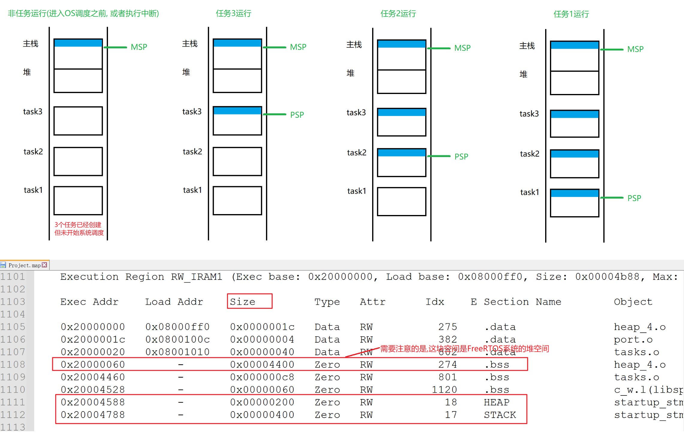

*图5.2-1双堆栈结构-图*

对于 Cortex-M3 架构的 CPU 来说：

1. 在硬件层面，同时提供了 MSP 和 PSP，用于支持两种不同用途的栈结构；
2. 在软件层面，FreeRTOS 在 C 语言库堆之外，又实现了一套属于自身的 FreeRTOS 内核堆，用于管理系统中的任务。

这种“双堆栈式“的设计，将系统内核相关的操作，与任务级别的执行逻辑进行清晰的划分。

这也是 FreeRTOS 能够在资源受限的 MCU 上，依然实现稳定多任务调度的关键原因之一。

#### 5.3 任务栈的栈基地址和栈顶地址

在 FreeRTOS 中，每个任务的 TCB 内部都会保存两个与任务栈相关的地址：

1. 一个指向任务栈的栈基地址
2. 一个指向任务栈的栈顶地址

那么，如下图所示，哪里是任务栈的栈基，哪里是栈顶呢？

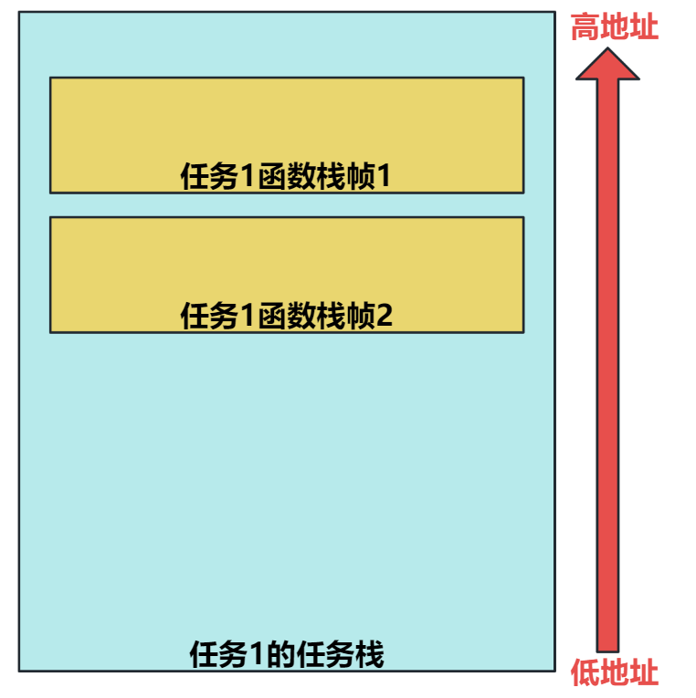

*图5.3-1任务栈结构-图*

首先我们要知道的一点是：

任务栈本质上是一段连续的内存空间。从程序员角度看，可以把这段空间视为一个数组。

**所谓栈基地址，是指这段连续内存空间的起始地址，如果把任务栈视为一个数组，那么栈帧地址也就是数组的首地址。**

那么栈基地址在哪里就一目了然了：

**栈基地址必然是整个任务栈区域的最低地址处，并且在整个任务生命周期内保持不变。**

那栈顶地址在哪呢？

**栈顶地址，也可以叫当前栈顶地址，用于指向当前已使用栈区域的最低地址位置。**

也就是上面讲的PSP、SP所指的位置。

任务栈和主栈在使用上是没有区别的，都遵循从高地址向低地址生长的规则。

因此：

1. **在任务刚创建、尚未运行时，栈顶地址位于任务栈空间的高地址端（边界附近）。**
2. **随着函数调用和数据压栈，栈顶地址会不断向低地址方向移动。**

对于上图中的任务栈而言，栈基和栈顶的位置，如下图所示：

如果任务当前未上CPU执行，任务刚刚创建还未执行时的栈顶地址和栈基地址。如下图所示：

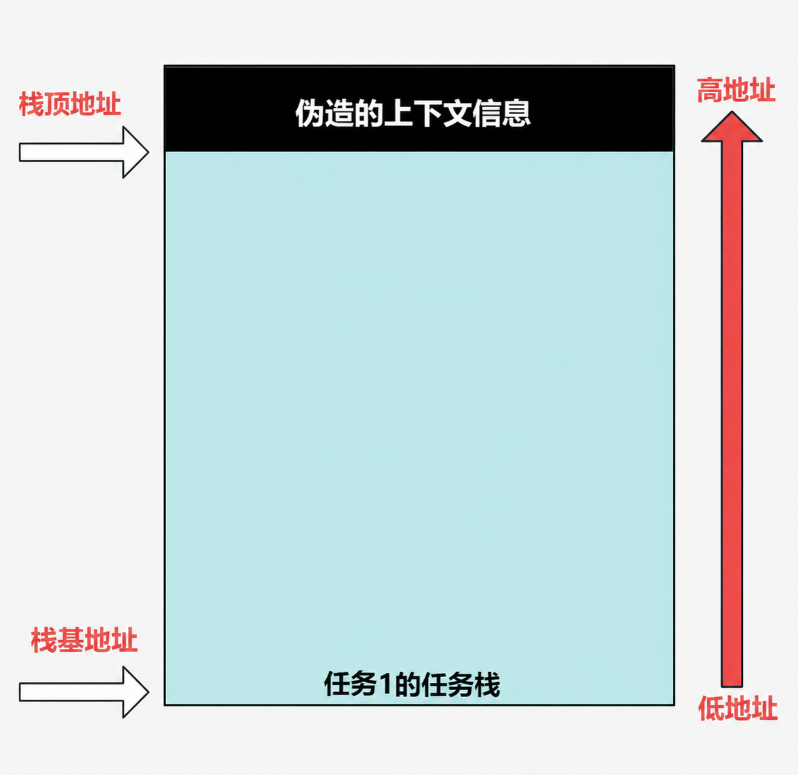

*图5.3-2任务栈结构-图2*

**其中，伪造的上下文信息，是任务在创建时由 FreeRTOS 内核预先构造好的。**

它的作用是：让任务第一次被调度上 CPU 执行时，看起来就像是从一次“上下文恢复”中返回一样，从而从任务入口函数的第一行开始执行。

**实际上，任务每次上 CPU 执行，本质上都可以理解为一次上下文恢复。**

**只不过，第一次恢复的是任务创建时预先伪造好的上下文；后续再次运行时，恢复的就是该任务上一次被切换出去时真实保存的上下文。**

如果任务已经上CPU执行，任务已经开始执行，已有函数栈帧入栈后的栈顶地址和栈基地址。如下图所示：

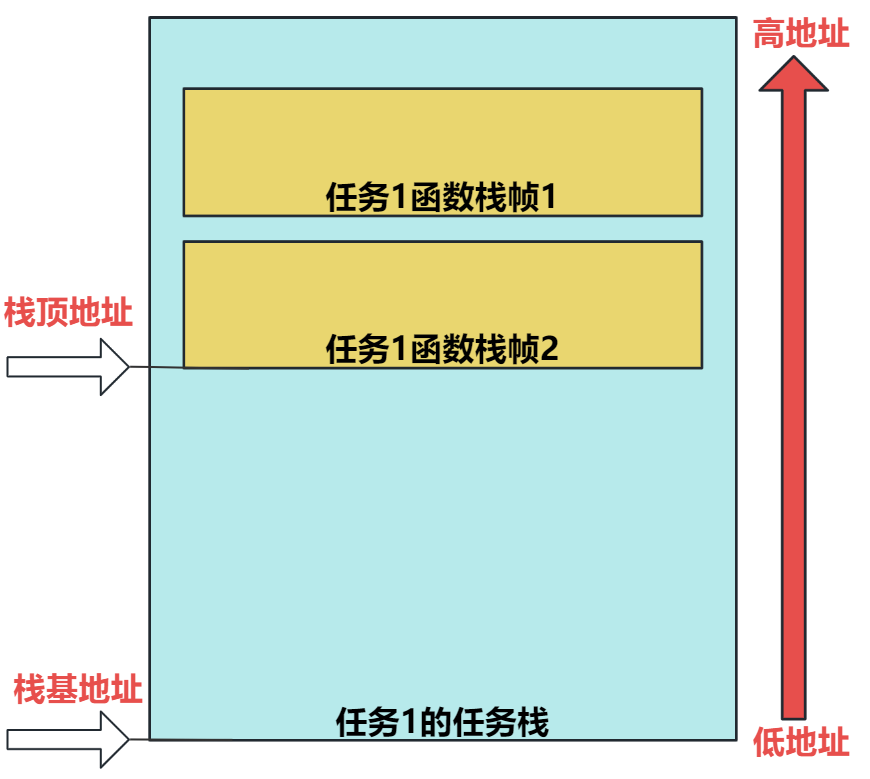

*图5.3-3任务栈结构-图3*

那么任务TCB存储这两个任务栈指针有什么用呢？

任务 TCB 中同时保存栈基地址和栈顶指针，主要是为了管理任务栈空间以及实现任务切换。

其中：

1. 栈基地址表示任务栈空间的低地址边界，在整个任务生命周期内保持不变，用于确定任务栈的范围，并用于栈溢出检测**（需要开启）**。
2. 栈顶指针表示当前任务运行时的栈顶位置，在任务切换时用于保存和恢复任务的执行现场。

因此可以理解为：

**栈基地址决定任务栈空间的边界，而栈顶指针记录当前任务执行到栈中的哪个位置。**

---

## 03 两种创建任务的方式

### 1. 准备工作：引入串口打印工具

**在正式讲解 FreeRTOS 任务的两种创建方式之前，我们先引入一套串口打印工具。**

原因其实很简单：

FreeRTOS 是一个多任务系统，一旦任务数量多了，代码就不再是“从上往下顺序执行”

的形式了。

此时如果还只靠 LED 闪烁来判断程序是否正常运行，不但信息量太少，而且调试效率极低。

因此，在后续的学习中，我们需要一种方式，能够：

1. 实时输出任务的执行信息
2. 观察不同任务是否被成功创建
3. 判断任务是否在运行、是否发生切换
4. 直观看到不同创建方式下的执行差异

**最合适、也最常用的手段，就是——串口打印调试信息。**

为此，这里我们提前封装了一套基于 USART1 的简易打印工具，提供类似 printf 的输出能力。

在后续的任务创建实验中，我们将大量使用该工具，在关键位置打印日志信息，用“看得见的输出”，来验证 FreeRTOS 行为是否符合预期。

从这一刻开始：

**串口输出 = 我们观察 FreeRTOS 内部行为的“眼睛”**

#### 1.1 参考实现代码

找到我们之前创建的FreeRTOS开发标准模板，在工程根目录下创建一个“Utils”文件夹，并添加到Keil5工程中。

然后在“Utils”目录下新增一个“DebugUSART1”模块。

具体需要创建两个文件，它们的内容如下：

**DebugUSART1.h头文件：**

```c
#ifndef __DEBUG_USART1_H__
#define __DEBUG_USART1_H__

#include "stm32f10x.h"
// 以下两个头文件中的某些函数声明，在实现printf1函数时需要用到
#include <stdio.h>
#include <stdarg.h>

/**
 * @brief 初始化调试串口 USART1
 * @note 用于调试输出，不作为通信接口使用
 */
void DebugUSART1_Init(void);

/**
 * @brief 调试打印函数（串口版 printf）
 */
void printf1(const char *format, ...);

#endif

```

**DebugUSART1.c实现源文件：**

```c
/* DebugUSART1.c
 *
 * 模块定位：
 * ------------------------------------------------------------
 * 本文件实现一个基于 USART1 的调试输出工具，
 * 用于在 FreeRTOS 实验中观察任务的创建、运行与调度行为。
 *
 * 设计原则：
 * 1) 对外仅暴露 printf1 接口
 * 2) 底层串口发送细节完全封装
 * 3) 采用阻塞式发送，逻辑直观，便于教学理解
 */

#include "DebugUSART1.h"

/* ================= 内部函数（不对外暴露） ================= */

/**
 * @brief USART1 发送单字节（阻塞式）
 * @note 仅供本文件内部使用
 */
static void DebugUSART1_SendByte(uint8_t Byte) {
    USART_SendData(USART1, Byte);

    /* 等待发送数据寄存器为空 */
    while (USART_GetFlagStatus(USART1, USART_FLAG_TXE) == RESET);
}

/* ================= 对外接口实现 ================= */

/**
 * @brief 初始化 USART1，用于调试输出
 */
void DebugUSART1_Init(void) {
    /* 1. 开启 USART1 和 GPIOA 外设时钟 */
    RCC_APB2PeriphClockCmd(RCC_APB2Periph_USART1, ENABLE);
    RCC_APB2PeriphClockCmd(RCC_APB2Periph_GPIOA, ENABLE);

    /* 2. 初始化 GPIO 引脚 */
    GPIO_InitTypeDef GPIO_InitStructure;

    /* PA9 -> USART1_TX：复用推挽输出 */
    GPIO_InitStructure.GPIO_Mode = GPIO_Mode_AF_PP;
    GPIO_InitStructure.GPIO_Pin = GPIO_Pin_9;
    GPIO_InitStructure.GPIO_Speed = GPIO_Speed_50MHz;
    GPIO_Init(GPIOA, &GPIO_InitStructure);

    /* PA10 -> USART1_RX：上拉输入 */
    GPIO_InitStructure.GPIO_Mode = GPIO_Mode_IPU;
    GPIO_InitStructure.GPIO_Pin = GPIO_Pin_10;
    GPIO_InitStructure.GPIO_Speed = GPIO_Speed_50MHz;
    GPIO_Init(GPIOA, &GPIO_InitStructure);

    /* 3. USART 参数配置：115200, 8N1 */
    USART_InitTypeDef USART_InitStructure;
    USART_InitStructure.USART_BaudRate = 115200;
    USART_InitStructure.USART_HardwareFlowControl =USART_HardwareFlowControl_None;
    USART_InitStructure.USART_Mode = USART_Mode_Tx | USART_Mode_Rx;
    USART_InitStructure.USART_Parity = USART_Parity_No;
    USART_InitStructure.USART_StopBits = USART_StopBits_1;
    USART_InitStructure.USART_WordLength = USART_WordLength_8b;
    USART_Init(USART1, &USART_InitStructure);

    /* 4. 使能 USART1 */
    USART_Cmd(USART1, ENABLE);
}

/**
 * @brief 调试打印函数（串口版 printf）
 * @param format: 格式化字符串，和printf函数的第一个参数完全一致
 * @note
 * 1. 用法与 printf 类似
 * 2. 实际输出通过 USART1 完成
 * 3. 用于 FreeRTOS 任务调试与运行观测
 */
void printf1(const char *format, ...) {
    // 初始情况下，单次发送字符串最大长度为99
    // 后续可以根据实际情况，增加buffer的容量
    char buffer[100];

    /*
       参照C语言库函数中printf函数的实现
       把 printf1("xxx", 参数...) 里的可变参数
       安全地取出来，并按格式拼成一段字符串。

       具体的实现，大家可以不了解。
    */
    va_list list;
    va_start(list, format);
    vsprintf(buffer, format, list);
    va_end(list);

    /* 逐字节输出数据到串口 */
    for (uint16_t i = 0; buffer[i] != '\0'; i++) {
       DebugUSART1_SendByte((uint8_t)buffer[i]);
    }
}

```

**给出一个测试用的"main.c"文件的代码：**

```c
#include "stm32f10x.h" // STM32F10x 标准外设库头文件

#include "FreeRTOS.h" // FreeRTOS 核心头文件
#include "task.h" // FreeRTOS 任务相关 API

#include "DebugUSART1.h" // 调试串口模块（printf1）

// -------------------- 任务1 --------------------
void vTask1(void *arg) {
    while (1) {
       printf1("task1 \r\n");
       vTaskDelay(2000); // 延时 2000 ms
    }
}

// -------------------- 任务2 --------------------
void vTask2(void *arg) {
    while (1) {
       printf1("task2 \r\n");
       vTaskDelay(2000); // 延时 2000 ms
    }
}

int main(void) {
    // 使用中断优先级分组4
    NVIC_PriorityGroupConfig(NVIC_PriorityGroup_4);
    // 1. 初始化调试串口
    DebugUSART1_Init();
    printf1("system start \r\n");

    // 2. 创建任务1
    xTaskCreate(vTask1,
               "Task1",
               configMINIMAL_STACK_SIZE,
               NULL,
               tskIDLE_PRIORITY + 1,
               NULL);

    // 3. 创建任务2（与任务1优先级相同）
    xTaskCreate(vTask2,
               "Task2",
               configMINIMAL_STACK_SIZE,
               NULL,
               tskIDLE_PRIORITY + 1,
               NULL);

    printf1("tasks created \r\n");

    // 4. 启动 FreeRTOS 调度器
    vTaskStartScheduler();

    // 理论上不会运行到这里
    while (1) {
    }
}

```

使用 printf1 与串口调试的注意事项：

1. **在调用 printf1 函数实现换行时，需要使用"\r\n"，而不是直接使用“\n”。**
2. 使用串口助手给STM32发数据时，如果发送换行符：
3. **建议使用串口工具，本身自带的发送换行符的功能。**
4. 不建议在发送框中手动输入 "\r\n" 或类似字符序列。
5. 因为你不知道这个串口工具内部究竟如何处理换行符，如果它不按照你的预期发送字符，就会出问题。
6. 如果多测试几次，尤其是将发送数据加长，很容易看到数据发送非常混乱。关于这一点，后续课程内容会进行解释。

#### 1.2 带串口调试功能的FreeRTOS标准工程

删除main.c中的一些内容，得到以下内容：

```c
#include "stm32f10x.h" // STM32F10x 标准外设库头文件

#include "FreeRTOS.h" // FreeRTOS 核心头文件
#include "task.h" // FreeRTOS 任务相关 API

#include "DebugUSART1.h" // 调试串口模块（printf1）

// -------------------- 任务1 --------------------
void vTask1(void *arg) {
    while (1) {
       vTaskDelay(1);
    }
}

// -------------------- 任务2 --------------------
void vTask2(void *arg) {
    while (1) {
       vTaskDelay(1);
    }
}

int main(void) {
    // 使用中断优先级分组4
    NVIC_PriorityGroupConfig(NVIC_PriorityGroup_4);
    // 1. 初始化调试串口
    DebugUSART1_Init();
    printf1("system start \r\n");

    // 2. 创建任务1
    xTaskCreate(vTask1,
               "Task1",
               configMINIMAL_STACK_SIZE,
               NULL,
               tskIDLE_PRIORITY + 1,
               NULL);

    // 3. 创建任务2（与任务1优先级相同）
    xTaskCreate(vTask2,
               "Task2",
               configMINIMAL_STACK_SIZE,
               NULL,
               tskIDLE_PRIORITY + 1,
               NULL);

    printf1("tasks created\r\n");

    // 4. 启动 FreeRTOS 调度器
    vTaskStartScheduler();

    // 理论上不会运行到这里
    while (1) {
    }
}

```

如此，我们就得到了一个带有串口调试模块的FreeRTOS模板工程。

在“王道嵌入式软件环境”下也提供了这样的模板工程。

### 2. 任务创建的两种方式

FreeRTOS的官网文档中，对于创建任务 - FreeRTOS™，一共有三种方式：

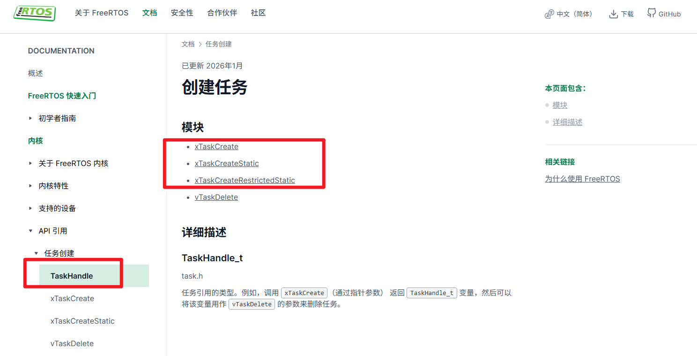

*图2-1FreeRTOS官网任务创建文档-图*

引入FreeRTOS后，STM32的SRAM内存布局如下：

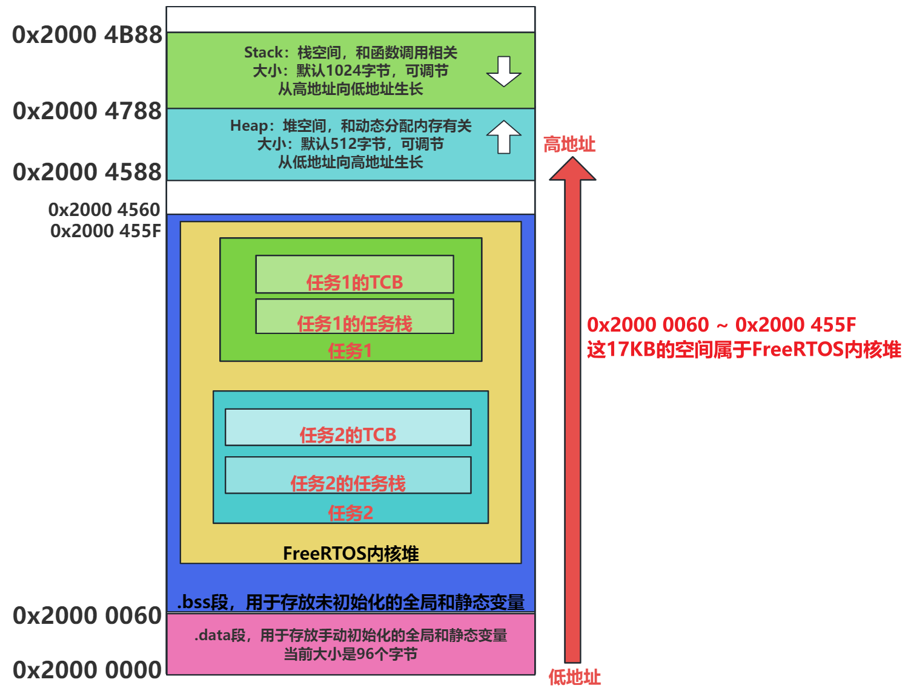

*图2-2任务的内存布局-图*

其中第三种方式，xTaskCreateRestrictedStatic函数：

在第二种方式，静态创建任务的基础上，还允许为任务额外限制可访问的内存区域。

但这种方式，只有在支持内存保护单元（MPU）的MCU上才可以使用。

STM32F1系列、Cortex-M3架构的单片机都不支持MPU功能，所以这种创建方式我们无法使用。

该种创建任务的方式，主要面向安全隔离、工业安全、功能安全认证等场景。

在绝大多数一般的嵌入式场景中，都不需要这么严密的安全保障，所以很少会用到。

下面我们主要讲解两种创建任务的方式：动态创建和静态创建任务。

1. **动态创建任务，xTaskCreate，最常用的任务创建方式，由 FreeRTOS 动态分配任务控制块和任务栈内存。**
   - a. 动态创建任务，使用简单，不需要操作任务内存分配的问题。
   - b. 任务的空间分配在FreeRTOS内核堆上，依赖FreeRTOS内核堆
   - c. 绝大多数场景都使用该函数创建任务，我们后续课程内容也主要使用动态创建任务。
2. **静态创建任务，xTaskCreateStatic，由用户提供任务控制块和任务栈内存，FreeRTOS 只负责调度，任务的内存空间由用户提供。**
   - a. 静态创建任务，使用更加繁琐，但内存空间更可控（毕竟任务的内存来源与管理都依赖程序员）。
   - b. 适合对内存确定性要求非常高的系统
   - c. 比较少用，偶尔用到。

这两种创建任务的方式，其核心的差异就在于：

**任务的内存区域由谁提供。**

具体来说：

1. 动态创建任务，任务的内存区域交由FreeRTOS在FreeRTOS内核堆上动态创建，程序员不需要操心任务内存区域的创建问题。
2. 静态创建任务，任务的内存区域交由程序员手动进行创建/分配/回收，也就是由程序员手动来管理每一个任务的内存区域。

搞明白了这两种方式的差异，那么它们的使用场景也就明朗了：

1. 大多数人都是懒鬼，况且任务的内存区域只要不出现溢出，放在哪里通常都没什么关系。所以动态创建任务是最常见的选择！
2. 如果你特别在意整个系统的内存使用确定性：
   - a. 必须明确，每一个任务在哪里分配内存，具体用多少，什么时候回收等问题
   - b. 此时，就必须手动来管理每一个任务的内存区域
   - c. 此时，就必须使用静态创建任务的方式。

总得来说，如果满足以下条件，更推荐使用静态创建任务：

1. 项目周期比较长，稳定性特别重要，优先考虑静态创建任务。如果是一个小项目，本身不过分在意稳定性，不太需要静态创建任务。
2. 系统中的任务都已经提前设计好了，不会临时改变任务。在这样确定的系统中，可以使用静态创建任务。
3. 系统中的任务不太复杂，只有少数几个任务，在方便手动管理的情况下，考虑使用静态创建任务。

当然，最后还有一个思考题，请大家思考：

###### 静态创建任务需要程序员手动创建任务的内存区域，那这个任务内存区域在哪里创建呢？

答：

FreeRTOS内核堆是动态创建方式使用的内存区域，静态创建不能使用。

C语言库堆是malloc等函数使用的区域，但我们不建议在STM32开发中使用这些函数，所以C库堆也不行。

主栈区域实际上也是不可用的，这一点我们下面会专门讲解。

那用哪里的内存区域充当任务内存区域呢？

很简单，自己创建一个静态内存区域.bss，然后把任务内存分配到自己创建的静态内存区域.bss即可。

关于静态创建任务，下面我们再详谈。

下面，我们就先来看一下动态创建任务，这种最常用的方式。

### 3. 重要的规律：FreeRTOS官方函数名命名规则

xTaskCreate和xTaskCreateStatic，是我们正式讲解FreeRTOS函数的前两个函数。

大家第一眼看到这两个函数名，想到的是什么？

我的第一印象中，在还没有想这两个函数有啥用之前，就想到了一个问题：

"TaskCreate"以及"Static"都是"见名知意"，描述函数的功能作用。

那么"x"这个前缀是什么意思呢？

如果这个前缀是完全无意义的，那么开发者这么干就有点太carzy了。

**事实上，几乎所有的FreeRTOS函数，乃至于变量名，都有这样的小写字母前缀。而不同的前缀，用以代表不同的返回值类型。**

下面列举一些常见的FreeRTOS函数名前缀，及其代表的函数。

#### 3.1 最简单的前缀形式：v

在 FreeRTOS 的命名规范体系中：

1. 以 v 作为前缀的函数，通常表示该函数没有返回值；
2. 而只要不是以 v 为前缀的函数，就通常表示该函数是有返回值的。

下面我们围绕这个规则，解释两个核心问题。

**第一，什么样的函数会被设计成没有返回值呢？**

这个问题，其实并不只是 FreeRTOS 的问题，而是一个非常典型、非常通用的工程设计问题：

**在实际工程中，什么时候该设计一个 void 返回值的函数？**

答案其实并不复杂，一句话就可以讲清楚：

如果一个函数的结果已经通过系统状态或副作用体现出来，而且调用者不需要去处理结果，处理也没有意义，那么这个函数就可以被设计成void返回值类型。

换个角度理解，只要你看到一个函数的返回值类型是 void，就是告诉你：

1. 要么这个函数压根不可能失败，只可能成功；
2. 要么函数即使失败了，你也很容易从现象上看出来，不需要再通过返回值判断；
3. 要么函数就算失败了，你也没什么补救手段，给你返回值也没有实际意义。

**所以作为程序员，看到void函数，其实应该高兴，这意味着这个函数不需要处理返回值。**

**第二，举一个典型的返回值是void，以“v”作为前缀开头的函数。**

其实这样的函数我们已经见过了，也用过了，那就是延时函数：

```c
void vTaskDelay( const TickType_t xTicksToDelay );
```

这是 FreeRTOS 中最典型的一个v前缀函数。

关于此函数的原理，我们后面再谈，这里我们只聊它的void返回值类型。

此函数之所以设计成没有返回值，是因为：

1. 这个函数几乎不存在失败的可能性，在正常系统运行条件下基本只会成功；
2. 就算没有真正延时成功，你也会立刻感知到——任务没有阻塞、代码继续往下跑，现象非常明显；
3. 即便给它设计一个返回值，调用者也很难据此做出有意义的补救行为，给返回值也没意义。

#### 3.2 最常见前缀名形式：x

在所有“有返回值”的 API 前缀里，出现频率最高的是 x。

在 FreeRTOS 的命名体系中，如果某个 API 的函数名前缀是 x，可以把它理解为类似数学中的“未知量 x”。

它代表的含义是：

1. **函数一定具有返回值！**

2. 函数的返回值代表函数执行完成后的结果，也就是说：该函数通过返回值告诉程序员，函数执行完成后的结果。

3. 但不同函数的执行结果不同，类型不同，代表的含义也大不相同：
   - a. 有些函数，其返回值代表执行成功或失败。
   - b. 有些函数，其返回值会返回操作完成后的对象。
   - c. 有些函数，其返回值是当前的系统时间。
   - d. .....
4. 于是，就用“x”这种数学意义上的未知量，来代表这一大类函数的返回值。
5. 当然：**既然函数的返回值是结果，且是有含义、有价值的结果，那我们就最好接收并处理它。**

需要注意的是：

这里的 x 并不等于某一种固定的数据类型。

它强调的是“有结果”，而不是“返回某种特定类型”。

总之，看到 x 前缀的 FreeRTOS 内核函数，就要形成一种条件反射：

**这个函数执行后会给出一个结果。这个结果具有语义意义，通常应当接收，并根据其含义进行处理。**

下面举一个例子。

x 前缀表示：函数会返回一个结果作为返回值，并且这个结果用于指示函数执行成功与否。

在这种情况下，函数的返回值类型通常为 BaseType_t 类型。

这个BaseType_t类型的返回值，通常用于表示函数执行是否成功。

这和C语言标准库函数中的malloc，用返回值来表示分配内存是否成功，其设计思路是一样的。

BaseType_t类型以"_t"结尾，很明显，这是一个类型别名。

**在FreeRTOS的设计中，BaseType_t 是与CPU架构匹配的基础整数类型。**

**在Cortex-M3架构CPU移植使用的FreeRTOS当中，BaseType_t其实就是有符号4字节的long类型。**

相关代码，如下图所示：

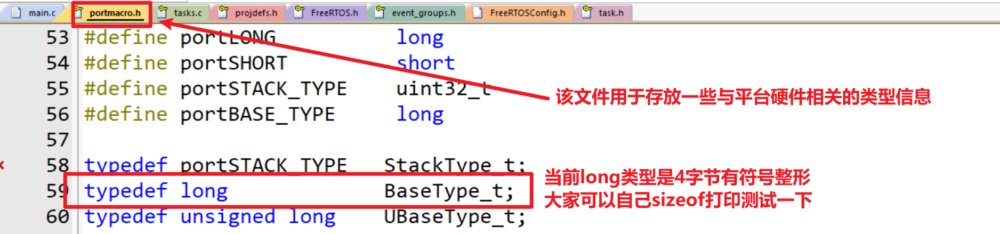

*图3.2-1BaseType_t源代码-图*

**portmacro.h 是 FreeRTOS 的“架构适配层核心文件”，也是我们进行移植时根据架构所选择的核心文件之一。**

**该文件所做的重要工作之一，就是：定义与 CPU 架构强相关的基础数据类型。**

通过这种“先定义类型别名，使用类型别名，再由具体移植层决定实际类型”的方式，FreeRTOS 在不同架构之间实现了统一接口。

同时也提高了代码的可读性和可移植性。

这正是类型别名的一个典型工程用途。

以 x 为前缀的函数，例如动态创建任务的函数——xTaskCreate，它的返回值类型就是BaseType_t。

那么问题来了：

既然返回值是一个 4 字节的有符号数long类型，且返回值用于指示函数是否执行成功。

那具体返回什么表示成功，返回什么表示失败呢？

若想了解这一点：

我们可以查阅FreeRTOS官方API手册：xTaskCreate - FreeRTOS™如下图所示：


*图3.2-2任务创建函数的返回值-图*

可以看到，返回值并不是直接给出一个“魔法数”，而是通过两个宏来表示创建任务是否成功。

这又是两个宏，它们的具体值是：

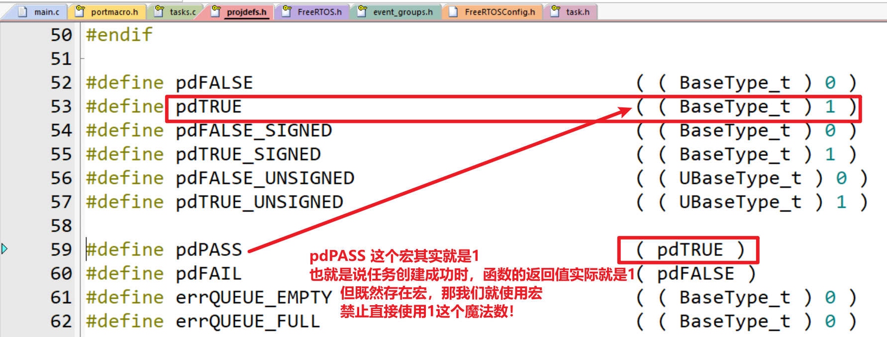

*图3.2-3任务创建函数的返回值-图2*

任务创建失败时返回的宏，如下图所示：

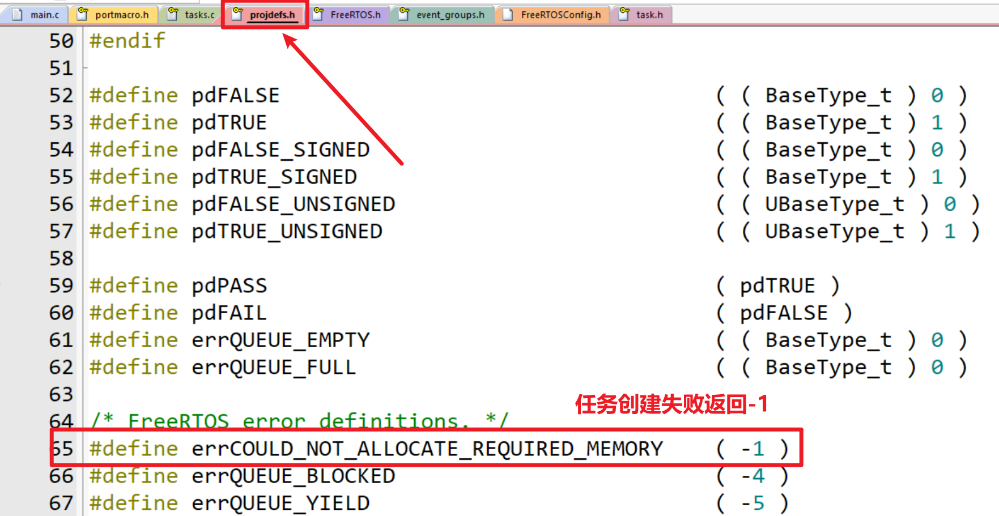

*图3.2-4任务创建函数的返回值-图3*

这些宏定义位于projdefs.h文件中。

projdefs.h文件，这是一个天才命名，个人猜测应该是：**project definitions**翻译过来就是说：该文件下存放的是，适用于整个FreeRTOS工程的宏定义。

事实上，这个文件下，确实定义了大量在整个FreeRTOS中，都广泛使用的宏定义。

比如创建任务函数的返回值，创建成功返回成功的宏，创建失败就返回创建失败的宏。

虽然这两个宏本质上就是1和0，但禁止直接使用魔法数，而应当使用 FreeRTOS 官方定义的语义宏。

#### 3.3 常见前缀名形式1：ux

ux 前缀表示：该函数具有返回值，并且返回值类型为 UBaseType_t。

UBaseType_t也是一个类型别名，它具体是什么类型呢？

这太简单了，使用它就是在BaseType_t的基础上加了一个U，所以就表示无符号版本。

在 Cortex-M3 架构上移植使用FreeRTOS：

1. BaseType_t → long
2. UBaseType_t → unsignedlong

如下图所示：

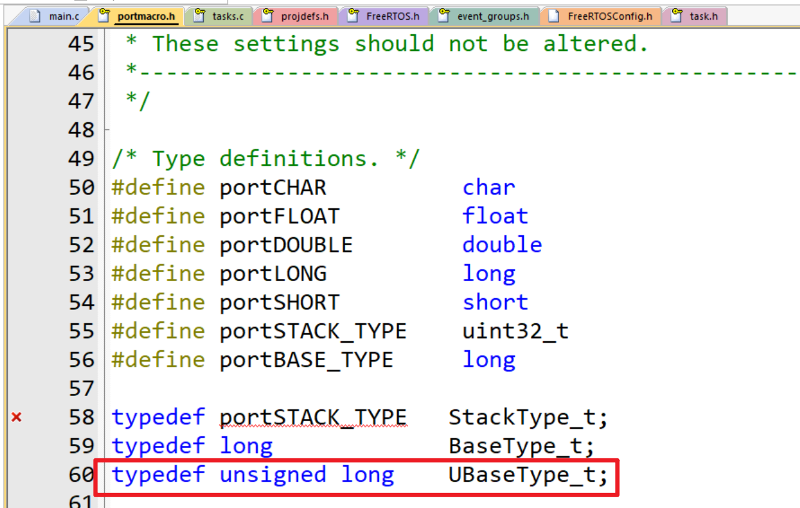

*图3.3-1UBaseType_t类型源码-图*

也就是说：

**ux 前缀函数，返回的是一个 4 字节无符号整数。**

那么这个返回值有什么作用呢？

**首先我们要知道：既然函数要强调自己的返回值类型是一个无符号数，这就意味着返回值不会是负数，只能是一个非负数。**

那么在 FreeRTOS 中，有哪些数据天然就应该是非负数呢？

很明显，数量、优先级、剩余空间等数据一定是非负数。

举两个具体函数的例子。

**例子1：**

对于函数：

```c
UBaseType_t uxTaskPriorityGet( const TaskHandle_t xTask );
```

该函数用于获取某个任务的优先级，并将其作为返回值。

优先级一定是一个非负数。

因此，该函数采用ux作为命名前缀，是非常合理的。

**例子2：**

对于函数：

```c
UBaseType_t uxTaskGetNumberOfTasks( void );
```

该函数用于获取整个 FreeRTOS 系统中当前存在的任务数量。

数量也是一个典型非负数，因此，该函数的命名前缀同样采用ux 。

#### 3.4 常见前缀名形式2：pv

在 FreeRTOS 的命名规范体系中：

1. p表示**pointer（指针）**
2. v表示**void**

合在一起：pv 表示返回一个 void * 类型的指针。

那函数什么情况下会返回一个通用指针类型呢？

这我们是不陌生的，因为C语言标准库函数中的malloc、calloc等都返回void*类型。

也就是说：

当一个函数用于申请一块内存并将这块内存的起始地址作为结果返回时（将申请的内存块交给外界）

就非常适合设计成返回 void * 类型。

**所以，以 pv 为前缀的函数，表示其返回值是void*类型，具体来说就是，返回一块内存区域的指针。**

FreeRTOS 中，最典型、也是最常见的pv前缀函数就是：

```c
void *pvPortMalloc( size_t xSize );
```

该函数用于从**FreeRTOS 内核堆**中申请一块内存，并返回这块内存的起始地址（指针）。

函数的返回值不仅仅是返回内存块，还兼具指示成功失败的作用：

1. **成功时**，返回值是一个有效的内存地址（void* ），不是NULL
2. **失败时**，返回值为NULL

**返回值本身，就是函数的执行结果**可以看到"pv"前缀的函数，它们的返回值设计哲学和malloc、calloc，其实是完全一致的。

#### 3.5 不多见的两个前缀：pc和e

在 FreeRTOS 的命名规范体系中，除了v 、x 、ux 、pv这些**高频前缀**之外，还存在一些**出现频率较低的前缀**，例如：pc**、**e 。

由于它们在实际使用中并不常见，这里我们做一个简要说明。

pc前缀可以拆开理解为：

1. p → pointer（指针）
2. c → char

也就是说：pc前缀表示：函数返回一个char*类型的指针。

与pv返回void*不同，pc返回的是明确类型的字符指针，通常用于：

1. 返回字符串
2. 返回可读文本信息

**看到 pc 前缀，你只需要记住一句话就够了：它返回的是一个字符指针（大概率就是一个字符串）。**

最常见的pc前缀的函数就是：

```c
char *pcTaskGetName( TaskHandle_t xTaskToQuery );
```

该函数的作用是获取任务的任务名字符串，并且作为返回值返回。

   - e. 前缀表示：该函数具有返回值，并且返回值类型是一个 enum（枚举类型）。

也就是说，这类函数的返回值：

1. 不是简单的成功 / 失败
2. 也不是数量或指针
3. 而是**多个离散状态之一**

**看到 e 前缀，也就是说此函数的返回值是一个枚举值。**

这类函数最常见的是：

```c
eTaskState eTaskGetState( TaskHandle_t xTask)
```

该函数用于获取任务的状态，而任务的状态有多个，使用一个枚举类型eTaskState 进行定义。

#### 3.6 表示作用域的前缀名形式：prv

在 FreeRTOS 的命名体系里，除了我们常见的v/x/ux/pv/pc/e这些“**返回值语义前缀**”之外。

还有一类前缀，它并不是在描述返回值类型，而是在描述**函数的作用域**。

这类前缀里最典型的就是：prv 。

prv前缀即：**prv = private（私有）**

也就是说：

**看到 prv 前缀的函数，你应该立刻想到：这是 FreeRTOS 内核内部使用的私有函数，不是给用户调用的 API。**

或者换句话说，上面讲解的所有前缀名，都表示函数是一个公共的，给用户调用的API。

prv 函数的典型特征是：

**在源码中，prv前缀往往和 static 修饰符共同出现。**

比如：

```c
static BaseType_t prvCreateIdleTasks( void );
```

当然这些内部使用的私有函数，是不会在头文件中存在定义的。

用户也不可能直接调用这些函数。

#### 3.7 表示中断环境专用的函数后缀名：FromISR

在前面我们提到过：

**FreeRTOS提供的API当中，绝大多数都只能在任务环境下使用，只有少数API可以在主程序和中断中使用。**

在 FreeRTOS 中，有一类函数专门用于在中断服务程序（ISR）中调用，而不能在其余位置被调用。

这类函数的命名有一个非常明显的特征：

**函数名后缀带有**FromISR例如：

```c
xQueueSendFromISR()
xQueueReceiveFromISR()
xSemaphoreGiveFromISR()
vTaskNotifyGiveFromISR()
```

这里的ISR是：

**Interrupt Service Routine（中断服务程序）**

当然这些函数的具体作用，后续课程再慢慢讲解，这里你知道有这么回事就可以了。

### 4. 补充：FreeRTOS官方变量名命名风格

实际上，FreeRTOS不仅在函数命名中大量使用前缀，在变量命名中同样大量使用前缀。

这种命名方式，本质上来源于一种经典的工程命名方式：**匈牙利命名法（Hungarian Notation）**

其核心思想是：

通过变量名前缀，快速表达变量的类型或用途，使程序员在阅读代码时，不需要查看变量定义，就可以大致判断变量的类型。

而且，FreeRTOS的变量名前缀规则，有些还和函数名前缀类似。

以下用表格的形式，总结一下这些变量名前缀的规则：

| 前缀 | 含义 | 典型类型 | 示例 |
|---|---|---|---|
| x | BaseType_t 或其它表示执行结果的变量，比如某种句柄（结构体类型指针） | BaseType_t | xResult |
| ux | 变量类型是无符号基础类型，Cortex-M3下通常是4字节无符号类型 | UBaseType_t | uxPriority |
| px | 变量类型是一个指针类型，比如指向BaseType_t 的指针或某个结构体类型的指针 | struct * | pxCurrentTCB |
| pc | 变量类型是字符指针，可能是一个字符串 | char * | pcTaskName |
| pv | 变量类型是通用指针类型 | void * | pvParameters |
| uc | 变量类型是无符号字符 | unsigned char | ucQueueType |
| us | 变量类型是无符号短整型 | unsigned short | usStackDepth |
| ul | 变量类型是无符号长整型 | unsigned long | ulRunTimeCounter |
| c | 变量类型是字符类型 | char | cRxedChar |
| prv | 内核私有函数或变量 | private | prvAddTaskToReadyList |

这部分内容了解即可，不是特别重要。

了解这些规律，可以让你在阅读FreeRTOS源码时，可以更快速的获悉变量的数据类型。

于是在阅读源码时，就可以节约一些时间，很多时候就不用再去翻源码查看类型了。

### 5. xTaskCreate动态创建任务

在task.h头文件的第 382 行左右，我们可以找到xTaskCreate函数的原型（声明）：

如下所示：

```c
BaseType_t xTaskCreate( TaskFunction_t pxTaskCode,
                     const char * const pcName,
                     const configSTACK_DEPTH_TYPE uxStackDepth,
                     void *pvParameters,
                     UBaseType_t uxPriority,
                     TaskHandle_t *pxCreatedTask );
```

这是 FreeRTOS 中最常用、也最核心的 API 之一，用于动态创建任务。

这个函数相对比较复杂，类型千奇百怪，形参也足足有6个之多。

所以下面我们逐一进行拆解，慢慢来理解这个函数。

#### 5.1 裁剪相关

**FreeRTOS 中，几乎所有对外提供的公共 API，理论上都属于“可剪裁 API”。**

某个 API 是否真正可用，最终都取决于FreeRTOSConfig.h中的配置。

但需要强调的是：

“可剪裁”并不等于“默认关闭”。

在 FreeRTOS 中，确实存在一部分非常常用、非常基础的 API，官方在设计时就选择了默认开启，以降低初学和工程上手的门槛。

xTaskCreate函数，就是典型的，会默认开启使用的API。

如下图所示：

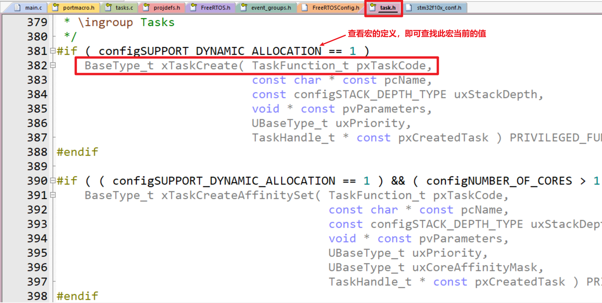

*图5.1-1xTaskCreate默认开启-图*

这个宏存在一个默认值，在没有手动定义它的情况下，如下图所示：

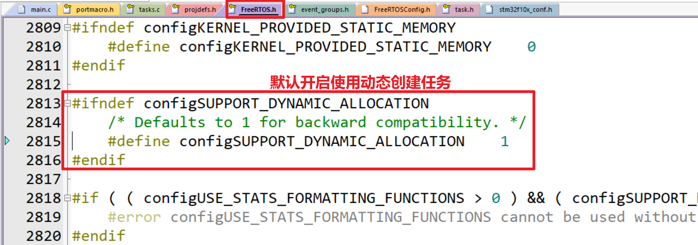

*图5.1-2xTaskCreate默认开启-图2*

**当然即便这个函数是默认开启的，我们也建议大家在配置文件中显式定义宏，显式开启此函数。**

你可以在FreeRTOSConfig.h头文件配置文件中，明确加入一条宏定义：

```c
// 显式配置，明确使用动态创建任务函数
#define configSUPPORT_DYNAMIC_ALLOCATION 1
```

所以在学习或使用 FreeRTOS 的任何一个 API 之前，首先需要关注的就是该API裁剪相关的事项。

#### 5.2 返回值

xTaskCreate这种以x**字母为前缀**的 FreeRTOS 公用 API，其返回值类型统一为

xTaskCreate_

BaseType_t是 FreeRTOS 中一个非常常见的基础类型。

在 Cortex-M 架构的移植实现中，它**本质上就是一个有符号的 4 字节**long**类型**。

对于xTaskCreate来说，这个返回值的作用只有一个：用于指示任务的创建是否成功。

在FreeRTOS中，用两个宏分别指代创建任务的成功与失败：

1. 任务创建成功，返回宏pdPASS ，这个宏本质上就是整数值1
2. 任务创建失败，返回宏errCOULD_NOT_ALLOCATE_REQUIRED_MEMORY ，这个宏本质上就是整数值-1

这两个宏的定义，可以在**头文件"projdefs.h"**中找到。如下图所示：

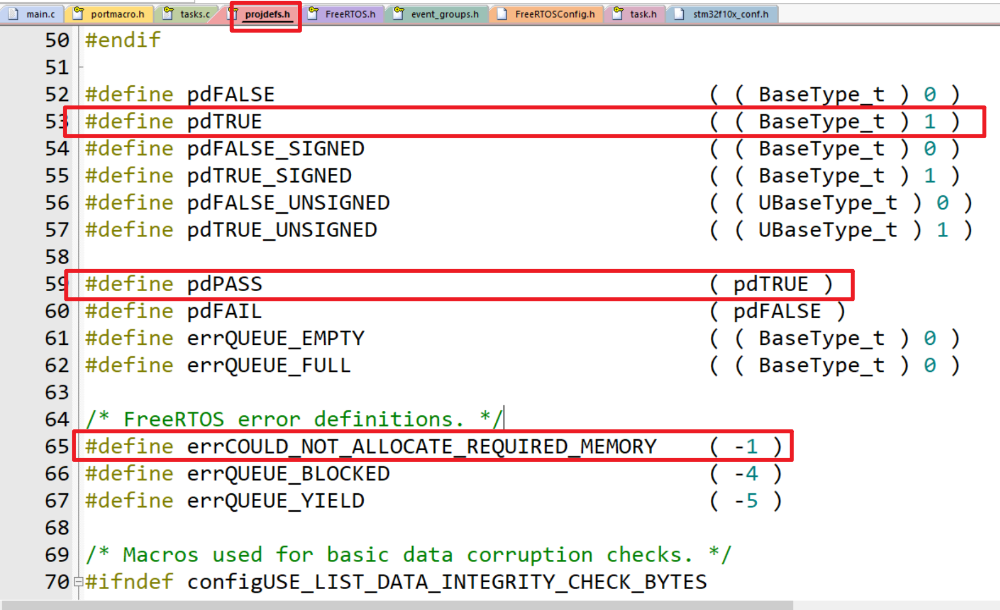

*图5.2-1返回值相关宏-图*

**那么什么时候xTaskCreate创建任务会失败呢？**

其实也很简单：

任务创建，会在FreeRTOS内核堆中，开辟专属于此任务的内存区域用于存储TCB与任务栈。

因此：

**如果在创建任务时，FreeRTOS内核堆的空间不足，任务创建就会失败。**

你可以手动将FreeRTOS内核堆的空间调小或者给一个任务分配超大的任务栈空间，这样就可以演示创建任务失败的场景。

对于此函数的返回值，建议的接收处理格式如下：

```c
// 函数调用的实参，可以继续阅读文档，下面会讲解
// 测试时，你可以把第三个参数改成10000，这样会导致任务内存区域会分配的非常大，远超FreeRTOS内核堆的大小
// 这样就能够测试任务创建失败的情况
BaseType_t Ret = xTaskCreate(vTask1, "Task1",
                          configMINIMAL_STACK_SIZE, // 此参数决定任务栈的空间大小
                          NULL,
                          tskIDLE_PRIORITY + 1,
                          NULL);

if (Ret != pdPASS){
    // 创建任务失败，必须手动处理
    printf1("Task1 create failed.\r\n");
    // 并且在处理完成后，应该直接写一个死循环
    // 既然任务已经创建失败了，干脆直接让整个程序停留在原地，而不是继续运行。
    while (1);
}
```

xTaskCreate函数的返回值，可以考虑接收并处理它，避免“任务创建失败却不自知，继续运行系统”的情况出现。

但只要系统空间设计与使用合理，在明确任务肯定能创建成功的情况下，也可以选择不接收处理返回值。

#### 5.3 第一个参数：pxTaskCode

xTaskCreate函数的第一个参数pxTaskCode ，用于指定该任务的入口函数，也就是说该任务上CPU时，就会执行这个函数。

该参数的类型是TaskFunction_t ，本质上是一个函数指针的类型别名。

如下所示：

```c
typedef void (* TaskFunction_t)( void * arg );
```

也就是说：

如果你想要定义一个任务的入口函数，那就需要遵循上述函数指针描述的格式。

**从声明的格式上来说，任务入口函数需要满足：**

1. 返回值类型必须是void，任务入口函数必须没有返回值
2. 函数名随意，建议遵循“见名知意”的原则。
3. 函数的形参列表，必须有1个形参，并且此形参的数据类型是：void*

**任务入口函数的实现，也有相应的要求：**

**任务入口函数不允许执行完毕，所以任务函数内部应包含一个死循环。**

**FreeRTOS的任务函数是一个永不返回的函数。**

在调用xTaskCreate时，创建任务成功，并不意味着会立即执行该任务函数。

而只是将该函数的地址保存到任务控制块（TCB）中。

当调度器启动，并且该任务上CPU时，处理器才会从pxTaskCode所指向的函数入口开始执行代码。

什么叫调度器启动呢？

其实就是一句函数调用：

```c
// 启动 FreeRTOS 调度器
vTaskStartScheduler();
```

这个函数的具体细节，我们等到后面再详谈。

#### 5.4 第二个参数：pcName

pcName 是xTaskCreate函数的第二个参数：

1. 它的类型是constchar*const ，本质上是一个只读字符串指针。
2. 用于给任务指定一个任务名（Task Name）。

在 FreeRTOS 中，任务名并不参与调度，不会影响任务的优先级，也不会决定任务什么时候运行、运行多久。

从内核角度看，任务名只是一个附加信息。

**换句话说，pcName 的存在目的只有一个：给“人”看的，不是给调度器看的。**

**在语法层面上来说：**

任务的名字几乎只有一个限制，那就是字符串长度的限制。

在FreeRTOS配置文件中，存在以下宏：

```c
// 没必要加长任务名的长度，实际上你把任务名起到超过10个字符长度就已经足够逆天了！

#define configMAX_TASK_NAME_LEN ( 16 )
```

也就是说，任务名的字符串，最大长度是15，超过这个长度就会自动截断多余部分。

**但从工程实践的角度来说，对于任务名的使用提几点建议要求：**

1. 任务名显然必须在任务整个存活期间都有效。建议直接传参字面值字符串常量作为任务名，这是最佳的选择！

2. 两个任务允许同名，FreeRTOS并没有限制这一点，但这么做，显然是自找麻烦。任务名不要重名！
3. 任务名建议“见名知意”的表明任务的作用，这样在调试排查时，会更加清晰明了。

除此之外，还有个小细节：

**这个参数名以"pc"作为前缀，这也隐含表示了它的类型是字符指针类型。**

#### 5.5 第三个参数：uxStackDepth

uxStackDepth 是 xTaskCreate 函数的第三个参数，它的类型是configSTACK_DEPTH_TYPE。

uxStackDepth直译过来，就是栈的深度，当然这里的栈指的是当前创建任务的任务栈，而不是主栈！

这个参数的作用非常简单，用于指定该任务栈的大小。

为了解释这个参数，我们提出以下问题：

1. configSTACK_DEPTH_TYPE具体是什么类型？
2. 这个参数，如何来确定任务栈的大小？

下面我们来逐一分析讲解这两个问题。

首先，我们可以找到configSTACK_DEPTH_TYPE 的实际类型是：StackType_t而那StackType_t 实际上是一个无符号32位整型。

如下图所示：

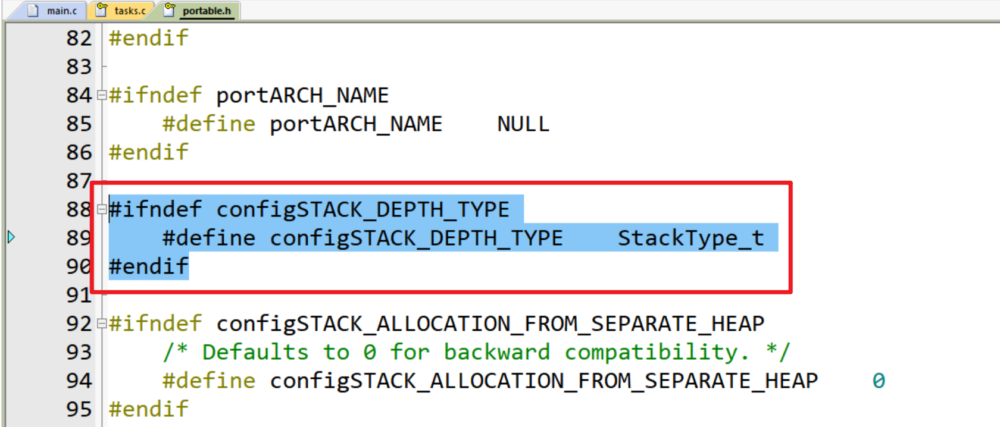

*图5.5-1configSTACK_DEPTH_TYPE类型-图*

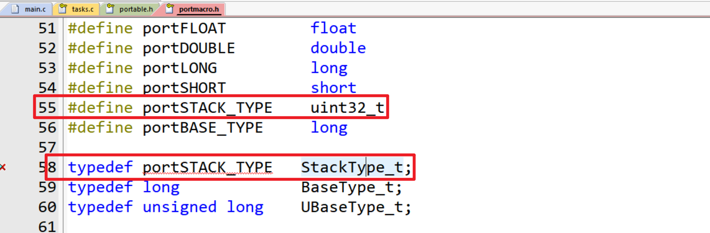

*图5.5-2configSTACK_DEPTH_TYPE类型-图2*

总之我们的结论是：

参数uxStackDepth 的类型是一个无符号32位整型，必须传参一个无符号非负数。

**那这个参数的取值，就是任务栈的字节大小吗？**

实际上并不是！

参见下面的源代码：

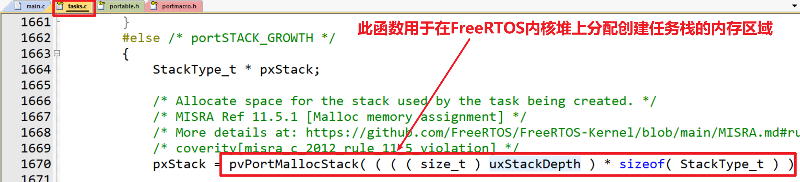

*图5.5-3任务栈的内存分配-图*

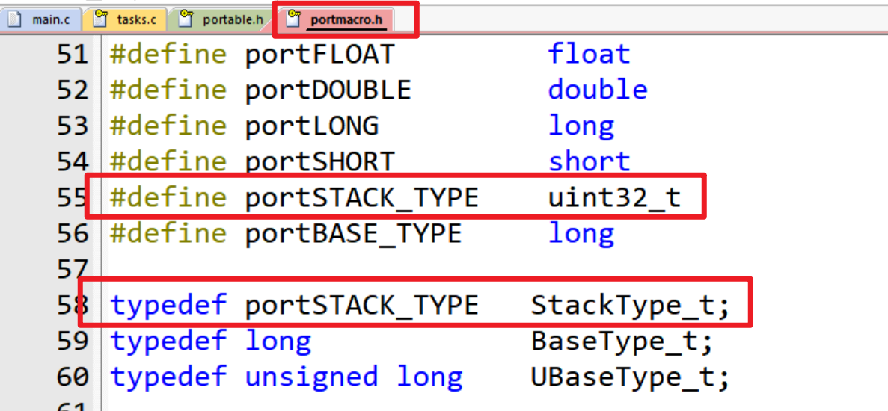

*图5.5-4任务栈的内存分配-图2*

所以我们的结论是：

**任务栈的字节大小 = 参数uxStackDepth * 4**也就是说，任务栈的字节大小一定是4的整数倍。

如果说的更准确具体一点：

**任务栈的大小是uxStackDepth字， uxStackDepth参数决定了任务栈的大小是多少个字。**

为什么有这样的设定呢？

这是因为在 STM32F103C8T6 单片机中，CPU一次性寻址操作的最小空间是一个字，也就是4字节。

所以任务栈空间大小需要确保为4字节的整数倍，这样便于CPU寻址与计算。

**除此之外，FreeRTOS 的配置文件中，还提供了一个建议的任务栈最小深度，如图所示：**

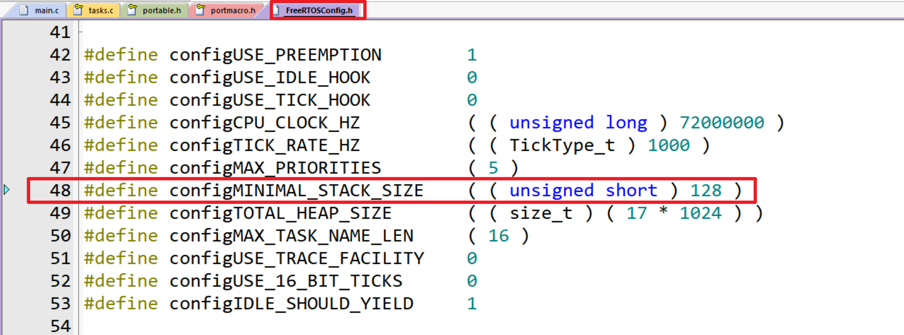

*图5.5-5任务栈建议最小深度-图*

该宏用于给出一个“最小可运行任务”的栈深度参考值。

在创建任务、传入任务栈深度参数时，建议任务栈的深度不小于该宏定义的数值，以保证任务能够正常运行。

在实际开发中，如果一时无法准确评估任务所需的栈空间大小，也可以直接使用configMINIMAL_STACK_SIZE作为任务栈深度的初始值。

如果使用这个推荐最小值，那么任务栈的深度就是128，任务栈的实际大小就是512个字节。

**当然，如果你的任务相对复杂，或任务内部开辟使用了较大的空间，可以酌情在此基础上增加栈的深度，以避免出现栈溢出的错误。**

扩展：

当然你肯定会有疑问，如何确定某个任务具体需要多大的任务栈空间呢？

不要着急，这个我们后面会给大家讲解。

#### 5.6 第四个参数：pvParameters

pvParameters 是xTaskCreate()的第四个参数。

它的类型是：void* ，通用指针类型。恰好这个参数的前缀名是**pv**，与前面讲过的函数名前缀命名规则保持一致。

**这个参数的作用也很明确：用于给任务的入口函数传参。**

任务入口函数的声明格式是固定的，如下所示：

```c
void TaskFunction(void * pvParameters);
```

pvParameters这个形参，会原封不动地传给任务函数的参数。

通俗的说：pvParameters 就是你创建任务时，顺手塞给这个任务的一份“启动参数”。

但是客观的讲：

**在主流FreeRTOS工程中，这个参数非常鸡肋，基本没啥用，几乎没有实用价值。**

**该参数直接传 NULL，不要用它给任务入口函数传参。**

这是为什么呢？

因为主流FreeRTOS工程中，普遍在main函数创建任务。

比如下列代码：

```c
// 任务入口函数
void vTask1(void *Arg) {
    uint8_t *PNum = (uint8_t *)Arg;
    // 后续可以操作main函数内传参的Num变量
    while (1) {
       vTaskDelay(1);
    }
}

// 当前处于main函数内部
uint8_t Num = 100;
xTaskCreate(vTask1,
           "Task1",
           configMINIMAL_STACK_SIZE,
           &Num,
           tskIDLE_PRIORITY + 1,
           NULL);
```

这段代码看起来非常合理：

1. 在main()中定义局部变量Num
2. 将Num的地址通过pvParameters传给任务
3. 在任务入口函数中使用该参数

但实际上，这段代码是无法依照预期执行的。

**问题的根源在于：主栈的使用方式发生了变化。**

在 FreeRTOS 调度器启动之前：

1. main()使用主栈（MSP）
2. main()的局部变量是安全的

但在调度器启动之后：

1. 主栈会被 FreeRTOS 用作**中断函数调用栈**
2. 所有中断相关函数的调用，都在主栈中完成
3. 而FreeRTOS的运行过程中，中断必然会频繁触发，主栈空间会被频繁使用和覆盖。

（为什么中断会频频繁触发后面讲）

**而主栈的空间本身就很有限。这意味着：**

1. main 函数的栈帧并不会受到任何保护，很容易被中断相关函数栈覆盖。
2. 一旦main函数栈帧被侵占覆盖，那么其中的数据就完全丢失了。

因此可以得出一个非常关键的结论：

**在 FreeRTOS 调度器启动后，指向 main 函数局部变量的指针，其指向的内存内容大概率已经被破坏。**

所以在任务中，几乎无法可靠地访问 main 函数中局部变量的正确值。

那如果你“非要传参”，非要用这第四个参数，怎么办呢？

主栈空间被侵占，但数据段并不会。

所以只要使用静态或全局变量传参即可。

比如下列代码：

```c
// 任务入口函数
void vTask1(void *Arg) {
    uint8_t *PNum = (uint8_t *)Arg;
    // 后续可以操作main函数内传参的Num变量
    while (1) {
       vTaskDelay(1);
    }
}

// 函数外部
uint8_t Num = 100; // 使用全局变量

// 当前处于main函数内部
static uint8_t Num = 100; // 使用静态局部变量
xTaskCreate(vTask1,
           "Task1",
           configMINIMAL_STACK_SIZE,
           &Num,
           tskIDLE_PRIORITY + 1,
           NULL);
```

但这样做，问题又来了：这种写法显然没有任何意义。

因为：

1. 任务入口函数
2. 以及这些全局 / 静态变量

通常都定义在同一个源文件中（就算不在同一个文件中，全局变量也可以跨文件共享访问）。

既然如此，直接访问即可，何必传参多此一举呢？

总结如下：

1. **在大多数 FreeRTOS 工程中，任务集中在 main() 中创建。此时在创建任务时给任务传参，没有什么实际价值。**
2. **pvParameters 在实际工程中基本用不上，直接传 NULL 是最稳妥、最清晰的做法。**

当然，这种传参也不是完全一无是处，一点用没有。

如果想要实现对任务的复用，对任务入口函数的复用，可以使用这种方式，给任务的入口函数传参。

但这种场景不太多见，知道即可。

#### 5.7 第五个参数：uxPriority

uxPriority 是xTaskCreate()的第五个参数，它的类型是：UBaseType_t 。

在在 Cortex-M3 架构上移植使用FreeRTOS：

UBaseType_t的实际类型就是unsigned long。如下图所示：

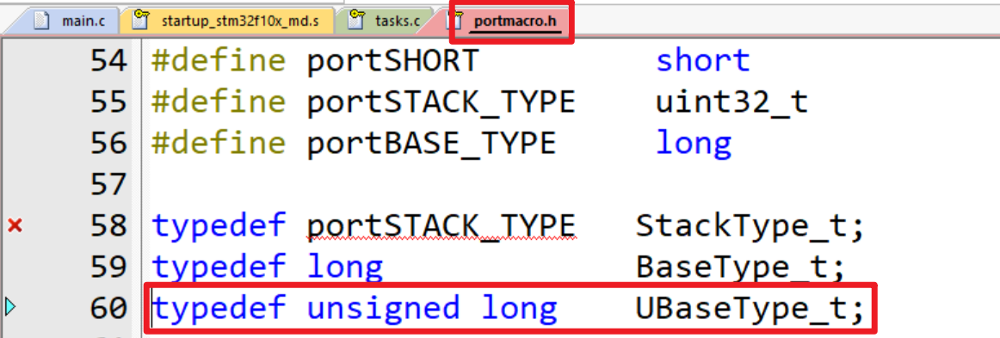

*图5.7-1UBaseType_t实际类型-图*

这个参数的作用是什么呢？

**非常简单：uxPriority 用于指定任务的优先级。**

**在 FreeRTOS 中，任务优先级是一个非负整数值。数值越大，优先级越高。**

##### 5.7.1 优先级的取值范围

在 FreeRTOS 中，任务优先级从**0 开始**。

其中：

1. **0 为最低优先级**
2. 数值越大，优先级越高

那么，最高优先级是多少呢？

在 FreeRTOS 的配置文件FreeRTOSConfig.h中，有如下宏定义：

```c
#define configMAX_PRIORITIES ( 5 )
```

**这个宏表示：系统中可用的优先级总数量。注意，它表示的是“数量”，而不是“最大数值”。**

所以此时的优先级取值范围是：0 ~ 4也就是说：

1. 最低优先级：0
2. 最高优先级：configMAX_PRIORITIES - 1

**是否需要修改这个值？**

理论上可以手动修改configMAX_PRIORITIES 。

但在实际工程中：

1. 过多的优先级会增加系统复杂度
2. 调度逻辑会变得难以维护
3. 通常 4~7 个优先级已经足够使用

因此，一般没有特殊需求时，不建议随意增大该数值。

##### 5.7.2 优先级的作用

那么，任务优先级到底有什么作用？

核心只有一句话：

**优先级决定哪个任务可以先获得 CPU 的执行权。**

关于任务的优先级调度机制，我们之前已经讲解过了。

具体来说，总结如下：

1. FreeRTOS采用优先级调度机制，当多个任务进入就绪状态时，调度器总是选择优先级最高的任务运行。
2. 只要高优先级的任务不主动让出CPU执行权，那么高优先级的任务将会一直执行，“饿死”低优先级的任务。
3. 如果开启了抢占式调度（默认开启），高优先级的任务进入就绪状态后，还可以抢占低优先级任务的执行。

为了更好的帮助大家理解FreeRTOS的优先级，我们举几个反例、优先级错误的理解：

**第一个误解：高优先级的任务更重要。**

FreeRTOS任务的优先级越高，只代表它会优先执行，甚至抢占执行。

也就是说：任务优先级越高，它就越容易优先执行，越容易立刻执行。

**所以，任务的优先级高优先级，和任务的重要性、价值都没有关系，只代表该任务执行的“紧迫性”，需要尽快执行罢了。**

而任务的优先级越低，代表任务越不“紧迫”，接受一定的延时执行。

**第二个误解：高优先级任务一定下先执行。**

FreeRTOS任务的优先级调度，是在多个任务都进入就绪状态，同时参与CPU竞争时，高优先级任务先执行。

但如果存在下面这种情况：

1. 任务A优先级很高，但长期处于阻塞状态，没有参与CPU竞争。
2. 任务B优先级很低，但系统中没有任务与它同时进入就绪状态，没有任务与它竞争CPU，那么它仍然会最先执行。

**第三个误解：核心的、关键的任务设置高优先级。**

上面已经讲过了，任务的高优先级最主要和任务的紧迫性相关。

而系统的核心任务，通常执行时间较长，长期占用CPU。

如果将这种任务设置高优先级，会导致低优先级任务很难有机会被执行，反而会导致整体系统的不稳定。

**所以，越高优先级的任务，应当越快执行完成，尽早让出CPU。**

系统的核心关键任务，通常都不应当设置高优先级。

**第四个误解：优先级设置的档位越多越好。**

优先级的档位越多，系统越复杂，越难以直观的预判系统行为，系统的稳定性就会降低。

所以，我们应该尽量少的设计优先级档位。

那么关于任务系统优先级的设计，具体该怎么做呢？

##### 5.7.3 实践中如何设计任务优先级

FreeRTOS这个实时操作系统，本身就设计用于资源受限的嵌入式系统。

在这种场景下，绝大多数 FreeRTOS 工程中，任务数量通常都不多，一般在 5 个以内，超过 10 个的情况并不常见。

**任务规模本身就不大，因此优先级设计更应该追求简洁、清晰、可预测，而不是“分得很细”。**

关于优先级设计，可以遵循以下几条工程化原则：

1. **优先级档位越少越好。**
   - a. 优先级不是越多越精细，而是越少越稳定。
   - b. 档位过多会增加系统行为的不确定性，使得任务调度的关系难以分析明白。
2. **只有极少数“必须立即响应”的任务，才提升一个优先级等级。**
   - a. 被提升优先级的任务，应当是那些必须马上、立刻做出响应的任务。
   - b. 高优先级的任务应当尽量少。
   - c. 高优先级的任务应该尽量快速执行，执行完成后快速让出CPU。
3. **能使用相同优先级的任务，尽量使用相同优先级。**
   - a. 同级任务在时间片轮转机制下公平运行，逻辑更清晰，系统行为更容易预测。
   - b. 在FreeRTOS系统中，同优先级的任务，应当占据绝大部分。

这样的优先级设计方式有三个明显优势：

1. 降低系统复杂度
2. 提高系统稳定性
3. 增强调度行为的可预测性

优先级设计的目标不是“区分地位”或者“区分重要性”，而是“控制响应时效”。只有紧急必须立刻响应的任务，才需要设置为高优先级。

而越少的层级，越清晰的结构，往往意味着越成熟、越稳健的系统。

就像我们的生活：

绝大多数时候都是按部就班的做事情，偶尔来一个紧急的事情需要立刻处理。

绝大多数事情都是早一点晚一点无所谓，偶尔来一个事情必须立刻处理。

##### 5.7.4 空闲任务和空闲任务优先级

在大多数时候，我们在创建任务时，都会使用一个宏来定义任务的优先级。

调用方式通常如下：

```c
BaseType_t ret = xTaskCreate(vTask1,
                          "Task1",
                          configMINIMAL_STACK_SIZE,
                          NULL,
                          tskIDLE_PRIORITY + 1,
                          NULL);
```

其中：

```c
tskIDLE_PRIORITY + 1
```

就是此任务的优先级。

那问题来了：

tskIDLE_PRIORITY这个宏到底是什么意思？

为什么几乎所有创建任务的示例代码里，任务优先级，都会在它的基础上+1 呢？

要回答这个问题，就必须先引入一个概念：**空闲任务（Idle Task）。**

**什么是空闲任务呢？**

在FreeRTOS调度器启动时，FreeRTOS内核会自动创建一个系统任务，这个系统任务就是空闲任务。

该任务不需要用户手动创建，也不允许用户手动创建。

除此之外，也不允许用户手动删除它。

只要系统进入多任务调度阶段，空闲任务就一定始终存在。

需要注意：

1. **空闲任务不是可选的，而是必须存在的，哪怕系统中一个用户任务都不创建，也必须存在空闲任务。**
2. **空闲任务和用户任务没有本质区别，空闲任务仍然有任务栈、TCB的结构。只不过这个任务由内核自动创建，不是你手动调用API创建。**
3. **空闲任务也可以由程序员控制和操作，但相对而言，允许执行的操作更少。比如肯定不能删除，也最好不要挂起。**

**空闲任务的什么时候上CPU呢？**

简单来说：

当系统中没有任何用户任务可以运行时，CPU 就会去执行空闲任务。

换句话说，只要系统中还有就绪状态的用户任务可以执行，空闲任务就不会、也不应当被执行。

正如它的名字空闲一样，只要当整个系统没有其他用户任务可以上CPU时，空闲任务才**“勉为其难”**的来上CPU。

**空闲任务当中执行什么逻辑呢？**

空闲任务就是一个普通任务，但是它的入口函数并不是我们自定义的。

那么空闲任务执行时，究竟执行什么逻辑，做什么事情呢？

关于这一点，我们先按下不表，留到后续课程内容补充。

**空闲任务的优先级是多少呢？**

了解了空闲任务的作用，可以看到它实际上是系统中的“兜底任务”。

所以它的优先级必然需要设定为最低！

通常来说，空闲任务的优先级用以下宏来表示：

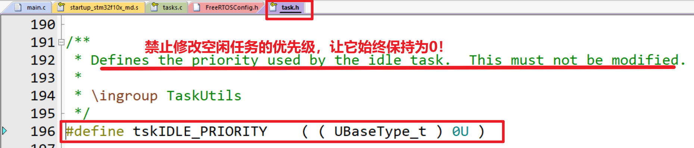

*图5.7.4-1空闲任务的优先级-图*

**也就是说：空闲任务的优先级是 0，并且是系统中的最低优先级。**

**这个优先级是固定的、不可修改的。**

**为什么需要空闲任务？**

因为调度器有一个非常底层、非常重要的前提：

系统中必须始终至少存在一个可运行的任务。

如果没有空闲任务：

1. 当所有用户任务都阻塞时
2. 调度器就会面临“无任务可调度”的情况

那此时该怎么办呢？系统该执行什么事情呢？

为了避免出现这种情况，FreeRTOS设计了空闲任务，本质上是一个兜底机制。

**用户任务的优先级应该如何设计？**

空闲任务是作为兜底使用的，它显然不应该随意上CPU。

所以：

**用户任务，永远不应该和空闲任务处在同一优先级。**

所有的用户任务的优先级 ≥ tskIDLE_PRIORITY+1 ：

1. 用户任务一定可以抢占空闲任务
2. 空闲任务只会在系统真正空闲时运行

系统行为清晰、可预测。

总之，在绝大多数 FreeRTOS 工程中，可以直接记住一句话：

**用户任务的最低优先级，就是 tskIDLE_PRIORITY + 1。**

**我们也建议大家在创建任务时，用这个宏做加法来定义任务优先级，不要擅自写魔法数字！**

#### 5.8 第六个参数：pxCreatedTask

pxCreatedTask 是xTaskCreate()的第六个参数。

**这可能是此函数最复杂，最需要理解的一个参数了。**

它的类型是：

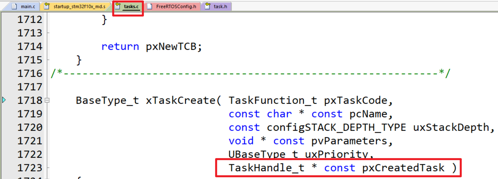

*图5.8-1pxCreatedTask参数类型-图*

再深入一层查看类型：

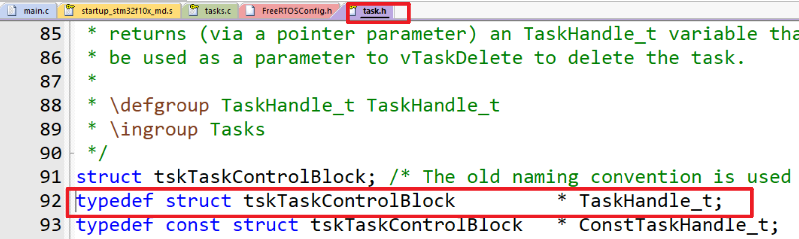

*图5.8-2pxCreatedTask参数类型-图2*

再深入一层：

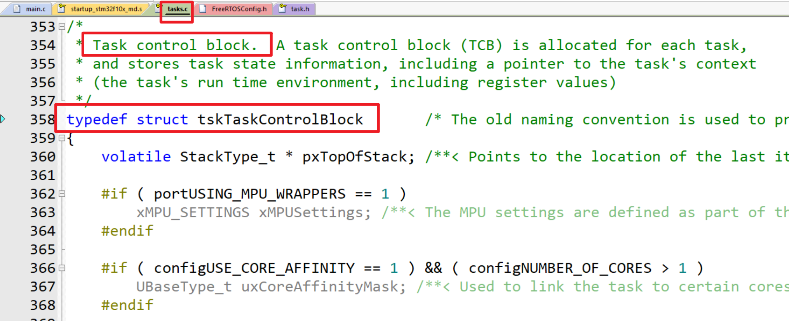

*图5.8-3pxCreatedTask参数类型-图3*

所以这个pxCreatedTask参数，到底是什么类型呢？

结论如下：

1. structtskTaskControlBlock ，本身是一个结构体类型，该结构体就是任务TCB的描述结构。任务的TCB内存区域其实就是这样的一个结构体。
2. TaskHandle_t ，本身是任务TCB结构体指针类型，的类型别名。
3. pxCreatedTask 形参，它是“任务TCB结构体指针类型别名”的指针类型。

一个直接明了的图示如下：

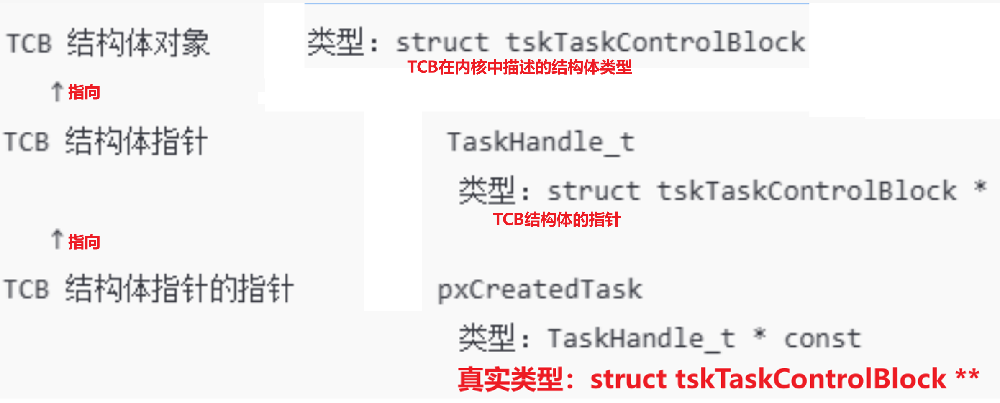

*图5.8-4pxCreatedTask参数类型-图4*

所以，pxCreatedTask形参的实际类型是：

```c
struct tskTaskControlBlock ** pxCreatedTask;
```

再说通俗点：

**形参pxCreatedTask的具体类型是，指向“任务控制块（TCB）结构体对象指针”的二级指针。**

##### 5.8.1 参数的作用

搞清楚了pxCreatedTask这个参数的类型本质之后，下一个问题自然就是：

**这个传参到底是用来干什么的？**

为了更好地理解这个参数的作用，我们不妨先看一个非常熟悉、也非常经典的函数调用：

```c
int num;
scanf("%d", &num);
```

**scanf 中的“指针传参”在干什么？**

在调用scanf时：

1. 表面上看，我们是给scanf传入了一个指针，也就是一个地址。
2. 但从本质上来说，scanf获得的是：**这个指针背后所对应的一片内存区域。**
3. 最终，scanf会把从键盘读取到的数据，直接写入这块内存区域中。
4. **scanf函数并不需要接收返回值，就可以通过指针传参获取键盘录入数据。**

xTaskCreate()中的pxCreatedTask参数，和scanf中的指针传参，在作用机制上是完全一致的。

同样是：

**函数内部产生结果，通过指针，把结果写回给调用者。**

我们一步一步来看。

该参数配合函数调用，推荐的格式如下：

```c
TaskHandle_t Task1Handle; // Task1Handle建议设置为一个全局变量
BaseType_t ret = xTaskCreate(vTask1,
                          "Task1",
                          configMINIMAL_STACK_SIZE,
                          NULL,
                          tskIDLE_PRIORITY + 1,
                          &Task1Handle);
```

**这段代码做了什么呢？**

首先，TaskHandle_t 类型是TCB结构体指针的类型别名。

所以变量Task1Handle的具体类型是：

```c
struct tskTaskControlBlock *Task1Handle;
```

也就是说：

Task1Handle 这个变量，本质上是一个指针变量。

是一个指向任务TCB结构体的指针。

**接下来，我们再看函数调用：**

```c
xTaskCreate(..., &Task1Handle);
```

注意这里传入的是：

```c
&Task1Handle
```

传参的是指针的指针，也就是传参了二级指针。

具体传参的类型是：

```c
struct tskTaskControlBlock **;
```

因此：

1. Task1Handle是 TCB 指针
2. &Task1Handle是 TCB 指针的指针（二级指针）

xTaskCreate()获取到这个二级指针后，就拥有了一个能力：

可以在函数内部，修改调用者中，Task1Handle这个指针变量的指向。

也就是说：

1. xTaskCreate创建了一个新的任务，在FreeRTOS内核堆上分配该任务的TCB结构体。
2. 此时xTaskCreate函数内部就获取了该TCB块的指针。
3. 然后通过二级指针，把这个地址写回给Task1Handle

具体的源码如下所示：

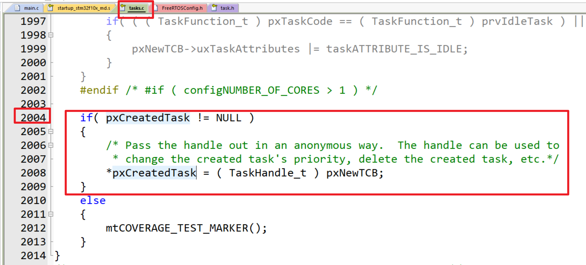

*图5.8.1-1句柄赋值源码-图*

**所以：**

**在函数执行完成后，Task1Handle 就是该任务TCB结构体的指针。**

参考注释当中的描述，Task1Handle就是此任务的handle。

把handle翻译成中文术语：

**在函数执行完成后，Task1Handle 就是该任务的任务句柄。**

##### 5.8.2 任务句柄

经过上面的描述，相信你已经对“任务句柄”的概念有了大体的认知。

说白了：

**任务句柄就是此任务TCB结构体的指针。**

在 FreeRTOS 中，每创建一个任务，内核都会为这个任务分配一块 TCB 内存区域，并用一个指针来唯一标识它。

这个指针，就是我们平时所说的任务句柄（TaskHandle_t）。

**那任务句柄有什么作用呢？拿到了任务句柄能实现什么功能呢？**

要回答这个问题，我们不妨先反过来问一句：

**为什么这个东西叫“句柄”呢？**

句柄是单词“handle”的术语翻译，而handle本身具有把柄、抓手的含义。

从这个词的原始含义出发，“句柄”这个命名，本身就已经在暗示它的用途。

在 FreeRTOS 中，“任务句柄”可以这样理解：

1. FreeRTOS 在创建任务时，会把这个任务的“抓手、把柄”交给你。
2. 你只要拿着这个“抓手、把柄”，就可以对这个任务进行操作和控制。

**给你任务的“句柄”，就是给你一种途径和权限，让你可以操作、控制这个任务。**

基于上面的理解，可以得出两个非常重要的结论：

1. **任务句柄就是你控制、操作任务的权限凭证。**
2. **任务句柄就是FreeRTOS内核中，某个任务的唯一性标识。**

**那为什么不把任务句柄直接叫“TCB指针”呢？这样不是更直击本质吗？**

这个问题非常关键，而且正是 FreeRTOS 命名设计的精妙之处。

如果它直接叫：“TCB指针”，是很容易让人产生误解的：

1. 既然它是一个指针，那我就可以直接解引用它。
2. 既然能解引用，那我直接修改 TCB 里的成员，看起来也是“合理”的。
3. **但实际上，任务 TCB 属于 FreeRTOS 内核管理的核心数据结构，不可能允许程序员随意修改。**

所以直接称呼为指针是不合理的。

**但程序员需要操作任务，但又不能直接操作 TCB，那怎么办呢？**

**FreeRTOS 给出的答案是：句柄 + API（实际上所有的操作系统都是这么干的）**

FreeRTOS 的解决方式非常明确：

1. 把 TCB 的指针交给你，但不鼓励、也不允许你直接操作它。
2. 把这个指针包装成一个“句柄”，强调它的**抽象意义**。
3. 程序员只能拿着这个“句柄”，通过 FreeRTOS 提供的 API，间接操作任务。

在这个过程中：

1. 任务句柄只是一个“权限凭证”
2. 真正对 TCB 的读写和修改全部由内核自主完成。

**那为什么不干脆翻译成“把柄”“抓手”这种更直观的词呢？**

原因也很简单：

1. 如果使用过于生活化的词汇，反而容易让人产生误解。
2. 技术术语本身就应该是抽象的、克制的，用来和日常语言做区分。
3. **这种抽象命名，反而会“逼迫”学习者去理解它背后的真实含义。**

从这个角度看，“句柄”这个翻译是**刻意而为之的**。

**最后，API配合任务句柄，是如何定位具体任务的呢？**

FreeRTOS 提供了大量用于控制和操作任务的 API。

这些 API 在内部，都需要回答同一个问题：

我要操作的是哪一个任务？

很显然：任务句柄是某个任务的TCB指针，这个指针/地址显然是具有唯一性的。

**所以，任务句柄天然就是某个任务的唯一性标识。**

**所有控制、操作任务的 API，都必须通过任务句柄来定位目标任务，所以这些任务都需要传参一个任务句柄。**

当然，任务句柄这个唯一性标识是被FreeRTOS内核认可的，任务唯一性标识。

对于程序员而言，任务名则更加直观，程序员可以依赖任务名来区分任务。

但对于FreeRTOS内核来说，任务名就只是一个普通的字符串，没什么特殊含义。

##### 5.8.3 扩展：FreeRTOS内核的句柄

**在后续 FreeRTOS 的学习中，包括 Linux 这种通用操作系统的系统编程学习中，“句柄”**

**都是一个非常常见、非常核心的概念。**

广义来说：

**操作系统内核提供给用户，通过 API 间接操作内核对象的一种“标识/凭证”，都可以称为句柄。**

句柄从实际类型来看：

1. 可以是一个指针（最常见）
2. 也可以是一个整型数据（比如Linux系统的文件描述符）
3. 也可以是一个结构体对象
4. ....

本质上，句柄就是：

**用户访问内核对象的一种“受控入口”。**

在FreeRTOS内核中，句柄大多都是一个原始类型的指针。

**虽然你可以拿到这个原始类型的指针，但你却并不能直接访问这个原始类型。**

比如，就以任务句柄为例：

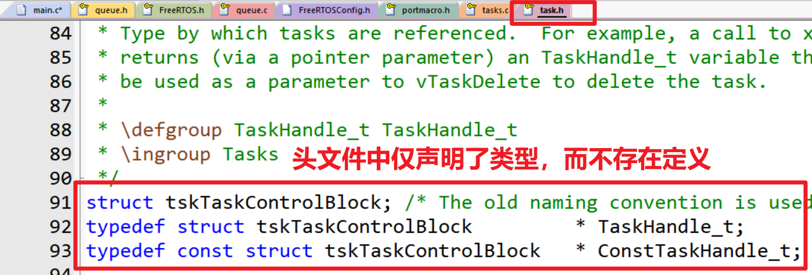

*图5.8.3-1任务句柄-源码1*

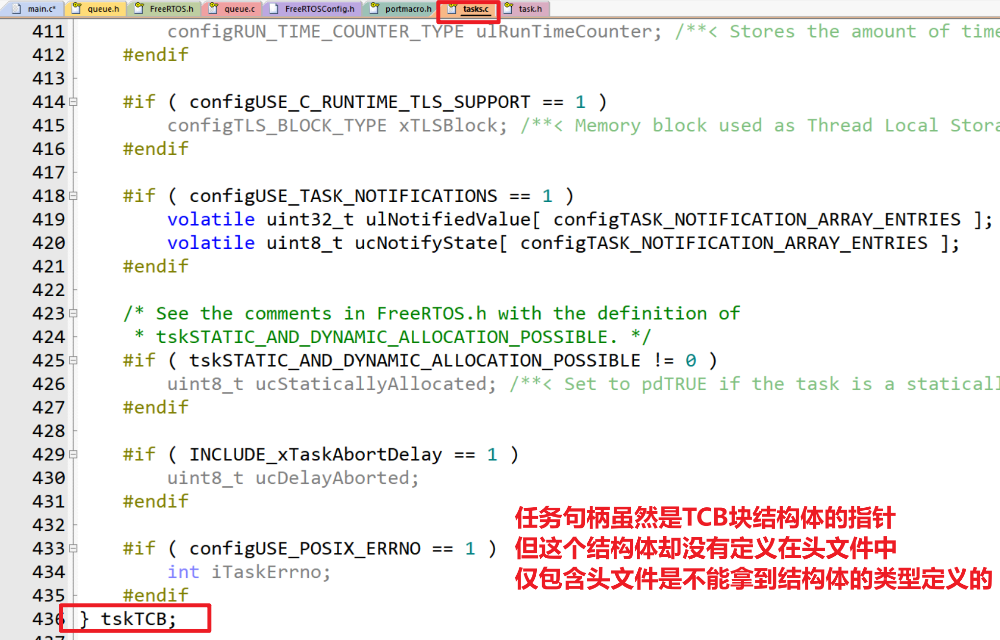

*图5.8.3-2任务句柄-源码2*

表面上看：任务句柄就是一个指向 TCB 的指针。

那么问题来了：

既然是指针，那用户是不是可以直接访问 TCB 结构体成员？

答案是：不能。

原因在于：

1. 用户代码只能看到 TCB 结构体的“声明”
2. 但看不到 TCB 结构体的“完整定义”

这是因为：

1. 用户代码仅能包含头文件，而头文件中仅有TCB结构体的类型声明。
2. 真正的结构体定义在内核源码（tasks.c）内部，这是用户代码所不能直接查看的。

因此，对于用户而言，虽然拿到了一个“指向 TCB 的指针”。

但由于不知道结构体内部布局，自然也就无法直接访问和修改内部成员。

在 C 语言中，这是一种经典的封装手段，称为：

**不透明指针（Opaque Pointer）设计模式。**

我们都知道，C 语言本身没有：

1. private
2. protected
3. class
4. 访问控制关键字

所以如果想实现“封装”，就必须通过一些设计技巧。“不透明指针”正是其中最常见的一种。

其核心思想是：

1. 在头文件中只暴露结构体声明
2. 在源文件中隐藏结构体完整定义
3. 对外只提供操作该结构体的 API

这样一来：

1. 用户只能通过 API 操作内核对象
2. 无法直接篡改内部结构（因为具体类型定义不可见）
3. 提高了模块的安全性和可维护性

**FreeRTOS 的句柄设计，几乎全面采用这种模式，了解这一点对我们后续学习会非常有帮助。**

##### 5.8.4 任务句柄必须保存吗？

任务句柄的作用，是为了在**任务外部**对该任务进行控制和各种操作。

例如：

1. 删除一个任务。
2. 临时挂起（暂停）一个任务，以及恢复一个挂起的任务
3. 给任务发通知（发数据）
4. 修改任务优先级
5. 以及各式各样的查询任务的操作。

所以：

**任务句柄不是任务运行的必要条件，而是跨任务操控任务的通行证。**

**如果系统结构简单、任务彼此独立，完全可以不保存句柄。**

如果确有需求保存任务句柄：

**应当使用全局变量或静态全局变量，来保存任务句柄。**

##### 5.8.5 任务句柄总结

由于任务句柄非常重要，但确实比较抽象。

所以这里做一个细致全面的总结：

1. **任务句柄本质上是任务 TCB 结构体的指针。**
2. **FreeRTOS 通过任务句柄，为每个任务提供一个唯一的、被内核认可的标识。**
3. **程序员只能通过“任务句柄 + 内核 API”的方式，间接操作和控制任务，而不能直接修改任务的 TCB 内存区域。**
4. **如果系统结构较为简单明了，各任务之间相互独立，那么任务句柄并不需要被保存。**

5. 如果需要保存任务句柄以供使用，建议使用全局变量或静态全局变量来保存，用局部变量来保存句柄也没什么意义。

### 6. vTaskStartScheduler调度器开启函数

在前面讲“动态创建任务”时，我们已经多次见过vTaskStartScheduler()这个函数。

但当时的介绍是**零散的、点到为止的**。

现在我们单独用一节内容，系统地把它讲清楚。

此函数的声明原型非常简单：

```c
void vTaskStartScheduler( void );
```

函数既不需要传参，也没有返回值。

那么这个函数有什么作用呢？

一句话总结：

**vTaskStartScheduler函数调用后，使得嵌入式系统从“单一执行路径、裸机运行模式”，进入“多任务调度”模式。**

**或者说，就是启动了FreeRTOS任务调度器。**

在调用该函数之前：

1. CPU 只是在顺序执行main()函数中的代码，整个系统只有单一执行路径。
2. 所有通过xTaskCreate()创建的任务，都只是被“创建并登记”，但并没有真正运行。

只有当vTaskStartScheduler()被调用之后：

1. 调度器才会接管 CPU
2. 任务才会按照调度规则，开始被调度执行。

由于课程进度的限制，我们暂时不需要将这个函数的作用完全了解。

目前我们只需要知道一个事情即可：

该函数会在FreeRTOS内核堆上创建一个优先级最低的空闲任务，作为系统的兜底任务，保证系统任意时刻总有任务可以执行。

关于此函数的调用，我们还需要注意以下细节：

**第一，该函数正常情况下一定不会返回。**

一旦调度器成功启动，CPU 将一直在各个任务之间切换执行，main()后续的代码理论上，没有再执行的机会。

```c
// main函数内，上面的代码会创建任务
// 启动 FreeRTOS 调度器
vTaskStartScheduler();

// 理论上不会运行到这里
```

当然，“理论上不会”并不等于“绝对不会”。

如果vTaskStartScheduler()返回了，通常只有两种原因：

1. FreeRTOS内核堆空间内存不足。比如空闲任务创建失败了，就会导致该函数返回，或者某个任务栈运行时爆栈。
2. FreeRTOS 配置、移植方面存在问题，调度器启动失败。

在确保移植正确的前提下，如果该函数仍然返回，通常都是FreeRTOS内核堆空间不足导致的。

比如下列代码：

```c
int main(void) {
    // 1. 初始化调试串口
    DebugUSART1_Init();
    printf1("System Init \r\n");

    // 2. 启动 FreeRTOS 调度器
    vTaskStartScheduler();

    // 正常来说，不会运行到这里
    printf1("error: scheduler return. \r\n");
    while (1) {
    }
}

// FreeRTOSConfig.h中配合修改一个宏：
// 注意：故意将FreeRTOS内核堆的空间调成128字节，这点空间甚至一个空闲任务都创建不了
#define configTOTAL_HEAP_SIZE ( ( size_t ) ( 128 ) )
```

**第二，建议在系统中所有任务都创建完成后，再开启调度器。**

创建任务，本质上就是在系统中“注册登记”一个任务。

因此，推荐的做法是：

1. 在main()函数中
2. 在vTaskStartScheduler()调用之前
3. 统一创建系统中的所有任务

不建议进行一些“花里胡哨”的操作，包括但不限于：

1. 在调度器启动函数之后创建任务（实际无效）
2. 在任务中再创建任务
3. 在各种中断处理中随意创建任务
4. ……

任务应该在调度器启动之前统一创建，这样任务系统结构清晰、行为可预期。

如果在系统运行过程中，在各种位置临时、随意地创建任务，只会增加系统复杂性和理解难度，纯粹自找麻烦。

**第三，调度器启动后，不要依赖主栈中的数据，尤其是main函数的局部变量。**

调度器启动后，主栈（MSP）会变成系统的公共资源。

需要明确几点事实：

1. 所有中断处理函数，**强制使用 MSP**，不会使用任务栈
2. 主栈空间本身就很小，通常默认只有 1KB，使用FreeRTOS后，也不会刻意调大（也没空间给主栈了）
3. 调度器启动后，main()函数的使命已经完成，其栈帧不再具备存在意义

因此，在调度器启动后：

1. main()的栈帧会很迅速的被中断和其他的一些系统行为覆盖
2. main()中定义的局部变量也会随之失效

此时：

如果在任务中访问main函数中定义的局部变量（基于指针传参），几乎只能访问到随机值。

### 7. 任务的线程安全问题

我们在前面的课程中讲过，FreeRTOS 中的任务兼具通用操作系统中**进程**和**线程**的特点：

1. 从内存资源分配的角度看，任务是 FreeRTOS 内核分配内存资源的基本单元
2. 从 CPU 调度管理的角度看，任务是 FreeRTOS 内核调度 CPU 资源的基本单元

因此，在使用方式上，FreeRTOS 中的任务更接近于通用操作系统中的**线程**。

**既然任务本质上具备“并发执行”的特性，那么在多任务并发运行的过程中，也就不可避免地会出现线程安全问题。**

那么，什么是任务的线程安全问题呢？

很简单：

当多个任务并发访问同一份共享资源时，程序依然能够保证执行逻辑正确、数据不被破坏。

这就叫做“保障了线程安全”。

反之，如果不能保证，就称之为“存在线程安全问题”。

需要说明的是，在上述语境中，“任务”和“线程”可以视为等价概念。

但在表述时，仍然建议统一使用“线程安全”这一术语，而不是“任务安全”。

**原因很简单：“线程安全”是操作系统领域早已经约定俗成的标准说法。**

光这么干讲概念，可能不够直观，下面我们通过一段实际代码来看线程安全问题是如何产生的。

#### 7.1 线程安全问题的典型案例

参考下列代码：

```c
#include "stm32f10x.h" // STM32F10x 标准外设库头文件

#include "FreeRTOS.h" // FreeRTOS 核心头文件
#include "task.h" // FreeRTOS 任务相关 API

#include "DebugUSART1.h" // 调试串口模块（printf1）

static uint32_t Count;

// -------------------- 任务1 --------------------
void vTask1(void *arg) {
    for (uint32_t i = 0; i < 5000000; i++) {
       Count++;
    }
    printf1("Count1 = %d \r\n", Count);
    while (1) {
    }
}

// -------------------- 任务2 --------------------
void vTask2(void *arg) {
    for (uint32_t i = 0; i < 5000000; i++) {
       Count++;
    }
    printf1("Count2 = %d \r\n", Count);
    while (1) {
    }
}

int main(void) {
    // 使用中断优先级分组4
    NVIC_PriorityGroupConfig(NVIC_PriorityGroup_4);
    // 1. 初始化调试串口
    DebugUSART1_Init();

    // 2. 创建任务1
    xTaskCreate(vTask1,
               "Task1",
               configMINIMAL_STACK_SIZE,
               NULL,
               tskIDLE_PRIORITY + 1,
               NULL);

    // 3. 创建任务2（与任务1优先级相同）
    xTaskCreate(vTask2,
               "Task2",
               configMINIMAL_STACK_SIZE,
               NULL,
               tskIDLE_PRIORITY + 1,
               NULL);

    // 4. 启动 FreeRTOS 调度器
    vTaskStartScheduler();

    // 理论上不会运行到这里
    while (1) {
    }
}

```

这段代码中：

1. 创建了两个任务
2. 两个任务优先级相同
3. 采用时间片轮转机制并发执行
4. 并且在任务中并发访问了同一份共享数据 —— 全局变量Count

每个任务都会对Count执行 5,000,000 次自增操作。

那么问题来了：

最终Count的结果，会是 10,000,000 吗？

答案是：一定不是，而且一定会小于 10,000,000。

这是为什么呢？

核心原因其实只有一句话：

**Count++ 并不是一个原子操作。**

啥意思？

在 C 语言层面，Count++看起来只是一条语句。

但从 CPU 的实际执行角度看，它至少会被拆成“读-改-写”三个步骤：

1. 从内存中读取Count的当前值，加载到通用寄存器（读）
2. CPU 在寄存器中将该值加 1（改）
3. 将加 1 后的结果写回内存（写）

也就是说：

一次 Count++，并不是“一步完成”的，而是分为多步。

而且这些步骤也不存在**“要么都全部完成，要么一步都不做”**的约束限制。

这就是所谓的**“不是一个原子操作”**。

那么这会带来什么样的影响呢？

两个任务并发执行Count自增时，在任何一个Count++的执行过程中，只要发生一次任务切换。

就可能出现如下情况：

1. 任务1 读取了Count的值（例如 100）
2. 任务1 执行了Count 加1
3. 任务1 还没来得及将加后的结果写回内存，发生任务切换，任务2 开始执行
4. 任务2 也读取到Count=100
5. 任务2 也执行了Count 加1，将101写回内存后，任务切换
6. 任务1 重新获取执行权后，继续将没有写回的101写入内存

最终的结果是：

1. 两个任务都执行了一次Count++
2. 但Count实际只增加了 1

这类“加法丢失”的情况，在多任务并发执行过程中会反复发生，是一种常态化的现象。

因此最终的Count结果：

1. 一定小于 10,000,000
2. 而且通常会小得多

这正是线程安全问题的一个典型表现。

#### 7.2 如何保障线程安全

既然了解了线程安全的问题所在，那么如何解决这个问题呢？

线程安全问题产生的根本原因是：Count++不是一个原子操作。

那么一个很自然的想法就是：

如果能把Count++变成一个原子操作，线程安全问题是不是就解决了？

事实上确实是这样。

所谓“原子操作”，核心只有一句话：

**原子操作在执行过程中，不允许被打断。**

也就是说：

1. 要么整个操作完整执行完
2. 要么一步都不执行
3. 中间不存在“被插一脚”的可能

如果Count++能满足这一点，那么：

1. 不论有多少个任务
2. 不论如何调度
3. 不论什么时候切换

都不可能再出现“加法丢失”的问题。

那具体怎么实现所谓“原子操作”呢？

这是我们后面的要讲解的内容，这里暂时先不深入讲解，下面简单介绍一下这种思想，即临界区。

#### 7.3 临界区的概念（暂时了解）

在通用操作系统和实时操作系统中，为了解决并发访问共享资源的线程安全问题，都提供了一种叫做“临界区”的解决方案。

什么叫做临界区呢？

简单来说是这样的：

**FreeRTOS中可以通过加锁、限制访问、禁止调度等方式让某一段访问共享资源的代码，在逻辑上表现为一个整体的原子操作。**

也就是说：这段代码在执行过程中，不允许被其他任务打断。

从而形成一种约束关系：在同一时刻，只允许一个任务进入临界区，执行这段代码。

因此，当任务1正在执行临界区代码时：

1. 其他任务无法同时进入该临界区
2. 也就无法并发访问同一份共享资源
3. 更无法对共享数据产生交叉修改

从而保证了对共享资源的并发访问是线程安全的。

我们来看一段伪代码。

```c
// -------------------- 任务1 --------------------
void vTask1(void *arg) {
    for (uint32_t i = 0; i < 5000000; i++) {
       // 进入临界区，其余任务直到临界区退出，无法执行Count++
       Count++;
       // 退出临界区，其余任务可以执行Count++
    }

    printf1("Count = %d \r\n", Count);
    while (1) {
    }
}

// -------------------- 任务2 --------------------
void vTask2(void *arg) {
    for (uint32_t i = 0; i < 5000000; i++) {
       // 进入临界区，其余任务直到临界区退出，无法执行Count++
       Count++;
       // 退出临界区，其余任务可以执行Count++
    }
    printf1("Count = %d \r\n", Count);

    while (1) {
    }
}
```

如此，在临界区的约束下：

1. 无论是任务1，还是任务2
2. 在执行Count++时
3. 都必须完整地完成“读 → 改 → 写”的整个过程
4. 才允许其他任务进入临界区
5. 也就是说，无论是任务1还是任务2，都需要完成Count++ 这个原子操作。

也就是说：

在同一时刻，只会有一个任务在执行这段代码，这样就解决了线程安全问题。

当然，没有任何机制是没有代价的。

临界区的存在，确实可以解决并发访问共享资源所带来的线程安全问题。

但与此同时，它也会引入额外的系统开销。

**如果临界区代码执行时间过长，就会降低系统的并发性，甚至影响系统的实时性。**

因此，在嵌入式系统中，应尽量缩短临界区的执行时间，并谨慎使用临界区机制。

**扩展：**

如果你实在好奇临界区如何实现，可以临时参考下列的代码：

```c
// -------------------- 任务1 --------------------
void vTask1(void *arg) {
    for (uint32_t i = 0; i < 5000000; i++) {
       // 进入临界区
       taskENTER_CRITICAL();
       Count++;
       // 退出临界区
       taskEXIT_CRITICAL();
    }

    printf1("Count = %d \r\n", Count);
    while (1) {
    }
}

// -------------------- 任务2 --------------------
void vTask2(void *arg) {
    for (uint32_t i = 0; i < 5000000; i++) {
       // 进入临界区
       taskENTER_CRITICAL();
       Count++;
       // 退出临界区
       taskEXIT_CRITICAL();
    }
    printf1("Count = %d \r\n", Count);

    while (1) {
    }
}
```

关于函数taskENTER_CRITICAL 的具体含义作用，我们后面课程再讲。

#### 7.4 另一个线程安全的案例

之所以这么早给大家提出“线程安全”这个概念（毕竟解决方案现在没法讲），主要是为了解释下面一段代码：

```c
// -------------------- 任务1 --------------------
void vTask1(void *arg) {
    while (1) {
       printf1("Task1 \r\n");
    }
}

// -------------------- 任务2 --------------------
void vTask2(void *arg) {
    while (1) {
       printf1("Task2 \r\n");
    }
}
```

在两个任务仍然优先级一致，并发执行的前提条件下，串口能够做到轮流打印吗？

显然是不行的。

为什么呢？

因为单片机的串口外设本身就是一个共享资源。

无论是任务1，还是任务2，最终都要访问同一个 USART 外设的数据寄存器。

而printf1()这个函数，也并不是一个原子操作。

它在底层至少包含：

1. 格式化字符串，使用了同一个共享的字节数据
2. 逐字节发送数据
3. 等待标志位置位
4. ...

假设当前任务1正在发送"Task1\r\n" ，刚发到一半时发生了任务切换。

此时任务2获得 CPU，也开始调用printf1("Task2\r\n") 。

那么串口线上发送的数据，就有可能变成：

```c
Task1sk2
```

或者：

```c
Task1
T
Task2
ask1
Task1Task2
Tas
Task1
Tk2
Task2
ask1
Task
Task2
Tas1
（顺序非常混乱）
```

也就是说：

两个任务对串口的访问发生了交叉。

这种现象，本质上仍然：

多个任务并发访问共享资源，且没有使用任何限制手段保护机制，所以就出现了典型的“线程安全”问题。

我们再换一种更严谨的说法。

在 FreeRTOS 中：

1. 两个优先级相同的任务会被时间片轮转调度
2. 每个时间片到达时，都可能发生任务切换
3. 任务切换的时机，是不可预测的

因此，只要printf1()的执行时间超过一个时间片（实际上一定超过一个时间片），它就可能在执行过程中被打断。

一旦被打断，而另一个任务也调用了printf1() ，那么串口发送的比特流就会交叉乱序，从而导致输出结果乱序。

这说明：

**并发执行 + 共享资源 + 无保护机制，就会产生线程安全问题。**

#### 7.5 术语解释（补充了解）

出于以下目的：

1. 真正搞懂线程安全的概念
2. 便于在学习和工作中进行技术交流

我们在讨论线程安全时，最少需要了解下面几个术语的含义。下面逐一做一个简要说明。

**第一，并发。**

并发的概念我们不陌生：

在 FreeRTOS 中，当多个任务优先级相同，并开启时间片轮转调度时，任务会轮流获得CPU。

虽然在任意时刻，CPU 只能执行一个任务，但由于任务切换时间非常短暂，人眼会感觉多个任务“同时在执行”。

这就是并发。

并发是出现线程安全问题的前提条件。

如果系统中只有一个任务，那么就不会存在并发，也就不存在竞争。

**第二，共享资源。**

共享资源，是指被多个任务并发访问的数据或硬件资源。

常见的共享资源包括：

1. 全局变量
2. 通信接口外设（如串口、I2C、SPI 等）
3. 文件
4. 内存缓冲区
5. ...

并发 + 访问共享资源，都是线程安全问题产生的必要条件。

**第三，原子操作。**

所谓原子操作，是指：一个操作在执行过程中不可被打断。

虽然它在底层可能由多个步骤组成，但从实际执行过程看，它要么完整执行完毕，要么完全没有执行。

如果多个任务并发执行同一个原子操作，那么就不会出现线程安全问题。

**第四，竞态条件。**

竞态条件是一个很不好理解的概念，至少从字面意义上看，并不直观。

所谓竞态条件，是指：

多个执行实体（任务 / 线程 / 中断）在访问共享资源时，如果最终执行结果与它们的执行顺序有关，这就叫做“产生了竞态条件”。

竞态条件（Race Condition），直译过来是“赛跑条件”。

也就是说：

多个执行实体像在赛跑一样，“谁先谁后跑完”，会直接影响最终的执行结果。

当执行顺序不同，结果也不同，这就叫产生了竞态条件。

比如，多个任务同时执行这样一行代码：

```c
Count++;
```

这里就产生了竞态条件。

产生了竞态条件，就意味着程序的执行结果变得不可预测，因为任务的先后顺序难以预测。

这就属于线程安全问题。

或者换句话说：

**产生竞态条件是原因，出现线程安全问题是结果。**

只要存在竞态条件，程序的结果就依赖于执行时机，而执行时机在并发系统中是不可控的。

而如果加上临界区，将上面一行代码的操作，变为一个原子操作：

```c
// 进入临界区
taskENTER_CRITICAL();
Count++;
// 退出临界区
taskEXIT_CRITICAL();
```

这样就消除了竞态条件，因为无论是任务1还是任务2，谁先谁后执行，都不会影响Count最终计算的结果。

**第五，临界区。**

为了解决竞态条件问题，我们需要对共享资源的访问进行保护。临界区（Critical Section），就是这样一种机制。

临界区指的是：访问共享资源的一段必须保证不可被并发打断的代码区域。

在任意时刻，只允许一个任务进入临界区执行。

当某个任务进入临界区后：

1. 其他任务无法同时访问同一份共享资源
2. 从而消除竞态条件
3. 确保了最终执行结果，与并发执行的先后顺序无关。

在FreeRTOS环境下，临界区是解决竞态条件，实现任务访问共享资源线程安全的最常用手段。

当然，临界区的实现方式多种多样，后续课程再详谈它。

### 8. 静态创建任务xTaskCreateStatic（了解）

在上面，我们已经讲过：

静态创建任务，和动态创建任务的核心区别在于，静态创建任务需要程序员手动来分配管理任务栈和TCB的内存区域。

在大多数场景下，静态创建任务不是FreeRTOS任务创建的首选，这种创建方式大家了解一下即可。

所以静态创建任务的方式，大家了解一下就可以了。

该函数的声明/原型如下：

```c
// 函数声明位于: task.h (508行)
TaskHandle_t xTaskCreateStatic( TaskFunction_t pxTaskCode,
                            const char * const pcName,
                            const configSTACK_DEPTH_TYPEuxStackDepth,
                            void * const pvParameters,
                            UBaseType_t uxPriority,
                            StackType_t * const puxStackBuffer,
                            StaticTask_t * const pxTaskBuffer );
```

下面逐一介绍该函数的使用。

#### 8.1 裁剪相关

要想完整的理解静态创建任务的方式，首先要理解FreeRTOS关于动态静态创建任务的，相关裁剪问题。

动态创建任务API是默认开启的，依赖于宏：

```c
#define configSUPPORT_DYNAMIC_ALLOCATION 1
```

只有这个宏的值是1，才可以使用相关动态创建任务的API函数。

**静态创建任务API则是默认禁用的：**

```c
// FreeRTOS.h头文件的第2806行

#ifndef configSUPPORT_STATIC_ALLOCATION
/* Defaults to 0 for backward compatibility. */
#define configSUPPORT_STATIC_ALLOCATION 0
#endif
```

如果想要使用此函数，需要明确在配置文件中，加上下述宏定义：

```c
#define configSUPPORT_STATIC_ALLOCATION 1
```

只有当该宏被定义为 1 时，静态创建任务相关 API 才会被编译进系统。

##### 8.1.1 能否同时使用两种创建任务的方式呢？

能不能在FreeRTOS中既使用动态创建任务，也使用静态创建任务呢？

答案是：可以。

前提是，在FreeRTOSConfig.h中同时开启这两个宏：

```c
#define configSUPPORT_STATIC_ALLOCATION 1
#define configSUPPORT_DYNAMIC_ALLOCATION 1
```

当这两个宏都为 1 时：

1. xTaskCreate()可以使用（动态创建）
2. xTaskCreateStatic()可以使用（静态创建）

两种方式彼此独立，互不影响。

那么什么时候考虑混用两种任务的创建方式呢？

**动态创建任务：**

1. 由FreeRTOS自动分配和管理任务内存
2. 优点是使用简单，代码整洁
3. 但缺点是内存行为不完全可预测，内存使用相对不可控。

**静态创建任务：**

1. 由程序员分配管理任务内存，FreeRTOS只负责任务调度
2. 内存使用更可控，内存行为完全可预测
3. 但缺点是使用起来更复杂，需要手动管理内存

实际工程中，如果混用两种创建任务的方式，通常：

1. 核心任务（必须稳定运行的任务）使用静态创建
2. 临时任务或功能性任务使用动态创建

这样可以在保证关键模块稳定性的同时，提高开发效率。

##### 8.1.2 静态创建任务宏的第二层含义（重点）

关于宏：

```c
#define configSUPPORT_STATIC_ALLOCATION 1
```

它的第一层含义就是：开启静态创建任务相关API。

但是，这只是表层含义。

它的第二层含义是，只要开启了这个宏：

**FreeRTOS系统中的空闲任务，以及静态方式手动创建的任务，都必须由程序员手动分配和管理任务内存区域。**

也就是说：

开启configSUPPORT_STATIC_ALLOCATION=1 ，不仅仅是允许你静态任务的方式。

而是整个FreeRTOS内核运行，都完全可以不依赖FreeRTOS内核堆，完全可以在“无堆模式”下运行。

**允许 FreeRTOS 内核在完全静态内存模式下运行。**

尤其需要注意的是：

**只要开启静态创建任务宏，空闲任务的任务空间都必须由程序员手动分配管理，即便允许动态创建任务。**

##### 8.1.3 FreeRTOS任务的几种创建方式组合

上面我们已经知道，FreeRTOS 允许同时开启动态和静态创建任务方式：

```c
#define configSUPPORT_STATIC_ALLOCATION 1
#define configSUPPORT_DYNAMIC_ALLOCATION 1
```

这意味着：

1. 可以使用xTaskCreate()动态创建任务
   - a. 动态创建任务的任务栈和 TCB 空间，由内核自动创建提供。
   - b. **仅使用动态创建方式**，空闲任务的任务栈和 TCB 空间，由内核自动创建提供。
2. 可以使用xTaskCreateStatic()静态创建任务
   - a. **静态创建任务的任务栈和 TCB 空间必须由程序员手动提供。**
   - b. **只要启用了静态创建方式，空闲任务的任务栈和 TCB 空间也必须由程序员手动提供。**

对上面两个宏进行排列组合，FreeRTOS还支持下面几种任务创建方式组合。

**第一，仅使用动态创建任务。**

这种方式是FreeRTOS创建任务的默认行为。

```c
#define configSUPPORT_STATIC_ALLOCATION 0
#define configSUPPORT_DYNAMIC_ALLOCATION 1
```

上述宏配置完全可以不写进配置文件，默认就使用上述宏配置。

所有任务的内存空间都由FreeRTOS内核自动分配和管理，程序员不需要操心。

**第二，仅使用静态创建任务。**

即使用下面的配置：

```c
#define configSUPPORT_STATIC_ALLOCATION 1
#define configSUPPORT_DYNAMIC_ALLOCATION 0
```

这意味着：

1. 手动创建任务，只能使用xTaskCreateStatic()静态创建任务
2. 所有任务（包含空闲任务）的内存区域都由程序员手动分配和管理，FreeRTOS只负责任务调度。

这种方式使用比较少见，仅见于需要完全控制任务内存空间的场景，比如对内存可预测性要求极高的系统。

**第三，混合模式。**

混合模式是指**同时支持动态任务创建和静态任务创建**。

即使用下面的配置：

```c
#define configSUPPORT_STATIC_ALLOCATION 1
#define configSUPPORT_DYNAMIC_ALLOCATION 1
```

在实际项目中，这种方式相对更常见。

因为大多数任务对内存位置没有特别严格的要求，可以直接采用**动态创建**，由FreeRTOS 内核堆统一分配任务控制块和任务栈空间。

而少数对内存使用更加敏感，或者需要明确控制内存来源的任务，则可以采用**静态创建**，由用户提前分配好任务控制块和任务栈空间。

这样既保留了动态创建任务的灵活性，也可以在关键任务上获得更确定的内存控制能力。

**第四，全部关闭。**

即使用下面的配置：

```c
#define configSUPPORT_STATIC_ALLOCATION 0
#define configSUPPORT_DYNAMIC_ALLOCATION 0
```

这种配置从语法上来说就是不可行，因为FreeRTOS系统中至少也有一个空闲任务需要创建。

如果两种任务创建方式都被禁止，那么空闲任务就无法创建了。

况且，不创建任务，要FreeRTOS系统来做什么呢？

所以这种配置方式是非法的。

#### 8.2 前面几个参数

此函数的声明如下：

```c
// 函数声明位于: task.h (508行)
TaskHandle_t xTaskCreateStatic( TaskFunction_t pxTaskCode,
                            const char * const pcName,
                            const configSTACK_DEPTH_TYPEuxStackDepth,
                            void * const pvParameters,
                            UBaseType_t uxPriority,
                            StackType_t * const puxStackBuffer,
                            StaticTask_t * const pxTaskBuffer );
```

此函数的前面几个参数：

1. TaskFunction_tpxTaskCode ，任务的入口函数。
2. constchar*constpcName ，任务的任务名（用于调试/可视化观察）。
3. constconfigSTACK_DEPTH_TYPEuxStackDepth ，任务栈的深度（重点）。
   - a. 确定最终任务栈的大小为：任务栈深度 * 4 字节
   - b. 任务栈的最低深度是：configMINIMAL_STACK_SIZE ，这个宏的大小可以配置，通常是128
   - c. 也就是说，FreeRTOS推荐的任务栈最小深度是128，最小大小是512字节。
4. void * const pvParameters，用于传参给入口函数。几乎无意义，不会这种方式给任务入口函数传参，通常直接写NULL。
5. UBaseType_t uxPriority，任务的优先级。
   - a. FreeRTOS采用任务抢占式调度，优先级高的任务只要不主动放弃CPU，会一直执行下去。
   - b. 空闲任务的优先级是tskIDLE_PRIORITY ，这个宏的大小可以配置，通常就是0
   - c. 设置任务优先级时，建议基于tskIDLE_PRIORITY+n的方式写，表达更清晰。

因此，xTaskCreateStatic()的前 5 个参数，和xTaskCreate() （动态创建任务）

在语义上是一样的。

真正的区别在于后面两个参数：

1. puxStackBuffer ：任务栈内存由用户提供
2. pxTaskBuffer ：TCB 内存由用户提供

后面我们重点讲这两项。

#### 8.3 第六个参数：puxStackBuffer

函数原型中第六个参数为：

```c
StackType_t * const puxStackBuffer
```

这个参数的含义是：

**任务栈的内存空间，由程序员手动提供。**

在动态创建任务时：

```c
xTaskCreate()
```

任务栈由 FreeRTOS 从 heap 中自动分配。

而在静态创建任务时：

```c
xTaskCreateStatic()
```

FreeRTOS 不再动态分配任务栈。

而是要求：

由程序员提前准备好一块连续内存区域，作为任务栈。

这块内存空间的首地址，就是参数puxStackBuffer 。

StackType_t 的实际类型在STM32F1系列上是：uint32_t**所以我们只需要创建一个此类型的数组，然后再把数组名传参即可。**

这里有两个小问题：

1. 这个数组应该是一个什么变量？
2. 这个数组的长度可以随便写吗？

下面来剖析这两个问题。

##### 8.3.1 任务栈数组应该是什么变量

既然任务栈是由程序员提供，那么这块内存的生命周期就必须满足一个前提条件：

任务存在多久，这块内存就必须有效多久，甚至更长。

任务栈内存空间的生命周期 >= 任务本身的生命周期任务是运行在整个系统生命周期中的。

而创建任务的函数，往往只是执行一次。

因此，如果我们写成下面这样：

```c
// main函数
StackType_t xTaskStack[128]; // 局部变量
xTaskCreateStatic(..., xTaskStack, ...);
```

这是错误的。

原因很简单：

1. xTaskStack是main函数中的局部变量
2. 调度器启动后，main函数所处的主栈空间会被侵占，其中存储的数据就无法保证正确了。
3. 主栈空间的大小十分有限，通常只有1024个字节，用来存储任务栈空间实在过于勉强。

既然主栈空间不可用，FreeRTOS内核堆也不可用，那么：

**任务栈数组必须定义为“静态存储区变量“。**

可以使用：

1. 全局变量或静态全局变量，优先推荐使用静态全局变量。
2. 静态局部变量，可以使用，但它的作用域仅限于函数内部，不利于后续调试与维护，不推荐使用。

##### 8.3.2 任务栈数组的长度

任务栈数组的长度显然是不能随便写的。

需要满足两个限制条件：

**第一，必须等于 uxStackDepth，也就是任务栈数组的长度与任务栈的深度参数必须保持一致。**

任务栈的深度，类型是 StackType_t，任务栈数组的类型也是它，所以只需要让它们保持一致即可。

比如都使用宏configMINIMAL_STACK_SIZE ，即默认的任务栈最小深度128。

**第二，必须满足任务的实际需求。**

任务栈的大小肯定不是越小越好，也不是越大越好，而是要满足实际任务的需求情况。

实际设置任务栈的大小时，建议先设置一个基础值，然后再根据使用情况，进行扩展。

思考一个小细节：

任务栈的实际大小，大于uxStackDepth参数决定的任务栈大小，可以吗？

比如：uxStackDepth传参128，那么任务栈的大小就是512字节。

实际创建一个1024字节大小的数组，然后传参，可以吗？

当然可以。

但FreeRTOS 只会使用你传入的 uxStackDepth 那么多的空间作为任务栈。

多余的空间无意义，FreeRTOS不会使用。

所以不要这么做，任务栈数组的实际大小，就应该等于uxStackDepth确定的任务栈大小。

##### 8.3.3 推荐的调用方式

总之，建议采用下面的方式来调用函数，进行传参：

```c
static StackType_t xTaskStack[configMINIMAL_STACK_SIZE]; // 静态全局变量
// main函数内部创建任务
xTaskCreateStatic(..., xTaskStack, ...);
```

下面再看一下最后一个参数。

#### 8.4 第七个参数：pxTaskBuffer

函数原型中第七个参数为：

```c
StaticTask_t * const pxTaskBuffer
```

这个参数的含义是：

任务控制块（TCB）的内存空间，由程序员手动提供。

关于TCB的概念，我们已经了解过了。

**简单来说，TCB 是 FreeRTOS 内核用来“管理任务”的核心数据结构，本质上就是一个结构体对象。**

这个结构体当中会存储任务的关键信息，例如：

1. 任务的任务名
2. 任务的优先级
3. 任务的栈基指针
4. 任务的栈顶指针
5. ....

在动态创建任务时：

```c
xTaskCreate()
```

FreeRTOS 会：

1. 从 FreeRTOS内核堆上分配一块内存作为 TCB
2. 从 FreeRTOS内核堆上分配一块内存作为任务栈

程序员无需关心这些内存的地址与生命周期。

而在静态创建任务时：

```c
xTaskCreateStatic()
```

FreeRTOS 不再自动分配 TCB和任务栈。

而是要求：

由程序员提前准备一块StaticTask_t类型的内存，用于存放任务的 TCB。

这块内存对象的地址，就是pxTaskBuffer 。

实际上就是：

让你创建一个StaticTask_t类型的全局结构体对象，然后把它的指针传进去即可。

所以此参数的推荐调用方式如下：

```c
static StaticTask_t xTaskTCB; // 静态全局变量
// main函数内部创建任务
xTaskCreateStatic(..., &xTaskTCB);
```

有了第六个参数（任务栈）的铺垫，想到这种写法其实并不难。

不过这里仍然会有两个小问题：

1. 在动态创建任务时，TCB 的结构体类型似乎和StaticTask_t不一样，这是怎么回事？
2. pxTaskBuffer这个参数到底是什么？它是不是任务句柄？

下面来逐一进行讲解。

##### 8.4.1 两种创建任务方式TCB结构体类型对比

FreeRTOS 内部真正使用的TCB类型，其实是：tskTCB 、TCB_t 等。

这个类型是定义在tasks.c 源码内部的一个私有的结构体类型。

TCB中的数据直接关系到FreeRTOS内核任务调度的稳定性，所以不可能直接暴露给外界查看和使用。

同样的：

在静态创建任务时，此函数也不能真正的拿到TCB的真实类型信息。

但是静态创建任务，又要求程序员提供TCB的内存区域，需要创建TCB结构体对象，那怎么办呢？

FreeRTOS提供的解决办法是：

1. 设计一个StaticTask_t 类型，静态 TCB 容器类型。
2. **该类型的内存使用大小，内存使用布局，都与真实的TCB结构体类型，完全保持一致！**

所以：

1. FreeRTOS内核内部：用TCB_t来创建TCB结构体对象，来进行任务管理。
2. 用户侧静态创建任务时：用StaticTask_t提供TCB内存块的模具、壳子、容器。

举一个更通俗的例子是：

你想在网上买鞋，不可能把脚寄过去，于是你使用“40、41...”这样的尺码来买鞋子。

这里的“尺码标准”，就类似于StaticTask_t类型。

而真正穿在脚上的鞋子，就相当于内核内部真正使用的 TCB 数据结构。

你不需要知道鞋子的内部结构：

1. 鞋底几层
2. 缝线怎么做
3. 鞋垫材质是什么
4. ...

你只需要按照“标准尺码”购买即可。

##### 8.4.2 这个参数是任务句柄吗？

关于这个问题的答案，我个人觉得答案应该是：是也不是。

先来说是：

pxTaskBuffer参数是一个指针，用于告诉FreeRTOS内核，在此指针指向的内存空间上创建管理任务的TCB结构体。

而任务句柄，在当前FreeRTOS系统中，本质上就是TCB结构体对象的指针。

**所以从存储的地址上来说，pxTaskBuffer参数和此任务的任务句柄，是完全一致的。**

那为什么又说不是呢？

这是因为二者的语义、类型以及设计思路都完全不同。

首先从语义上来说：

1. pxTaskBuffer是你提供给内核的一块“原始内存空间”，它的作用是：作为 TCB 的存储位置。
2. TaskHandle_t是内核返回给你的“任务标识符”，它的作用是：用于后续对任务进行操作。

二者的语义作用是完全不同的。

其次是类型不同：

1. pxTaskBuffer是一个指向StaticTask_t结构体类型的指针。
2. 任务句柄的类型是TaskHandle_t 。

二者虽然大小和内存布局是一致的，但类型确实不一致。

最后再谈设计思路的不同：

**任务句柄是某个任务唯一性标识的抽象类型，它并不一定就是TCB类型。**

**FreeRTOS 并不保证：TaskHandle_t 永远等于 TCB 的地址/指针。**

只是当前实现“恰好如此”。

内核完全可以在未来改成：

1. 句柄内部包含额外字段
2. 句柄不再直接等于 TCB 指针
3. 甚至通过句柄查表定位 TCB

而你提供的pxTaskBuffer仍然只是那块内存空间。

**所以，从根本上来说，pxTaskBuffer参数不应该被视为任务句柄。**

它们一个是“任务唯一性标识”的抽象概念，一个是具体TCB块的实现内存空间。

#### 8.5 返回值

此函数的返回值类型是：

```c
TaskHandle_t
```

这就非常明显了：

1. 此函数创建任务成功时，返回任务句柄
2. 失败时返回 NULL

任务句柄是任务的唯一性标识，配合FreeRTOS提供的任务操作API，可以实现对任务的各种操作与控制。

那么什么时候会导致静态创建任务失败呢？

静态创建任务几乎不会因为“内存不足”而失败，因为：

1. TCB 是你自己提供的
2. 栈空间是你自己提供的

如果你故意提供错误的参数，例如：

```c
pxTaskCode = NULL
puxStackBuffer = NULL
pxTaskBuffer = NULL
uxStackDepth = 0
```

5. ....

则静态创建任务可能会失败。

静态创建任务的返回值可以酌情决定是否接收处理。

#### 8.6 静态创建任务的推荐方式

对于静态创建任务，推荐采用下面的标准调用方式：

```c
#include "stm32f10x.h" // STM32F10x 标准外设库头文件

#include "FreeRTOS.h" // FreeRTOS 核心头文件
#include "task.h" // FreeRTOS 任务相关 API

#include "DebugUSART1.h" // 调试串口模块（printf1）

// -------------------- 任务1 --------------------
void vTask1(void *arg) {
    while (1) {
       printf1("Task1 \r\n");
       vTaskDelay(1000);
    }
}

// -------------------- 任务2 --------------------
void vTask2(void *arg) {
    while (1) {
       printf1("Task2 \r\n");
       vTaskDelay(1000);
    }
}

// 任务1的任务栈、TCB以及任务句柄
static StackType_t xTask1_Stack[configMINIMAL_STACK_SIZE];
static StaticTask_t xTask1_TCB;
static TaskHandle_t xTask1_Handle;

// 任务2的任务栈、TCB以及任务句柄
static StackType_t xTask2_Stack[configMINIMAL_STACK_SIZE];
static StaticTask_t xTask2_TCB;
static TaskHandle_t xTask2_Handle;

int main(void) {
    // 使用中断优先级分组4
    NVIC_PriorityGroupConfig(NVIC_PriorityGroup_4);
    // 初始化调试串口
    DebugUSART1_Init();
    //printf1("Usart1 init completed. \r\n");
    // 静态创建任务1
    xTask1_Handle = xTaskCreateStatic(
       vTask1,
       "Task1",
       configMINIMAL_STACK_SIZE,
       NULL,
       tskIDLE_PRIORITY + 1,
       xTask1_Stack,
       &xTask1_TCB);

    if (xTask1_Handle == NULL) {
       printf1("Task1 create failed. \r\n");

       while (1);
    }

    // 静态创建任务2
    xTask2_Handle = xTaskCreateStatic(
       vTask2,
       "Task2",
       configMINIMAL_STACK_SIZE,
       NULL,
       tskIDLE_PRIORITY + 1,
       xTask2_Stack,
       &xTask2_TCB);

    if (xTask2_Handle == NULL) {
       printf1("Task2 create failed. \r\n");

       while (1);
    }

    // 启动 FreeRTOS 调度器
    vTaskStartScheduler();

    // 理论上不会运行到这里
    while (1) {
    }
}

```

这段代码写完后，我们直接编译代码，能够成功吗？

当然是不行的。

只要开启了静态创建任务，配置了下列宏：

```c
#define configSUPPORT_STATIC_ALLOCATION 1
```

那么空闲任务的任务栈和TCB内存空间也需要程序员来手动提供。

而上述代码，显然没有做任何与此相关的操作。

直接编译这行代码会出现一个链接错误，怎么解决呢？

#### 8.7 为空闲任务提供内存空间

这个链接错误的错误信息是：

linking...

.\Objects\xTaskCreate_Test.axf: Error: L6218E: Undefined symbol vApplicationGetIdleTaskMemory (referred from tasks.o).

Not enough information to list image symbols.

Not enough information to list load addresses in the image map.

Finished: 2 information, 0 warning and 1 error messages.

".\Objects\xTaskCreate_Test.axf" - 1 Error(s), 0 Warning(s).

重点看到这一行：

Undefined symbol vApplicationGetIdleTaskMemory (referred from tasks.o).

基本就可以直接下结论：

**FreeRTOS 内核要求你提供 Idle Task（空闲任务）的静态内存，但你没有提供。**

FreeRTOS内核规定：

允许静态分配任务时，用户必须实现vApplicationGetIdleTaskMemory() 函数，把空闲任务的 TCB 和栈空间提供给内核。

实际上这就是通过vTaskStartScheduler 的一段源码实现的。

如下所示：

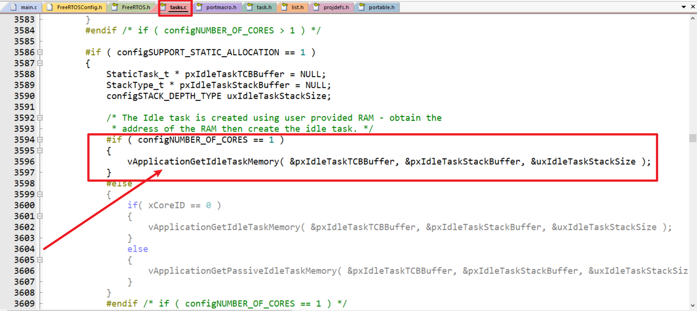

*图8.7-1空闲任务必须手动提供任务空间-图1*

这个函数的声明原型，就写在对应的头文件中：

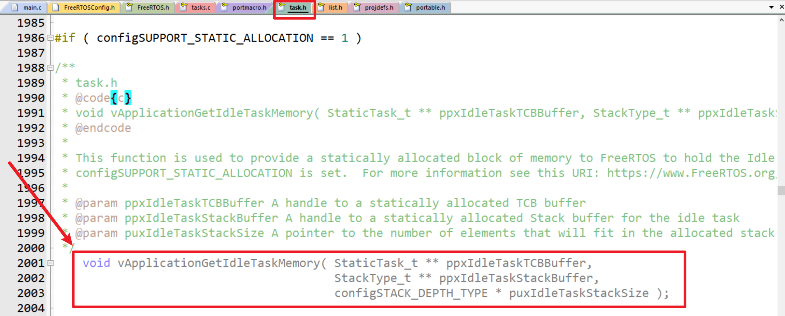

*图8.7-2空闲任务必须手动提供任务空间-图2*

在使用静态创建任务时，链接器会在链接阶段自动查找该函数的实现。链接器如果找不到这个函数的实现，自然就会抛出一个链接错误。

##### 8.7.1 控制反转思想（了解）

这个函数的设计，体现的是一种**“控制反转（Inversion of Control, IoC）”**的思想。

所谓控制反转，就是：

你只负责提供具体逻辑的实现，至于这个逻辑何时执行，由系统框架来决定。

这种思想我们已经见过很多次了，下面举一些例子。

**在qsort函数中：**

你只需要提供一个比较函数，用来定义排序规则。

至于：

1. 比较函数的调用时机
2. 比较函数的调用次数

都由 qsort 内部算法决定。

这里的控制反转是通过“函数指针参数传递”实现的：

1. 用户在调用 qsort 时，将比较函数地址作为参数传入；
2. qsort 在排序过程中，通过该函数指针调用比较函数；
3. 从而实现“算法框架固定、比较规则可变”的灵活排序功能。

qsort函数的设计，是一种典型的函数回调的应用，教科书般的函数回调。

函数回调是实现控制反转思想最简单直接的一种方式。

**在任务创建中：**

你提供任务入口函数。

但：

1. 任务何时获得 CPU
2. 任务何时开始执行
3. 任务何时被切换

都由 FreeRTOS 调度器决定。

这里的控制反转同样基于函数地址：

1. 任务函数地址在创建任务时保存到 TCB；
2. 调度器在首次调度任务时，根据 TCB 中保存的函数地址跳转执行。

不同之处在于：

函数地址不是通过参数反复传递，而是存入任务TCB中。

任务入口函数的调用，某种程度上来说，也可以视为一种函数回调的机制，只不过没那么纯粹。

毕竟任务入口函数一旦调用，除非切换任务，否则会一直执行（任务入口函数不会结束）。

**在中断机制中：**

从底层机制来看，中断服务程序的执行，本质上仍然是一种“函数地址跳转”。

1. 中断服务函数地址在编译/链接阶段写入中断向量表；
2. 中断向量表烧录后存储在 Flash闪存中；
3. 当硬件中断触发时，CPU 根据中断号索引向量表；
4. 然后跳转到对应函数执行。

这里的函数地址：不是运行时传递，不是存入SRAM内存结构中。

而是：

在系统启动前就已经写死在 Flash 中。

中断函数的调用，如果谈本质的话，也可以视为一种函数回调，只不过存在硬件（NVIC）参与控制，也不是传统意义上的回调。

**qsort、任务调度、中断机制，三者虽然表现形式不同，但本质一致：**

都是通过函数地址跳转执行用户代码。

区别仅在于，函数地址来源不同

1. 参数传入
2. 数据结构保存
3. 向量表索引

**相比之下，vApplicationGetIdleTaskMemory 的控制反转实现更加特殊。**

它并没有通过函数指针参数来实现控制反转。

而是：

1. FreeRTOS内核在固定位置声明该函数；
2. 用户必须提供该函数实现；
3. 链接阶段由链接器完成对应函数实现的链接，也就是绑定符号；
4. FreeRTOS内核运行时直接调用该函数。

**这种机制称为：钩子或钩子函数（Hook）**

它的特点是：

1. 函数名以及函数声明固定
2. 实现由用户提供
3. 链接阶段进行符号绑定
4. 具体的调用时机由系统框架来决定。

##### 8.7.2 为什么要学习控制反转的思想（了解）

通过上述几个例子我们可以看到：

无论是 qsort、任务调度、中断机制，还是 Hook，本质上都体现了一种共同的设计思想：

**框架掌控流程，用户提供逻辑。**

在传统顺序程序中：

1. 程序员掌控执行流程；
2. 每一个函数何时执行，由 main 函数明确控制。

而在控制反转模型中：

1. 执行流程由系统或框架掌控；
2. 程序员只需要提供某些“被调用的逻辑单元”。

至于：

1. 何时执行
2. 执行多少次
3. 是否被打断
4. 是否再次执行

都由框架或硬件决定。

**如果从更抽象的层面来看：**

控制反转的核心，并不在于“函数指针”这个技术细节，而在于：

**控制权的转移。**

具体的实现手段可以有很多种：

1. 函数指针参数传递（qsort）
2. 数据结构保存函数地址（TCB 中的任务入口函数）
3. 向量表索引函数地址（中断机制）
4. 固定函数声明 + 链接期绑定（钩子，Hook）

它们在技术实现上不同，但在设计思想上是完全统一的。

因此，我们可以得出一个更高层的结论：

控制反转是一种架构思想回调、Hook、任务入口函数、中断服务函数，都是这种思想在不同层次上的具体体现。

从应用层到内核层，从软件框架到硬件机制，控制反转思想贯穿始终。

**如果再往上升一个层次去看：**

操作系统本身，就是一个巨大的控制反转框架。

1. 用户程序并不控制 CPU；
2. 用户程序并不决定自己何时执行；
3. 中断并不由用户程序主动调用；
4. 系统资源的分配也不由用户程序直接掌控。

一切都在“系统框架”的调度之下运行。

而我们写的代码，只是嵌入在这个框架中的一部分逻辑。

总之：

**当系统规模变大，单纯依赖顺序控制无法构建复杂系统时，就必须引入控制反转，让框架接管流程，而程序员只专注于实现具体逻辑。**

举几个大家现在能理解的例子，这段内容大家看个乐子即可：

**案例一：裸机 while(1) 与 FreeRTOS 的对比**我们先看最原始的裸机程序：

```c
int main(void){
    init_uart();
    init_led();

    while (1){
       if (uart_rx_flag){
           handle_uart();
       }

       if (led_timeout){
           toggle_led();
       }
    }
}
```

在这个模型里：

1. 你控制主循环
2. 你决定检查顺序
3. 你决定执行频率
4. 你决定任务优先级（靠代码顺序）

这是典型的“顺序控制模型”。

现在换成 FreeRTOS：

```c
void vUartTask(void *arg){
    while (1){
       handle_uart();
       vTaskDelay(10);
    }
}

void vLedTask(void *arg){
    while (1){
       toggle_led();
       vTaskDelay(10);
    }
}
```

此时发生了什么？

1. 你不再写主循环调度逻辑
2. 你不再控制任务顺序
3. 你不再控制切换时机
4. 你不再控制优先级抢占过程

调度器接管了执行流程。

你只写“任务逻辑”。

这就是控制反转在嵌入式中的直接体现。

**第二个例子，利用中断来接收串口数据。**

如果你直接用轮询的方式：

```c
while (USART_GetFlagStatus(USART1, USART_FLAG_RXNE) == RESET);
data = USART_ReceiveData(USART1);
```

你在控制CPU，让它等待阻塞式的接收串口数据。

控制权在你。

但如果你用中断：

```c
void USART1_IRQHandler(void){
    // 省略多余逻辑
    if (USART_GetITStatus(USART1, USART_IT_RXNE) == SET){
       data = USART_ReceiveData(USART1);
    }
}
```

现在：

1. 你不再等待阻塞接收数据
2. 你不再决定什么时候接收数据，你没有这个控制权。
3. **由硬件触发中断机制，来决定何时进行数据接收。**

你只是提供“数据到来时要做什么”。

**这是硬件层面的控制反转。**

如果你能坚持看到这里，而且也能看懂的话，控制反转的思想将对你后续的学习进阶之路非常有帮助。

我希望大家能够记住几件事情：

第一，控制反转不是一定要使用的。顺序执行也不是万恶之源。

如果你只是简单点个灯，也没有必要将控制权交给其他框架，直接顺序执行就可以了。

只有复杂的系统，存在并发或异步执行的需求时，才需要用到控制反转。

第二，面对大型框架，复杂代码时：

**如果需要手写逻辑让系统框架调用，不妨多思考“它在哪个生命周期阶段调用我”，而不是总是思考“它为什么要调用我”。**

这是一个认知上的提升，比如我们后面学习Qt框架，一定需要掌握这种认知，才能够真正学明白。

**第三，所谓控制反转，是从“程序控制机器”走向“系统调度程序”的过程。**

##### 8.7.3 借助内核函数提供空闲任务的空间（了解）

说了一大堆理论，这一小节来具体实践一下如何提供空闲任务的内存空间。

首先我们先讲一种，几乎很少见，但确实存在的方式——借助FreeRTOS内核函数为空闲任务提供任务空间。

如下图所示：

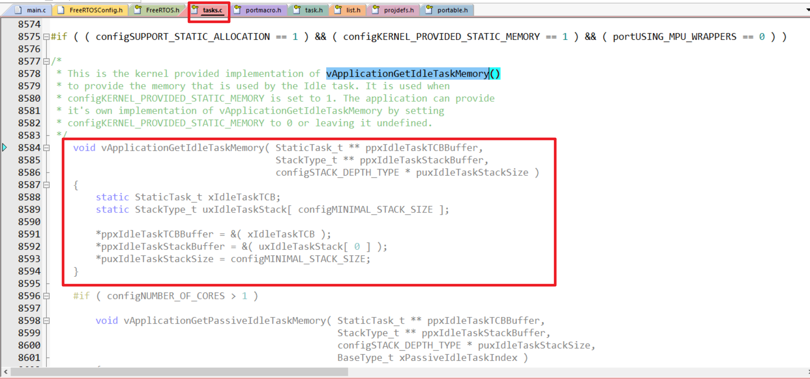

*图8.7.3-1借助内核函数提供空闲任务的空间-图1*

为了开启这个内核函数，我们需要在配置文件中添加以下宏定义：

```c
// 以下三个配置宏开启后，空闲任务空间的创建由FreeRTOS内核函数提供
#define configKERNEL_PROVIDED_STATIC_MEMORY 1
#define portUSING_MPU_WRAPPERS 0
#define configTIMER_TASK_STACK_DEPTH 128
```

如此配置后，我们的main.c文件中的代码不需要任何改变，就可以直接完成静态创建任务，并启动FreeRTOS。

此时空闲任务采用以下配置：

1. 默认的最小任务栈大小，即512字节。
2. 任务栈和TCB的内存区域都分配为静态局部变量。

这种方式并不推荐使用，因为：

1. 不可以自主控制空闲任务的任务栈的大小（通常尽量不改FreeRTOS内核源码）
2. 静态局部变量在函数外部无法获取访问，不利于调试维护代码。

下面，我们讲一下更推荐的方式，即手动为空闲任务分配任务栈和TCB内存空间。

##### 8.7.4 手动为空闲任务分配任务空间

将配置文件中的上述三行宏定义注释掉，我们采用手动为空闲任务分配任务空间的方式。

首先，我们从头文件中把函数的声明抄过来：

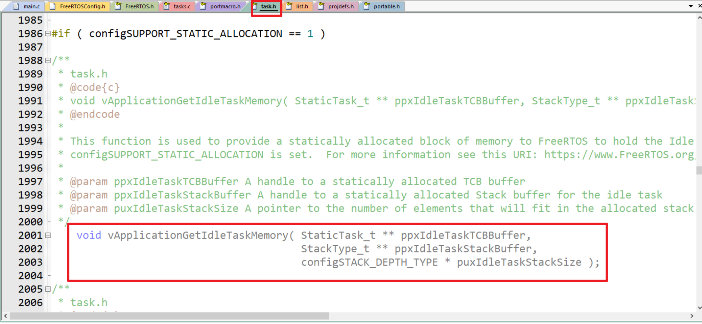

*图8.7.4-1手动为空闲任务分配任务空间-图1*

如下所示：

```c
void vApplicationGetIdleTaskMemory( StaticTask_t **ppxIdleTaskTCBBuffer,
                                StackType_t **ppxIdleTaskStackBuffer,
                                configSTACK_DEPTH_TYPE * puxIdleTaskStackSize);
```

可以看到此函数有三个参数，分别是：

1. TCB内存空间的二级指针。
2. 任务栈内存空间的二级指针。
3. 任务栈深度的一级指针。

我们已经学习使用C语言超过一个月了，这个函数的实现方式，对你来说应当非常简单了：

1. 传参TCB内存空间的二级指针：
   - a. 目的是在函数内部修改对应一级指针的指向，也就是TCB指针的指向
   - b. 指向谁呢？
   - c. 当然是指向我们自定义创建的TCB内存块。
2. 传参任务栈内存空间的二级指针：
   - a. 目的是在函数内部修改对应一级指针的指向，也就是任务栈指针的指向
   - b. 指向谁呢？
   - c. 当然是指向我们自定义创建的任务栈内存块。
3. 传参任务栈深度的一级指针：
   - a. 目的是在函数内部修改任务栈的深度
   - b. 改为哪个数值呢？
   - c. 当然是我们自定义创建的任务栈数组的长度。

一个标准的规范的调用方式如下：

```c
/* 空闲任务的 TCB 和任务栈 使用静态全局变量 */
static StaticTask_t IdleTaskTCB;
static StackType_t IdleTaskStack[configMINIMAL_STACK_SIZE];

void vApplicationGetIdleTaskMemory(StaticTask_t**ppxIdleTaskTCBBuffer,
                                StackType_t**ppxIdleTaskStackBuffer,
                                uint32_t *pulIdleTaskStackSize){
    /* 设置空闲任务 TCB 的存储位置 */
    *ppxIdleTaskTCBBuffer = &IdleTaskTCB;

    /* 设置空闲任务 任务栈 的存储位置 */
    *ppxIdleTaskStackBuffer = IdleTaskStack;

    /* 设置任务栈的深度 */
    *pulIdleTaskStackSize = configMINIMAL_STACK_SIZE;
}
```

相比“内核自己偷偷分配”，这种方式具有明显优势：

1. 内存在哪你看得见；
2. 栈多大你自己决定；
3. 更利于内存分析与调试；
4. 不需要开启特殊的配置宏；
5. 行为完全可预期。

一句话总结：

这是最清晰、最可控、最符合嵌入式工程思维的一种写法。

#### 8.8 静态创建任务的内存空间回收（了解）

在 FreeRTOS 中，如果我们静态创建任务：

```c
xTaskCreateStatic( ... );
```

那么任务的：

1. TCB
2. 任务栈

都是由我们自己提供的静态内存。

问题来了：

当我们调用vTaskDelete()删除这个任务时，这块内存会不会被自动“释放”？

当然不会。

静态创建任务时，任务的内存空间是由程序员显式提供的，程序的静态数据区。

而静态内存的生命周期，从系统上电开始就已经存在，直到系统断电才消失（SRAM）。

因此，这种内存本身就不存在“分配”和“释放”的过程，自然也不存在所谓的“自动释放”。

那怎么销毁这段空间呢？

答案是：

**不能销毁，不能释放，不能free。毕竟这段空间是静态区域，没有所谓的“释放”。**

**这段空间只能被复用，被其他静态任务所重新使用。**

但在工程实践中，这种“删除后复用”的场景极少出现。

因为使用静态创建任务的核心设计理念通常是：系统任务数量固定，结构稳定，不进行动态扩展或删除。

也就是说：

静态任务通常在系统初始化阶段创建完成，之后长期存在，基本不会删除。

所以静态任务的空间回收，工程实践中，基本上不会去做这个事情。

### 9. 总结

至此，关于任务创建的两种方式，以及其中涉及的一些基础概念，我们已经完整梳理了一遍。

总体来说，在实际工程中使用更多的仍然是**动态创建任务**。

建议大家仔细阅读官方文档，把相关 API 与细节都好好自己梳理一番，结合任务内存布局，深入理解任务的创建。

当然，任务创建只是第一步。

创建任务，编写任务入口函数，解决的是：

系统中“需要有哪些任务”，这些任务都在做什么事情。

而真正决定系统行为的，是：

当前“谁在运行”。

这就引出了接下来更核心的问题——**FreeRTOS 的任务调度机制。**

在前面的章节中，我们已经从结果层面知道：

1. 高优先级任务会抢占低优先级任务
2. 高优先级任务会一直执行，直到主动放弃CPU
3. 相同优先级任务会进行时间片轮转
4. 阻塞态任务不会参与调度
5. 进程的三种状态
6. ...

这些是调度的“表现”。

但问题是：

FreeRTOS 内部究竟是如何实现这些行为的？

调度器是依靠什么结构来组织和管理任务的？

如果说“任务创建”是给系统添加成员，那么“任务调度”就是决定这些成员如何运转。

要真正理解调度机制，我们必须深入内核最核心的一部分——**任务列表（Task List）。**

请学习下一章节：

---

## 04 任务列表

### 1. 任务状态切换

在前面的课程内容中，为了讲清楚FreeRTOS的任务调度机制，我们引入了“进程的三种状态”，也就是经典的三状态模型。

如下图所示：

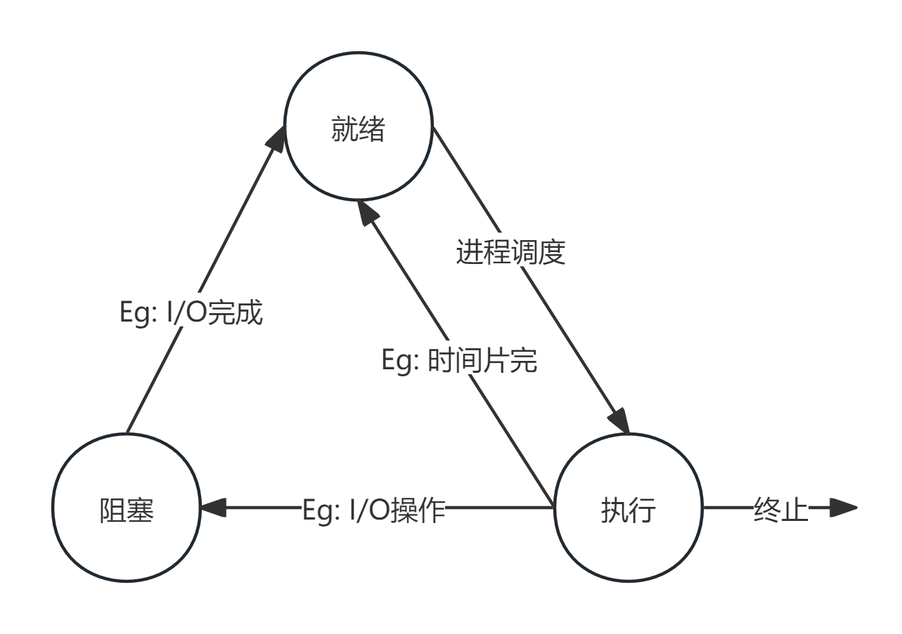

*图1-1进程的三种状态-图*

在当时，我们就提到过：

进程的三种状态只是描述**CPU 资源调度问题的逻辑结构模型。**

而具体到实际的操作系统实现：

竞争CPU资源的实体名称可以改变，状态的名字也可以改变，状态可以更多样化，状态切换的结构可以更复杂化....

三状态模型只是一个“最简抽象框架”。

在FreeRTOS中：

1. 竞争 CPU 的实体名称不再叫“进程”，而是叫“任务（Task）”
2. FreeRTOS系统中，任务的实际状态有四种：就绪、运行、阻塞以及挂起。

也就是说：

FreeRTOS 在经典三状态模型的基础上，引入了“挂起态”这一额外状态（实际上这种状态模型的设计仍然是非常简陋的，相较于通用操作系统）。

因此，在 FreeRTOS 中，任务的状态切换关系模型，会比经典三状态模型要多一个状态。

下图所示，即为 FreeRTOS 任务的四状态切换结构模型图：

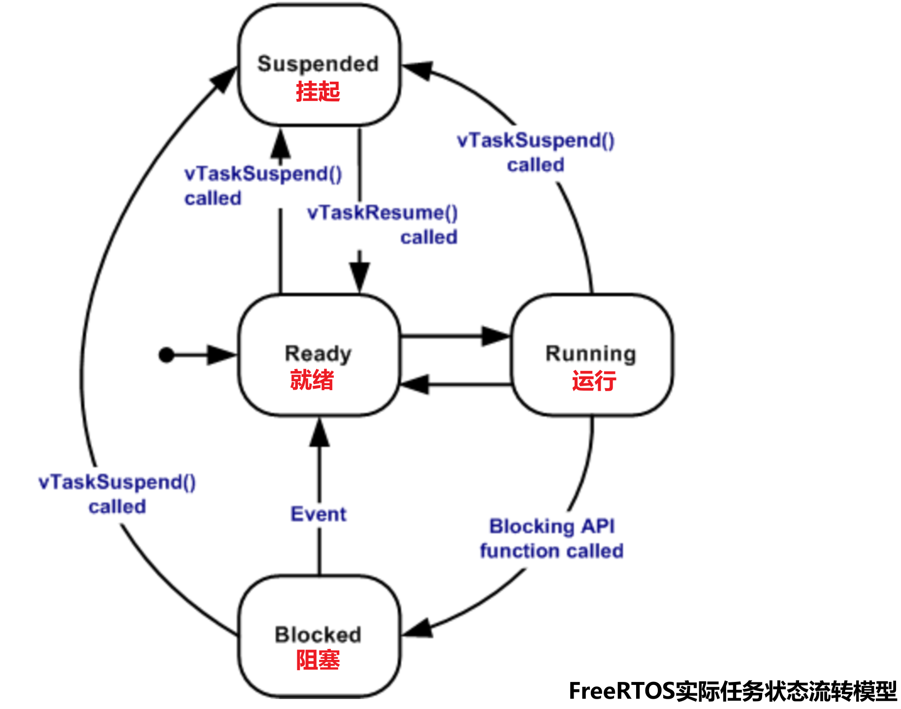

*图1-2FreeRTOS任务四种状态切换模型-图*

这张图来源自，FreeRTOS官网：有效任务状态转换这张图描述的是 FreeRTOS 任务的四种状态流转关系：

1. 就绪态（Ready）
2. 运行态（Running）
3. 阻塞态（Blocked）
4. 挂起态（Suspended）

**首先，刚刚创建的任务处于就绪态，这是一个前提条件。**（下面会解释这一点）

#### 1.1 Ready ↔ Running

**任务状态流转的第一条主线是：Ready ↔ Running**在单核 MCU 上（比如STM32F103C8T6），同一时刻只能有一个任务上CPU，处于Running 状态。

这不是调度策略问题，而是硬件物理限制决定的。

因此可以得到两个基本结论：

1. 调度器只会从“就绪态任务集合”中选择一个任务运行，被选中的任务，从 Ready 状态进入 Running 状态。
2. 当前运行的任务在被抢占或主动让出 CPU 后，会重新回到就绪态或进入其它状态。

在实际工程中，大多数时候，处于就绪态的任务都不止一个。

这时就需要引入一个经典术语——**就绪队列（Ready Queue）**。

就绪队列，是用于存放所有“已经具备运行条件，但暂时未获得 CPU”的执行实体的数据结构。

注意：

**“就绪队列”只是一个逻辑概念，用来表示“等待 CPU 的任务集合”。**

它并不限定必须采用某种具体的数据结构形式。

在早期批处理操作系统实现时，就绪队列确实采用了 FIFO 队列实现，所以叫做“就绪队列”。

但在现代操作系统中（尤其是通用操作系统），就绪队列的实现远比数据结构队列要复杂得多。

之所以仍然称为“队列”，更多是一种历史习惯和术语沿用，而不是数据结构意义上的严格定义。

那么问题来了：

**FreeRTOS 内核中的“就绪队列”究竟是如何实现的？**

作为一个轻量化操作系统，它是一个简单的队列实现呢？

还是有着更精巧的结构设计？

这将是下面课程内容的重点。

在后续内容中，我们将结合源码，对其内部实现进行详细分析。

#### 1.2 Running → Blocked → Ready

任务的运行态（Running）和就绪态（Ready）之间，可以进行双向切换。

在 FreeRTOS 中，任务的执行可以被抢占，被抢占的任务会回到就绪态，随后此任务还可以重新获取CPU执行权，重新进入运行态。

但一旦涉及到阻塞态，任务状态的切换就不再是简单的双向关系了。

**FreeRTOS中的某个任务，只能在运行态进行切换到阻塞态。**

所以FreeRTOS任务状态流转的第二条主线是：

**Running → Blocked → Ready**这条主线，描述了任务离开 CPU 的另一种方式：**主动放弃CPU执行权，进入阻塞状态。**

进入阻塞态的任务，会主动让出CPU执行权，在达成阻塞条件后（比如延时时间到），就会重新回到就绪态。

特别需要注意的是：

**阻塞态的任务在完成阻塞后，并不会直接回到 Running 状态，而是回到 Ready 状态，重新参与任务调度。**

随后能否运行，仍然要取决于当前系统中的调度情况。

#### 1.3 Ready ↔ Suspended

在进程的三种状态经典模型中，并没有直接提到“挂起态”。

那么什么是挂起态呢？

在 FreeRTOS 中，挂起态指的是：

**任务被人为主动地“从调度系统中移除”。**

注意这个关键词——人为。

也就是说，是程序员主动调用挂起函数，使某个任务进入挂起态。

当然，FreeRTOS内核有些时候也会将任务挂起，使得任务进入挂起态，这在后续课程中能够见到。

与阻塞态不同的是：

1. 阻塞态是“等待某个条件达成”；
2. 挂起态则是“被明确暂停，不参与调度”；
3. 挂起态的任务虽然没有被删除，但实际会被调度器忽略，永远不会获取CPU执行权。
4. 被挂起的任务，只有在恢复挂起后（即调用恢复函数），回到就绪态，才能重新参与 CPU 竞争。

需要特别注意两个细节：

1. **处于任意状态的任务，都可以被挂起，直接进入挂起态；**
2. 被挂起的任务在恢复后，会回到就绪态，类似于阻塞态任务完成阻塞后的状态转换。

#### 1.4 总结

至此，我们已经从逻辑模型层面，把 FreeRTOS 的四种任务状态以及三条主线梳理清楚：

1. Ready ↔ Running —— 解决的是 CPU 在多个任务之间如何切换；
2. Running → Blocked → Ready —— 解决的是任务为何主动离开 CPU；
3. Ready ↔ Suspended —— 解决的是任务如何被人为移出调度体系。

可以看到，这一整套状态流转模型，本质上仍然围绕一个核心问题展开：

**调度器如何管理“就绪态任务”？**

因为无论是阻塞完成，还是恢复挂起，最终都会回到 Ready 状态，重新参与 CPU 竞争。

也就是说：

所有任务状态流转的“汇聚点”，都是——就绪态。

那么问题来了：

FreeRTOS 内核究竟是如何组织这些就绪任务的？

**它的“就绪队列”到底采用了怎样的数据结构？**

下面，我们正式进入源码层面，用画图的方式，来分析 FreeRTOS 就绪队列的内部实现机制。

### 2. FreeRTOS内核任务状态管理数据结构

FreeRTOS是一个简易轻量化的实时操作系统，所以其内核任务状态管理的数据结构部分设计的非常简单。

包括就绪队列，整体实现参考如下源码：

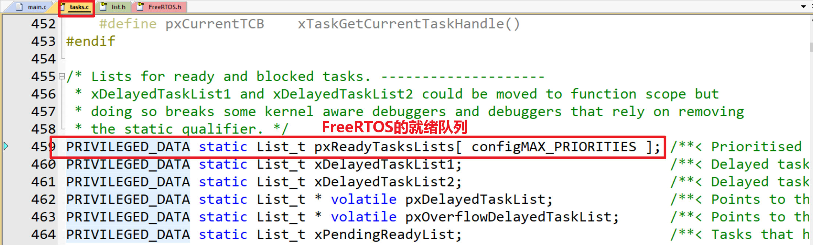

*图2-1FreeRTOS内核就绪队列源码-图1*

这一系列定义在task.c 文件内部的静态成员，本质上就是 FreeRTOS 内核用来管理任务状态的核心数据结构。

实际上我们在研究FreeRTOS任务内存布局时，在内核堆数组的高地址上方，存在 tasks.c 的静态全局变量区域，这里存放着 FreeRTOS 用来管理任务状态的核心链表结构。

.map文件中可以看到如下图所示：

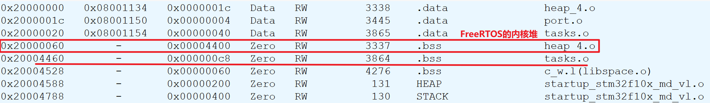

*图2-2FreeRTOS内核就绪队列源码-图2*

在内存模型中如下图所示：

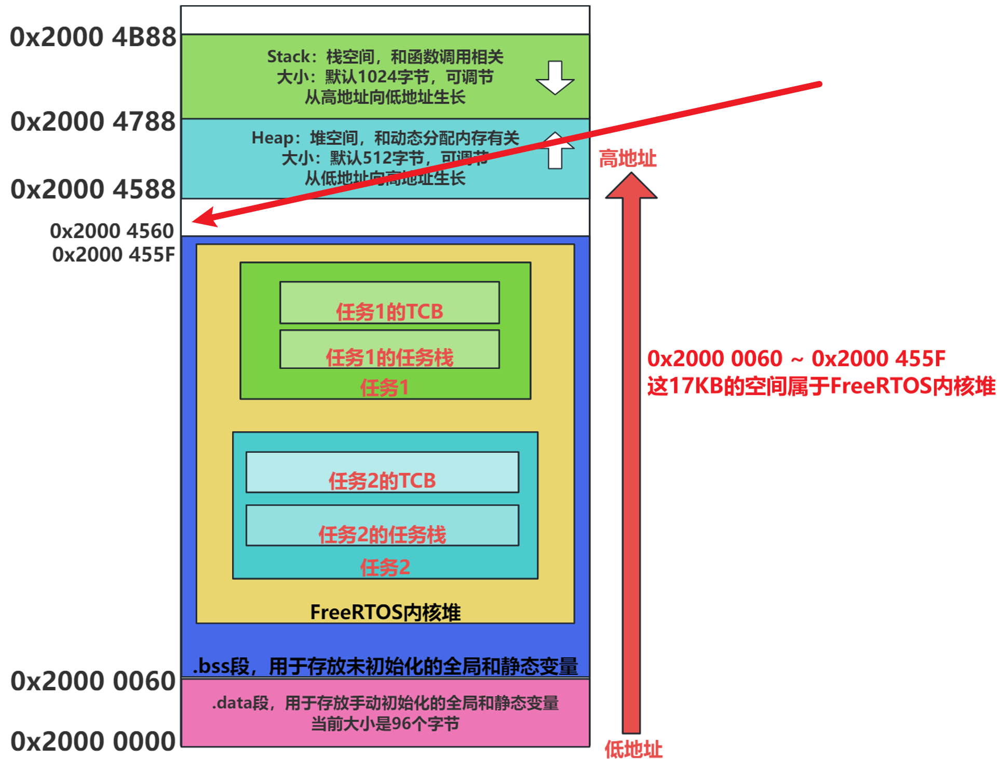

*图2-3FreeRTOS内核就绪队列源码-图3*

这段区域就是 FreeRTOS 内核用来管理任务状态的核心数据结构的存放区域。

这一段源码，需要注意的关键点有两个：

**第一，这些变量被定义为 static 修饰。**

这意味着：

它们只在tasks.c文件内部可见，不允许外部文件直接访问。

也就是说：任务调度的核心数据结构，被严格封装在内核内部。

当然这也是可以预见的设计，毕竟这些数据结构被内核管理，不能够暴露给外界使用。

**第二，这些静态变量都是 List_t 类型。**

这实际上是一个结构体类型，用于表示存储一条链表。

类型定义如下：

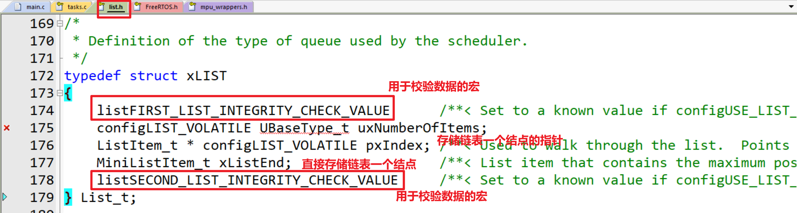

*图2-4List_t类型定义源码-图*

源码中每一个该类型的静态成员，都代表着一条或多条链表，用来管理任务的状态。

任务不同状态的管理，使用不同的链表。

**在命名时，从术语的角度，它们统一被命名为“XX列表”。**

**在命名时，从术语的角度，它们统一被命名为“XX列表”。**

**在命名时，从术语的角度，它们统一被命名为“XX列表”。**

下面，我们具体来看一下，都存在哪些列表。

#### 2.1 就绪列表数组

在 FreeRTOS 中，最重要的一种任务状态就是就绪态（Ready）。

那么，FreeRTOS内核如何管理就绪态任务呢？

实际上，FreeRTOS 使用了一个 List_t 类型的数组来管理所有就绪态任务。

这一数据结构是 FreeRTOS 调度器中最核心的数据结构之一。

在源码中，对应的变量定义如下：

```c
// 最前面的宏和static只是修饰符，不影响语义，在分析结构时可以暂时忽略它们
PRIVILEGED_DATA static List_t pxReadyTasksLists[ configMAX_PRIORITIES ];
```

通常我们将它称为：

1. 就绪队列，这种叫法符合操作系统课程中的概念，但不建议这么叫。
2. **更准确的叫法应该是：就绪列表数组，在下面的课程中我们也会采用这种称呼。**

所谓就绪列表数组，本质上就是：

FreeRTOS 使用一个List_t类型的数组，来分别管理不同优先级下的就绪任务。

关于就绪列表数组的具体内部实现方式，以及它如何进行任务状态的管理，我们将在下面的小节中进行详细分析。

#### 2.2 延时阻塞列表

如果某个任务因延时进入阻塞状态，例如调用了vTaskDelay()函数，那么此时任务会发生一次状态转换：

**Running → Blocked**也就是说，任务主动放弃 CPU 执行权，不再参与 CPU 竞争，进入阻塞状态。

**在 FreeRTOS 内核中，所有“因时间而阻塞”的任务，都会被插入到一个专门的链表结构中进行管理。**

对应源码中的关键变量如下：

```c
PRIVILEGED_DATA static List_t xDelayedTaskList1;
PRIVILEGED_DATA static List_t xDelayedTaskList2;
PRIVILEGED_DATA static List_t * volatile pxDelayedTaskList;
PRIVILEGED_DATA static List_t * volatile pxOverflowDelayedTaskList;
```

通常我们将它们统称为：**延时阻塞列表**。

当然实际上延时阻塞列表有两个，xDelayedTaskList1和xDelayedTaskList2。

至于这些数据结构是如何完成任务的阻塞状态管理，以及为何需要两张延时阻塞列表配合使用，我们将在后续小节中详细分析。

#### 2.3 挂起相关列表

如果某个任务被挂起，进入挂起态，那么该任务相当于被人为暂停，暂时不参与 CPU 执行权的竞争。

此时，任务会从原有状态列表中移除，并被插入到专门的挂起列表中进行管理。

在 FreeRTOS 内核中，与“挂起”相关的列表结构并不只有一个。

对应源码中的关键变量包括：

对应源码变量如下：

```c
PRIVILEGED_DATA static List_t xSuspendedTaskList; // 挂起列表
PRIVILEGED_DATA static List_t xPendingReadyList; // 挂起就绪列表
```

其中：

1. xSuspendedTaskList用于存放真正处于挂起态的任务；
2. xPendingReadyList则用于调度器暂停期间，暂存“待进入就绪态”的任务。

为了避免术语混淆，在后续课程内容中，我们将分别讲解：

1. **挂起列表（Suspended Task List）**
2. **挂起就绪列表（Pending Ready List），也可以叫待就绪列表**

挂起就绪列表涉及到下一章节的重要概念——临界区。

所以本章节中我们只讲一下挂起列表。

本小节先给出结构上的整体认知，具体的数据流转机制将在下面的小节中详细展开。

### 3. 就绪列表数组（重点）

**在FreeRTOS中，一个任务处于某个状态，实际上是通过它处于“哪个列表里”来进行判断的。**

如果一个任务处于就绪态（Ready）或运行态（Running），那么它实际上是处于“就绪列表数组”中的。

#### 3.1 没有运行列表

**首先需要特别强调一点：运行态并没有专属的列表。**

因为：

1. 运行态本质上只是“当前被选中的那个就绪任务”
2. 它仍然存在于就绪列表中
3. 只是调度器用一个当前TCB指针（pxCurrentTCB）指向了它

比如下列源码：

在tasks.c 文件的第442行，存储了一个当前TCB指针：

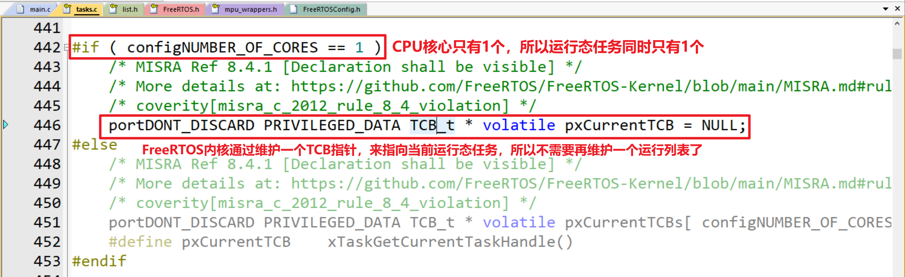

*图3.1-1运行态指针-图*

这个指针，就用于标记当前处于运行态的任务。（因为CPU只有一个，所以同一时刻只可能有一个任务上CPU）

再比如下列源码：

**如果创建多个优先级相同的任务，那么在任务创建完成后，当前TCB指针实际上会指向最后一个创建的任务。**

源码解析如下，大家可以了解一下。

第一次创建任务时：


*图3.1-2运行态指针-图2*

创建后续任务时：


*图3.1-3运行态指针-图3*

了解了上述FreeRTOS内核源码，了解了上述机制，那么对于下面代码：

```c
#include "stm32f10x.h" // STM32F10x 标准外设库头文件

#include "FreeRTOS.h" // FreeRTOS 核心头文件
#include "task.h" // FreeRTOS 任务相关 API

#include "DebugUSART1.h" // 调试串口模块（printf1）

// -------------------- 任务1 --------------------
void task1(void *arg) {
    while (1) {
       printf1("Task1 \n");
       vTaskDelay(1000);
    }
}

// -------------------- 任务2 --------------------
void task2(void *arg) {
    while (1) {
       printf1("Task2 \n");
       vTaskDelay(1000);
    }
}

int main(void) {
    // 使用中断优先级分组4
    NVIC_PriorityGroupConfig(NVIC_PriorityGroup_4);
    // 1. 初始化调试串口
    DebugUSART1_Init();

    // 2. 创建任务1
    xTaskCreate(task1,
               "Task1",
               configMINIMAL_STACK_SIZE,
               NULL,
               tskIDLE_PRIORITY + 1,
               NULL);

    // 3. 创建任务2（与任务1优先级相同）
    xTaskCreate(task2,
               "Task2",
               configMINIMAL_STACK_SIZE,
               NULL,
               tskIDLE_PRIORITY + 1,
               NULL);

    // 4. 启动 FreeRTOS 调度器
    vTaskStartScheduler();

    // 理论上不会运行到这里
    while (1) {
    }
}

```

哪一个任务会先执行呢？

**当然是Task2会先执行，它会先打印结果。**

因为当前TCB指针，在任务创建完成后指向了任务2。

#### 3.2 就绪列表数组本身

就绪列表数组相关的源码如下：

```c
PRIVILEGED_DATA static List_t pxReadyTasksLists[ configMAX_PRIORITIES ];
```

这里有几个关键点需要理解：

1. pxReadyTasksLists被称之为**就绪列表数组**。
2. 数组长度由configMAX_PRIORITIES决定。
3. 每一个数组元素，都是一个List_t类型的链表，也就是一个**就绪列表**。

configMAX_PRIORITIES是在 FreeRTOSConfig.h 中配置的最大优先级数量，默认情况下，其取值就是5。


*图3.2-1任务优先级最大值宏-图*

这意味着：

1. 系统中最多支持 5 个优先级
2. 优先级编号为 0 ~ 4

对应到就绪列表数组中，可以理解成：

FreeRTOS 内核默认维护的，是一个“按优先级分层”的就绪列表数组。

具体结构如下：

1. 优先级 0 → 1条就绪列表
2. 优先级 1 → 1条就绪列表
3. 优先级 2 → 1条就绪列表
4. 优先级 3 → 1条就绪列表
5. 优先级 4 → 1条就绪列表

**FreeRTOS内核就绪队列中，每一个优先级的任务，都有一条就绪列表。**

如下图所示：


*图3.2-2就绪列表数组-图*

通常这种设计，不同优先级任务之间天然分层，结构清晰，便于内核调度任务的执行。

#### 3.3 任务列表List_t类型

**List_t类型，我们起一个专门的名称：任务列表，简称列表。**


*图3.3-1任务列表-图*

任务列表是一个通用的链表类型，任务各个状态的列表都由此类型来表示。

那么一个“任务列表”的数据结构又是什么样的呢？

通过查阅源码我们知道，此类型中最核心的是三个成员：

1. uxNumberOfItems
2. pxIndex
3. xListEnd

下面逐一进行解释。

##### 3.3.1 成员：pxIndex

该成员的类型是ListItem_t* 的指针类型。

ListItem_t 类型，我们称之为：**任务列表项，简称列表项。**

任务列表项是任务列表的核心组成部分，用于表示链表中的一个结点，用来代表某个处于就绪/运行态的任务。

那成员pxIndex的作用是什么呢？

这个一个任务列表项指针类型成员，用于指向某个列表项。

**该成员用于记录：当前列表，遍历到了哪个任务结点**当多个任务处于同一优先级时，FreeRTOS 通过移动 pxIndex 来实现时间片轮转。

简单理解就是：

1. 上一次运行的是任务A
2. 下一次调度，就从任务A后面的节点开始找

这就实现了“同优先级任务轮流执行”。

##### 3.3.2 成员：xListEnd

该成员的类型是MiniListItem_t ，这种类型，我们称之为：**哨兵列表项。**

这个成员是一个特殊的“哨兵节点”。

它并不代表具体的某一个任务，不存储有效数据。

它的作用是：

标记链表的结束位置FreeRTOS 的任务列表，实际上一个“带哨兵结点的双向循环链表”。

xListEnd 是一个哨兵结点，它有两个作用：

1. 作为链表的尾结点标记，始终指向链表的最后一个结点。
2. **让链表操作逻辑更加统一，所有真实任务结点都必须插入在xListEnd 之前。**

可以理解为：

这个一个永远存在于链表中的假节点，指示链表的尾部，方便进行插入结点的操作。

##### 3.3.3 成员：uxNumberOfItems

该成员的类型是UBaseType_t ，这个类型我们太熟悉，它实际上就是一个无符号4字节整型。

再结合它的成员命名，这个成员的作用非常简单：

**当前任务列表中，一共有多少个结点（也就是多少个任务）**

这是一个计数器，用于记录链表中真实结点数量。

注意，哨兵结点不属于链表的真实结点，该计数器不会计算它。

在FreeRTOS内核调度时，调度器可以直接检查 uxNumberOfItems 是否为 0，从而判断某个优先级是否有任务。

如果该成员取值是0，说明该优先级没有就绪任务，那么就无需再去遍历链表了。

从而提升系统任务调度的效率。

#### 3.4 任务列表项ListItem_t 类型

为了能够完整画出“就绪列表数组”的数据结构图，我们还需要深入研究一下任务列表项ListItem_t 类型。

List_t 只是一个存储链表结构的容器，真正的链式结构的结点类型是任务列表项ListItem_t 类型。

此类型的源码如下：


*图3.4-1任务列表项类型-图1*

在FreeRTOS中为了简化代码，避免反复进行类型转换，所以：

1. 任务列表List_t类型，是所有状态列表都共用的类型。
2. **任务列表项ListItem_t 类型，所有状态的任务也共用同一个类型。**

这就导致一个问题：某种状态的任务，其任务列表项的成员，并不是每一个成员都有作用。

比如处于就绪态的任务，只有以下成员有作用：

1. pxNext
2. pxPrevious
3. pvOwner
4. pvContainer

下面来逐一介绍这四个成员，也是最通用的四个成员，任务无论处于何种状态，都涉及这四个成员。

##### 3.4.1 成员：pxNext和pxPrevious

这两个成员的类型都是任务列表项ListItem_t 的指针类型，它们的作用就非常明显了：

1. pxNext指向链表的下一个任务列表项节点
2. pxPrevious指向链表的上一个任务列表项节点

任务列表，这条链表中的每一个任务结点都会存储下一个和上一个结点的指针。

**由此可见，任务列表是一条双向循环链表。**

##### 3.4.2 成员：pvOwner

**该成员是任务调度过程中，调度器能够定位任务本体的核心桥梁。**

**pvOwner是一个指针类型，而且是一个指向任务TCB结构的指针。**

也就是说：

每一个任务列表项结点本身并不存储任务信息，而是通过pvOwner指针，间接指向任务的 TCB。

因此可以这样理解，FreeRTOS 内核调度器在遍历就绪链表时：

1. 先获取链表中的ListItem_t
2. 再通过pvOwner找到对应任务的 TCB
3. 最终通过 TCB 中保存的栈指针、优先级等信息完成任务切换

所以本质上：

调度器并不是直接在操作“任务函数”，而是在操作“链表节点”，再通过链表节点中的pvOwner ，间接定位到任务 TCB。

可以用一句话总结：

**FreeRTOS 的调度过程，本质是“链表节点 → pvOwner → TCB → 栈指针”的层层定位过程。**

这样设计的好处是：

链表结构与任务控制结构解耦，提高了内核结构的通用性和可扩展性。

##### 3.4.3 成员：pvContainer

在任务列表项结构体类型中，成员pvContainer的类型是任务列表List_t类型。

**所以这个成员的作用是：记录当前任务列表项属于哪个任务列表。**

也就是说：

**每一个 ListItem_t，都知道自己被挂在哪个 List_t 里。**

这个成员有啥作用呢？

我们来设想一个场景。

假如某一个任务需要被删除，那么就需要从任务列表中移除它的列表项。

如果ListItem_t不知道自己属于哪一个列表，那么只能这么做：

1. 遍历所有可能的任务列表
2. 在每个任务列表中查找该任务列表项结点
3. 找到之后再执行删除操作

这种方式不仅麻烦，而且效率低。

而有了pvContainer成员之后，情况就完全不同了。

删除流程变成：

1. 通过pvContainer直接获取所属的List_t
2. 直接移除对应的任务列表项
3. 随即更新任务列表中的节点数量与指针关系

整个过程无需遍历其他列表。

如此就简化了操作，更提升了任务调度的性能。

#### 3.5 哨兵列表项MiniListItem_t类型

为了能够画出就绪列表数组的数据结构，我们还需要深入了解一下哨兵列表项MiniListItem_t类型。

哨兵列表项类型非常简单，因为它并不存储有效任务数据。

其类型定义源码，如下图所示：


*图3.5-1哨兵列表项类型源码-图*

在每一个List_t任务列表中，都包含一个成员：

```c
MiniListItem_t xListEnd;
```

这个成员，就是整条链表的“尾部标记”，不存储有效数据，只是一个哨兵结点。

特别需要留意的是：

哨兵结点直接存储在结构体中作为一个成员，而不是存储指针。

由此可见，任务列表的链表是一条双向循环链表，并且是一个带哨兵结点的双向循环链表。

这样设计的好处是：

1. 插入和删除效率更高
2. 不需要单独处理头尾特殊情况

某种程度上来说，是一种空间（存储更多结点指针）换时间（效率提升）的做法。

实践中使用链表，多数都会使用这种双向循环链表，用更多空间占用来换取效率的提升。

#### 3.6 就绪任务数组的数据结构图

经过上面的一通讲解和描述，FreeRTOS内核的就绪任务数组的数据结构图，就基本可以很清晰的画出来了。

但还是有一些小细节需要补充一下：

1. 任务列表中的哨兵结点和普通结点类型是不同的。
   - a. **但实际上在FreeRTOS内核代码中，会直接把哨兵结点当成普通结点使用。**
   - b. 这是做的好处是，可以让哨兵结点和普通结点之间可以互相指向。
   - c. 之所以可以这么做是因为哨兵结点和普通结点，它们前半部分（前三个成员）是完全一致。
   - d. **这种结构体类型的“前缀兼容设计”，在各种操作系统内核中都很普遍，目的是为了节约空间，简化代码实现。**
2. 哨兵结点名为xListEnd，它的作用是标记双向链表的尾部，这一个细节需要注意。
3. 在初始化任务列表时，pxIndex成员会初始化为指向哨兵结点，当然FreeRTOS并不会把哨兵结点当成真实任务去调度。

上述描述可以参考内核函数vListInitialise() 的实现：


*图3.6-1任务列表初始化-图*

以上。

下面我们结合不同的情况，来画就绪任务列表的数据结构示意图。

##### 3.6.1 不存在任务结点的就绪任务列表

如果某个优先级的就绪任务列表不存在任何真实任务结点，那么它的数据结构示意图。

如下图所示：


*图3.6.1-1不存在任务结点的就绪任务列表-图*

哨兵结点的前驱与后继指针都指向自己。

pxIndex标记当前遍历结点，也指向哨兵结点。

##### 3.6.2 一个任务结点的就绪任务列表

如果某个优先级的就绪任务列表，只存在一个任务结点。那么它的数据结构示意图。如下图所示：


*图3.6.2-1一个任务结点的就绪任务列表-图*

解释一下这张图：

1. 哨兵结点和普通结点互相指向，各自存储的两个指针都指向对方。
2. pxIndex指向唯一的普通结点，如果所有处于就绪态的任务中，当前优先级是最高的，那么此任务就会上CPU，且不会进行时间片轮转。
3. pvContainer指向当前任务列表。

##### 3.6.3 多个任务结点的就绪任务列表

如果某个优先级的就绪任务列表，存在多个任务结点。那么它的数据结构示意图。如下图所示：


*图3.6.3-1多个任务结点的就绪任务列表-图*

解释一下这张图：

1. 每个任务列表项两个指针的指向都省略了，它们一个指向自身任务的TCB，一个指向当前任务列表。
2. **严格来说，循环链表没有所谓的“头尾”，但图中还是把哨兵结点当成尾部，这么做的目的是为了区分前驱和后继的方向。**

##### 3.6.4 整体数据结构模型图

整体数据结构模型图，如下图所示：


*图3.6.4-1整体数据结构模型-图*

任务的就绪列表数组，其结构搞清楚后，那么FreeRTOS内核，在“就绪态和运行态”之间的任务调度，是如何进行的呢？

#### 3.7 就绪任务调度机制

在FreeRTOS中，如何来决定当前哪一个任务上CPU呢？

很简单：

1. FreeRTOS 的任务调度，就是在就绪列表数组中，找到最高优先级的非空链表，然后从该链表中选出一个任务执行。
2. 如果最高优先级的任务具有多个，那么采用时间片轮转机制。

这个过程需要解决的第一个问题就是：

如何找到最高优先级的任务列表？

##### 3.7.1 找到最高优先级的任务列表

最简单办法是从任务列表数组的末尾开始遍历数组元素，直到找到一条不为空的链表。

但这个操作涉及遍历，从性能上还是有点差。

在开启下列宏的前提下（实际上默认开启）：

```c
#define configUSE_PORT_OPTIMISED_TASK_SELECTION 1
```

内核维护一个关键变量：


*图3.7.1-1当前最高优先级-图*

简单来说，通过这个静态全局变量，内核可以一步到位不需要遍历就知道当前最高优先级的任务列表。

那这是怎么实现的呢？

uxTopReadyPriority 的类型是UBaseType_t ，通常就是一个4字节无符号整型。

但只有其中的低configMAX_PRIORITIES位有效，通常就是低 5 位使用，高27则属于保留位。

在任务创建和转换状态时，通过下面源码来记录情况：


*图3.7.1-2当前最高优先级-图2*

任务调度器在调度任务时，可以直接利用这个优先级位图变量，一步位运算直接找出存在任务的最高优先级就绪列表。

源码如下图所示：


*图3.7.1-3image-20260318171756095*

整个源码的大体流程是：

```c
vTaskSwitchContext // 此函数调用意味着调度器开始切换任务
→taskSELECT_HIGHEST_PRIORITY_TASK // 调度器开始选择“下一个要运行的任务”
→portGET_HIGHEST_PRIORITY // 根据优先级位图，找出当前最高优先级
→ __clz // 使用CPU指令，快速定位“最高位的1”（最高优先级）
```

了解了原理，下面详细讲一下这个变量，也就是“优先级位图变量”的使用实例。

##### 3.7.2 优先级位图变量

uxTopReadyPriority变量实际上是一个**“优先级位图”**。

所谓位图（BitMap），是一种用整数的“每一位（二进制位）”来表示某种状态的数据结构。

不要把它和数据结构中的图（Graph）混淆。

位图中的“图”，来源于英文 Bitmap 中的 Map，表示映射关系。

从真实含义上来说，其实把 Bitmap 翻译为“位映射”更加贴切。

所谓优先级位图，在 FreeRTOS 中，就是用一个整数变量的每一位，来表示对应优先级的就绪列表是否存在就绪任务。

具体来说，是这样的：

| 位图（二进制） | bit.... | bit4 | bit3 | bit2 | bit1 |
|---|---|---|---|---|---|
| 位值 | .... | 1 | 0 | 1 | 0 |
| 对应优先级 | .... | 4 | 3 | 2 | 1 |
| 代表对应优先级的就绪列表有无任务 | .... | 有 | 无 | 有 | 无 |

再举一个实际的例子，假如系统当前存在：

1. 优先级4 的就绪任务
2. 优先级1 的就绪任务
3. 优先级0 的就绪任务

那么：

**优先级位图变量uxTopReadyPriority = ( 1 << 4 ) | ( 1 << 1 ) | ( 1 << 0 ) = 0b10011**调度器在任务调度时，只要找到uxTopReadyPriority最高位的1：

**比如找到上述数据最高位1在bit4，调度器就知道当前最高优先级的任务列表是优先级4。**

于是调度器直接去优先级为4的就绪列表中，找任务上CPU。

**这种“用 bit 表示状态集合”的位图设计，以极小的内存占用，基于位运算的高性能快速定位状态，在操作系统中被广泛采用。**

扩展：

FreeRTOS默认采用这种“优先级位图”的设计，但 uxTopReadyPriority 默认只是一个4字节无符号整型，只有32位。

这其实隐含了一个对优先级最大值的限制：

优先级的分级档位不应该超过32，即支持的最大优先级是31，即宏configMAX_PRIORITIES 的值应该小于等于32。

一旦优先级最大值超过31，优先级位图就无法覆盖全部优先级，其行为就会变为未定义不可预测。

当然绝大多数嵌入式系统，也没必要搞这么多任务优先级，多数情况5个优先级等级已经完全足够了。

##### 3.7.3 任务创建时如何插入就绪列表

首先，就绪列表List_t类型的结构体对象，其成员pxIndex，用于标记当前就绪列表，遍历到了哪个任务结点。

在任务列表初始化时，pxIndex指针指向了哨兵结点。

**在整个创建任务的过程中，pxIndex指针并不会被移动，仍然指向哨兵结点。**

想象一个场景：

依次序创建Task123三个任务，它们的优先级是一致的，会进入同一个就绪列表。

那么这三个任务的任务列表项结点，加上哨兵结点，是如何组成一条链表的呢？

为了解决这个问题，我们就需要查看相关源码了：


*图3.7.3-1任务创建时插入就绪列表-源码图*

如果你不相信，还可以更进一步点进去看看这个宏函数：


*图3.7.3-2任务创建时插入就绪列表-源码图2*

也就是说：

依次序创建优先级一致的Task123三个任务，就绪列表如下：

**哨兵 → Task1→ Task2 → Task3 → 哨兵**

##### 3.7.4 就绪列表时间片轮转

现在这三个任务处于同一个就绪列表，它们的优先级是一致的，所以采用时间片轮转。

这个过程主要涉及两个核心的变量：

1. pxIndex：标记目前已遍历的任务结点，一开始指向哨兵结点。
2. pxCurrentTCB：当前TCB指针，它指向真正上CPU，处于运行态的任务TCB。

接下来，调度器在每一次需要选择任务时，都会执行如下逻辑：

1. 找到当前最高优先级的就绪列表（本例中最高优先级是1）。
2. **在该就绪列表中，通过 pxIndex 向后移动一个结点，将移动到的结点对应的 TCB 赋值给 pxCurrentTCB。**
3. 随即完成任务的上下文切换，实现时间片轮转机制。

进行任务上下文切换的函数是：

```c
static void vTaskSwitchContext( void )
```

一路向内部寻找核心代码，最终找到源码如下：


*图3.7.4-1就绪列表时间片轮转源码-图*

由于pxCurrentTCB在任务完成创建后，已经指向了“Task3”，所以实际上在调度器启动后，这三个任务的执行顺序是：

Task3 → Task1 → Task2 → Task3 → Task1 → Task2 ......

其中Task3会第一个上CPU是因为，任务创建后**当前TCB指针**指向了Task3随后执行Task1，这是因为Task1是哨兵结点的下一个结点，pxIndex向后移动一个结点就是它。

##### 3.7.5 通过Keil5的调试模式查看就绪列表

将上述案例的代码放入Keil5中编译烧录：

```c
#include "stm32f10x.h" // STM32F10x 标准外设库头文件

#include "FreeRTOS.h" // FreeRTOS 核心头文件
#include "task.h" // FreeRTOS 任务相关 API

#include "DebugUSART1.h" // 调试串口模块（printf1）

// -------------------- 任务1 --------------------
void task1(void *arg) {
    TickType_t xLast = xTaskGetTickCount();

    while (1) {
       printf1("Task1 \n");
    }
}

// -------------------- 任务2 --------------------
void task2(void *arg) {
    TickType_t xLast = xTaskGetTickCount();

    while (1) {
       printf1("Task2 \n");
    }
}

// -------------------- 任务3 --------------------
void task3(void *arg) {
    while (1) {
       printf1("Task3 \n");
    }
}

int main(void) {
    // 使用中断优先级分组4
    NVIC_PriorityGroupConfig(NVIC_PriorityGroup_4);
    // 1. 初始化调试串口
    DebugUSART1_Init();

    // 2. 创建任务1
    xTaskCreate(task1,
               "Task1",
               configMINIMAL_STACK_SIZE,
               NULL,
               tskIDLE_PRIORITY + 1,
               NULL);

    // 3. 创建任务2（与任务1优先级相同）
    xTaskCreate(task2,
               "Task2",
               configMINIMAL_STACK_SIZE,
               NULL,
               tskIDLE_PRIORITY + 1,
               NULL);

    // 4. 创建任务3（与任务1优先级相同）
    xTaskCreate(task3,
               "Task3",
               configMINIMAL_STACK_SIZE,
               NULL,
               tskIDLE_PRIORITY + 1,
               NULL);

    // 5. 启动 FreeRTOS 调度器
    vTaskStartScheduler();

    // 理论上不会运行到这里
    while (1) {
    }
}

```

然后进入调试模式，打断点：


*图3.7.5-1通过Keil5的调试模式查看就绪列表-图1*

随后可以打开Keil5调试模式的监视窗口，输入表达式，查看就绪列表：


*图3.7.5-2通过Keil5的调试模式查看就绪列表-图2*

这里使用了下列表达式来查看优先级为1的任务列表：

```c
pxReadyTasksLists[1].uxNumberOfItems // 查看优先级为1的任务列表有几个任务，目前是3个
((TCB_t *)pxReadyTasksLists[1].xListEnd.pxNext->pvOwner)->pcTaskName//哨兵节点的后继结点任务，Task1
((TCB_t *)pxReadyTasksLists[1].xListEnd.pxNext->pxNext->pvOwner)->pcTaskName//Task1任务的后继结点任务，Task2
// Task2任务的后继结点任务，Task3
((TCB_t *)pxReadyTasksLists[1].xListEnd.pxNext->pxNext->pxNext->pvOwner)->pcTaskName
// 当前TCB指针，任务调度器启动后，Task3会最先上CPU
pxCurrentTCB->pcTaskName
```

这张图足以完美解释上面的推论。

**这里不再赘述了，如果你还有些不理解，可以仔细自行分析一下，可以自己用Keil5的调试模式来分析一下。**

### 4. 延时阻塞列表

理解了就绪列表数组，就绪态和运行态的切换，就已经掌握了 FreeRTOS 调度器的核心机制。

接下来我们继续看一种任务列表——延时阻塞列表。

在内核源码task.c 中，可以看到这样几行变量定义：

```c
PRIVILEGED_DATA static List_t xDelayedTaskList1;
PRIVILEGED_DATA static List_t xDelayedTaskList2;
PRIVILEGED_DATA static List_t * volatile pxDelayedTaskList;
PRIVILEGED_DATA static List_t * volatile pxOverflowDelayedTaskList;
```

它们就是FreeRTOS内核，延时阻塞状态管理的核心数据结构。

在 FreeRTOS 中，某个处于运行态的任务一旦调用vTaskDelay() 等时间相关的延时函数后：

其任务列表项就会从就绪列表移除，转而被插入延时阻塞列表当中。

延时阻塞队列为什么有两个呢？

为什么还需要使用两个指针呢？

下面来详细介绍一下FreeRTOS延时阻塞状态的管理机制。

#### 4.1 xTickCount全局Tick计数器

所有的延时阻塞都会有“醒来”的时刻。

FreeRTOS所有的延时阻塞函数，都是基于这样的思想来实现：

**如果需要延时x时间，那就让任务在进入阻塞状态后的“当前时间 + x时间”后回到就绪态。**

那么问题来了，在FreeRTOS中，怎么知道当前时间呢？

在内核源码文件tasks.c 中，维护了这样的一个全局系统节拍计数器：


*图4.1-1xTickCount源码-图*

在系统启动时，从0开始计数，每过一个系统节拍就自增1。

这个计数器就可以表示FreeRTOS内核的全局时间。

那么一个系统节拍是多长时间呢？

这个我们早就知道了，在配置文件中配置了下面的宏：

```c
#define configTICK_RATE_HZ ( ( TickType_t ) 1000 )
```

这就是说：1秒钟分为1000个系统节拍，1个系统节拍就是1ms。

在内核源码文件tasks.c 中，还存在这样的一个函数xTaskIncrementTick() ，它会在内核每过一个系统节拍时，为此全局变量自增1：


*图4.1-2xTickCount源码-图2*

当前这里面的注释也提到了：

1. xTickCount的类型是TickType_t （无符号），通常就是一个无符号4字节整型数据。
2. xTickCount每个系统节拍自增 1，持续累加必然发生溢出。
3. 全局系统节拍计数器的最大取值是4294967295 ，约等于每计时49.71天就会产生溢出。
4. FreeRTOS把这个现象称之为**“系统节拍回绕”**，也就是全局系统节拍计数归0。

xTaskGetTickCount()函数，其函数原型如下：

```c
TickType_t xTaskGetTickCount( void );
```

该函数的返回值，就是当前系统全局 Tick 的计数值。

如果你想获取当前系统 Tick，可以直接调用此函数。

#### 4.2 任务列表项中的成员：xItemValue

在就绪列表中，某个任务列表项的成员xItemValue通常是没有意义的。

但是在延时阻塞列表中，该成员是一个起着核心作用的成员：

**它会存储当前任务“苏醒”的全局系统节拍计数，也就是记录当前任务结束延时阻塞，回归就绪态的时间。**

可以通过查阅 vTaskDelay() 等函数的源码，找到 prvAddCurrentTaskToDelayedList() 函数，来了解这一个设定：


*图4.2-1xItemValue成员-源码图*

然后将任务的这个苏醒时间，存入到任务列表项的xItemValue成员中：


*图4.2-2xItemValue成员-源码图2*

既然每一个处于延时阻塞列表的任务结点，都记录了自己的苏醒时间，那么接下来就好办了：

只需要把结点按照苏醒时间排序，早苏醒的（节拍计数小的）排在前面，晚苏醒的排在后面。

由于延时阻塞列表是按唤醒时间升序排列的，调度器就无需遍历整条链表了。

而是仅需要检查头部的结点，只要头部的结点不苏醒，剩下的结点任务必然会持续阻塞。

#### 4.3 两个延时阻塞列表的作用

了解了前面的知识点，那么就可以解释一个问题了：

为什么延时阻塞列表有两个。

这个问题的答案，并不复杂，核心原因只有一个：

**系统的全局 Tick 计数器是会“回绕”的。**

现在思考一个场景。

假设当前：xTickCount = 0xFFFFFFF0某个任务A调用：

```c
vTaskDelay( 50 );
```

那么它的唤醒时间为：

xTimeToWake = 当前 Tick + 延时 Tick= 0xFFFFFFF0 + 50= 发生溢出 → 0x00000022**这个唤醒时间节拍计数，其数值由于溢出变得很小。**

另一个任务B调用：

```c
vTaskDelay( 5 );
```

那么它的唤醒时间为：

xTimeToWake = 当前 Tick + 延时 Tick= 0xFFFFFFF0 + 5= 0xFFFFFFF5**这个唤醒时间节拍计数，由于没有溢出，所以是一个比较大的数值。**

问题来了。

如果我们只有一个延时链表，并且简单按“唤醒时间升序排序”。

那么这两个任务应当先唤醒谁呢？

从时间顺序上看：B 应当先唤醒但实际上，如果只有一条延时阻塞列表，那么A任务由于唤醒时间小，处在链表前面，它会被先唤醒。

这显然是不正确的，不合理的。

为了解决这个问题，FreeRTOS的设计者将延时阻塞列表分为了两类，对应两类阻塞任务：

**第一类延时阻塞列表，存放苏醒时间在溢出前的任务结点，这就是“当前延时阻塞列表”。**

**也就是指针pxDelayedTaskList指向的延时阻塞列表。**

**第二类延时阻塞列表，存放苏醒时间在溢出后的任务结点，这就是“溢出/回绕延时阻塞列表”。**

**也就是指针pxOverflowDelayedTaskList指向的延时阻塞列表。**

也就是说：

```c
PRIVILEGED_DATA static List_t xDelayedTaskList1;
PRIVILEGED_DATA static List_t xDelayedTaskList2;
```

这两个延时阻塞列表，它们究竟是“当前延时”还是“回绕延时”，要看两个指针哪一个指向它们：

1. 如果pxDelayedTaskList指针指向了xDelayedTaskList1，那么xDelayedTaskList1就是当前延时阻塞列表。
2. 如果pxOverflowDelayedTaskList指针指向了xDelayedTaskList1，那么xDelayedTaskList1就是回绕延时阻塞列表。
3. **反之也一样。延时阻塞列表1和2究竟是什么作用，都只看什么指针指向这个列表。**

#### 4.4 回绕后延时阻塞列表的处理

xDelayedTaskList1和xDelayedTaskList2谁是当前延时阻塞列表，谁是回绕延时阻塞列表？

这当然不是固定的，会进行轮流的切换。

在内核第一次创建任务时，就会初始化内核任务列表的数据结构，涉及一个函数prvInitialiseTaskLists() 。

其源码如下图所示：


*图4.4-1延时阻塞列表的切换-图*

可以看到，在系统启动后，一开始：

1. pxDelayedTaskList指针指向了xDelayedTaskList1，xDelayedTaskList1是当前延时阻塞列表。
2. pxOverflowDelayedTaskList指针指向了xDelayedTaskList2，xDelayedTaskList2是回绕延时阻塞列表。

还是回到上面的场景中：

1. 当前的系统节拍计数是：xTickCount = 0xFFFFFFF0
2. 任务A的xItemValue成员中存储的数据是：0x00000022
   - a. 这个唤醒时间数值显然小于当前系统节拍计数，所以它是一个回绕后的时间
   - b. 于是任务A进入延时阻塞状态后，会进入回绕延时阻塞列表。
   - c. 也就是xDelayedTaskList2列表，pxOverflowDelayedTaskList指向这个列表。
3. 任务B的xItemValue成员中存储的数据是：0xFFFFFFF5
   - a. 这个唤醒时间数值显然大于当前系统节拍计数，所以它不是一个回绕后的时间
   - b. 于是任务B进入延时阻塞状态后，会进入当前延时阻塞列表。
   - c. 也就是xDelayedTaskList1列表，pxDelayedTaskList指向这个列表。

随后系统中的流程是这样的：

1. 当全局系统节拍计数达到0xFFFFFFF5时，任务B会结束阻塞苏醒，回归就绪态，从xDelayedTaskList1列表移除。
2. 当全局系统节拍计数达到0xFFFFFFFF且继续进入下一个节拍时：
   - a. 此时全局系统节拍计数溢出回绕，xTickCount = 0。
   - b. pxOverflowDelayedTaskList和pxDelayedTaskList两个指针需要交换指向的对象。
   - c. 随后xDelayedTaskList2列表变成了当前延时阻塞列表，xDelayedTaskList1列表变成了回绕延时阻塞列表。
3. 当全局系统节拍计数达到0x00000022时，任务A会结束阻塞苏醒，回归就绪态，从xDelayedTaskList2列表移除。
4. .....

xDelayedTaskList1和xDelayedTaskList2这两个链表，会交替作为“当前延时列表”和“回绕延时列表” 使用。

从而共同完成 FreeRTOS 中延时阻塞任务的管理与调度。

在系统运行过程中：

1. pxDelayedTaskList指针指向**当前延时列表**
2. pxOverflowDelayedTaskList指针指向**回绕延时列表**

当系统全局 Tick 计数器发生回绕时，这两个指针会进行一次交换。

交换之后：

1. 原来的回绕延时列表变成新的当前延时列表
2. 原来的当前延时列表则变成新的回绕延时列表

这样一来，FreeRTOS 就可以继续按照新的时间周期来管理延时任务。

**pxDelayedTaskList和pxOverflowDelayedTaskList这两个指针交换的源码如下图所示：**


*图4.4-2延时阻塞列表的切换-图2*

上述源码描述了全局Tick计数发生了回绕现象，下面的源码则是交换指针的过程：


*图4.4-3延时阻塞列表的切换-图3*

以上。

这套设计的精妙之处在于：

1. 利用无符号 Tick 计数器的自然回绕特性。
2. 将时间范围划分为两个周期区间
   - a. 溢出回绕前，一个周期对应当前延时列表
   - b. 溢出回绕后，另一个周期对应回绕延时列表。
3. 通过交换两个指针完成时间周期切换，不需要重新计算或调整列表结构。
4. 整个过程中无需移动任何列表节点。

因此，从实现思想上来看，这种设计本质上是：

通过增加一个链表结构，将复杂的时间判断问题转化为简单的指针交换操作。

也可以理解为：

用结构设计降低算法复杂度。

**总之，FreeRTOS 的延时机制，并不是简单“等待多少毫秒”，而是一个基于 Tick 计数、链表管理和回绕处理的完整时间调度系统。**

**关于这一点，关于FreeRTOS延时函数的具体原理，我们等到后面讲定时器时再详谈。**

### 5. FreeRTOS提供的延时阻塞函数

前面我们已经讲完了**延时阻塞列表**的实现机制。大家已经知道：FreeRTOS系统中存在一个全局 Tick 计数器xTickCount 。

任务调用延时函数之后，会发生这样几件事情：

1. 当前任务从就绪列表中移除
2. 任务被插入延时阻塞列表
3. 当全局 Tick 计数器xTickCount增长到任务设定的唤醒时间（即xItemValue ）
4. 任务就会重新进入**就绪列表**，回到就绪态

也就是说：

**FreeRTOS 的延时，本质上是通过延时阻塞列表 + 全局 Tick 计数实现的。**

知道了这个本质，那么我们就可以来一起看一下FreeRTOS 内核为我们提供的**任务级延时函数**。

在实际编程中，最常用的用于延时，使任务进入阻塞态的函数有两个：

```c
vTaskDelay();
vTaskDelayUntil();
```

这两个函数基本覆盖了 FreeRTOS 中绝大多数的延时场景。

下面我们就分别来看一下，这两个函数是怎么用的，以及它们之间有什么区别。

当然，首先我们要知道的是：

**这两个延时函数，能够使得任务进入阻塞态，主动放弃CPU！**

而且这两个函数都是默认配置启用的，在FreeRTOS配置文件中存在下列宏：

```c
#define INCLUDE_vTaskDelayUntil 1
#define INCLUDE_vTaskDelay 1
```

#### 5.1 vTaskDelay()函数

vTaskDelay()的函数原型是：

```c
void vTaskDelay( const TickType_t xTicksToDelay );
```

这个函数只有一个参数：xTicksToDelay用于表示当前任务希望延时多少个系统节拍 Tick。

vTaskDelay()函数的实现逻辑，和上面讲的延时阻塞列表的原理是完全一致的：

该内部函数会完成几个操作：

1. 当前任务从就绪列表中移除
2. **计算任务的唤醒时间 = 此函数调用时的全局Tick + xTicksToDelay**
3. 将任务插入延时阻塞列表

当系统 Tick 递增到这个唤醒时间时，任务就会从阻塞态“苏醒”，重新回到就绪列表。

也就是说：

vTaskDelay() 的本质，就是让任务进入延时阻塞列表等待 Tick。

举一个例子：

```c
vTaskDelay(1000);
```

在默认配置的情况下，1个系统节拍Tick是1ms，所以这种写法就表示：

任务**大概**延时1000ms，也就是**大概**1s后重新回到就绪态。

为什么是大概呢？

要回答这个问题，我们可以先思考一个更简单的问题：

```c
vTaskDelay(1);
```

是不是精确延时 1 个系统节拍？

**答：大概率不是。**

为什么呢？

原因在于vTaskDelay(1)的唤醒时间是这样计算的：

```c
xTimeToWake = xTickCount + xTicksToDelay
```

如果调用：

```c
vTaskDelay(1)
```

则：

```c
xTimeToWake = 全局Tick + 1
```

任务会进入延时列表，等待 Tick 递增到这个时间。

举一个具体数值的例子：

假如，当前 Tick = 1000任务调用：vTaskDelay(1)则内核计算出的唤醒时间为：1001任务会被插入延时阻塞列表，等待系统 Tick 增长到 1001。

问题在于：

**任务是在 Tick 周期的哪个时刻调用 vTaskDelay(1)。**

如果任务是在1000这个 Tick 刚刚开始的时候调用，那么：

下一次 Tick （1001）到来大约还有完整的一个 Tick 周期。

因此vTaskDelay(1) 延时接近：1 Tick，接近1ms但如果任务是在**Tick=1000 即将结束的时候**调用 vTaskDelay(1)那么：

可能很短暂的几十微秒之后，1000这个Tick就结束了，1001这个Tick就会到来。

于是任务的唤醒条件就很快得到满足，任务会重新进入就绪列表。

这种情况下，实际延时的时长很短暂，可能只有：几十微秒所以可以得到一个重要结论：

**vTaskDelay(1) 的实际延时时长是一个范围：0 ~ 1 Tick，而不是固定的 1 Tick。**

**我们把vTaskDelay()函数实现的延时，称之为“相对延时”，因为它始终相对于函数执行的当前Tick来完成延时。**

当然，如果延时的 Tick 数大于 1，情况就会不同。

因为从第二个延时 Tick 开始，整个 Tick 都在延时内度过。

所以vTaskDelay()的误差最大是接近1 Tick，这个误差不会随延时时长变长而增加。

再回到：vTaskDelay(1000);

这个函数的实际延时时长是：999Tick ~ 1000TickvTaskDelay()函数实现的相对延时，实现简单，使用起来也比较简单，但确实存在1个Tick内的误差。

在实际工程中，如果不要求特别高的精度，把这个函数当成延时 1s 其实问题也不大。

但如果特别在意精度，就需要使用另一个函数——vTaskDelayUntil()，下面来讲一下这个函数。

#### 5.2 vTaskDelayUntil()函数

vTaskDelayUntil() 的函数原型如下：

```c
void vTaskDelayUntil( TickType_t * const pxPreviousWakeTime,
                   const TickType_t xTimeIncrement );
```

**如果说vTaskDelay()实现的是相对延时，那么vTaskDelayUntil()就是实现了绝对延时。**

为了讲清楚这个函数，就需要先了解一个问题——vTaskDelay() 的时间漂移问题。

##### 5.2.1 vTaskDelay() 的周期漂移问题

假设我们希望任务**每 1 秒执行一次**。

很多人会这样写：

```c
while(1){
    Operate();
    vTaskDelay(1000);
}
```

看起来好像是：每执行一次任务，就延时 1000 Tick。

看起来好像是：每次执行任务间隔 1000 Tick。

但这里有一个隐藏的问题：

**任务本身也是要消耗时间的。**

例如：Operate()函数的调用，任务自身的操作，需要执行 5 个Tick那么任务的一次完整执行时间，实际上是：

```c
任务执行时间 + vTaskDelay时间
```

也就是说：

```c
任务的实际周期 = 任务执行时间 + 1000 Tick
```

于是任务周期实际上变成了：

```c
1005 Tick
```

而且任务操作执行所消耗的时间Tick，大概率不会每次都是一样的。

再加上vTaskDelay()本身就有1Tick的误差。

而且随着循环次数增加，误差还会不断累积。最终任务的执行，就会越来越偏离原来的周期。

这就叫做：

**周期漂移（Period Drift）问题**比如：

你想设置一个周期为1000Tick的周期任务，使用vTaskDelay()，它的执行时间线由于周期漂移就会越来越奇怪：

第1次执行Tick：0第2次执行Tick：1005第3次执行Tick：2010第4次执行Tick：3015...

在实际的工程环境下，如果某一个任务特别在意周期性执行，特别需要确保它的执行周期不变那么使用vTaskDelay()进行延时显然是错误的，此时就需要使用vTaskDelayUntil()函数。

##### 5.2.2 vTaskDelayUntil() 的工作方式

vTaskDelayUntil()用于实现**周期性任务延时**。

它和vTaskDelay()的区别在于：

1. vTaskDelay()是从**当前调用时刻**开始延时一段时间。
2. vTaskDelayUntil()是根据**上一次计划唤醒时间**，计算下一次固定的唤醒时间点。

**所以，vTaskDelayUntil() 更适合用于传感器周期采集、状态周期检测、周期打印调试信息等场景。**

这个函数有两个参数：

```c
pxPreviousWakeTime
```

   - a. 用于保存任务的**上一次计划唤醒时间**。
   - b. 这里需要传入一个指针，因为vTaskDelayUntil()函数内部会自动更新这个时间值。
   - c. 第一次使用之前，通常需要先调用xTaskGetTickCount()获取当前系统Tick，作为初始参考时间。

```c
xTimeIncrement
```

   - a. 用于指定任务的运行周期，单位是 Tick。
   - b. 例如传入1000 ，表示任务希望每隔 1000 个 Tick 周期性运行一次。

此函数的典型调用方式如下：

```c
// 任务入口函数
TickType_t LastWakeTime = xTaskGetTickCount(); // 获取当前系统全局Tick
while(1){
    Operate();
    vTaskDelayUntil(&LastWakeTime, 1000);
}
```

**我们直接用Tick数值，来描述此时任务的执行过程：**

**假设任务第一次开始执行时：**

```c
当前全局 Tick = 1000
LastWakeTime = 1000
```

任务自身执行Operate() ，消耗了 5 个 Tick。

此时：

```c
当前全局 Tick = 1005
```

然后调用：

```c
vTaskDelayUntil(&LastWakeTime, 1000);
```

函数内部会计算下一次计划唤醒时间：

```c
下一次计划唤醒时间 = LastWakeTime + 1000
               = 1000 + 1000
               = 2000
```

**所以任务并不是从当前 Tick = 1005 开始再延时 1000 个 Tick，而是延时到固定的Tick = 2000。**

因此本次实际延时阻塞时间为：

```c
2000 - 1005 = 995 Tick
```

同时，vTaskDelayUntil()内部会自动更新LastWakeTime ，使其变为下一次的周期基准：

```c
LastWakeTime = 2000
```

下一轮任务被唤醒时，当前全局 Tick 大约为：

```c
当前全局 Tick = 2000
```

如果这一轮Operate()执行消耗了 6 个 Tick，那么调用vTaskDelayUntil()时：

```c
当前全局 Tick = 2006
LastWakeTime = 2000
```

函数内部继续计算下一次计划唤醒时间：

```c
下一次计划唤醒时间 = LastWakeTime + 1000
               = 2000 + 1000
               = 3000
```

所以本次实际阻塞时间为：

```c
3000 - 2006 = 994 Tick
```

可以看到，即使任务自身的执行时间每次不完全相同。

例如第一次消耗 5 Tick，第二次消耗 6 Tick，vTaskDelayUntil()仍然会尽量保证任务按照固定周期运行：

```c
Tick = 1000 运行
Tick = 2000 运行
Tick = 3000 运行
Tick = 4000 运行
```

也就是说，vTaskDelayUntil()关注的不是“从现在开始延时多久”，而是“下一次应该在什么固定时间点运行”。

即使任务本身操作的执行，消耗了几 Tick，甚至每一次执行消耗的Tick数量都不同vTaskDelayUntil()仍然会保证：任务总是按固定周期运行。

##### 5.2.3 注意事项（重点）

**注意：使用 vTaskDelayUntil() 时，第一次获取 Tick 时间的语句应该放在 while 循环外面。**

###### ◼︎vTaskDelayUntil()正确调用方式-演示代码

```c
// 正确的写法
TickType_t LastWakeTime = xTaskGetTickCount();

while (1) {
 Operate();
 vTaskDelayUntil(&LastWakeTime, PeriodTick);
}
```

**下面的写法，严格来说是错误的：**

###### ◼︎vTaskDelayUntil()错误调用方式-演示代码

```c
while (1) {
 // 错误的写法
 TickType_t LastWakeTime = xTaskGetTickCount();
 Operate();
 vTaskDelayUntil(&LastWakeTime, PeriodTick);
}
```

因为LastWakeTime是周期任务的时间基准，vTaskDelayUntil()内部会自动更新它。

如果把xTaskGetTickCount()放到while循环里面，每一轮都会重新设置时间基准，就失去了固定周期运行的意义，容易导致任务周期发生偏移。

或者换句话说，如果把xTaskGetTickCount()放到while循环里面，此函数调用接近vTaskDelay() ！

#### 5.3 总结与建议

vTaskDelay()的特点：

1. 相对延时
2. 延时时间相对于系统当前全局 Tick
3. 可能产生周期漂移
4. 适合工程中的简单延时，不在意精度的场景。

vTaskDelayUntil()的特点：

1. 绝对延时
2. 按固定时间点唤醒任务（固定周期）
3. 周期更稳定
4. 适合周期任务

#### 5.4 了解：pdMS_TO_TICKS()宏函数

在 FreeRTOS 中，经常会看到这样的写法：

```c
vTaskDelay(pdMS_TO_TICKS(1000));
```

其中pdMS_TO_TICKS()实际上是一个宏函数，在源码projdefs.h文件中可以看到它的定义：

*图5.4-1宏函数的定义-图*

**这个宏函数的作用很简单：把毫秒值转换为 Tick 数值。**

换算公式就是：

```c
Tick = 毫秒值 × configTICK_RATE_HZ / 1000
```

如果配置宏configTICK_RATE_HZ 的数值就是默认推荐值1000，那么这个宏函数实际没啥意义。

所以：

这个宏函数主要在configTICK_RATE_HZ 不是1000时，才用得到，可以更方面的计算出毫秒值对应多少Tick。

但实际上，大多数FreeRTOS工程都会不会修改configTICK_RATE_HZ ，所以这个宏函数作用有限，了解即可。

### 6. 任务挂起

**在 FreeRTOS 中，任务除了“就绪态”“运行态”“阻塞态”之外，还有一种特殊状态 —— 挂起态（Suspended）。**


*图6-1FreeRTOS任务状态流转-图*

关于挂起态，我们需要了解以下几点基本概念：

1. 处于任意调度状态的任务，都可以被vTaskSuspend()挂起，进入挂起态。
   - a. 甚至可以挂起后再挂起，一个任务被挂起多次，但这样没什么实际意义，FreeRTOS没有“挂起计数”的概念。
   - b. 任务创建完毕后就处于就绪态，所以该函数可以在main()函数中执行，直接在任务创建完成后挂起任务。
   - c. vTaskSuspend()
2. 被挂起的任务不参与任务调度，也不会因为条件满足而自行回归就绪态。

3. 进入挂起态的任务，实质上是被移出原有列表，并插入内核维护的挂起列表xSuspendedTaskList。

4. **在其他任务中调用 vTaskResume()，就可以恢复某个任务，让它重新被插入就绪列表，回到就绪态。**

#### 6.1 为什么设计挂起态

既然已经有阻塞态了，为什么还要挂起态？

阻塞态，通常表示任务因为“等待某种条件”而暂时不运行。

挂起态，则表示任务被人为强制停止运行。

阻塞态的恢复依赖条件满足，比如时间到了。

挂起态的恢复不依赖这些条件，而是依赖其他任务或中断主动调用恢复函数。

**所以，阻塞更像“任务自己在等事情发生，然后自动恢复”，挂起更像“任务被别人按下了暂停键，不会自动恢复”。**

#### 6.2 vTaskSuspend()和vTaskResume()函数

挂起和恢复挂起，分别对面下面两个函数：

1. vTaskSuspend()，将任务挂起。
2. vTaskResume()，将任务恢复挂起。

想要使用这两个函数，必须开启下面这个宏：

```c
#define INCLUDE_vTaskSuspend 1
```

当然，在配置文件中，它是一个默认配置：


*图6.2-1裁剪相关-图*

默认开启任务的挂起状态，及其相关的API。

vTaskSuspend()函数的函数原型是：

```c
void vTaskSuspend(TaskHandle_t xTaskToSuspend);
```

**其中xTaskToSuspend，表示要挂起的任务句柄，如果传参NULL表示挂起当前运行的任务，也就是自己挂起自己。**

vTaskResume()函数的函数原型是：

```c
void vTaskResume(TaskHandle_t xTaskToResume)
```

**其中xTaskToResume，表示要恢复挂起的任务句柄。**

**这里就不能再传参NULL了，被挂起的任务没有机会执行，不可能自己恢复挂起自己。**

参考一个演示代码案例：

```c
#include "stm32f10x.h"
#include "freertos.h"
#include "task.h"
#include "DebugUSART1.h"
#include <string.h>

/* ================================
 * 任务1：
 * 每1秒运行一次
 * 第一次运行时主动挂起自身
 * ================================ */
void task1(void * arg) {
    int flag = 0; // 标记是否已自挂起
    while (1) {
       vTaskDelay(1000); // 延时1秒（阻塞态）
       // 第一次运行时主动挂起自身
       if (flag == 0) {
           vTaskSuspend(NULL); // NULL表示挂起当前任务
           flag = 1;
       }
       printf1("task1 \n");
    }
}

/* ================================
 * 任务2：
 * 每1秒打印一次
 * 始终处于正常调度状态
 * ================================ */
void task2(void * arg) {
    while (1) {
       vTaskDelay(1000); // 延时1秒
       printf1("task2 \n");
    }
}

/* ================================
 * beginTask：
 * 负责控制 task1 的挂起与恢复
 * ================================ */
void beginTask(void *arg) {
    TaskHandle_t hand1, hand2;

    // 创建两个优先级相同的任务（优先级 4）
    xTaskCreate(task1, "Task1", configMINIMAL_STACK_SIZE, NULL, 4,&hand1);
    xTaskCreate(task2, "Task2", configMINIMAL_STACK_SIZE, NULL, 4,&hand2);

    while (1) {
       // 延时5秒钟后，恢复挂起task1，回到就绪态
       vTaskDelay(5000);
       vTaskResume(hand1);

       // 延时5秒钟后，挂起task1
       vTaskDelay(5000);
       vTaskSuspend(hand1);
    }
}

/* ================================
 * 主函数：
 * 创建 beginTask 并启动调度器
 * ================================ */
int main(void) {
    // 使用中断优先级分组4
    NVIC_PriorityGroupConfig(NVIC_PriorityGroup_4);
    DebugUSART1_Init(); // 初始化串口

    // 创建 beginTask，优先级 3
    xTaskCreate(beginTask, "beginTask",
               configMINIMAL_STACK_SIZE,
               NULL,
               3,
               NULL);

    vTaskStartScheduler(); // 启动调度器

    while (1) {
    }
}

```

**系统中一共存在三个任务：**

1. task1（优先级 4）
2. task2（优先级 4）
3. beginTask（优先级 3）

**Task1 的行为分析：**

task1 在第一次运行时，会主动调用：

```c
vTaskSuspend(NULL);
```

将自己挂起。

这里有一个非常关键的点：

这是任务“主动把自己从调度系统中移除”。

执行该函数后，会发生以下事情：

1. 任务从就绪列表中移除
2. 被插入挂起列表（Suspended List）
3. 不再参与任何调度

也就是说：

**一旦进入挂起态，这个任务就从调度器关注的状态列表中移出，不再参与 CPU 竞争。**

想要让它重新运行，必须调用：

```c
vTaskResume(hand1);
```

由外部将其恢复到就绪态。

**beginTask 的控制逻辑分析：**

beginTask 的作用是对 task1 进行“启停控制”。

其行为可以描述为：

1. 每隔 5 秒恢复 task1
2. 再隔 5 秒挂起 task1

形成一个周期性的控制流程：

恢复 → 运行 → 挂起 → 停止 → 再恢复因此现象非常直观：

1. task1 会周期性“出现 / 消失”
2. 挂起期间完全没有任何打印或执行行为

可以把它理解为：

**beginTask 在动态“开关” task1。**

**调度行为分析：**

当前系统优先级关系如下：

1. task1 / task2：优先级 4（高优先级）
2. beginTask：优先级 3（低优先级）

调度过程可以分三种情况理解：

1. 当 task1 和 task2 都处于就绪态，两个任务优先级相同
2. 启用时间片轮转
3. 表现为：task1 和 task2 交替运行
4. 当 task1 被挂起，此时优先级 4 只剩 task2，表现为：**task2 独占 CPU**
5. 当 task2 调用 vTaskDelay() 进入阻塞态，高优先级任务全部阻塞
   - a. 此时调度器才会切换到 beginTask
   - b. 表现为：**低优先级任务只有在高优先级“让出CPU”时才能运行**

**最终结论：**

**挂起态，本质是一种：“人为控制的冻结状态”**

它与阻塞态有本质区别：

1. 阻塞态，由系统条件触发恢复（时间延时/ 事件）
2. 挂起态，必须由外部手动恢复（vTaskResume）

可以用一句话总结：

**阻塞是“等条件”，挂起是“被人为停掉”。**

#### 6.3 挂起列表

在tasks.c中可以找到如下定义：

```c
PRIVILEGED_DATA static List_t xSuspendedTaskList;
```

这说明：

**FreeRTOS 内核内部维护了一个挂起列表，用于存放处于挂起态的任务。**

它的数据类型仍然是List_t 类型。

也就是 FreeRTOS 内部的双向循环链表结构。

调用vTaskSuspend 函数后，挂起操作的源码路径大体上是

```c
/* 1. 从原任务列表移除任务 */
uxListRemove( &( pxTCB->xStateListItem ) );

/* 2. 插入挂起列表 */
vListInsertEnd( &xSuspendedTaskList, &( pxTCB->xStateListItem ) );
```

这两步非常关键：

1. 第一步：把任务从原有状态列表中移除
2. 第二步：插入挂起列表

这意味着：

挂起态任务一定只存在于 xSuspendedTaskList 中。

**任务处于任何状态都可以进行挂起，那么挂起时如果任务原本在阻塞态怎么办？**

这是很多人容易误解的地方。

任务如果原本处于阻塞态，调用 vTaskSuspend() 时：

1. 内核还是会把任务从阻塞列表移除
2. 然后再插入挂起列表xSuspendedTaskList

**并且在调用恢复挂起函数后，直接让任务去到就绪态。**

所以：

1. 如果挂起前任务处于阻塞状态，那么挂起操作会直接打破它的“阻塞条件”，直接进入挂起态。
2. **恢复挂起时，直接进入就绪态。**

而FreeRTOS内核调度器只会在就绪列表pxReadyTasksLists中寻找优先级最高的任务，进入运行态。

某个任务一旦进行挂起列表xSuspendedTaskList，那么调度器就不会管这个任务了。

总之，可以认为：

**挂起列表是“调度系统之外”的一个隔离区，挂起状态是一种暂时脱离调度的任务状态。**

它的设计意义是：

1. 提供人为冻结任务的能力；
2. 不参与优先级竞争；
3. 不参与时间推进；
4. 不参与事件唤醒；

### 7. 任务删除

在FreeRTOS中，也如果有一个任务暂时不希望它参与任务调度，需要根据实际情况选择不同的处理方式。

1. 如果这个任务只是暂时等待一段明确的时间，时间到了以后还需要继续运行：
2. 那么可以使用 vTaskDelay。
3. vTaskDelay 会让任务进入阻塞态，等指定的 Tick 时间到达以后，
4. FreeRTOS 会自动把任务重新放回就绪态，让它重新参与任务调度。
5. 如果这个任务暂时不需要运行，并且它什么时候恢复不是由固定时间决定，而是由其他任务、外部事件或系统状态决定：
   - a. 那么可以调用**vTaskSuspend函数**将任务挂起。
6. 任务一旦被挂起，就不会因为时间到达而自动恢复，必须由其他代码调用**vTaskResume函数**，才能让它重新回到就绪态，继续参与任务调度。
7. 如果已经确定这个任务后续不再需要运行，整个系统也不再需要保留这个任务：
   - a. 那么可以使用 vTaskDelete 删除任务。
8. 任务被删除后，它将完全从任务调度中消失，并且无法恢复！

在前面的内容中，我们已经讲过了延时阻塞以及任务挂起，所以这里我们一起来学习一下任务删除。

#### 7.1 vTaskDelete()任务删除函数

vTaskDelete()用于删除一个已经创建的 FreeRTOS 任务。

当系统确定某个任务后续不再需要运行时，就可以调用vTaskDelete()将该任务删除。

函数原型如下：

```c
void vTaskDelete( TaskHandle_t xTaskToDelete );
```

参数xTaskToDelete表示要删除的任务句柄：

1. 如果传入的是某个任务的句柄，就删除对应任务。
2. 如果传入的是NULL ，表示删除当前正在运行的任务，也就是任务自己删除自己。

**任务被删除后，会从 FreeRTOS 的任务列表中移除，不再参与任务调度，而且无法恢复。**

#### 7.2 删除函数调用后的内核行为

在调用任务删除函数，将某个任务删除后，内核会执行下面一系列操作：

**首先，被删除的任务会从它当前所在的任务列表中移除。**

源码部分如下所示：


*图7.2-1任务删除源码-图1*

也就是说：可以在此任务处于任意状态下，删除一个任务。

比如：

1. 如果任务处于就绪态，就从就绪列表中移除；
2. 如果任务处于阻塞态，就从阻塞列表中移除；
3. 如果任务处于挂起态，就从挂起列表中移除。
4. ...

任务一旦从这些列表中移除，就不再参与 FreeRTOS 的任务调度。

任务被从任务列表中移除后，就直接消失了吗？

并不是。

**随后，任务会被加入“待终止”列表。**

源码如下：


*图7.2-2任务删除源码-图2*

相关源码如下图所示：


*图7.2-3删除列表-源码图*

图中的xTasksWaitingTermination ，即待终止任务列表。

uxDeletedTasksWaitingCleanUp 变量，用于记录当前有多少个已删除任务正在等待空闲任务清理。

某个任务加入xTasksWaitingTermination待终止列表后，说明任务逻辑上已经被删除，任务不再参与调度。

**随后，这个任务会等待回收其 TCB 和任务栈的内存空间。**

此时又可以分两种情况：

1. 如果任务删除的是任务自身，那么会把任务放入待终止列表后，再立刻触发一次任务调度，让当前任务下CPU，随后等待被释放内存空间。
2. 如果任务删除的是其它任务，那么把这个任务放入待终止列表后，不会触发任务调度，而是直接等待被释放内存空间。

那么任务的内存空间由谁来释放呢？

具体而言又可以再细分两种情况。

##### 7.2.1 动态创建的任务

如果任务是通过xTaskCreate()动态创建的，那么任务的 TCB 和任务栈空间都是从FreeRTOS 内核堆中申请的。

既然这些内存空间是由 FreeRTOS 申请的，那么任务删除后，也应该由 FreeRTOS 负责释放。

当空闲任务运行时，会检查uxDeletedTasksWaitingCleanUp是否大于 0。

如果这个全局变量的值大于0，说明存在已删除任务正在等待清理。

空闲任务就会从xTasksWaitingTermination待终止列表中取出任务，并调用内存释放函数，释放该任务的 TCB 和任务栈空间。

因此，对于动态创建的任务来说：

**任务删除后，任务本身不再参与调度，任务的 TCB 和任务栈空间最终由空闲任务负责释放。**

##### 7.2.2 静态创建的任务

如果任务是通过xTaskCreateStatic()静态创建的，那么任务的 TCB 和任务栈空间不是从 FreeRTOS 内核堆中申请的。

这两个内存区域通常是用户提前定义好的静态数组或静态变量，例如：

```c
static StaticTask_t TaskTCB;
static StackType_t TaskStack[128];
```

然后在创建任务时，把这些内存空间传给xTaskCreateStatic()使用。

这种情况下，FreeRTOS 只是使用用户提供的 TCB 和任务栈空间，并没有从内核堆中申请这些内存。

所以任务删除后，FreeRTOS 不能、也不应该调用vPortFree()去释放这些内存。

因此，对于静态创建的任务来说：

**任务删除后，任务本身不再参与调度，但它的 TCB 和任务栈空间不会由 FreeRTOS 释放。**

这些静态内存本来就属于用户定义的全局变量或静态变量，它们的生命周期通常贯穿整个程序运行期间。

##### 7.2.3 任务删除的流程总结

调用vTaskDelete()删除任务后，FreeRTOS 的处理流程可以概括为：

1. **先从任务当前所在的列表中移除**
   - a. 无论任务处于就绪态、阻塞态还是挂起态，都会先从对应的任务列表中移除。
   - b. 移除后，该任务不再参与调度。
2. **再加入待终止列表**
   - a. 被删除任务会被加入xTasksWaitingTermination待终止列表。
   - b. uxDeletedTasksWaitingCleanUp用于记录等待清理的任务数量。
3. **如果删除的是任务自身**，任务加入待终止列表后，会立刻触发任务调度，让当前任务下 CPU。
4. **如果删除的是其他任务**，被删除任务不再参与调度，但当前任务通常可以继续执行。
5. **最后处理任务内存**
   - a. xTaskCreate()动态创建的任务，TCB 和任务栈最终由空闲任务释放。
   - b. xTaskCreateStatic()静态创建的任务，TCB 和任务栈由用户提供，FreeRTOS 不会释放。

一句话总结：

**任务删除就是先把任务从调度系统中移除，再放入待终止列表；动态任务由空闲任务回收内存，静态任务只移除调度关系，不释放静态内存。**

#### 7.3 任务内存回收的时机

任务删除需要特别注意一个核心细节：vTaskDelete 并不会立即释放内存。

它只是把任务从调度系统中移除，并标记为**“待终止”**。

真正的内存释放（TCB 和任务栈），是由 Idle 任务在运行时调用：→ vPortFree() 完成的。

首先空闲任务的入口函数，是由内核提供的，如下所示：


*图7.3-1空闲任务的入口函数-图*

```c
void prvIdleTask( void *pvParameters );
```

空闲任务最核心的一步操作就是调用函数：

```c
prvCheckTasksWaitingTermination()
```

用于释放任务的内存空间。源码如下图所示：


*图7.3-2任务删除源码-图*

具体释放的过程如下：


*图7.3-3任务删除源码-图2*

由此，可以看出，任务删除释放内存空间的过程，是非常依赖空闲任务的。

#### 7.4 注意事项

如果空闲任务无法运行，被删除任务的内存就不会被释放。

时间一长，就可能导致：内存泄露。

**也正因为这一点，任务删除在实际工程中：并不常用，甚至会刻意避免使用**主要有三个原因：

1. 生命周期难控制任务一旦删除：
2. 资源可能还没释放干净 → 内存泄漏
3. 其他任务还在访问它的数据 → 直接出问题
4. 实时系统更推荐“状态切换”
   - a. FreeRTOS 更推荐：**任务常驻 + 状态控制**
   - b. 例如：挂起（vTaskSuspend）、阻塞（Delay / Queue / Event）
   - c. 而不是：创建 → 删除 → 再创建
5. 动态内存带来不确定性
   - a. 频繁 delete + create 会导致：内存碎片、系统行为不可预测
   - b. 这是嵌入式系统中的大忌

不过，任务删除也不是完全不用，以下场景是合理的：

1. 一次性任务（初始化完成后自删除）
2. 明确不会再使用的功能模块
3. 系统内存确实非常紧张，确实需要主动回收空间

最后做一个总结：

1. 任务删除 = 彻底销毁（不可恢复）
2. 挂起 = 人为暂停（可恢复）
3. 阻塞 = 等待条件（自动恢复）

#### 7.5 总结

总结：

在 FreeRTOS 中：

1. 任务不能通过 return 结束；
2. 任务应通过 vTaskDelete 显式删除；
3. 删除任务后内存由FreeRTOS内核机制自动释放**（静态创建的任务由程序员手动释放）**；
4. 若涉及任务删除，必须保证空闲任务能够运行；
5. 建议删除任务后将句柄置 NULL，避免误访问。
6. **如无绝对必要，不建议删除任务，某个任务如果暂时不用，FreeRTOS更建议挂起或阻塞它。**

#### 7.6 代码示例

一个简单的，任务删除的代码示例如下所示：

```c
#include "stm32f10x.h"
#include "FreeRTOS.h"
#include "task.h"
#include "DebugUSART1.h"

/* ===================== 任务句柄 ===================== */

static TaskHandle_t MonitorTaskHandle = NULL;
static TaskHandle_t DeletedTaskHandle = NULL;

/* ===================== 状态转换函数 ===================== */

static const char *TaskState2Str(eTaskState State) {
    switch (State) {
       case eRunning:
           return "RUNNING";

       case eReady:
           return "READY";

       case eBlocked:
           return "BLOCKED";

       case eSuspended:
           return "SUSPENDED";

       case eDeleted:
           return "DELETED";

       case eInvalid:
           return "INVALID";

       default:
           return "ERROR";
    }
}

/* ===================== DeletedTask ===================== */

static void DeletedTask(void *arg) {

    printf1("DeletedTask running.\r\n");

    /*
     * 任务删除自己。
     *
     * NULL 表示删除当前任务。
     *
     * 这个任务执行到这里后，会被放入 FreeRTOS 的删除任务等待清理列表中。
     * 后续空闲任务运行时，会负责真正释放它的 TCB 和任务栈资源。
```

后续空闲任务运行时，会负责真正释放它的C和任务栈资源。

```c
     */
    printf1("DeletedTask will delete itself.\r\n");

    vTaskDelete(NULL);

    // 任务已经删除，正常不会运行到这里。
    while (1) {
    }
}

/* ===================== MonitorTask ===================== */

static void MonitorTask(void *arg) {
    (void)arg;

    printf1("MonitorTask running.\r\n");

    /*
     * 创建 DeletedTask。
     * MonitorTask 优先级是 2。
     * DeletedTask 优先级是 3。
     * 所以 DeletedTask 创建成功后，会立刻抢占 MonitorTask 执行。
     */
    xTaskCreate(DeletedTask,
               "DeletedTask",
               configMINIMAL_STACK_SIZE,
               NULL,
               tskIDLE_PRIORITY + 3,
               &DeletedTaskHandle);
    // 程序运行到这里时，DeletedTask 已经运行并删除了自己。
    eTaskState State = eTaskGetState(DeletedTaskHandle);
    printf1("DeletedTask state: %s\r\n", TaskState2Str(State));

    /*
       上面获取的DeletedTask任务的状态，应当是：DELETED
       注意：一旦此任务vTaskDelay，空闲任务就会得以执行
       空闲任务就会回收释放 DeletedTask 的 TCB与任务栈内存空间。
       TCB 被清理后，再用 DeletedTaskHandle 查询状态就是错误行为了。
    */
    while (1) {
    }
}

/* ===================== main ===================== */

int main(void) {
    // 使用中断优先级分组4
    NVIC_PriorityGroupConfig(NVIC_PriorityGroup_4);
    DebugUSART1_Init();

    /*
     * 创建 MonitorTask。
     * MonitorTask 负责创建 DeletedTask，
    * 并观察 DeletedTask 删除后的状态。
    */
    xTaskCreate(MonitorTask,
               "MonitorTask",
              configMINIMAL_STACK_SIZE,
               NULL,
               tskIDLE_PRIORITY + 2,
               &MonitorTaskHandle);

    vTaskStartScheduler();

    while (1) {
    }
}

```

从这个案例中，你可以看到任务的一种特殊的状态——DELETED，已删除状态。

**这是任务列表项处在待终止列表时，任务的一种特殊的、临时的状态。**

这里使用到了一个获取任务状态的函数——eTaskGetState()函数，调用此函数，需要设置以下配置宏：

```c
#define INCLUDE_eTaskGetState 1
```

以上。

---

## 05 获取任务信息API

### 1. 概述

在前面的内容中，我们已经学习了任务的创建、删除、阻塞以及挂起恢复等操作。这些API 主要用于“控制任务行为”。

但在实际开发中，仅仅控制任务还不够，我们还需要了解：

1. 当前正在运行的是哪个任务；
2. 某个任务的优先级是多少；
3. 系统当前有多少个任务；
4. 调度器是否已经启动。
5. ....

也就是说，我们不仅要“控制任务”，还要“获取任务信息”。

为此，FreeRTOS 提供了一组任务获取 API。

这类 API 不会改变任务状态，而是用于查询系统当前运行情况，常用于调试与状态监测。

接下来，我们将逐一介绍这些任务获取接口，并结合源码分析其实现机制。

**这些函数了解即可，知道FreeRTOS提供了这些函数，知道FreeRTOS可以对任务做这些操作，就足够了。**

不需要记住，有时间把函数调用一下，试一试，敲一敲就可以了。

特别需要注意的是：

**FreeRTOS 中大部分“获取信息类 API”默认是关闭的，需要在 FreeRTOSConfig.h 中手动配置开启。**

原因也很简单，这些获取信息的API和内核运行没有关系，通常是用来调试程序的。

在正常运行时，保留它们只能带来额外资源开销。

### 2. 获取任务详细信息：vTaskGetInfo()函数

vTaskGetInfo 用于获取指定任务的详细运行状态信息。

**该函数不会改变任务状态，而是将任务当前的运行信息填充到用户提供的 TaskStatus_t 结构体中。**

在使用该函数之前，必须在 FreeRTOSConfig.h 中修改以下配置宏：

```c
#define configUSE_TRACE_FACILITY 1
```

在默认情况下，这个配置宏的值是0，就在FreeRTOSConfig.h当中就定义了这个宏，如下：


*图2-1vTaskGetInfo函数配置宏-图*

下面来讲一下这个函数。

**函数原型：**

```c
void vTaskGetInfo(
    TaskHandle_t xTask,
    TaskStatus_t *pxTaskStatus,
    BaseType_t xGetFreeStackSpace,
    eTaskState eState
);
```

下面首先介绍一下这些参数。

#### 2.1 参数说明

**第一个参数，xTask：要查询的任务句柄。**

这个参数用来指定：要获取哪个任务的信息。

1. 传入某个具体任务的句柄，表示查询该指定任务的信息。
2. 传入NULL ，表示查询当前正在运行的任务。

**第二个参数，pxTaskStatus：任务信息输出结构体指针。**

这个参数用来保存查询结果。

调用该函数前，用户需要先定义一个TaskStatus_t类型的结构体变量，然后把这个变量的地址传给函数。

函数执行完成后，目标任务的详细信息就会被写入该结构体中。

**第三个参数，xGetFreeStackSpace：是否获取任务的最小剩余栈空间。**

**这个参数用于控制：是否统计该任务历史上的最小剩余栈空间。**

可以传参两个宏定义之一：

1. pdTRUE，表示计算并填充usStackHighWaterMark字段，也就是统计计算任务栈的历史水位线。
2. pdFALSE，表示不计算栈剩余空间，这样可以减少函数执行开销。

这里要注意一点：

获取最小剩余栈空间时，系统需要遍历任务栈区，因此会带来一定的时间开销。

所以如果不需要获取任务栈历史水位线（历史最小空间剩余），可以不统计这个数据，传参pdFALSE。

**第四个参数，eState：任务状态参数。**

这个参数用于指定：

函数应当以哪一种状态信息来填写结构体中的任务状态字段。

在实际使用中，通常直接传入eInvalid ，表示让函数获取该任务当前的实际状态。

也就是说：

eInvalid并不是说“任务状态无效”，而是表示：不由用户指定状态，而是由函数内部去判断任务当前真实状态。

**Tips/了解：**

eState参数的存在，并不是用于判断任务状态，而是用于在特定场景下减少状态判断开销。

如果程序员本身已经知道任务所处的状态（例如来自就绪列表或阻塞列表）

此时可以直接通过eState参数传入该状态，避免函数内部再次进行状态判断，从而提高效率。

在普通使用中，我们通常无法提前确定任务状态，因此：

通常情况下，建议传入eInvalid ，由系统自动获取任务的真实状态。

#### 2.2 TaskStatus_t结构体类型说明

vTaskGetInfo 的查询结果，会存储在TaskStatus_t结构体对象中，其主要成员如下：

1. xHandle：任务句柄
2. pcTaskName：任务名称
3. **uxCurrentPriority：当前优先级，即任务当前所处的优先级。（大多数时候就是任务的真实优先级，但也可能是继承的优先级，后面再谈）**
4. uxBasePriority：基础优先级，此成员默认是无意义、不开启使用的。（关于它的开启使用，后面再谈）
5. ulRunTimeCounter：任务累计运行时间（需启用宏configGENERATE_RUN_TIME_STATS，还需要另配宏函数，通常不获取这个数据）
6. pxStackBase：任务栈的栈基地址；
7. usStackHighWaterMark：**任务历史最小剩余栈空间（单位：字）**；
8. eCurrentState：当前任务状态（eReady、eRunning、eBlocked、eSuspended）。

**这里面特别需要拎出来说一说的就是ulRunTimeCounter和usStackHighWaterMark。**

#### 2.3 ulRunTimeCounter

ulRunTimeCounter 是TaskStatus_t结构体中的一个成员，用于记录任务的累计运行时间，也就是任务占用 CPU 的时间。

其定义如下：

```c
uint32_t ulRunTimeCounter;
```

该成员表示：

**任务自系统启动以来，在 CPU 上实际运行的总时间。**

要使用该成员，必须在FreeRTOSConfig.h中开启宏：

```c
#define configGENERATE_RUN_TIME_STATS 1
```

否则该字段不会被更新。

同时，还需要提供两个宏函数：

```c
#define portCONFIGURE_TIMER_FOR_RUN_TIME_STATS()
#define portGET_RUN_TIME_COUNTER_VALUE()
```

这两个宏的作用是：

1. 配置一个高精度计时器；
2. 通过该计时器获取当前时间计数值；

**可以看出：想要统计任务的运行时间，需要额外引入计时机制，配置成本较高。**

在实际开发中，尤其是中小型嵌入式项目里：

我们更关注的是：

1. 任务是否按预期执行
2. 优先级设置是否合理
3. 任务栈空间是否充足
4. 系统整体是否稳定

而精确统计每个任务占用了多少 CPU 时间，使用场景相对较少。

所以该成员，我们可以不管它，对我们而言，意义不大。

#### 2.4 usStackHighWaterMark（重要）

usStackHighWaterMark 表示任务栈在运行过程中的，历史最小剩余空间。

其定义如下：

```c
UBaseType_t usStackHighWaterMark;
```

需要注意：

**这个值不是“当前剩余栈空间”，而是“从任务运行以来，整个历史当中，栈最低还剩多少空间”。**

从命名上也可以理解：

StackHighWaterMark → 栈“最高水位线”标记比如一个防洪水库的水位线，肯定也是记录有史以来，最高的水位线。

FreeRTOS 会记录任务栈在运行过程中，最深使用到的位置，然后计算出：最小剩余栈空间。

这个成员就是最小剩余栈空间。

还有一个细节需要注意的是：

**usStackHighWaterMark 的单位是：“字”（StackType_t 单位），而不是字节。**

例如：

若 usStackHighWaterMark = 100则表示：

100 × 4 = 400 字节说明该任务在历史运行过程中，最少还剩 400 字节栈空间。

在嵌入式系统中，任务栈空间通常比较有限：

1. 栈分配过小 → 容易发生栈溢出，导致系统异常
2. 栈分配过大 → 会浪费宝贵的 SRAM 资源

**因此，可以通过 usStackHighWaterMark 判断栈是否分配合理：**

1. 若剩余空间较多 → 栈可能分配过大，可以适当缩减
2. 若剩余空间接近 0 → 存在栈溢出风险，需要及时调整

总结起来就是一句话：

**usStackHighWaterMark 是调试阶段判断任务栈是否分配合理的关键依据。**

**当不确定任务栈该分配多大时：**

**通过观察该值，是最直接、最可靠的判断方法。**

#### 2.5 演示代码

可以基于下列代码，演示一下此函数的使用：

```c
#include "stm32f10x.h" // STM32F10x 标准外设库
#include "FreeRTOS.h" // FreeRTOS 核心头文件
#include "task.h" // 任务相关 API
#include "DebugUSART1.h" // 调试串口 printf1

// 任务1的任务句柄
static TaskHandle_t Task1Handle;

// 将任务状态转换为字符串，方便串口打印观察
static char *TaskState2Str(eTaskState eCurrentState) {
    switch (eCurrentState) {
       case eRunning:
           return "RUNNING";

       case eReady:
           return "READY";

       case eBlocked:
           return "BLOCK";

       case eSuspended:
           return "SUSPENDED";

       case eDeleted:
           return "DELETED";

       case eInvalid:
           return "INVALID";

       default:
           return "ERROR";
    }
}

// 打印指定任务的信息；handle 为 NULL 时，表示打印当前任务信息
static void PrintTaskInfo(TaskHandle_t handle) {
    TaskStatus_t TaskInfoStruct;

    // 获取任务信息，并同时获取任务栈历史水位线
    vTaskGetInfo(handle, &TaskInfoStruct, pdTRUE, eInvalid);

    // 打印任务状态
    printf1("Task State: %s\r\n",TaskState2Str(TaskInfoStruct.eCurrentState));

    // 打印任务名称
    printf1("Task Name: %s\r\n", TaskInfoStruct.pcTaskName);

    // 打印任务栈基地址
    printf1("Task Stack Base Address: %x\r\n",TaskInfoStruct.pxStackBase);

    // 打印任务基础优先级，可不打印，目前看到的数据是无意义的
    printf1("Task BasePriority: %u\r\n",TaskInfoStruct.uxBasePriority);

    // 打印任务当前优先级
    printf1("Task CurrentPriority: %u\r\n",TaskInfoStruct.uxCurrentPriority);

    // 打印任务编号
    printf1("Task TaskNumber: %u\r\n",TaskInfoStruct.xTaskNumber);

    // 打印任务栈历史水位线，单位先是 Word，再换算为 Byte
    printf1("HighWaterMark: %u Word, %u Byte\r\n",
           TaskInfoStruct.usStackHighWaterMark,
           TaskInfoStruct.usStackHighWaterMark * 4);
}

// 任务1
void task1(void *arg) {
    while (1) {
       // 传入 NULL，表示打印当前正在运行的任务信息
       PrintTaskInfo(NULL);

       // 延时 5000 个 tick，任务进入阻塞态
       vTaskDelay(5000);
    }
}

int main(void) {
    // 使用中断优先级分组4
    NVIC_PriorityGroupConfig(NVIC_PriorityGroup_4);
    // 初始化调试串口
    DebugUSART1_Init();

    // 创建任务1
    xTaskCreate(task1,
               "Task1",
               configMINIMAL_STACK_SIZE + 128,
               NULL,
               tskIDLE_PRIORITY + 1,
               &Task1Handle);

    // 启动任务调度器
    vTaskStartScheduler();

    // 正常情况下不会运行到这里
    while (1) {
    }
}

```

运行后可以通过串口打印的调试信息观察，主要关注一下任务栈的水位信息。

### 3. 获取任务栈水位线：uxTaskGetStackHighWaterMark()函数

如果仅仅是为了获取某个任务的历史任务栈水位，实际上并没有必要使用vTaskGetInfo()函数。

uxTaskGetStackHighWaterMark()用于获取指定任务的**任务栈历史最小剩余空间**。

**它常用于检查任务栈是否分配得过大或过小，从而帮助我们合理调整任务栈大小。**

函数原型如下：

```c
UBaseType_t uxTaskGetStackHighWaterMark(TaskHandle_t xTask);
```

参数说明：

1. xTask ：要查询的任务句柄；
2. 如果传入具体任务句柄，表示查询指定任务的任务栈历史水位；
3. 如果传入NULL ，表示查询当前任务自己的栈水位。

返回值说明：

该函数返回任务运行过程中，任务栈曾经剩余空间的最小值。

**也就是说，它表示任务运行以来，栈空间最紧张时还剩下多少空间。**

**需要注意的是，返回值的单位是字，不是字节，而1个字是4个字节。**

#### 3.1 剪裁相关

默认情况下，此函数是禁用的，不可以直接调用。

使用该函数前，需要在FreeRTOSConfig.h中设置启用宏：

```c
#define INCLUDE_uxTaskGetStackHighWaterMark 1
```

#### 3.2 使用示例

使用示例：

```c
UBaseType_t StackFreeWords;
StackFreeWords = uxTaskGetStackHighWaterMark(NULL);
printf1("Stack high water mark: %u words\r\n", StackFreeWords);
```

使用该函数前，需要在FreeRTOSConfig.h中启用宏：

```c
#define INCLUDE_uxTaskGetStackHighWaterMark 1
```

总结来说：

uxTaskGetStackHighWaterMark()查询的不是当前瞬间的剩余栈空间，而是任务运行历史中**最小的剩余栈空间**。

1. 这个值越小，说明任务栈曾经越接近耗尽，所以要考虑适当增大任务栈的空间大小。
2. 如果这个值长期很大，说明任务栈可能分配得偏大，可以适当减小任务栈的空间大小。

#### 3.3 一个小问题

假如某个函数输出它的任务栈历史水位线，代码如下：

```c
#include "stm32f10x.h" // STM32F10x 标准外设库头文件
#include "FreeRTOS.h" // FreeRTOS 核心头文件
#include "task.h" // FreeRTOS 任务相关 API
#include "DebugUSART1.h" // 调试串口模块（printf1）

// 任务1的任务句柄
static TaskHandle_t Task1Handle;

// -------------------- 任务1 --------------------
void task1(void *arg) {
    while (1) {
       UBaseType_t TaskHighWaterMark =uxTaskGetStackHighWaterMark(NULL);
       printf1("TaskHighWaterMark = %u Word, %u Byte\r\n",TaskHighWaterMark,TaskHighWaterMark * 4);
       vTaskDelay(3000);
    }
}

int main(void) {
    // 使用中断优先级分组4
    NVIC_PriorityGroupConfig(NVIC_PriorityGroup_4);
    // 1. 初始化调试串口
    DebugUSART1_Init();

    // 2. 创建任务1
    xTaskCreate(task1,
               "Task1",
               // 任务栈使用默认推荐大小，即512个字节
               configMINIMAL_STACK_SIZE,
               NULL,
               tskIDLE_PRIORITY + 1,
               &Task1Handle);

    // 启动 FreeRTOS 调度器
    vTaskStartScheduler();

    // 理论上不会运行到这里
    while (1) {
    }
}

```

在串口调试助手上，可能会打印以下信息：

TaskHighWaterMark = 118 Word, 472 ByteTaskHighWaterMark = 26 Word, 104 ByteTaskHighWaterMark = 26 Word, 104 ByteTaskHighWaterMark = 26 Word, 104 Byte....

为什么会出现这种现象呢？

**任务栈历史水位线，是从这个任务执行开始，到获取任务栈信息为止，整个任务栈使用历史中，任务栈的最小剩余空间大小。**

所以：

1. 第一次水位测量发生在第一次printf1()之前，所以看到的剩余栈空间比较大。

（任务栈剩余472个字节）

2. 等到第二次测量时，任务栈被printf1()` 更深地使用过，历史最低剩余量下降了。

（任务栈剩余104个字节）

3. 从第二次开始，uxTaskGetStackHighWaterMark()记录的就是，使用printf1 下降后的历史最低剩余量，所以一直保持在 104 个字节左右。

而一旦水位线下降，后续即使函数返回、栈空间恢复，水位线数值也不会自动升高，因为它记录的是历史最低值。

并且对任务栈使用较深的就是printf1 函数，因为它使用了一个比较大的数组。

### 4. 任务栈溢出检测机制

关于任务栈空间判断，除了主动调用uxTaskGetStackHighWaterMark()查询栈水位之外，FreeRTOS自身还提供了任务栈溢出检测机制。

任务在运行过程中，局部变量、函数调用现场、上下文保存信息等内容都会占用任务栈空间。

如果任务栈分配得太小，或者任务中定义了过大的局部数组，就可能导致任务栈越界。

一旦任务栈越界，就可能覆盖其他内存区域，导致程序出现非常隐蔽的问题，例如：

1. 程序跑飞；
2. 任务异常卡死；
3. 数据莫名其妙被改写；
4. 系统进入 HardFault；
5. FreeRTOS 内核数据结构被破坏。

因此，FreeRTOS 提供了栈溢出检测机制。

当检测到任务栈异常时，就会调用用户实现的vApplicationStackOverflowHook() ，方便我们快速定位是哪一个任务出现了问题。

#### 4.1 vApplicationStackOverflowHook()函数

vApplicationStackOverflowHook()是 FreeRTOS 提供的任务栈溢出**钩子函数（回调函数）**。

**也就是说，当 FreeRTOS 检测到某个任务的任务栈可能已经溢出时，内核会自动调用这个函数。**

此函数需要用户手动实现，其函数声明如下所示：

```c
void vApplicationStackOverflowHook(TaskHandle_t xTask, char *pcTaskName);
```

用户在实现此函数时，可以自行实现一些提醒逻辑，比如打印串口信息，报警等。

#### 4.2 使用前需要开启宏

宏configCHECK_FOR_STACK_OVERFLOW用来开启配置 FreeRTOS 的**任务栈溢出检测机制**。

它常见取值有：

```c
#define configCHECK_FOR_STACK_OVERFLOW 0
#define configCHECK_FOR_STACK_OVERFLOW 1
#define configCHECK_FOR_STACK_OVERFLOW 2
```

其中：

```c
#define configCHECK_FOR_STACK_OVERFLOW 0
```

表示关闭任务栈溢出检测，这也是默认值，这个机制是默认关闭的。

##### 4.2.1 配置宏取值为 1

**配置宏，取值为 1**

```c
#define configCHECK_FOR_STACK_OVERFLOW 1
```

表示使用**第一种栈溢出检测方式**。

这种方式主要检查：

**任务切换时，当前任务的栈顶指针是否已经越过了任务栈的合法边界（栈基地址）。**

通俗来说就是：

FreeRTOS 在任务切换时，看一下这个任务当前的栈指针位置是否还在自己的任务栈范围内。

如果栈指针已经跑到任务栈范围之外，就说明任务栈大概率已经溢出了。

这种方式的特点是：

1. 检测开销较小；
2. 只能发现比较明显的栈溢出；
3. 如果栈曾经短暂越界，但后来栈指针又恢复到合法范围内，可能检测不到；
4. 如果栈溢出破坏了栈基附近的数据，但栈指针本身还没有越界，也可能检测不到。
5. 由于开销更小，就更适合在实际工程运行时使用。

所以1属于基础检测，只能检测出严重的栈溢出问题。

##### 4.2.2 配置宏取值为 2

**配置宏，取值为 2**

```c
#define configCHECK_FOR_STACK_OVERFLOW 2
```

表示使用**第二种栈溢出检测方式**。

这种方式会在方式 1 的基础上，额外检查任务栈边界处的一段固定标记值是否被破坏。

FreeRTOS 创建任务时，会把任务栈区域填充成固定值，例如常见的0xA5 。

当任务运行过程中，如果栈向外增长并覆盖了这些边界标记值，那么任务切换时FreeRTOS 就可以发现：

**任务栈边界处的标记值已经被改写，说明任务栈可能发生了溢出。**

这种方式的特点是：

1. 检测更严格；
2. 能发现更多类型的栈溢出；
3. 比方式 1 略有额外开销；
4. 更适合调试和开发阶段使用。

所以2属于**增强检测**，轻微的栈溢出也能被检测出来，是更常用的选择。

##### 4.2.3 两种取值的核心区别

可以简单理解为：

```c
configCHECK_FOR_STACK_OVERFLOW = 1
```

**主要看：当前任务的栈顶指针有没有越界（越过栈基指针）。**

```c
configCHECK_FOR_STACK_OVERFLOW = 2
```

**除了看栈顶指针，还会看：任务栈边界处的保护标记有没有被破坏。**

也就是说：

1. **宏的取值为 1 时只检查栈顶指针是否越界。**
2. **宏的取值是 2 时不仅检查栈指针是否越界，还检查栈边界的标记数据是否被覆盖。**

#### 4.3 示例代码

可以在工程中实现如下钩子函数：

```c
#include "stm32f10x.h" // STM32F10x 标准外设库头文件

#include "FreeRTOS.h" // FreeRTOS 核心头文件
#include "task.h" // FreeRTOS 任务相关 API

#include "DebugUSART1.h" // 调试串口模块（printf1）

// 使用FreeRTOS的内核任务栈检测机制，需要手动实现以下钩子函数
void vApplicationStackOverflowHook(TaskHandle_t xTask, char *pcTaskName){
    printf1("%s Task Stack Overflow!\r\n", pcTaskName);

    // 任务栈都溢出了，没有必要继续执行了，直接进入死循环
    while (1);
}

// 没有出口的递归函数
uint32_t test(uint32_t n) {
    // if(n == 0){
    // return 0;
    // }
    printf1("Task1 WaterMark = %u Byte\r\n",uxTaskGetStackHighWaterMark(NULL)* 4);
    vTaskDelay(1000);
    return n + test(n - 1);
}

// -------------------- 任务1 --------------------
void vTask1(void *arg) {
    test(100);
    while (1) {
    }
}

// -------------------- 主函数 --------------------
int main(void) {
    // 使用优先级分组4
    NVIC_PriorityGroupConfig(NVIC_PriorityGroup_4);
    // 1. 初始化调试串口
    DebugUSART1_Init();

    // 2. 动态创建两个任务
    xTaskCreate(vTask1,
               "Task1",
               configMINIMAL_STACK_SIZE,
               NULL,
               tskIDLE_PRIORITY + 1,
               NULL);

    // 3. 启动 FreeRTOS 调度器
    vTaskStartScheduler();

    // 理论上不会运行到这里
    while (1) {
    }
}

```

注意，若想要观测到任务栈溢出，钩子函数被调用，通常需要满足两个条件：

1. **系统中需要存在任务切换，因为任务栈溢出检测机制，需要在任务切换时进行检测。**
2. **任务栈溢出不能太猛烈，不能一下子溢出太多，过于猛烈的栈溢出，可能会直接导致整个系统崩溃，钩子函数就不能被调用了。**

#### 4.4 和 uxTaskGetStackHighWaterMark 的区别

uxTaskGetStackHighWaterMark()是主动查询。

它用于观察任务运行过程中，任务栈历史上最少还剩多少空间。

而vApplicationStackOverflowHook()是被动报警。

它只有在 FreeRTOS 检测到任务栈可能已经溢出时，才会被调用。

所以二者适合配合使用：

1. 平时用uxTaskGetStackHighWaterMark()观察任务栈是否够用；
2. 调试阶段开启configCHECK_FOR_STACK_OVERFLOW ，一旦真的发生栈溢出，就进入vApplicationStackOverflowHook() ；
3. 如果进入该函数，说明任务栈已经非常危险，应该优先增大对应任务的任务栈大小，并检查任务中是否有过大的局部变量。

可以总结为：

uxTaskGetStackHighWaterMark()更适合提前观察栈空间余量。

vApplicationStackOverflowHook()更适合在栈溢出发生时快速定位出问题的任务。

#### 4.5 注意事项（必看！）

**需要注意的是，FreeRTOS 提供的任务栈溢出检测机制，并不是万能的。**

它只能在 FreeRTOS 有机会进行检查时，尽量发现任务栈是否已经发生了溢出情况。

这种检查，通常发生在**任务切换**这个特定时机，而不是任务每执行一条指令都实时检查。

例如，一个任务在函数中定义了较大的局部数组：

```c
void vTask1(void *arg) {
    char Buffer[1024];

    while (1) {
       /* 任务代码 */
    }
}
```

如果该任务本身只分配了较小的任务栈，那么创建大数组时就可能导致任务栈溢出。

但是，栈溢出后不一定马上进入vApplicationStackOverflowHook() 。

**如果栈溢出的数据已经破坏了其他任务栈、TCB 或 FreeRTOS 内核链表，系统可能会直接卡死、跑飞等，而不是正常调用栈溢出钩子函数。**

再比如，递归调用过深也容易导致栈空间不断被消耗：

```c
uint32_t test(uint32_t n) {
    if (n == 0) {
       return 0;
    }

    return n + test(n - 1);
}
```

如果递归层数越来越深，任务栈会持续增长，最终可能发生栈溢出。

**相对来说，缓慢、温和的栈溢出，更容易被 FreeRTOS 的栈溢出检测机制捕获。**

因为栈空间是逐步被消耗的，在系统完全被破坏之前，任务之间仍然可能发生切换。

只要 FreeRTOS 还有机会执行栈溢出检查，就有可能调用vApplicationStackOverflowHook() 。

而突发、大幅度的栈溢出，则可能在 FreeRTOS 检测之前，就已经破坏了系统运行环境。

例如，任务栈本身很小，却一次性定义一个很大的局部数组：

```c
void vTask1(void *arg) {
    char Buffer[2048];

    while (1) {
       /* 任务代码 */
    }
}
```

这种情况下，栈空间可能瞬间被大量占用，甚至直接覆盖其他任务栈、TCB 或内核数据结构。

此时系统可能已经卡死、跑飞，或者进入异常状态，FreeRTOS 不一定还有机会正常调用栈溢出钩子函数。

因此，vApplicationStackOverflowHook()更适合看作一种栈溢出后的调试辅助入口，而不是绝对可靠的保护机制。

实际开发中，还应该配合uxTaskGetStackHighWaterMark()观察任务栈的历史最小剩余空间，提前判断任务栈是否设置得过小。

总结来说：

1. FreeRTOS 的任务栈溢出检测只能尽量发现问题，不能保证所有栈溢出都能被捕获；
2. 一般来说，缓慢、温和的栈溢出更容易被检测出来，而突发、大幅度的栈溢出更容易直接破坏系统；
3. **真正可靠的做法，是合理分配任务栈，并在运行过程中持续观察任务栈水位，只把任务栈溢出检测机制作为辅助手段。**

### 5. 获取任务的状态：eTaskGetState()函数

eTaskGetState()用于获取指定任务当前所处的状态。

通过这个函数，可以观察某个任务当前是正在运行、就绪、阻塞、挂起，还是已经被删除。

使用该函数前，需要在FreeRTOSConfig.h中启用下面任意一个配置：

```c
#define INCLUDE_eTaskGetState 1
#define configUSE_TRACE_FACILITY 1
#define INCLUDE_xTaskAbortDelay 1
```

**注意，三个配置宏只要有1个设置为1即可。**

一般情况下，如果只是想使用eTaskGetState()函数，直接启用下面这个配置即可：

```c
#define INCLUDE_eTaskGetState 1
```

此函数的原型如下：

```c
eTaskState eTaskGetState(
    TaskHandle_t xTask // 任务句柄
);
```

它只有一个参数，任务句柄，用于表示要查询的任务。

**但是要注意，此函数不允许传参NULL，来表示查询当前任务的状态信息。**

这种设计也是可以理解的：

**如果传参NULL表示查询自己、当前任务的状态信息，这显然是多此一举，因为当前任务一定正在执行，一定是运行态。**

这个函数的返回值类型，是一个表示任务状态的枚举类型。如下所示：


*图5-1表示任务状态的枚举类型-图*

下面用一个表格来表示，这些任务的状态：

| 返回值 | 状态描述 |
|---|---|
| eRunning | 任务正在运行，运行态 |
| eReady | 就绪态，准备上 CPU 执行 |
| eBlocked | 阻塞态，由于各种因素，暂时不能上CPU执行 |
| eSuspended | 挂起态，任务被人为、主动移除调度系统 |
| eDeleted | 已删除状态，任务被删除，但未释放资源 |

一个演示的示例代码，如下：

```c
#include "stm32f10x.h"
#include "FreeRTOS.h"
#include "task.h"
#include "DebugUSART1.h"

/* ===================== 任务句柄 ===================== */

static TaskHandle_t MonitorTaskHandle = NULL;
static TaskHandle_t ReadyTaskHandle = NULL;
static TaskHandle_t BlockedTaskHandle = NULL;
static TaskHandle_t SuspendedTaskHandle = NULL;

/* ===================== 状态转换函数 ===================== */

static const char *TaskState2Str(eTaskState State) {
    switch (State) {
       case eRunning:
           return "RUNNING";

       case eReady:
           return "READY";

       case eBlocked:
           return "BLOCKED";

       case eSuspended:
           return "SUSPENDED";

       case eDeleted:
           return "DELETED";

       case eInvalid:
           return "INVALID";

       default:
           return "ERROR";
    }
}

/* ===================== 打印任务状态 ===================== */

static void PrintTaskState(const char *TaskName, TaskHandle_tTaskHandle){
    eTaskState State;

    State = eTaskGetState(TaskHandle);

    printf1("%s state: %s\r\n", TaskName, TaskState2Str(State));
}

/* ===================== MonitorTask ===================== */

static void MonitorTask(void *arg) {
    while (1) {
       printf1("\r\n========== Task State ==========\r\n");

       PrintTaskState("MonitorTask ", MonitorTaskHandle);
       PrintTaskState("ReadyTask ", ReadyTaskHandle);
       PrintTaskState("BlockedTask ", BlockedTaskHandle);
       PrintTaskState("SuspendedTask", SuspendedTaskHandle);

       printf1("================================\r\n");

       vTaskDelay(5000);
    }
}

/* ===================== ReadyTask ===================== */

static void ReadyTask(void *arg) {
    while (1) {
       /*
      * 这个任务不调用 vTaskDelay，不主动阻塞。
      * 由于它优先级低于 MonitorTask，所以 MonitorTask 运行时，
      * ReadyTask 通常处于 READY 状态。
      */
    }
}

/* ===================== BlockedTask ===================== */

static void BlockedTask(void *arg) {
    while (1) {
       /*
      * 任务调用 vTaskDelay 后，会进入阻塞态。
      * 所以 MonitorTask 大多数时候会看到它是 BLOCKED。
      */
       vTaskDelay(10000);
    }
}

/* ===================== SuspendedTask ===================== */

static void SuspendedTask(void *arg) {
    while (1) {
       vTaskDelay(1000);
    }
}

/* ===================== main ===================== */

int main(void) {
    // 使用中断优先级分组4
    NVIC_PriorityGroupConfig(NVIC_PriorityGroup_4);
    DebugUSART1_Init();
    xTaskCreate(MonitorTask,
               "MonitorTask",
               configMINIMAL_STACK_SIZE,
               NULL,
               3,
               &MonitorTaskHandle);
    xTaskCreate(ReadyTask,
               "ReadyTask",
               configMINIMAL_STACK_SIZE,
               NULL,
               1,
               &ReadyTaskHandle);
    xTaskCreate(BlockedTask,
               "BlockedTask",
               configMINIMAL_STACK_SIZE,
               NULL,
               1,
               &BlockedTaskHandle);

    xTaskCreate(SuspendedTask,
               "SuspendedTask",
               configMINIMAL_STACK_SIZE,
               NULL,
               1,
               &SuspendedTaskHandle);

    // 调度器启动后，SuspendedTask 就会一直处于 SUSPENDED 状态
    vTaskSuspend(SuspendedTaskHandle);

    vTaskStartScheduler();

    while (1) {
    }
}

```

你可以自行用这段代码，测试一下，了解一下这个函数的使用。

### 6. 获取系统中所有任务的详细信息：uxTaskGetSystemState()函数

uxTaskGetSystemState()函数用于获取当前系统中所有任务的详细运行信息。

相比较于vTaskGetInfo() 函数，用于获取单独某个任务的详细信息，此函数可以一次性获取整个系统中，所有任务的详细信息。

调用这个函数后，FreeRTOS 会把当前系统中每一个任务的信息，依次保存到一个TaskStatus_t数组中。

vTaskGetInfo() 函数获取单独某个任务的详细信息，这个任务的详细信息保存到TaskStatus_t结构体对象中。

uxTaskGetSystemState()函数用于获取当前系统中所有任务的详细运行信息，把**这些任务的详细信息**，保存到一个TaskStatus_t**数组**中。

#### 6.1 剪裁相关

如果要使用uxTaskGetSystemState()函数，需要在FreeRTOSConfig.h中启用下面这个配置：

```c
#define configUSE_TRACE_FACILITY 1
```

启用后，FreeRTOS 才会提供任务状态追踪相关的结构体和函数。

这个配置宏，实际上和vTaskGetInfo() 函数开启，使用的配置宏是一样的。

#### 6.2 参数说明

**函数原型：**

```c
UBaseType_t uxTaskGetSystemState(
    TaskStatus_t * const pxTaskStatusArray,
    const UBaseType_t uxArraySize,
    uint32_t * const pulTotalRunTime
);
```

这个函数的返回值是：UBaseType_t**表示实际获取到的任务数量。**

也就是说，调用成功后，返回值代表pxTaskStatusArray数组中有多少个元素是有效的。

**第一个参数：pxTaskStatusArray**

```c
TaskStatus_t * const pxTaskStatusArray
```

这个参数用于传入一个TaskStatus_t类型的数组。

FreeRTOS 会把当前系统中每一个任务的信息，依次填写到这个数组中。

例如，创建一个该类型的数组，然后传参：

```c
TaskStatus_t TaskStatusArray[10];
```

表示最多可以保存 10 个任务的信息。

如果当前系统中有 5 个任务，那么函数调用后，返回值就是5，代表数组前 5 个元素就是有效任务信息。

**第二个参数：uxArraySize**

```c
const UBaseType_t uxArraySize
```

这个参数表示pxTaskStatusArray数组的长度，**换句话说，这个参数表示这个数组最多可以存储几个任务的详细信息。**

例如：

```c
TaskStatus_t TaskStatusArray[10];
uxTaskGetSystemState(TaskStatusArray, 10, NULL);
```

这里的10就表示这个数组最多可以保存 10 个任务的信息。

注意：

**数组长度一定要足够大。**

如果数组长度小于系统中实际存在的任务数量，那么就无法完整保存所有任务的信息。

**第三个参数：pulTotalRunTime**

```c
uint32_t * const pulTotalRunTime
```

这个参数用于保存系统总运行时间。

如果暂时不关心任务运行时间统计，可以直接传入：NULL例如：

```c
uxTaskGetSystemState(TaskStatusArray, 10, NULL);
```

一般而言，建议这个参数就传参NULL，不统计任务运行时长。

#### 6.3 TaskStatus_t 结构体

uxTaskGetSystemState()获取到的每个任务信息，都会保存到一个TaskStatus_t结构体对象中。

在上面我们已经讲过了这个结构体类型。

如下所示：

```c
// 保存获取信息的结构体
typedef struct xTASK_STATUS{
    TaskHandle_t xHandle; // 任务句柄
    const char *pcTaskName; // 任务名称
    UBaseType_t uxCurrentPriority; // 当前优先级
    UBaseType_t uxBasePriority; // 基础优先级
    uint32_t ulRunTimeCounter; // 任务运行时间（暂时不使用这个成员）
    StackType_t *pxStackBase; // 任务栈的栈基地址
    UBaseType_t usStackHighWaterMark; // 任务栈历史使用的最小剩余空间（单位:字）
    eTaskState eCurrentState; // 任务状态(eReady, eRunning,eBlocked,eSuspended...)
} TaskStatus_t;
```

这里不再赘述。

#### 6.4 代码示例

一个用于打印系统中全体任务的示例代码，如下：

```c
#include "stm32f10x.h"
#include "FreeRTOS.h"
#include "task.h"
#include "DebugUSART1.h"

// 用于保存系统中所有任务信息的数组长度。
#define TASK_STATUS_ARRAY_SIZE 10

/* ===================== 任务句柄 ===================== */

static TaskHandle_t MonitorTaskHandle = NULL;
static TaskHandle_t ReadyTaskHandle = NULL;
static TaskHandle_t BlockedTaskHandle = NULL;
static TaskHandle_t SuspendedTaskHandle = NULL;

/* ===================== 任务状态数组 ===================== */

/*
 * 用于保存 uxTaskGetSystemState() 获取到的任务信息。
 *
 * 这里定义成全局静态数组，而不是定义在 MonitorTask 的局部变量中，
 * 主要是为了减少 MonitorTask 的任务栈占用。
 */
static TaskStatus_t TaskStatusArray[TASK_STATUS_ARRAY_SIZE];

/* ===================== 状态转换函数 ===================== */

static const char *TaskState2Str(eTaskState State) {
    switch (State) {
       case eRunning:
           return "RUNNING";

       case eReady:
           return "READY";

       case eBlocked:
           return "BLOCKED";

       case eSuspended:
           return "SUSPENDED";

       case eDeleted:
           return "DELETED";

       case eInvalid:
           return "INVALID";

       default:
           return "ERROR";
    }
}

/* ===================== 打印单个任务信息 ===================== */

static void PrintOneTaskInfo(TaskStatus_t *TaskInfo) {
    printf1("Name : %s\r\n", TaskInfo->pcTaskName);

    printf1("State : %s\r\n", TaskState2Str(TaskInfo->eCurrentState));

    printf1("CurPri : %u\r\n",
           (unsigned int)TaskInfo->uxCurrentPriority);

    printf1("BasePri : %u\r\n",
           (unsigned int)TaskInfo->uxBasePriority);

    printf1("StackFree : %u\r\n",
           (unsigned int)TaskInfo->usStackHighWaterMark);

    printf1("StackBase : 0x%08X\r\n",
           (unsigned int)(uint32_t)TaskInfo->pxStackBase);

    printf1("-------------------------------\r\n");
}

/* ===================== MonitorTask ===================== */

static void MonitorTask(void *arg) {

    while (1) {
       /*
        * uxTaskGetSystemState() 用于获取当前系统中所有任务的信息。
        * 第 1 个参数：TaskStatus_t 数组，用于保存每个任务的信息。
        * 第 2 个参数：数组长度，表示最多可以保存多少个任务的信息。
        * 第 3 个参数：用于保存系统总运行时间。
        *
        * 返回值：实际获取到的任务数量。
        */
       UBaseType_t TaskCount =uxTaskGetSystemState(TaskStatusArray,
TASK_STATUS_ARRAY_SIZE,
                                                NULL);

       printf1("\r\n========== System Task Info ==========\r\n");

       /*
        * 如果 TaskCount 为 0，通常说明 TaskStatusArray 数组太小，
        * 无法容纳当前系统中的所有任务信息。
        */
       if (TaskCount == 0) {
           printf1("TaskStatusArray is too small!\r\n");
       } else {
           printf1("TaskCount : %u\r\n",
                  (unsigned int)TaskCount);

           printf1("--------------------------------------\r\n");

           for (UBaseType_t i = 0; i < TaskCount; i++) {
               PrintOneTaskInfo(&TaskStatusArray[i]);
           }
       }

       printf1("======================================\r\n");

       vTaskDelay(10000);
    }
}

/* ===================== ReadyTask ===================== */

static void ReadyTask(void *arg) {

    while (1) {
       /*
        * 这个任务不调用 vTaskDelay，不主动阻塞。
        *
        * 它的优先级低于 MonitorTask。
        *
        * 当 MonitorTask 正在运行时，
        * ReadyTask 没有阻塞，只是暂时拿不到 CPU，
        * 所以通常会被观察为 READY 状态。
        */
    }
}

/* ===================== BlockedTask ===================== */

static void BlockedTask(void *arg) {

    while (1) {
       /*
        * 调用 vTaskDelay() 后，任务会进入阻塞态。
        *
        * 所以 MonitorTask 大多数时候会看到它是 BLOCKED。
        */
       vTaskDelay(10000);
    }
}

/* ===================== SuspendedTask ===================== */

static void SuspendedTask(void *arg) {

    while (1) {
       /*
        * 这个任务创建后会在 main() 中被挂起。
        *
        * 所以 MonitorTask 观察它时，
        * 通常会看到它是 SUSPENDED。
        */
       vTaskDelay(1000);
    }
}

/* ===================== main ===================== */

int main(void) {
    // 使用中断优先级分组4
    NVIC_PriorityGroupConfig(NVIC_PriorityGroup_4);
    DebugUSART1_Init();

    xTaskCreate(MonitorTask,
               "MonitorTask",
               256,
               NULL,
               3,
               &MonitorTaskHandle);

    xTaskCreate(ReadyTask,
               "ReadyTask",
               configMINIMAL_STACK_SIZE,
               NULL,
               1,
               &ReadyTaskHandle);

    xTaskCreate(BlockedTask,
               "BlockedTask",
               configMINIMAL_STACK_SIZE,
               NULL,
               1,
               &BlockedTaskHandle);

    xTaskCreate(SuspendedTask,
               "SuspendedTask",
               configMINIMAL_STACK_SIZE,
               NULL,
               1,
               &SuspendedTaskHandle);

    /*
     * 调度器启动后，SuspendedTask 会一直处于 SUSPENDED 状态。
     */
    vTaskSuspend(SuspendedTaskHandle);

    vTaskStartScheduler();

    while (1) {
    }
}

```

大家可以参考一下。

---

## 06 临界区

### 1. 引入

在前面的内容中，我们已经讲过：

**当多个任务同时访问同一份共享资源时，如果不加控制，就可能出现数据错乱的问题，这就是线程安全问题。**

进一步分析可以发现：

**出现线程安全问题的根本原因在于，任务对共享资源的访问过程，并不是一个原子操作。**

任务在执行操作的过程，随时都可能被切换打断（包括任务与中断），最终导致了线程安全问题。

所以：

若想解决线程安全问题，根本思路就是让原本对共享资源的非原子性操作，变为一个原子操作。

那么在FreeRTOS当中，如何让一个操作变为原子操作呢？

很简单：

**只需要保证任务在执行共享资源访问操作时，不被打断就可以了。**

在FreeRTOS当中，已经提供了这样的机制，这就是**临界区（Critical Section）**：

1. 通过某种机制，使一段代码在执行期间不被打断干扰的行为，我们称之为：**进入临界区**
2. 而被保护起来、要求连续执行、不允许被打断的那段代码，就称为**临界区代码**。
3. 临界区代码执行完毕后，还需要还原系统行为，回归正常调度，这就是：**退出临界区**。

在具体学习临界区的实现方式之前，在这里我们就要先搞清楚一点：

**FreeRTOS的所谓临界区，其本质的原理都是：保证任务在临界区内不会被打断！**

换句话说：

只要一段代码进入临界区，就必须完整执行完毕，中途不能被打断。

临界区正是基于这样的原理，来实现对共享资源的原子性操作。

### 2. 暂停调度器

在 FreeRTOS 中，**（接近）**实现临界区的第一种方式是：暂停调度器。

相关的一对API如下：

```c
void vTaskSuspendAll( void ); // 暂停任务调度器
BaseType_t xTaskResumeAll( void ); // 恢复任务调度器
```

这一组 API 的核心思想非常简单：

**既然任务切换是调度器触发的，那我直接把调度器停掉！**

**通过暂停调度器，阻止任务切换，从而保证当前任务能够连续执行。**

这一对函数是FreeRTOS 内核自带的调度控制函数，不受任何宏配置开关控制，始终是存在的。

#### 2.1 澄清一个误区

在继续深入之前，需要先澄清一个非常容易产生误解的点。

这两个函数的名字，很容易让人误以为它们类似于：

1. 挂起所有任务
2. 恢复挂起所有任务

难道说，执行这个函数就是把所有其他任务“挂起来”？通过这种方式来实现禁止切换？

当然不是，如果是这样，未免太麻烦了。

实际上：

**这两个函数，它们操作的对象不是“任务”，而是“调度器”。**

也就是说：

1. vTaskSuspendAll：暂停调度器，暂停系统中一切任务调度相关的行为。
2. xTaskResumeAll：恢复调度器，恢复调度器的调度行为。

进一步来说：

**这两个 API 并不会直接改变任何任务的状态。**

任务原本是什么状态：

1. 就绪态
2. 运行态
3. 阻塞态
4. 挂起态

在调用这两个函数前后，都不会发生改变。

**它们真正做的事情只有一个：让“任务切换机制”暂时失效/恢复。**

可以用一句更本质的话来理解：

**vTaskSuspend() 是冻结某个任务，暂停某个任务。**

**vTaskSuspendAll() 则是“冻结调度器”，“暂停调度”。**

#### 2.2 vTaskSuspendAll()源码

当然，如果只是讲上述内容，告诉你这样一句结论：vTaskSuspendAll() 是“冻结调度器”，“暂停调度”。

还是太抽象了，你也根本不理解到底发生了什么事情。

若想真正理解它的行为，最好、最有效的办法还是直接看源码。

这个函数做了什么事情呢？

其实非常简单：

它的核心作用只有一行代码：


*图2.2-1vTaskSuspendAll源码-图*

说白了，这个函数只做了一件事情：

**把uxSchedulerSuspended这个调度器暂停标志，加1，从原本的默认值0，改为了1。**

从而表示：暂停调度器。

接下来需要重点关注的是：当 uxSchedulerSuspended 不为 0 时，内核的行为会发生哪些变化？

下面逐一进行分析。

##### 2.2.1 调度器暂停对任务切换的直接影响

调度器暂停后，最直接的影响就是：

任务上下文切换不会再发生。

其具体表现为：

**当前正在运行的任务，一旦获得 CPU，就会持续占用 CPU，不会被调度器切换出去。**

即使在此期间，有更高优先级任务就绪，也不会立即切换任务。

当然时间片轮转机制就更不会生效了。

从内核实现角度来看：

FreeRTOS 中，真正完成“选择下一个运行任务”的核心函数是：

```c
vTaskSwitchContext()
```

该函数的职责是：

**从就绪列表中选择优先级最高的任务，并更新当前运行任务指针。**

而一旦任务调度器被暂停，那么任务上下文切换就被禁止了。此时该函数的处理源码如下所示：


*图2.2.1-1任务上下文切换-源码图*

一句话总结：

**调度器暂停，本质上就是“禁止 vTaskSwitchContext() 的执行”，从而彻底阻断任务上下文切换。**

##### 2.2.2 调度器暂停标志对全局Tick计数的影响

在前面的学习中，我们已经讲过全局系统Tick计数，也就是全局变量xTickCount 。

每当一个新Tick到来后，内核就会调用函数xTaskIncrementTick() ，完成对全局计数的累加，并且处理一些事项。

在正常情况下，在任务调度器没有被暂停的情况下，它主要完成以下事项：

1. 全局 Tick 计数加 1
2. 检查延时阻塞列表
3. 将已到期的任务移出阻塞态，并移入就绪列表
4. 根据情况决定是否触发任务切换

此函数的部分源码如下图所示：


*图2.2.2-1xTaskIncrementTick函数部分源码-图*

但这一切行为的前提是：

uxSchedulerSuspended == 0，即任务调度器处于正常工作状态。

一旦调度器被暂停（uxSchedulerSuspended > 0），xTaskIncrementTick() 的行为就会发生变化。

此时，该函数不再执行完整的 Tick 处理流程，而是只保留**最基本的时间推进功能**。

源码如下：


*图2.2.2-2xTaskIncrementTick函数部分源码-图2*

具体来说，此时函数的行为是：

1. 全局 Tick 计数仍然会加 1，系统时间继续向前推进
2. 不再检查延时阻塞列表，即不会判断任务是否到期
3. 不会将到期任务移入就绪列表，任务仍然停留在阻塞态
4. 不会触发任务调度，即不会发生任务切换

**也就是说，在调度器暂停期间，Tick 仍然在不断产生，时间还在继续推进，但由 Tick 引发的阻塞态任务状态切换不再进行了。**

为了记录这段时间内累计的 Tick 数，内核使用了变量 xPendedTicks（暂停时期Tick计数）。

在调度器暂停期间，每当一个 Tick 到来时，不再执行完整的处理流程，而是简单地执行：

```c
xPendedTicks++
```

可以这样理解这一过程：

1. **正常情况下，Tick 到来后会立即推动任务状态变化，并可能引发调度；**
2. **而在调度器暂停期间，Tick 只被“记录下来”，并不会立即产生任何调度效果。**

因此，会出现一种现象：

某些延时阻塞任务在时间上已经“到期”，但状态上仍然停留在阻塞态。

这是因为：

时间在推进，但时间对任务状态产生的影响被延迟了，调度器被暂停了。

但是需要注意：

**这些关于延时阻塞任务的处理不会丢失，而是会在后续调用 xTaskResumeAll() 时统一处理。**

换句话说，调度器暂停期间，并不是“不处理”，而是“暂不处理”。

通过这一条执行路径，我们还可以得到一个更本质的结论：

**调度器暂停后，所有与任务调度相关的行为，并不会消失，而是被整体延后，统一在恢复调度器时再处理。**

做一个类比就是：

公司周末不上班，并不是把需要做的工作都“消灭”了。

而是将事务暂时积压，等到下一个工作日再统一处理。

所以：

若一个处于延时阻塞状态的任务，一个处于延时阻塞列表中的任务在任务调度暂停期间到达"苏醒时间"，那么它实际不会发生任何变化，仍然会继续待在延时阻塞列表中，继续处在延时阻塞状态。

直到任务调度器恢复，它才会回到就绪态。

##### 2.2.3 调度器暂停标志对事件阻塞的影响（了解）

在前面的分析中，我们已经从**“Tick驱动路径”**出发，说明了：

当调度器被暂停时，Tick 仍然正常推进，但由 Tick 引发的延时阻塞任务状态变化会被延迟处理。

但是在FreeRTOS当中，处于阻塞状态的任务，并不只有延时阻塞。

还有一种很常见的阻塞方式：

**事件阻塞。**

由于事件阻塞涉及到后面的知识点，所以这里只简单提一下，尽量不超出大家目前的知识范畴。

所谓事件阻塞，可以简单理解为：任务在等待某个“外部条件”成立或者“外部事件”发生。

例如，任务 A 需要等待其他任务发送通知。

如果这个事件始终没有发生，那么任务 A 会一直处于阻塞态；只有当事件真正发生时，任务 A 才会解除阻塞。

这里有一个关键区别：

**延时阻塞依赖时间推进，而事件阻塞依赖事件本身是否发生。**

处于事件阻塞的任务，会被放入对应的事件列表当中（具体是什么事件列表，后面详谈）。

那么问题来了：

如果在任务调度器被暂停的期间，事件发生了，会如何进行处理呢？

事件一旦发生，内核会调用**函数 xTaskRemoveFromEventList()**来进行任务状态的处理。

常规的处理就是直接唤醒任务，将任务移入就绪列表，转变成就绪态：


*图2.2.3-1事件阻塞恢复-图*

但如果此时调度器处于暂停状态，情况就不同了：


*图2.2.3-2事件阻塞恢复-图2*

如果调度器暂停期间，事件发生了，任务就不会回到就绪态了，而是被移入**挂起就绪列表**。

也就是我们之前见过的一个列表：


*图2.2.3-3任务挂起就绪列表-图*

挂起就绪列表，只是一个临时列表，它用于存储那些：

**“在调度器暂停期间，事件发生，满足执行条件，进入就绪态的任务”。**

为什么这么设计呢？

很简单：

**在任务调度器暂停期间，如果让任务也能从阻塞态回到就绪态，即便不调度它上CPU，但这种操作还是破坏了调度系统结构本身。**

这就好比：

公司的财务周末没上班，休息了，我偷偷往公司的账上记一笔。

显然是不合理。

从这个角度出发：

1. 挂起就绪列表就是一个“临时账本”，先记一笔
2. 等到 xTaskResumeAll() 函数调用，再把“临时账本”上的数据抄回就绪列表这个“真正的账本”（这个事情由财务亲自干）。

也就是说：

1. 挂起就绪列表，相当于一个“临时记录区”
2. 等调度器恢复（调用xTaskResumeAll() ）后
3. 再把这些任务统一转移到真正的就绪列表中

总之，这条线还是告诉我们一个任务调度器暂停的本质作用：

**调度器暂停后，所有与任务调度相关的行为，并不会消失，而是被整体延后，统一在恢复调度器时再处理。**

只不过：

1. 延时阻塞的任务如果到期，内核会先记录临时挂起Tick计数，恢复调度器后再统一处理。
2. 事件阻塞的任务如果满足条件，内核会先将它们放入挂起就绪列表，恢复调度器后再统一处理。

##### 2.2.4 任务调度暂停对挂起任务的影响

如果一个任务处于挂起状态，那么任务调度器暂停对它有影响吗？

这个简单，直接查看挂起相关函数的源码即可：


*图2.2.4-1任务调度暂停对挂起任务的影响-图1*

挂起函数中，没有找到任何有关调度器暂停的判断。

那么恢复挂起呢？


*图2.2.4-2任务调度暂停对挂起任务的影响-图2*

恢复挂起函数中，也没有找到任何有关调度器暂停的判断。

所以，任务调度器暂停对挂起状态实际上是不起作用的：

1. 即便任务调度器暂停，仍然可以将一个任务挂起，让这个任务进入挂起列表。
2. 即便任务调度器暂停，仍然可以将一个挂起的任务，恢复挂起，让这个任务回到就绪列表。

**但是注意，即便一个挂起任务恢复挂起，回到就绪态，但在任务调度器暂停期间，也不会上CPU执行。**

##### 2.2.5 vTaskSuspendAll()执行后的系统行为

调度器暂停后，所有与任务调度相关的行为，并不会消失，而是被整体延后，统一在恢复调度器时再处理。

也就是说，当执行 vTaskSuspendAll() 之后，系统进入一种**“半冻结”状态**：

1. 当前正在运行的任务会继续执行
2. 不会再发生任务切换（上下文切换被禁止）
3. 即使有更高优先级任务就绪，也不会抢占当前任务。
4. **中断仍然可以正常响应，只是暂停调度器，而没有禁用中断。**
5. 但由 Tick 驱动的任务状态变化（如延时到期）不会立即生效，延时阻塞状态的任务不会回到就绪态。
6. 事件仍然可以正常发生，但被唤醒的任务不会立即被立刻加入就绪列表，而是进入挂起就绪列表。
7. 挂起状态相关的事项仍然可以正常处理，但并没有实际意义，也不推荐在任务调度器暂停期间做挂起相关操作。

#### 2.3 vTaskSuspendAll()函数总结

通过源码可以看出，vTaskSuspendAll()的本质可以归纳为以下几点：

1. vTaskSuspendAll() 并不是“停止系统运行”，而只是“暂停任务调度”。
   - a. 系统 Tick 仍然正常产生，全局时间持续推进。
   - b. 但所有与任务调度相关的行为被暂时冻结。
2. 调度器暂停后，所有“与调度相关的行为”都会被延迟处理，而不会丢失。
   - a. 延时阻塞任务到期 → 不立即转入就绪态，而是通过xPendedTicks记录
   - b. 事件触发 → 不直接进入就绪列表，而是进入挂起就绪列表
   - c. 任务切换 → 不立即发生
   - d. 本质上：不是“不处理”，而是“暂不处理，后续统一处理”
3. 内核通过“临时记录机制”保证系统状态的正确性。
   - a. xPendedTicks ：记录暂停期间累计的 Tick
   - b. 挂起就绪列表：记录本应进入就绪态但被延迟处理的任务
   - c. 即使调度器暂停，系统状态也不会丢失或紊乱。
4. **xTaskResumeAll() 是整个机制的“收口点”**，恢复调度器时会统一处理：
   - a. 累计的xPendedTicks
   - b. 延时到期任务
   - c. 挂起就绪列表中的任务
   - d. 并在必要时触发一次任务调度
   - e. **可以理解为：暂停期间积压的所有调度行为，在这里一次性补执行。**

一句话总结：

**vTaskSuspendAll() 的本质，不是停止系统，而是将任务调度行为整体延后，并在恢复时统一处理。**

#### 2.4 xTaskResumeAll()函数

前面我们讲了：

vTaskSuspendAll() 的作用，本质上就是把调度器暂停标志 uxSchedulerSuspended 加 1，使系统进入“暂停调度”的状态。

那么很自然就会有一个问题：

调度器暂停之后，靠谁来恢复？

答案就是：

xTaskResumeAll()这个函数的作用可以概括为一句话：

**恢复调度器，并把暂停期间积压的那些“本该处理但暂时没处理”的调度相关事务，统一补处理掉。**

也就是说：

1. vTaskSuspendAll()负责“先暂停”
2. xTaskResumeAll()负责“再恢复，并收尾”

这两个函数通常是成对使用的。

##### 2.4.1 函数的行为

**xTaskResumeAll() 做了什么？**

这个函数整体上主要完成 4 件事情：

1. 将调度器暂停计数减 1
2. 如果计数已经恢复为 0，说明调度器真正恢复
3. 统一处理暂停期间积压的任务状态变化
4. 根据情况来决定是否触发一次任务切换，并通过返回值告诉调用者是否发生任务切换

它的核心逻辑，其实就是围绕下面这句展开的：


*图2.4.1-1xTaskResumeAll源码-图*

也就是说：

vTaskSuspendAll()是对调度暂停标志加 1，xTaskResumeAll()就是对调度暂停标志减 1。

##### 2.4.2 嵌套计数器

很容易就可以发现：

只有当调度暂停标志最终减回到 0 时，才表示：

**调度器真正从“暂停状态”恢复到了“可调度状态”**

所以，这里也能看出一个细节：

**调度器暂停不是简单的布尔标志，而是一个可嵌套计数器。**

例如：

```c
vTaskSuspendAll();
vTaskSuspendAll();
```

此时uxSchedulerSuspended=2必须调用两次：

```c
xTaskResumeAll();
xTaskResumeAll();
```

才能真正恢复调度器。

**暂停调度器这一对API，必须成对出现使用。而且暂停几次，就必须恢复几次。**

##### 2.4.3 函数核心功能

具体来说，恢复调度器，会完整以下操作。

第一，处理挂起就绪列表中的任务，统一将它们转移到就绪列表。

让它们真正进入就绪态。

源码部分如下所示：


*图2.4.3-1函数核心功能源码-图*

除此之外，它还会补处理暂停期间积压的 Tick。

将 xPendedTicks 记录的Tick，进行逐个调用 xTaskIncrementTick()函数。

也就是将记录的Tick，逐个Tick的完成：

1. 全局Tick计数加 1
2. 检查延时就绪列表，将应当苏醒的任务加入就绪列表，回归就绪态。

源码部分如下所示：


*图2.4.3-2函数核心功能源码-图2*

xTaskResumeAll() 的核心作用就是：

**把暂停期间积压的“时间变化”和“就绪变化”，统一补处理。**

#### 2.5 xTaskResumeAll()函数返回值

xTaskResumeAll()用于**恢复被暂停的任务调度器**。

它的返回值不是表示“调度器是否恢复成功”，而是表示：

**恢复调度器的过程中，内核是否已经发起过任务切换请求。**

源码中返回的变量是：

```c
BaseType_t xAlreadyYielded = pdFALSE;
```

函数最后返回：

```c
return xAlreadyYielded;
```

所以从变量名也可以看出，返回值的含义更接近于：

**是否已经执行过 yield 请求，也就是：是否”主动让当前任务放弃CPU，触发一次任务切换请求“。**

它的返回值有两种：

##### 2.5.1 第一种情况：返回 pdTRUE

**第一种情况：返回 pdTRUE**当xTaskResumeAll()返回pdTRUE时，表示：

恢复调度器期间，FreeRTOS 检测到了任务切换需求，并且已经在函数内部发起了 Yield 请求。

调度器暂停期间，系统可能已经积累了一些变化，例如：

1. 任务延时到期；
2. 事件唤醒任务；
3. 任务被暂时放入xPendingReadyList ；
4. Tick 中断发生，但延时列表处理被推迟。

恢复调度器时，xTaskResumeAll()会统一处理这些变化。

如果发现有更高优先级任务需要运行，就会让当前任务放弃CPU，触发一次任务切换请求。

##### 2.5.2 第二种情况：返回 pdFALSE

**第二种情况：返回 pdFALSE**当xTaskResumeAll()返回pdFALSE时，表示：

恢复调度器期间，内核没有自动发起 yield 请求。

常见原因包括：

1. 调度器暂停是嵌套的，本次调用后还没有真正恢复调度器；（调度器暂停标志还没有减到0）
2. 暂停期间没有任务被唤醒；
3. 有任务恢复就绪，但优先级不高于当前任务；
4. 补处理挂起 Tick 时，没有产生切换需求；
5. 当前没有开启抢占式调度。

所以，pdFALSE不是表示恢复失败，而是表示：

**本次恢复调度器时，没有触发一次任务切换请求。**

##### 2.5.3 任务切换请求

**xTaskResumeAll()调度器恢复过程中，触发任务切换请求是不是就一定发生了任务切换？**

举一个例子：

如果代码是：

```c
xTaskResumeAll();

printf1("after resume\r\n");
```

假如在xTaskResumeAll()的过程中，触发了一次任务切换请求，是不是就一定切换了任务呢？

通常来说，答案是肯定的。

在开启优先级抢占式调度、存在更高优先级就绪任务的情况下，xTaskResumeAll()恢复调度器过程中才会触发一次任务切换请求。

而且这个任务切换会在xTaskResumeAll()函数返回之前，执行完毕任务切换。

所以：

**如果xTaskResumeAll()的返回值是pdTRUE，就意味着当前任务不会马上执行到printf()，因为任务已经被切换了。**

它要等以后重新获得 CPU，才会继续从xTaskResumeAll()后面往下执行。

##### 2.5.4 常见源码写法

FreeRTOS 源码中经常可以看到：

```c
if( xTaskResumeAll() == pdFALSE ){
    taskYIELD();
}
```

这不是表示“恢复调度器失败了”。

它的真实含义是：

**如果恢复调度器时内核没有自动发起切换，但当前 API 又希望给其他任务一次运行机会，就主动调用 taskYIELD()。**

因此一般不要写成：

```c
if( xTaskResumeAll() == pdTRUE ){
    taskYIELD();
}
```

因为pdTRUE已经表示：

xTaskResumeAll()**内部已经发起过 yield 请求。**

扩展/补充：

Tips：简单介绍一下taskYIELD() 函数。

调用portYIELD()后，系统会触发一次任务调度切换请求，使当前任务让出 CPU，由调度器重新选择任务运行。

具体表现为：

1. 当前任务主动放弃 CPU 的使用权
2. 系统进行一次调度
3. **选择当前就绪状态中最高优先级的任务运行**

根据系统情况，结果可能不同：

1. 若存在更高优先级任务 → 切换到更高优先级任务执行
2. 若存在同优先级任务 → 进行时间片轮转，切换到下一个任务
3. 若没有其他就绪任务 → 当前任务继续执行（看起来像没有变化）

可以一句话理解为：

**taskYIELD() 只是让调度器“现在就重新选一次任务”，但不保证当前任务一定被切走。**

##### 2.5.5 返回值总结

xTaskResumeAll()的返回值可以这样理解：

```c
xTaskResumeAll() == pdTRUE
```

表示：

**恢复调度器过程中，内核已经发起过任务切换请求。**

```c
xTaskResumeAll() == pdFALSE
```

表示：

**恢复调度器过程中，内核没有自动发起任务切换请求。**

一句话总结：

**xTaskResumeAll() 的返回值，本质上表示恢复调度器期间是否已经发起过 yield 请求，而不是表示调度器是否恢复成功。**

xTaskResumeAll()的返回值，通常不需要你主动接收处理。

如果你希望无论如何，在该函数调用后都触发一次任务切换请求，那么可以按照下面的方式来编写代码：

```c
if (xTaskResumeAll() == pdFALSE) {
    taskYIELD();
}
```

但这种写法很少见，几乎用不到，了解即可。

#### 2.6 代码示例

在前面，我们让多个任务，使用同一串口打印调试信息，就会出现线程安全问题。

所以我们可以这一对API来实现“禁止任务调度”的受保护区域，这样串口打印调试数据就不会再乱了。

还可以参考下面代码示例：

```c
#include "stm32f10x.h" // STM32F10x 标准外设库头文件

#include "FreeRTOS.h" // FreeRTOS 核心头文件
#include "task.h" // FreeRTOS 任务相关 API

#include "DebugUSART1.h" // 调试串口模块（printf1）

// -------------------- 任务1 --------------------
void task1(void *arg) {
    uint8_t testFlag = 0;

    while (1) {
       vTaskDelay(5000);
       printf1("task1 running\r\n");

       // 只测试一次
       if (testFlag == 0) {
           testFlag = 1;

           printf1("\r\n");
           printf1("task1 -> call vTaskSuspendAll()\r\n");

           // 暂停调度器
           vTaskSuspendAll();

           // for循环忙等待延时
           for (uint32_t i = 0; i < 8000000; i++);

           printf1("task1 -> still running 1\r\n");

           // for循环忙等待延时
           for (uint32_t i = 0; i < 8000000; i++);

           printf1("task1 -> still running 2\r\n");

           // for循环忙等待延时
           for (uint32_t i = 0; i < 8000000; i++);

           printf1("task1 -> still running 3\r\n");

           // for循环忙等待延时
           for (uint32_t i = 0; i < 8000000; i++);

           printf1("task1 -> call xTaskResumeAll()\r\n");
           printf1("\r\n");

           // 恢复调度器
           xTaskResumeAll();
       }
    }
}

// -------------------- 任务2 --------------------
void task2(void *arg) {
    while (1) {
       vTaskDelay(3000);
       printf1("task2 running\r\n");
    }
}

// -------------------- main函数 --------------------
int main(void) {
    // 1. 初始化调试串口
    DebugUSART1_Init();
    printf1("system start\r\n");

    // 2. 创建两个同优先级任务
    xTaskCreate(task1,
               "Task1",
               configMINIMAL_STACK_SIZE,
               NULL,
               tskIDLE_PRIORITY + 1,
               NULL);

    xTaskCreate(task2,
               "Task2",
               configMINIMAL_STACK_SIZE,
               NULL,
               tskIDLE_PRIORITY + 1,
               NULL);

    printf1("tasks created\r\n");

    // 3. 启动调度器
    vTaskStartScheduler();

    while (1) {
    }
}

```

还有一个很好的例子就是，假如你需要在任务当中创建新任务，又不希望被打断（尤其被创建的任务优先级还更高的情况）。

也可以临时暂停调度器。

代码示例如下：

```c
#include "stm32f10x.h" // STM32F10x 标准外设库头文件

#include "FreeRTOS.h" // FreeRTOS 核心头文件
#include "task.h" // FreeRTOS 任务相关 API

#include "DebugUSART1.h" // 调试串口模块（printf1）

// -------------------- 任务1 --------------------
void task1(void *arg) {
    while (1) {
       printf1("task1\r\n");
    }
}

// -------------------- 任务2 --------------------
void task2(void *arg) {
    while (1) {
       printf1("task2\r\n");
    }
}

// -------------------- 开始任务 --------------------
void beginTask(void *arg) {
    TaskHandle_t hand1 = NULL;
    TaskHandle_t hand2 = NULL;

    // 创建两个优先级更高的任务
    xTaskCreate(task1,
               "Task1",
               configMINIMAL_STACK_SIZE,
               NULL,
               3,
               &hand1);

    xTaskCreate(task2,
               "Task2",
               configMINIMAL_STACK_SIZE,
               NULL,
               3,
               &hand2);

    while (1) {
       printf1("beginTask\r\n");
    }
}

// -------------------- main函数 --------------------
int main(void) {
    // 1. 初始化调试串口
    DebugUSART1_Init();

    // 2. 创建开始任务
    xTaskCreate(beginTask,
               "beginTask",
               configMINIMAL_STACK_SIZE,
               NULL,
               2,
               NULL);

    // 3. 启动调度器
    vTaskStartScheduler();

    while (1) {
    }
}
```

由于被创建的任务优先级反而更高，所以：

beginTask 在创建完 task1 后，task1任务就绪，优先级更高，抢占 beginTask。

随后：

beginTask再也没有机会执行。

task2也不会被创建。

整个系统就只有task1在执行。

为了解决这个问题，可以在创建任务的过程中暂停调度器，还可以在创建任务结束后删除此任务。

参考代码如下：

```c
void beginTask(void *arg) {
    TaskHandle_t hand1 = NULL;
    TaskHandle_t hand2 = NULL;

    // 暂停调度器，防止创建高优先级任务后立即发生切换
    vTaskSuspendAll();

    // 创建任务1
    xTaskCreate(task1,
               "Task1",
               configMINIMAL_STACK_SIZE,
               NULL,
               3,
               &hand1);

    // 创建任务2
    xTaskCreate(task2,
               "Task2",
               configMINIMAL_STACK_SIZE,
               NULL,
               3,
               &hand2);

    // 恢复调度器
    xTaskResumeAll();

    // 启动任务完成后，删除自身
    vTaskDelete(NULL);
}
```

如此，beginTask就可以顺利完成任务的创建，随后被删除。

#### 2.7 不能使用vTaskDelay等延时函数

**FreeRTOS 提供的延时类函数，都不应该在调度器暂停期间使用。**

因为延时函数的本质都是：

让当前任务进入阻塞态，主动放弃CPU，然后等待到期后再恢复就绪态，重新参与调度。

这类操作本身就依赖调度器的正常工作。

而vTaskSuspendAll()的作用恰恰是：

暂停调度器，禁止正常的任务调度流程。

**所以两者在设计目标上就是冲突的。**

对于vTaskDelay()来说，这一点从源码里其实已经能直接看出来：


*图2.7-1vTaskDelay函数-源码*

所以，在任务调度器暂停期间，调用延时函数的后果就是：

**当前任务会进入阻塞态，但不会立即发生任务切换。**

比如下列代码：

```c
void task1(void *arg) {
    while (1) {
       printf1("task1 start\r\n");
       // 暂停任务调度器
       vTaskSuspendAll();

       printf1("Delay start\r\n");
       // 延时5s
       vTaskDelay(5000);
       printf1("Delay end\r\n");

       // 恢复任务调度器
       xTaskResumeAll();
       printf1("task1 end\r\n");
    }
}
```

执行完vTaskDelay(5000); 函数调用后，并不会立刻让任务进入阻塞，反而会一直运行。

直接打印：

task1 startDelay startDelay end待到调度器恢复，发现task1需要延时阻塞5s，此时才开始真正延时。

于是5s过后，任务1又会打印：

task1 endDelay startDelay end看起来延时的行为还在，但被延后了，这显然也是不符合我们预期的。

因此：

凡是会让当前任务阻塞、等待时间到达的延时函数，都不应放在vTaskSuspendAll()和xTaskResumeAll()之间使用。

包括：

```c
vTaskDelay()
vTaskDelayUntil()
```

等FreeRTOS提供的延时函数，都不能在任务调度暂停期间使用。

那么我自己写一个for循环忙等待延时，可不可以用呢？

**用是可以用，但不推荐！**

**在任务调度器暂停期间加延时，是一个可以实现，但是没有意义的操作！**

#### 2.8 暂停调度器的时间不应该过长

**暂停调度器的时间不应该过长。**

这是因为：

vTaskSuspendAll() 暂停的只是任务调度，不是整个系统时钟，也不是所有内核活动。

在这段期间内：

1. 当前任务会一直占用 CPU 持续运行
2. 其他任务即使已经满足运行条件，也无法及时获得 CPU
3. 所有与调度相关的处理，都会被不断积压，等恢复调度器后再统一处理

因此：

如果只是短时间的暂停调度器，避免任务执行共享资源时被打断，这是合理的设计。

但如果长时间暂停调度器，势必导致整个系统的实时性，确定性都被破坏。

所以：

**暂停调度器，只适合用于保护极短的关键代码片段，其中不应该执行延时、长循环，甚至阻塞等待等操作。**

周末放假两天，积压两天的工作，周一还是可以处理的，但如果放假一年，公司就倒闭了。

#### 2.9 注意：暂停调度器不算真正的临界区

严格来说，暂停调度器，并不算真正意义上的临界区。

它可以在系统明确只有任务切换，而没有中断抢占任务时，**“冒充“**一下临界区。

这是因为 vTaskSuspendAll() 的作用只是：禁止调度，禁止任务之间的切换。

**但它并没有禁止中断。**

这就意味着，在调度器被暂停期间：

1. 虽然当前任务不会被其他任务打断，
2. 但仍然可能被中断打断。

如果中断中也访问了同一份共享资源，依然可能发生线程安全问题。

因此，从严格意义上讲：

**vTaskSuspendAll() 只能保证“任务级别”的原子操作，不能保证“系统级别”的原子性。**

也就是说：

1. 它只能防止“任务与任务之间”的竞争，导致数据出现问题。
2. 但无法防止“任务与中断之间”的竞争。

所以可以得到一个非常重要的结论：

**暂停调度器，只是弱化版的临界区，而不是真正的临界区。**

当然：

**能不能用暂停调度器，取决于你的资源是否会被中断访问；只要涉及中断，就不能把它当作临界区使用。**

什么样才算真正的临界区呢？

很简单，临时禁用中断，就是真正意义上的实现“系统级别原子操作”，是真正的临界区。

**日常口语描述下，我们常说的“临界区”也是指“禁用中断”级别的临界区。**

#### 2.10 使用建议

什么时候可以使用“暂停调度器”这种级别的弱化版临界区呢？

它适用的场景其实是非常有限的，毕竟它是弱化版。

一般来说，只有在满足下面条件时，才适合使用：

**第一，共享资源只会被“任务访问”，不会被中断访问。**

也就是说：

这份共享资源，只存在于任务之间的竞争，中断中不会去读写它。

在这种情况下，只需要防止任务切换即可，即便中断“插一脚”也不会对共享资源产生影响。

此时使用暂停调度器就是安全的。

**第二，被保护的代码执行时间非常短**暂停调度器期间：

所有任务调度都会被延后，如果这段时间过长，就会影响系统实时性。

因此：

只适合保护很短的一段代码。

因此不能在保护代码中执行延时、等待等操作。

### 3. 临界区的概念

在 FreeRTOS 当中，一个真正意义上能被称为临界区的机制，应当同时满足两个条件：

1. 能防止任务切换
2. **还能防止中断打断**

FreeRTOS已经给我们提供了这样的一组 API，如下：

```c
taskENTER_CRITICAL(); // 进入临界区，不会被中断和任务打断
taskEXIT_CRITICAL(); // 退出临界区
```

这一组 API 的核心思想也非常简单：

**禁用中断，关闭中断，来保证当前代码执行期间不被打断。**

也就是说，只要中断被关闭，就能够同时实现两大功能：

1. 不会被中断打断
2. 不会发生任务切换

于是你马上就会提出一个疑问：

关闭中断后，不会被中断打断，这很正常，很好理解。但为什么同时也不会发生任务切换呢？

为了解释这个问题：

我们还需要先了解一下，FreeRTOS任务切换的过程，究竟是怎么进行的。

### 4. FreeRTOS任务切换的流程

在前面的课程中，我们已经对 FreeRTOS 的任务切换有了初步了解：

1. 任务被切换时，会将当前上下文信息保存到自身的任务栈中
2. 当任务再次运行时，从任务栈中恢复上下文信息，继续执行

但是，这里还存在两个关键问题：

1. 任务是在什么时候发生切换的？
2. 任务切换的具体执行过程是怎样的？比如会调用哪些函数？

这部分内容在这里并没有完全讲解，所以在这一小节，我们就来把这一部分补完整。

首先要明确一个非常关键的结论：

**FreeRTOS 的任务切换，并不是“随时发生的”，也不是在某个普通函数中完成的，而是必须在中断ISR中完成。**

**这也是临界区禁止中断后，就可以禁止任务切换的根本原因！**

FreeRTOS 任务切换流程，可以直接分为两大步：

1. 触发任务切换请求，也就是触发任务调度器进行调度。
2. 在 PendSV 中断服务函数**（PendSV_Handler）**中完成任务切换。

我们先不讲调度如何触发，因为触发调度有多种方式，不妨先来看一下PendSV_Handler 是如何实现任务切换的。

#### 4.1 PendSV_Handler中断处理函数

在 FreeRTOS 的移植过程中，我们通过配置宏：

```c
#define xPortPendSVHandler PendSV_Handler
```

**将 PendSV_Handler 中断服务函数交由 FreeRTOS 内核接管。**

为什么这么做呢？

很简单：

FreeRTOS 中的任务切换，并不是在任务调用某个函数中直接完成的，而是统一在PendSV_Handler 中断处理中完成。

也就是说：

在任务当中可以“触发调度”，“请求一次调度”，但真正的任务切换，也就是真正的“上下文切换动作”，一定发生在 PendSV_Handler 中。

这也是 FreeRTOS 的一项强制设计：

**所有任务切换，都必须在中断环境中完成，而这个中断就是 PendSV。**

这样设计的目的很明确：

将任务切换这一复杂且关键的操作，统一放在一个固定入口中执行，从而保证切换过程的可控性与一致性。

总结一句话：

**PendSV_Handler 就是 FreeRTOS 任务上下文切换的唯一执行现场。**

**了解一下 PendSV 中断：**

PendSV 是 Cortex-M 内核提供的可挂起系统异常，在 FreeRTOS 中通常用于在合适时机完成任务上下文切换。

PendSV 的“可挂起”，就是可以由软件主动设置为 pending 状态，让它延后到合适时机再被 CPU 响应。

这里说的**合适的时机**，主要指：

**当前 CPU 没有正在执行中断，而且也没有更高优先级的异常需要处理，这种情况下，才会响应 PendSV 中断。**

##### 4.1.1 上下文切换流程

FreeRTOS内核接管的 PendSV_Handler 函数处理，其源码大多都是汇编代码。如下所示：


*图4.1.1-1PendSV中断服务函数-源码*

但从整体逻辑上看，它的执行可以概括为三步：

1. 先保存当前任务的上下文信息（入栈）。
   - a. 当前正在运行的任务进入 PendSV 中断后
   - b. 会将当前任务（也就是pxCurrentTCB指针指向的任务）需要保存的CPU内核寄存器压入当前任务栈中
   - c. 包括当前任务的任务栈栈顶等信息也都会保存起来。
   - d. 这就是任务上下文切换过程中的上下文保存。
2. 调用函数vTaskSwitchContext()，判断是否需要切换任务。**（暂停任务调度器的核心原理就是该函数不会再切换任务）**
   - a. 该函数的作用是：
   - b. 根据当前系统状态（优先级、就绪列表等），判断是否需要切换任务，并选择下一个要运行的任务。
   - c. **也就是说：PendSV 只是提供“切换的执行环境”，只做“上下文的保存与恢复”，是否真的发生任务切换，是由调度器决定的。**
3. 恢复上下文信息（出栈）。
   - a. 根据 pxCurrentTCB 指向的任务，将它的上下文信息，从任务栈中恢复，恢复CPU 的执行现场。
   - b. 完成后，中断执行完毕，退出中断。
   - c. **注意：pxCurrentTCB 指向的任务可能是新任务，也完全可以还是旧任务，具体是哪一个任务要看优先级和就绪列表的状态。**
   - d. 所以：如果调度器选择了新的任务，那么就完成了任务切换，如果仍然是原任务，那么实际上只是“进了一次 PendSV，又回来”。

总结一句话：

**PendSV 负责“执行切换”，vTaskSwitchContext 决定“要不要切换、切换到谁”。**

##### 4.1.2 扩展/补充了解：为什么选择PendSV这个中断来切换任务

这牵扯到FreeRTOS的内核底层设计问题，而且这是一个非常巧妙的设计，非常推进大家阅读学习一下。

我们一步步得来回答这个问题：

**第一，我们首先解释一下为什么要用中断来完成任务切换。**

原因很简单：

1. 如果在普通任务环境下进行任务切换，这是非常不合理的。因为：
   - a. 任务处于执行状态下，当前任务的代码本身也在用CPU寄存器
   - b. 那怎么完成任务上下文的保存呢？
   - c. 让CPU一边动态运行任务的代码，然后一边记录静态的任务状态，显然是不可能的。
   - d. 所以，任务切换必然不可能在任务环境下完成。
2. 使用中断切换任务还有一个天然的好处：
   - a. **进入中断时，任务已经处于冻结状态，硬件自动保存任务执行的上下文。**
   - b. 在这种状态下，进行任务的切换是非常合理且安全的。

**总之，只有在中断上下文中，任务切换才是“安全且可控的”。**

**第二个问题，为什么非要选择PendSV这个中断来切换任务呢？**

首先，我们要明确的一些前提是：

**FreeRTOS明确要求，STM32集成FreeRTOS，需要设置使用优先级分组4。**

FreeRTOS-CM3使用注意如下图所示：


*图4.1.2-1FreeRTOS要求采用优先级分组4*

也就是说，整个STM32中断系统：

没有子优先级，全部4位优先级位寄存器都用于设置抢占优先级，抢占优先级的取值范围是：0 ~ 15当然，中断的优先级数值越大，优先级越低。（这和FreeRTOS的任务优先级是恰好相反的）

并且：

**FreeRTOS启动后，任务成为了“主程序执行”，所有中断都可以打断任务的执行。**

现在来回答问题：

为什么非要选择PendSV这个中断来切换任务呢？

**原因很简单，PendSV中断的优先级最低，默认是15，源码设置如下所示：**


*图4.1.2-2FreeRTOS中断优先级配置-图*

这里涉及两个 Cortex-M 内核异常：**PendSV**和**SysTick**。

它们不是普通外设中断，而是 Cortex-M 内核自带的系统异常。

因此，它们的优先级不存放在普通外设中断的 NVIC 优先级寄存器中，而是存放在**系统异常优先级寄存器**中。

对于 Cortex-M3 来说，PendSV 和 SysTick 的优先级通常位于同一个 32 位寄存器中。

该寄存器可以按 4 个字节理解：

```c
31 24 23 16 15 8 7 0
+------------+------------+------------+------------+
| SysTick | PendSV | | |
+------------+------------+------------+------------+
```

也就是说：

1. SysTick 的优先级配置值，存放在寄存器的 bit31 ~ bit24，占8位。
2. **PendSV 的优先级配置值，存放在寄存器的 bit23 ~ bit16，占8位。**

虽然每个异常的优先级字段占 8 位，但是在 STM32F103 这类 Cortex-M3 芯片中，实际并不是 8 位全部有效。

通常只有这个 8 位字段的**高 4 位有效**，低 4 位不参与优先级判断。

例如一个优先级字段是：1111 1111其中真正参与优先级判断的是高 4 位：1111低 4 位：1111，通常不起作用。

按照上述源码中的写法：

**在FreeRTOS当中，PendSV和Systick中断的优先级都是抢占优先级15，属于优先级最低的任务。**

这样设计的好处是：

**它们执行的时候，一定是在“所有更高优先级中断都执行完”之后，它们一定不会打断其他中断的执行！**

这样的设计，可以使得触发任务切换的中断，一定不会打断其它业务逻辑的中断执行，使得整个任务切换的过程更加安全可预测。

举个例子：

系统中 USART 中断（这个中断优先级数值设置的比15小）正在执行：

```c
uint8_t data = USART_ReceiveData();
xQueueSendFromISR(...); // 触发调度
```

如果 PendSV 优先级不低，它会立刻抢占当前 USART 中断，在USART 中断还没执行完的时候就开始进行任务切换。

**这样会导致USART 中断逻辑被打断，串口数据可能没处理完，系统状态也可能被破坏，这是不安全的。**

而在 FreeRTOS 中，PendSV 被设置为最低优先级。

当在中断中触发调度时，PendSV 不会立刻执行，而是等当前 USART 中断执行完并退出之后，再执行任务切换。

关键点在于：任务切换发生在中断执行完成之后，而不是中断执行过程中。

**总结一句话：PendSV 设为最低优先级，是为了保证任务切换不会打断正在执行的中断，确定任务切换的安全性。**

##### 4.1.3 扩展/补充了解：任务的第一次执行

既然任务切换是通过中断完成的，那么任务第一次上CPU是怎么完成的呢？

首先，任务第一次上CPU也是通过中断来完成的。

既然任务第一次上CPU，也需要依赖中断来完成，于是就自然存在一个问题：

任务都还没有开始执行，任务栈中怎么会保存任务的上下文信息呢？（中断结束后，需要恢复上下文执行任务）

原因很简单：

**第一次运行的任务，其“上下文”并不是上一次运行保存出来的，而是FreeRTOS“伪造出来的”。**

FreeRTOS在创建任务时，会在该任务的任务栈中，提前构造好了一个“假的中断现场、一个假的任务执行上下文”。

因此，这个“伪造的上下文”，本质上是在模拟一种场景：

就好像这个任务曾经运行过一次，被中断打断，现在需要被恢复执行。

换句话说：

FreeRTOS在创建任务时，已经提前帮你把“任务第一次运行时所需要的CPU寄存器状态、以及其他信息”作为一个“伪造的上下文信息”，全部压入了任务栈中。

任务的第一次上CPU执行，就是这个“伪造的上下文信息”恢复的过程。

**但具体到细节：**

1. **FreeRTOS 内核调度器启动后的第一个任务执行**，也就是真正意义上的第一个任务开始运行。
2. **调度器已经启动之后，后续其他任务的第一次执行**。

这两种情况虽然都可以说是“任务第一次上 CPU 执行”，但是它们在底层实现上是有区别的。

比如：

在main函数中依次创建 A、B、C 三个任务，并且这三个任务的优先级相同。

在这种情况下，调度器启动后，首先执行的任务是**任务 C**。

随后，任务 A 和任务 B 也会在后续的调度过程中，依次第一次获得 CPU 执行。

但是要注意：

**任务 C 第一次上 CPU 执行，和任务 A、任务 B 第一次上 CPU 执行，底层所依赖的异常机制并不完全相同。**

**任务 C 的第一次执行：**

1. 任务 C 是调度器启动后，第一个真正开始运行的任务。
2. 此时系统还没有处于正常的“任务切换任务”的运行状态。
3. 也就是说，在任务 C 执行之前，CPU 并不是正在执行另一个 FreeRTOS 任务，而是在执行main函数中的初始化代码。
4. **此时在任务调度器启动后，FreeRTOS执行整个系统中的第一个函数，会触发 SVC 中断，依赖于SVC 中断处理完成任务C的上CPU执行。**

在FreeRTOS配置文件中，SVC系统汇中断，也被FreeRTOS内核接管了，基于下面的配置宏：

```c
#define vPortSVCHandler SVC_Handler
```

FreeRTOS内核SVC_Handler源码，如下图所示：


*图4.1.3-1内核SVC_Handler源码-图*

这段vPortSVCHandler内核源码函数的作用可以简单总结为：

**它负责在 FreeRTOS 调度器启动时，恢复第一个任务的上下文，并让第一个任务真正开始运行。**

具体过程就是：

1. 通过pxCurrentTCB找到当前要运行的任务。
2. 从任务 TCB 中取出任务栈顶指针。
3. 从任务栈中恢复r4~r11等寄存器。**（此时恢复的是伪造的上下文）**
4. 让CPU内核寄存器SP指针从MSP模式，切换到PSP模式，即进入FreeRTOS任务栈模式。
5. 清除BASEPRI ，恢复中断响应。
6. 执行异常返回，让 CPU 从 SVC 异常返回到任务入口函数。

一句话理解：

**SVC 不是在普通任务之间做切换，而是在调度器启动时，把第一个任务从任务栈中“恢复出来”，让 FreeRTOS 正式进入多任务运行状态。**

**A任务和B任务的第一次上CPU：**

任务 A 和任务 B 的情况不同。

当任务 A、任务 B 第一次上 CPU 执行时，FreeRTOS 调度器已经启动，系统已经进入了多任务运行状态。

此时 CPU 已经在执行某一个任务，例如任务 C。

如果任务 C 调用了vTaskDelay() ，或者时间片到达，或者其他原因触发任务调度，那么 FreeRTOS 就需要从当前任务切换到另一个任务。

在 Cortex-M 架构中，任务运行过程中的上下文切换，主要依靠**PendSV 异常**完成。

因此，任务 A 和任务 B 后续的第一次执行，本质上是：

**在一次正常的任务切换过程中，由 PendSV 异常恢复它们的上下文后开始执行的。**

也就是说：

**PendSV 负责 FreeRTOS 运行过程中任务与任务之间的切换。**

**所以这里要区分两个“第一次”：**

1. 从现象上看：
   - a. 任务 C 是第一次执行。
   - b. 任务 A、任务 B 也是第一次执行。
2. 但是从内核实现角度看，它们不是同一类“第一次”。
   - a. 任务 C 的第一次执行，是：**调度器启动后的第一个任务启动。**
   - b. 任务 A、任务 B 的第一次执行，是：**调度器运行过程中的普通任务切换。**

因此可以这样理解/总结：

1. **整个系统中的第一次任务执行，是 FreeRTOS 从裸机环境进入多任务环境的过程，这个需要触发SVC中断进行处理。**
2. **后续某个任务的第一次执行，乃至于整个系统后续任务切换，是 FreeRTOS 在多任务环境中进行任务切换的过程，这些都需要触发PendSV中断进行处理。**

#### 4.2 总结一下FreeRTOS内核接管的三个中断

在移植FreeRTOS时，我们让FreeRTOS内核接管了三个系统级别中断，配置宏如下所示：

```c
#define xPortPendSVHandler PendSV_Handler
#define vPortSVCHandler SVC_Handler
#define xPortSysTickHandler SysTick_Handler
```

它们的作用可以简要总结为：

**SVC_Handler：用于启动整个系统中的第一个任务。**

SVC主要用于 FreeRTOS 调度器启动时。

当调用vTaskStartScheduler()后，FreeRTOS 会通过SVC中断恢复第一个任务的上下文（伪造的），使第一个任务真正开始运行。

**PendSV_Handler：用于FreeRTOS启动后的任务调度切换。**

PendSV主要用于 FreeRTOS 启动后，正常运行过程中的上下文切换。

当需要从当前任务切换到另一个任务时，FreeRTOS 会触发 PendSV 中断，在 PendSV 中保存当前任务上下文，再恢复下一个任务的上下文。

**SysTick_Handler：周期性产生系统节拍Tick，是FreeRTOS内核的时间基准，必要时触发任务调度。**

SysTick主要用于产生 FreeRTOS 的系统节拍。

每产生一次 SysTick 中断，FreeRTOS 的系统 Tick 计数就会增加，并检查是否有延时阻塞任务到期、是否需要时间片轮转等。

必要时，SysTick中断处理当中会触发任务调度。

最后可以总结为一句话：

**SVC 负责启动第一个任务，PendSV 负责系统启动后的任务切换，SysTick 负责提供内核时间基准。**

#### 4.3 任务主动触发调度：taskYIELD()

上面我们已经讲完了，FreeRTOS内核如何进行任务调度，如何实现任务切换。

那下面我们就要了解一下任务调度切换的触发方式。

首先，我们需要知道的是：

**不论什么方式来触发任务调度，归根结底，都是触发PendSV中断。**

在前面的学习中，我们已经接触过一种主动触发任务调度的方式：

```c
taskYIELD();
```

**它由某个任务调用，主动让出CPU，主动触发一次任务调度。**

最终的结果就是触发 PendSV 中断，在 PendSV_Handler 中根据任务调度机制来决定谁上CPU。

随后完成必要的上下文切换流程。

#### 4.4 最常见的触发调度方式：Tick中断（重点）

在 FreeRTOS 中，任务调度的触发方式有多种，但最常见、也是最核心的一种方式，就是**Tick 中断**。

##### 4.4.1 什么是Tick中断

在 FreeRTOS 中，Tick 中断可以这样理解：

**Tick 中断，是一个按照固定时间间隔、周期性触发的系统定时中断。**

很显然，这种周期性的、时间强相关的中断，必然需要定时器外设的参与。

在FreeRTOS中，Tick 中断实际上就是由最简单的定时器——**系统嘀嗒定时器（SysTick）**触发的。

它会按照设定好的周期，不断重复触发中断。

Tick 中断的产生频率，由如下宏决定：

```c
#define configTICK_RATE_HZ ( ( TickType_t ) 1000 )
```

所以对于这个宏的理解，我们进一步加深了：

**这个宏配置了系统每秒会产生多少次 Tick，每秒划分为多少个时间片，也是每秒会产生多少次Tick中断。**

换一个更本质的理解方式：

Tick 是 FreeRTOS 的最小时间单位。

系统时间被划分为一个个离散的 Tick，每到一个 Tick，系统时间就向前推进一步。

每一个新的 Tick 到来时，都会触发一次 Tick 中断。

Tips：

SysTick系统嘀嗒定时器产生的Tick中断，其中断处理也被FreeRTOS接管了。

这就是我们在移植FreeRTOS时，使用的下面配置宏：

```c
#define xPortSysTickHandler SysTick_Handler
```

关于SysTick系统嘀嗒定时器中断，我们后续定时器课程还会再详谈它，这里你了解一下即可。

##### 4.4.2 Tick中断做了什么事情呢？

Tick中断做的事情，我们太熟悉了。

实际上它就做了这三件事情：

1. 系统全局Tick计数 + 1
2. 遍历延时阻塞列表，查看是否有任务需要唤醒**（这两件事情是通过调用xTaskIncrementTick()函数实现的）**
3. 若需要切换任务，则触发一次系统调度，即触发PendSV中断。


*图4.4.2-1Tick中断-源码图*

这也解释了一个问题：

引入FreeRTOS后，Systick系统嘀嗒定时器，被用于产生FreeRTOS系统节拍，产生Tick中断。

既然Systick系统嘀嗒定时器已经被占用了，那我们就不要再用了。

之前我们实现的，基于Systick系统嘀嗒定时器的延时函数，就不能再使用了。

#### 4.5 其他触发任务调度的场景

看到这里，我们已经知道：

所谓触发任务调度，本质上就是触发PendSV中断。

真正的任务上下文切换，通常是在**PendSV 中断处理函数**中完成的。

除了前面讲过的场景外，FreeRTOS 内核中还有很多情况也可能触发任务调度，例如：

1. 当前任务主动进入阻塞态。
   - a. 比如任务调用vTaskDelay()等函数后，当前任务不能继续运行。
   - b. 此时内核需要重新选择一个就绪任务执行，因此可能请求 PendSV，完成任务切换。
2. 某个任务被唤醒（时间到期、事件发生），回到就绪态。
   - a. 如果被唤醒任务的优先级高于当前任务，就需要进行任务切换
   - b. 此时，也会触发 PendSV 中断。
3. ....

而这些内核源码中触发任务切换，本质上都是通过 yield 相关宏触发 PendSV，在PendSV 真正完成上下文切换。

比如vTaskDelay()的源码中：


*图4.5-1vTaskDelay函数源码-图*

而图中的taskYIELD_WITHIN_API() 函数，本质上和函数taskYIELD() 一样，都是触发PendSV中断，触发任务调度。

至此，一切前置前摇都讲完了，那么下面我们正式来讲一下临界区的特点，以及它的实现原理。

### 5. taskENTER_CRITICAL()临界区

在FreeRTOS当中，想要构建一个临界区，最常用的方式就是，基于一对函数：

1. taskENTER_CRITICAL()，进入临界区，禁用某些低优先级的中断，从而禁止
2. taskEXIT_CRITICAL()，退出临界区，重新恢复

**FreeRTOS 中构建临界区的方式 —— taskENTER_CRITICAL()**除了通过挂起调度器（vTaskSuspendAll / xTaskResumeAll）构建“调度级临界区”之外，FreeRTOS 还提供了更常见的一种临界区机制：

taskENTER_CRITICAL() 与 taskEXIT_CRITICAL()。

这是一对专门用于临界资源保护的函数。

```c
taskENTER_CRITICAL();
...
taskEXIT_CRITICAL();
```

调用 taskENTER_CRITICAL() 表示进入临界区，调用 taskEXIT_CRITICAL() 表示退出临界区。

这两个函数必须成对使用，用于包裹需要被保护的代码段。

当进入临界区后：

当前任务不会被任务调度器切换出去。

#### 5.1 示例代码

示例代码如下：

```c
#include "stm32f10x.h" // STM32F10x 标准外设库头文件

#include "FreeRTOS.h" // FreeRTOS 核心头文件
#include "task.h" // FreeRTOS 任务相关 API

#include "DebugUSART1.h" // 调试串口模块（printf1）

// -------------------- 任务1 --------------------
void task1(void * arg) {
    while (1) {
       printf1("task1\r\n");
    }
}

// -------------------- 任务2 --------------------
void task2(void * arg) {
    while (1) {
       printf1("task2\r\n");
    }
}

// -------------------- 开始任务 --------------------
void beginTask(void * arg) {
    TaskHandle_t hand1 = NULL;
    TaskHandle_t hand2 = NULL;

    taskENTER_CRITICAL();

    xTaskCreate(task1,
               "Task1",
               configMINIMAL_STACK_SIZE,
               NULL,
               3,
               &hand1);

    xTaskCreate(task2,
               "Task2",
               configMINIMAL_STACK_SIZE,
               NULL,
               3,
               &hand2);

    taskEXIT_CRITICAL();

    while (1) {
    }
}

// -------------------- main函数 --------------------
int main(void) {
    DebugUSART1_Init();

    xTaskCreate(beginTask,
               "beginTask",
               configMINIMAL_STACK_SIZE,
               NULL,
               2,
               NULL);

    vTaskStartScheduler();

    while (1) {
    }
}
```

在这段代码中，任务创建过程被临界区包裹，在退出临界区之前，不会发生任务调度。

**挂起调度器与 taskENTER_CRITICAL 的区别**虽然这两种方式都可以“保护代码”，但它们的本质机制不同。

**vTaskSuspendAll / xTaskResumeAll 的特点**它们的作用是暂停任务调度器。

调用 vTaskSuspendAll() 后：

1. 不发生任务切换；
2. 但中断仍然可以发生；
3. 中断服务函数仍然会执行。

如果在中断中：有更高优先级任务被唤醒进入就绪态，那么在恢复调度器时，可能立即发生任务切换。

因此可以总结为：

挂起调度器 = 只禁止任务调度，不禁止中断。

**taskENTER_CRITICAL 的特点**taskENTER_CRITICAL() 不仅：

禁止任务调度；

还会：屏蔽部分中断。

具体屏蔽哪些中断，取决于：

```c
#define configMAX_SYSCALL_INTERRUPT_PRIORITY 191
```

在 Cortex-M3 架构下：

NVIC 使用高 4 位作为中断的有效优先级。

**191 对应 0xB0 → 1011 1111，只取高四位，就是1011，即十进制优先级 11。**

由于 Cortex-M 中：

数值越小，优先级越高。

因此：

进入临界区后，**会屏蔽优先级数值为 11~15 的中断，不会屏蔽优先级 0~10 的中断。**

可以理解为：

只屏蔽“低优先级中断”，高优先级中断仍然可以响应。

**当然，屏蔽了中断，自然就屏蔽了任务调度。**

**如何选择使用哪种方式**可以这样理解：

如果希望：

保护“短时间关键代码”，并且不希望被中断打断，可以使用：taskENTER_CRITICAL() / taskEXIT_CRITICAL()如果希望：允许中断响应，但不允许任务切换。

可以使用：

vTaskSuspendAll() / xTaskResumeAll()**为什么不建议长时间进入临界区**无论使用哪种方式，都不建议在临界区中执行长时间代码。

原因如下：

1. 第一，实时性会下降。
   - a. 如果长时间关闭调度或屏蔽中断，
   - b. 高优先级任务和中断将无法及时响应。
2. 第二，系统抖动增加。
   - a. 延迟的中断会在退出临界区后集中执行，
   - b. 可能导致系统瞬时负载增大。
3. 第三，可能引发看门狗复位。
   - a. 若长时间屏蔽中断，某些周期性中断无法执行，
   - b. 可能触发系统异常。

因此临界区应尽量短小，只保护必要的共享数据操作，避免在临界区中：

1. 执行 printf
2. 调用 vTaskDelay
3. 进行复杂逻辑计算
4. 执行阻塞操作

**总结一下，taskENTER_CRITICAL临界区：**

1. 禁止调度 + 屏蔽部分中断，以此来实现一个更加安全的临界区
2. 适合极短关键代码保护

**总结一下，vTaskSuspendAll临界区：**

1. 只禁止调度，允许中断响应
2. 适合需要保证连续执行但又不想影响中断的场景

合理选择机制，是实时系统设计的重要能力之一。

#### 5.2 中断和任务间的屏蔽问题

**中断一定能打断任务吗？临界区是如何真正屏蔽中断的？**

我们之前讲过一句话：

在 FreeRTOS 中，ISR 的优先级天然高于任务优先级，因此中断可以随时打断任何任务的执行。

这句话是正确的。

但随后我们又看到：

taskENTER_CRITICAL() 可以屏蔽部分中断；

这看起来似乎有些矛盾，其实并不矛盾。关键在于：

中断是否能打断任务，取决于“CPU当前是否允许这个等级的中断执行”。

而 FreeRTOS 的临界区机制，本质上是操作了 Cortex-M 的中断屏蔽寄存器。

**回顾：STM32 中的中断屏蔽寄存器**在 Cortex-M 内核中，常见的中断屏蔽寄存器有三个：

1. BASEPRI
2. PRIMASK
3. FAULTMASK

它们的作用分别不同：

**一、BASEPRI**BASEPRI 用于屏蔽“低优先级中断”。

当设置 BASEPRI = X 时：

优先级数值 ≥ X 的中断将被屏蔽。

注意：

Cortex-M 中优先级数值越小，优先级越高。

因此：

设置一个 BASEPRI 值，本质是设定一个“屏蔽阈值”。

高于这个阈值（数值更小）的中断仍然可以触发。

这正是 FreeRTOS 使用的核心机制。

**二、PRIMASK**PRIMASK 只有一位：

1. PRIMASK = 1 → 屏蔽所有普通 IRQ
2. PRIMASK = 0 → 允许普通 IRQ

即：

它会屏蔽所有可屏蔽中断，但不会屏蔽：

1. NMI
2. HardFault

这两个系统级别中断**三、FAULTMASK**FAULTMASK = 1 时：

1. 屏蔽所有可屏蔽中断
2. 甚至屏蔽 HardFault

仍然不会屏蔽 NMI。

这个寄存器极少在普通应用中使用。

**关于 HardFault 与 NMIHardFault：**

当系统发生严重异常时触发，例如：

1. 访问非法地址
2. 执行非法指令
3. 总线错误
4. 使用错误

默认处理函数通常是死循环：

```c
while(1);
```

**NMI（Non-Maskable Interrupt）：**

最高优先级中断，不能被任何寄存器屏蔽。

常见触发原因：

1. 看门狗异常
2. 时钟失锁
3. 外部硬件异常

**FreeRTOS 是如何实现临界区的？**

理解了这些寄存器之后，我们就可以回答：

taskENTER_CRITICAL() 是如何屏蔽中断的，以及taskEXIT_CRITICAL() 如果退出临界区，解除屏蔽的。

taskENTER_CRITICAL 屏蔽中断的实现原理：

设置 BASEPRI = configMAX_SYSCALL_INTERRUPT_PRIORITY。

也就是说：

屏蔽优先级数值 ≥ configMAX_SYSCALL_INTERRUPT_PRIORITY 的中断。

由于 Cortex-M 采用“数值越小优先级越高”的规则，因此：

1. 数值较大的（低优先级中断） → 被屏蔽
2. 数值较小的（高优先级中断） → 仍然可以响应

换句话说：

**FreeRTOS 并没有关闭所有中断，而是只屏蔽“可调用系统 API 的那一类中断”。**

这样设计的目的，是在保证临界区安全的同时：

仍然允许极高优先级的中断（如紧急中断）继续执行，从而保证系统实时性。

另外，taskENTER_CRITICAL() 还做了一件重要的事情：

**维护临界区嵌套计数（uxCriticalNesting）**

也就是说：

1. 每调用一次 taskENTER_CRITICAL → 计数 +1
2. 支持“临界区嵌套”使用

taskEXIT_CRITICAL 解除中断屏蔽的过程：

taskEXIT_CRITICAL() 并不会每次调用都立即恢复中断，而是：

1. 先将嵌套计数减 1
2. 只有当计数减到 0 时，才真正恢复中断

最终的恢复动作是：

```c
BASEPRI = 0
```

这表示：

**取消中断屏蔽阈值，恢复所有可屏蔽中断的响应能力。**

**核心总结**taskENTER_CRITICAL 的本质：

都是通过修改 Cortex-M 的 BASEPRI 寄存器，来控制中断响应范围。

它们并不是在“操作任务”，而是在操作“CPU 的中断屏蔽级别”。

因此：

**中断是否能打断任务，最终取决于当前的中断屏蔽状态，而不是任务优先级本身。**

#### 5.3 临界区的退出

与xTaskResumeAll()不同，taskEXIT_CRITICAL() 几乎不做“内核层面的处理”。

**它只做一件事：先嵌套计数-1，然后在嵌套计数归零时，把 BASEPRI 清零，恢复中断响应。**

之后发生的事情，其实不是它“主动做的”，而是硬件自动触发的：

1. 之前被屏蔽的中断（如 Tick）开始执行
2. 如果这些中断触发了调度（如 PendSV）
3. 才会进一步发生任务切换

所以可以这样对比总结：

1. xTaskResumeAll() ：主动处理一堆内核事务（补调度、处理延迟列表等）
2. taskEXIT_CRITICAL() ：只恢复中断，后续一切交给中断机制自然推进

一句话总结：

**调度器恢复是“内核主动收尾”，而临界区退出只是“打开中断开关”。**

#### 5.4 临界区嵌套

**taskENTER_CRITICAL() 的嵌套机制**在 FreeRTOS 中，taskENTER_CRITICAL() 支持嵌套调用。

也就是说：

可以在一个临界区内部再次进入临界区，而不会破坏中断屏蔽状态。

其本质实现方式是：

通过内部计数器（临界区嵌套计数）来维护嵌套深度。

具体机制如下：

1. 每调用一次 taskENTER_CRITICAL() → 计数器递增；
2. 每调用一次 taskEXIT_CRITICAL() → 计数器递减；
3. 只有当计数器递减至 0 时，才真正恢复中断。

这意味着：

只有“最后一次退出”临界区时，才会重新开启中断。

**嵌套示例**

```c
taskENTER_CRITICAL(); // 第一次进入，计数器 = 1，屏蔽中断

// ... 临界区代码1 ...

taskENTER_CRITICAL(); // 第二次进入，计数器 = 2，中断仍然屏蔽

// ... 临界区代码2 ...

taskEXIT_CRITICAL(); // 计数器 = 1，中断仍然保持屏蔽

taskEXIT_CRITICAL(); // 计数器 = 0，恢复中断
```

可以看到：

中断只在“最外层临界区退出”时恢复。

**为什么需要嵌套支持**在实际工程中，某些函数内部可能已经使用了临界区，而上层调用函数也可能使用了临界区。

如果不支持嵌套，则会导致：

1. 中断提前被恢复；
2. 临界区保护失效；
3. 出现数据竞争风险。

因此：

嵌套计数机制是保证临界区安全性的关键。

**底层实现说明（Cortex-M）**

在 Cortex-M 端口中：

FreeRTOS 使用 BASEPRI 寄存器来屏蔽部分中断。

taskENTER_CRITICAL()：

1. 提高 BASEPRI 屏蔽级别；
2. 同时增加嵌套计数。

taskEXIT_CRITICAL()：

1. 减少嵌套计数；
2. 当计数归零时恢复 BASEPRI。

**注意事项**必须保证：

每一个 taskENTER_CRITICAL()都有一个对应的 taskEXIT_CRITICAL()否则：

计数器无法归零，中断将永久处于屏蔽状态，系统将失去实时响应能力。

**小结**taskENTER_CRITICAL 的嵌套机制依赖：

内部计数器维护临界区层级。

其原则是：

进入几次，就必须退出几次。只有最外层退出时，中断才会真正恢复。

#### 5.5 重要的提醒

在我们创建使用多任务FreeRTOS系统时，（默认配置下）如果希望禁用中断的临界区功能生效，应该遵循以下原则：

1. 用户自定义中断的优先级不要高于阈值（11），即中断优先级数值应满足：大于或等于11。
   - a. 推荐设置为 11 或 12。
   - b. 这样这些中断才能被 BASEPRI 正常屏蔽，从而保证临界区有效。
   - c. 如果优先级设置得更高（数值更小，例如 0~10），则不会被屏蔽，临界区将失去保护作用。
2. 自定义中断优先级设置为 11 或 12 已经足够使用，这是因为：
   - a. 它们仍然属于“较高优先级中断”，响应速度已经很快（毕竟这个优先级已经高于任务调度的中断优先级了）。
   - b. **同时又处于 FreeRTOS 可管理范围内（可被 BASEPRI 屏蔽），可以安全调用FromISR API。**

注意：

只有优先级数值 ≥ configMAX_SYSCALL_INTERRUPT_PRIORITY 的中断，才允许调用FreeRTOS API（FromISR 版本）。

原因也很简单：

FreeRTOS 内核在操作关键数据结构（如就绪列表、延时列表等）时，大量依赖临界区进行保护。

而临界区的本质，是通过 BASEPRI 屏蔽“一部分中断”。

如果你定义的中断优先级过高（数值更小），**不受 BASEPRI 控制**，那么就会出现这种情况：

**内核正在修改链表 → 你这个高优先级中断突然打断 → 又调用了 FreeRTOS API → 再次操作这些链表**结果就是：

**内核数据结构被破坏，系统直接异常甚至崩溃。**

所以，必须牢记一个结论：

**用户自定义中断的优先级，不要高于 configMAX_SYSCALL_INTERRUPT_PRIORITY 对应的阈值。**

也就是说：

**中断优先级数值必须 ≥ 该阈值（例如 ≥ 11）。**

---
