# FreeRTOS讲义（卷三）

> 拆分自 `2_FreeRTOS讲义汇总.md / 卷三`，共 3 份 PDF 讲义。所有插图保存在 `FreeRTOS_assets/` 目录，请保持相对位置不变。

## 目录

- 01 时钟树

- 02 SysTick

- 03 TIM定时器

---

## 01 时钟树

### 1. 时钟/时钟信号的概念

在 STM32 微控制器中，时钟信号是整个系统运行的基础与核心。

**它为处理器、总线结构以及各类片上外设提供统一的时间基准与驱动节奏。**

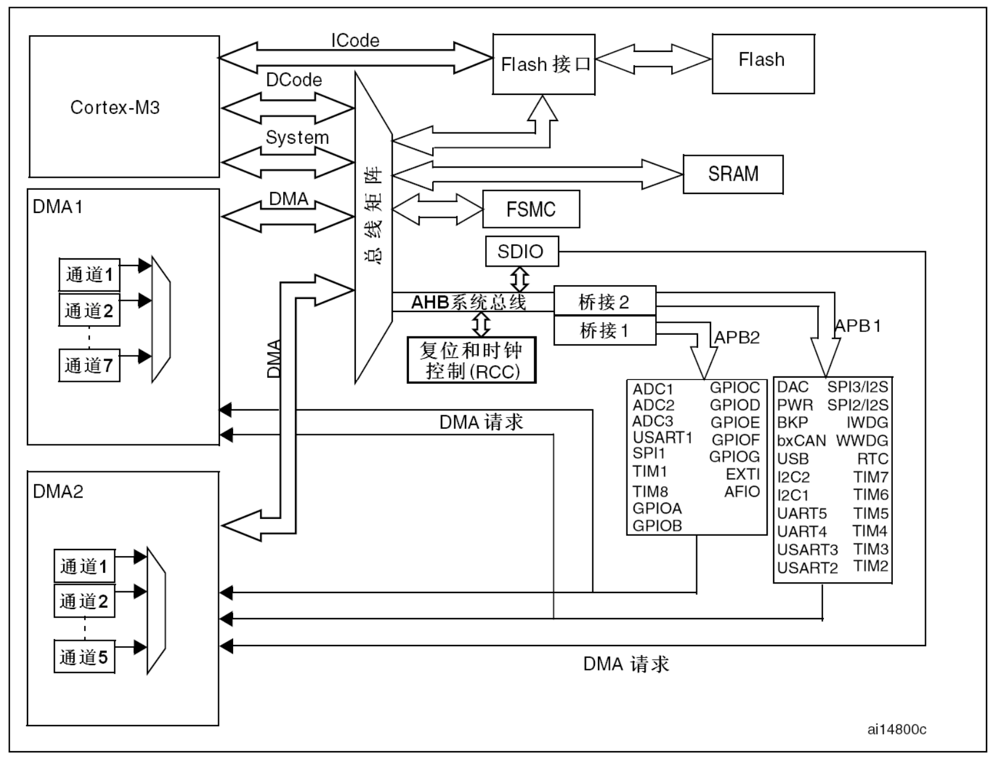

*图1-1F1系列单片机的系统结构体-图*

**几乎所有功能模块都依赖时钟信号才能正常工作，包括：**

1. 中央处理器（CPU）
2. 存储器接口
3. AHB/APB 总线
4. 定时器
5. 串行通信外设（UART、SPI、I2C、CAN）
6. 模拟外设（ADC、DAC）
7. 看门狗定时器（IWDG、WWDG）
8. 低功耗管理模块
9. ...

怎么理解这个时钟信号呢？

**通俗地讲，时钟信号就是一种周期性变化的高低电平信号。**

它不断在“高电平”和“低电平”之间切换，形成一个稳定的节奏。

这种周期性的翻转，为整个数字电路系统提供了统一的“时间刻度”。

所有寄存器什么时候更新、数据什么时候采样、状态什么时候改变，都依赖这个节奏。

**更准确地说，时钟信号是一种周期性方波信号，其上升沿或下降沿通常被用作触发数字电路状态变化的时刻。**

比如我们之前学习SPI通信时，采样时机的边沿设置，就是时钟信号作用的体现：

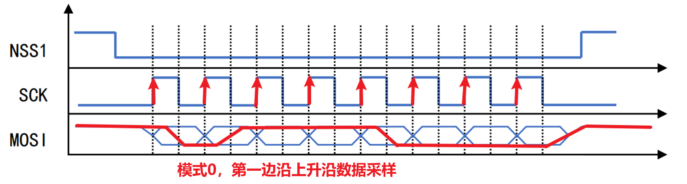

*图1-2时钟信号的方波-图*

**从本质上讲，时钟的作用主要体现在以下几个方面：**

1. 提供系统运行的基本节奏，使各模块在统一时间尺度下运转。
2. 保证数据传输与逻辑运算的同步性与正确性。
3. 协调不同功能模块之间的协同动作。
4. 通过选择不同的时钟源与分频策略，实现性能与功耗之间的平衡。

STM32 的时钟系统通常由多个时钟源构成，例如：

1. 高精度内部时钟 HSI
2. 低功耗内部时钟 LSI
3. 高精度外部晶振 HSE
4. 低功耗外部晶振 LSE

**通过 RCC（Reset and Clock Control）片上外设模块构建的“时钟树”。**

**可以对各级总线与外设进行分频、选择与分配，实现灵活的时钟管理与性能控制。**

举一个典型例子：

```c
// 开启 GPIOA 的时钟
RCC_APB2PeriphClockCmd(RCC_APB2Periph_GPIOA, ENABLE);
```

上述代码的本质，是修改 RCC 模块中的相关寄存器（例如 RCC->APB2ENR），为对应的外设提供时钟信号。

APB2ENR 寄存器负责控制如 GPIOA、GPIOB、ADC1、USART1 等外设的时钟使能状态。

**所谓“开启时钟”，本质上就是为某个硬件模块提供周期性的脉冲信号。**

这个脉冲信号在物理层面表现为持续的高低电平翻转，例如 8 MHz 的时钟，意味着每秒钟发生 8,000,000 次电平变化。

数字电路内部依赖这种周期性的电平变化来驱动触发器、状态机以及各种组合逻辑完成数据采样与状态更新。

如果某个外设没有时钟输入，那么其内部逻辑将停止翻转，相当于进入“静止”状态。

虽然并非真正意义上的断电，但由于内部逻辑不再切换，功耗会显著降低。

**因此，STM32 在默认情况下并不会自动开启所有外设时钟。**

大多数片上外设在复位后都是关闭状态。

在实际开发过程中，如果需要使用某个外设，第一步往往就是通过 RCC 为其开启时钟，否则即使配置寄存器，也不会产生实际效果。

可以这样理解：

**时钟之于 STM32，就如同心跳之于生命系统。**

**没有时钟，所有数字逻辑都无法运行；**

**有了时钟，整个芯片才能按照既定的节奏协调工作。**

### 2. 时钟树的概念

时钟从哪里来？又是如何分配到各个模块的？

我们已经知道，在 STM32 中，无论是片上外设、总线数据传输，还是 CPU 内部的逻辑计算单元运行，都离不开时钟信号。

那么问题来了：

这些时钟信号是谁提供的？不同来源的时钟，又是如何被传递到不同的物理硬件区域的？

**这个问题的答案，都在下图——时钟树当中。**

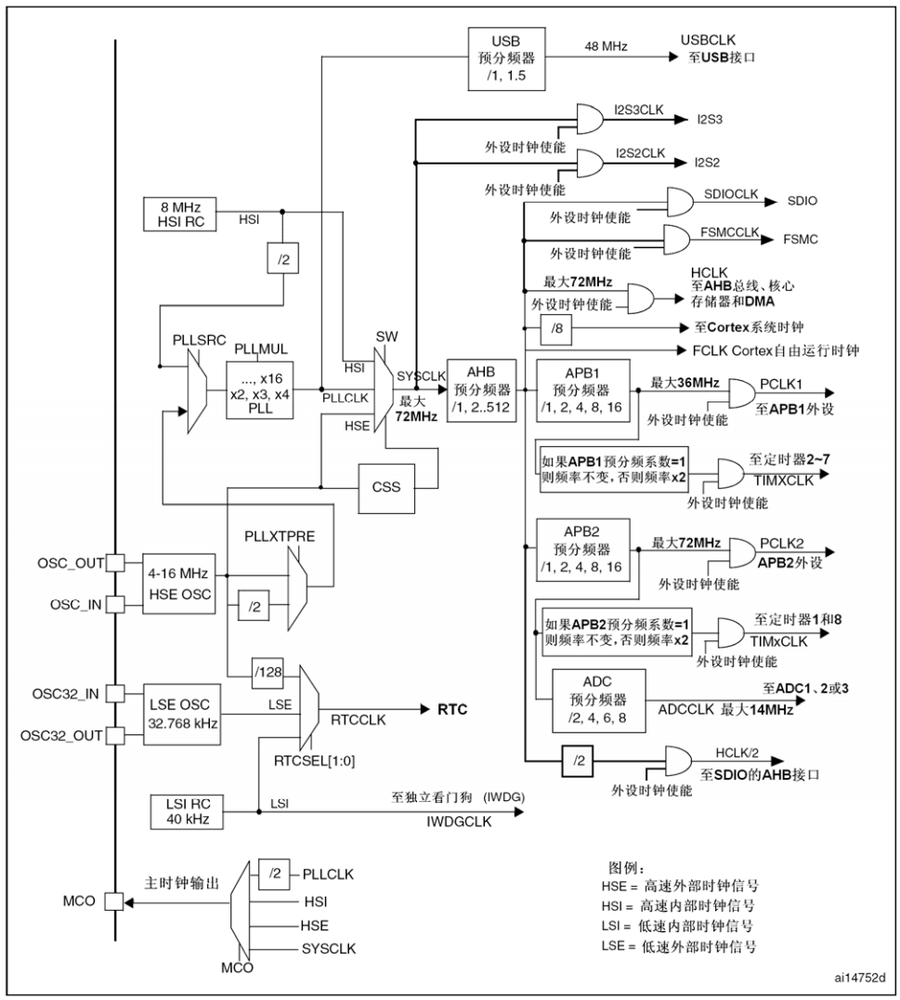

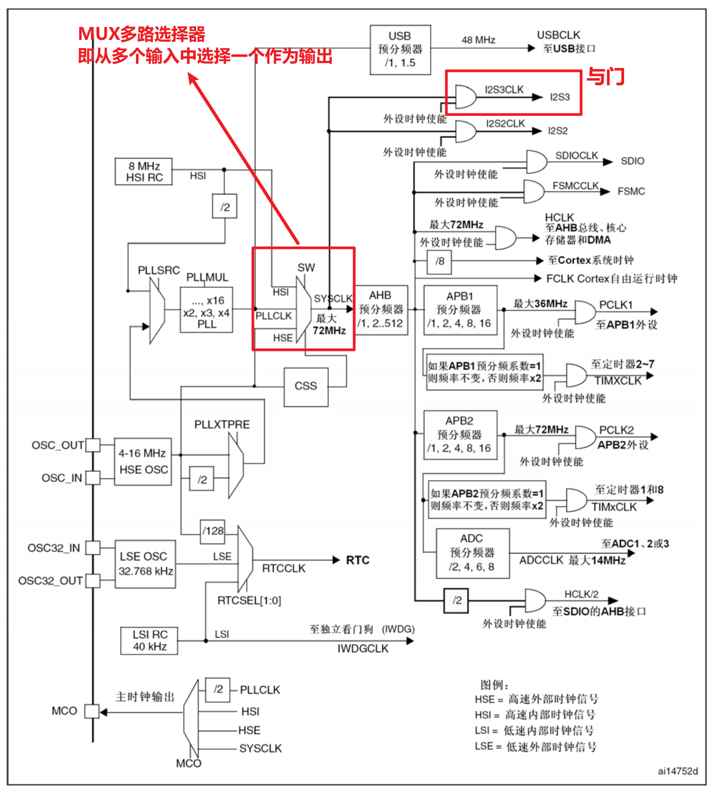

*图2-1时钟树-图图2-2几个数字电路符号描述-图*

上图所示的 STM32F10x 时钟树，本质上就在回答这几个问题。

虽然整张图看起来十分复杂，但如果换一个角度，可以把它拆分为三个阶段来理解。

1. **时钟源输入**
   - a. 这是整棵时钟树的起点。
   - b. 包括 HSI、HSE、LSI、LSE 等内部或外部振荡源。
   - c. 这一部分解决的是：谁来产生最原始的周期性方波信号。
2. **时钟选择 / 分频 / 倍频处理**
   - a. 这一层主要由 PLL 和各级分频器完成。
   - b. 它的作用是对原始时钟进行加工处理。
   - c. 有的需要提高频率（倍频），有的需要降低频率（分频），有的需要在多个时钟源之间进行切换选择。
   - d. 这一阶段最终决定了 SYSCLK、HCLK、PCLK1、PCLK2 等关键系统时钟的数值。
3. **输出到系统 / 外设 / 接口**
   - a. 加工完成后的时钟，会被分配到不同功能模块。
   - b. 例如 HCLK 送往 AHB 总线、内核和 DMA；
   - c. PCLK1 送往 APB1 外设；
   - d. PCLK2 送往 APB2 外设；
   - e. USB、ADC、RTC 等则有各自独立的时钟分支。
   - f. 这一部分解决的是：哪一个模块，使用哪一路时钟。

如果用一个形象的比喻来理解：

时钟树就像一个供电网络。

上游是发电厂（时钟源）

中间是变压站（分频、倍频、选择）；

下游是不同等级的用户（CPU、总线、外设）。

这样拆开来看，原本复杂的时钟树，其实就是一个清晰的三段结构：

**时钟源输入 → 时钟加工处理 → 时钟分发到各模块。**

理解了这个框架之后，再回头分析具体的分支，就会变得非常清晰。

### 3. 时钟源

在 STM32F10x 系列微控制器中，时钟并不是只有一种来源。

为了兼顾性能、稳定性、功耗以及不同应用场景的需求，芯片内部一共提供了四种基础时钟源：

1. HSI（High Speed Internal）高速内部 RC 振荡器，即**高速内部时钟源**
2. HSE（High Speed External）高速外部晶振，即**高速外部时钟源**
3. LSI（Low Speed Internal）低速内部 RC 振荡器，即**低速内部时钟源**
4. LSE（Low Speed External）低速外部晶振，即**低速外部时钟源**

时钟树的所有分支，最终都可以追溯到这四个“原始振荡源”。

它们是整套时钟系统的起点，也是系统时钟架构设计的根基。

接下来，我们逐一分析 STM32F10x 所提供的四种时钟源，以及它们各自的特点和典型用途。

#### 3.1 HSI高速内部时钟源

HSI 是 STM32F10x 内部集成的高速 RC 振荡器，其典型工作频率为 8 MHz。

该振荡器直接集成在 STM32F103 芯片内部，无需外接晶振或其他外围器件，上电即可工作。

HSI 的产生方式是 RC 振荡。

所谓 RC 振荡器，是利用电阻（R）与电容（C）构成的充放电网络，通过电压的周期性变化形成振荡信号。

这种振荡信号本质上就是周期性变化的高低电平方波，也就是我们所说的时钟信号。

**RC 振荡器的优点是结构简单、体积小、启动速度快、无需外部器件、成本低。**

**但它的缺点也很明显：频率精度不高，误差较大。**

即便经过出厂校准，HSI 的典型精度误差约为 ±1%，在极端情况下可能达到 ±2.5%**（易受温度等环境量的改变而增加误差）**。

因此它更适用于对时钟精度要求不高的应用场景，例如一般逻辑控制、GPIO 操作、简单通信实验等。

对于 STM32F103 系列单片机而言，HSI 是一个非常重要的时钟源：

**由于上电启动速度快，MCU 上电复位后，默认使用 HSI 作为系统时钟（SYSCLK）的时钟源。**

也就是说，如果用户不做任何时钟配置，默认情况下，系统在启动阶段，会直接运行在8 MHz 的 HSI 上。

当然：

单片机内部还会对时钟源信号做一些处理，比如分频和倍频：

1. **分频：分频的作用是降低时钟频率，直白点说就是让原始时钟信号的频率除以一个整数。**
2. **倍频：倍频的作用是提高时钟频率，直白点说就是让原始时钟信号的频率乘以一个整数。**

简单总结：

1. **分频是把时钟变慢。**
2. **倍频是把时钟变快。**

单片机内部会根据 CPU、总线和外设的需要，对时钟源信号进行分频或倍频处理，以满足不同模块对时钟信号的需求。

在 STM32 的时钟系统中，不同模块对频率的需求不同，因此往往需要通过分频器将时钟调整到合适的数值。

简单理解，几分频，就是把时钟频率除以几。

因此，当 HSI 作为 PLL 输入时，其实际进入 PLL 的频率为 4 MHz，而不是原始的 8 MHz。

总结一下 HSI 的几个关键特征：

1. MCU内部集成，无需外部晶振
2. 默认上电即启用，启动速度快
3. 频率 8 MHz
4. 精度相对较低
5. **可作为系统启动时的初始时钟信号源**

**理解了 HSI，你就掌握了 STM32 最基础、最“原始”的时钟来源。**

##### 3.1.1 HSI作为系统时钟源

当然如果只用文字讲 HSI，有点抽象。我们不妨结合时钟树来看，如下图所示：

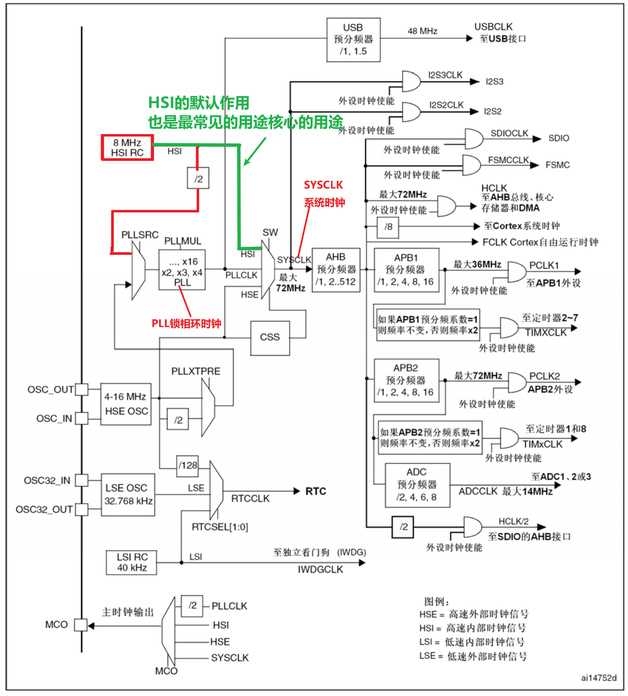

*图3.1.1-1HSI作为系统时钟时钟源-图*

在图的左上角，可以看到：8 MHz HSI RC这就是 HSI 的物理位置，也是整条路径的起点。

它先产生一个 8 MHz 的周期性时钟方波信号。

这就是最原始的内部高速时钟。

简单介绍一下图中涉及的一些数字功能单元：

1. **PLL（Phase Locked Loop）锁相环**：用于将输入的参考时钟进行倍频处理，从而生成更高频率的时钟。
2. **PLLSRC（PLL Source）PLL时钟源选择：这是一个多路选择器，用于选择哪一路时钟作为 PLL 的输入来源，例如 HSI/2 或 HSE。**
3. **PLLMUL（PLL Multiplier）PLL倍频系数**：用于设置 PLL 的倍频倍数，将输入频率按设定系数放大。
4. **SW（System Clock Switch）系统时钟切换开关**：这是一个多路选择器，用于选择当前系统时钟 SYSCLK 的来源，例如 HSI、HSE 或 PLLCLK。
5. **PLLCLK（PLL Clock）PLL输出时钟**：指 PLL 经过倍频处理后输出的时钟信号，可作为系统主时钟候选源。
6. **SYSCLK（System Clock）系统主时钟：是整个芯片运行的核心时钟，最终供给CPU 和各级总线分频使用。**

接下来依照图中红线来看，HSI 主要有两条去向。

1. **直接进入 SW，HSI 可以不经过任何处理，直接送到 SW。**
   - a. 如果在 RCC_CFGR 寄存器中将 SW 选择为 HSI，那么：
   - b. SYSCLK = 8 MHz
   - c. **这也是 STM32F103 上电复位后的默认状态。**
   - d. 在这种情况下，CPU、AHB 总线以及后续分频得到的 APB1、APB2 时钟，全部建立在 8 MHz 的基础上运行。
   - e. 此时系统时钟结构最简单、启动最快，但主频较低，运行速度较慢且不准确。
2. **经过 2 分频后再送入 PLL**
   - a. 在图中可以看到，HSI 在进入 PLL 之前，会先经过一个 “/2” 分频单元。
   - b. 也就是说：8 MHz → 2 分频 → 4 MHz → 作为 PLL 输入
   - c. 这是 STM32F10x 架构上的一个固定规则：HSI 作为 PLL 输入时，必须先进行 2 分频。
   - d. 进入 PLL 后，再通过 PLLMUL 设置倍频系数，例如 ×6、×9 等。
   - e. 例如：4 MHz × 9 = 36 MHz
   - f. 得到 PLLCLK 后，再通过 SW 选择 PLL 作为系统时钟来源。
   - g. 如果 SW 选择 PLLCLK，那么：
   - h. SYSCLK = PLL 输出频率
   - i. 这样就可以在内部 RC 时钟的基础上，提高系统运行频率。
   - j. 这种设置不是默认配置，需要手动进行配置。

**综合来看，HSI 的角色可以概括为：**

1. 它是系统默认的启动时钟来源
2. 它可以直接作为系统主时钟
3. 它也可以参与 PLL 进行倍频后再作为系统时钟
4. 但由于频率和精度都相对有限，不适用于对频率精度要求较高、或对速率要求较高的场景
5. **通常来说，STM32F10X单片机在默认情况下，只在上电启动时直接选择HSI作为系统时钟源，其余时候通常不使用HSI作为时钟源。**

理解了 HSI 的这两条路径，你就已经掌握了时钟树中最基础的一段逻辑流程：

时钟源产生 → 选择是否加工 → 选择是否作为系统主时钟 → 再分配给各级总线与外设。

##### 3.1.2 从单片机上电启动理解HSI的作用

**第一步，上电瞬间（硬件阶段）**

当 STM32 上电或复位时，芯片内部的复位逻辑首先工作。

此时发生两件关键事情：

1. 高速内部时钟源 HSI 自动开启工作
2. 系统时钟默认选择 HSI 作为 SYSCLK 系统时钟的时钟源

也就是说：

上电启动瞬间后，CPU 就运行在 8 MHz 的 HSI 上。

这一步是硬件自动完成的，不依赖任何软件代码。

如果没有 HSI 这个默认时钟，CPU 没有任何时钟信号，根本无法开始执行指令。

**第二步，CPU读中断向量表的入口地址，也就是0x00000000，获取MSP主栈栈顶指针。**

CPU会从该地址中读出一个 32 位数据，加载到 MSP（主栈指针）寄存器中。

这一步完成后：

主栈空间被建立，CPU 拥有了可用的主栈环境。

如此，CPU就可以开始调用函数，正式开始执行指令了。

**第三步，CPU 读取中断向量表中地址 0x00000004。**

CPU会从该地址取出复位处理函数地址，也就是 Reset_Handler 函数的入口地址。

随机开始执行此函数。

**第四步，CPU 执行函数 Reset_Handler（执行汇编代码阶段）**

在启动文件中可以看到，这个汇编代码函数，其实主要是调用了两个函数：

1. 先调用 SystemInit()
2. 最终调用 main()

此时整个执行过程仍然运行在 HSI 8 MHz 主频下。

这部分代码截图如下：

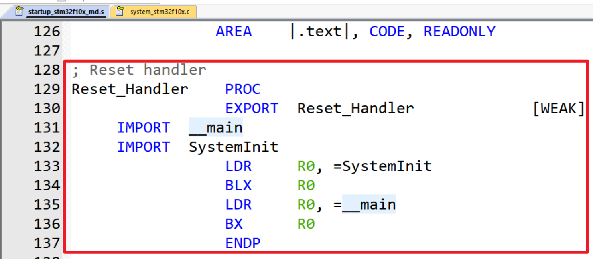

*图3.1.2-1单片机上电启动过程-图*

**汇编代码我们不需要掌握，总得来说，这段汇编代码，相当于调用了这样的一个函数：**

```c
void Reset_Handler(void){
    SystemInit();
    __main(); // 进入C运行库，并最终调用main函数
}
```

**第五步，调用SystemInit()函数（执行C语言代码）**

在该函数中：

1. 再次确保 HSI 处于开启状态
2. 清除 RCC 时钟配置寄存器
3. 关闭 PLL、HSE 等可能残留的配置
4. 将时钟系统恢复到可控的默认状态

此时主系统时钟源仍然是 HSI。

这部分源码如下：

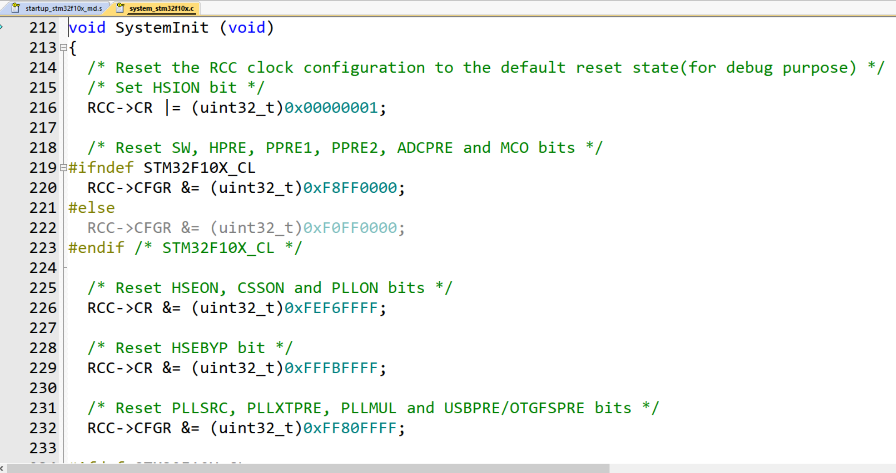

*图3.1.2-2单片机上电启动过程-图2*

**第六步，在SystemInit()函数完成上述配置后，调用 SetSysClock() 函数，默认配置HSE作为主系统时钟源。**

在默认情况下，在不修改此函数源码的前提下（通常都不会改）：

该函数是这么操作的：

1. 先开启外部高速晶振**HSE = 8 MHz**
2. 等待 HSE 稳定
3. 配置 PLL：
   - a. 选择 HSE 作为 PLL 输入
   - b. 设置倍频系数 ×9
   - c. 得到：**8 MHz × 9 = 72 MHz**
4. 修改 RCC_CFGR 寄存器的 SW 位
   - a. 将系统时钟源从默认的**HSI = 8 MHz**
   - b. 切换为**PLLCLK = 72 MHz**（此时PLLCLK是倍频后的HSE）

当切换完成后：

**系统主时钟正式由 “HSE 经 PLL 倍频后“ 接管，此时主系统时钟频率是 72MHz。**

CPU 不再运行在 HSI 上，而是运行在新的HSE主频下。

从这一刻开始：

1. CPU 主频 = 72 MHz
2. AHB 总线 = 72 MHz
3. APB1 = 36 MHz（默认 /2）
4. APB2 = 72 MHz

也就是说：

CPU 从最初的 HSI 8 MHz 运行，正式切换为 72 MHz 高速运行模式。

这部分源码如下：

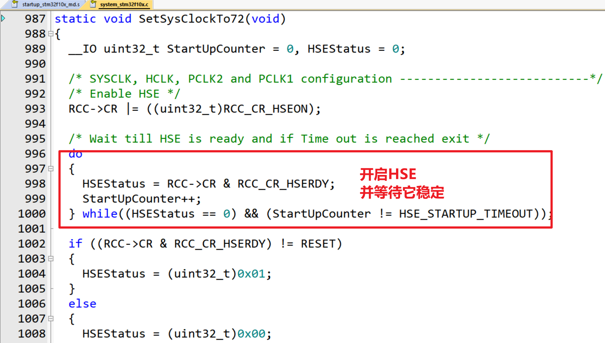

*图3.1.2-3单片机上电启动过程-图3*

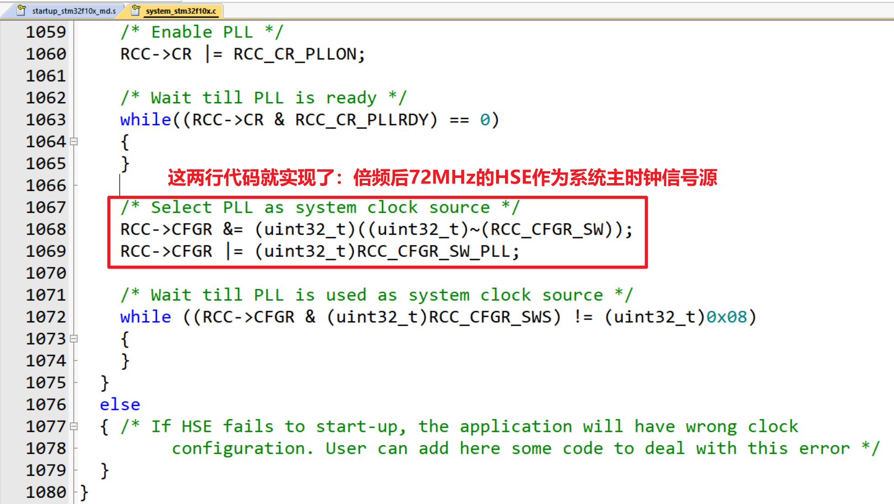

*图3.1.2-4单片机上电启动过程-图4*

**第七步，开始调用main函数（主系统时钟源已变为HSE）。**

此时：

1. 系统时钟已经完成切换
2. 主频已达到目标频率（例如 72 MHz）
3. AHB、APB 总线分频关系已生效

整个 MCU 进入用户程序阶段，单片机真正开始执行用户程序。

#### 3.2 HSE高速外部时钟源

HSE（High Speed External）高速外部时钟源，为 STM32F10x 提供的高速外部时钟源。

其工作频率范围一般为 2 ~ 16 MHz。

在我们当前使用的 STM32F103C8T6 最小系统板上，HSE高速外部时钟源为 8 MHz。

如下图所示：

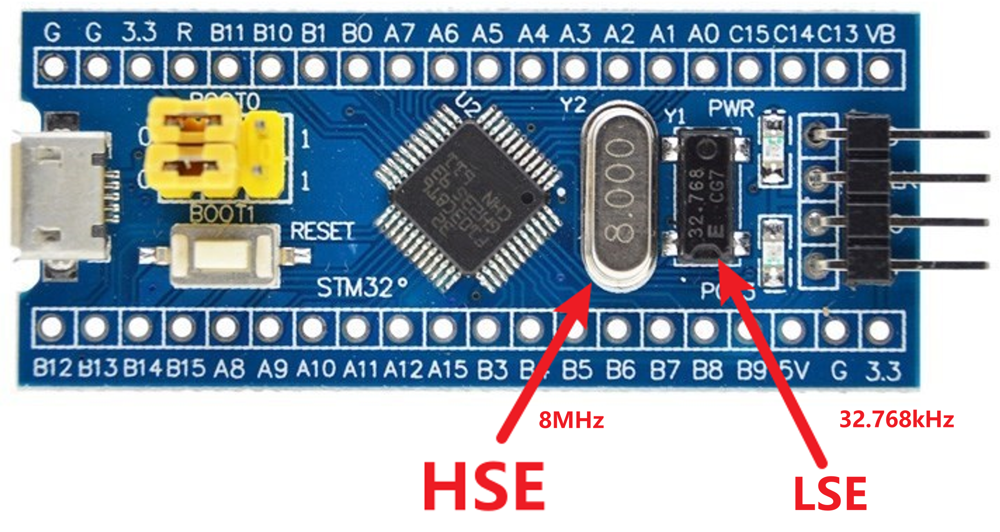

*图3.2-1最小系统板外部时钟源-图*

与 HSI 不同，HSE 并不集成在芯片内部。

它来自芯片外部的石英晶振，通过 OSC_IN 和 OSC_OUT 两个引脚接入 MCU。

对于STM32F103C8T6单片机来说，HSE外部晶振，实际上占用PD0和PD1两个引脚，一个用于输入，一个对外输出。

如下图所示：

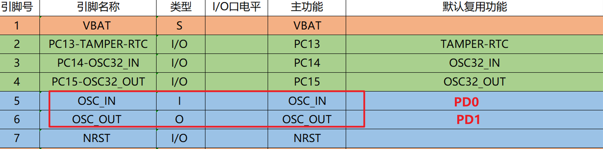

*图3.2-2HSE占用的引脚-图*

因为我们使用的是最小系统板，这两个引脚都已经被占用了。所以一般是不能再作为PD0和PD1使用了。

**HSI 是“芯片内部自带的时钟”，而 HSE 是“外接晶振提供的时钟”。**

那为什么HSE这种石英材质的时钟源，更加准确稳定呢？

石英晶振的原理可以简单理解为：石英是一种压电材料。

当对石英晶体施加电压时，它会产生机械振动。

在特定尺寸和结构下，它会在某一个固定频率上发生稳定共振。

这种机械振动会被电路转换为稳定的电信号，从而形成周期性的时钟方波。

**由于石英晶体的物理特性非常稳定，因此 HSE 的频率精度远高于内部 RC 振荡器，误差通常只有万分之一到万分之三左右。**

从性能特点来看，HSE 具有两个核心优势：

1. 频率稳定，误差小
2. 不会像HSI那样，会随着温度变化导致频率偏移，术语叫“抗温漂能力强“。

因此HSE适用于对时钟精度要求较严格的场景，比如一些通信的场景，精准定时的场景。

这些外设如果使用精度较低的 HSI，可能会产生误差导致功能失效。

##### 3.2.1 HSE的用途

在时钟树结构中，HSE 主要有两个用途：

1. 可以直接作为系统时钟源（SYSCLK）
2. 更常见的用法是作为 PLL 的输入源

比如STM32F103C8T6单片机，它的默认系统时钟主频为 72 MHz，其实现方式通常是：

HSE = 8 MHz，PLL × 9，SYSCLK = 72 MHz如下图所示：

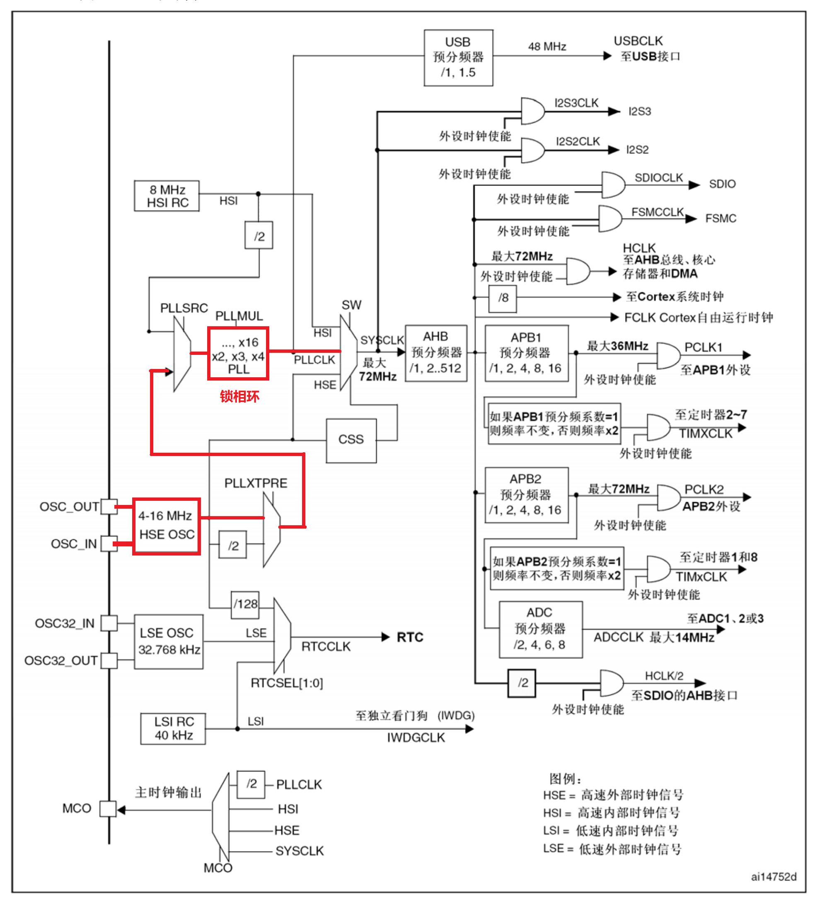

*图3.2.1-1HSE作为系统时钟时钟源-图*

也就是说：

**HSE 提供稳定的参考频率，PLL 再对其进行倍频，最终生成高频系统主时钟。**

##### 3.2.2 HSI和HSE的差别

如果从系统运行阶段来看，可以把 HSI 和 HSE 理解为两个不同角色：

1. **HSI 负责“上电启动兜底”。**
   - a. 它集成在芯片内部，上电自动开启，不依赖任何外部器件。
   - b. 只要 MCU 上电，HSI 就一定存在，因此系统一定能够跑起来。
   - c. 它的优势是简单、可靠、无需外部电路、启动速度快。
   - d. 但它的精度相对较低，本质上是 RC 振荡器，受温度、电压等因素影响较大。
2. **HSE 则更多承担“系统稳定运行阶段的主时钟来源”。**
   - a. 它来自外部石英晶振，频率稳定，误差小。
   - b. 在系统完成初始化后，通常会切换到 HSE 经 PLL 倍频后的时钟作为 SYSCLK。
   - c. 它的优势是精度高、稳定性好，适合对时序要求严格的应用场景。

因此可以这样理解：

**HSI 是保证系统一定能启动的基础时钟，它解决的是“能不能跑起来”的问题。**

**HSE 是保证系统高性能、高精度运行的核心时钟源，它解决的是“跑得快不快、准不准”**

**的问题。**

如果用一个形象的比喻：

HSI 像是芯片内部自带的应急发电机，保证设备一开机就有电。

HSE 像是外接的稳定市电电源，在系统进入正常运行后，由它提供长期、稳定、高质量的电力。

或者：

HSI 是机器人的备用临时电池，刚启动复位的时候先用备用临时电池顶一顶。

HSE 则是机器人的长期稳定能量来源，机器人的长期工作运行，需要使用 HSE 这种长期、稳定、高质量的能量来源。

**HSI和HSE，这两者并不是互相替代关系，而是启动阶段与运行阶段各司其职。**

##### 3.2.3 了解：CSS时钟安全系统

**CSS（Clock Security System）时钟安全系统**在实际应用中，外部晶体振荡器在运行过程中是有可能出现异常的，例如振荡停止、频率漂移、焊接问题或环境干扰等。

也就是说：

如果系统主时钟来自 HSE（高速外部时钟），那么在运行过程中是存在失效风险的。

而在 STM32 的时钟结构中，HSE 是直接接入 CSS 监控逻辑的。

**CSS 的作用机制**当 CSS 监测到 HSE 振荡异常或停止时，会立即触发硬件保护机制。

此时硬件会自动执行以下动作：

1. 检测到 HSE 故障（HSERDY 失效）
2. 关闭 HSE
3. 自动将系统时钟来源切换为 HSI
4. 触发 NMI 中断（通知系统异常发生）

也就是说，系统主时钟原本路径是：HSE → PLL → SYSCLK发生异常后会自动变为：HSI → SYSCLK无需软件主动干预，硬件即可完成这样的切换。

**切换的本质**这种切换并不是“软件重新配置”，而是硬件在底层自动修改 RCC 寄存器中的时钟选择逻辑。

通过控制 SW 选择器，将系统时钟来源从外部高速时钟路径，切换为内部高速时钟 HSI。

目的只有一个：保证系统不会因为外部晶振失效而立刻停止运行。

**为什么必须这样设计？**

如果没有 CSS：一旦 HSE 停振失效，CPU 将失去时钟信号，系统立即崩溃。

而有了 CSS：系统可以退回到内部 RC 时钟，在HSI时钟源的驱动下，继续运行。

至少保证：程序还能执行，系统还能响应，起码可以进入安全处理流程。

**一句话总结CSS 是一种硬件级的主时钟容错机制，当 HSE 失效时，系统会自动切换到 HSI，保证MCU 不会因为外部晶振故障而立刻停机。**

#### 3.3 LSI低速内部时钟源

**LSI（Low Speed Internal）低速内部时钟源**，LSI 是 STM32F10x 内部集成的低速 RC 振荡器。

其典型工作频率为 40 KHz。

和 HSI 一样，LSI 也是由 RC 振荡器产生，直接集成在 STM32F103 芯片内部，无需任何外部晶振或外围电路。

也就是说：

只要芯片上电，LSI 就可以作为单片机内部的时钟信号源，但需要软件开启（置位RCC_CR 的 LSION 位）。

**从结构上看，LSI 与 HSI 的原理相同，都是基于 RC 充放电形成周期性振荡信号。**

不同的是，二者工作频率不同：

1. HSI 是高速（8 MHz），
2. LSI 是低速（40 KHz）。

由于 RC 振荡器天生存在精度问题，LSI 的频率波动较大。

虽然典型值为 40 KHz，但在实际环境中可能在 30~50 KHz 范围内波动。

因此它也不适用于对时间精度要求严格的场景。

**LSI 的主要用途并不是作为系统主时钟。**

它的用途参考下图：

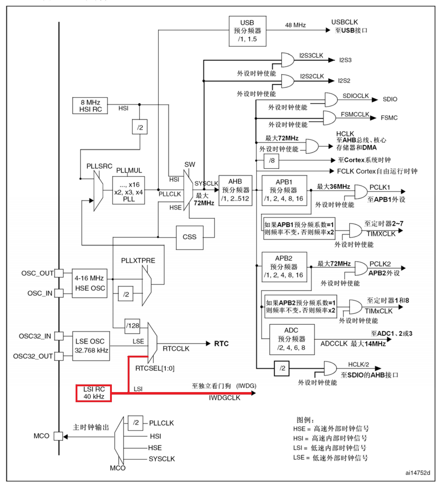

*图3.3-1LSI作用-图*

它用于低速、独立运行的模块，例如：

1. 独立看门狗 IWDG，该外设用于在程序异常或死机时自动复位系统，保证系统可靠运行。
2. 实时时钟 RTC，F1系列的 RTC 外设实际上就是一个32位秒计时器，即使主系统掉电也可依靠后备电源继续计时。

需要特别注意的是：独立看门狗 IWDG 必须使用 LSI 作为时钟源。

这是为了保证：

即使主系统时钟异常（例如 HSE 故障或 PLL 失锁），看门狗仍然能够独立运行，从而在系统失控时完成复位保护。

至于 RTC，在大多数正式产品中，通常更倾向于使用 LSE（外部 32.768 KHz 晶振），因为 LSE 精度更高，更适合长期计时。

最后用一句话概括：

**LSI 是一颗低速、内部集成、精度一般，但具备独立性和可靠性的时钟源。**

**它最主要的，最常用的用途就是为独立看门狗提供时钟信号源。**

#### 3.4 LSE低速外部时钟源

LSE 是 STM32F10x 提供的低速外部时钟源，其标准工作频率为 32.768 KHz。

这个数值并不是随意选择的：

1. 32.768 KHz = 215 Hz。
2. 如果连续进行 15 次 2 分频
3. 32.768 KHz → 1 Hz

也就是说：

经过分频后，可以非常方便地得到 1 秒的时间基准。

**这正是它被广泛用于实时时钟（RTC）的根本原因。**

与 HSE 类似，LSE 并不集成在芯片内部。

它和HSE一样，来自外部的低速石英晶振（通常为 32.768 KHz 晶振），通过 OSC32_IN 和 OSC32_OUT 两个专用引脚接入芯片，如下图所示：

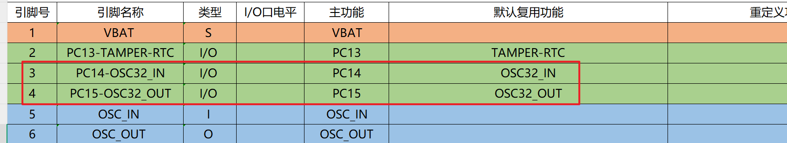

*图3.4-1LSE低速外部时钟源引脚-图*

**这种晶振通常被称为“表晶”或“时钟晶振”，常见于电子手表、RTC 芯片等精密计时设备。**

从精度角度来看：LSE 的稳定性远高于 LSI。

它受温度和电压变化的影响较小，适合用于长时间、连续运行的时间计量。

因此在实际产品中：RTC 通常优先选择 LSE 作为时钟源。

在 STM32F103 中，LSE 的主要用途就是：为 RTC 提供稳定、精准的低速时钟。

它不参与系统主频生成，不参与 PLL，也不直接供给 CPU 或高速外设。

在时钟树中，LSE的功能部分如下图所示：

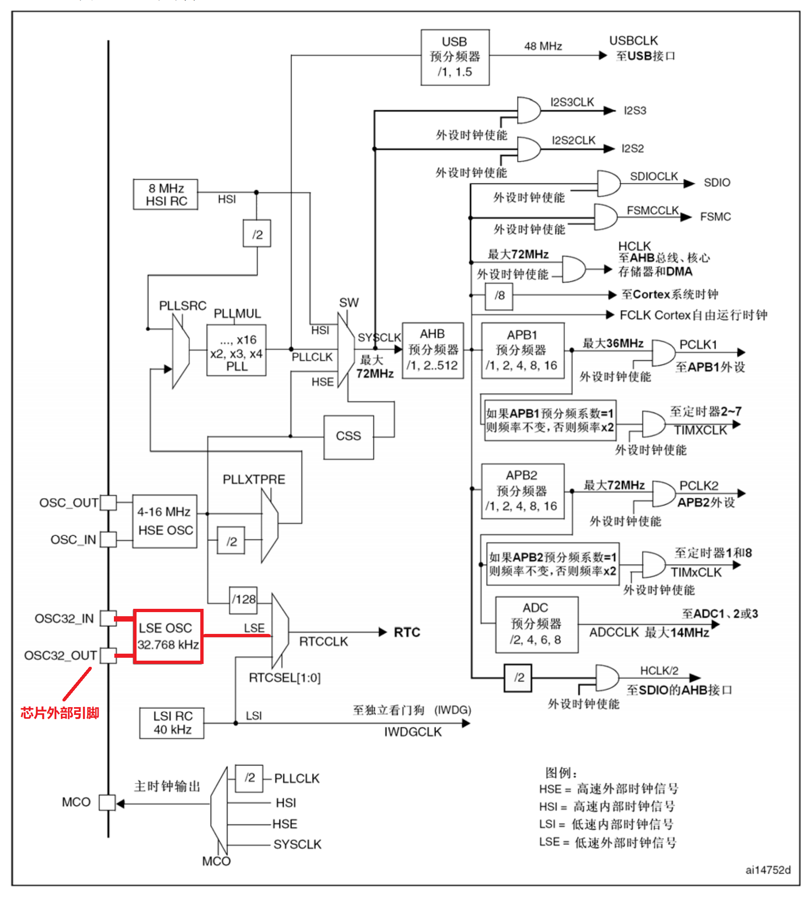

*图3.4-2LSE提供RTC时钟源-图*

可以看到，LSE外部低速时钟源，最核心、最常见的用途就是作为RTC实时时钟的时钟信号源。

#### 3.5 总结

从系统角色分工来看：

1. HSI 负责上电启动与基础运行，
2. HSE 负责系统的高速与高精度运行，
3. LSI 负责低速、独立、安全相关模块，
4. LSE 负责高精度、长期稳定的时间计量。

四种时钟源并不是相互替代关系，而是各司其职、分工明确：

1. HSI 解决的是“系统能否可靠启动”的问题；
2. HSE 解决的是“系统是否运行得快且准”的问题；
3. LSI 保障的是“在主时钟异常时，关键模块仍能独立工作”；
4. LSE 则提供“长期稳定的时间基准”。

**如果从整体架构角度理解：这四个时钟源共同构成了 STM32 时钟体系的根基。**

它们通过时钟树被选择、加工、分配，最终支撑整个 MCU 的运行。

理解了这四个时钟源的定位与差异，就等于掌握了 STM32 时钟系统的核心逻辑。

### 4. SYSCLK系统主时钟

前面我们介绍了四种时钟源。

但如果继续深入研究时钟树结构，就会发现一个非常关键的“汇聚点**”——SYSCLK**。

除了少数特殊模块（例如 IWDG 使用 LSI、RTC 使用 LSE、USB 有独立时钟要求）之外，**绝大多数功能单元的时钟，最终都会以 SYSCLK 为基础进行分配，所以 SYSCLK 其实也可以视为一个时钟源。**

**SYSCLK（System Clock，系统时钟）是 STM32 单片机最核心、最主要的时钟源。**

它本身并不产生时钟信号，而是从 HSI、HSE 或 PLLCLK 中选择其中一路作为系统主时钟。

这个选择是通过 RCC_CFGR 寄存器中的 SW 位完成的。

也就是说：

**SYSCLK 是“被选出来的最终主时钟”。**

#### 4.1 系统主时钟的重要性

SYSCLK 的地位非常重要，它是整个芯片内部时钟体系的中心节点：

1. CPU 的运行频率直接由**SYSCLK AHB 总线时钟（简称为HCLK）**决定。
2. **AHB 总线时钟（简称为HCLK）**由 SYSCLK 分频得到。
3. APB1、APB2 总线时钟（PCLK1、PCLK2）也都是在 SYSCLK 基础上继续分频派生。
4. ...

进一步来看：

GPIO、USART、SPI、I2C、TIM 等大多数外设，都是通过 APB 或 AHB 总线获得它们的工作时钟。

换句话说：

**SYSCLK 决定了系统整体运行节奏。**

**SYSCLK 是整棵时钟树的“中枢节点”**

#### 4.2 系统主时钟输送时钟信号

单片机内部绝大多数片上外设，以及CPU的运行，它的时钟信号来源都是系统主时钟SYSCLK 。

但SYSCLK 并不会直接把时钟信号送出去，而是按照层级进行分发。

时钟树对这种输送路径，有明确的描述，如下图所示：

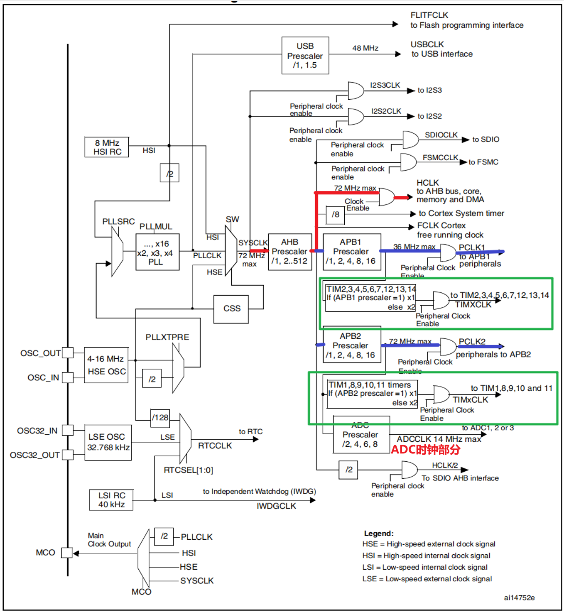

*图4.2-1系统主时钟输送时钟信号-图*

下面分为几部分专门讲解一下这种时钟信号的输送。

#### 4.3 HCLK系统主干时钟

时钟输送路径如下：

**SYSCLK → AHB Prescaler（AHB 分频器） → HCLK**也就是图中红线部分。

HCLK 是 AHB 总线时钟（包含上面挂载的外设），同时也是 Cortex-M3 内核CPU、DMA 控制器以及片上 SRAM / Flash 接口的工作时钟。

最重要的：

CPU 主频 = HCLK如果 AHB 分频器为 1：

HCLK = SYSCLK这就是默认选项，CPU默认主频就是72MHz如果分频为 2：

HCLK = SYSCLK / 2此时CPU的主频就是36MHz除此之外，居于CPU内核当中的NVIC，它所使用的时钟频率也和CPU保持一致。

而 SysTick 默认使用 HCLK 作为时钟源（也可选择 HCLK/8），在默认配置下其频率页与 CPU 相同。

#### 4.4 APB2 和 APB1外设总线时钟

HCLK 继续分发到两个重要分支：

**HCLK → APB2 Prescaler（APB2 分频器） → PCLK2HCLK → APB1 Prescaler（APB1 分频器）→ PCLK1**也就是图中蓝线部分。

**APB2（高速外设总线）**

1. 最大 72 MHz
2. 典型外设：
   - a. GPIO
   - b. USART1
   - c. SPI1
   - d. TIM1
   - e. ADC

**APB1（低速外设总线）**

1. 最大 36 MHz
2. 典型外设：
   - a. USART2/3
   - b. I2C
   - c. SPI2
   - d. TIM2~7
   - e. CAN

**如果 SYSCLK = 72 MHz，且 APB1 必须至少分频为 2，否则会超出 36 MHz 上限。**

特别需要注意的是：

**APB 外设总线时钟 ≠ 挂载外设的时钟！**

比如USART外设，其波特率来源于内部波特率寄存器，对时钟信号的分频。

#### 4.5 定时器倍频设定

图中绿框框中的部分，属于定时器（Timer）外设的时钟控制部分。

注意，所有的定时器都挂载在APB总线上，可能是APB2，也可能是APB1。

但存在一个特殊规则：

**如果 APBx 分频系数 ≠ 1，则：TIM x CLK = PCLK × 2，也就是时钟频率直接在APB总线的基础上乘以2。**

例如：

SYSCLK = 72 MHz，APB1 分频 = 2，则APB1总线的时钟频率为36MHz。

但由于分频系数为2，触发特殊规则：

**实际所有挂载在APB1总线上的定时器，其时钟频率仍然保持为72MHz！**

这样设计的目的是：

在降低外设总线频率的同时，不降低定时器的时间分辨率。

通俗点说就是：APB 可以慢一点省电，但定时器需要精准所以不能满，芯片偷偷把时钟补回来。

#### 4.6 ADC独立分频机制

所有 ADC 外设都挂载在**APB2 外设总线**上。

ADC 时钟来源于对 APB2 时钟的分频。

输送路径为：

**PCLK2 → ADC Prescaler（ADC分频器） → ADCCLK**分频系数可选：2 / 4 / 6 / 8STM32F103 系列单片机，存在明确的硬件约束：

**ADCCLK ≤ 14 MHz**这是 STM32F103 数据手册规定的最大 ADC 输入时钟。

举一个例子：

在默认情况下：

```c
SYSCLK = 72 MHz
AHB 不分频 → HCLK = 72 MHz
APB2 不分频 → PCLK2 = 72 MHz
```

此时：

如果选择：

```c
2 分频 → 36 MHz ❌ 超出 14MHz
4 分频 → 18 MHz ❌ 仍然超标
6 分频 → 12 MHz ✅ 合法
8 分频 → 9 MHz ✅ 合法
```

因此：

当 PCLK2 = 72MHz 时，ADC 至少需要 6 分频。

### 5. 扩展/了解：时钟输出功能

前面我们讲到的时钟源选择、SYSCLK 生成以及 CSS 时钟安全系统，本质上解决的是一个问题：

**系统内部使用哪个时钟源，以及如何保证系统稳定运行。**

也就是说：

我们讨论的是“时钟从哪里来”，以及“系统内部如何使用时钟”。

但如果换一个角度思考：

芯片内部产生的时钟信号，是否只能供芯片内部使用？

答案是：

当然不是。

在实际工程中，芯片产生的时钟也可以输出到芯片外部，供其他器件使用。

**这就是所谓的：时钟输出功能，MCO（Microcontroller Clock Output）。**

在 STM32F103C8T6 中，提供了一个专门的时钟输出引脚：

**MCO 引脚（PA8）**


*图5-1时钟输出功能-图*

通过该引脚，可以将芯片内部的某一路时钟信号输出到外部。

比如可以给一个外部 MCU 提供参考时钟。

**MCO 的工作方式：**

MCO 输出的时钟来源可以通过 RCC 寄存器进行选择。

具体是修改：

RCC->CFGR 寄存器中的 MCO 位可选的输出时钟源包括：

1. PLLCLK / 2：PLL 倍频后的时钟，再进行 2 分频
2. HSI：高速内部时钟
3. HSE：高速外部晶振时钟
4. SYSCLK：当前系统主时钟

也就是说：

MCO 不是固定输出某个时钟，而是可以通过软件选择输出哪一路时钟。

如下图所示：

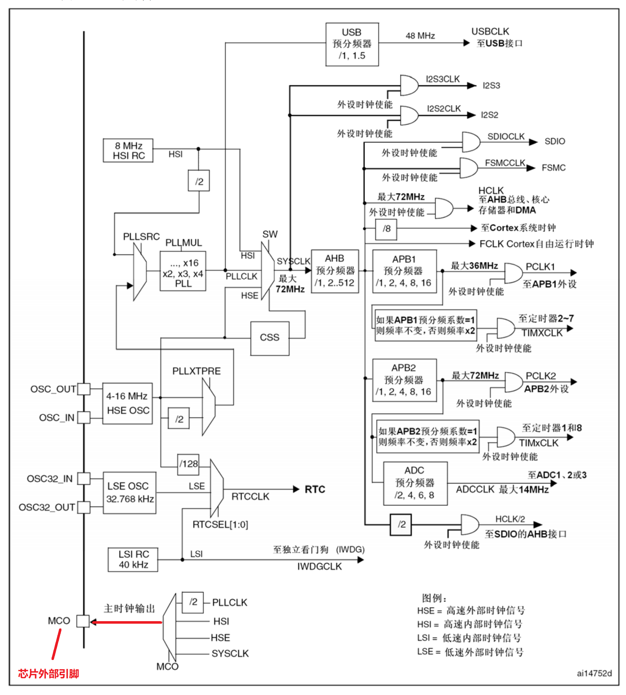

*图5-2时钟输出功能-图*

**本质理解**MCO 的作用是：

将芯片内部的某一路时钟，通过引脚“导出”到外部。

它本质上是一个时钟多路选择器 + 输出驱动电路。

可以理解为：

系统内部的时钟信号，不仅可以用于片上外设，也可以作为“公共时钟源”提供给外部系统。

**MCO 是 STM32 提供的时钟输出功能，通过 PA8 引脚将内部选定的时钟信号输出到芯片外部。**

---

## 02 SysTick

### 1. 概述/前言

在上一节中，我们已经讲清楚了时钟源的选择，以及 SYSCLK 如何经过分级分发，最终驱动整个 MCU 运行。

但是，在实际程序运行过程中，系统往往还需要一个统一的时间基准，用来完成延时控制、周期性中断等功能。

比如在 FreeRTOS 中，任务延时、时间片轮转、阻塞超时等机制，都需要依赖一个固定周期产生的系统节拍。

**这个系统节拍，通常就是由 SysTick 系统嘀嗒定时器产生的。**

SysTick 是 Cortex-M3 内核自带的一个 24 位递减计数器。

它属于“内核级外设”，并不挂载在 APB 或 AHB 总线上，而是直接集成在CPU处理器内部。

也就是说：

**SysTick 不是普通的片上外设，而是 Cortex-M3 内核组成的一部分。**

SysTick 的核心作用是：

**为系统提供一个稳定、可配置的周期性中断，这就是FreeRTOS任务切换的Tick中断的由来。**

SysTick 常见用途包括：

1. 实现毫秒级延时
2. 作为操作系统（如 FreeRTOS）的系统节拍源
3. 周期性事件处理
4. 软件定时器实现

下面简单介绍一下系统嘀嗒定时器的原理机制和使用。

### 2. SysTick的工作流程

SysTick 是一种集成在CPU内部的简易定时器，是MCU内部最简单的定时器，最主要的用途就是产生周期性的节拍中断。

什么叫做产生周期性的节拍中断？

你可以把系统嘀嗒定时器，想象成一个 Cortex-M3 内核自带的一个“小闹钟”。

**它的使命很单纯 —— 按节奏敲钟。**

敲谁？

敲 CPU。

干嘛？

**提醒你：时间到了，该干活了。**

它的工作原理，如下图所示：

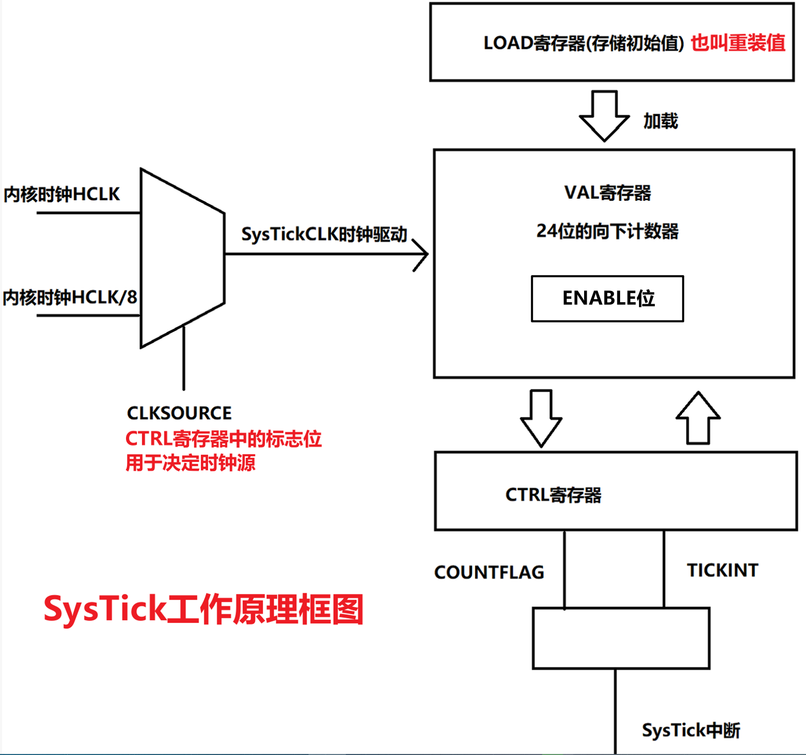

*图2-1SysTick的工作原理-图*

基于这张原理图，先从结构入手理解它的工作机制。

SysTick 本质上由 3 个核心寄存器组成：

1. **LOAD 寄存器（Reload Value Register，重装值寄存器）**
2. **VAL 寄存器（Current Value Register，当前计数值寄存器）**
3. **CTRL 寄存器（Control and Status Register，控制与状态寄存器）**

我们按工作流程，一步一步讲它是怎么运行的。

#### 2.1 四个需要用到的标志位

SysTick 在工作时，当中的 CTRL （控制）寄存器中我们只需要关注 4 个标志位即可：

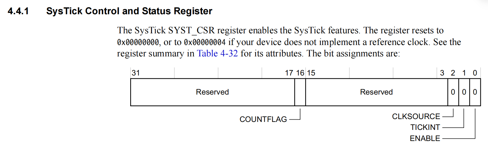

*图2.1-1SysTick寄存器-图*

1. bit0，ENABLE 位。
   - a. 英文全称：**Counter Enable**
   - b. 作用：**控制计数器开关**
   - c. 0 → 计数器停止，1 → 计数器开始递减计数
   - d. **只要这一位置位，计数器就会开始递减计数，SysTick才开始真正工作。**
2. bit1，TICKINT位。
   - a. 英文全称：**Tick Interrupt Enable**
   - b. 作用：**是否产生 SysTick 中断**
   - c. 0 → 计数到 0 不进中断
   - d. 1 → 计数到 0 触发 SysTick 中断
   - e. 它不影响计数，只决定要不要触发中断，也就是“闹钟到点了响不响”。
3. bit2 ，CLKSOURCE位。
   - a. 英文全称：**Clock Source**
   - b. 作用：**选择计数器的时钟来源**
   - c. 0 → 主时钟八分频（HCLK/8），默认9MHz
   - d. 1 → 系统主时钟 HCLK，默认72MHz
4. bit16，COUNTFLAG位。
   - a. 英文全称：**Count Flag**
   - b. 作用：**计数递减是否到 0 的标志位**
   - c. 当计数器从 1 递减到 0 时，硬件自动置位
   - d. 该位递减到0后自动置位，读一次CTRL 寄存器会自动复位。
   - e. 它不影响计数，只决定是不是“到点了”，可以通过读该位得知“一次重装值递减到0”完成了。

如果你需要进行寄存器开发编程，可以记忆下面的寄存器结构图：

bit16 COUNTFLAGbit2 CLKSOURCEbit1 TICKINTbit0 ENABLE

#### 2.2 第一步：选择时钟源

首先看左边。

它的时钟来源有两个：

1. 内核时钟 HCLK
2. 内核时钟 HCLK / 8

这两个通过一个多路选择器进行选择，由**SysTick内部的 CTRL 寄存器**里的**CLKSOURCE 位**决定。

也就是说：

1. CLKSOURCE = 1 → 用 HCLK，默认主频是72MHz
2. CLKSOURCE = 0 → 用 HCLK / 8

**SysTick 本质上是一个递减计数器，时钟源决定了每秒计数值会减多少。**

因此，一旦时钟源改变了，SysTick的计数方式就需要改变。

#### 2.3 第二步：写入重装值

向 LOAD 寄存器写入一个数值 N。

这个 N 就是你希望计数器从多少开始往下递减。

这个 N 用术语来称呼，叫做**“重装值（Reload Value）”**。

它为什么叫这个名字呢？

不要着急，继续往下看。

注意：

**SysTick 是 24 位计数器，重装值的最大值是 0xFFFFFF，也就是16777215（1600万+）。**

重装值也可以写0，只不过写0，计数器就不能递减工作了，对于整个SysTick而言也没啥意义。

#### 2.4 第三步：自动重装/周期性工作

向 VAL 寄存器写任意值，会清除当前计数器值，并清除 COUNTFLAG 标志。

随后，如果ENABLE位置位：

硬件会自动把 LOAD 中的值装载到 VAL 中。**（向VAL寄存器写的值，只为触发工作，不参与计数！）**

这一步叫做**重装值装载**。

装载完成后，随即开始计数。SysTick 开始在选定的时钟驱动下：

**每来一个时钟周期，VAL 值减 1。**

计数过程是：

VAL = NN-1N-2……

10当计数器从 1 递减到 0 的那个时钟周期内，会发生两件事情：

1. CTRL 寄存器的 COUNTFLAG 标志位自动置位，“到点了！”。
2. **在随后的下一个时钟周期，VAL 自动重装 LOAD 的值。**

**如果TICKINT位置位，重装值递减到0，还会触发SysTick中断。**

**COUNTFLAG 置位后，读 CTRL 寄存器，COUNTFLAG 会自动复位。**

这就是 SysTick 能“周期性工作”的核心原因。

因为它会自动循环：

装载 → 递减 → 到 0 → 重新装载 → 再递减....

也正是因为 LOAD 寄存器中存储的值可以自动重装，所以这个 LOAD 值被称之为**“重装值”**。

你只需写一次 LOAD 寄存器的值，但它实际上会自动重装很多次。

#### 2.5 流程总结

**第一步：选择时钟源**通过 CTRL 寄存器中的 CLKSOURCE 位选择时钟来源。

CLKSOURCE = 1 → 使用 HCLK（默认 72MHz）

CLKSOURCE = 0 → 使用 HCLK / 8时钟源决定计数器递减的速度。

**第二步：写入重装值**向 LOAD 寄存器写入一个数值 N（最大 0xFFFFFF）。

这个 N 叫做“重装值（Reload Value）”。

它表示每一轮计数开始时的初始值。

**第三步：启动计数**设置 ENABLE = 1。

计数器开始从 N 递减。

**第四步：递减过程**计数器按照时钟驱动，每1个时钟周期递减1：

N → N-1 → … → 1 → 0**第五步：当计数器从 1 递减到 0 的那个时钟周期内**会发生三个硬件行为：

1. COUNTFLAG 置 1，表示“到点了”
2. 如果 TICKINT = 1，则产生 SysTick 中断请求
3. 在下一个时钟周期，VAL 自动从 LOAD 重新装载

**第六步：自动循环**重装 → 递减 → 到 0 → 再重装 → 再递减……

因此 SysTick 可以周期性工作。

**一句话总结**SysTick 本质上就是一个，可自动重装的 24 位递减计数器。

### 3. 细节问题：重装值N的设定

重装值N，每过1个时钟周期，自动减1。

而SysTick的功能比较简单，通常就是两个作用：

1. 延时N个时钟周期
2. 每隔N个时钟周期，触发一次中断，处理一些事情

那么，这个重装值N应该设置为多少呢？

很多人第一反应是：

“我想延时 N 个周期，那我就填 N 呗。”

但这个答案实际上是错误的。

官方手册中，专门针对这个话题做了解释，**实际上重装值应该设置为：N-1**。

**如果要得到周期为 N 个时钟周期的定时效果，应该设置：RELOAD = N - 1**如下图所示：

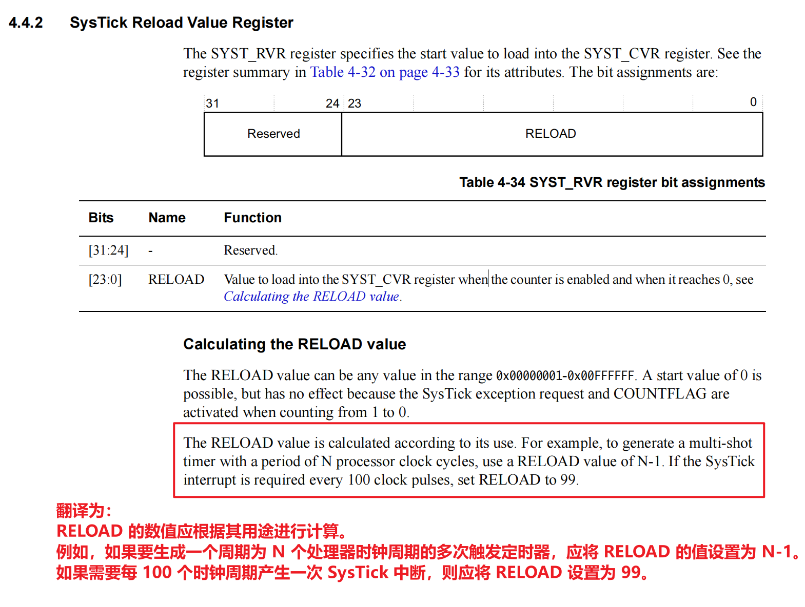

*图3-1重装值的设定官方手册-图*

为什么是这样呢？为什么要减去1呢？

原因很简单：

假如重装值是3，计数器开始计时：

1. 第一个时钟周期，装置重装值到VALUE寄存器，VALUE = 3
2. 第二个时钟周期，VALUE - 1 = 2
3. 第三个时钟周期，VALUE - 1 = 1
4. 第四个时钟周期，VALUE - 1 = 0，此时COUNTFLAG标志位置位
5. 第五个时钟周期，VALUE自动重装
6. 第六个时钟周期，VALUE - 1 = 2
7. ....

按照这样的规律，从计时开始，到触发标志位置位，一共几个时钟周期呢？

1. 加载重装值到VALUE，VALUE = 3，算1个时钟周期
2. VALUE为2时，算1个时钟周期
3. VALUE为1时，算1个时钟周期
4. VALUE为0时，算1个时钟周期

再次重装后：

1. VALUE重装，VALUE设置为3
2. VALUE为2时，算1个时钟周期
3. VALUE为1时，算1个时钟周期
4. VALUE为0时，算1个时钟周期

....

总之：

如果把重装值设置为3时，整个VALUE寄存器，递减到0的计数过程实际上耗费了4个时钟周期。

**注意，要把重装值是初始值，或者重装的这一个时钟周期算进去！！！**

**所以若想得到3个时钟周期触发标志位置位，就需要将重装值减去1，将重装值设定为2。**

### 4. 实现延时操作（轮询COUNTFLAG标志位）

我们在core_cm3.h文件中，可以看到这样一段结构体定义。

如下图所示：

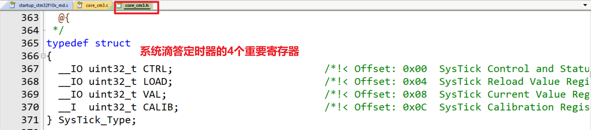

*图4-1SysTick结构体定义-图*

除此之外，我们在头文件中，还可以找到一些相关的宏定义：

```c
// core_cm3.h 742
#define SysTick ((SysTick_Type *) SysTick_BASE)

// core_cm3.h 718
#define SysTick_BASE (SCS_BASE + 0x0010)

// core_cm3.h 715
#define SCS_BASE (0xE000E000) /*!< System Control Space Base Address */
```

这些代码就是告诉我们一件事情：

**基于STM32内存映射，SysTick的相关寄存器也被映射到了内存中，我们可以通过操作地址的方式来直接控制 SysTick 的内部寄存器。**

SysTick 一共有 4 个寄存器：

1. CTRL 寄存器（控制与状态寄存器）
2. LOAD 寄存器（重装载寄存器）
3. VAL 寄存器（当前计数值寄存器）
4. CALIB 寄存器（校准寄存器）

我们一个一个来看。

#### 4.1 四个寄存器介绍

**第一个寄存器，CTRL 寄存器**这个寄存器最重要。

它既负责控制，又负责状态反馈。

关键位如下：

1. **bit0 —— ENABLE 位**
   - a. 0：关闭 SysTick 停止计数
   - b. 1：开启 SysTick 开始计数
2. **bit1 —— TICKINT 位**
   - a. 0：不产生中断
   - b. 1：计数到 0 时产生中断
3. **bit2 —— CLKSOURCE 位**
   - a. 0：时钟来源 = HCLK / 8
   - b. 1：时钟来源 = HCLK
4. **bit16 —— COUNTFLAG 位**
   - a. 当 VAL 从 1 递减到 0 时，硬件自动将该位置 1
   - b. 这是一个事件标志位。
   - c. **并且有一个重要特性：读取该位后，会自动清零。**
   - d. 这是一种典型的“读清零”机制。

**第二个寄存器，LOAD 寄存器**这个寄存器用来设置：**重装值。**

在使用时，可以直接向该寄存器中写入重装值。

在开启SysTick计数的前提下，当计数器减到 0 后，在下一个时钟周期，会从 LOAD 中重新装载数值。

注意：

SysTick 是一个**24 位递减计数器**，所以 LOAD 最大不能超过 0xFFFFFF。

**第三个寄存器，VAL 寄存器**这是当前计数值寄存器。向该寄存器写任意值，会清空计数值，并自动复位COUNTFLAG 标志位。

并且随即装载重装值，如果开启SysTick计数，计数值的数值由硬件自动递减。

非常重要的一句话是：

**VAL 的递减完全由硬件逻辑完成，不需要 CPU 参与。**

也就是说：不是程序在做VAL-- ，而是：每来一个时钟周期，硬件自动减 1。

当减到 0 时，触发 COUNTFLAG 硬件自动置位，如果开启了 TICKINT，则触发中断。

**第四个寄存器，CALIB 寄存器**这个寄存器用于校准。它给出一个参考值，用于说明 10ms 对应的计数值（在标准频率下）。

在实际工程中很少主动使用它。

我们随后实现延时操作时，也不会用到这个寄存器。

#### 4.2 实现延时（非中断实现）

前面我们已经知道：

SysTick 的寄存器都在固定的映射地址上，并且可以通过SysTick->CTRL/LOAD/VAL直接操作。

整个 SysTick 的本质就变成一句话：

**让 SysTick 从某个数开始往下数，数到 0 之后告诉我们“到点了”。**

具体到延时的实现，可以采用两种方式：

1. 不开启中断，让CPU轮询等待COUNTFLAG置位，本质上是一个确定时长的for循环延时。
2. 开启中断，维护一个全局变量，实现延时。

绝大多数情况下，如果目标仅仅是实现一个延时，不建议使用中断的方式。

**因为中断是对紧急重要的事情进行处理，而延时通常谈不上紧急，直接让CPU等待阻塞就可以了。**

这套非中断，基于寄存器开发方式的延时实现思路是：

1. 设置LOAD=N-1 （注意要减1）
2. 清空VAL=0 （注意：写任何值都可清空计数值，复位 COUNTFLAG 标志位）
3. 配置CTRL ：
   - a. ENABLE = 1（启动计数）
   - b. TICKINT = 0（不需要触发中断）
   - c. CLKSOURCE 选时钟源，建议设置为1，表示时钟来源为HCLK，即默认72MHz
4. 死循环等待COUNTFLAG变 1，读到 1 后，COUNTFLAG 标志位会自动清零
5. 如果是一次性延时，可以直接关掉 SysTick

#### 4.3 重装值N如何计算？

前面我们已经知道，实现延时的核心步骤是：

1. 设置LOAD=N-1
2. 清空VAL=0
3. 配置CTRL启动计数，选择时钟源，不使能中断
4. 等待COUNTFLAG=1
5. 必要时关闭 SysTick

那么现在真正关键的问题来了：

N 到底怎么计算？重装值如何计算？

我们先记住一句最核心的话：

**重装值N，说白了就是先确定我们想要延迟的时间，然后把这个时间换成SysTick的时钟周期，最后再减去1即可。**

**第一步，我们先确定时钟频率。**

在一般通常情况下，我们设置CLKSOURCE = 1那么：

SysTick 时钟 = HCLK在 STM32F103 中默认系统主频是 72MHz**那么：SysTick 每秒有 72 000 000个时钟周期，也就是每秒计数相减 72 000 000 次第二步，进行时间单位的换算。**

我们分别来看几种常见延时**第一种延时1秒：**

N = 1 × 72 000 000N = 72 000 000所以：

LOAD（重装值）= 72 000 000 - 1**第二种延时1毫秒：**

1 ms = 0.001 秒N = 0.001 × 72 000 000N = 72 000所以：

LOAD（重装值）= 72 000 - 1**第二种延时1微秒：**

1 us = 0.000001 秒N = 0.000001 × 72 000 000N = 72所以：

LOAD（重装值）= 72 - 1

#### 4.4 参考代码实现

SysTick 不是 STM32 外设，而是 Cortex-M 内核外设。

**ST公司对此外设的SPL库封装并不完善，用起来实际上有种“半寄存器开发、半SPL库”**

**的感觉。**

所以我们干脆不使用 SysTick 的SPL库封装函数，直接基于寄存器开发。

这也是我们上面大量讲解寄存器的原因。（当然这里的寄存器开发，仍然会用ST公司封装的寄存器地址宏）

直接使用寄存器，一个使用 SysTick 实现的延时函数。代码示例，如下所示：

**Delay.h头文件：**

```c
#ifndef __DELAY_H
#define __DELAY_H

#include "stm32f10x.h"

void Delay_Us(uint32_t us);
void Delay_Ms(uint32_t ms);
void Delay_S(uint32_t s);

#endif // !__DELAY_H
```

**Delay.c源代码文件：**

```c
#include "Delay.h"

/**
  * @brief 提供微秒级延时
  * @param us 延时时长（单位：微秒）
  * 当系统时钟为 72 MHz 且 CLKSOURCE = 1（SysTick 时钟 =HCLK）时
  * 建议取值范围：0 ~ 233016 us
  * @retval 无
  * @note 最大值为什么是 233016？
  * 1) SysTick 是 24 位递减计数器
  * LOAD 寄存器只有 24 位有效位
  * 所以最大可装载值为：
  * LOAD_max = 0xFFFFFF = 16777215
  *
  * 2) 本函数设置 CLKSOURCE = 1
  * SysTick 时钟频率 = HCLK = 72000000 Hz
  * 也就是每秒递减 72000000 次
  *
  * 3) 计数器从 LOAD 递减到 0 一共经历 (LOAD + 1) 次时钟
  * 最大一次能经历的计数次数：
  * N_max = LOAD_max + 1 = 16777216 次
  *
  * 4) 最大延时时间：
  * T_max = N_max / 72,000,000
  * = 16777216 / 72000000 秒
  * ≈ 0.233016888... 秒
  * ≈ 233016.888... 微秒
  *
  * 5) 为了不超出 24 位装载能力，us 取整后可取：
  * us_max = 233016
  */
void Delay_Us(uint32_t us) {
    if (us == 0) {
       return;
    }

    if (us > 233016) {
       return; // 超出 24 位计数器计数能力
    }

    /* 重装值 LOAD = N - 1 */
    SysTick->LOAD = 72U * us - 1U;

    /* 清空当前计数值，同时清除 COUNTFLAG */
    SysTick->VAL = 0U;

    /*
       CTRL寄存器：
       bit0 ENABLE = 1 (开启计时)
       bit1 TICKINT = 0 (禁用中断)
       bit2 CLKSOURCE = 1 (选中HCLK)
    */
    SysTick->CTRL = (1U << 0) | (1U << 2);

    /* 等待 COUNTFLAG 置位（bit16） */
    while ((SysTick->CTRL & (1U << 16)) == 0);

    /* 单次延时完成，关闭 SysTick 计数器，bit0 ENABLE = 0 */
    SysTick->CTRL &= ~(1U << 0);
}

/**
  * @brief 提供毫秒级延时
  * @param ms 延时时长（单位：毫秒）
  * 取值范围受 uint32_t 类型限制：
  * 0 ~ 4294967295
  *
  * 理论最大延时 ≈ 49.7 天
  * @retval 无
  */
void Delay_Ms(uint32_t ms) {
    while (ms--) {
       Delay_Us(1000);
    }
}

/**
  * @brief 提供秒级延时
  * @param s 延时时长，范围：0~4294967295
  * @retval 无
  */
void Delay_S(uint32_t s) {
    while (s--) {
       Delay_Ms(1000);
    }
}
```

一些细节内容，可以参考注释。

注意事项：

基于SysTick上述代码，实现的微秒级别延时操作，由于函数本身存在一些软件开销，比如：

1. 参数判断
2. 写配置各种寄存器
3. 轮询标志位
4. ...

**这些操作本身，都需要 CPU 执行时间。因此，该函数的实际延时时间通常会略大于传入的 Us 值。**

当 Us 很小时，例如 1us、2us、5us，软件开销占比较大，延时误差会比较明显；

当 Us 较大时，软件开销相对于总延时时间占比较小，延时效果会更接近目标值。

建议不要过分纠结SysTick延时的绝对精准，在一般的开发场景中，这种基于 SysTick 的阻塞式延时已经可以满足大多数普通延时需求。

### 5. 了解：基于Tick中断实现延时

基于Tick中断来实现延时，这也是可以的，但必要性很低，几乎不会这么干，了解一下。

首先，在默认时钟频率72MHz的前提下，如果想要实现“微秒级别延时”：

也就是期望1微秒就能触发一次中断，这就意味着1秒钟内要触发 ( 72 000 000 / 72 ) = 100 0000 次。（72个时钟周期是1微秒）

1秒钟触发 100万次中断，这个频率太高了，系统开销太大了，所以基于中断来实现延时，我们就不实现微秒级延时了。

更合理的做法是：

1. **SysTick 中断负责提供 1 ms 系统节拍，每 1ms 触发一次 Tick中断。**
2. Delay_Ms() 、Delay_S()改成基于中断计数实现。

#### 5.1 实现思路

基于中断实现的延时，不再使用“查询 COUNTFLAG 的忙等待方式”来实现毫秒延时。

而是改为：

1. 利用 SysTick 周期性产生中断
2. 在中断服务函数中维护一个全局毫秒计数值
3. 再基于这个毫秒计数值实现Delay_Ms()和Delay_S()

这样做之后，延时的“计时”工作，就不再依赖当前函数内部去轮询 SysTick 是否计满，而是交给 SysTick 中断自动完成。

需要注意：

这里虽然使用了中断来计时，但Delay_Ms()本身仍然是阻塞式等待。

也就是说：

1. 时间推进，靠中断完成
2. 当前函数返回之前，CPU 仍然会一直等待

所以它仍然并不是 FreeRTOS 里的那种“让出 CPU 的非阻塞延时”，只是比原先“反复配置 SysTick 做单次计时”的方式更适合做系统级毫秒节拍。

#### 5.2 实现步骤

**第一步：配置 SysTick 为 1ms 周期中断**

1. 系统时钟为 72MHz，1ms 对应 72000 次时钟周期
2. 重装值设置LOAD=72000-1
3. 配置 CLKSOURCE=1（选择 HCLK时钟源）
4. 配置 TICKINT=1（开启中断）
5. 配置 ENABLE=1（启动计数器）
6. 使 SysTick 持续以 1ms 为周期运行，每 1ms 产生一个Tick中断。

**第二步：定义全局毫秒节拍变量**

1. 在 Delay 模块中定义全局变量volatileuint32_tg_delayTick
2. 该变量用于记录系统已经经过的毫秒数
3. 每增加 1，表示时间前进 1ms
4. 必须使用volatile ，防止编译器优化导致读取不到最新值

**第三步：实现 SysTick 中断服务函数**

1. 在stm32f10x_it.c中实现SysTick_Handler()
2. 在中断函数中执行g_delayTick++
3. 由于每 1ms 进入一次中断，因此该变量每 1ms 自增一次
4. 最终形成一个连续递增的“系统时间基准”。

**第四步：实现 Delay_Ms 函数**

1. 调用延时时，先记录当前时间：start=g_delayTick
2. 在循环中不断读取当前节拍值
3. 判断条件为(g_delayTick-start)<ms
4. 当差值达到指定毫秒数时，退出循环
5. 本质是通过“节拍差值”判断时间是否到达，而不是自己计时

**第五步：实现 Delay_S 函数**

1. 秒级延时基于毫秒延时实现
2. 循环调用Delay_Ms(1000)
3. 每执行一次表示经过 1 秒
4. 重复执行 s 次即可完成秒级延时

**总结：**

1. SysTick 负责每 1ms 产生一次中断
2. 中断中维护全局时间变量
3. 延时函数通过比较时间差实现延时
4. 整体形成统一的毫秒时间基准系统

**本实现的核心是：利用 SysTick 周期中断建立统一的 1ms 时间基准，再通过比较节拍差值实现延时功能。**

#### 5.3 参考代码实现

**Delay.h头文件：**

```c
#ifndef __DELAY_H
#define __DELAY_H

#include "stm32f10x.h"

extern volatile uint32_t g_delayTick;

void Delay_Init(void);
void Delay_Ms(uint32_t ms);
void Delay_S(uint32_t s);
uint32_t Delay_GetTick(void);

#endif
```

**Delay.c源文件：**

```c
#include "Delay.h"

/* 全局毫秒节拍计数 */
volatile uint32_t g_delayTick = 0;

/**
  * @brief 初始化延时模块
  * @param 无
  * @retval 无
  * @note 配置 SysTick 每 1ms 产生一次中断
  * 系统时钟默认为 72MHz
  */
void Delay_Init(void) {
    /*
       72MHz 时钟下：

       1ms = 72000 个时钟周期

       SysTick 计数次数 = LOAD + 1
       所以：
       LOAD = 72000 - 1
    */
    SysTick->LOAD = 72000U - 1U;

    /* 清空当前计数值 */
    SysTick->VAL = 0U;

    /*
       CTRL 寄存器：
       bit0 ENABLE = 1 启动计数器
       bit1 TICKINT = 1 开启 SysTick 中断
       bit2 CLKSOURCE = 1 选择 HCLK 作为时钟源
    */
    SysTick->CTRL = (1U << 0) | (1U << 1) | (1U << 2);
}

/**
  * @brief 获取当前系统毫秒节拍值
  * @param 无
  * @retval 当前毫秒节拍值
  */
uint32_t Delay_GetTick(void) {
    return g_delayTick;
}

/**
  * @brief 提供毫秒级延时
  * @param ms 延时时长（单位：毫秒）
  * @retval 无
  * @note 本函数属于阻塞式延时
  */
void Delay_Ms(uint32_t ms) {
    uint32_t start = g_delayTick;

    while ((g_delayTick - start) < ms);
}

/**
  * @brief 提供秒级延时
  * @param s 延时时长（单位：秒）
  * @retval 无
  */
void Delay_S(uint32_t s) {
    while (s--) {
       Delay_Ms(1000);
    }
}
```

**stm32f10x_it.c中断实现：**

```c
void SysTick_Handler(void) {
    g_delayTick++;
}
```

**main.c 使用示例：**

```c
#include "stm32f10x.h"
#include "Delay.h"
#include "LED.h"

int main(void) {
    LED_Init();
    Delay_Init();

    while (1) {
       LED_Turn(); // 切换LED电平状态
       Delay_Ms(500);
    }
}
```

在上述参考代码中，我们使用了 SysTick 中断，但是没有像普通外设中断那样配置NVIC，也没有单独设置中断优先级。

这是因为：

1. **SysTick 不是普通外设中断**
   - a. SysTick 属于**Cortex-M3 内核自带的系统异常**，不是 USART、TIM、EXTI 这类挂在外设总线上的普通中断。
   - b. 因此，SysTick 不需要通过NVIC_Init()来开启中断通道。
2. SysTick 的中断开关由自身寄存器控制
   - a. SysTick 是否产生中断，主要由 SysTick 控制寄存器中的相关位决定。
   - b. 比如是否开启计数、是否允许计数到 0 时产生中断。
   - c. 所以，只要配置好 SysTick 本身，它就可以产生中断。（毕竟它也和内核住一起）
3. SysTick 的中断优先级设置依赖于Cortex-M3 内核中的系统中断优先级寄存器，是一个单独的内核优先级寄存器。
4. 基于SPL库编程的话，可以通过NVIC_SetPriority()设置 SysTick 优先级，其本质就是修改内核的优先级寄存器。

比如你可以通过下面的代码：

```c
NVIC_SetPriority(SysTick_IRQn, 15); // SPL库提供的接口，可以设置Tick中断为最低优先级（抢占优先级）
```

将 SysTick 中断设置为最低优先级，可以理解成抢占优先级是15。

**在裸机开发的前提下：**

完全可以不手动设置SysTick中断的优先级，SysTick 中断会在单片机上电复位后具有优先级0，即拥有最高的优先级。

裸机程序通常只用 SysTick 做简单延时或周期计数，中断关系比较简单，即使使用默认优先级，一般也不会影响系统运行。

**但在FreeRTOS中，系统把SysTick中断作为系统时间基准：**

它会周期性地产生 Tick 中断，用来驱动任务延时、阻塞超时、时间片轮转等内核机制。

如果 SysTick 保持默认的最高优先级，就可能抢占一些更重要的外设中断，影响系统整体的中断响应关系。

**因此，在 FreeRTOS 当中，普遍的设计就是将SysTick中断设置为最低优先级。**

### 6. FreeRTOS中的SysTick

前面我们已经知道：

SysTick 本质上是一个24 位递减计数器。它可以用来做延时，可以产生周期性中断那么问题来了：

在 FreeRTOS 中，SysTick 还在干延时这件事吗答案是否定的。

**FreeRTOS中的SysTick不再只是简单延时工具**它变成了，整个操作系统的心跳时钟。

关于 SysTick 在 FreeRTOS 中的核心作用，可以一句话总结：

**SysTick 提供了 FreeRTOS 的系统节拍时钟 Tick，也就是提供时间片，也提供了时间基准。**

FreeRTOS 是一个抢占式实时操作系统，它需要一个时间基准，来做这些事情：

1. 任务延时管理
2. 时间片轮转
3. 延时任务唤醒
4. 软件定时器驱动

**这个时间基准，就是 SysTick 周期性中断。**

#### 6.1 时间片的由来

FreeRTOS 如何使用 SysTick 呢？

在 FreeRTOS 中，SysTick 完全被 FreeRTOS内核接管。

FreeRTOS系统启动时，会调用vTaskStartScheduler() 函数，从而启动任务调度器。

这个过程，会配置 SysTick，使其按照configTICK_RATE_HZ，产生周期中断。

例如：

在默认情况下，宏configTICK_RATE_HZ的值就是1000，这表示每秒产生 1000 次 Tick，也就是 1ms 时间为 1个FreeRTOS系统节拍（Tick）。

此时 SysTick 会被配置为中断模式，每 1 个Tick就会产生一个 SysTick 中断。

这部分的源码，你可以按照下列流程找到：

```c
vTaskStartScheduler() → xPortStartScheduler() → vPortSetupTimerInterrupt()
```

最终你能找到下面的源码部分，这两行代码就是 SysTick 操作的核心代码：

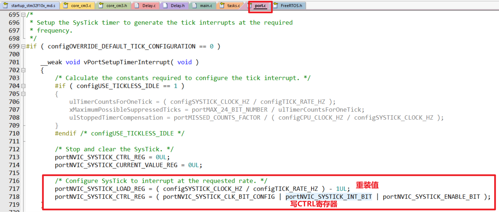

*图6.1-1FreeRTOS使用SysTick源码-图1*

这两行代码使用的相关宏，如下：

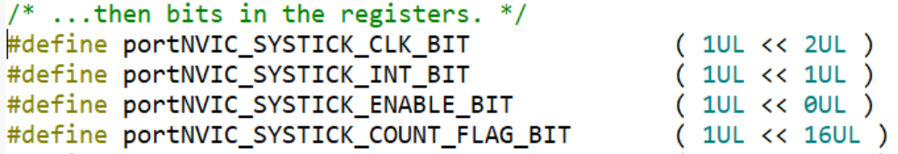

*图6.1-2FreeRTOS使用SysTick源码-图2*

可以看到在上述源码中，完成了重装值的装载（需要减去1），随后写CTRL寄存：

1. 使用HCLK主时钟频率
2. 开启中断模式
3. 开启计数器递减计数

由于主时钟频率是 72MHz， configTICK_RATE_HZ配置为1000，所以重装值是：

7200 0000 / 1000 - 1很明显周期性触发中断的间隔是 1ms这正是1ms作为FreeRTOS时间片的由来。

#### 6.2 FreeRTOS对SysTick中断的处理

FreeRTOS每 1ms 产生一次 Tick，触发一次SysTick中断。

那么：

**SysTick 中断发生之后，FreeRTOS 到底做了什么？**

实际上这一步，才是调度器真正开始工作的地方。

SysTick 中断服务程序（ISR）的入口是哪个函数？

在裸机开发时，我们自己写：

```c
void SysTick_Handler(void){

}
```

**但在 FreeRTOS 中，这个中断处理函数被FreeRTOS内核接管了。**

这就是我们在移植FreeRTOS时，在配置文件中添加的一个宏定义：

```c
#define xPortSysTickHandler SysTick_Handler
```

也就是说，触发SysTick中断处理，实际执行的函数是：

```c
xPortSysTickHandler()
```

这个函数在 port.c 文件中，源码如下所示：

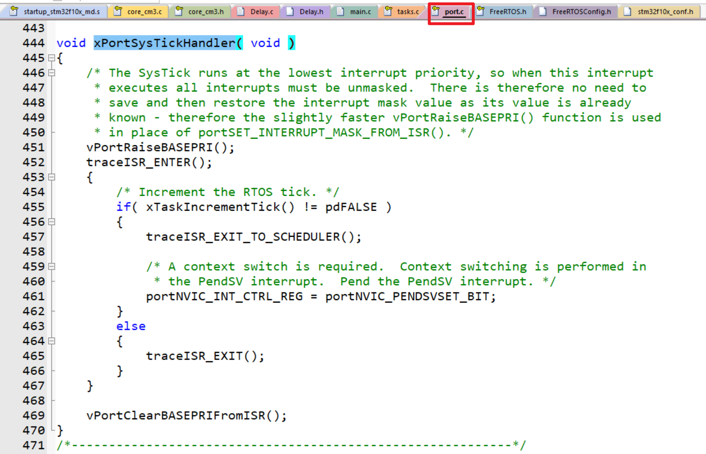

*图6.2-1xPortSysTickHandler源码-图*

**xPortSysTickHandler 函数做了哪些事情呢？**

核心逻辑可以概括为三步：

**第一步：增加系统全局节拍计数器 xTickCount**内部调用函数：

```c
xTaskIncrementTick();
```

这一步非常重要，xTickCount 是整个 FreeRTOS 的时间基准。

所有延时任务，所有软件定时器，全部依赖这个变量。

**第二步，检查是否有延时任务到期**仍然是函数 xTaskIncrementTick() 内部，会遍历“延时阻塞列表”

检查：

当前 xTickCount，是否已经到达某个任务的唤醒时间。

如果到达，该任务会从“延时列表”，移动到“就绪列表”。

这一步完成了：

**任务从 Blocked → Ready 的状态转换第三步，判断是否需要任务切换**如果刚刚被唤醒的，进入就绪态的任务，优先级高于当前正在运行的任务。

那么就需要立刻进行任务切换。

此时会触发：

```c
PendSV
```

PendSV 是 Cortex-M 专门用于，“上下文切换”的中断。

FreeRTOS 不会在 SysTick 中断里直接切换任务而是：

在 SysTick 中断里“申请切换”，真正的切换动作在 PendSV 里完成。

实际上 PendSV 中断处理函数PendSV_Handler ，也被FreeRTOS接管了：

```c
#define xPortPendSVHandler PendSV_Handler
```

在这个FreeRTOS内核自己实现的xPortPendSVHandler 函数内部，实现了任务的上下文切换。

#### 6.3 完整流程总结

默认配置下，每 1ms 产生一次 SysTick 中断。

而 SysTick 中断 ISR 的执行流程如下：

1. 某个时间片到期，SysTick 中断触发。
2. 调用xPortSysTickHandler中断服务函数。
3. 调用xTaskIncrementTick函数，完成：
   - a. 执行xTickCount++
   - b. 检查延时阻塞列表并唤醒任务
   - c. 判断是否需要触发任务调度（高优先级任务就绪或需要时间片轮转等）。
4. 在必要时触发一次任务调度，触发 PendSV 中断，在 PendSV 中断 ISR 中完成任务上下文切换。
5. **SysTick 负责产生系统节拍，PendSV 负责执行任务切换。这就是 FreeRTOS 的“时间驱动调度机制”。**

#### 6.4 扩展细节：为什么不能在 SysTick 中断里直接切换任务

在FreeRTOS中 SysTick 和 PendSV 的优先级都被刻意设置为最低。

如下图所示：

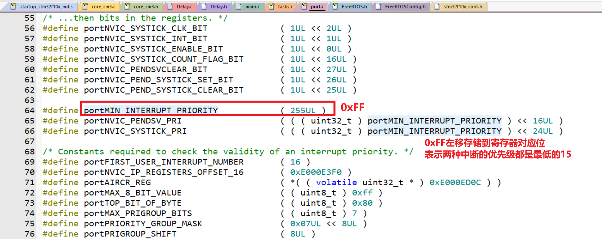

*图6.4-1中断优先级源码-图*

这样设计的目的，是为了让它们尽量不要打断其他外设中断的执行。

当系统中还有其他更高优先级的中断正在执行，或者还有更高优先级的中断正在等待处理时，CPU 会优先处理这些中断。

只有当这些中断都处理完成之后，CPU 才会进入 SysTick 或 PendSV。

**那为什么不能在 SysTick 中断里直接切换任务呢？**

FreeRTOS 并不是不能在 SysTick 中断里直接切换任务，而是**故意不这样设计**。

在 Cortex-M内核 + FreeRTOS 中，通常采用：

1. SysTick：负责系统节拍，更新 Tick，判断是否需要唤醒调度
2. PendSV ：负责真正的任务上下文切换

这样做的好处是：

1. **SysTick 中断可以保持简短。**
   - a. SysTick 是周期性中断，触发频率较高
   - b. 它只适合做 Tick 更新、延时任务检查和调度判断，不适合执行保存现场、恢复现场这类较重的操作。
2. **任务切换可以统一处理。**
   - a. 不只是 SysTick，串口中断、DMA 中断、外部中断等也可能唤醒任务。
   - b. 如果每个中断都直接切换任务，系统会很复杂。
   - c. 所以 FreeRTOS 统一让这些中断只“提出切换请求”，真正的切换交给 PendSV。
3. **任务切换的触发场景很多，而 PendSV 更方便作为统一的任务切换入口。**
   - a. 任务切换的触发场景很多，而 PendSV 可以通过软件设置**挂起位**触发。
   - b. 不同场景中，只需要挂起 PendSV，就可以提出一次任务切换请求。
   - c. 这样，真正的上下文切换逻辑就可以统一放到PendSV_Handler()中完成。
4. **相比于其它中断，PendSV 可以延后到更合适的时机执行。**
   - a. PendSV 被设置为最低优先级的中断，因此它不会打断其他高优先级中断。
   - b. 而 PendSV 不是必须立刻执行的中断，而是可以先挂起，等 CPU 判断时机合适时再执行的中断。
   - c. 所谓更合适的时机，通常是指：所有中断都已经执行完毕退出，并且没有更高优先级中断需要处理。
   - d. CPU会自动延后没有高优先级中断需要处理时再执行PendSV，所以PendSV非常适合用来完成 FreeRTOS 的任务上下文切换。

总结来说：

**SysTick 负责产生系统节拍和调度时机，PendSV 负责真正执行任务切换。**

**FreeRTOS 把任务切换交给 PendSV，是为了让 SysTick 更短，让切换入口更统一，并让上下文切换发生在更稳定、可控的时机。**

#### 6.5 总结

在裸机开发中，SysTick 只是一个简易定时器。

它本质上只是一个 24 位递减计数器，重装值减到到 0 置位标志位或者产生中断，仅此而已。

但在 FreeRTOS 中：

**SysTick 是时间推进器，它推动 xTickCount（全局Tick计数）前进，判断延时任务苏醒，触发任务切换。**

但它本身并不负责上下文切换，真正切换任务的是 PendSV中断。

也就是说：

1. SysTick 负责“提出调度申请”
2. PendSV 负责“真正执行调度”

这是一种分工明确的架构设计。

由此我们可以得到一个非常现实的结论：

**既然 FreeRTOS 已经接管了 SysTick，那么在使用 FreeRTOS 时，不要再把 SysTick 当成普通定时器使用。**

所以：

在FreeRTOS环境下，如果我们还想实现自己的延时功能（CPU等待阻塞式延时），或者实现某些独立的周期性任务，就不能再使用SysTick了。

而是需要使用：**外设定时器（TIMx）**

这正是下一个章节的内容。

---

## 03 TIM定时器

### 1. 概述/前言

既然SysTick已经被FreeRTOS征用了，那么就不能再使用它来实现基础延时功能了。

那么，引入FreeRTOS之后，还能不能实现基础延时功能呢？

当然可以。

**在 STM32 中，除了 Cortex-M 内核自带的 SysTick 定时器外，还提供了功能更丰富的TIM 外设定时器。**

TIM定时器也可以实现诸如延时、周期性中断等与 SysTick 类似的功能。

从本质上讲：

**延时 = 对时钟周期进行计数。**

TIM定时器，内部也实现了类似的计数器，也可以实现延时的功能。

下面我们先来简单了解一下 TIM 定时器，随后我们实现一个替代 SysTick 的 Delay 函数。

### 2. STM32F103C8T6的TIM外设

STM32F10x单片机的外设框图，如下图所示：

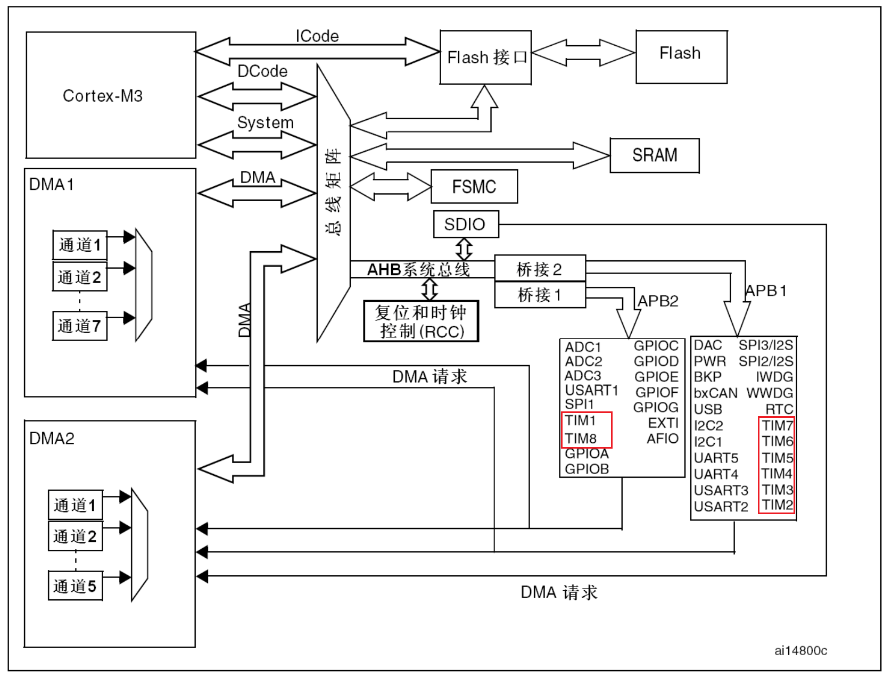

*图2-1STM32F10x单片机的外设框图*

这张框图上显示：

1. 挂载在APB2外设总线上的TIM外设有：
   - a. TIM1
   - b. TIM8
2. 挂载在APB1外设总线上的TIM外设有：
   - a. TIM2
   - b. TIM3
   - c. TIM4
   - d. TIM5
   - e. TIM6
   - f. TIM7

也就是说，这张框图上一共出现了 8 个 TIM 定时器。

不过具体到我们使用的STM32F103C8T6：

它并没有拥有全部的 8 个定时器，实际上只有 4 个TIM定时，即TIM1~TIM4。

其中：

1. TIM1 挂在**APB2 总线**
2. TIM2~TIM4 挂在**APB1 总线**

### 3. TIM定时器分类及功能

在 STM32F10x 系列中，TIM 定时器并不是“完全一样”的。

根据功能强弱不同，大体可以分为三类：

**第一类，高级定时器（Advanced Timer）。**

属于高级定时器的有：**TIM1、TIM8**特点：

1. 支持互补输出
2. 支持死区时间插入
3. 支持刹车输入（Break）
4. 主要用于电机控制、功率控制等场景

功能最强，结构也最复杂。

如果只是做普通延时，用它就有点“杀鸡用牛刀”。

**第二类，通用定时器（General-purpose Timer）**

属于通用定时器的有：**TIM2、TIM3、TIM4、TIM5**特点：

1. 16 位或 32 位计数器
2. 支持输入捕获
3. 支持输出比较
4. 支持 PWM
5. 支持定时中断

这是最常用的一类定时器。

如果我们只是要实现一个基于计数的延时功能，使用通用定时器是最合适的选择。

**第三类，基本定时器（Basic Timer）**

属于基本定时器的有：**TIM6、TIM7**特点：

1. 结构最简单
2. 只有计数功能
3. 没有输入输出通道
4. 主要用于产生定时中断

可以理解为“增强版的 SysTick”。

当然，我们使用的C8T6，是没有基本定时器的。

**注意，这三类定时器之间，从功能上说，可以理解为一种“逐级增强”的包含关系：**

1. 通用定时器在功能上基本覆盖了基本定时器的核心功能
2. 高级定时器在功能上也覆盖了通用定时器的大部分功能，并进一步扩展了更强大的控制能力

从硬件设计思路上看，也可以理解为一种“在原有基础上扩展”的关系：

1. 通用定时器是在基本定时器计数核心的基础上，增加新的功能模块电路，从而实现更丰富的应用场景。
2. 高级定时器则是在通用定时器功能基础上，增加新功能模块电路，实现更强大的功能。

总结一下：

1. 高级定时器 —— 功能最强
2. 通用定时器 —— 最常用
3. 基本定时器 —— 最纯粹的计数计时器，基本就是一个SysTick增强版

而我们现在的目标只是：

**实现一个简单延时函数。**

所以接下来，我们重点关注的，其实是**通用定时器**的基本计数功能。

### 4. TIM的时基控制单元

首先我们可以先看一下：基本定时器、通用定时器和高级定时器这三者的设计框图。

基本定时器的功能结构框图，如下图所示：


*图4-1基本定时器框图*

通用定时器的功能结构框图，如下图所示：

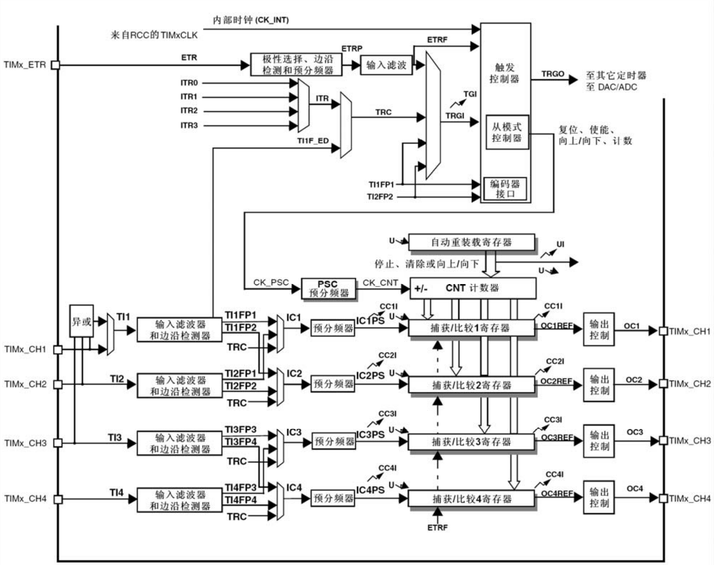

*图4-2通用定时器功能框图*

高级定时器的功能结构框图，如下图所示：

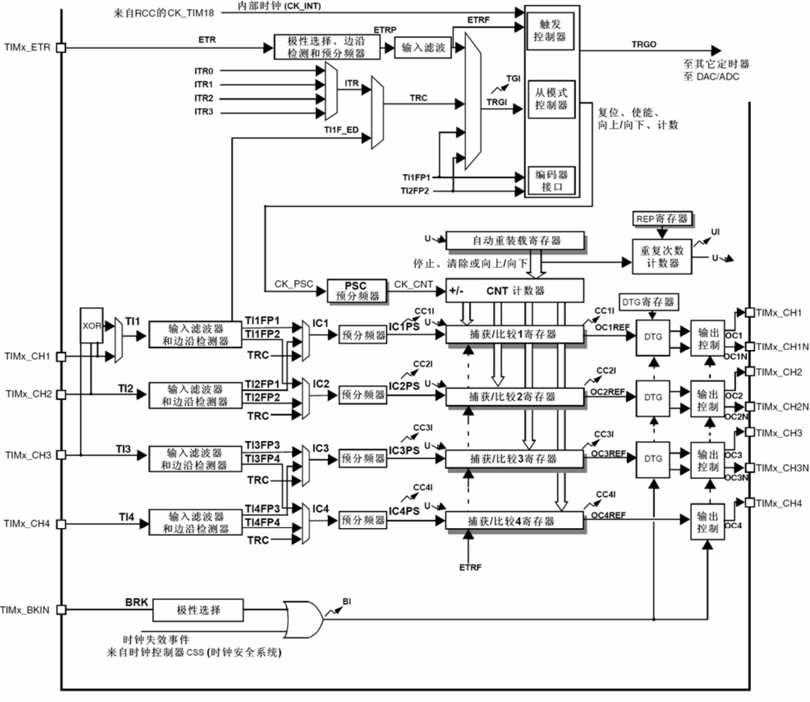

*图4-3高级定时器功能框图*

通过简单对比可以发现：

高级控制定时器、通用定时器和基本定时器虽然功能复杂程度不同，但它们都具有一个共同的核心结构——**时基单元（Time Base Unit）**。

这个时基控制单元，就是基本定时器的核心原理单元，而它实际上非常类似 SysTick 的计数器部分。

如下图所示：


*图4-4时基控制单元-图*

下面我们进行拆解，讲解一下这个时基控制单元。

#### 4.1 确认选择使用的定时器外设

STM32F103C8T6有多个TIM定时器外设，包括：

1. 挂载在APB2外设总线上的高级定时器，TIM1
2. 挂载在APB1外设总线上的通用定时器，TIM2、TIM3、TIM4
3. 没有基本定时器

现在我们要实现的功能是：CPU等待阻塞式延时那么：

**我们显然没有必要去选择一个高级定时器，选择一个通用定时器就足够了，比如选择TIM2。**

#### 4.2 时基控制单元部分的时钟源

**CK_INT**表示定时器的内部时钟输入。

如果我们选择挂载在APB1外设总线上的通用定时器，比如TIM2，那么：

1. 在默认情况下，APB1 总线分频系数为 2（对主时钟频率进行2分频）
2. 因此 APB1 上的外设最大时钟频率为 36MHz（72 / 2）

实际上，我们之前也使用过：

挂载在 APB1 上的外设（如 UART、I2C、SPI 等），它们默认运行在 36MHz 时钟下。

那么通用定时器（比如TIM2）也是这样吗？

当然不是。

这里有一个非常关键的点：

**当 APB1 预分频系数 ≠ 1 时，定时器时钟会自动 ×2。**

如下图所示：


*图4.2-1时钟树-图*

因此：

对于挂载在 APB1 上的定时器：

1. TIM2、TIM3、TIM4、TIM5（通用定时器）
2. TIM6、TIM7（基本定时器）

虽然 APB1 是 36MHz，但提供给这些 TIM（包括TIM2）的实际时钟频率是：

**36MHz × 2 = 72MHz**

#### 4.3 PSC 预分频器的作用

如下图所示：

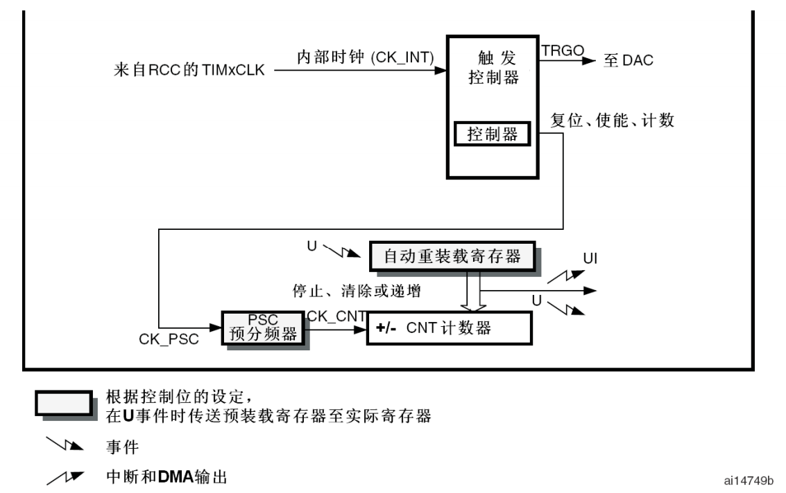

*图4.3-1时基控制单元-图*

CNT计数器进行计数时，仍然和SysTick一样，1个时钟周期计数一次。

但1个时钟周期到底是是多长时间，还需要依据**CNT计数器的输入时钟频率CK_CNT**来决定。

TIMx内部时钟信号 CK_INT 在进入CNT计数器之前，会先进入PSC，再进行一次分频操作：

得到真正用于计数的时钟信号频率，也就是CK_CNT。

计算公式：

**CK_CNT = CK_INT / (PSC + 1)**例如：

如果设置PSC = 71则：

CK_CNT = 72MHz / (71 + 1)= 72MHz / 72= 1MHz把PSC预分频设置为71，就可以得到1MHz的时钟频率输入计数器。

**扩展/了解：为什么 PSC 需要加1呢？**

可以把 PSC 想成一个“**数时钟周期的小计数员**”，CK_INT 每来一个时钟周期，PSC 就数一次。

但是注意：

PSC 寄存器里写的值，不是“直接除以多少”，而是告诉它：

**从 0 数到这个值以后，再放行一个时钟给后面的 CNT 计数器。**

例如：

```c
PSC = 0;
```

PSC 的计数过程是：

```c
0
```

它只数 1 次，就放行一次时钟。

所以：

```c
CK_CNT = CK_INT / 1
```

也就是不分频。

再看：

```c
PSC = 1;
```

PSC 的计数过程是：

```c
0 → 1
```

它要数 2 次，才放行一次时钟。

所以：

```c
CK_CNT = CK_INT / 2
```

再看：

```c
PSC = 2;
```

PSC 的计数过程是：

```c
0 → 1 → 2
```

它要数 3 次，才放行一次时钟。

所以：

```c
CK_CNT = CK_INT / 3
```

因此规律就是：

1. PSC = 0，分频系数 = 1
2. PSC = 1，分频系数 = 2
3. PSC = 2，分频系数 = 3
4. ....
5. PSC = 7199，分频系数 = 7200

所以最终公式是：

**CK_CNT = CK_INT / (PSC + 1)**通俗理解就是：

**PSC 不是“数到 PSC 次”，而是“从 0 数到 PSC”。**

因为从 0 开始数，所以总次数要多 1 次。

比如从 0 数到 9：

0 1 2 3 4 5 6 7 8 9看起来最后的数字是 9，但实际上一共数了**10 个数**。

所以：

**PSC = 9 时，分频系数是 10，而不是 9。**

总结一句话：

**PSC 寄存器写入的值是“计数终点”，不是“分频倍数”；由于 PSC 从 0 开始数到计数终点，然后放行一次时钟周期，所以实际分频系数是 PSC + 1。**

#### 4.4 CNT计数方向

如下图所示：


*图4.4-1时基控制单元-图*

设置好CK_CNT输入时钟频率后，紧接着就可以开始计数了。

但 CNT计数器是向上计数还是向下计数，是可以设置的。**（SysTick永远是向下的）**

它由**TIMx_CR1 寄存器中的 DIR 位（bit4）**决定。

1. DIR = 0 ：向上计数
2. DIR = 1 ：向下计数

**向上计数时：**

CNT 从 0 开始递增，计数到 ARR 时产生更新事件，然后清零重新开始。

注：ARR 就是**Auto-Reload Register**，也就是图中的自动重装载寄存器。

**向下计数时：**

CNT 从 ARR 开始递减，减到 0 时产生更新事件，然后重新装载 ARR。

**默认情况下，一般使用向上计数模式，即默认从0，累加到重装值。**

扩展/了解：为什么通常使用向上计数？

TIM 定时器常用向上计数，是因为它更直观：

CNT 从 0 开始累加到 ARR，ARR 表示计数终点。

**同时，ARR + 1 表示实际计数次数。**

#### 4.5 CNT计数器的工作原理

每当CK_CNT产生一个有效计数周期，CNT 计数器就会在硬件控制下自动变化（递减或递增）。

如果选择**向上计数**模式，CNT 会从 0 开始递增：

```c
0 → 1 → 2 → ... → ARR
```

需要注意的是：

CNT 计数到 ARR 时，只表示到达了本轮计数的最大值。

当下一个 CK_CNT 计数周期到来时，CNT 会从 ARR 溢出并重新回到 0，同时产生更新事件，并将 TIMx_SR 寄存器中的 UIF 标志位置位。

可以理解为：

```c
CNT = 0 → 1 → 2 → ... → ARR → 0
                            ↑
                   溢出重装，UIF 置位
```

如果开启了更新事件中断，UIF 置位后会进一步触发对应的定时器中断，例如：

```c
TIM2_IRQn
TIM3_IRQn
TIM4_IRQn
....
```

这些中断号可以在stm32f10x.h中查询。

另外需要特别注意：

**通用定时器TIM2的ARR重装值寄存器，CNT计数器、PSC寄存器等都是低16位有效的，所以重装值和计数值，它们的最大值都是：**

65535（216 - 1）

#### 4.6 TIM 是否触发中断

当 CNT 计数到 ARR（或向下计数到 0）时，一定会产生更新事件，执行一系列操作。

但这不代表一定会进入中断。

是否触发中断，取决于下面的条件：

在TIMx_DIER寄存器中，是否置位了 UIE 位（中断使能位，类似USART外设中的RXNEIE中断使能位）

只有将 UIE位设置为1，TIM计数完成后，才能触发一次中断请求。

#### 4.7 实际案例

假设我们设置：

1. PSC分频 = 72 - 1 = 71
2. ARR重装值 = 1000 - 1 = 999**（当你想要 N 次计数时，ARR 应设置为 N-1）**

**第一步：**

72MHz 经过 PSC 分频：

72MHz / (71 + 1) = 1MHz**第二步：**

1MHz 的1个时钟周期是：

1 / 1MHz = 1µs（1 微秒）

即 1MHz 的定时器时钟信号频率，1个时钟周期就是1微秒选择“CNT向上计数”，也就是说：

每 1个时钟周期，也就是每 1 微秒，CNT计数值 +1。

**第三步：**

CNT 从 0 加到 999，一共需要：

1000 次计数即：

1000 × 1µs = 1000µs = 1ms也就是说：

整个计数值加满，需要1000个时钟周期，即需要1ms。

最终结论，通过设置：

1. PSC = 71
2. ARR = 999
3. 向上计数

可以让 TIMx 每 1ms 产生触发一次计数加满，触发更新事件，也可以触发一个中断。

### 5. 基于TIM2实现延时（轮询计数值实现）

在引入FreeRTOS后，如果我们想要实现一个延时函数，尤其是微秒级、毫秒级这种相对精确的延时，更推荐使用 TIM 定时器外设。

TIM2 是一个比较合适的选择：它属于通用定时器，挂载在 APB1 总线上，资源常见，功能也完全够用。

TIM2 实现延时过程，其计数器的工作过程可以理解为：

```c
CK_INT → PSC 预分频 → CK_CNT → CNT 按节拍计数
```

实现延时的核心问题只有一个：

希望 CNT 多久计数一次？

**常见做法是将 TIM2 配置为 1MHz 计数频率：**

```c
CK_CNT = 72MHz / (71 + 1) = 1MHz
```

这样 CNT 每增加 1，就表示经过**1us**。

因此，需要延时 N 微秒时，只需要先将 CNT 清零，然后轮询等待 CNT 计数到 N。

本节采用的是 TIM2 硬件计数 + CPU 轮询等待的方式实现阻塞式延时，暂时不使用定时器中断。

#### 5.1 实现思路

实现思路很简单：

**把 TIM2 配置成“每 1us 计数一次”的硬件计数器，然后通过轮询 CNT 计数值，判断延时时间是否到达。**

也就是说，本方案并不是靠软件空循环估算时间，而是让 TIM2 的 CNT 计数器提供时间基准。

**首先第一步：将 TIM2 配置为 1MHz 计数频率**在 STM32F103 的常见时钟配置下：

```c
SYSCLK = 72MHz
APB1 = 36MHz
TIM2 输入时钟 = 72MHz
```

TIM2 的计数频率由 PSC 预分频器决定：

```c
CK_CNT = TIM2 输入时钟 / (PSC + 1)
```

设置：

```c
PSC = 71
```

则：

```c
CK_CNT = 72MHz / (71 + 1) = 1MHz
```

因此：

```c
CNT 每增加 1 = 经过 1us
```

这样，CNT 当中的计数值就可以直接理解为已经经过的微秒数，也可以直接理解成延时的微秒数。

**第二步：通过轮询 CNT 实现微秒延时**可以先将 CNT 清零，让计数器从 0 开始计数：

```c
TIM_SetCounter(TIM2, 0);
```

然后不断读取 CNT 的当前值：

```c
while (TIM_GetCounter(TIM2) < us);
```

由于 TIM2 已经被配置成**1us 计数一次**，所以当 CNT 计数到us时，就表示已经经过了us微秒。

例如：

1. 当CNT 计数到 10 时，表示经过了 10us，已经经过了10个时钟周期，此时刚进入第11 个计数周期。
2. 当CNT 计数到 100 时，表示经过了 100us，已经经过了100个时钟周期，此时刚进入第 101 个计数周期。
3. 当CNT 计数到 1000 时，表示经过了 1000us，已经经过了1000个时钟周期，此时刚进入第 1001 个计数周期。

所以，我们可以说：

**当计数值已经是us时，那就已经延时了us微秒！**

需要注意的是，这种写法要求：

```c
us <= ARR
```

因为 CNT 的计数范围仍然受到 ARR 自动重装值限制，当 CNT 计数到 ARR 后，会在下一个时钟周期，自动重新回到 0，进入下一轮递增计数。

**其余实现：扩展实现毫秒和秒延时**毫秒级延时可以在微秒级延时的基础上封装：

```c
Delay_Ms(ms) = 循环调用 Delay_Us(1000)
```

秒级延时继续在毫秒级延时的基础上封装：

```c
Delay_S(s) = 循环调用 Delay_Ms(1000)
```

所以整体结构是逐层封装：

```c
Delay_Us() → Delay_Ms() → Delay_S()
```

总结：

**本方案本质上属于：硬件计数 + 软件轮询的阻塞式延时实现。**

它的优点是：

1. 时间基准来自 TIM2 硬件计数器，比普通软件空循环更稳定；
2. 配置为 1MHz 后，CNT 每加 1 就是 1us，计算直观；
3. 实现简单，适合裸机实验和基础教学。

它的缺点是：

1. 延时期间 CPU 会一直停留在等待循环中；
2. 不适合长时间延时；
3. 在 FreeRTOS 多任务环境中，不建议用它做较长时间的任务延时，会导致任务一直占着CPU“睡觉”。

#### 5.2 参考实现代码

基于TIM2实现的延时，为了更加简单方便，我们选择使用SPL库来完成。

参考代码如下：

**Delay.h头文件：**

```c
#ifndef __DELAY_H
#define __DELAY_H

/*
 * 注意：
 * 该延时函数属于“忙等待延时”
 * 在延时期间：CPU 会一直循环等待，无法执行其他任务
 * 也就是这些延时函数实现延时的过程中，会持续占用CPU
 * 因此：
 * 在 FreeRTOS 任务中，通常不建议使用该延时
 * 在 FreeRTOS 任务环境下应使用：
 * vTaskDelay()，该函数会在延时过程中主动放弃CPU
 */

#include "stm32f10x.h"

void Delay_Init(void);
void Delay_Us(uint16_t us);
void Delay_Ms(uint16_t ms);
void Delay_S(uint16_t s);

#endif // !__DELAY_H

```

**Delay.c源代码文件实现：**

```c
#include "Delay.h"

/*
 * 函数名：Delay_Init
 * 功 能：初始化 TIM2，用于实现微秒级延时
 *
 * 实现原理：
 * 我们利用 TIM2 的计数器作为“时间计数器”。
 * 系统主频：SYSCLK = 72 MHz
 * APB1 默认分频为：APB1 = 36 MHz
 * 但需要注意：当 APB1 分频 ≠ 1 时，定时器时钟会自动 ×2
 * 因此：
 * TIM2 输入时钟 = 36 MHz × 2 = 72 MHz
 * 然后通过设置预分频器 PSC：
 * CK_CNT = TIM_CLK / (PSC + 1)
 * 设置：PSC = 71
 * 则：CK_CNT = 72 MHz / 72 = 1 MHz
 * 也就是：定时器每计数一次，时间正好经过 1 微秒
 * 因此：CNT 的值，就等价于经过的微秒数
 */
void Delay_Init(void){
    // 1.开启TIM2外设时钟
    // TIM2外设挂载在APB1外设总线上
    RCC_APB1PeriphClockCmd(RCC_APB1Periph_TIM2, ENABLE);

    // 2. 初始化 TIM2 时基单元
    TIM_TimeBaseInitTypeDef TIM_TimeBaseInitStruct;

    // 设置定时器内部采样时钟tDTS分频
    // 此时钟通常用于输入滤波等功能，普通延时不会用到这个时钟
    // 这个成员保持默认 1 分频即可
    TIM_TimeBaseInitStruct.TIM_ClockDivision = TIM_CKD_DIV1;

    // 设置 CNT 计数器为向上计数模式
    TIM_TimeBaseInitStruct.TIM_CounterMode = TIM_CounterMode_Up;

    // 设置自动重装载值 ARR
    // 向上计数时，CNT 从 0 递增到 ARR 后重新开始计数
    TIM_TimeBaseInitStruct.TIM_Period = 0xFFFF;

    // 设置 PSC 预分频器
    // TIM2 计数时钟 = 72MHz / (71 + 1) = 1MHz
    // 因此 CNT 每 1us 加 1
    TIM_TimeBaseInitStruct.TIM_Prescaler = 71;

    // TIM2 是通用定时器，不使用重复计数器参数
    // TIM_TimeBaseInitStruct.TIM_RepetitionCounter = ;

    TIM_TimeBaseInit(TIM2, &TIM_TimeBaseInitStruct);

    // 3.开启TIM2外设
    TIM_Cmd(TIM2, ENABLE);
}

/**
  * @brief 微秒级延时函数（基于 TIM2 硬件计数）
  * @param us 延时时间，单位：微秒（取值范围：1 ~ 65535）
  *
  * @note 实现原理：
  * 1. TIM2 已配置为 1MHz 计数频率（即 CNT 每 1us 加 1）
  * 2. 将 CNT 清零，从 0 开始计数
  * 3. 当 CNT 计数达到 us 时，表示已经经过 us 微秒
  *
  * @note 注意事项：
  * 1. 该函数为“阻塞式延时”，执行期间 CPU 会一直空转等待
  * 2. 最大延时受 ARR 限制（本例为 65535us ≈ 65.5ms）
  * 3. 不建议在中断或 RTOS 任务中长时间使用
  * 4. 实际延时会存在极小误差（函数执行开销导致）
  */
void Delay_Us(uint16_t us){
    if (us == 0) {
        return;
    }
    // 软件设置CNT计数器的值为0
    TIM_SetCounter(TIM2, 0);
    // 轮询等待CNT计数器的值到达us，也就是延时了us个计时周期，延时了us微秒
    while(TIM_GetCounter(TIM2) < us);
}

/**
  * @brief 毫秒级延时函数
  * @param ms 延时时间，单位：毫秒
  */
void Delay_Ms(uint16_t ms) {
    while (ms--) {
        Delay_Us(1000);
    }
}

/**
  * @brief 秒级延时函数
  * @param s 延时时间，单位：秒
  */
void Delay_S(uint16_t s) {
    while (s--) {
        Delay_Ms(1000);
    }
}

```

注意事项：

和 SysTick 实现的微秒级延时一样，基于 TIM2 的 Delay_Us() 也需要考虑额外的软件开销。因此，实际延时时间通常会比理论的 us 微秒略长一些。

尤其当 us 很小时，例如 1us、2us、5us，软件开销在总延时时间中占比较大，误差会更加明显。

**除此之外，也不要过分纠结下面这部分写法：**

```c
TIM_SetCounter(TIM2, 0);
while(TIM_GetCounter(TIM2) < us);
```

在实际开发中，一般不需要纠结**1 个计数周期级别的细微差异**。

因为这种基于 TIM2 轮询 CNT 的延时函数，本身就不可能做到绝对精确，软件层面的额外开销，是注定无法完全绕开的，考虑绝对精准延时是不现实的。

### 6. 基于TIM2实现延时（轮询标志位实现）

上面介绍的是一种**基于轮询 CNT 计数值**实现的 TIM2 延时方法。

除了轮询计数值以外，TIM2 还可以通过**轮询更新标志位 UIF**的方式实现延时。

这种方式会稍微麻烦一些，但也是可以实现的，了解即可。

#### 6.1 实现思路

这种方法不再关心 CNT 当前具体计数到了多少，而是关心定时器是否已经完成了一轮计数。

也就是说：

**当 CNT 从 0 计数到 ARR，并在下一个计数周期发生溢出重装时，TIM2 会产生更新事件，同时置位 UIF 更新标志位。**

因此，我们可以通过等待 UIF 标志位置位，来判断本次延时是否结束。

需要注意的是：

轮询 CNT 计数值和轮询 UIF 标志位的判断依据不同：

1. 轮询 CNT 时，判断的是，CNT 是否已经达到目标计数值
2. 轮询 UIF 时，判断的是，定时器是否已经完成一次更新周期

而 UIF 标志位的置位周期，和重装值的关系，如下所示：

```c
CNT = 0 → 1 → 2 → ... → ARR → 0
                            ↑
                   溢出重装，UIF 置位
```

所以在使用 UIF 标志位实现延时时，通常需要根据目标延时时间设置 ARR 的值。

如果希望延时 N 个计数周期，一般应设置：

```c
ARR = N - 1
```

因为定时器从 0 计数到 ARR 后再产生更新事件，一轮更新周期包含：ARR + 1 个计数周期也就是说：ARR = N - 1时，更新事件正好在 N 个计数周期后产生。

**现在，我们同样将TIM2设置为 CNT 每 1us 递增一次，也就是说，若希望延时 N 微秒，则需要设置重装值为 N -1，然后等待 UIF 标志位置位。**

#### 6.2 参考代码

参考代码如下：

**Delay.h头文件：**

```c
#ifndef __DELAY_H
#define __DELAY_H

/*
 * 注意：
 * 该延时函数属于“忙等待延时”
 * 在延时期间：CPU 会一直循环等待，无法执行其他任务
 * 也就是这些延时函数实现延时的过程中，会持续占用CPU
 * 因此：
 * 在 FreeRTOS 任务中，通常不建议使用该延时
 * 在 FreeRTOS 任务环境下应使用：
 * vTaskDelay()，该函数会在延时过程中主动放弃CPU
 */

#include "stm32f10x.h"

void Delay_Init(void);
void Delay_Us(uint16_t us);
void Delay_Ms(uint16_t ms);
void Delay_S(uint16_t s);

#endif // !__DELAY_H

```

**Delay.c源代码文件实现：**

```c
#include "Delay.h"

/*
 * 函数名：Delay_Init
 * 功 能：初始化 TIM2，用于实现微秒级延时
 *
 * 实现原理：
 * 我们利用 TIM2 的计数器作为“时间计数器”。
 * 系统主频：SYSCLK = 72 MHz
 * APB1 默认分频为：APB1 = 36 MHz
 * 但需要注意：当 APB1 分频 ≠ 1 时，定时器时钟会自动 ×2
 * 因此：
 * TIM2 输入时钟 = 36 MHz × 2 = 72 MHz
 * 然后通过设置预分频器 PSC：
 * CK_CNT = TIM_CLK / (PSC + 1)
 * 设置：PSC = 71
 * 则：CK_CNT = 72 MHz / 72 = 1 MHz
 * 也就是：定时器每计数一次，时间正好经过 1 微秒
 * 因此：CNT 的值，就等价于经过的微秒数
 */
void Delay_Init(void){
    // 1.开启TIM2外设时钟
    // TIM2外设挂载在APB1外设总线上
    RCC_APB1PeriphClockCmd(RCC_APB1Periph_TIM2, ENABLE);

    // 2. 初始化 TIM2 时基单元
    TIM_TimeBaseInitTypeDef TIM_TimeBaseInitStruct;

    // 设置定时器内部采样时钟tDTS分频
    // 此时钟通常用于输入滤波等功能，普通延时不会用到这个时钟
    // 这个成员保持默认 1 分频即可
    TIM_TimeBaseInitStruct.TIM_ClockDivision = TIM_CKD_DIV1;

    // 设置 CNT 计数器为向上计数模式
    TIM_TimeBaseInitStruct.TIM_CounterMode = TIM_CounterMode_Up;

    // 设置自动重装载值 ARR
    // 向上计数时，CNT 从 0 递增到 ARR 后溢出，然后归0重新开始计数
    TIM_TimeBaseInitStruct.TIM_Period = 0xFFFF;

    // 设置 PSC 预分频器
    // TIM2 计数时钟 = 72MHz / (71 + 1) = 1MHz
    // 因此 CNT 每 1us 加 1
    TIM_TimeBaseInitStruct.TIM_Prescaler = 71;

    // TIM2 是通用定时器，不使用重复计数器参数
    // TIM_TimeBaseInitStruct.TIM_RepetitionCounter = ;

    TIM_TimeBaseInit(TIM2, &TIM_TimeBaseInitStruct);

    // 3.开启TIM2外设
    TIM_Cmd(TIM2, ENABLE);
}

/**
  * @brief 微秒级延时函数（基于 TIM2 更新标志位）
  * @param us 延时时间，单位：微秒（取值范围：1 ~ 65535）
  *
  * @note 实现原理：
  * 1. TIM2 已配置为 1MHz 计数频率（即 CNT 每 1us 加 1）
  * 2. 若希望延时 us 微秒，则设置 ARR = us - 1
  * 3. 清零 CNT，并清除 UIF 更新标志位
  * 4. 启动 TIM2，等待 CNT 从 0 计数到 ARR 后溢出
  * 5. 溢出产生更新事件，UIF 置位，表示延时结束
  *
  * @note 注意事项：
  * 1. 该函数为“阻塞式延时”，执行期间 CPU 会一直空转等待
  * 2. 最大延时受 ARR 限制（不超过 65535us ≈ 65.5ms）
  * 3. 不建议在中断或 FreeRTOS 任务中长时间使用
  * 4. 实际延时会存在一定误差（函数执行和寄存器操作开销导致）
  */
void Delay_Us(uint16_t us) {
    if (us == 0) {
        return;
    }

    // 先关闭 TIM2，避免配置 ARR、CNT 时定时器仍在计数
    TIM_Cmd(TIM2, DISABLE);

    // 若希望延时 us 微秒，则 ARR = us - 1
    // 因为一次更新周期 = ARR + 1 个计数周期
    TIM_SetAutoreload(TIM2, us - 1);

    // 将 CNT 计数器清零，让本次延时从 0 开始计数
    TIM_SetCounter(TIM2, 0);

    // 清除 UIF 更新标志位，避免上一次延时残留的标志位影响本次判断
    TIM_ClearFlag(TIM2, TIM_FLAG_Update);

    // 启动 TIM2
    TIM_Cmd(TIM2, ENABLE);

    // 等待 UIF 更新标志位置位
    // 当 CNT 从 ARR 溢出回 0 时，硬件会置位 UIF
    while (TIM_GetFlagStatus(TIM2, TIM_FLAG_Update) == RESET);

    // 本次延时结束，关闭 TIM2
    TIM_Cmd(TIM2, DISABLE);

    // 清除 UIF，避免影响下一次延时
    TIM_ClearFlag(TIM2, TIM_FLAG_Update);
}

/**
  * @brief 毫秒级延时函数
  * @param ms 延时时间，单位：毫秒
  */
void Delay_Ms(uint16_t ms) {
    while (ms--) {
        Delay_Us(1000);
    }
}

/**
  * @brief 秒级延时函数
  * @param s 延时时间，单位：秒
  */
void Delay_S(uint16_t s) {
    while (s--) {
        Delay_Ms(1000);
    }
}

```

注意事项：

UIF标志位不是在向上递增到ARR时触发置位，而是向上递增到ARR的下一个时钟周期才会触发UIF标志位置位。

---
