# FreeRTOS讲义（卷四）

> 拆分自 `2_FreeRTOS讲义汇总.md / 卷四`，共 3 份 PDF 讲义。所有插图保存在 `FreeRTOS_assets/` 目录，请保持相对位置不变。

## 目录

- 01 消息队列

- 02 信号量

- 03 直达任务通知

---

## 01 消息队列

### 1. 任务间为什么需要通信？

在 FreeRTOS 多任务系统中，本质上就是很多个**并行干活的工人**。

比如：

1. A 任务采集传感器数据
2. B 任务负责 OLED 刷屏
3. C 任务负责串口打印
4. D 任务负责报警/蜂鸣器
5. ...

但工人多了就一定会遇到一个现实问题：

大多数时候你干你的，我干我的，但总有需要协同工作的时候。

比如：

1. A 任务采集到温度数据以后，B 才能刷新 OLED
2. A 任务采集到异常值以后，D 才需要鸣叫报警
3. C 任务打印数据之前，必须等 A 任务把数据准备好
4. ....

它们之间必然要传数据、发通知、同步工作节奏、互相“喊一声”。

**在基于 FreeRTOS 实时操作系统的多任务环境中，各任务运行在相互独立的执行上下文中。**

为了完成协同工作，例如：

1. 任务A采集数据
2. 任务B处理数据
3. 任务C显示结果

就必须通过某种机制完成：

1. 数据传递
2. 执行同步
3. 资源协调

这些机制统称为：**任务间通信（Inter-Task Communication, ITC）**

所以，我们可以看到，任务间具有通信的需求，就像“多个工人”完成工作需要沟通协作一样。

**除此之外，任务与中断之间也有通信的需求，而且多是中断向中断传输数据、或者发送通知。**

虽然标题叫做任务间通信，但任务与中断间的通信，也一并也在这里讲解。

### 2. 如何实现任务间通信

现在我们已经知道，任务间确实存在通信的需求。

任务之间不仅要各自运行，还必须互相交换数据、协调工作节奏。

那问题来了：

既然任务之间需要通信，那么如何实现任务间的通信呢？

一个最简单，最容易想到的方式是：

**使用全局变量。**

比如定义一个全局变量：

```c
int16_t Temperature;
```

A 任务负责采集传感器数据：

```c
Temperature = ReadSensor();
```

B 任务负责在 OLED 上显示数据：

```c
OLED_ShowNum(Temperature);
```

乍一看，好像也没什么毛病。

但实际上问题还是挺多的，在多个任务并行的系统中：

1. 如果 A 任务数据写到一半，B 任务刚好被调度运行去读，怎么办？
2. 读写过程中被抢占怎么办？
3. 多个任务同时访问这个变量怎么办？
4. B 任务如果想“只在有新数据时再刷新OLED”，怎么办？
5. ....

你会发现：

事情开始变得复杂了。

为了弥补这些问题，往往就需要：

1. 增加各种全局标志位
2. 增加状态变量
3. 手动加锁
4. 手动判断数据是否更新
5. ...

慢慢地，你的程序里就会出现一堆xxxFlag：

```c
IsDataReady
DataUpdatedFlag
BusyFlag
UpdateFinishedFlag
```

你的大量时间，不再用来做功能开发，而是花在维护这些全局变量和状态逻辑上。

这显然是非常不可取的。

因为：

搞的太复杂，既容易出错，又难以维护，还严重影响系统的可扩展性。

那怎么办呢？

FreeRTOS 官方早就替我们思考过这个问题。

**在 FreeRTOS 中，已经为我们提供了一套标准、安全、可控的任务间通信机制。**

一共有哪些手段实现任务间通信呢？

FreeRTOS 为我们提供了以下常见的任务间通信手段：

1. **消息队列（Queue）**
2. 二值信号量（Binary Semaphore）
3. 计数信号量（Counting Semaphore）
4. 事件标志组（Event Group）
5. **任务通知（Task Notification）**
6. **互斥信号量（Mutex）**
7. 队列集（Queue Set）

这些通信机制看起来很多，但并不是每一种都同等重要、同等常用。

从工程实践角度来说，可以抓住三条主线：

1. **如果是两个任务/中断之间收发数据，优先考虑使用消息队列。**
   - a. 它是最基础、最常用、最核心的任务间通信手段。
   - b. 绝大多数“任务间传数据”的场景，都可以直接使用消息队列去解决。
2. **如果是一个任务/中断给另一个任务发“通知”而不是传数据，优先考虑任务通知。**
   - a. 它是 FreeRTOS 官方最推荐的，轻量级、高性能的任务间实现通知的通信手段。
   - b. 任务通知实际上类似二值信号量，但它性能更好，某种程度上可以把它视为二值信号量的升级版。
3. **如果需要多个任务/中断互斥访问共享资源，实现类似临界区的对共享资源保护，应使用互斥信号量。**
   - a. 互斥信号量是基于任务间通信的方式，来实现临界区，本质是一个互斥锁。
   - b. 它带有优先级继承机制，专门用于解决优先级反转问题，是共享资源保护的标准做法。

当然，总的来说：

**消息队列是基础，是核心。**

不管怎么样，消息队列都是这些手段中的基础。

其余通信手段，其实大部分也都涉及消息队列的使用。

所以接下来，接下来，我们就从最核心的通信手段开始——**看看消息队列是如何实现任务间通信的。**

### 3. 一些前置知识点

在具体讲 FreeRTOS 的消息队列使用之前，我们还是先来看一些基本的概念，一些前置的知识点。

主要涉及两个知识点：

1. **数据结构中的“队列”（Queue）**
2. **阻塞队列（Blocking Queue）的基本思想**

该小节的内容，主要是为了照顾没有相关知识点的同学，如果你已经对此有所了解，简单看看即可。

#### 3.1 数据结构的队列

数据结构中的队列。

队列是一种**先进先出（FIFO, First In First Out）**的，**操作受限的线性数据结构**。

什么意思？

简单来说就是：

先进入的数据，先被取出，后进入的数据，后被取出。

就像“绝对文明不插队”的排队打饭一样：

1. 只能从队尾进入
2. 先排队的人，先打到饭
3. 后排队的人，排在队尾
4. 只能从队头离开

在数据结构中，队列通常包含几个核心操作：

1. 入队（Enqueue）—— 往队尾添加数据
2. 出队（Dequeue）—— 从队头取出数据
3. 访问队头元素
4. 队列判空
5. 队列判满

如下图所示：

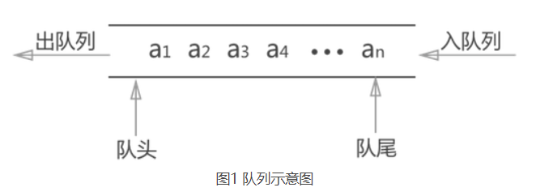

*图3.1-1队列概念模型-图*

由于队列的逻辑结构是：**操作受限的线性表（先进先出，FIFO）**。

所以在具体物理实现时，可以有两种常见方式：

1. 基于数组实现
2. 基于链表实现

如果选择**数组**来实现队列（通常实现循环队列）：

1. 入队、出队时间复杂度都可以做到**O(1)**
2. 内存连续，支持随机访问，整体操作性能会更好
3. 缺点是：容量需要提前设定，扩容成本较高（需要重新分配并拷贝数据）

如果选择**链表**来实现队列：

1. 入队、出队同样可以做到**O(1)**（需维护头尾指针）
2. 容量更灵活，按需动态申请内存
3. 缺点是：存在额外指针开销，内存不连续，整体效率通常不如数组实现

因此：

1. 若容量可预估、追求性能，优先选择数组实现
2. 若容量变化不可预估、需要高度动态扩展，可选择链表实现

两者本质时间复杂度相同，差异主要体现在内存管理方式与实际运行效率上。

关于队列数据结构的具体实现，这里不再赘述，感兴趣的可以参考文档：数据结构-队列

#### 3.2 阻塞队列

不管采用数组还是链表实现队列，本质上都差不太多，都需要维护一个队头与队尾的概念。

如果用数组来实现队列，可以简单抽象成：

```c
Queue[10] // 长度为10的数组，可以存储10个元素
Front
Rear
```

入队，本质就是：

```c
Data[Rear++] = Value;
```

出队，本质就是：

```c
Value = Data[Front++];
```

在单线程程序中，这样的队列结构通常是没有问题的。

因为只有一个执行流，不会同时读写。

但现在，我们是在 FreeRTOS 的多任务环境中。

这时候问题就来了。

如果：

1. 一个任务正在入队
2. 另一个任务同时出队

甚至：

1. 队列是空的，但有任务要取数据
2. 队列是满的，但有任务要写数据

该怎么处理这些问题？

难道让任务一直 while(1) 去轮询队列的状态吗？

显然是不可取的，这样做不仅浪费 CPU 时间，还会破坏系统的实时性。

于是，就引出了第二个概念：

**阻塞队列。**

**FreeRTOS当中的阻塞队列可以理解为：一种“带事件等待机制”的队列。**

它不仅仅是存数据的容器，还具备以下能力**（这里指的是FreeRTOS中的事件等待列表）**：

1. 当队列为空时，读取数据（出队）操作的任务会自动进入阻塞状态
2. 当队列有数据时，会自动唤醒处于等待读取数据（出队）的任务
3. 当队列已满时，发送数据（入队）的任务会自动进入阻塞状态
4. 当队列出现空位时，自动唤醒发送任务进行数据发送（入队）
5. **阻塞队列，可以和调度器协同工作。**

**这时候，队列就不再只是一个“数组+下标”的数据结构，而是变成了一个参与任务调度的通信工具。**

这就是阻塞队列。

普通队列解决的是：“数据如何存放”。

阻塞队列解决的是：“任务如何等待”

而 FreeRTOS 的消息队列，正是在这两者的基础上实现的一种：

**线程安全、带阻塞能力的 FIFO 通信机制。**

接下来，我们就正式进入：

FreeRTOS 消息队列的使用与原理讲解。

### 4. FreeRTOS的消息队列

在前面的课程内容中，我们已经学习过诸如：

1. FreeRTOS任务
2. FreeRTOS阻塞列表
3. FreeRTOS临界区
4. ..

等概念。

有了这些概念理论做支撑，我们直接看消息队列的源码，直接搞懂FreeRTOS消息队列的机制原理，也并不困难。

所以，我们学习FreeRTOS的消息队列，第一件事情就是直接看源码。

这既是对前面学习知识点的巩固和实战，也是你了解FreeRTOS消息队列最本质的第一步。

#### 4.1 消息队列的机制原理

首先回答一个核心问题：

FreeRTOS 的消息队列到底是什么结构？

在源码queue.c 文件中，所有消息队列相关实现都在这里。

当然，我们想要使用这个消息队列，也需要包含头文件queue.h 。

消息队列的核心数据结构，如下图所示：

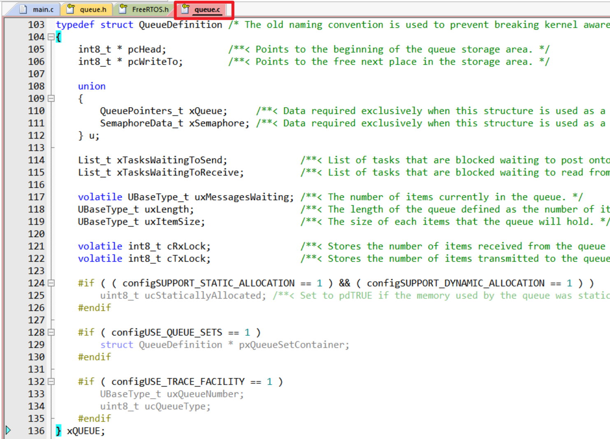

*图4.1-1消息队列核心数据结构-源码图*

消息队列本质上是一个结构体类型，其中最核心的成员如下（简化版）：

```c
typedef struct QueueDefinition{
    // 第一部分四个成员，四个用于操作数组队列的指针。其中有两个成员来自于联合体
    int8_t *pcHead;
    int8_t *pcTail;
    int8_t *pcWriteTo;
    int8_t *pcReadFrom;

    // 第二部分两个成员
    List_t xTasksWaitingToSend;
    List_t xTasksWaitingToReceive;

    // 第三部分三个成员
    volatile UBaseType_t uxMessagesWaiting;
    UBaseType_t uxLength;
    UBaseType_t uxItemSize;

} xQUEUE;
```

这些最核心的成员，我们分为三个部分来进行讲解。

我们首先讲解一下第三部分，因为它是消息队列的核心。

**Tips：**

在上面贴出的源码注释中，可以看到频繁出现**“Items”**单词，它是FreeRTOS消息队列的基本组成单元。

在下面的文档中，统一将FreeRTOS消息队列的基本组成单元，翻译成**“队列元素”**。

使用元素这个翻译，更符合数据结构中的术语使用习惯。

##### 4.1.1 数组循环队列

首先我们先来看一下下面三个成员：

```c
// 第三部分三个成员
volatile UBaseType_t uxMessagesWaiting;
UBaseType_t uxLength;
UBaseType_t uxItemSize;
```

一个一个来介绍一下。

**先看第一个：**

```c
volatile UBaseType_t uxMessagesWaiting;
```

这个变量表示：

**当前消息队列里已经存放了多少个元素。**

注意是“队列元素的个数”，不是字节的个数。

这个成员的作用非常简单直接：就是用于判断队列是否空或满。

可以理解为：**这是队列的“元素库存计数器”。**

**再看第二个成员：**

```c
UBaseType_t uxLength;
```

这个成员表示：

**此消息队列中，最多可以存放多少个元素。**

强调一点：

它表示的是“元素数量”，不是字节数。

如果uxLength=5 ，说明这个队列最多放 5 个元素。

那么一个元素多大呢？

**这就要看第三个成员：**

```c
UBaseType_t uxItemSize;
```

这个成员表示：

**每个元素占多少字节。**

当你创建队列时：会调用函数xQueueCreate 。

实际上就是给此结构体的这两个成员传参，比如调用方式如下：

```c
// 参数1：uxLength， 参数2：uxItemSize
xQueueCreate( 5, 4 );
```

那么：

uxLength = 5uxItemSize = 4**最终，你所创建的消息队列实际上是一个总长度20个字节，存储了5个大小为4个字节元素的数组，而且它是一个数组循环队列。**

**创建数组循环队列结构 + 队列控制块，参考源码如下所示：**

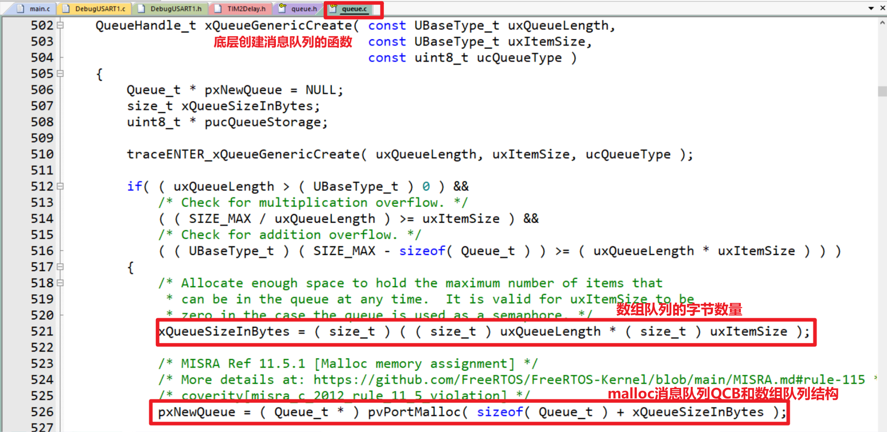

*图4.1.1-1创建消息队列源码-图*

这两部分结构存放的顺序如下所示：

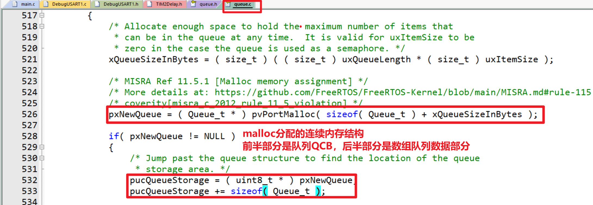

*图4.1.1-2创建消息队列源码-图2*

通常这些源码，我们能够得到以下结论：

1. FreeRTOS消息队列的控制结构体，和对应的数据区域（数组循环队列区域），是直接一次性分配的连续空间。
2. **数组循环队列，消息队列的数据区就紧跟在控制结构体后面。**
3. 之所以这样设计，是因为都使用连续内存性能更好，且分配和释放都只需要一次，更快捷。

##### 4.1.2 四个操作指针

以下四个成员：

```c
int8_t *pcHead;
int8_t *pcTail;
int8_t *pcWriteTo;
int8_t *pcReadFrom;
```

本质上是：

**用来管理一块连续数组内存的“边界指针 + 读写位置指针”。**

我们已经知道，消息队列的数据区域本质上是一个数组。

那么这四个指针的作用，就是对这块数组内存区域进行“循环队列式”的管理。

其中：

**pcHead指针：指向数组队列的起始地址，它是整个循环队列的“起点”。**

**pcTail指针，指向数组队列末尾的越界地址。**

注意：

**pcTail指针并不是指向“最后一个元素”，而是指向“最后一个元素的下一个元素“，也就是数组越界位置的第一个元素。**

也就是说：

**pcTail 本质上是循环队列数组的“终止边界标记”。**

以上两个指针是固定不动的。

它们只是用来标识这块内存区域的边界，在队列运行过程中不会发生移动。

关于这两点，可以通过以下源码获悉。比如对于pcHead指针：

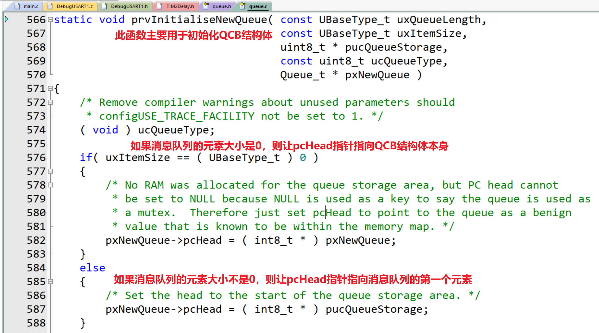

*图4.1.2-1pcHead源码-图*

而且这个指针在完成初始化后，就不会再移动了。

而对于pcTail指针：

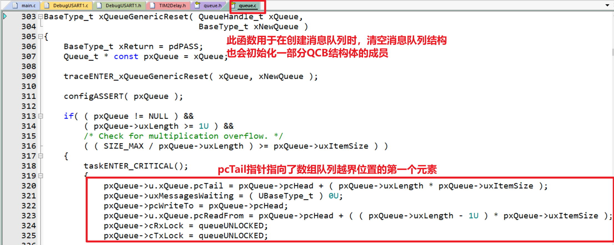

*图4.1.2-2pcTail源码图*

**在队列进行读写操作时，真正会移动的是下面两个指针：**

**pcWriteTo 指针：指向“下一次写入元素”的位置。**

FreeRTOS 的设计是：

1. 写队列操作时，先在 pcWriteTo 指向的位置写一个元素
2. 然后再移动pcWriteTo 指针
3. 如果该指针移动到pcTail位置，说明越界了，那么pcWriteTo 指针就会回绕到pcHead位置。
4. pcWriteTo 指针一开始指向pcHead，表示队列为空，从数组起点开始写入数据。

这就是循环队列的由来。

**pcReadFrom 指针：指向“上一次读取元素的位置”。**

注意这里非常关键：

它并不是指向“当前可读元素”。

FreeRTOS 的设计是：

1. 读队列操作时，先移动 pcReadFrom 到下一个元素
2. 如果移动后pcReadFrom==pcTail ，则回绕到pcHead
3. 如果没到末尾或已经回绕，则从移动后的pcReadFrom位置读一个元素

把读指针设计为“指向上一次读的位置”，可以让读操作也采用“先移动（含回绕处理）→ 再读取”的统一流程，减少边界的特殊判定。

关于这两个读写位置指针，其源码如下图所示：

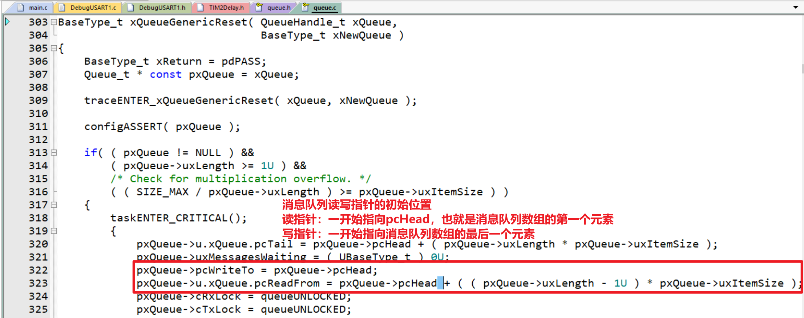

*图4.1.2-3读写位置指针-源码*

所以，这四个指针本质就是：

两个边界指针（Head / Tail）

两个移动指针（Write / Read）

**它们配合在一起，让一个普通数组具备了：循环队列的能力。**

最后还是需要强调一点的就是：

队列满不满，不靠指针判断，而是靠成员uxMessagesWaiting 来进行判断。

指针只负责移动，这个计数器用来记录队列状态。

##### 4.1.3 FreeRTOS消息队列的结构示意图

依照上面的内容，我们可以画出以下**FreeRTOS 消息队列的结构示意图**：

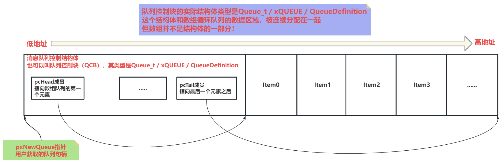

*图4.1.3-1FreeRTOS消息队列的结构示意-图*

这张图主要展示了：

1. FreeRTOS 在创建消息队列时，会通过pvPortMalloc()一次性申请一块连续内存，其中包含队列控制结构体（Queue_t）和队列数据存储区。
2. 在内存布局上，**队列控制结构体位于低地址**，而**队列数据数组位于高地址**。

3. 用户获得的队列句柄 pxNewQueue，本质上是指向 **Queue_t / xQUEUE / QueueDefinition 队列控制结构体类型** 的指针。

4. pcHead指向**队列数据存储区的起始地址**，也就是数组的第一个元素位置。
5. pcTail指向**队列存储区的末尾地址（最后一个元素之后的位置）**，用于判断数组是否越界，并配合实现循环队列。
6. 队列的数据元素以**数组形式连续存储**，FreeRTOS 通过移动**读写指针**来实现**FIFO（先进先出）的循环数组队列**。

**在队列初始创建完成时，四个核心控制指针的位置如下图所示：**

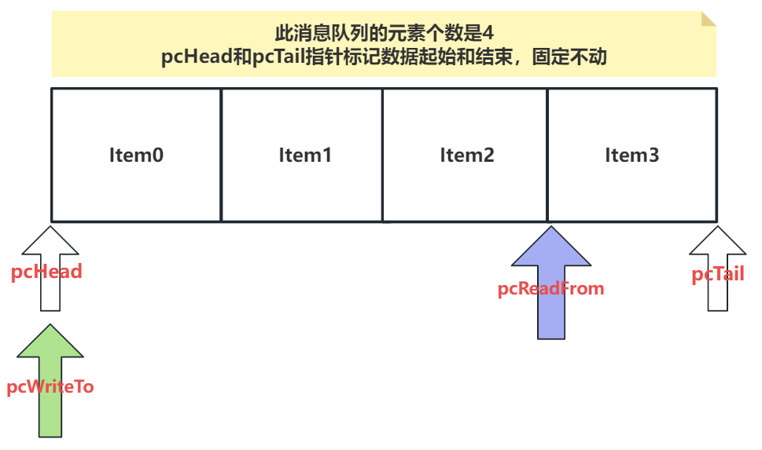

*图4.1.3-2四个核心指针的指向-图1*

现在向队列**新增一个元素（入队列）**：

1. 首先将新元素**复制到**pcWriteTo**指针当前指向的位置**。
2. 随后将pcWriteTo**移动到下一个元素位置**，表示下一次写入的位置。

如下图所示：

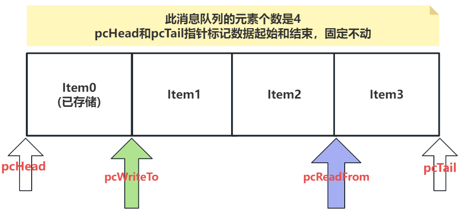

*图4.1.3-3四个核心指针的指向-图2*

接下来**从队列读取一个元素（出队列）**：

1. 首先将pcReadFrom**移动到下一个元素位置**。
2. 如果发现pcReadFrom==pcTail ，说明已经到达数组末尾，此时发生**回绕**，pcReadFrom指针回到pcHead位置。
3. 随后**读取**pcReadFrom**指向位置的元素数据**，并将该数据返回给调用者。

如下图所示：

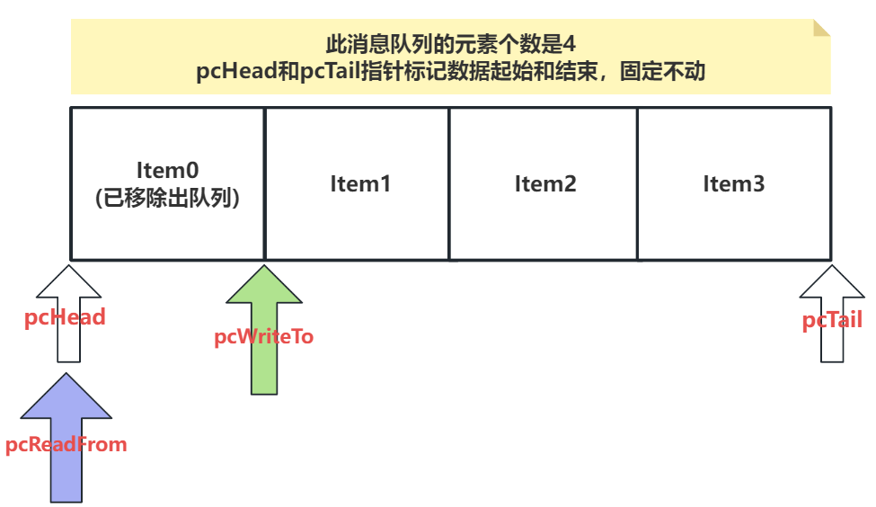

*图4.1.3-4四个核心指针的指向-图3*

在这种情况下，再**向队列连续插入三个元素**：

1. 每插入一个元素时，都先将数据**复制到**pcWriteTo**指向的位置**，然后再将该指针**移动到下一个元素位置**。
2. 当插入第三个元素后，pcWriteTo指针移动到了pcTail位置。
3. 此时pcWriteTo==pcTail ，说明已经到达数组末尾，因此发生**回绕**，pcWriteTo指针重新回到pcHead位置。
4. 此时三个指针的关系变成：pcReadFrom==pcHead==pcWriteTo
5. 也就是说，如果此时**再次入队列一个元素**，新的数据就会写入pcHead所指向的位置。

如下图所示：

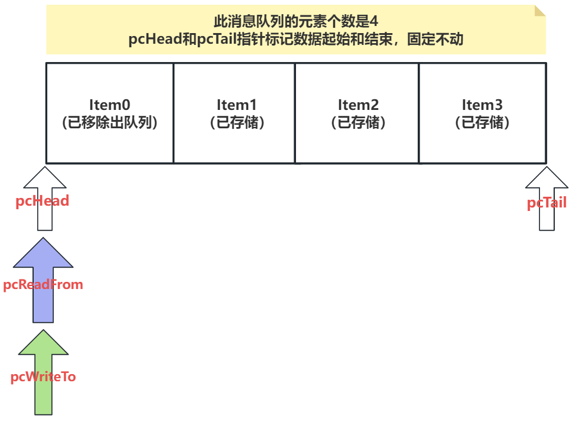

*图4.1.3-5四个核心指针的指向-图4*

可以看到：

正是基于两个固定的边界指针（pcHead、pcTail），以及两个可以回绕移动的读写位置指针（pcWriteTo、pcReadFrom）

**FreeRTOS 的消息队列最终实现了一个循环数组队列（Circular Queue）的数据结构。**

##### 4.1.4 阻塞队列的核心（重点）

FreeRTOS的消息队列是一个阻塞队列，那么它为什么可以阻塞呢？

本质原因就是下面两个成员：

```c
List_t xTasksWaitingToSend;
List_t xTasksWaitingToReceive;
```

这个List_t 类型，我们并不陌生。

因为我们前面讲过的：就绪列表、阻塞列表等列表，它们底层用的，都是基于List_t类型的一条链表结构。

所以现在你应该意识到一件事：

FreeRTOS的消息队列之所以能“阻塞”，是一个阻塞队列必然不是因为其数组的结构，也跟四个管理指针没有关系**而是队列控制块内部维护了两个“事件等待列表”，用于管理因等待队列条件而进入阻塞态的任务。**

**一旦某个消息队列满了，那么负责往队列发送元素的任务，如果还想继续发送元素，就会：**

1. 被从就绪列表中移除
2. 被插入到xTasksWaitingToSend列表，也就是进入了"等待发送阻塞列表"
3. 进入阻塞态
4. 主动放弃CPU执行权，让出CPU

那等待什么条件被唤醒呢？

当有其他任务从队列接收数据，从队列中取走一个元素，腾出一个空位之后。

调度器会唤醒此任务，任务从阻塞态回到就绪态，随后根据优先级进行任务调度。

**一旦某个消息队列是空的，那么负责从队列接收元素的任务，如果还想继续接收元素，就会：**

1. 被从就绪列表中移除
2. 被插入到xTasksWaitingToReceive列表，也就是进入了“等待接收阻塞列表”
3. 进入阻塞态
4. 主动放弃CPU执行权，让出CPU

等什么时候被唤醒呢？

当有其他任务往队列发送1个元素，消息队列不再为空之后。

调度器会唤醒此任务，任务从阻塞态回到就绪态，随后根据优先级进行任务调度。

**所以，我们可以得出一个非常关键的结论：**

FreeRTOS的消息队列是一个阻塞队列**但这个阻塞指的是“执行收发队列元素的任务”被阻塞，而不是队列本身是阻塞式的。**

**被阻塞的是任务，而不是队列本身消息队列本身，就只是一个普通的数组循环队列。**

##### 4.1.5 消息队列的线程安全（重点）

如果你没深入的看上述文档，但看到这里，你也应该知道：

1. **FreeRTOS的消息队列，其存储元素的队列部分，底层实现是一个数组循环队列**
2. **FreeRTOS的消息队列，之所以是一个阻塞队列，是因为内核维护了两个事件等待阻塞列表**

到这里，FreeRTOS消息队列的大部分原理，你就搞懂了。

但还有一个非常核心的问题：

两个任务，乃至于多个任务，都需要操作同一个消息队列。

在FreeRTOS的多任务环境下，这很显然属于，访问了共享资源。

这势必产生竞态条件，导致线程安全问题。

那消息队列是如何解决这个问题，保持线程安全，保证多个任务同时访问它，而不会乱呢？

解决的方式，很简单：

**FreeRTOS消息队列的读写操作，都是在临界区内完成的，某个任务在执行读写队列操作时，执行的都是一个原子操作。**

比如下列源码，这是FreeRTOS消息队列发送消息的函数。

其源码如下：

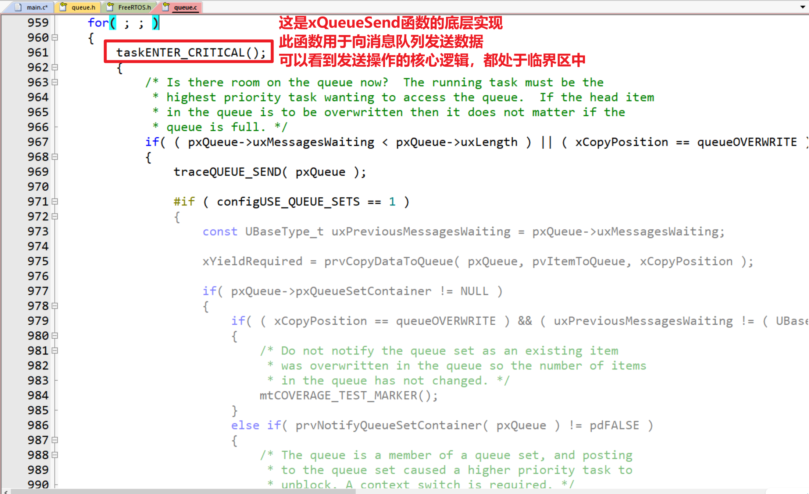

*图4.1.5-1消息队列的线程安全源码-图*

需要注意的是，消息队列使用的临界区是：

```c
taskENTER_CRITICAL();
...
taskEXIT_CRITICAL();
```

这意味着：

1. **在任务进行读写操作消息队列时，在临界区内，不会发生任务切换。**
2. **在默认配置下，此临界区不会被优先级小于等于11的中断打断。优先级高于11的中断（比如10）则可以打断临界区的执行。**
3. **如果是在自定义中断中调用相关任务间通信API，一定要确保此中断的优先级是11或更低优先级的中断！**
4. 队列结构体中的关键成员（如pcWriteTo 、pcReadFrom 、uxMessagesWaiting）的修改是**原子操作**，不会被任务和低优先级中断所打断。

所以，通过加临界区的方式，使得队列的数据修改阶段，其操作是一个原子操作。

从而保障了消息队列的线程安全。

最后做一个总结：

**消息队列的阻塞机制解决了“任务调度问题”，实现了阻塞式队列而临界区机制解决了“并发线程安全问题”。**

两套机制配合，构成了完整的、安全的、消息队列实现。

#### 4.2 消息队列核心操作函数

了解了 FreeRTOS 消息队列的核心机制和工作原理之后，下面我们正式进入消息队列的核心操作函数部分。

在 FreeRTOS 中，消息队列的核心 API 实际上只有三个，也是我们在实际开发中最常用、最重要的三个函数：

1. xQueueCreate函数，创建消息队列
2. xQueueSend函数，向消息队列发送数据
3. xQueueReceive函数，从消息队列接收数据

可以说，只要掌握了这三个函数，消息队列的基本使用就已经完全没有问题了。

下面我们逐一介绍这三个函数。

首先，这三个函数在FreeRTOS都是默认开启的，前提是启用了**动态内存分配机制**，即开启下面的宏：

```c
#define configSUPPORT_DYNAMIC_ALLOCATION 1
```

也就是依靠动态分配内存宏，它是默认开启的。

**这是因为 xQueueCreate() 本质上是通过动态分配内存来创建结构体和队列数据存储区的。**

##### 4.2.1 xQueueCreate：创建消息队列

其函数原型如下：

```c
QueueHandle_t xQueueCreate(
    // UBaseType_t也就是BaseType_t的无符号版本，其实就是unsigned long，通常就是无符号4字节
    const UBaseType_t uxQueueLength, // 数组循环队列的元素数量，也就是循环队列最多装几个元素
    const UBaseType_t uxItemSize, // 数组循环队列中每个元素的大小，以字节为单位
)
```

两个参数非常关键：

1. uxQueueLength ：队列能存放多少个元素
2. uxItemSize ：每个元素的大小（单位：字节）

这两个参数共同决定了消息队列的数据区域——数组循环队列的长度大小，以及可以存储几个元素。

注意，这个函数所表示的创建，显然是动态创建，会在FreeRTOS内核堆上分配内存空间，生命周期由内核自动管理。

举例：

```c
QueueHandle_t Queue = xQueueCreate(5, 4);
```

这表示：

1. 队列最多存 5 个元素
2. 每个元素 4 字节
3. 底层会分配 5 × 4 = 20 字节的连续内存，也就是一个数组

返回值，得到一个QueueHandle_t类型的返回值。

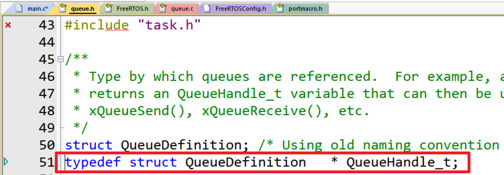

*图4.2.1-1QueueHandle_t类型别名-图*

这种情况我们太熟悉的。

**此函数的返回值，就是FreeRTOS消息队列的操作句柄，也就是一个操作消息队列的凭证。**

当然，这个消息队列句柄本质上是一个消息队列结构体对象的指针。

由于结构体并没有定义在头文件中，你并不能直接利用这个指针操作结构体。

**函数的返回值如果是 NULL，则说明FreeRTOS内核堆空间不足，消息队列创建失败。**

##### 4.2.2 xQueueSend：向队列发送数据

其函数原型如下：

```c
BaseType_t xQueueSend(
    QueueHandle_t xQueue, // 消息队列句柄，也就是“队列对象的指针/引用”
    const void * pvItemToQueue, // 要发送数据的指针
    TickType_t xTicksToWait // 消息队列满时，最多愿意等多久（单位：tick）
);
```

**该函数用于，在任务中向消息队列发送数据，也就是向队列尾部写入一个元素。**

**xQueue参数：**

表示要操作的队列句柄。或者说，表示往哪个队列发送数据。

它是xQueueCreate()返回的值，本质可以理解为队列控制结构的引用。

**pvItemToQueue参数：**

表示要发送数据的地址。

类型为constvoid* ，说明可以发送任意类型的数据。

需要特别强调：

**队列发送的是元素内容的拷贝，而不是指针本身。**

执行时会从 pvItemToQueue 指向的地址开始，拷贝 uxItemSize 个字节，存入数组循环队列的一个元素位置。

整个过程实际上就是执行了一个memcpy 函数。如下源码：

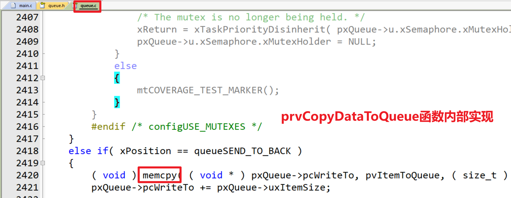

*图4.2.2-1xQueueSend实现-源码*

例如：

```c
uint32_t Value = 100;
xQueueSend(QueueHandle, &Value, 0);
```

进入队列的是数值 100 的副本，即使 Value是局部变量也不会出问题。

注意：发送数据的格式要和创建队列时指定元素的长度保持一致。

比如队列创建时一个元素是4个字节，pvItemToQueue指针指向的数据也应该是4字节的。

**xTicksToWait参数：**

表示当消息队列已满时，当前任务最多等待多少个 tick（1个tick默认设置是1ms）。

它的取值规则如下：

1. 0 表示不等待，立即返回发送的结果（成功或失败）。
2. 大于 0 表示最多等待指定 tick 数。
3. portMAX_DELAY 表示一直阻塞等待（前提是允许无限期阻塞，FreeRTOS默认允许无限期阻塞）。

**关于宏portMAX_DELAY ，这里要多说两句：**

第一，从宏定义上来说，它其实就是4字节无符号整型的最大值：

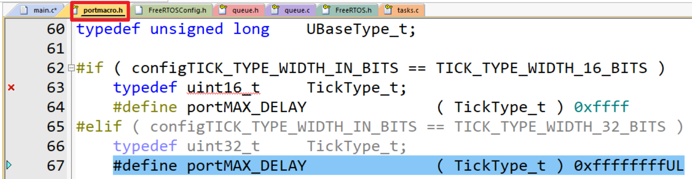

*图4.2.2-2portMAX_DELAY宏源码-图*

这么看，使用这个宏填在xTicksToWait位置，表示最大阻塞等待大约49天多。

这个时间对于嵌入式系统而言，确实已经非常“大”了，几乎可以说是无限期阻塞等待。

但事实真的是这样吗？

当然不是。

实际上：

在使用宏portMAX_DELAY 作为参数，配合**默认允许无限期阻塞的宏配置**：

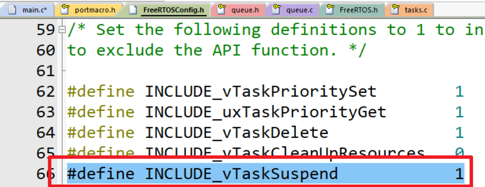

*图4.2.2-3允许无限期阻塞-宏配置*

熟悉不，这不就是之前学挂起状态的相关宏。

相关的源码如下：

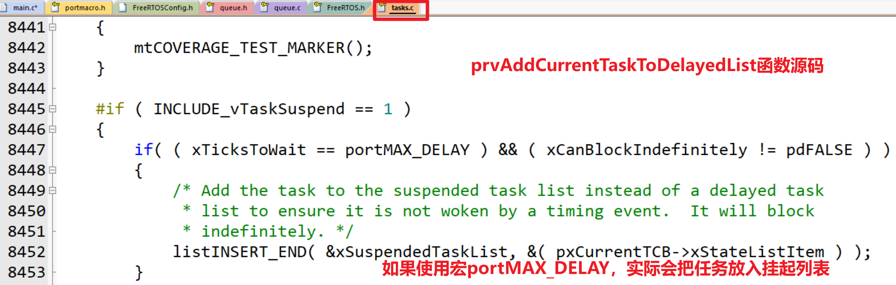

*图4.2.2-4无限期阻塞挂起等待-图*

所以内核实际是这么做的：

使用 portMAX_DELAY 且队列操作的条件不满足时，任务实际上被内核移入挂起列表，进入挂起态。

但这个挂起态比较特殊：

1. 本质上任务处于“无限期等待”的延时阻塞状态，只不过为了方便，内核将它移入了挂起列表。
2. 当事件满足（比如队列腾出空位）时，内核会把任务从挂起列表中移出，重新放回**就绪列表**，随后参与调度继续完成发送。

**关于函数的返回值也要着重说一下：**

1. 如果函数返回 pdPASS 表示发送成功。
2. 如果函数返回 errQUEUE_FULL 则表示队列已满，无法发送数据到队列。

**errQUEUE_FULL 等价于 pdFALSE/pdFAIL。**

此函数的行为逻辑可以这样描述：

1. 如果队列有空位，立刻把数据拷贝到队列写入指针的位置，数据发送成功，返回pdPASS
2. 如果队列没有空位，当 xTicksToWait = 0，立即返回 errQUEUE_FULL 表示失败。
3. 如果队列没有空位，当 xTicksToWait > 0 时：
   - a. 当前任务进入事件阻塞状态，主动放弃CPU执行权
   - b. 随后任务被延时**最多** xTicksToWait 个Tick
   - c. 若在等待时间内队列腾出空间，任务被唤醒回到就绪态，随后获取CPU执行权，完成数据发送。
   - d. 若超时队列仍无空间，返回 errQUEUE_FULL 发送失败。
4. 如果队列没有空位，当 xTicksToWait = portMAX_DELAY时：
   - a. **任务进入无限期等待（实际由内核操作，进入挂起列表）**
   - b. 如果队列一直没有空位，那么当前任务就会一直挂起，那么函数就会一直阻塞等待，函数始终不会返回
   - c. 一旦空位出现，内核就会让任务恢复挂起，回到就绪态，随后获取CPU执行权发送数据。

理解了往队列发送数据，那么从队列接收数据也是差不多的，只不过数据方向改变了。

##### 4.2.3 xQueueReceive：从队列接收数据

函数原型如下：

```c
BaseType_t xQueueReceive(
    QueueHandle_t xQueue, // 表示要操作的队列句柄。
    void * pvBuffer, // 表示用于接收数据的缓冲区地址。
    TickType_t xTicksToWait // 消息队列空时，最多愿意等多久（单位：tick）
);
```

**该函数用于，在任务中从消息队列接收数据，也就是从队列头部移除一个元素，并返回元素的取值。**

xQueueReceive 的本质是：

**从队列中取出一个元素，并拷贝到用户提供的缓冲区，若队列为空，则根据等待时间决定是否阻塞。**

**xQueue参数：**表示要操作的队列句柄。

**pvBuffer参数：**

表示用于接收数据的缓冲区地址。

当接收成功时，队列会将内部存储的一个元素，按 uxItemSize 字节拷贝到 pvBuffer 指向的内存空间。

队列创建时的元素大小、发送时的数据大小，接收时的数据大小应当保持一致。

最简单的设定就是，直接让它们的类型都保持一致。

需要注意的是：

xQueueReceive接收队列一个元素后，该元素会被从队列中移除，也就是所谓的“出队”。

**xTicksToWait参数：**

使用方式和原理与xQueueSend函数的xTicksToWait参数没有任何区别。

这里不再赘述。

**返回值有两种：**

1. pdPASS 表示接收成功。
2. errQUEUE_EMPTY 表示队列为空且等待失败。

其余原理和xQueueSend函数一致，这里不再赘述。

### 5. 消息队列的使用举例（任务与任务通信）

现在我们已经搞懂了，FreeRTOS 消息队列的核心机制以及工作原理。

那么接下来我们就来“实战演练”一下。

下面举一些实际的场景，实际的代码，分析一下最终的行为。

#### 5.1 案例1：一个任务发送不接收

示例代码如下：

```c
#include "stm32f10x.h" // STM32F10x 标准外设库头文件

#include "FreeRTOS.h" // FreeRTOS 核心头文件
#include "task.h" // FreeRTOS 任务相关 API
#include "queue.h" // FreeRTOS 队列相关 API

#include "DebugUSART1.h" // 调试串口模块（printf1）

// 创建队列句柄
static QueueHandle_t QueueHandle = NULL;

// -------------------- 任务1：发送任务 --------------------
void taskSend(void *arg) {
 // 先延时1s等待打印内容
    vTaskDelay(1000);
    uint32_t Count = 0;

 while (1) {
       Count++;

     // 向队列中发送数据
       // 如果队列已满，最多等待 3000ms
       BaseType_t Ret = xQueueSend(QueueHandle, &Count, 3000);

     if (Ret == pdPASS) {
           // 发送成功：说明队列中还有空位
           printf1("[Send OK ] Count = %lu \n", Count);
       } else {
           // 发送失败：原因是等待了3s但队列仍然已满
           printf1("[Send FAIL] Queue Full \n");
       }
       // 稍微延时1s，不要发的太快
       vTaskDelay(1000);
    }
}

int main(void) {
 // 1. 初始化调试串口
    DebugUSART1_Init();

 // 2. 创建消息队列
    // 队列长度为 5，每个队列元素占用 sizeof(uint32_t) 字节
    QueueHandle = xQueueCreate(5, sizeof(uint32_t));

 // 3. 创建发送任务
    xTaskCreate(taskSend,
               "TaskSend",
               configMINIMAL_STACK_SIZE,
               NULL,
               tskIDLE_PRIORITY + 1,
               NULL);

 // 4. 启动 FreeRTOS 调度器
    vTaskStartScheduler();

 // 理论上不会运行到这里
    while (1) {
    }
}

```

程序的行为是：

1. 队列容量是 5，且没有接收者（只有生产者，没有消费者）
2. 所以前 5 次发送必定成功（返回**pdPASS**）
3. 第 6 次开始队列满，xQueueSend(...,3000)会让任务进入**阻塞等待**
4. 因为没人接收，等待永远等不到空位。所以 3000 tick 后超时返回**errQUEUE_FULL**
5. 从第 6 次开始，打印Error，任务的循环周期会变长，约等于：**等待超时 + 自己的vTaskDelay**

试想一下，如果把Send函数等待时长改为portMAX_DELAY ，会出现什么场景？

任务在发送5个数据后，会始终等待队列空位置，会持续阻塞。

#### 5.2 案例2：简单的生产者和消费者模型

基于 FreeRTOS 消息队列实现的单生产者、单消费者模型。

taskSend作为生产者，周期性产生数据并发送到消息队列；

taskRecv作为消费者，从消息队列中取出数据并处理，消息队列在二者之间起到缓冲和解耦作用。

**示例代码如下：**

```c
#include "stm32f10x.h" // STM32F10x 标准外设库头文件

#include "FreeRTOS.h" // FreeRTOS 核心头文件
#include "task.h" // FreeRTOS 任务相关 API
#include "queue.h" // FreeRTOS 队列相关 API

#include "DebugUSART1.h" // 调试串口模块（printf1）

// 消息队列句柄
static QueueHandle_t QueueHandle = NULL;

// -------------------- 生产者任务 --------------------
static void TaskSend(void *arg) {
 uint32_t Count = 1;

 while (1) {
     /*
        * 向队列发送数据。
        * 第三个参数为 0，表示队列满时不阻塞，立即返回。
        */
       BaseType_t Ret = xQueueSend(QueueHandle, &Count, 0);

       if (Ret == pdPASS) {
           printf1("[Send] %lu\r\n", Count);

           // 发送成功后，准备下一个数据
           Count++;
       } else {
           // 队列已满，本次发送失败
           printf1("[Send] Queue Full!\r\n");
       }

       // 每隔 1 秒生产一次数据
       vTaskDelay(1000);
    }
}

// -------------------- 消费者任务 --------------------
static void TaskRecv(void *Arg) {
    uint32_t Value;

    while (1) {
       /*
        * 从队列中接收数据。
        * portMAX_DELAY 表示队列为空时一直阻塞等待。
        */
       BaseType_t Ret = xQueueReceive(QueueHandle, &Value, portMAX_DELAY);

       if (Ret == pdPASS) {
           printf1("[Recv] %lu\r\n", Value);
       } else {
           // 使用 portMAX_DELAY 时，正常情况下不会执行到这里
           printf1("[Recv] Error!\r\n");
       }

       // 模拟消费者处理数据需要 3 秒
       vTaskDelay(3000);
    }
}

int main(void) {
    BaseType_t Ret;

    // 1. 初始化调试串口
    DebugUSART1_Init();

    /*
     * 2. 创建消息队列。
     * 队列长度为 5，每个元素为 uint32_t 类型。
     */
    QueueHandle = xQueueCreate(5, sizeof(uint32_t));

    if (QueueHandle == NULL) {
       printf1("Queue Create Failed!\r\n");

       while (1) {
       }
    }

    // 3. 创建生产者任务
    Ret = xTaskCreate(TaskSend,
                    "TaskSend",
                    configMINIMAL_STACK_SIZE,
                    NULL,
                    tskIDLE_PRIORITY + 1,
                    NULL);

    if (Ret != pdPASS) {
       printf1("TaskSend Create Failed!\r\n");

       while (1) {
       }
    }

    // 4. 创建消费者任务
    Ret = xTaskCreate(TaskRecv,
                    "TaskRecv",
                    configMINIMAL_STACK_SIZE,
                    NULL,
                    tskIDLE_PRIORITY + 1,
                    NULL);

    if (Ret != pdPASS) {
       printf1("TaskRecv Create Failed!\r\n");

       while (1) {
       }
    }

    // 5. 启动 FreeRTOS 任务调度器
    vTaskStartScheduler();

    /*
     * 正常情况下不会运行到这里。
     * 如果运行到这里，通常表示空闲任务创建失败，
     * 可能是 FreeRTOS 堆空间不足。
     */
    while (1) {
    }
}

```

程序运行一段时间后，队列会被逐渐填满，并进入稳定状态：

Recv每隔 3000ms 从队列中取出一个数据，使队列空出一个位置。

随后，Send每隔 1000ms 尝试发送数据，因此下一次发送通常能够成功，立即把刚空出的位置重新填满。

之后的两次发送由于队列仍然是满的，都会失败并打印QueueFull 。直到Recv再次取出一个数据，Send才能再次成功发送。

因此，稳定后的输出规律基本是：

```c
[Recv] 一个数据
[Send] 成功发送一个数据
[Send] Queue Full!
[Send] Queue Full!
```

这个现象说明：

生产者每 1000ms 生产一次，而消费者每 3000ms 只消费一次，生产速度是消费速度的3 倍。

**队列只能暂时保存数据，无法解决生产速度长期大于消费速度的问题。**

#### 5.3 案例3：利用消息队列实现任务同步

什么是任务同步？

**任务同步，就是让多个任务之间按照一定的先后关系协调执行。**

在 FreeRTOS 中，任务不是完全各跑各的。很多时候，一个任务必须等待另一个任务完成某件事之后，才能继续执行。

例如：

任务 A 负责接收数据任务 B 负责处理数据那么任务 B 不能一开始就处理，而是要等任务 A 把数据接收完成后，通知任务 B。

**这个过程就叫任务同步。**

简单说：

任务同步就是让任务之间通过某种机制互相等待、互相通知，从而保证程序按正确顺序执行。

**可以用消息队列来实现任务同步，但消息队列不是最佳方案。**

比如下列代码：

```c
#include "stm32f10x.h" // STM32F10x 标准外设库头文件

#include "FreeRTOS.h" // FreeRTOS 核心头文件
#include "task.h" // FreeRTOS 任务相关 API

#include "DebugUSART1.h" // 调试串口模块（printf1）

// -------------------- 任务1 --------------------
void task1(void *arg) {
    while (1) {
       printf1("Task1 \n");
       vTaskDelay(1000);
    }
}

// -------------------- 任务2 --------------------
void task2(void *arg) {
    while (1) {
       printf1("Task2 \n");
       vTaskDelay(1000);
    }
}

// -------------------- 任务3 --------------------
void task3(void *arg) {
    while (1) {
       printf1("Task3 \n");
       vTaskDelay(1000);
    }
}

int main(void) {
    // 1. 初始化调试串口
    DebugUSART1_Init();

    // 2. 创建任务1
    xTaskCreate(task1,
               "Task1",
               configMINIMAL_STACK_SIZE,
               NULL,
               tskIDLE_PRIORITY + 1,
               NULL);

    // 3. 创建任务2（与任务1优先级相同）
    xTaskCreate(task2,
               "Task2",
               configMINIMAL_STACK_SIZE,
               NULL,
               tskIDLE_PRIORITY + 1,
               NULL);

    // 4. 创建任务3（与任务1优先级相同）
    xTaskCreate(task3,
               "Task3",
               configMINIMAL_STACK_SIZE,
               NULL,
               tskIDLE_PRIORITY + 1,
               NULL);

    // 此时当前TCB指针指向了任务3
    // 也就是说任务3，最先上CPU执行
    // 优先级为1的任务就绪列表是：哨兵 -> 任务1 -> 任务2 -> 任务3 -> 哨兵
    // 5. 启动 FreeRTOS 调度器
    vTaskStartScheduler();

    // 理论上不会运行到这里
    while (1) {
    }
}

```

如果三个任务都不加vTaskDelay延时，依照就绪队列的初始状态，那么时间片轮转的顺序应该是：任务3 -> 任务1 -> 任务2 -> 任务3....

但由于加了延时，任务放弃CPU又回到就绪列表，使得就绪列表的结构发生了改变，时间片轮转的顺序变成了：任务3 -> 任务2-> 任务1 -> 任务3....

现在基于FreeRTOS的消息队列，实现任务同步，不依赖时间片轮转，把任务的执行顺序变成：任务1 -> 任务2 -> 任务3 -> 任务1....

实现思路如下：

这里用消息队列实现的不是“传递业务数据”，而是传递一个**同步令牌**。

谁收到令牌，谁就执行，收不到令牌就不能执行。

某个任务执行完毕以后，再把令牌发送给下一个任务。

建议直接创建三个消息队列，分别对应三个任务需要的三个令牌：

Task1 等待 Task1Queue中的令牌Task2 等待 Task2Queue中的令牌Task3 等待 Task3Queue中的令牌整体顺序就是：

Task1Queue 有令牌 ↓Task1 执行 ↓Task1 给 Task2Queue 发令牌 ↓Task2 执行 ↓Task2 给 Task3Queue 发令牌 ↓Task3 执行 ↓Task3 给 Task1Queue 发令牌 ↓循环参考代码如下：

```c
#include "stm32f10x.h" // STM32F10x 标准外设库头文件

#include "FreeRTOS.h" // FreeRTOS 核心头文件
#include "task.h" // FreeRTOS 任务相关 API
#include "queue.h" // FreeRTOS 消息队列相关 API

#include "DebugUSART1.h" // 调试串口模块（printf1）

// 三个用于实现任务同步的队列
static QueueHandle_t Task1Queue = NULL;
static QueueHandle_t Task2Queue = NULL;
static QueueHandle_t Task3Queue = NULL;

// -------------------- 任务1：最先执行 --------------------
void task1(void *arg) {
    uint8_t Token = 0;

    while (1) {
       // 等待任务1的执行令牌
       xQueueReceive(Task1Queue, &Token, portMAX_DELAY);

       printf1("Task1 \r\n");

       // 仅用于降低串口打印速度，方便观察现象
       // 这个延时不负责控制任务顺序，任务顺序由队列同步控制
       vTaskDelay(1000);

       // 通知任务2执行
       xQueueSend(Task2Queue, &Token, portMAX_DELAY);
    }
}

// -------------------- 任务2：居中执行 --------------------
void task2(void *arg) {
    uint8_t Token = 0;

    while (1) {
       // 等待任务2的执行令牌
       xQueueReceive(Task2Queue, &Token, portMAX_DELAY);

       printf1("Task2 \r\n");

       // 仅用于降低串口打印速度，方便观察现象
       // 这个延时不负责控制任务顺序，任务顺序由队列同步控制
       vTaskDelay(1000);

       // 通知任务3执行
       xQueueSend(Task3Queue, &Token, portMAX_DELAY);
    }
}

// -------------------- 任务3：最后执行 --------------------
void task3(void *arg) {
    uint8_t Token = 0;

    while (1) {
       // 等待任务3的执行令牌
       xQueueReceive(Task3Queue, &Token, portMAX_DELAY);

       printf1("Task3 \r\n");

       // 仅用于降低串口打印速度，方便观察现象
       // 这个延时不负责控制任务顺序，任务顺序由队列同步控制
       vTaskDelay(1000);

       // 重新通知任务1执行
       xQueueSend(Task1Queue, &Token, portMAX_DELAY);
    }
}

int main(void) {
    uint8_t StartToken = 1;

    // 1. 初始化调试串口
    DebugUSART1_Init();

    // 2. 创建三个同步队列
    // 每个队列只需要保存 1 个 uint8_t 令牌
    Task1Queue = xQueueCreate(1, sizeof(uint8_t));
    Task2Queue = xQueueCreate(1, sizeof(uint8_t));
    Task3Queue = xQueueCreate(1, sizeof(uint8_t));

    if ((Task1Queue == NULL) || (Task2Queue == NULL) ||(Task3Queue == NULL)){
       printf1("Queue Create Error\r\n");

       while (1) {
       }
    }

    // 3. 创建任务1
    xTaskCreate(task1,
               "Task1",
               configMINIMAL_STACK_SIZE,
               NULL,
               tskIDLE_PRIORITY + 1,
               NULL);

    // 4. 创建任务2
    xTaskCreate(task2,
               "Task2",
               configMINIMAL_STACK_SIZE,
               NULL,
              tskIDLE_PRIORITY + 1,
               NULL);

    // 5. 创建任务3
    xTaskCreate(task3,
               "Task3",
               configMINIMAL_STACK_SIZE,
               NULL,
               tskIDLE_PRIORITY + 1,
               NULL);

    // 6. 先给 Task1Queue 放入一个初始令牌
    // 这样调度器启动后，只有任务1能够首先收到令牌并执行
    // 任务2、任务3因为没有令牌，会阻塞在各自的 xQueueReceive() 上
    xQueueSend(Task1Queue, &StartToken, 0);

    // 7. 启动 FreeRTOS 调度器
    vTaskStartScheduler();

    // 理论上不会运行到这里
    while (1) {
    }
}

```

上述代码是可以实现需求的，是可以实现任务同步的。

但显然有一些麻烦，而且创建了三个消息队列，有点浪费空间。

你有这些想法是正常的，因为我们后面会介绍一种更适合做任务通知的手段，这里只是演示消息队列的功能，日常并不推荐这么做。

#### 5.4 扩展了解：利用结构体校验数据边界

在之前学习任务列表时，我们知道列表的基本类型是一个List_t类型。如下图所示：

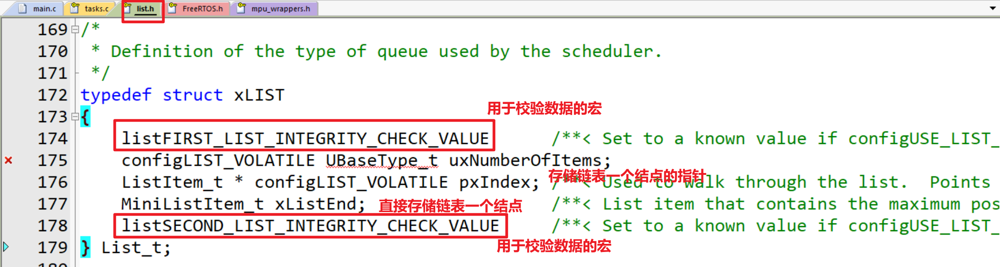

*图5.4-1List_t类型源码-图*

可以看到：这个结构体的首尾会放置**边界校验成员宏**，用于检测内存是否存在非法覆盖。

**这种机制本质上就是一种结构体边界保护Guard 保护思想**这是怎么实现的呢？

恰好在学习消息队列时，有同学提出了这样的疑问：

如果我们在使用消息队列时，队列的元素大小和实际收发元素的大小不一致，会发生什么？

比如：

**我们创建消息队列时是这样写的：**

```c
pxQueue = xQueueCreate(5, 20);
```

这意味着：

1. 队列中每个元素大小是**20 字节**
2. 每次发送 / 接收时，FreeRTOS 内部都会执行memcpy
3. 并且从指定指针位置开始，**固定拷贝 20 个字节**

**注意这里的关键点队列拷贝是“按创建时的 uxItemSize 固定长度拷贝”它不会管你实际数据有多大**与此同时，我们发送的数据却是：

```c
uint32_t Value = 1;
xQueueSend(pxQueue, &Value, portMAX_DELAY);
```

一个uint32_t只有**4 字节**。

队列却按**20 字节**进行拷贝，这 20 字节从哪里来？

从&Value开始往后连续读取 20 字节。

也就是说：

**Value 后面的栈空间也会被一起复制进队列。这显然是不正确的。**

但问题更严重的是接收端。

如果接收端仍然用uint32_t去接收数据，那么 FreeRTOS 仍然会从目标指针开始，连续写入 20 个字节的数据。

这就会导致：**任务栈空间被非法覆盖**，并产生更加严重的问题与后果。

为了把这种“越界覆盖”的现象演示得更直观，我们可以构建这样一个结构体类型：

```c
/* 结构体成员布局是连续的，确保RecvValue前后都被校验成员包围 */
typedef struct {
    volatile uint32_t CheckValue1;
    uint32_t RecvValue;
    volatile uint32_t CheckValue2;
} QueueItemOverflow_t;
```

其中：

1. RecvValue用来“接收”数据（注意：这里故意用错）
2. CheckValue1/CheckValue2用作边界校验
3. 如果CheckValue2的值发生变化，就说明发生了越界覆盖

为什么这个方法有效？

因为结构体成员在内存中是连续排列的。

当我们从&RecvValue开始写入 20 字节时：

1. 前 4 字节写入RecvValue
2. 后续字节会继续写入CheckValue2所在位置
3. 导致CheckValue2被破坏

因此：

**CheckValue2 是否被改写就是最直观的“越界检测信号”**

这也正是 FreeRTOS 在一些数据结构中使用边界校验成员的核心思想。

整体演示代码如下（故意写错，用于实验）：

```c
#include "stm32f10x.h" // STM32F10x 标准外设库头文件

#include "FreeRTOS.h" // FreeRTOS 核心头文件
#include "task.h" // FreeRTOS 任务相关 API
#include "queue.h" // FreeRTOS 队列相关 API

#include "DebugUSART1.h" // 调试串口模块（printf1）

// 创建消息队列句柄
static QueueHandle_t QueueHandle = NULL;

// -------------------- 任务1：发送任务 --------------------
void taskSend(void *arg) {
    // 先延时3s,等待接收任务打印初始状态
    vTaskDelay(3000);
    uint32_t Value = 100;

    while (1) {
       // 故意错误：
       // 队列元素大小是 20 字节
       // 但是这里发送的数据实际只有 4 字节
       // FreeRTOS 内核会从 &Value 开始，越界拷贝 20 个字节到消息队列中
       if (xQueueSend(QueueHandle, &Value, portMAX_DELAY) ==pdPASS){
           // 发送成功后，再打印本次发送的数据
           printf1("[Send] Value = %lu\r\n", Value);

           Value++;
       } else {
           // 使用 portMAX_DELAY 时，正常情况下不会执行到这里
           printf1("[Send] Error\r\n");
       }

       vTaskDelay(3000);
    }
}

// -------------------- 任务2：接收任务 --------------------
void taskRecv(void *arg) {
    typedef struct {
       volatile uint32_t CheckValue1;
       uint32_t RecvValue;
       volatile uint32_t CheckValue2;
    } QueueItemOverflow_t;

    QueueItemOverflow_t Struct;

    Struct.CheckValue1 = 0xAAAAAAAA;
    Struct.RecvValue = 0;
    Struct.CheckValue2 = 0xBBBBBBBB;

    // 先打印结构体的初始状态
    printf1("[Init] CheckValue1 = 0x%08X\r\n", (unsignedint)Struct.CheckValue1);
    printf1("[Init] RecvValue = %lu\r\n", Struct.RecvValue);
    printf1("[Init] CheckValue2 = 0x%08X\r\n", (unsignedint)Struct.CheckValue2);
    printf1("------------------------------\r\n");

    while (1) {
       // 故意错误：
       // 队列元素大小是 20 字节
       // 但是 RecvValue 只有 4 字节
       // FreeRTOS 内部会 memcpy 20 字节，因此可能覆盖 RecvValue 后面的成员
       xQueueReceive(QueueHandle, &(Struct.RecvValue),portMAX_DELAY);

       // 每接收一次，打印一次结构体当前状态
       printf1("[Recv] CheckValue1 = 0x%08X\r\n", (unsignedint)Struct.CheckValue1);
       printf1("[Recv] RecvValue = %lu\r\n", Struct.RecvValue);
       printf1("[Recv] CheckValue2 = 0x%08X\r\n", (unsignedint)Struct.CheckValue2);
       printf1("------------------------------\r\n");

       // 检查上下两个校验成员是否被修改
       if ((Struct.CheckValue1 != 0xAAAAAAAA) ||(Struct.CheckValue2 != 0xBBBBBBBB)){
           printf1("Error: Queue Receive Memory Overflow!\r\n");

           while (1) {
           }
       }

       vTaskDelay(1000);
    }
}

int main(void) {
    // 1. 初始化调试串口
    DebugUSART1_Init();

    printf1("System Start\r\n");

    // 2. 创建消息队列
    // 队列长度为 5，每个队列元素占用 20 字节
    QueueHandle = xQueueCreate(5, 20);

    // 3. 创建发送任务
    xTaskCreate(taskSend,
               "TaskSend",
               configMINIMAL_STACK_SIZE,
               NULL,
               tskIDLE_PRIORITY + 1,
               NULL);

    // 4. 创建接收任务
    xTaskCreate(taskRecv,
              "TaskRecv",
               configMINIMAL_STACK_SIZE,
               NULL,
               tskIDLE_PRIORITY + 1,
              NULL);

    printf1("Tasks Created\r\n");

    // 5. 启动 FreeRTOS 调度器
    vTaskStartScheduler();

    // 理论上不会运行到这里
    while (1) {
    }
}

```

你可以运行这段代码观察现象：

1. 初始化时CheckValue2=0xBBBBBBBB
2. 一旦发生接收拷贝，CheckValue2很大概率会被改写

**这就说明：队列元素大小与实际接收缓冲区大小不匹配，会导致越界写入。**

也就能理解：

为什么 FreeRTOS 会在某些结构体首尾设计边界校验成员，用于快速发现“内存被非法覆盖”的问题。

### 6. 消息队列的使用举例（任务与中断通信）

现在我们来完成这样的一道编程题目，实现以下功能。

题目描述如下：

**在基于SPL库 + FreeRTOS的开发环境下实现一个简单的串口命令解析程序。**

PC 通过串口工具向STM32发送字符串命令：

1. 当收到字符串"OK"时，点亮 LED，并通过串口回复PC端LightOn
2. 当收到字符串"ERROR"时，熄灭 LED，并通过串口回复PC端LightOff

要求如下：

1. 串口采用 USART1 中断方式，进行接收数据。
2. 用于接收指令字符串的Buffer数组必须始终保持为合法的**C 字符串（以**'\0'**结尾）**。
3. 为防止接收数据过长导致数组越界，需要实现**Buffer缓冲区溢出保护**。
4. 若接收到**非法指令（如**ABC**）**，系统应能够自动清空Buffer并恢复正常工作，避免后续命令无法识别。
5. 成功解析命令后，应**清空 Buffer 并重置索引变量**，以便接收下一条命令。
6. 建议对\r 和\n 这两个Windows环境下的换行符，直接过滤掉，不处理。

求解这道题目，建议采用下面的思路：

1. 在USART1中断中处理数据接收
2. 创建一个FreeRTOS任务，在任务中处理接收数据后的业务逻辑

很显然，中断和任务之间要共享同一个存储字符串指令的字符数组，于是就涉及到任务间通信。

#### 6.1 不使用消息队列的解决方式

在本章节的开头，我们已经提到过：如果不使用消息队列，那么中断和任务之间的“任务间通信”，就只能靠**共享同一块内存Buffer**来完成。

说白了就是：

1. **ISR（中断）负责把字符一个一个塞进 Buffer**
2. **Task（任务）负责在合适的时机读取 Buffer，并解析命令**

直接给出参考实现代码：

**LED.h头文件：**

```c
#ifndef __LED_H__
#define __LED_H__

#include "stm32f10x.h"

void LED_Init(void);
void LED_On(void);
void LED_Off(void);

#endif

```

**LED.c头文件：**

```c
#include "LED.h"

void LED_Init(void) {
    RCC_APB2PeriphClockCmd(RCC_APB2Periph_GPIOC, ENABLE);

    GPIO_InitTypeDef initType;
    initType.GPIO_Pin = GPIO_Pin_13;
    initType.GPIO_Mode = GPIO_Mode_Out_PP;
    initType.GPIO_Speed = GPIO_Speed_50MHz;
    GPIO_Init(GPIOC, &initType);

    // LED默认熄灭
    LED_Off();
}

// PC13 低电平点亮
void LED_On(void) {
    GPIO_ResetBits(GPIOC, GPIO_Pin_13);
}

void LED_Off(void) {
    GPIO_SetBits(GPIOC, GPIO_Pin_13);
}

```

**USART.h头文件：**

```c
#ifndef __DEBUG_USART1_H__
#define __DEBUG_USART1_H__

#include "stm32f10x.h"
#include <stdio.h>
#include <stdarg.h>
#include <string.h>

#define BUFFER_SIZE 10

// 全局变量仅声明，共享main.c中的全局变量
extern char Buffer[BUFFER_SIZE];
extern uint8_t BufferIndex;

/**
 * @brief 初始化串口 USART1
 */
void USART1_Init(void);

/**
 * @brief 调试打印函数（串口版 printf）
 */
void printf1(const char *format, ...);

#endif

```

**USART.c源文件：**

```c
#include "USART1.h"

/* ================= 内部函数（不对外暴露） ================= */

/**
 * @brief USART1 发送单字节（阻塞式）
 * @note 仅供本文件内部使用
 */
static void USART1_SendByte(uint8_t Byte) {
    /* 等待发送数据寄存器为空 */
    while (USART_GetFlagStatus(USART1, USART_FLAG_TXE) == RESET);
    USART_SendData(USART1, Byte);
}

/**
 * @brief 初始化 USART1 串口
 */
void USART1_Init(void) {
    RCC_APB2PeriphClockCmd(RCC_APB2Periph_USART1 |RCC_APB2Periph_GPIOA,ENABLE);
    GPIO_InitTypeDef GPIO_InitStructure;

    /* PA9 -> USART1_TX：复用推挽输出 */
    GPIO_InitStructure.GPIO_Mode = GPIO_Mode_AF_PP;
    GPIO_InitStructure.GPIO_Pin = GPIO_Pin_9;
    GPIO_InitStructure.GPIO_Speed = GPIO_Speed_50MHz;
    GPIO_Init(GPIOA, &GPIO_InitStructure);

    /* PA10 -> USART1_RX：上拉输入 */
    GPIO_InitStructure.GPIO_Mode = GPIO_Mode_IPU;
    GPIO_InitStructure.GPIO_Pin = GPIO_Pin_10;
    GPIO_InitStructure.GPIO_Speed = GPIO_Speed_50MHz;
    GPIO_Init(GPIOA, &GPIO_InitStructure);

    /* USART 参数配置：115200, 8N1 */
    USART_InitTypeDef USART_InitStructure;
    USART_InitStructure.USART_BaudRate = 115200;
    USART_InitStructure.USART_HardwareFlowControl =USART_HardwareFlowControl_None;
    USART_InitStructure.USART_Mode = USART_Mode_Tx |USART_Mode_Rx;
    USART_InitStructure.USART_Parity = USART_Parity_No;
    USART_InitStructure.USART_StopBits = USART_StopBits_1;
    USART_InitStructure.USART_WordLength = USART_WordLength_8b;
    USART_Init(USART1, &USART_InitStructure);
    USART_Cmd(USART1, ENABLE);

    // 以下为USART1全局中断配置
    USART_ITConfig(USART1, USART_IT_RXNE, ENABLE);

    NVIC_InitTypeDef NVIC_InitStructure;
    NVIC_InitStructure.NVIC_IRQChannel = USART1_IRQn;
    // 使用FreeRTOS时
    // 中断优先级一律建议采用分组4，即4位优先级寄存器全部配置给抢占优先级
    // 抢占优先级设置为12，不建议高于11（可以设置为11）
    // 原因请看文档或者询问老师
    NVIC_InitStructure.NVIC_IRQChannelPreemptionPriority = 12;
    NVIC_InitStructure.NVIC_IRQChannelSubPriority = 0;
    NVIC_InitStructure.NVIC_IRQChannelCmd = ENABLE;
    NVIC_Init(&NVIC_InitStructure);

    USART_Cmd(USART1, ENABLE);
}

/**
 * @brief 调试打印函数（串口版 printf）
 * @param format: 格式化字符串，和printf函数的第一个参数完全一致
 * @note
 * 1. 用法与 printf 类似
 * 2. 实际输出通过 USART1 完成
 * 3. 用于 FreeRTOS 任务调试与运行观测
 */
void printf1(const char *format, ...) {
    char buffer[100];
    va_list list;
    va_start(list, format);
    vsprintf(buffer, format, list);
    va_end(list);

    for (uint16_t i = 0; buffer[i] != '\0'; i++) {
       USART1_SendByte((uint8_t)buffer[i]);
    }
}

/**
  * @brief USART1全局中断处理函数，用于接收PC端数据
  */
void USART1_IRQHandler(void) {
    if (USART_GetITStatus(USART1, USART_IT_RXNE) == SET) {
       char ReceiveChar = (char)USART_ReceiveData(USART1);

       if (ReceiveChar == '\r' || ReceiveChar == '\n') {
           return; // 不接收处理换行符
       }

       if (BufferIndex < BUFFER_SIZE - 1) {
           Buffer[BufferIndex++] = ReceiveChar;
           Buffer[BufferIndex] = '\0'; // 永远保证当前字符的下一个位置是空字符
       } else {
           // 如果接收过长的数据导致Buffer溢出
           // 那么多余数据直接用空字符拼在Buffer末尾
           Buffer[BUFFER_SIZE - 1] = 0;
       }
    }
}

```

**main.c源代码文件**

```c
#include "stm32f10x.h"
#include "FreeRTOS.h"
#include "task.h"
#include "queue.h"
#include "LED.h"
#include "USART1.h"

char Buffer[BUFFER_SIZE];
uint8_t BufferIndex;

/* -------------------- 任务1： 判断串口接收数据并处理--------------------*/
void TaskRecv(void *Argument) {
    while (1) {
       if (strcmp(Buffer, "OK") == 0) {
           printf1("Light On \n");
           LED_On();
           // 清零Buffer并归零Idx
           memset(Buffer, 0, sizeof(Buffer));
           BufferIndex = 0;
       } else if (strcmp(Buffer, "ERROR") == 0) {
           printf1("Light Off \n");
           LED_Off();
           // 清零Buffer并归零Idx
           memset(Buffer, 0, sizeof(Buffer));
           BufferIndex = 0;
       }

       // 输入非法指令，就清零Buffer
       if (BufferIndex > 0 && Buffer[0] != 'O' && Buffer[0] !='E'){
           memset(Buffer, 0, sizeof(Buffer));
           BufferIndex = 0;
       }

       // 长度超过最大命令长度，就清零Buffer
       if (BufferIndex > 5) {
           memset(Buffer, 0, sizeof(Buffer));
           BufferIndex = 0;
       }

       // 避免死循环空转，导致空闲任务无法上CPU
       vTaskDelay(10);
    }
}

int main(void) {
    // 使用优先级分组4
    NVIC_PriorityGroupConfig(NVIC_PriorityGroup_4);
    LED_Init();
    USART1_Init();

    xTaskCreate(TaskRecv,
               "TaskRecv",
               configMINIMAL_STACK_SIZE + 128, // 适当增加一些任务栈空间
               NULL,
               tskIDLE_PRIORITY + 1,
               NULL);

    vTaskStartScheduler();

    while (1) {}
}

```

使用全局变量来实现，优点是比较简单，缺点是功能需求越多时，需要用的全局变量就会越多，代码就会变得越发难以维护。

下面我们来看一下，使用消息队列的方式来实现这个功能。

当然，在此之前，我们还需要学习一个专门用于，在中断中向消息队列发送数据的函数**——xQueueSendFromISR**。

#### 6.2 xQueueSendFromISR：在中断中向消息队列发送数据

函数原型如下：

```c
BaseType_t xQueueSendFromISR(
    QueueHandle_t xQueue, // 表示要操作的队列句柄
    const void * pvItemToQueue, // 表示要发送数据的地址
    BaseType_t * pxHigherPriorityTaskWoken // 是否需要在ISR结束后，触发高优先级任务切换
);
```

xQueueSendFromISR，在主要作用上其实和xQueueSend函数并无不同：

**都是向消息队列发送一个元素，也就是将用户提供的数据拷贝到消息队列的内部存储空间。**

但仍然主要有两点不同：

1. **该函数专门用于中断服务函数（ISR）中调用，xQueueSend则必须在任务中使用。**
2. 该函数既然用于中断中，那就不存在所谓阻塞，在调用时：
   - a. 如果队列仍然有空位，则发送成功，返回pdPASS
   - b. **如果队列已满，则会直接发送失败，退出函数，返回errQUEUE_FULL**

前面两个参数和xQueueSend函数一致，这里不再赘述。

**这里讲一下第三个参数：pxHigherPriorityTaskWoken。**

这个参数通常，只有两种传参的方式，两种不同的调用方式。

**第一种，可以直接传参NULL，表示无事发生，什么都不会做，相当于函数没有这个参数。**

**第二种，调用和传参的方式，如下：**

```c
void XXXX_IRQHandler(void){
    BaseType_t Flag = pdFALSE;
    xQueueSendFromISR(xx, &xx, &Flag);
    portYIELD_FROM_ISR(Flag);
}
```

解释一下这种调用方式。

简单来说，这三行代码实际上完成了**三件事情**：

1. 向消息队列发送数据（xQueueSendFromISR函数的基本功能）
2. 判断是否唤醒了更高优先级任务（xQueueSendFromISR函数内部实现此功能）
3. 若唤醒了，则在ISR结束后，立即进行一次任务调度，让更高优先级的任务上CPU（宏函数 portYIELD_FROM_ISR 的作用）

下面用流程的形式来描述一下这三条代码：

任务A正在运行 ↓USART1中断发生，串口接收数据 ↓进入 USART1 ISR ↓xQueueSendFromISR() ↓向消息队列发数据 ↓如果系统中有任务B，阻塞等待接收队列数据 ↓任务B从阻塞态 → 就绪态 ↓如果任务B优先级高于当前运行任务A ↓Flag = pdTRUE ↓portYIELD_FROM_ISR(Flag) ↓触发 PendSV（只有Flag设置为pdTRUE，才会触发PendSV）

↓USART1 ISR 退出 ↓PendSV 中断执行 ↓FreeRTOS 调度器运行 ↓切换到更高优先级任务B执行所以一旦采用了这种调用方式，可以达成这样的效果：

**在 USART1 的 ISR 中向队列发送数据时：**

**如果系统中存在比当前任务，更高优先级任务正在等待该队列数据，那么在 ISR 结束后，系统会立刻切换到该高优先级任务执行。**

接下来可以思考一个问题：

既然任务B优先级更高，那么即使不在 ISR 结束后立即触发任务调度等到下一个 Tick 到来时，系统依然会触发调度，并最终切换到任务B。

既然如此，又为什么那么“着急”、在ISR结束后就手动触发任务切换呢？

原因很简单：

**为了尽可能降低任务响应延迟。**

如果不调用portYIELD_FROM_ISR ，系统会按照正常的调度节奏运行：

USART1 ISR结束 ↓继续执行任务A ↓等待下一次 SysTick ↓FreeRTOS 调度器运行 ↓切换到更高优先级任务B执行在这种情况下，任务B 最多可能要等待**1 个 Tick**才能运行。

**也就是说，任务B 最坏情况下可能会被延迟约 1ms 才开始执行。**

在很多普通应用中，这个延迟可能并不明显。

但在一些**实时性要求较高的系统**中，**1ms 的延迟可能已经是比较大的时间开销。**

因此，通过这种方式可以让系统在**ISR 结束后立刻进行任务调度**，从而让高优先级任务更快地处理数据。

当然，如果系统对这点延迟并不敏感，也可以采用更简单的写法：

```c
xQueueSendFromISR(xx, &xx, NULL);
```

这种写法表示：

不关心是否唤醒了更高优先级任务，也不主动请求立即调度。

系统会在下一次正常调度时机（例如下一次 Tick 中断）再进行任务切换。

#### 6.3 为什么不学习任务向中断发送数据的函数？

在 FreeRTOS 中，我们更多关注的是“中断 → 任务”的通信，而基本不会讨论“任务 → 中断”。

**其根本原因在于：中断不具备等待能力。**

**任务可以通过消息队列，或其他任务间通信机制进入阻塞态，从而等待数据，因此需要中断或其他任务去“唤醒它”。**

而中断必须快速执行并退出，既不能阻塞，也不会长期处于等待状态，因此不存在“等待任务发送数据”的需求。

因此，从设计上来说：

**通信机制的核心，是让“能等待的一方去等待”。**

**而中断无法等待，只能作为“事件的产生者”或“数据的发送者”，这就是我们主要学习“中断 → 任务”通信的原因。**

#### 6.4 使用消息队列的参考实现代码

讲完了上面的函数，那么使用消息队列来实现上述功能，就很简单了。

主要做两点核心变化：

1. USART1_IRQHandler() ：收到 1 字节 → xQueueSendFromISR() 向消息队列中发送这个字节数据
2. TaskRecv() 任务入口函数：无限期阻塞xQueueReceive()接收队列数据 → 拼接到局部变量Buffer[] → 判断"OK"/"ERROR"

参考代码如下：

**USART.h头文件：**

```c
#ifndef __USART1_H__
#define __USART1_H__

#include "stm32f10x.h"
#include <stdio.h>
#include <stdarg.h>
#include <string.h>
#include "FreeRTOS.h"
#include "queue.h"

/* main.c 里创建的队列句柄 */
extern QueueHandle_t UartRxQueue;

/**
 * @brief 初始化串口 USART1
 */
void USART1_Init(void);

/**
 * @brief 调试打印函数（串口版 printf）
 */
void printf1(const char *format, ...);

#endif

```

**USART.c源文件：**

```c
#include "USART1.h"

/* ================= 内部函数（不对外暴露） ================= */

/**
 * @brief USART1 发送单字节（阻塞式）
 * @note 仅供本文件内部使用
 */
static void USART1_SendByte(uint8_t Byte) {
    /* 等待发送数据寄存器为空 */
    while (USART_GetFlagStatus(USART1, USART_FLAG_TXE) == RESET);
    USART_SendData(USART1, Byte);
}

/**
 * @brief 初始化 USART1 串口
 */
void USART1_Init(void) {
    RCC_APB2PeriphClockCmd(RCC_APB2Periph_USART1 |RCC_APB2Periph_GPIOA,ENABLE);
    GPIO_InitTypeDef GPIO_InitStructure;

    /* PA9 -> USART1_TX：复用推挽输出 */
    GPIO_InitStructure.GPIO_Mode = GPIO_Mode_AF_PP;
    GPIO_InitStructure.GPIO_Pin = GPIO_Pin_9;
    GPIO_InitStructure.GPIO_Speed = GPIO_Speed_50MHz;
    GPIO_Init(GPIOA, &GPIO_InitStructure);

    /* PA10 -> USART1_RX：上拉输入 */
    GPIO_InitStructure.GPIO_Mode = GPIO_Mode_IPU;
    GPIO_InitStructure.GPIO_Pin = GPIO_Pin_10;
    GPIO_InitStructure.GPIO_Speed = GPIO_Speed_50MHz;
    GPIO_Init(GPIOA, &GPIO_InitStructure);

    /* USART 参数配置：115200, 8N1 */
    USART_InitTypeDef USART_InitStructure;
    USART_InitStructure.USART_BaudRate = 115200;
    USART_InitStructure.USART_HardwareFlowControl =USART_HardwareFlowControl_None;
    USART_InitStructure.USART_Mode = USART_Mode_Tx | USART_Mode_Rx;
    USART_InitStructure.USART_Parity = USART_Parity_No;
    USART_InitStructure.USART_StopBits = USART_StopBits_1;
    USART_InitStructure.USART_WordLength = USART_WordLength_8b;
    USART_Init(USART1, &USART_InitStructure);
    USART_Cmd(USART1, ENABLE);

    // 以下为USART1全局中断配置
    USART_ITConfig(USART1, USART_IT_RXNE, ENABLE);

    NVIC_InitTypeDef NVIC_InitStructure;
    NVIC_InitStructure.NVIC_IRQChannel = USART1_IRQn;
    // 使用FreeRTOS时
    // 中断优先级一律建议采用分组4，即4位优先级寄存器全部配置给抢占优先级
    // 抢占优先级设置为12，不建议高于11（可以设置为11）
    // 原因请看文档或者询问老师
    NVIC_InitStructure.NVIC_IRQChannelPreemptionPriority = 12;
    NVIC_InitStructure.NVIC_IRQChannelSubPriority = 0;
    NVIC_InitStructure.NVIC_IRQChannelCmd = ENABLE;
    NVIC_Init(&NVIC_InitStructure);

    USART_Cmd(USART1, ENABLE);
}

/**
 * @brief 调试打印函数（串口版 printf）
 * @param format: 格式化字符串，和printf函数的第一个参数完全一致
 * @note
 * 1. 用法与 printf 类似
 * 2. 实际输出通过 USART1 完成
 * 3. 用于 FreeRTOS 任务调试与运行观测
 */
void printf1(const char *format, ...) {
    char buffer[100];
    va_list list;
    va_start(list, format);
    vsprintf(buffer, format, list);
    va_end(list);

    for (uint16_t i = 0; buffer[i] != '\0'; i++) {
       USART1_SendByte((uint8_t)buffer[i]);
    }
}

/**
  * @brief USART1中断：收到 1 字节就塞进 FreeRTOS 队列
  */
void USART1_IRQHandler(void) {
    if (USART_GetITStatus(USART1, USART_IT_RXNE) == SET) {
       char ch = (char)USART_ReceiveData(USART1);

       if (UartRxQueue != NULL) {
           BaseType_t xFlag = pdFALSE;
           xQueueSendFromISR(UartRxQueue, &ch, &xFlag);
           // 如果xFlag在上述函数中被设置为pdTRUE
           // 则下面的宏函数会触发PendSV，使得ISR结束后触发任务切换
           portYIELD_FROM_ISR(xFlag);
       }
    }
}

```

**main.c源文件：**

```c
#include "stm32f10x.h" // STM32F10x 标准外设库头文件

#include <string.h> // strcmp、strncmp、memset 函数头文件

#include "FreeRTOS.h" // FreeRTOS 核心头文件
#include "task.h" // FreeRTOS 任务相关 API
#include "queue.h" // FreeRTOS 队列相关 API

#include "LED.h" // LED 驱动模块
#include "USART1.h" // USART1 串口模块

#define BUFFER_SIZE 20
#define UART_QUEUE_LENGTH 20

// 串口接收队列句柄
// USART1 接收中断中会向该队列发送接收到的字节
QueueHandle_t UartRxQueue = NULL;

// -------------------- 任务1：接收并解析串口命令 --------------------
void TaskRecv(void *Argument) {
    char Buffer[BUFFER_SIZE] = { 0 }; // 局部数组需要手动初始化
    uint8_t BufferIndex = 0;
    char Ch = 0;

    while (1) {
       // 阻塞等待串口接收队列中的数据
       if (xQueueReceive(UartRxQueue, &Ch, portMAX_DELAY) ==pdPASS){

           // 如果接收到回车或换行，直接丢弃
           if (Ch == '\r' || Ch == '\n') {
               continue;
           }

           // 拼接字符串，最后一个字节保留给 '\0'
           if (BufferIndex < BUFFER_SIZE - 1) {
               Buffer[BufferIndex++] = Ch;
               Buffer[BufferIndex] = '\0';
           } else {
               // 接收数据过长，清空缓冲区，重新接收下一条指令
               memset(Buffer, 0, sizeof(Buffer));
               BufferIndex = 0;
               continue;
           }

           // 接收到 OK 指令，点亮 LED
           if (strcmp(Buffer, "OK") == 0) {
               printf1("Light On\r\n");
               LED_On();

               memset(Buffer, 0, sizeof(Buffer));
               BufferIndex = 0;
               continue;
           }

           // 接收到 ERROR 指令，熄灭 LED
           if (strcmp(Buffer, "ERROR") == 0) {
               printf1("Light Off\r\n");
               LED_Off();

               memset(Buffer, 0, sizeof(Buffer));
               BufferIndex = 0;
               continue;
           }

           // 判断当前内容是否还可能继续组成 OK 或 ERROR
           // 例如 O、OK、E、ER、ERR、ERRO、ERROR 都是合法前缀
           if (!((BufferIndex <= 2 && strncmp(Buffer, "OK",BufferIndex)== 0)||
                (BufferIndex <= 5 && strncmp(Buffer, "ERROR",BufferIndex)== 0))){

               // 当前内容已经不可能组成合法指令，清空缓冲区
               memset(Buffer, 0, sizeof(Buffer));
               BufferIndex = 0;
               continue;
           }
       }
    }
}

int main(void) {
    // 1. 配置中断优先级分组
    NVIC_PriorityGroupConfig(NVIC_PriorityGroup_4);

    // 2. 初始化 LED
    LED_Init();

    // 3. 创建串口接收队列
    // 队列长度为 20，每个元素占用 1 字节
    UartRxQueue = xQueueCreate(UART_QUEUE_LENGTH, sizeof(char));

    if (UartRxQueue == NULL) {
       while (1) {
       }
    }

    // 4. 初始化 USART1
    // 注意：如果 USART1_Init 内部开启了接收中断，
    // 那么 UartRxQueue 必须在 USART1_Init 之前创建完成
    USART1_Init();

    // 5. 创建串口命令解析任务
    xTaskCreate(TaskRecv,
              "TaskRecv",
               configMINIMAL_STACK_SIZE + 128,
               NULL,
               tskIDLE_PRIORITY + 1,
              NULL);

    // 6. 启动 FreeRTOS 调度器
    vTaskStartScheduler();

    // 理论上不会运行到这里
    while (1) {
    }
}

```

以上。

#### 6.5 使用消息队列的好处

相比较于使用全局变量实现任务间通信，使用**FreeRTOS 消息队列（Queue）**具有更好的系统结构和更高的可靠性。

下面从几个角度简单说明两者的区别。

**首先，从数据传递方式来看。**

使用全局变量时，本质上是：

1. 中断函数**直接修改共享变量**
2. 任务**周期性读取共享变量**

这种方式依赖任务不断轮询数据是否发生变化。

而使用消息队列时：

1. 中断函数**将数据发送到队列**
2. 任务**从队列中接收数据**

队列在内核中负责缓存数据并协调任务与中断之间的通信。

**因此，消息队列本质上是一种内核提供的安全通信机制。**

**其次，从 CPU利用率来看。**

使用全局变量方案时，任务通常需要写成：

```c
// 伪代码
while(1){
    判断全局变量状态;
    vTaskDelay(...);
}
```

这种方式实际上属于**轮询机制**。

如果不加入vTaskDelay() ，任务会一直空转，占用大量 CPU 时间。

**而加入延时，任务在延时期间会进入阻塞态，在此期间即使数据已经到达，任务也无法立刻处理。**

**从而引入额外的响应延迟，降低系统的实时响应能力。**

而使用消息队列时，接收数据的任务可以这样写：

```c
xQueueReceive(queue, &data, portMAX_DELAY);
```

当队列中没有数据时：

1. 任务会**自动进入阻塞态**，不占用 CPU
2. 有数据到来时，会被自动唤醒

**因此消息队列属于事件驱动机制，而不是轮询机制，CPU利用率更高。**

**第三，从系统可靠性来看。**

使用全局变量时，需要程序员自己处理很多细节，例如：

1. Buffer越界问题
2. 字符串结束符问题
3. 非法数据清理
4. 中断与任务访问冲突

如果处理不当，很容易导致程序逻辑错误。

而消息队列由**FreeRTOS 内核管理缓冲区**，具有以下特点：

1. 自动维护队列长度
2. 自动保证数据顺序（FIFO）
3. 不会发生数组越界
4. 中断与任务访问是安全的

因此，使用FreeRTOS后，系统稳定性会更高。

**第四，从程序结构来看。**

全局变量方案中：

1. 中断函数和任务**强耦合**
2. 两者依赖同一个变量

这种设计在系统复杂后容易变得混乱。

而使用消息队列时：

1. 中断只负责**发送数据**
2. 任务只负责**处理数据**

两者通过队列解耦。

这种设计更加符合现代软件工程的设计理念，即**“高内聚低耦合”**。

**最后，从系统扩展性来看。**

如果系统中只有一个任务处理串口数据，两种方法差别不大。

但如果系统变复杂，例如：

1. 多个任务需要接收串口数据
2. 串口数据需要缓存多条消息
3. 系统中有多个中断源发送数据

此时全局变量方案就会变得非常难维护。

而消息队列天然支持：

1. **数据缓存**
2. **任务阻塞唤醒**
3. **多任务通信**

**因此在实际工程中，FreeRTOS 更推荐使用消息队列或其他RTOS通信机制，而不是直接使用全局变量。**

总结来说：

使用全局变量实现任务间通信的优点是**实现简单、代码少，简单实验**。

而使用消息队列则具有以下优势：

1. 任务可阻塞等待数据，避免CPU空转
2. 由内核负责管理缓冲区，可靠性更高
3. 中断与任务之间解耦，程序结构更清晰
4. 更适合复杂系统和工程开发

因此，在实际 FreeRTOS 项目开发中，**推荐优先使用消息队列来实现任务间通信。**

### 7. FreeRTOS消息队列特点总结

经过上面文档的阅读与学习，相信大家已经对FreeRTOS的消息队列有了一定的理解。

下面总结一下，FreeRTOS消息队列的核心特点：

1. 消息队列既可以用于任务之间通信，也可以用于中断与任务之间通信。具体来说：
   - a. 任务发 → 任务收（常见）
   - b. 中断发 → 任务收（很常见）
   - c. 任务发 → 中断收（几乎没有）
2. **在嵌入式系统中，最常见的一种模式是：外设中断 → 发送消息到队列 → 任务读取消息并处理。**
   - a. 在这种模式下，中断只负责收集数据，任务负责处理业务逻辑。
   - b. 要重点学习这种消息队列的使用模式，这是实际工程中，最常见的消息队列使用方式。
3. 消息队列的操作是线程安全的，基于临界区的机制，**多个任务同时访问同一个队列时，不会产生竞态条件。**
4. 队列在任务与中断之间，同样能够做到线程安全访问。
   - a. FreeRTOS提供了专门的**FromISR版本API**，用于在中断中操作队列。
   - b. 这些函数内部同样会使用临界区机制，从而保证了线程安全。
   - c. **但一定要注意：只有优先级小于或等于11的中断（默认配置），才可以安全调用FromISR函数。**
5. 消息队列具有独立的存储空间，可以动态创建，也允许静态创建。
   - a. 二者的核心区别在于：**消息队列所需内存由谁负责分配。**
   - b. 通常来说，消息队列使用动态创建即可，由FreeRTOS内核在内核堆上开辟。
6. 向队列发送数据的本质是数据拷贝，从队列读取数据本质也是内存拷贝。
7. 消息队列支持任务阻塞机制，发送和接收数据时，任务都可以进入阻塞态等待条件满足后再完成操作。
8. **中断中的队列操作不能阻塞，数据收发会立刻成功或失败。**

**因此，在FreeRTOS系统中，消息队列是最常用、也是最基础的任务间通信机制，是我们学习FreeRTOS的重点。**

### 8. 消息队列的其他函数举例（了解）

**从实际工程使用的角度来看，FreeRTOS 的消息队列，其实只需要掌握下面四个核心函数，基本就已经能够满足绝大多数开发需求。**

| 函数名 | 作用 | 使用场景 | 说明 |
|---|---|---|---|
| xQueueCreate() | 创建一个消息队列 | 系统初始化阶段 | 在内核中创建队列对象，并分配存储空间，返回QueueHandle_t 队列句柄 |
| xQueueSend() | 向队列发送数据 | 任务中发送数据 | 如果队列满，可以选择立即返回或进入阻塞等待 |
| xQueueReceive() | 从队列接收数据 | 任务中接收数据 | 如果队列为空，可以选择立即返回或进入阻塞等待 |
| xQueueSendFromISR() | 在中断中发送数据 | 中断 → 任务通信 | ISR 专用版本，不能阻塞，可触发高优先级任务立即调度 |

在实际项目中，绝大多数情况下只需要使用这几个函数就足够了。

不过，为了课程内容的完整性，FreeRTOS 中还有一些**与消息队列相关的辅助函数**，后面也会简单介绍一下。

这些函数**了解即可**，建议大家简单看看，知道有这么个东西即可，**不需要专门去记忆，也不需要刻意练习**。

#### 8.1 静态创建队列：xQueueCreateStatic（建议不看）

除了前面介绍的动态创建队列函数xQueueCreate()之外，FreeRTOS 还提供了一种**静态创建队列**的方式，对应的函数是：xQueueCreateStatic()该函数的作用与xQueueCreate()基本相同，都是用于创建一个消息队列。

**不同之处在于：队列所使用的内存不再由 FreeRTOS 内核动态分配，而是由用户自己提供。**

换句话说：

1. xQueueCreate()：由**FreeRTOS 从内核堆中动态申请内存**
2. xQueueCreateStatic()：由**用户提前准备好内存，交给 FreeRTOS 使用**

其函数原型如下：

```c
QueueHandle_t xQueueCreateStatic(
    UBaseType_t uxQueueLength, // 队列长度：队列中最多可以存放多少个元素
    UBaseType_t uxItemSize, // 元素大小：每个队列元素占用的字节数
    uint8_t *pucQueueStorageBuffer, // 队列数据存储区：用于存放实际队列数据的内存空间
    StaticQueue_t *pxQueueBuffer // 队列控制结构体：用于存放队列内部管理结构
);
```

需要注意的是：

使用xQueueCreateStatic()时，用户需要自己准备两块内存空间：

**第一，队列数据存储区**用于存放队列中的实际数据，例如：

队列元素1队列元素2队列元素3...

这块内存由pucQueueStorageBuffer指针指向。

**第二，队列控制结构体**FreeRTOS 内部需要一个结构体来管理队列，例如：

1. 写入位置指针pcWriteTo
2. 读取位置指针pcReadFrom
3. 当前队列元素数量
4. 队列长度
5. 等待队列的任务列表

这些信息都存储在StaticQueue_t结构体对象中，由pxQueueBuffer指针提供。

**和之前讲的静态创建任务一样，静态创建队列也需要程序员手动，在数据段分配消息队列的相关内存空间。**

在大多数一般项目中，直接使用xQueueCreate()动态创建队列即可，使用更加简单方便。

#### 8.2 发送数据到队尾：xQueueSendToBack()

FreeRTOS 在发送队列数据时，除了常见的xQueueSend()之外，还提供了一个更加明确语义的函数：

xQueueSendToBack()该函数的作用是：

**将数据发送到队列的“队尾”。**

也就是说，新发送的数据会排在队列最后面，按照先进先出（FIFO）的顺序被读取。

其函数原型如下：

```c
BaseType_t xQueueSendToBack(
    QueueHandle_t xQueue, // 要操作的队列句柄
    const void *pvItemToQueue, // 指向待发送数据的指针
    TickType_t xTicksToWait // 队列满时，最多等待多少 Tick
);
```

你应该很快就发现了：

xQueueSend() 函数的作用与参数，和这个函数不是完全一致吗？

确实是这样。

xQueueSend()本质上就是xQueueSendToBack()的一个宏封装。

在 FreeRTOS 源码中：

```c
#define xQueueSend( xQueue, pvItemToQueue, xTicksToWait ) \
     xQueueSendToBack( ( xQueue ), ( pvItemToQueue ), ( xTicksToWait ) )
```

也就是说：

xQueueSend()默认就是向队列尾部发送数据。

因此在实际开发中：

1. 使用xQueueSend()
2. 或使用xQueueSendToBack()

效果完全一样，只是名字表达更明确而已。

#### 8.3 发送数据到队头：xQueueSendToFront()

FreeRTOS 除了可以向队列队尾发送数据之外，还提供了一个函数，可以把数据插入到队列头部，这个函数就是：

xQueueSendToFront()**该函数的作用是：将数据发送到队列的队头位置。**

也就是说，新发送的数据会被**优先读取**，排在队列最前面。

这与xQueueSend() / xQueueSendToBack()不同：

1. xQueueSend() / xQueueSendToBack()：数据进入**队尾**
2. xQueueSendToFront()：数据进入**队头**

函数原型如下：

```c
BaseType_t xQueueSendToFront(
    QueueHandle_t xQueue, // 要操作的队列句柄
    const void *pvItemToQueue, // 指向待发送数据的指针
    TickType_t xTicksToWait // 队列满时最多等待多少 Tick
);
```

举一个简单示例：

```c
uint32_t value = 100;
xQueueSendToFront(queue, &value, 0);
```

如果当前队列中的数据为：

队列原有数据：

10 → 20 → 30执行xQueueSendToFront()后：

100 → 10 → 20 → 30也就是说：

新数据被插入到了队列最前面。

**需要注意的是：**

在实际项目中，很少使用xQueueSendToFront() 。

因为大多数情况下我们希望队列遵循**先进先出（FIFO）**的顺序处理数据。

只有在某些特殊场景中才会使用，例如：

1. **插入高优先级消息**
2. **需要立即处理的紧急数据**
3. **任务调度类控制消息**

在日常开发中：

绝大多数情况只需要使用xQueueSend()即可。

xQueueSendToFront()知道有这个函数就行了。

#### 8.4 仅读取队头数据：xQueuePeek()

在 FreeRTOS 的消息队列中，除了xQueueReceive()可以读取并移除队列数据之外，还提供了一个函数：

xQueuePeek()该函数的作用是：

**读取队列头部的数据，但不会将该数据从队列中移除。**

也就是说：

1. xQueueReceive()：读取数据**并出队**
2. xQueuePeek()：读取数据**但不出队**

因此，xQueuePeek()常被称为窥视队列（Peek）。

函数原型如下：

```c
BaseType_t xQueuePeek(
    QueueHandle_t xQueue, // 要操作的队列句柄
    void *pvBuffer, // 用于接收数据的缓冲区
    TickType_t xTicksToWait // 队列为空时最多等待多少 Tick
);
```

举一个简单示例：

```c
uint32_t value;
xQueuePeek(queue, &value, portMAX_DELAY);
printf("Peek Value = %lu\n", value);
```

如果当前队列中的数据为：

```c
10 → 20 → 30
```

执行xQueuePeek()后：

```c
value = 10
```

但此时队列中的数据仍然保持不变：

```c
10 → 20 → 30
```

下一次调用xQueueReceive()时，仍然会取到10 。

在实际开发中：

xQueuePeek()的使用频率并不高。

因为大多数情况下，我们读取数据后就会**直接消费（出队）**，因此通常直接使用xQueueReceive()即可。

#### 8.5 删除消息队列：vQueueDelete()

该函数用于删除一个已经创建的消息队列。

```c
void vQueueDelete(
    QueueHandle_t xQueue // 要删除的队列句柄
);
```

函数作用：

1. 释放队列占用的内存
2. 删除队列控制结构体
3. 队列句柄将不再有效

需要注意的是：

如果队列是通过xQueueCreate()动态创建的，调用vQueueDelete()后，FreeRTOS 会释放其占用的FreeRTOS内核堆内存。

而如果队列是通过xQueueCreateStatic()静态创建的：

1. FreeRTOS **不会释放用户提供的内存**
2. 只是删除队列对象

**在很多嵌入式系统中，队列通常创建一次长期使用，因此这个函数实际使用并不多。**

#### 8.6 获取队列中当前元素数量：uxQueueMessagesWaiting()

该函数用于获取当前队列中存储的消息数量。

```c
UBaseType_t uxQueueMessagesWaiting(
    QueueHandle_t xQueue // 队列句柄
);
// 返回值：当前存储的元素数量
```

函数作用：

返回当前队列中已经存放的元素个数。

例如：

队列长度 = 5当前队列元素：

10 → 20 → 30此时函数返回值为：

3这个函数常用于：

1. 判断队列中是否有数据
2. 统计当前队列使用情况
3. 调试信息输出

#### 8.7 获取队列剩余空间：uxQueueSpacesAvailable()

该函数用于获取队列中还可以继续存储多少条消息。

```c
UBaseType_t uxQueueSpacesAvailable(
    QueueHandle_t xQueue // 队列句柄
);
// 返回值：剩余可存储消息数量
```

函数作用：

**返回队列中剩余可用空间数量。**

例如：

队列长度 = 5当前队列：

10 → 20 → 30此时：

当前消息数量 = 3剩余空间 = 2函数返回值为：

2这个函数常用于：

1. 判断队列是否快满
2. 控制发送节奏
3. 调试系统状态

#### 8.8 清空消息队列：xQueueReset()

该函数用于清空消息队列中的所有数据，使队列恢复为空队列状态。

```c
BaseType_t xQueueReset(
    QueueHandle_t xQueue // 队列句柄
);
// 返回值：pdPASS，表示重置成功
```

函数作用：

**清空队列中当前保存的所有消息，并重新设置队列的读写位置。**

例如：

队列长度 = 5当前队列：

```c
10 → 20 → 30
```

调用：

```c
xQueueReset(xQueue);
```

此时：

```c
当前消息数量 = 0
剩余空间数量 = 5
```

需要注意，xQueueReset() 并不会逐字节擦除队列存储区中的原数据，只是将消息数量清零，并重新设置读写指针。

原来的数据会被视为无效，后续发送的新数据会将其覆盖。

这个函数常用于：

1. 丢弃队列中尚未处理的旧数据
2. 重新开始一轮数据收发
3. 系统状态切换或异常恢复时重置队列

注意：xQueueReset() 只能在任务环境中调用，不能在中断服务函数中使用。

当然，FreeRTOS内核消息队列相关的API还有很多，这里就不一一介绍了。

大家如果有需求，可以结合官方手册以及AI自行了解学习。

---

## 02 信号量

### 1. 信号量的引入

在前面学习 FreeRTOS 的任务通信机制时，我们已经学习了消息队列（Queue）。

**消息队列主要用于任务之间传递数据，也是任务间通信最常用的手段之一。**

例如：

任务A采集数据，将数据发送到队列：

```c
xQueueSend(QueueHandle, &Value, 0);
```

任务B从队列中读取数据：

```c
xQueueReceive(QueueHandle, &Value, portMAX_DELAY);
```

这种方式解决的是：

**任务之间如何传递数据的问题。**

但在实际系统中，还有另外一种非常常见的需求：**任务同步。**

这里有一个小问题：什么叫做任务同步？

很多同学第一次听到这个词时，往往会觉得有点抽象。

其实所谓的**任务同步**，本质上就是一句话：

**让多个任务按照某种顺序或条件进行执行。**

换句话说就是：

**某个任务必须等待某个事件发生，才能继续执行。**

**这种“等待条件满足再继续执行”的行为，就称为任务同步。**

当然如果两个任务之间没有任何关系，它们就可以各自独立运行，这种互不依赖的执行方式称为任务异步。

举一个非常简单的例子，假设系统中有两个任务：

**任务A：读取传感器数据任务B：处理传感器数据**显然：

任务B必须等待任务A采集完成之后，才能开始处理。

如果任务B提前执行，就会出现问题：此时任务B得到的数据可能是错误的、旧的或者空的。

所以我们需要一种机制，让任务B：

**等待任务A完成后再继续执行。**

**这就是一个典型的任务同步问题。**

在这种场景下：我们并不需要传递数据。只需要告诉对方：**某个事件发生了。**

为了解决这种问题，RTOS操作系统通常会提供一种机制：**信号量（Semaphore）。**

**在FreeRTOS中，若想使用信号量，首先需要包含一个头文件：**

```c
#include "semphr.h"
```

否则相关的声明定义、函数API等都是无法使用的。

### 2. 信号 VS 信号量

在讲信号量之前，我们先简单区分两个非常容易混淆的概念：**信号（Signal）**和**信号量（Semaphore）**。

这两个名字非常像，但实际上是**两种完全不同的机制**。

很多初学者在第一次接触操作系统时，经常会把这两个概念混淆。

**信号（Signal）**

**信号主要出现在 Linux / 类Unix 这些通用操作系统中。**

信号是一种**异步通知机制**，用于通知进程某个事件发生。

例如：

1. 程序按下Ctrl+C
2. 子进程退出
3. 定时器到期
4. 程序非法访问内存

这些事件都会触发一个**Signal 信号**。

程序可以通过**信号处理函数（Signal Handler）**来处理这些事件。

简单来说：

**信号（Signal）本质是一种简单的事件通知机制，只用于通知某个事件已经发生。**

需要注意的是：

**FreeRTOS 中并没有 Signal 这种机制。**

**信号量（Semaphore）**

信号量是一种**用于任务同步和资源管理的机制**。

它主要用于解决：**多个任务之间的协作问题。**

例如：

任务A等待某个事件发生：

等待信号量任务B完成某项工作后：

释放信号量这样任务A就会被唤醒继续执行。

可以理解为：

**信号量是一种任务之间的事件通知，实现任务同步的工具。**

从这个角度来看：

**Signal 和 Semaphore 都可以用于事件通知。**

但除此之外，信号量还兼具资源计数管理、共享资源保护等功能，这些能力是**Signal 机制所不具备的**。

简单对比一下：

| 机制 | 主要用途 | 使用场景 |
|---|---|---|
| Signal（信号） | 事件通知 | Linux / Unix 通用操作系统 |
| Semaphore（信号量） | 事件通知 / 资源管理 / 资源保护 | RTOS 实时操作系统 |

接下来我们将学习 FreeRTOS 中的三种信号量，它们的作用是完全不同的：

1. **二值信号量（Binary Semaphore）**，用于**事件通知，任务同步**。
2. **计数信号量（Counting Semaphore）**，用于**资源计数管理。**
3. **互斥信号量（Mutex）**，用于**保护共享资源**，并解决**优先级反转问题**。

接下来我们先来看最简单的一种信号量：二值信号量（Binary Semaphore）。

当然，在具体讲解这些信号量之前，我们先要明确一个大前提：

**所有信号量的本质都是消息队列，所有信号量的底层实现都是一个Queue_t类型的结构体。**

### 3. 二值信号量

在 FreeRTOS 中，最简单的一种信号量类型是：**二值信号量（Binary Semaphore）**

从名字就可以看出，它有两个关键词：**二值（Binary）**、**信号量（Semaphore）**

所谓**二值**，意思就是，这个信号量的值**只有两种状态**：

01可以理解为：

0. 表示没有信号1 表示有信号也可以理解成：

0. 表示资源不可用1 表示资源可用或者更直观一点，它就像一个开关：

0. 关1 开

#### 3.1 剪裁相关（默认开启）

首先，二值信号量机制在FreeRTOS中是可裁剪配置的，它的使用基于下列宏的开启：

```c
#define configSUPPORT_DYNAMIC_ALLOCATION 1
```

这个宏我们很熟悉了，它的默认值就是1。

**所以二值信号量是FreeRTOS默认开启使用的任务间通信机制。**

#### 3.2 从本质上理解二值信号量

从具体讲解二值信号量的操作 API，以及如何使用它之前，我们不妨先从**源码层面**来理解一下：

**二值信号量到底是什么东西？**

**实际上，FreeRTOS当中所有的信号量，包括二值信号量，本质上都是基于消息队列来实现的。**

**换句话说：信号量，实际上是一种特殊的消息队列。**

**就二值信号量来说，它本质上是一个长度为 1 的消息队列，也就是说：**

创建二值信号量的函数是：xSemaphoreCreateBinary()它本质上是一个宏函数，源码如下：

```c
// 源码截取自 semphr.h 的第166行
#if ( configSUPPORT_DYNAMIC_ALLOCATION == 1 )
 #define xSemaphoreCreateBinary() \
    xQueueGenericCreate( ( UBaseType_t ) 1,semSEMAPHORE_QUEUE_ITEM_LENGTH,queueQUEUE_TYPE_BINARY_SEMAPHORE)
#endif

....
// 源码截取自 semphr.h 的第41行
#define semSEMAPHORE_QUEUE_ITEM_LENGTH ( ( uint8_t ) 0U )
```

可以看到，创建二值信号量和创建消息队列时，最终调用的都是同一个函数：

```c
xQueueGenericCreate()
```

也就是说：

**二值信号量的底层实现，其实就是创建了一个消息队列。**

不过，这个队列和普通队列有两个非常明显的区别：

1. **元素的个数只有1个，队列的长度是1**
2. **每个元素的大小是0**

这代表什么意思呢？

很简单：

**二值信号量确实是一个消息队列，但实际上不能存储任何元素，不能存储任何有效数据，但消息队列仍然具有1个元素（概念上）。**

那么问题来了：

既然这个消息队列**不存储任何数据**，那么它又是如何表示**信号存在（1） / 信号不存在（0）**这两种状态的呢？

答案其实就藏在**消息队列控制结构体**当中。

FreeRTOS 中消息队列的核心控制结构体定义如下（前面已经学过了）：

```c
typedef struct QueueDefinition{
    // 第一部分四个成员
    int8_t *pcHead;
    int8_t *pcTail;
    int8_t *pcWriteTo;
    int8_t *pcReadFrom;

    // 第二部分两个成员
    List_t xTasksWaitingToSend;
    List_t xTasksWaitingToReceive;

    // 第三部分三个成员
    volatile UBaseType_t uxMessagesWaiting;
    UBaseType_t uxLength;
    UBaseType_t uxItemSize;

} xQUEUE;
```

关键就在 xQUEUE 结构体里的这个成员：

```c
uxMessagesWaiting
```

这个成员表示：当前消息队列中有多少个元素，实际存储元素的个数对于二值信号量来说：

1. **uxMessagesWaiting取值是0，消息队列为空，信号不存在，即二值信号量的0。**
2. **uxMessagesWaiting取值是1，消息队列中有1个长度为0的元素，信号存在，即二值信号量的1。**

理解了二值信号量的本质后，再来学习二值信号量的一系列操作函数，就会变得**非常简单、非常清晰**。

#### 3.3 二值信号量的操作API

从 API 使用角度来看，二值信号量常用的函数其实并不多，核心操作API还是只需要学习 4个：

1. 创建二值信号量
2. 获取信号量（Take）
3. 释放信号量（Give）
4. 在中断环境下释放信号量（GiveFromISR）

下面，逐一介绍一下这些函数。

##### 3.3.1 创建二值信号量：xSemaphoreCreateBinary()

创建一个二值信号量，其函数原型如下：

```c
SemaphoreHandle_t xSemaphoreCreateBinary(void);
```

函数的作用是：用于创建一个二值信号量对象。

函数的返回值含义是：

1. 如果创建成功，返回二值信号量句柄。创建完成后，就可以通过这个句柄操作二值信号量。
2. 如果FreeRTOS内核堆空间不足创建失败，函数返回NULL**（很显然，这是一种动态创建手段，依赖FreeRTOS内核堆空间）**。

代码示例：

```c
SemaphoreHandle_t BinarySem;
BinarySem = xSemaphoreCreateBinary();
```

需要注意的是：

**刚创建出来的二值信号量默认是空的，默认是0，或者说默认事件未发生。**

也就说，如果创建完二值信号量后，立刻去获取信号量（Take），是无法获取信号量的。

如果使用二值信号量来表示**资源的可用状态**，那么有些场景下我们希望：**系统启动时资源就是可用的。**

此时通常的做法是：

在创建二值信号量后，**手动释放一次信号量。**

当然，是否需要在创建后立即释放信号量，**取决于具体的使用场景和设计需求。**

**如果二值信号量用于事件通知（例如中断通知任务），那么通常不需要提前释放信号量，而是等待事件真正发生时再释放信号量。**

创建二值信号量的本质就是：

1. 创建一个长度为1，元素大小为0的消息队列
2. 在创建之初，队列控制结构体中的成员uxMessagesWaiting 取值是0，表示没有信号量。

##### 3.3.2 释放二值信号量：xSemaphoreGive()

该函数用于**释放信号量**。

**也可以理解为：发送信号量、发送通知。**

该函数原型如下：

```c
BaseType_t xSemaphoreGive(
    SemaphoreHandle_t xSemaphore // 要操作的二值信号量句柄
);
```

当任务调用该函数时：信号量的值从0变为 1，从无到有，从不满足条件到满足条件。

**如果此时有任务正在等待该信号量：**

那么系统会：唤醒等待的任务。

其返回值，表示释放信号的两种结果：

1. pdTRUE，释放成功
2. pdFALSE，释放失败

什么时候会释放成功，什么时候会释放失败呢？

1. 当二值信号量已经为 1 时，再次调用xSemaphoreGive()会失败并返回pdFALSE，因为信号量已经处于释放状态。
2. 如果二值信号量还是0，调用此函数，就会释放信号成功，并返回值pdTRUE 。

**为什么这个函数不需要设置阻塞时间？**

**释放信号不会阻塞任务，因为释放信号本身不需要等待条件成立，不像消息队列存在没有空位置的概念，没有信号时就释放成功，有信号时直接释放失败。**

**释放二值信号量的本质可以理解为：改变队列中“元素数量”的状态。**

在调用xSemaphoreGive()释放信号量时：

1. 如果uxMessagesWaiting的取值是0，表示当前没有信号，此时函数会将其设置为**1**，表示信号产生，并返回**pdTRUE**。
2. 如果uxMessagesWaiting的取值已经是1，表示信号已经存在，此时函数不会阻塞，也不会改变状态，直接返回**pdFALSE**。

##### 3.3.3 获取二值信号量：xSemaphoreTake()

该函数用于**获取信号量**。

**也可以理解为：等待接收信号量、等待事件发生、等待通知。**

函数原型如下：

```c
BaseType_t xSemaphoreTake(
    SemaphoreHandle_t xSemaphore, // 要操作的二值信号量句柄
    TickType_t xTicksToWait // 等待的最大阻塞时间
);
```

其函数中的参数，和消息队列中xQueueReceive 函数的参数类似：

1. xSemaphore，表示要操作的信号量句柄。
2. xTicksToWait，表示等待信号量的最大阻塞时间。其取值分为三种：
   - a. 等于0，不等待，立刻返回获取结果，即有信号或无信号。
   - b. 大于0，表示最多阻塞等待xTicksToWait个Tick，如果超时后仍无信号，则会返回获取失败的结果。
   - c. portMAX_DELAY ，表示无限期阻塞等待信号，不会因超时返回获取失败。

其返回值表示获取信号的两种结果：

1. pdTRUE，获取成功
2. pdFALSE，获取失败

看到这里，你应该已经很熟悉了，这不是和消息队列差不多？不着急，我们继续看。

**获取二值信号量的本质，也可以理解为：改变队列中“元素数量”的状态。**

在调用xSemaphoreTake()获取信号量时：

1. 如果uxMessagesWaiting的取值是0，表示当前没有信号，此时函数会根据**xTicksToWait**的取值决定是否进入阻塞等待，或者直接返回失败。
2. 如果uxMessagesWaiting的取值是1，表示信号存在，此时函数会**获取该信号**，并将uxMessagesWaiting的值**设置为 0**，然后返回**pdTRUE**。

##### 3.3.4 在中断环境释放信号量：xSemaphoreGiveFromISR()

xSemaphoreGive()只能在任务环境中调用，如果在**中断服务函数（ISR）**中调用该函数，是不允许的。

FreeRTOS 专门提供了一个**中断版本的释放函数**：

```c
BaseType_t xSemaphoreGiveFromISR(
    SemaphoreHandle_t xSemaphore, // 要操作的二值信号量句柄
    BaseType_t *pxHigherPriorityTaskWoken // 是否需要在ISR结束后，触发高优先级任务切换
);
```

这个函数的作用是：

**在中断服务函数中释放信号量。**

该函数和在中断中发送数据到消息队列函数，使用起来完全是一致的。

如果需要要在ISR结束后，立刻触发高优先级任务切换，则需要按照下列方式进行函数调用：

```c
// 某个中断的ISR
void XXXX_IRQHandler(void){
    BaseType_t xFlag = pdFALSE;
    xSemaphoreGiveFromISR(BinarySem, &xFlag);
    portYIELD_FROM_ISR(xFlag);
}
```

采用上面的调用方式时，如果随着信号量释放，某个高优先级的任务被唤醒了，那么：

**就会触发一次任务调度，在此ISR结束后，系统通常会立即切换到这个更高优先级的任务执行。**

这么做可以尽早让高优先级的信号量接收任务，上CPU执行响应，提升系统的实时性。

#### 3.4 简单代码示例

先给出一个简单的代码示例，演示一下上述二值信号量API函数的使用。

如下：

```c
#include "stm32f10x.h" // STM32F10x 标准外设库头文件

#include "FreeRTOS.h" // FreeRTOS 核心头文件
#include "task.h" // FreeRTOS 任务相关 API
#include "semphr.h" // FreeRTOS 信号量相关 API

#include "DebugUSART1.h" // 调试串口模块（printf1）

// 二值信号量句柄
static SemaphoreHandle_t BinarySem = NULL;

// -------------------- 任务1：释放信号量任务 --------------------
void taskGive(void *arg) {
    BaseType_t Ret = pdFALSE;

    while (1) {
       // 每隔 1000ms 释放一次二值信号量
       vTaskDelay(pdMS_TO_TICKS(1000));

       // 释放二值信号量
       // 如果当前信号量已经是“有信号”状态，则释放失败
       Ret = xSemaphoreGive(BinarySem);

       if (Ret == pdTRUE) {
           printf1("[Give] Binary Semaphore Give Success\r\n");
       } else {
           printf1("[Give] Binary Semaphore Give Failed\r\n");
       }
    }
}

// -------------------- 任务2：等待信号量任务 --------------------
void taskTake(void *arg) {
    BaseType_t Ret = pdFALSE;

    while (1) {
       printf1("[Take] Waiting Semaphore...\r\n");

       // 等待二值信号量
       // 如果当前没有信号量，则任务进入阻塞状态
       // portMAX_DELAY 表示一直等待，直到获取到信号量
       Ret = xSemaphoreTake(BinarySem, portMAX_DELAY);

       if (Ret == pdTRUE) {
           printf1("[Take] Got Semaphore!\r\n");
       } else {
           // 使用 portMAX_DELAY 时，正常情况下不会执行到这里
           printf1("[Take] Got Semaphore Failed!\r\n");
       }

       // 模拟任务处理过程
       // 在这 5 秒内，taskGive 仍然会继续释放信号量
       vTaskDelay(pdMS_TO_TICKS(5000));
    }
}

int main(void) {
    // 1. 初始化调试串口
    DebugUSART1_Init();

    // 2. 创建二值信号量
    // 刚创建出来的二值信号量默认是“空”的
    BinarySem = xSemaphoreCreateBinary();

    if (BinarySem == NULL) {
       // 创建失败通常是 FreeRTOS 堆空间不足
       printf1("Binary Semaphore Create Failed!\r\n");

       while (1) {
       }
    }

    // 3. 创建释放信号量任务
    // 该任务优先级较高，用于周期性释放二值信号量
    xTaskCreate(taskGive,
               "TaskGive",
               configMINIMAL_STACK_SIZE,
               NULL,
               tskIDLE_PRIORITY + 2,
               NULL);

    // 4. 创建等待信号量任务
    // 该任务优先级较低，用于等待并获取二值信号量
    xTaskCreate(taskTake,
               "TaskTake",
               configMINIMAL_STACK_SIZE,
               NULL,
               tskIDLE_PRIORITY + 1,
               NULL);

    // 5. 启动 FreeRTOS 调度器
    vTaskStartScheduler();

    // 理论上不会运行到这里
    // 如果运行到这里，通常说明空闲任务创建失败，可能是堆空间不足
    while (1) {
    }
}
```

通过该示例，可以观察到二值信号量具有以下几个特点：

1. 二值信号量只有两种状态：可用（1）或不可用（0）。
2. **刚创建出来的二值信号量默认是空的（不可用状态）。因此如果任务立即执行xSemaphoreTake()，任务会进入阻塞等待。**
3. **当信号量为空时，执行 xSemaphoreTake() 的任务会被阻塞。任务会从就绪态进入阻塞态，等待信号量被释放。**
4. 当其他任务执行xSemaphoreGive()释放信号量后，等待该信号量的任务会被唤醒继续运行。
5. **二值信号量最多只能保存一个“信号”。如果信号量已经处于可用状态，再次执行xSemaphoreGive() 会失败。**
6. 二值信号量常用于实现任务同步或事件通知，而不是用于传递数据。

#### 3.5 利用二值信号量实现任务同步

在前面我们通过消息队列实现了任务同步，现在学习了二值信号量，它是一种更适合用来做任务同步的任务间通信机制。

下面是参考代码：

```c
#include "stm32f10x.h" // STM32F10x 标准外设库头文件

#include "FreeRTOS.h" // FreeRTOS 核心头文件
#include "task.h" // FreeRTOS 任务相关 API
#include "semphr.h" // FreeRTOS 信号量相关 API

#include "DebugUSART1.h" // 调试串口模块（printf1）

// 三个用于实现任务同步的二值信号量
static SemaphoreHandle_t Task1Sem = NULL;
static SemaphoreHandle_t Task2Sem = NULL;
static SemaphoreHandle_t Task3Sem = NULL;

// -------------------- 任务1 --------------------
void task1(void *arg) {
    while (1) {
       // 等待任务1的执行信号
       if (xSemaphoreTake(Task1Sem, portMAX_DELAY) == pdTRUE) {
           printf1("Task1 \r\n");

           // 仅用于降低串口打印速度，方便观察现象
           // 这个延时不负责控制任务顺序，任务顺序由信号量同步控制
           vTaskDelay(1000);

           // 通知任务2执行
           xSemaphoreGive(Task2Sem);
       }
    }
}

// -------------------- 任务2 --------------------
void task2(void *arg) {
    while (1) {
       // 等待任务2的执行信号
       if (xSemaphoreTake(Task2Sem, portMAX_DELAY) == pdTRUE) {
           printf1("Task2 \r\n");

           // 仅用于降低串口打印速度，方便观察现象
           // 这个延时不负责控制任务顺序，任务顺序由信号量同步控制
           vTaskDelay(1000);

           // 通知任务3执行
           xSemaphoreGive(Task3Sem);
       }
    }
}

// -------------------- 任务3 --------------------
void task3(void *arg) {
    while (1) {
       // 等待任务3的执行信号
       if (xSemaphoreTake(Task3Sem, portMAX_DELAY) == pdTRUE) {
           printf1("Task3 \r\n");

           // 仅用于降低串口打印速度，方便观察现象
           // 这个延时不负责控制任务顺序，任务顺序由信号量同步控制
           vTaskDelay(1000);

           // 重新通知任务1执行
           xSemaphoreGive(Task1Sem);
       }
    }
}

int main(void) {
    // 1. 初始化调试串口
    DebugUSART1_Init();

    // 2. 创建三个二值信号量
    Task1Sem = xSemaphoreCreateBinary();
    Task2Sem = xSemaphoreCreateBinary();
    Task3Sem = xSemaphoreCreateBinary();

    if ((Task1Sem == NULL) || (Task2Sem == NULL) || (Task3Sem ==NULL)){
       printf1("Semaphore Create Error\r\n");

       while (1) {
       }
    }

    // 3. 创建任务1
    xTaskCreate(task1,
               "Task1",
               configMINIMAL_STACK_SIZE,
               NULL,
               tskIDLE_PRIORITY + 1,
               NULL);

    // 4. 创建任务2
    xTaskCreate(task2,
               "Task2",
               configMINIMAL_STACK_SIZE,
               NULL,
               tskIDLE_PRIORITY + 1,
               NULL);

    // 5. 创建任务3
    xTaskCreate(task3,
               "Task3",
               configMINIMAL_STACK_SIZE,
               NULL,
               tskIDLE_PRIORITY + 1,
               NULL);

    // 6. 先释放 Task1Sem
    // 这样调度器启动后，只有任务1能够首先获取信号量并执行
    // 任务2、任务3因为没有信号量，会阻塞在各自的 xSemaphoreTake() 上
    xSemaphoreGive(Task1Sem);

    // 7. 启动 FreeRTOS 调度器
    vTaskStartScheduler();

    // 理论上不会运行到这里
    while (1) {
    }
}

```

可以很明显的发现：

二值信号量虽然比消息队列更适合用于任务同步，但它相比消息队列只是略微减小了代码复杂度、内存占用和运行开销。

**由于二值信号量本身仍然是一个独立的内核对象，使用时仍然需要创建信号量，并占用一定的内核资源。**

因此，在只需要实现任务之间的简单通知或同步时，FreeRTOS 官方更推荐使用**任务通知机制**。

关于任务通知机制，留到下一小节来进行讲解。

#### 3.6 串口接收数据的优化

在前面使用 FreeRTOS **消息队列**的例子中，我们已经实现了这样一个功能：

通过**USART1 串口接收数据**，再由任务从消息队列中取出数据进行解析，最终控制LED 的点亮与熄灭。

这个程序在正常情况下当然是没有问题的。

但是现在，我们还需要进一步思考一个问题：如果系统运行过程中出现了异常情况怎么办？

比如说：

1. **USART1 串口RXNE中断持续不断地接收数据，将接收到的数据发送到消息队列，而且发送的速度很快**
2. **但负责接收消息队列数据的任务，因为某些原因没有及时运行**
3. **消息队列中的数据越积越多，最终把消息队列塞满**
4. **此时中断继续向消息队列发送数据，就会发送失败，导致数据丢失。**

这就是一种很典型的**系统运行时异常**。

如果出现这些异常情况，怎么办呢？

这里要注意，我们现在暂时先不去讨论：

**出现异常以后，到底该怎么恢复、怎么补救、怎么重试。**

因为在真正处理异常之前，还有一个更基础、更重要的问题：

**程序必须先知道异常已经发生了。**

如果程序连异常发生了都不知道，后面自然也就谈不上做任何处理。

所以这里的第一步，不是“处理异常”，而是：

**先把异常上报出来，通知系统：现在出问题了。**

**而在 FreeRTOS 中，二值信号量就非常适合完成这样的工作。**

因为二值信号量本身并不负责传递具体数据，它更适合表达这样一种含义：

**某个事件发生了，请通知另外一个任务立即去处理。**

这里的“事件”，就可以是：

**消息队列已满，串口中断发送数据到消息队列失败，系统发生了异常。**

因此，我们完全可以这样设计：

1. **USART1 中断**仍然负责接收串口数据，并尝试把数据发送到消息队列中
2. 如果发送成功，说明一切正常，程序继续运行
3. 如果发送失败，说明消息队列可能已经满了，也就是系统发生了异常情况
4. 此时中断中不直接做复杂处理，而是**释放一个二值信号量**
5. 随后，由一个**更高优先级的异常处理任务**去等待这个二值信号量
6. 一旦信号量被释放，说明系统出现了异常，该任务就会被立即唤醒，进行后续处理

这样一来，程序的结构就会变得比较清晰：

**消息队列负责传递正常数据，二值信号量负责上报异常事件。**

也就是说：

**消息队列传数据，信号量传异常通知。**

下面给出代码示例：

**USART.h头文件：**

```c
#ifndef __USART1_H__
#define __USART1_H__

#include "stm32f10x.h"
#include <stdio.h>
#include <stdarg.h>
#include <string.h>
#include "FreeRTOS.h"
#include "queue.h"
#include "semphr.h"

/* main.c 里创建的队列句柄 */
extern QueueHandle_t UartRxQueue;
extern SemaphoreHandle_t UartErrSem;

/**
 * @brief 初始化串口 USART1
 */
void USART1_Init(void);

/**
 * @brief 调试打印函数（串口版 printf）
 */
void printf1(const char *format, ...);

#endif

```

**USART.c源文件：**

```c
#include "USART1.h"

// ================= 内部函数（不对外暴露） =================

/**
 * @brief USART1 发送单字节（阻塞式）
 * @note 仅供本文件内部使用
 */
static void DebugUSART1_SendByte(uint8_t Byte) {
    // 等待发送数据寄存器为空
    while (USART_GetFlagStatus(USART1, USART_FLAG_TXE) == RESET);

    USART_SendData(USART1, Byte);
}

/**
 * @brief 初始化 USART1 串口
 */
void USART1_Init(void) {
    RCC_APB2PeriphClockCmd(RCC_APB2Periph_USART1 |RCC_APB2Periph_GPIOA,ENABLE);
    GPIO_InitTypeDef GPIO_InitStructure;

    // PA9 -> USART1_TX：复用推挽输出
    GPIO_InitStructure.GPIO_Mode = GPIO_Mode_AF_PP;
    GPIO_InitStructure.GPIO_Pin = GPIO_Pin_9;
    GPIO_InitStructure.GPIO_Speed = GPIO_Speed_50MHz;
    GPIO_Init(GPIOA, &GPIO_InitStructure);

    // PA10 -> USART1_RX：上拉输入
    GPIO_InitStructure.GPIO_Mode = GPIO_Mode_IPU;
    GPIO_InitStructure.GPIO_Pin = GPIO_Pin_10;
    GPIO_InitStructure.GPIO_Speed = GPIO_Speed_50MHz;
    GPIO_Init(GPIOA, &GPIO_InitStructure);

    // USART 参数配置：115200, 8N1
    USART_InitTypeDef USART_InitStructure;
    USART_InitStructure.USART_BaudRate = 115200;
    USART_InitStructure.USART_HardwareFlowControl =USART_HardwareFlowControl_None;
    USART_InitStructure.USART_Mode = USART_Mode_Tx |USART_Mode_Rx;
    USART_InitStructure.USART_Parity = USART_Parity_No;
    USART_InitStructure.USART_StopBits = USART_StopBits_1;
    USART_InitStructure.USART_WordLength = USART_WordLength_8b;
    USART_Init(USART1, &USART_InitStructure);
    USART_Cmd(USART1, ENABLE);

    // 以下为USART1全局中断配置
    USART_ITConfig(USART1, USART_IT_RXNE, ENABLE);

    NVIC_InitTypeDef NVIC_InitStructure;
    NVIC_InitStructure.NVIC_IRQChannel = USART1_IRQn;
    // 使用FreeRTOS时
    // 中断优先级一律建议采用分组4，即4位优先级寄存器全部配置给抢占优先级
    // 抢占优先级设置为12，不建议高于11（可以设置为11）
    // 原因请看文档或者询问老师
    NVIC_InitStructure.NVIC_IRQChannelPreemptionPriority = 12;
    NVIC_InitStructure.NVIC_IRQChannelSubPriority = 0;
    NVIC_InitStructure.NVIC_IRQChannelCmd = ENABLE;
    NVIC_Init(&NVIC_InitStructure);

    USART_Cmd(USART1, ENABLE);
}

/**
 * @brief 调试打印函数（串口版 printf）
 * @param format: 格式化字符串，和printf函数的第一个参数完全一致
 * @note
 * 1. 用法与 printf 类似
 * 2. 实际输出通过 USART1 完成
 * 3. 用于 FreeRTOS 任务调试与运行观测
 */
void printf1(const char *format, ...) {
    char buffer[100];
    va_list list;
    va_start(list, format);
    vsprintf(buffer, format, list);
    va_end(list);

    for (uint16_t i = 0; buffer[i] != '\0'; i++) {
       if (buffer[i] == '\n') {
           DebugUSART1_SendByte('\r');
       }

       DebugUSART1_SendByte((uint8_t)buffer[i]);
    }
}

/**
  * @brief USART1中断：收到 1 字节就塞进 FreeRTOS 队列
  */
void USART1_IRQHandler(void) {
    if (USART_GetITStatus(USART1, USART_IT_RXNE) == SET) {
       char ch = (char)USART_ReceiveData(USART1);

       BaseType_t xFlag = pdFALSE;

       if (xQueueSendFromISR(UartRxQueue, &ch, &xFlag) != pdPASS){
           // 消息队列已满
           // 通知高优先级异常处理任务
           if (UartErrSem != NULL) {
               xSemaphoreGiveFromISR(UartErrSem, &xFlag);
           }
       }

       // 如果xFlag在上述函数中被设置为pdTRUE
       // 则下面的宏函数会触发PendSV，使得ISR结束后触发任务切换
       portYIELD_FROM_ISR(xFlag);
    }
}

```

**main.c源文件：**

```c
#include "stm32f10x.h" // STM32F10x 标准外设库头文件

#include <string.h> // strcmp、strncmp、memset

#include "FreeRTOS.h" // FreeRTOS 核心头文件
#include "task.h" // FreeRTOS 任务相关 API
#include "queue.h" // FreeRTOS 队列相关 API
#include "semphr.h" // FreeRTOS 信号量相关 API

#include "LED.h" // LED 模块
#include "USART1.h" // USART1 串口模块

// 串口接收队列句柄
// 注意：如果 USART1 中断服务函数中要使用它，则不能定义为 static
QueueHandle_t UartRxQueue = NULL;

// 串口异常信号量句柄
// 注意：如果 USART1 中断服务函数中要使用它，则不能定义为 static
SemaphoreHandle_t UartErrSem = NULL;

// -------------------- 清空命令缓冲区 --------------------
static void ClearCmdBuffer(char *Buffer, uint8_t *BufferIndex) {
    memset(Buffer, 0, 20);
    *BufferIndex = 0;
}

// -------------------- 任务1：接收并解析串口命令 --------------------
void taskRecv(void *arg) {
    char Buffer[20] = { 0 };
    uint8_t BufferIndex = 0;
    char Ch = 0;

    while (1) {
       // 阻塞等待串口接收队列中的数据
       if (xQueueReceive(UartRxQueue, &Ch, portMAX_DELAY) ==pdPASS){

           // 丢弃回车和换行
           if (Ch == '\r' || Ch == '\n') {
               continue;
           }

           // 如果命令长度超过缓冲区范围，直接清空重新接收
           if (BufferIndex >= 20 - 1) {
               ClearCmdBuffer(Buffer, &BufferIndex);
               continue;
           }

           // 拼接接收到的字符，并保证字符串以 '\0' 结尾
           Buffer[BufferIndex++] = Ch;
           Buffer[BufferIndex] = '\0';

           // 接收到 OK 指令：点亮 LED
           if (strcmp(Buffer, "OK") == 0) {
               printf1("Light On\r\n");
               LED_On();

               ClearCmdBuffer(Buffer, &BufferIndex);
               continue;
           }

           // 接收到 ERROR 指令：熄灭 LED
           if (strcmp(Buffer, "ERROR") == 0) {
               printf1("Light Off\r\n");
               LED_Off();

               ClearCmdBuffer(Buffer, &BufferIndex);
               continue;
           }

           // 如果当前内容既不是 OK 的前缀，也不是 ERROR 的前缀，说明是非法指令
           if ((BufferIndex <= 2 && strncmp(Buffer, "OK",BufferIndex)== 0)||
               (BufferIndex <= 5 && strncmp(Buffer, "ERROR",BufferIndex)== 0)){
               continue;
           }

           ClearCmdBuffer(Buffer, &BufferIndex);
       }
    }
}

// -------------------- 任务2：串口异常处理任务 --------------------
void taskUartError(void *arg) {
    while (1) {
       // 阻塞等待串口异常信号量
       if (xSemaphoreTake(UartErrSem, portMAX_DELAY) == pdTRUE) {
           printf1("Error: USART RX Queue Overflow!\r\n");

           // 这里可以继续扩展异常处理逻辑
           // 例如：点亮告警灯、启动蜂鸣器、统计错误次数等
       }
    }
}

int main(void) {
    // 1. 配置中断优先级分组
    NVIC_PriorityGroupConfig(NVIC_PriorityGroup_4);

    // 2. 初始化 LED
    LED_Init();

    // 3. 创建串口接收队列
    // 队列长度为 20，每个元素占用 1 字节
    UartRxQueue = xQueueCreate(20, sizeof(char));

    if (UartRxQueue == NULL) {
       printf1("Error: UartRxQueue Create Failed!\r\n");

       while (1) {
       }
    }

    // 4. 创建二值信号量
    // 用于通知串口异常处理任务
    UartErrSem = xSemaphoreCreateBinary();

    if (UartErrSem == NULL) {
       printf1("Error: UartErrSem Create Failed!\r\n");

       while (1) {
       }
    }

    // 5. 初始化 USART1
    // 注意：如果 USART1_Init 内部开启了接收中断，
    // 那么队列和信号量应当在 USART1_Init 之前创建完成
    USART1_Init();

    // 6. 创建串口命令解析任务
    xTaskCreate(taskRecv,
               "TaskRecv",
               configMINIMAL_STACK_SIZE + 128,
               NULL,
               tskIDLE_PRIORITY + 1,
               NULL);

    // 7. 创建串口异常处理任务
    // 异常处理任务优先级更高，便于及时响应异常事件
    xTaskCreate(taskUartError,
               "TaskUartError",
               configMINIMAL_STACK_SIZE + 128,
               NULL,
               tskIDLE_PRIORITY + 2,
               NULL);

    // 8. 启动 FreeRTOS 调度器
    vTaskStartScheduler();

    // 理论上不会运行到这里
    while (1) {
    }
}

```

**如此，我们就在原本 “串口中断 + 消息队列 + 接收任务解析” 的基础上，又补充了一层异常事件通知机制。**

整个程序的运行逻辑，就可以概括为下面这样：

1. USART1 接收到 1 个字节数据，进入接收中断
2. 中断中尝试将该字节发送到UartRxQueue消息队列
3. 如果发送成功，说明系统当前处理能力正常，程序继续按照原来的逻辑运行
4. 如果发送失败，说明消息队列可能已经满了，也就是系统当前出现了异常情况
5. 此时中断中不去直接做复杂处理，而是释放二值信号量UartErrSem
6. 高优先级任务TaskUartError一直阻塞等待该信号量
7. 一旦信号量被释放，说明异常发生，TaskUartError会被立即唤醒并执行相应处理逻辑

这样写有一个非常明显的好处：

**中断中只负责“发现异常并上报异常”，而不负责“详细处理异常”。**

### 4. 计数信号量（了解）

除了二值信号量，FreeRTOS 还提供**计数信号量（Counting Semaphore）**作为一种任务间通信的手段。

计数信号量在实际项目中**使用频率并不算高**，一般了解其原理和基本使用方式即可。

从功能上来说，计数信号量大体可以实现两类用途：

1. 计数功能，释放一次信号，计数器的值就会 + 1：
   - a. 比如某个中断每触发一次，就释放一次信号量，那么信号量的计数值就可以用来表示“事件发生了多少次”。
   - b. 但这种用途完全可以用消息队列来实现，而且消息队列还能携带实际数据，比计数信号量好用。
   - c. **因此，在实际工程中，如果只是为了统计事件次数，通常直接使用消息队列即可。**

2. 计数信号量真正比较适合的场景，是：系统中存在多个相同资源，而且存在多个任务同时竞争，此时需要进行资源数量管理。

例如：

系统中有多个缓冲区Buffer，此时多个任务都可能申请这些资源。

如果资源已经被全部占用，那么新的任务就需要**等待资源释放**。

在这种场景下，就可以使用计数信号量来管理资源数量。

因此可以总结为一句话：

**计数信号量的核心作用是：管理“多个相同资源”的数量。**

理解这一点之后，计数信号量的使用方式其实就非常简单了。

而且：

**计数信号量对于 “多个相同资源” 的管理问题，具有非常独特的作用，可以很好地表示当前系统中还剩多少可用资源。**

FreeRTOS 的其他任务间通信机制，一般很难直接实现类似的功能。（多任务竞争多个资源）

但可惜的是：

FreeRTOS更适用于资源紧张的嵌入式环境中，这种多资源竞争管理的场景，确实很少见。

连带着，计数信号量也就不太常用了。

但如果真的涉及到这种场景，还是可以考虑使用计数信号量。

#### 4.1 计数信号量的本质

计数信号量和二值信号量，本质上是同一种东西。

甚至可以说：

**计数信号量只是“容量更大的二值信号量”。**

在 FreeRTOS 中：

所有的信号量，本质上都是基于消息队列实现的，计数信号量当然也不例外。

计数信号量在创建时，最终依然会调用xQueueGenericCreate() 函数。

如下图所示：

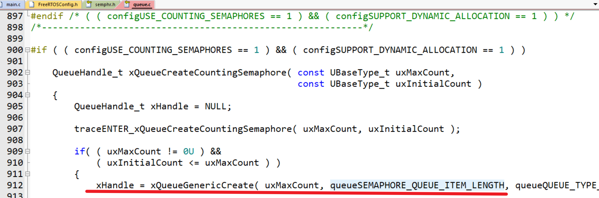

*图4.1-1计数信号量-源码*

这意味着：

1. 计数信号量在底层仍然是一个消息队列结构体（Queue_t / xQUEUE）。
2. 队列长度不再是 1，而是 uxMaxCount，元素大小仍然是 0

举个例子：

在创建计数信号量时，我们指定uxMaxCount的值是5，那么实际上等价于：

**创建一个长度为 5 的消息队列，每个元素大小为 0 字节。**

由于元素大小为**0 字节**，因此这个队列仍然**不存储任何实际数据**。

但是：

队列中“元素的个数”，就可以表示当前信号量的计数值。

这个数量，仍然保存在 Queue 控制结构体中的成员：

```c
uxMessagesWaiting
```

因此：

计数信号量的计数值，其实就是uxMessagesWaiting 的当前取值。

从底层结构来看，可以用一句话总结二值信号量和计数信号量：

1. **二值信号量，本质是一个长度为1的“0字节消息队列”，用uxMessagesWaiting的1和0表示两种不同的状态。**
2. **计数信号量，本质是一个长度为N的“0字节消息队列”，把uxMessagesWaiting的具体值作为一个计数器。**

理解了这一点之后，下面来学习计数信号量的操作API就非常简单了。

#### 4.2 剪裁相关（手动开启）

首先，计数信号量机制在 FreeRTOS 中是可裁剪配置的功能。

它的使用依赖于下面这个宏是否开启：

```c
#define configUSE_COUNTING_SEMAPHORES 1
```

如果该宏被设置为1 ，则表示开启计数信号量功能。

如果该宏为0 ，则表示关闭计数信号量功能。

需要注意的是：

**这个宏的默认值是 0，也就是说：计数信号量在 FreeRTOS 中默认是关闭的任务间通信机制。**

如果需要在工程中使用计数信号量，就需要手动在**FreeRTOSConfig.h**文件中显式设置该宏的取值是1。

#### 4.3 计数信号量的操作API

现在，你已经知道计数信号量和二值信号量的区别：

**计数信号量无非就是消息队列元素数量是N，uxMessagesWaiting的最大值是N的二值信号量。**

**所以计数信号量的操作 API 与二值信号量基本一致，只是创建函数不同。**

##### 4.3.1 创建计数信号量xSemaphoreCreateCounting()

创建计数信号量的函数：xSemaphoreCreateCounting()其函数原型如下：

```c
SemaphoreHandle_t xSemaphoreCreateCounting(
    UBaseType_t uxMaxCount, // 底层消息队列的元素数量，也就是信号量允许的最大计数值，也就是uxMessagesWaiting的最大值
    UBaseType_t uxInitialCount // 计数值的初始值，也就是uxMessagesWaiting的初始值
);
```

举一个例子：

```c
SemaphoreHandle_t Sem;
Sem = xSemaphoreCreateCounting(5, 5);
```

**函数的返回值和二值信号量并无不同，都是返回信号量句柄。**

表示：

1. uxMessagesWaiting成员的最大值是5
2. uxMessagesWaiting成员的初始值是5

如果用计数信号量来表示可用资源数量：

1. 当前最大可用资源数量为**5**
2. **当前可用资源数量为 5**

##### 4.3.2 获取信号量：xSemaphoreTake()

**用于获取信号量（表示获取消耗一个资源）。**

该函数和二值信号量的获取信号是同一个函数：

```c
BaseType_t xSemaphoreTake(
    SemaphoreHandle_t xSemaphore, // 要操作的信号量句柄
    TickType_t xTicksToWait // 最大等待阻塞时间
);
```

返回值：

1. pdTRUE，获取信号成功（资源获取成功）
2. pdFALSE，获取信号失败（在规定时间内，获取资源失败）

**对于计数信号量来说，xSemaphoreTake()函数调用一次，本质上是：**

**uxMessagesWaiting--**

##### 4.3.3 释放信号量：xSemaphoreGive()

**用于释放信号量（表示释放，结束占用一个资源）。**

该函数和二值信号量的释放信号是同一个函数：

```c
BaseType_t xSemaphoreGive(
    SemaphoreHandle_t xSemaphore // 要操作的信号量句柄
);
```

返回值：

1. pdTRUE，释放信号成功（资源释放成功，解除占用）
2. pdFALSE，释放信号失败（对于资源管理来说，只要正确编写代码不存在消息队列满，导致资源释放失败的情况，因为只要总是先占用再释放）

**对于计数信号量来说，xSemaphoreGive()函数调用一次，本质上是：**

**uxMessagesWaiting++**

##### 4.3.4 在中断环境释放信号量：xSemaphoreGiveFromISR()

用于在中断中，释放信号量（表示释放，结束占用一个资源）。

该函数和二值信号量的在中断中释放信号是同一个函数：

```c
BaseType_t xSemaphoreGiveFromISR(
    SemaphoreHandle_t xSemaphore, // 要操作的二值信号量句柄
    BaseType_t *pxHigherPriorityTaskWoken // 是否需要在ISR结束后，触发高优先级任务切换
);
```

返回值：

1. pdTRUE，释放成功（资源释放成功，解除占用）
2. pdFALSE，释放失败（对于资源管理来说，只要正确编写代码不存在消息队列满，导致资源释放失败的情况）

**对于计数信号量来说，xSemaphoreGiveFromISR()函数调用一次，本质上是：**

**uxMessagesWaiting++**只不过是在中断环境下完成这个事情。

##### 4.3.5 计数信号量在资源管理上的约定

在使用计数信号量进行资源管理时，有一个非常重要的约定：

**计数信号量的数值表示的是“当前可用资源数量”。**

而不是：**当前已使用资源数量。**

因此在资源管理场景中，应当遵循如下规则：

1. xSemaphoreCreateCounting(3, 3) → 共有3个可用资源，且一开始都处于可用状态。

uxMessagesWaiting的初始值是3

2. xSemaphoreTake() → 获取信号量 → 获取占用一个资源 → uxMessagesWaiting--
3. xSemaphoreGive() → 释放信号量 → 释放，解除占用一个资源 → uxMessagesWaiting++

一旦计数变为：0即说明：系统已经没有可用资源新的任务调用xSemaphoreTake()想要获取资源时，就会阻塞等待资源释放，如此就实现了对资源的管理。

#### 4.4 代码示例

如果系统中有些资源需要多任务竞争使用，那么我们就可以使用**计数信号量**来实现这种资源管理场景。

参考代码示例如下：

```c
#include "stm32f10x.h" // STM32F10x 标准外设库头文件

#include "FreeRTOS.h" // FreeRTOS 核心头文件
#include "task.h" // FreeRTOS 任务相关 API
#include "semphr.h" // FreeRTOS 信号量相关 API

#include "DebugUSART1.h" // 调试串口模块（printf1）

#define RESOURCE_MAX_COUNT 2
#define RESOURCE_INIT_COUNT 2

// 计数信号量句柄
// 用于表示当前系统中可用资源的数量
SemaphoreHandle_t ResourceSem = NULL;

// -------------------- 通用任务函数：申请并释放资源 --------------------
void TaskResource(void *Argument) {
    char *TaskName = (char *)Argument;

    while (1) {
       // 尝试获取资源
       // 如果当前没有可用资源，则最多等待 500ms
       while (xSemaphoreTake(ResourceSem, pdMS_TO_TICKS(500)) !=pdTRUE){
           printf1("%s waiting resource\r\n", TaskName);
       }

       // 成功获取到资源
       // 此时计数信号量的计数值会减 1
       printf1("%s get resource\r\n", TaskName);

       // 模拟任务占用资源
       // 在这段时间内，该任务不会释放资源
       vTaskDelay(pdMS_TO_TICKS(10000));

       // 任务使用完资源，准备释放
       printf1("%s release resource\r\n", TaskName);

       // 释放资源
       // 此时计数信号量的计数值会加 1
       xSemaphoreGive(ResourceSem);

       // 稍微延时一下，方便观察串口打印现象
       vTaskDelay(pdMS_TO_TICKS(1000));
    }
}

int main(void) {
    // 1. 初始化调试串口
    DebugUSART1_Init();

    // 2. 创建计数信号量
    // 最大计数值为 2，表示最多有 2 个资源
    // 初始计数值为 2，表示程序开始时有 2 个资源可用
    ResourceSem = xSemaphoreCreateCounting(RESOURCE_MAX_COUNT,RESOURCE_INIT_COUNT);

    if (ResourceSem == NULL) {
       printf1("Resource Semaphore Create Failed!\r\n");

       while (1) {
       }
    }

    // 3. 创建任务 A
    xTaskCreate(TaskResource,
               "TaskA",
               configMINIMAL_STACK_SIZE,
               "TaskA",
               tskIDLE_PRIORITY + 1,
               NULL);

    // 4. 创建任务 B
    xTaskCreate(TaskResource,
               "TaskB",
               configMINIMAL_STACK_SIZE,
               "TaskB",
               tskIDLE_PRIORITY + 1,
               NULL);

    // 5. 创建任务 C
    xTaskCreate(TaskResource,
               "TaskC",
               configMINIMAL_STACK_SIZE,
               "TaskC",
               tskIDLE_PRIORITY + 1,
               NULL);

    // 6. 启动 FreeRTOS 调度器
    vTaskStartScheduler();

    // 理论上不会运行到这里
    while (1) {
    }
}

```

注：

如果printf1 输出结果很乱，可以使用临界区加锁保障输出时不会发生任务切换。

通过这个示例可以清楚地看到：**计数信号量的核心作用，就是管理“有限数量的资源”。**

但这种场景，并不多见，了解即可。

### 5. 互斥信号量

在之前的学习中，我们已经学习过**临界区（Critical Section）**。

临界区的作用是：

**在一小段代码执行期间，暂时禁用低优先级中断或禁止任务调度。**

典型形式如下：

```c
taskENTER_CRITICAL();

/* 访问共享资源 */

taskEXIT_CRITICAL();
```

通过这种方式，可以确保：

在执行临界区代码期间，不会发生任务切换，也不会被低优先级中断打断。

这样就可以保证共享资源访问的原子性，从而保证线程安全。

但是，临界区也存在明显的局限性。

临界区的特点是：执行期间 CPU 不能被打断，无论中断亦或者其他任务，都无法获得CPU执行权。

基于这样的特点，临界区的使用必须做到：

**临界区的代码必须尽快执行完成并退出，避免持续占用CPU导致破坏系统的实时性，甚至整个系统运行出现问题。**

因此：

**临界区只能用于保护非常短小的、执行迅速的代码片段。**

但在实际系统中，还有另一种情况：某个资源需要被任务**长时间占用**。

例如：

1. 串口发送数据
2. 访问 I2C 总线
3. 访问 SPI Flash
4. 操作 OLED（本质上还是通信）
5. ....

这些操作往往需要：

1. 几百微秒
2. 几毫秒
3. 甚至更长时间

如果使用临界区保护这些操作，就会出现严重问题：整个系统在这段时间内无法进行任务切换，也不能响应中断。

这显然是不可接受的。

因此，FreeRTOS 提供了另一种机制：**互斥信号量（Mutex）。**

互斥信号量的核心思想是：**允许任务在等待资源时进入阻塞态，而不是一直占用CPU。**

当任务获取互斥信号量时：

1. 如果共享资源空闲，任务会立即获得资源
2. 如果资源被其他任务占用，当前任务会进入**阻塞态**，主动放弃CPU执行权。
3. 当共享资源释放后，阻塞任务会被唤醒。

这样：

在共享资源被占用的时候，CPU无需等待资源释放，还可以继续执行其他任务。系统的实时性和效率都不会受到影响。

#### 5.1 剪裁相关（手动开启）

首先，互斥信号量机制在 FreeRTOS 中是**可裁剪配置的功能**。

它的使用依赖于下面这个宏是否开启：

```c
#define configUSE_MUTEXES 1
```

如果该宏被设置为1 ，则表示**开启互斥信号量功能**。

如果该宏为0 ，则表示**关闭互斥信号量功能**。

需要注意的是：

**这个宏的默认值是 0，也就是说：互斥信号量在 FreeRTOS 中默认是关闭的任务间通信机制。**

如果需要在工程中使用计数信号量，就需要手动在**FreeRTOSConfig.h**文件中显式开启该宏。

#### 5.2 互斥信号量的本质

在 FreeRTOS 中：

互斥信号量同样是基于**消息队列机制**实现的。在创建互斥信号量时，内部最终同样会调用：

```c
xQueueGenericCreate();
```

源码如下图所示：

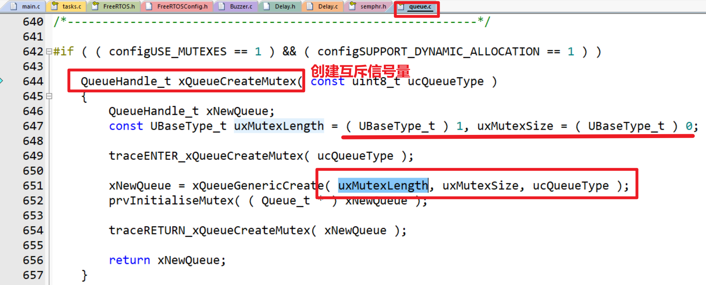

*图5.2-1互斥信号量的本质-源码1*

因此，从底层实现结构来看：

互斥信号量和二值信号量在消息队列层面是完全一致的。

具体表现为：

1. 队列长度为**1**
2. 队列元素大小为**0 字节**

同时，互斥信号量的状态同样是通过队列结构体中的成员**uxMessagesWaiting**的取值来表示。

**从当前这些内容来看，互斥信号量和二值信号量几乎没有区别。**

但是需要注意：

**虽然二者使用的是同一个成员变量 uxMessagesWaiting，但在两种信号量中的语义含义是完全不同的。**

在**二值信号量**中：

成员**uxMessagesWaiting**的取值表示**信号是否存在**：

1. 当uxMessagesWaiting=1时，表示**信号存在**
2. 当uxMessagesWaiting=0时，表示**信号不存在**

而在**互斥信号量**中：

**成员 uxMessagesWaiting 的取值表示资源是否被占用：**

1. **当uxMessagesWaiting = 1时，表示互斥信号量可用（即资源空闲）**
2. **当uxMessagesWaiting = 0时，表示互斥信号量已被占用（即资源不可用）**

因此：

当某个任务成功获取互斥信号量后，uxMessagesWaiting会从**1 变为 0**，表示资源已经被占用。

此时如果其他任务再次尝试获取该互斥信号量：

由于信号量已经不可用，这些任务就会进入阻塞状态，等待资源释放。

只有当当前持有资源的任务调用**xSemaphoreGive()**释放互斥信号量后，其他等待的任务才有机会再次获取该资源。

因此，互斥信号量的主要作用是：

**当多个任务需要访问同一个共享资源时，通过互斥信号量保证同一时刻只有一个任务能够访问该资源，从而实现对共享资源的线程安全访问。**

从这个角度出发，在很多情况下，我们也会把**互斥信号量**直接称为：

**FreeRTOS 中的“互斥锁”（Mutex Lock）。**

当某个任务成功获取互斥信号量后，就相当于获得了这把锁，并且独占对应的共享资源。

只要该任务**不主动释放这把锁**，其他任务就无法获取该互斥信号量，也就无法进入对共享资源的访问代码。

**互斥锁可以保证某一段代码在同一时刻只会被一个任务执行。**

这段被保护的代码区域，也可以称之为**临界区（Critical Section）**。（思考一下和之前的临界区有啥区别）

例如，下列伪代码就展示了多个任务通过互斥锁访问共享资源的过程：

```c
// 任务A
获取互斥锁 // 成功获取锁，独占共享资源
.... // 对共享资源进行访问
释放互斥锁 // 资源使用完毕，释放锁

// 任务B
获取互斥锁 // 若此时锁已被任务A占用，则任务B会阻塞等待
.... // 成功获取锁后，访问共享资源
释放互斥锁 // 资源使用完毕，释放锁
```

当任务A获取互斥锁后，如果任务B尝试获取该锁，由于资源已经被占用，任务B就会进入阻塞状态，直到任务A释放互斥锁为止。

反之亦然。

#### 5.3 互斥锁的实现原理

上面我们讲到：

互斥信号量本质上可以看作是一种**互斥锁**。

如果某个任务已经获取了互斥锁，那么：

其余任务再次尝试获取该锁时，就无法成功获取锁，只能**进入阻塞状态**，等待锁被释放。

但是这里就会产生一个非常重要的问题：

如果互斥信号量只是一个简单的二值信号量结构，那么它显然无法实现真正的“互斥锁”

机制。

原因其实很简单：

**系统必须知道：这把锁当前到底是被哪个任务持有。**

如果系统不知道锁的持有者是哪个任务，那么系统甚至无法判断当前任务是否持有锁，无法决定当前任务能否访问共享资源。

因此，在 FreeRTOS 中：

**互斥信号量在普通信号量的基础上，额外增加了用于记录锁持有者的信息。**

在源码中可以看到如下结构，在QCB结构体充当互斥信号量时，联合体选择下面的成员：

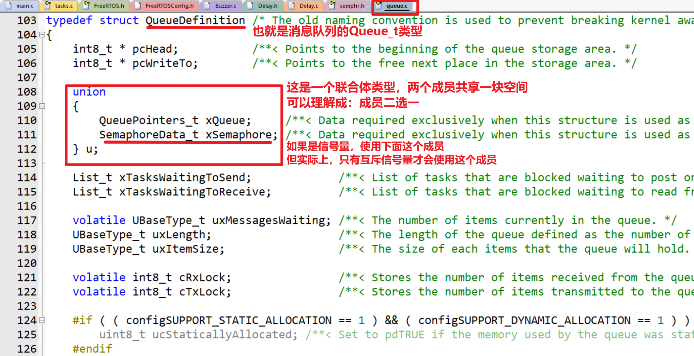

*图5.3-1互斥锁的实现原理-源码1*

联合体选择的这个成员，详细类型信息如下所示：


*图5.3-2互斥锁的实现原理-源码2*

**其中最关键的成员是：xMutexHolder**它用于记录：当前持有互斥锁的任务句柄（TaskHandle_t）。

此后，如果其他任务再次尝试获取该互斥锁，而锁已经被占用，则该任务会进入阻塞状态，等待锁释放。

下面总结一下互斥锁的实现原理：

1. 通过**uxMessagesWaiting**表示互斥锁的占用状态。
   - a. 当uxMessagesWaiting=1时，表示锁未被占用（资源可用）；
   - b. 当uxMessagesWaiting=0时，表示锁已被占用（资源不可用）。
2. 通过**xMutexHolder**记录当前持有互斥锁的任务。
   - a. 系统可以根据该成员判断**锁当前的持有者是谁**，从而确定当前任务是否具有共享资源的访问权。
   - b. 如果当前任务不具有共享资源的访问权，那么当前任务会进入阻塞状态，主动下CPU。

可以看到，二值配合，才真正实现了互斥锁的机制。

#### 5.4 优先级反转问题

FreeRTOS是一种多任务环境，优先级抢占式实时操作系统。

这意味着，正常情况下，优先级越高的任务越先执行，而且只要该任务不主动放弃CPU，那么它会一直执行下去。

但系统中一旦引入互斥信号量，使用互斥锁，就不可避免的会带来——**优先级反转问题（Priority Inversion）**

什么是优先级反转？

**高优先级任务反而被低优先级任务“间接阻塞”，明明高优先级任务处于就绪态，却始终无法上CPU，这种异常现象就是优先级反转。**

下面具体来看一个场景（只是为了演示优先级反转问题，实际上FreeRTOS中不会这么运行）。

假设系统中有三个任务：

1. **TaskHigh（高优先级5）**
2. **TaskMedium（中优先级3）**
3. **TaskLow（低优先级1）**

同时有一个共享资源，例如**串口**，使用互斥信号量进行保护。

系统执行过程可能如下：

**第一步：**

系统启动时，**只有低优先级任务 TaskLow 处于就绪态**，其余任务还没有进入就绪状态。

于是低优先级的任务，先执行。

于是低优先级的任务，获取互斥锁，共享资源被TaskLow任务使用。

**第二步：**

高优先级任务**TaskHigh**变为就绪态，并尝试获取同一个互斥锁。

但是：

互斥锁已经被 TaskLow 占用，且没有被释放。

因此：

**TaskHigh 只能进入阻塞态等待。**

**第三步：**

这时**TaskMedium**变为就绪态。

由于：

TaskMedium 的优先级**高于 TaskLow**，因此调度器会让**TaskMedium 运行**。

**而且任务 TaskMedium 不会主动放弃CPU，它会一直运行下去。**

此时整个系统中的三个任务，它们的运行情况是：

1. TaskHigh → 等待获取互斥锁，等待共享资源（阻塞）
2. TaskMedium → 一直运行，一直占着CPU不放。
3. TaskLow → 处于就绪态，但优先级低，无法获取CPU，没有执行权。

结果就是：

真正持有互斥锁的 TaskLow 无法运行，自然也无法释放 Mutex。

而 TaskHigh 又必须等待 Mutex。

于是就出现了一种奇怪的情况：高优先级任务，反而被中优先级任务间接阻塞了，高优先级的任务反而没有机会执行了。

这就是：**优先级反转问题。**

简单一句话总结：

**高优先级任务因为资源竞争，被更低优先级任务间接阻塞执行。**

这种情况显然是不合理的，那么如何解决这种优先级反转问题呢？

#### 5.5 互斥信号量的重要机制：优先级继承

为了解决优先级反转问题，FreeRTOS 在互斥信号量中实现了一种重要机制：**优先级继承（Priority Inheritance）。**

其核心思想其实非常简单：

**当高优先级任务因等待互斥锁而进入阻塞状态时，系统会临时提升当前锁持有任务的优先级，使其优先级提升到与等待该锁的最高优先级任务相同。**

我们仍然用刚才的三个任务来举例：

1. **TaskHigh（优先级5）**
2. **TaskMedium（优先级3）**
3. **TaskLow（优先级1）**

系统的**真实**运行过程如下：

**第一步：**

系统启动时，**只有低优先级任务 TaskLow 处于就绪态**，其余任务还没有进入就绪状态。

于是低优先级的任务，先执行。

于是低优先级的任务，获取互斥锁，共享资源被TaskLow任务使用。

**第二步：**

高优先级任务**TaskHigh**变为就绪态，并尝试获取同一个互斥锁。

但是：互斥锁已经被 TaskLow 占用，且没有被释放。

因此：**TaskHigh 只能进入阻塞态等待。**

这时 FreeRTOS 会发现：

**高优先级任务正在等待一个被低优先级任务占用的互斥锁。**

于是系统会执行**优先级继承机制**：

**临时把 TaskLow 的优先级提升到 TaskHigh 的优先级。**

也就是说，原本的优先级关系是：

TaskHigh 5TaskMedium 3TaskLow 1触发优先级继承后变成：

TaskHigh 5 (阻塞)TaskLow 5 (临时提升)TaskMedium 3**第三步：**

此时即使**TaskMedium**进入就绪态，由于**TaskLow 的优先级已经被提升到 5**，因此**TaskLow 会优先运行**。

这样 TaskLow 执行完共享资源访问操作，并释放互斥锁。

**第四步：**

互斥锁释放后：

1. TaskHigh 立即被唤醒
2. TaskHigh 立刻抢占 CPU（优先级最高）

与此同时：

**释放互斥锁后，TaskLow 的优先级会恢复为原来的优先级。**

系统优先级关系恢复正常。

因此可以用一句话总结**优先级继承机制**：

**当高优先级任务等待互斥资源时，系统会临时提升资源持有者的优先级，使其尽快释放资源。**

需要特别注意的一点是：

**优先级继承只存在于互斥信号量中，其余信号量没有这样的机制。**

所以我们可以得出一个结论：

**如果需求是针对单一共享资源的保护，推荐使用互斥信号量。**

#### 5.6 互斥信号量的操作API

互斥信号量的API只需要学习一个新的。

**创建互斥信号量：**

```c
SemaphoreHandle_t xSemaphoreCreateMutex(void);
```

**该函数用于创建一个互斥信号量（互斥锁），返回值是一个互斥信号量句柄。**

需要注意的是：

互斥信号量在创建成功后，其内部状态默认是**可用状态**，也就是：

```c
uxMessagesWaiting = 1
```

表示当前没有任务占用该锁。

当任务需要访问共享资源时，可以调用如下函数**获取互斥锁**：

```c
BaseType_t xSemaphoreTake(
    SemaphoreHandle_t xSemaphore,
    TickType_t xTicksToWait
);
```

如果互斥锁当前**没有被其他任务占用**，那么任务就可以成功获取锁，并进入临界区访问共享资源。

如果互斥锁**已经被其他任务持有**，那么当前任务就会根据xTicksToWait的设置：

1. 立即返回失败
2. 或进入**阻塞状态等待锁释放**

当任务使用完共享资源后，需要调用以下函数**释放互斥锁**：

```c
BaseType_t xSemaphoreGive(
    SemaphoreHandle_t xSemaphore
);
```

释放互斥锁后，系统会：

1. 将锁状态恢复为**可用**
2. 并唤醒等待该锁的任务

需要特别注意的是：

**互斥锁必须由“锁的持有者任务”进行释放。**

也就是说：

获取互斥锁的任务，必须由**同一个任务调用**xSemaphoreGive()**释放锁**。

否则将会导致系统行为异常。

最后总结一下互斥信号量的基本使用流程：

```c
创建互斥锁 (xSemaphoreCreateMutex)
   ↓
任务获取互斥锁 (xSemaphoreTake)
    ↓
访问共享资源
    ↓
释放互斥锁 (xSemaphoreGive)
```

通过这种方式，就可以在多任务环境下实现对共享资源的互斥访问。

#### 5.7 一个很重要的经验总结

到这里为止，三种常见的信号量机制：二值信号量、计数信号量、互斥信号量，我们已经全部学完了。

我们可以对信号量相关的操作 API 做一个简单的总结。

有以下几条：

1. 三种信号量的创建函数各不相同，但本质上都是创建消息队列，返回消息队列句柄。
2. 释放信号量都使用xSemaphoreGive()函数：
   - a. 对于二值信号量而言，释放信号量表示信号状态从无到有，从0到1。
   - b. 对于计数信号量和互斥信号量而言，释放信号量表示资源被释放，可用资源增加。
   - c. **本质上，都是uxMessagesWaiting++**
3. 获取信号量都使用xSemaphoreTake()函数：
   - a. 对于二值信号量而言，获取信号量表示信号状态从有到无，从1到0。
   - b. 对于计数信号量和互斥信号量而言，获取信号量表示资源被获取占用，可用资源减少。
   - c. **本质上，都是uxMessagesWaiting--**
4. **牢牢记住：Give 表示释放，Take 表示获取，三种信号量使用同样的函数进行获取和释放。**

记住这几点，在理解和使用信号量机制时，很多问题都会变得更加清晰。

#### 5.8 优先级继承：代码演示

对于下列演示代码：

**Buzzer.h头文件：**

```c
#ifndef __BUZZER_H
#define __BUZZER_H

#include "stm32f10x.h"

/* 初始化蜂鸣器 IO口接入PA0引脚 低电平工作 */
void Buzzer_Init(void);

/* 翻转蜂鸣器状态 */
void Buzzer_Toggle(void);

#endif

```

**Buzzer.c实现源文件：**

```c
#include "Buzzer.h"

/**
 * @brief 初始化蜂鸣器 GPIO
 * @note 蜂鸣器接在 PA0，低电平响
 */
void Buzzer_Init(void) {
    /* 1. 开启 GPIOA 时钟 */
    RCC_APB2PeriphClockCmd(RCC_APB2Periph_GPIOA, ENABLE);

    /* 2. 配置 PA0 为推挽输出 */
    GPIO_InitTypeDef GPIO_InitStructure;

    GPIO_InitStructure.GPIO_Pin = GPIO_Pin_0;
    GPIO_InitStructure.GPIO_Mode = GPIO_Mode_Out_PP;
    GPIO_InitStructure.GPIO_Speed = GPIO_Speed_2MHz;

    GPIO_Init(GPIOA, &GPIO_InitStructure);

    /* 默认关闭蜂鸣器 */
    GPIO_SetBits(GPIOA, GPIO_Pin_0);
}

/**
 * @brief 翻转蜂鸣器状态
 */
void Buzzer_Toggle(void) {
    if (GPIO_ReadOutputDataBit(GPIOA, GPIO_Pin_0) == Bit_SET) {
       GPIO_ResetBits(GPIOA, GPIO_Pin_0);
    } else {
       GPIO_SetBits(GPIOA, GPIO_Pin_0);
    }
}

```

**main.c源文件：**

```c
#include "stm32f10x.h" // STM32F10x 标准外设库头文件

#include "FreeRTOS.h" // FreeRTOS 核心头文件
#include "task.h" // FreeRTOS 任务相关 API
#include "semphr.h" // FreeRTOS 信号量相关 API

#include "Delay.h" // TIM2 延时模块
#include "Buzzer.h" // 蜂鸣器模块
#include "DebugUSART1.h" // 调试串口模块（printf1）

/*
    任务优先级关系：
    1. TaskLow
      低优先级任务，先获取互斥锁，并长时间占用共享资源。

    2. TaskMedium
      中优先级任务，不使用互斥锁，只模拟普通任务运行。

    3. TaskHigh
      高优先级任务，后续尝试获取同一个互斥锁。

    用于演示：

    1. 低优先级任务先持有互斥锁。
    2. 高优先级任务随后申请互斥锁，但因为锁被占用，所以进入阻塞态。
    3. 中优先级任务本来可以抢占低优先级任务。
    4. 但由于使用的是 Mutex，FreeRTOS 会触发优先级继承机制。
    5. 低优先级任务会临时继承高优先级任务的优先级，继续运行并尽快释放互斥锁。
*/

// 串口互斥锁句柄
static SemaphoreHandle_t UartMutex = NULL;

// -------------------- 打印当前任务的当前优先级和基础优先级 --------------------
static void PrintPriorityInfo(const char *TaskName) {
    TaskStatus_t TaskStatus;

    /*
       需要在配置文件中设置以下配置宏：
           #define configUSE_MUTEXES 1
           #define configUSE_TRACE_FACILITY 1
    */
    vTaskGetInfo(NULL,
               &TaskStatus,
               pdFALSE, // 不获取任务栈水位线
               eRunning); // 不获取任务真实状态

    printf1("[%s] CurrentPriority = %lu, BasePriority = %lu\r\n",
           TaskName,
           (uint32_t)TaskStatus.uxCurrentPriority,
           (uint32_t)TaskStatus.uxBasePriority);
}

// -------------------- 低优先级任务：先持有互斥锁 --------------------
void TaskLow(void *Argument) {
    uint8_t i = 0;

    while (1) {
       printf1("\r\n[TaskLow] try take mutex\r\n");
       PrintPriorityInfo("TaskLow");

       // 低优先级任务先获取互斥锁
       xSemaphoreTake(UartMutex, portMAX_DELAY);

       printf1("[TaskLow] take mutex\r\n");
       PrintPriorityInfo("TaskLow");

       // 模拟长时间持有互斥锁
       // 这里使用 Delay_Ms() 忙等延时，方便观察优先级继承现象
       for (i = 1; i < 6; i++) {
           printf1("[TaskLow] working %d\r\n", i);
           PrintPriorityInfo("TaskLow");

           Delay_Ms(1000);
       }

       printf1("[TaskLow] before give mutex\r\n");
       PrintPriorityInfo("TaskLow");

       // 释放互斥锁
       xSemaphoreGive(UartMutex);

       printf1("[TaskLow] after give mutex\r\n");
       PrintPriorityInfo("TaskLow");
    }
}

// -------------------- 高优先级任务：后续申请互斥锁 --------------------
void TaskHigh(void *Argument) {
    uint8_t i = 0;

    // 先延时一段时间，确保 TaskLow 先运行并拿到互斥锁
    vTaskDelay(500);

    while (1) {
       printf1("\r\n[TaskHigh] try take mutex\r\n");
       PrintPriorityInfo("TaskHigh");

       // 高优先级任务申请互斥锁
       // 如果互斥锁还在 TaskLow 手中，TaskHigh 会进入阻塞态
       xSemaphoreTake(UartMutex, portMAX_DELAY);

       printf1("[TaskHigh] take mutex\r\n");
       PrintPriorityInfo("TaskHigh");

       for (i = 1; i < 6; i++) {
           printf1("[TaskHigh] working %d\r\n", i);
           PrintPriorityInfo("TaskHigh");

           Delay_Ms(1000);
       }

       printf1("[TaskHigh] before give mutex\r\n");
       PrintPriorityInfo("TaskHigh");

       // 释放互斥锁
       xSemaphoreGive(UartMutex);

       printf1("[TaskHigh] after give mutex\r\n");
       PrintPriorityInfo("TaskHigh");

       // 主动延时，避免高优先级任务一直反复获取互斥锁
       vTaskDelay(1000);
    }
}

// -------------------- 中优先级任务：模拟普通任务运行 --------------------
void TaskMedium(void *Argument) {
    // 延时更长一些，保证 TaskHigh 先尝试获取互斥锁并进入阻塞态
    vTaskDelay(1000);

    printf1("\r\n[TaskMedium] start running\r\n");
    PrintPriorityInfo("TaskMedium");

    while (1) {
       // 中优先级任务不访问共享串口资源
       // 这里只用蜂鸣器翻转表示该任务正在运行
       Buzzer_Toggle();

       vTaskDelay(200);
    }
}

int main(void) {
    // 1. 配置中断优先级分组
    NVIC_PriorityGroupConfig(NVIC_PriorityGroup_4);

    // 2. 初始化调试串口
    DebugUSART1_Init();

    // 3. 初始化 TIM2 延时模块
    Delay_Init();

    // 4. 初始化蜂鸣器
    Buzzer_Init();

    // 5. 创建互斥锁
    UartMutex = xSemaphoreCreateMutex();

    if (UartMutex == NULL) {
       printf1("Uart Mutex Create Failed!\r\n");

       while (1) {
       }
    }

    // 6. 创建低优先级任务
    xTaskCreate(TaskLow,
               "TaskLow",
               configMINIMAL_STACK_SIZE,
               NULL,
               tskIDLE_PRIORITY + 1,
               NULL);

    // 7. 创建中优先级任务
    xTaskCreate(TaskMedium,
               "TaskMedium",
               configMINIMAL_STACK_SIZE,
               NULL,
               tskIDLE_PRIORITY + 2,
               NULL);

    // 8. 创建高优先级任务
    xTaskCreate(TaskHigh,
               "TaskHigh",
               configMINIMAL_STACK_SIZE,
               NULL,
               tskIDLE_PRIORITY + 3,
               NULL);

    // 9. 启动 FreeRTOS 调度器
    vTaskStartScheduler();

    // 理论上不会运行到这里
    while (1) {
    }
}

```

其中Delay_Ms是前面定时器阶段讲过，写过的，基于TIM2定时器实现的CPU阻塞式忙等待延时。

**也就是说：使用Delay_Ms进行延时，会占用CPU进行阻塞。**

这段代码的设计是这样的：

1. 高优先级和低优先级任务竞争同一个串口资源。
2. 中等优先级的任务，控制蜂鸣器翻转工作。

通过这段代码，你可以自行测试一下互斥信号量的工作机制原理。

#### 5.9 互斥信号量 VS 计数信号量

在 FreeRTOS 中，互斥信号量和计数信号量在底层实现上其实非常相似，它们本质上都是基于消息队列机制实现的。

而且看起来，它们都和资源管理、保护有关系。

但实际上，两者有明显区别。

**互斥信号量（Mutex）用于保护单一共享资源。**

其核心特点是：

1. 同一时刻**只允许一个任务获取资源**
2. **内核会记录当前资源持有者**
3. **支持优先级继承机制，用于解决优先级反转问题**

因此，互斥信号量通常用于：

1. 保护串口
2. 保护 SPI / I2C 总线
3. 保护 OLED 的操作
4. 保护一个全局数据结构，比如一个全局共享的Buffer

本质上，它解决的是：**多个任务竞争同一个资源的线程安全问题。**

**计数信号量（Counting Semaphore）**则用于**管理多个相同资源的数量**。

其核心特点是：

1. 同时允许**多个任务获取资源**
2. 资源数量由**计数值控制**
3. 没有**优先级继承机制**

例如：

如果系统中有**3 个相同资源**，那么最多允许**3 个任务同时获取资源**，当资源耗尽时，新的任务必须等待。

因此，计数信号量解决的是：

**多个任务竞争多个同类资源的问题。**

可以用几句话话简单总结两者的区别：

1. 互斥锁和计数信号量都可以用于资源竞争管理，但它们解决的问题不同。
2. 互斥锁用于保护单个共享资源，强调“谁持有锁，谁拥有该资源的独占访问权”，同一时刻只允许一个任务进入受保护的代码区域。
3. 计数信号量用于管理多个同类资源，计数值表示当前可用资源数量。
   - a. 任务获取计数信号量时，计数值减一；
   - b. 释放资源时，计数值加一。
   - c. 当计数值为 0 时，后续任务需要阻塞等待。
4. **因此，单个共享资源的互斥访问应使用互斥锁；多个同类资源的数量管理应使用计数信号量。**

如果用一句话来表示二者的区别：

1. **互斥锁：一个资源，只允许一个任务进入。**
2. **计数信号量：多个同类资源，允许有限数量的任务同时进入。**

在嵌入式开发这种资源紧张的前提背景下，互斥信号量显然是更常用的。

互斥信号量是学习信号量的重点。

#### 5.10 互斥信号量 VS 二值信号量

互斥信号量和二值信号量在 FreeRTOS 底层都基于队列实现，并且队列元素大小都为0，所以它们在内存结构上非常相似。

但是二者的使用目的不同。

**二值信号量主要用于任务同步或事件通知。**

例如：中断接收到数据后，释放二值信号量，通知任务去处理数据。它关注的是：**事件是否发生**。

**互斥信号量主要用于单一共享资源保护。**

例如：多个任务访问同一个串口、I2C 总线、全局变量或显示屏时，需要使用互斥信号量保证同一时刻只有一个任务访问资源。

它关注的是：**资源当前由谁占用**。

两者最大的区别是：

**互斥信号量具有“持有者”概念，并且支持优先级继承，可以缓解优先级反转问题。**

**二值信号量没有“持有者”概念，也不支持优先级继承，因此不推荐用来保护共享资源。**

总结来说：

**二值信号量用于同步通知，互斥信号量用于单一资源保护。**

#### 5.11 其余需要了解的细节

在**优先级反转**和**优先级继承**讲完之后，关于互斥信号量，其实还有几个比较实用的注意点，可以简单了解一下。

**第一，互斥信号量必须由持有者释放**互斥信号量有一个基本规则：谁获取，谁释放。

例如：

```c
TaskA xSemaphoreTake(Mutex);
TaskB xSemaphoreGive(Mutex); // 不允许，不允许
```

这种用法会导致系统误以为锁被释放，从而破坏互斥访问，可能导致A和B两个任务同时访问共享资源。

同时这种做法还会破坏优先级继承机制。

**总之，互斥锁必须遵循 “谁加锁，谁解锁” 的原则。**

**第二，互斥信号量不能在中断中使用（重点！！！！！）。**

互斥信号量**只能在任务环境中使用**，不能在中断服务函数（ISR）中使用。

原因是：

互斥信号量会记录锁持有者的任务句柄，而中断显然不是任务，没有任务句柄。

而且互斥信号量涉及**优先级继承机制**，而中断并不是任务，没有任务优先级，也不存在任务调度关系。

因此：不要在中断中尝试使用互斥信号量。

**第三，递归和函数嵌套中使用互斥信号量（了解）。**

FreeRTOS 还提供了一种特殊的互斥信号量：

**递归互斥信号量（Recursive Mutex）**

创建函数：

```c
xSemaphoreCreateRecursiveMutex()
```

它允许**同一个任务多次获取同一个 Mutex**，但释放时也必须释放相同次数。

通过下面的一个成员实现：

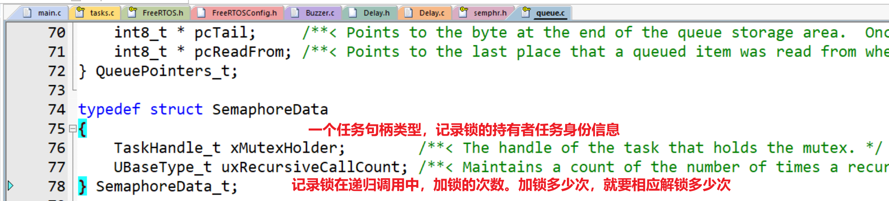

*图5.11-1递归中使用互斥锁-图*

这种机制主要用于函数嵌套调用时的资源保护，实际项目中使用较少，了解即可。

#### 5.12 扩展问题：如果中断当中需要保护共享资源怎么办？

这是一个很好的问题，甚至很值得在面试中问一问。

在一个嵌入式系统中，共享资源大多是：

1. 某个外设资源
2. 某个缓冲区Buffer
3. 某个全局变量
4. ...

如果这些共享资源，需要同时被中断和任务访问，甚至被两个中断同时访问。

看起来，如果不采取任何保护机制，就非常有可能出现。

**所以，理论上来说，中断访问共享资源时，也需要保护。**

但从实际工程角度出来，我们不应该这么设计系统，也就是说：

**在实际工程中，优良的设计是：不要在中断中处理复杂共享资源。**

**设计良好的嵌入式系统中，应当遵循一个原则：尽量不要让中断去操作复杂的共享资源。**

具体来说：

1. **中断只负责产生事件，产生信号，发送通知。**
2. **而不要让中断去处理事件，处理信号，处理通知。**
3. **中断只负责产生数据或事件，而任务负责消费和处理这些数据。**

这样设计至少有三点好处：

1. 中断可以更加短平快，执行时间更短，这符合中断的设计哲学。
2. 避免复杂的同步问题，而不处理这些问题就可以更好的实现第一条。
3. 系统实时性更好，这是第一条和第二条带来的好处。

FreeRTOS官方也更推荐使用这种设计方式。

**也就是说：解决问题，不仅可以选择解决问题本身，还可以解决问题的提出者。**

**记住：系统设计远比单纯技术实现更重要。**

当然，如果某些情况下**中断确实需要访问共享资源**，那么也可以使用最简单的保护方法：

**短暂关闭中断，也就是使用临界区。**

```c
// 中断ISR当中
UBaseType_t uxSavedInterruptStatus;

uxSavedInterruptStatus = taskENTER_CRITICAL_FROM_ISR();

/* 访问共享资源 */

taskEXIT_CRITICAL_FROM_ISR( uxSavedInterruptStatus );
```

但需要注意：临界区必须短平快。

所以总结来说：

**如果中断中需要保护共享资源，可以使用临界区。**

但更好的系统设计方式是：

**让中断只产生事件，由任务去处理资源。**

这样既简单，也更安全，也是 FreeRTOS 推荐的设计模式。

总结如下：

1. 如果共享资源只是**全局变量或 Buffer 缓冲区**，在中断中使用**临界区简单保护**一下通常问题不大。
2. **但如果共享资源是串口、I2C 等重量级通信外设资源，一般不建议在中断中直接处理数据。**

3. 更合理的做法是：中断只负责产生事件，任务负责处理数据。也就是：中断做通知，任务做处理。

#### 5.13 临界区和互斥信号量的案例对比

如果是对**轻量级资源**的共享竞争，比如竞争某个全局变量、某个缓冲区等，此时使用**临界区**是完全可以的。

因为这类资源的临界区代码通常**非常短、执行很快**。

虽然理论上临界区会短时间禁止任务切换，对系统实时性有一定影响，但为了保证数据访问的正确性，这种开销是完全可以接受的。

**但如果是对重量级资源的共享竞争，比如：**

多个任务竞争**某个外设资源（串口、I2C、SPI 等）**

此时就更建议使用**互斥信号量**来进行访问控制，从而提升整体系统的运行效率。

你可以这样理解这两种机制的区别：

1. 临界区的含义是：在临界区代码执行期间，调度器被暂时锁定，其它任务无法进行任务切换，必须等待临界区执行结束。

2. 互斥信号量的含义是：只有需要竞争该资源的任务才会等待锁，而不涉及该资源的任务仍然可以正常被调度执行。

再用一个更通俗的类比来理解：

1. **临界区就像是：**
   - a. 所有人都**必须**排队竞争同一个资源
   - b. 后面的人，都必须等待前面的人完成操作之后，才能得以运行。
   - c. 如果每个人的操作都很快，那问题不大，即便后面的人也能很快得到资源。
   - d. 但如果把每个人操作的时间都延长，那后面的人想要获取资源就非常困难了。
2. **互斥信号量则像是：**
   - a. **愿意**竞争资源的人就排队。
   - b. 既然你愿意竞争资源，愿意排队，那么即便等得久一些也是你乐意的。
   - c. 而不需要这个资源的人，可以继续去做自己的事情，不会受到影响。

经过多次讲解，相信大家已经对临界区和互斥信号量的区别，有了一定的了解。

下面我们再通过两段代码加深对它们区别的理解。

首先，我们仍然继续使用上面代码中写过的蜂鸣器模块代码。

随后我们在系统中，创建3个优先级一致的任务：

1. 任务A和任务B竞争，同一个串口资源，进行串口输出。
2. 任务C只负责翻转蜂鸣器状态。
3. **由于三者优先级一致，采用时间片轮转调度，理论上蜂鸣器能够正常工作。**

**如果采用临界区来实现：**

```c
#include "stm32f10x.h" // STM32F10x 标准外设库头文件

#include "FreeRTOS.h" // FreeRTOS 核心头文件
#include "task.h" // FreeRTOS 任务相关 API

#include "Buzzer.h" // 蜂鸣器模块
#include "DebugUSART1.h" // 调试串口模块（printf1）

// -------------------- 任务1：蜂鸣器节拍任务 --------------------
void TaskBeep(void *arg) {
    while (1) {
       // 翻转蜂鸣器状态
       // 用于观察系统调度是否受到影响
       Buzzer_Toggle();

       // 每隔 200ms 翻转一次
       vTaskDelay(200);
    }
}

// -------------------- 任务2：发送大量串口数据 --------------------
void TaskA(void *arg) {
    uint8_t i = 0;

    while (1) {
       // 进入临界区
       // 临界区内不会发生任务切换，可以避免 TaskA 和 TaskB 的串口输出交叉
       taskENTER_CRITICAL();

       printf1("---------- TaskA START ----------\r\n");

       for (i = 0; i < 20; i++) {
           printf1("TaskA running %d : 1234567890ABCDEFGHIJKLMNOPQRSTUVWXYZ\r\n",i);
       }

       printf1("---------- TaskA END ----------\r\n\r\n");

       // 退出临界区，恢复正常任务调度
       taskEXIT_CRITICAL();

       // 延时一段时间，让其他任务有机会运行
       vTaskDelay(500);
    }
}

// -------------------- 任务3：发送大量串口数据 --------------------
void TaskB(void *arg) {
    uint8_t i = 0;

    while (1) {
       // TaskB 同样使用临界区保护串口打印
       // 这样可以避免 TaskA 和 TaskB 的打印内容混在一起
       taskENTER_CRITICAL();

       printf1("---------- TaskB START ----------\r\n");

       for (i = 0; i < 20; i++) {
           printf1("TaskB running %d : abcdefghijklmnopqrstuvwxyz1234567890\r\n",i);
       }

       printf1("---------- TaskB END ----------\r\n\r\n");

       // 退出临界区
       taskEXIT_CRITICAL();

       // 延时一段时间，让其他任务有机会运行
       vTaskDelay(500);
    }
}

int main(void) {
    // 1. 配置中断优先级分组
    NVIC_PriorityGroupConfig(NVIC_PriorityGroup_4);

    // 2. 初始化调试串口
    DebugUSART1_Init();

    // 3. 初始化蜂鸣器
    Buzzer_Init();

    // 4. 创建 TaskA
    xTaskCreate(TaskA,
               "TaskA",
               configMINIMAL_STACK_SIZE,
               NULL,
               tskIDLE_PRIORITY + 1,
               NULL);

    // 5. 创建 TaskB
    xTaskCreate(TaskB,
               "TaskB",
               configMINIMAL_STACK_SIZE,
               NULL,
               tskIDLE_PRIORITY + 1,
               NULL);

    // 6. 创建蜂鸣器节拍任务
    xTaskCreate(TaskBeep,
               "TaskBeep",
              configMINIMAL_STACK_SIZE,
               NULL,
               tskIDLE_PRIORITY + 1,
               NULL);

    // 7. 启动 FreeRTOS 调度器
    vTaskStartScheduler();

    // 理论上不会运行到这里
    while (1) {
    }
}

```

在这个实现中：

蜂鸣器任务实际上**和串口资源毫无关系**，它根本不需要参与串口资源的竞争。

但由于**临界区会锁定调度器**，在任务A或任务B执行串口输出期间，其它任务都无法进行任务切换。

而串口打印本身是一个**相对耗时的操作**，因此临界区会持续较长时间。

最终就会导致：

蜂鸣器任务无法按时获得CPU执行时间，表现为**断断续续、不规律、甚至卡顿式的工作状态**。

**如果采用互斥信号量来实现：**

```c
#include "stm32f10x.h" // STM32F10x 标准外设库头文件

#include "FreeRTOS.h" // FreeRTOS 核心头文件
#include "task.h" // FreeRTOS 任务相关 API
#include "semphr.h" // FreeRTOS 信号量相关 API

#include "DebugUSART1.h" // 调试串口模块（printf1）
#include "Buzzer.h" // 蜂鸣器模块

// 串口互斥锁句柄
static SemaphoreHandle_t UartMutex = NULL;

// -------------------- 任务1：发送大量串口数据 --------------------
void TaskA(void *arg) {
    uint8_t i = 0;

    while (1) {
       // 申请串口互斥锁
       // 如果串口正在被其他任务使用，当前任务会进入阻塞态等待
       xSemaphoreTake(UartMutex, portMAX_DELAY);

       printf1("---------- TaskA START ----------\r\n");

       for (i = 0; i < 20; i++) {
           printf1("TaskA running %d : 1234567890ABCDEFGHIJKLMNOPQRSTUVWXYZ\r\n",i);
       }

       printf1("---------- TaskA END ----------\r\n\r\n");

       // 释放串口互斥锁
       xSemaphoreGive(UartMutex);

       // 主动延时一段时间，方便观察 TaskA、TaskB、TaskBeep 的运行现象
       vTaskDelay(500);
    }
}

// -------------------- 任务2：发送大量串口数据 --------------------
void TaskB(void *arg) {
    uint8_t i = 0;

    while (1) {
       // 申请串口互斥锁
       xSemaphoreTake(UartMutex, portMAX_DELAY);

       printf1("---------- TaskB START ----------\r\n");

       for (i = 0; i < 20; i++) {
           printf1("TaskB running %d : abcdefghijklmnopqrstuvwxyz1234567890\r\n",i);
       }

       printf1("---------- TaskB END ----------\r\n\r\n");

       // 释放串口互斥锁
       xSemaphoreGive(UartMutex);

       // 主动延时一段时间，避免两个串口任务一直抢占串口资源
       vTaskDelay(500);
    }
}

// -------------------- 任务3：蜂鸣器节拍任务 --------------------
void TaskBeep(void *arg) {
    while (1) {
       // 翻转蜂鸣器状态
       // 用于观察系统调度是否仍然正常运行
       Buzzer_Toggle();

       // 每隔 200ms 翻转一次
       vTaskDelay(200);
    }
}

int main(void) {
    // 1. 配置中断优先级分组
    NVIC_PriorityGroupConfig(NVIC_PriorityGroup_4);

    // 2. 初始化调试串口
    DebugUSART1_Init();

    // 3. 初始化蜂鸣器
    Buzzer_Init();

    // 4. 创建串口互斥锁
    UartMutex = xSemaphoreCreateMutex();

    if (UartMutex == NULL) {
       printf1("Uart Mutex Create Failed!\r\n");

       while (1) {
       }
    }

    // 5. 创建 TaskA
    xTaskCreate(TaskA,
               "TaskA",
               configMINIMAL_STACK_SIZE,
               NULL,
               tskIDLE_PRIORITY + 1,
               NULL);

    // 6. 创建 TaskB
    xTaskCreate(TaskB,
               "TaskB",
               configMINIMAL_STACK_SIZE,
               NULL,
               tskIDLE_PRIORITY + 1,
               NULL);

    // 7. 创建蜂鸣器节拍任务
    xTaskCreate(TaskBeep,
               "TaskBeep",
               configMINIMAL_STACK_SIZE,
               NULL,
               tskIDLE_PRIORITY + 1,
               NULL);

    // 8. 启动 FreeRTOS 调度器
    vTaskStartScheduler();

    // 理论上不会运行到这里
    while (1) {
    }
}

```

在这种实现方式中：

只有任务A 和任务B 需要竞争串口资源，因此它们会通过互斥信号量进行访问控制。

当某个任务获取不到互斥信号量时，它会进入阻塞态等待，不会持续占用 CPU。

**而蜂鸣器任务并不参与串口资源的竞争，因此它不会被迫等待阻塞。**

蜂鸣器任务仍然可以按照**时间片轮转调度**正常获得执行机会，从而保持稳定的节拍工作。

### 6. 信号量总结

到这里，我们已经把 FreeRTOS 中最常用的三类信号量机制全部讲完了，分别是：

1. 二值信号量（Binary Semaphore）
2. 计数信号量（Counting Semaphore）
3. 互斥信号量（Mutex）

虽然这三种机制在使用形式上比较相似，都是通过 Take / Give 进行操作，但它们在设计目的和使用场景上是有所区别的。

简单总结如下：

| 类型 | 本质 | 主要作用 |
|---|---|---|
| 二值信号量 | 长度为1、元素大小为0的消息队列 | 任务同步 / 事件通知 |
| 计数信号量 | 长度>1、元素大小为0的消息队列 | 管理同类型的多个资源 |
| 互斥信号量 | 记录持有者，实现优先级继承机制的特殊二值信号量 | 保护重量级共享资源 |

从使用角度来看，可以这样理解：

1. **二值信号量，**常用于**任务同步**，例如：中断通知任务、任务之间的事件触发。
2. **计数信号量**，用于**管理同类型的多个资源**，例如：多个缓冲区、多个连接、多个设备资源等。
3. **互斥信号量**，用于**保护重量级共享资源**，例如：串口、I2C、SPI 等外设资源访问控制。

不过在实际的嵌入式开发中，真正最重要、也最常使用的，往往是互斥信号量（Mutex），也就是我们常说的互斥锁。

**计数信号量**用于管理多个同类型资源，在嵌入式系统中这样的场景很少见，因此计数信号量的使用频率也很低。

**而二值信号量在很多场景下，已经被任务通知（Task Notification）机制所替代。**

**这是 FreeRTOS 官方非常力推的一种任务间通信方式。**

下一章节，我们就来详细看看任务通知是如何工作的。

---

## 03 直达任务通知

### 1. 前言概述

在前面的内容中，我们已经学习了 FreeRTOS 中两种常见的任务间通信机制：

1. **消息队列（Queue）**
2. **信号量（Semaphore）**

其中：

1. **消息队列**主要用于**任务与任务、任务与中断之间传递数据**
2. **信号量**主要用于**任务同步以及资源管理**

消息队列的作用几乎是**不可替代的**。

**如果需要在任务与任务，或者任务与中断之间传递数据，那么消息队列通常都是首选机制。**

但在实际应用中，很多时候并不需要传递数据。

例如：

1. 中断通知任务
2. 一个任务唤醒另一个任务
3. 某个事件发生后通知任务继续执行

**这种情况，本质上只是发送通知和接收通知。**

在前面的学习中，我们已经知道：**二值信号量**就可以完成这种任务同步工作。

不过，如果是向单一任务发送通知的场景，使用消息队列或者信号量，其实显得有些“重量级”。

因此，FreeRTOS 又提供了一种**更加轻量级的通信机制**：**直达任务通知（Task Notification）**

**任务通知可以理解为：二值信号量在面向单个任务发通知时，一种更加轻量、更高效的实现方式。**

接下来，我们就来学习 FreeRTOS 的任务通知机制。

注意：

我们这里学习的机制，官方最正式的中文翻译应当是：直达任务通知但日常口语中，叫任务通知也问题不大，但考虑到任务通知本身只是一个动作，所以建议大家在学习时，术语上记“直达任务通知”。

下面的文档中，也尽量使用“直达任务通知”这一术语，避免与“任务通知”这一动作混淆。

### 2. 直达任务通知替代二值信号量

直达任务通知的实际功能有很多，这里挑选最常用的两种来介绍。

但直达任务通知最有价值，最常见的用途就是：

**在只有一个任务等待事件通知的情况下，任务通知可以代替二值信号量发通知，而且效率会更高。**

我们先来看一下官网对直达任务通知的介绍：

相关官方文档链接：FreeRTOS 直达任务通知 - FreeRTOS™相关内容，如下图所示：

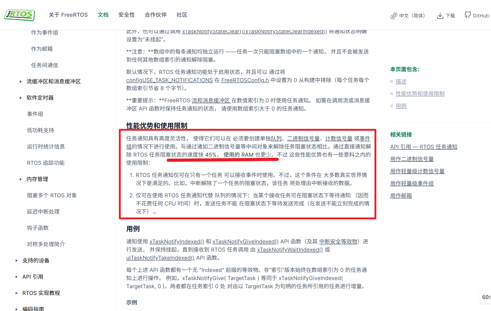

*图2-1任务通知的官方介绍-图*

在 FreeRTOS 官方文档中有明确说明，相比使用二值信号量，直达任务通知有两个明显优势：

1. 第一，**执行效率更高**
2. 第二，**系统开销更小，SRAM占用更少**

换句话说：

**如果只是为了完成 “通知某一个任务发生了一件事情” 这样的操作，那么使用直达任务通知往往会比二值信号量更加高效。**

可以说：在上面的场景中，直达任务通知可以视为二值信号量的升级版本。

下面来介绍一下FreeRTOS的直达任务通知机制，先来了解一下它的工作原理。

#### 2.1 注意事项

在正式学习使用直达任务通知替代二值信号量之前，我们需要先说明一个客观的事实：

**直达任务通知并不是二值信号量的完全替代方案。**

更准确地说：

**直达任务通知是在“只有一个任务等待通知”的情况下，对二值信号量的一种性能优化实现。**

二值信号量可以做到：

同一个事件同时通知多个任务。

使用二值信号量，只要一个任务想要接收通知，那么它都可以调用：

```c
xSemaphoreTake(BinarySem, portMAX_DELAY);
```

多个任务，都可以同时等待一个通知，等待同一个二值信号量的释放。

而直达任务通知则不同：

**直达任务通知发送的通知，是直接面向某个任务的直接通知，不能一次性通知多个任务！（官方叫它直接任务通知）**

不过在实际嵌入式系统中：

同一个事件同时唤醒多个任务的场景其实非常少见。

因此在多数情况下，直达任务通知都可以作为二值信号量的轻量级替代方案来使用。

也就是说：

如果后面你听到有人说“直达任务通知是二值信号量的升级版”，你心里要清楚，这句话是“对也不对”。

#### 2.2 直达任务通知的工作原理

直达任务通知，是一种较晚（大约2015年）才引入FreeRTOS的任务间通信机制。

在上面的描述中，我们知道：

直达任务通知相比较于二值信号量，有**执行效率更高、资源开销更低**的优势，可谓是“全方面遥遥领先”。

那为什么直达任务通知有这样的全面优势呢？

其实原因非常简单：

**直达任务通知并不依赖一个独立的内核对象。**

我们前面学习消息队列、信号量的时候，都有一个共同特点：

这些机制在使用之前，都需要**先创建对象**。

例如：

1. 创建消息队列需要调用xQueueCreate()
2. 创建二值信号量需要调用xSemaphoreCreateBinary()

也就是说，这些通信机制本质上都需要**额外创建一个内核对象**。

而这些对象在 FreeRTOS 内部，其实都是通过**消息队列（Queue）结构**实现的。

因此在使用这些机制时，内核需要：

1. 为对象**分配内存空间**
2. 维护**队列控制结构体**
3. 管理**等待该对象的任务列表**

这些操作都会带来一定的时间开销和内存开销。

但你可以仔细想一想：

如果仅仅是面向单一任务发通知，再去创建一个消息队列对象，管理它，这些操作还是太“重量级”了。

**直达任务通知的设计思路完全不同。**

**FreeRTOS 在设计任务控制块（TCB）的时候，专门为每一个任务预留了一块直达任务通知相关的成员变量。**

换句话说：

**每一个任务在创建的时候，就已经自带了直达任务通知机制。**

##### 2.2.1 TCB中直达任务通知相关成员

在FreeRTOS中若想要使用直达任务通知机制，让任务创建时预留相关成员变量，则需要开启相应宏：

```c
#define configUSE_TASK_NOTIFICATIONS 1 // 配置使用直达任务通知机制，TCB中会存储相应成员
```

**直达任务通知机制，在FreeRTOS中是默认开启的**，如下图所示：

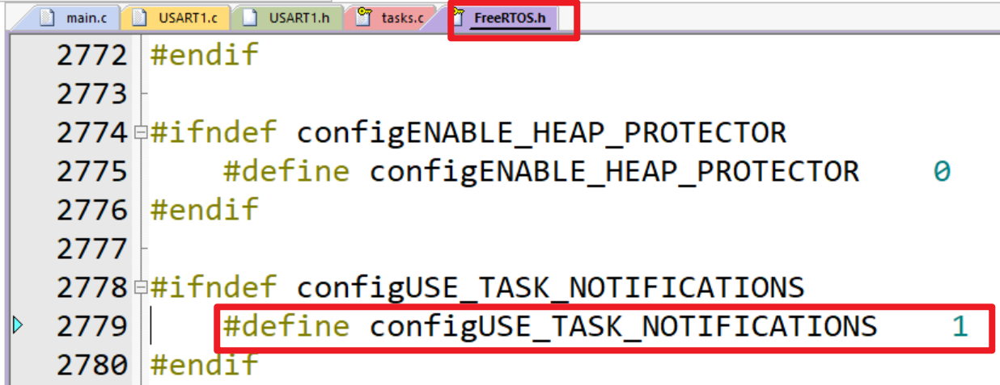

*图2.2.1-1默认开启直达任务通知-图*

**TCB结构体中，这两个核心的成员是：**

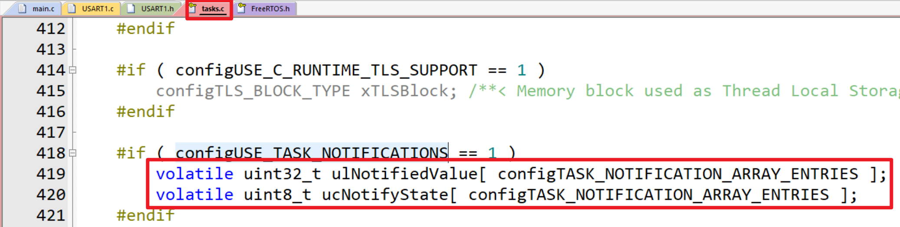

*图2.2.1-2直达任务通知相关成员-图*

注意表面上看，这是两个数组，但实际上它们是两个无符号4字节的整型变量。

这是因为两个数组长度的宏，其取值都是1，如下图所示：

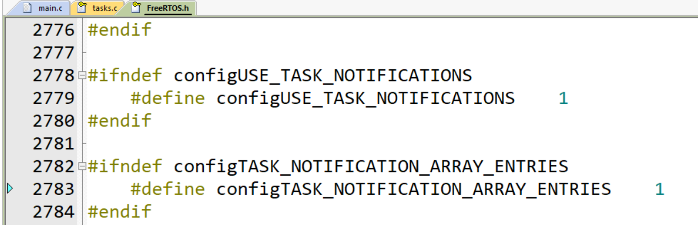

*图2.2.1-3直达任务通知相关成员-图2*

**这两个无符号4字节的整型成员变量，正是直达任务通知机制的核心实现基础。**

其中：

1. ulNotifiedValue用于保存**通知值**，也可以叫做通知计数值。
2. ucNotifyState用于记录**通知状态**

因此，当任务之间使用直达任务通知进行通信时：

1. 不需要创建额外对象
2. 不需要额外分配内存
3. 不需要维护额外的队列结构

直达任务通知实际上只是：

直接修改目标任务 TCB 中的通知状态和通知值。

也就是说：

一个任务想要通知另外一个任务，本质上只是做了这样几件事情：

1. 找到目标任务的**TCB**
2. 修改该任务的**通知值**
3. 将该任务从**阻塞态移动到就绪态**

整个过程非常直接，中间没有复杂的中间结构。

这也正是为什么直达任务通知会比信号量和队列执行路径更短、效率更高的原因。

简单来说可以这样理解：

**消息队列、信号量这类机制的结构是：任务/中断 → 消息队列/信号量对象 → 任务而直达任务通知则是：任务/中断 → 任务**中间少了一层**内核对象的管理开销**。

因此，在很多只需要**向单一任务发事件通知**的简单场景中，直达任务通知往往是一个更优的选择。

##### 2.2.2 ucNotifyState：通知状态的作用

首先，我们需要知道这两个成员在**TCB 创建之后的初始默认值**。

FreeRTOS内核创建任务的函数源码如下：

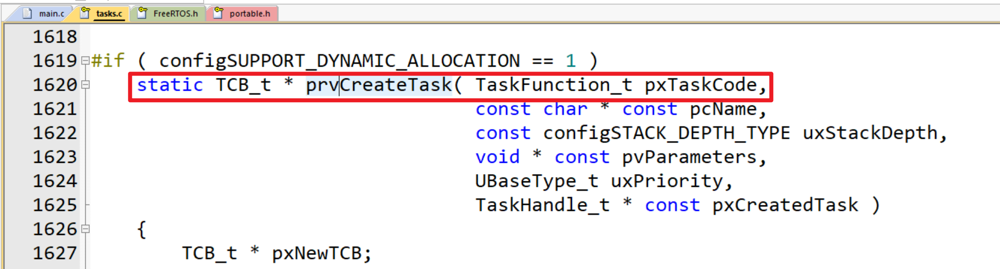

*图2.2.2-1FreeRTOS内核创建任务源码-图*

实际上在该函数内部，包括函数pvPortMallocStack()中，都找不到**单独初始化这两个成员变量**的代码。

原因是：

在申请到TCB_t内存之后，FreeRTOS 会对整个结构体进行**统一清零处理**：

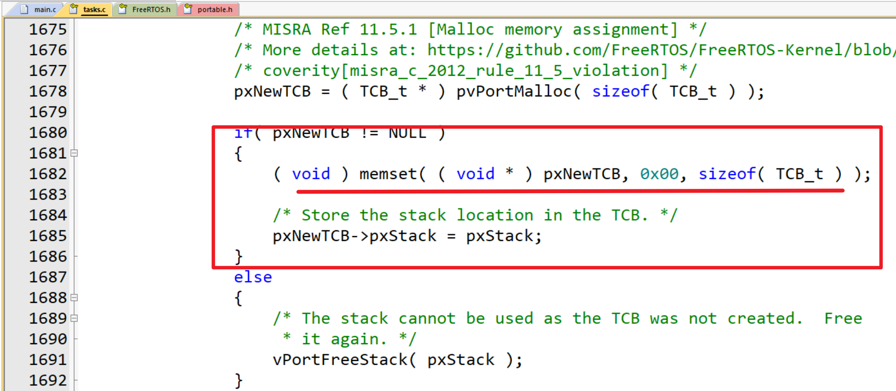

*图2.2.2-2FreeRTOS内核创建任务源码-图2*

也就是说：

**TCB 结构体中的所有成员，在任务创建时默认都会被初始化为 0。**

因此可以得到：

1. **ulNotifiedValue**是一个 4 字节无符号整型，初始值为**0**
2. **ucNotifyState**是一个 1 字节无符号整型，初始值同样为**0**

**接下来我们先来看一下 ucNotifyState 成员，也就是通知状态成员的作用。**

当直达任务通知被当作**二值信号量**使用时，也就是：

向单一任务发送通知，用于任务同步这种情况下，系统实际上只关心一个问题：

该任务是否已经收到通知。

因此此时主要依赖**ucNotifyState**来记录通知状态，而通常并不关心**ulNotifiedValue**的具体数值。

**ucNotifyState 成员用于记录任务当前的通知状态。**

在 FreeRTOS 内核中，这个成员的标准取值是下列三个宏定义：

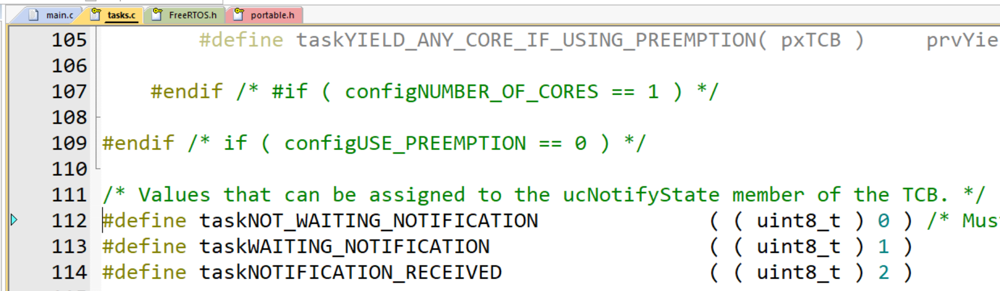

*图2.2.2-3ucNotifyState标准取值-图*

具体来说，如下表格所示：

| 对应整数值 | 宏 | 含义 | 备注 |
|---|---|---|---|
| 0 | taskNOT_WAITING_NOTIFICATION | 当前任务没有等待通知 | 必须是0，因为该取值依赖初始化内存为0值 |
| 1 | taskWAITING_NOTIFICATION | 当前任务正在等待通知 | 正在等待通知的任务会进入阻塞态，放弃CPU |
| 2 | taskNOTIFICATION_RECEIVED | 当前任务已经收到通知 | 如果任务在阻塞等待通知，那么它会被唤醒 |

**任务创建完成之后，ucNotifyState 的默认值是 0，也就是taskNOT_WAITING_NOTIFICATION。**

这表示：当前任务既没有等待通知，也没有收到通知。

**当任务调用等待通知函数，而且当前还没有通知到达，那么内核会：**

1. 将ucNotifyState设置为taskWAITING_NOTIFICATION
2. 随后让当前任务进入**阻塞状态**，表示该任务正处于等待通知的阻塞状态。
3. 等待其他任务或者中断发送通知

**当其他任务或者中断发送通知时，FreeRTOS 内核就会：**

1. 将任务的ucNotifyState设置为：taskNOTIFICATION_RECEIVED
2. 表示该任务**已经收到通知**。
3. 如果此时任务正处于等待通知的阻塞状态，内核就会把该任务从**阻塞态移动到就绪态**，任务随后就可以继续执行。

因此可以理解为：

ucNotifyState本质上是一个**直达任务通知状态标志**，用于记录任务：

1. 是否正在等待通知
2. 是否已经收到通知

**FreeRTOS 内核正是通过这个状态变量，来判断任务是否需要进入阻塞或者被唤醒执行。**

##### 2.2.3 ulNotifiedValue：通知值的作用

ulNotifiedValue用于保存**通知值**，也会叫通知计数值。

也就是说，利用直达任务通知发通知的同时，还可以“顺手”发一个通知值。

当然，如果把直达任务通知当成**“轻量版二值信号量“**使用，那么这个通知值的作用并不大。

关于它的具体作用，我们放到后面再讲。

#### 2.3 直达任务通知作为信号量使用的相关操作 API

如果只是使用**直达任务通知实现任务同步（替代二值信号量）**，实际上常用的 API 只有三个：

```c
xTaskNotifyGive()
vTaskNotifyGiveFromISR()
ulTaskNotifyTake()
```

又看到了**Give**和**Take**这两个单词，它们的含义其实和**二值信号量中的 Give / Take 完全一致**：

1. **Give**表示发送直达任务通知，相当于产生一个事件信号。
2. **Take**表示等待接收直达任务通知，如果当前没有通知，任务会进入**阻塞状态**，直到通知到来（前提是会等待阻塞）。

因此，从使用方式上来看，可以把直达任务通知理解为一种**“轻量级二值信号量”**。

下面来详细介绍一下这三个API。

##### 2.3.1 xTaskNotifyGive()：向某个任务发送通知并将通知值加1

函数原型：

```c
BaseType_t xTaskNotifyGive(TaskHandle_t xTaskToNotify);
```

作用：向**指定任务发送一个通知信号**。

**其唯一的参数，通过传参一个任务句柄，指定需要接收通知的任务。**

从效果上来看，它非常像二值信号量中的：

```c
xSemaphoreGive()
```

但从内部实现上来看，它并不是“释放一个信号量对象”，而是：**直接修改目标任务 TCB 中的通知相关成员。**

xTaskNotifyGive()的核心作用可以概括成一句话：

**向指定任务发送一次通知，并将该任务的通知值加 1。**

也就是说，它至少做了两件事：

1. 修改目标任务的通知状态，将 ucNotifyState 成员的取值改为 taskNOTIFICATION_RECEIVED，表示这个任务已经收到通知了。

2. 修改目标任务的通知值，将ulNotifiedValue 成员的取值进行自增1。

需要注意的是，任务在收到通知之前可以处于两种不同的状态：

1. taskNOT_WAITING_NOTIFICATION（任务没有等待接收通知）
2. taskWAITING_NOTIFICATION（任务在等待接收通知）

这说明：

**直达任务通知不一定非要“先等后发”，也可以“先发后等”：**

1. 如果任务在接收通知之前，处于等待接收通知的状态，那么此任务会从阻塞态被唤醒，进入就绪态。
2. 如果目标任务没有等待通知，没有阻塞等待，那么任务会在下一次调用接收通知函数时获取该通知，通知并不会丢失。

特别需要注意的是：

1. 每调用xTaskNotifyGive()函数1次，发送1次通知，通知值都会累加一次。
2. 但如果把直达任务通知作为二值信号量来使用，这个通知值通常没有太大的意义。

**函数的返回值：**

此函数的返回值有两个：pdPASS和pdFAIL，用于指示通知发送是否成功。

但这个函数发送通知几乎不会失败，所以不需要接收函数的返回值并判断。

##### 2.3.2 ulTaskNotifyTake()：当前任务尝试接收通知

函数原型如下：

```c
uint32_t ulTaskNotifyTake(
    BaseType_t xClearCountOnExit, // 函数返回时，直达任务通知值如何处理
    TickType_t xTicksToWait // 最大阻塞等待时间
);
```

个函数的作用是：当前任务主动去等待接收一个通知，并在接收到通知后返回通知。

它的行为可以简单理解为：

直达任务通知里的 xTaskNotifyTake()≈二值信号量中的 xSemaphoreTake()也就是说：

1. 如果当前还没有收到通知，那么任务可以进入**阻塞状态**
2. 如果已经有通知了，那么任务就会立即取走通知，返回通知值，并继续运行。

具体到行为：

如果此时任务还没有收到通知，那么内核会做两件事：

1. 把当前任务的ucNotifyState设为taskWAITING_NOTIFICATION （等待接收通知）
2. 如果允许阻塞等待，就让任务进入阻塞态

如果调用ulTaskNotifyTake()时，通知本身已经到了：

1. ucNotifyState 成员的取值本身就是taskNOTIFICATION_RECEIVED
2. 那么当前任务就不会阻塞，而是直接收到通知。
3. 调用此函数会直接返回结果，也就是返回通知值（处理之前的）。
4. **当然无论是哪种模式，处理完通知之后都会将 ucNotifyState 设为taskWAITING_NOTIFICATION（等待接收通知）。**

下面介绍一下函数的形参和返回值。

**参数1：xClearCountOnExit**

```c
BaseType_t xClearCountOnExit
```

这个参数用于决定：

这个参数用于决定：**任务成功取到通知后，通知值（成员ulNotifiedValue）如何处理。**

如果传参为：pdTRUE表示：

取到通知后，直接把通知值（ulNotifiedValue）清零，这更像二值信号量的行为。

因为在作为二值信号量使用时，ulNotifiedValue通知值只是作为一个计数器，记录发送了几次通知。

现在任务已经收到了通知，那就不管之前被通知了几次，直接归零即可。

类比一下：

你妈喊你吃饭，喊了你好几次最终你去吃饭了如果只把直达任务通知当通知使用，只要响应了通知，通知值计数就可以归零。

如果传参为：pdFALSE表示：**取到通知后，只把通知值减 1，即把ulNotifiedValue的取值自减1。**

如果是把直达任务通知当成二值信号量使用，建议的传参是：pdTRUE 。

**参数2：xTicksToWait**此传参用于表示任务等待通知时，最大等待阻塞时间。

该参数我们已经非常熟悉了，不再赘述。

**函数的返回值：**

函数的返回值类型是一个4字节无符号整型：uint32_t 类型该函数的返回值表示：**接收通知之前**，当前任务的通知计数值。

返回值可能有两种：

1. 0，表示到达阻塞时间，超时等待，仍然没有接收到通知。接收通知失败。
2. 大于0，表示接收通知时，通知值的原始取值。

**注意，此函数返回之前会修改通知值，但该函数的返回值是通知值的原始值。**

类比一下：

你妈叫你去吃饭，喊了3次。

于是通知计数值就是3你响应了通知，去吃饭，于是这个通知计数值被归0了。

但你仍然知道你妈叫了你3次。

如果把直达任务通知作为二值信号量使用，该函数的返回值就表示对方通知的次数，在这种情况下，此函数的返回值通常没有意义。

##### 2.3.3 xTaskNotifyGiveFromISR()：在中断环境下向某个任务发送通知

vTaskNotifyGiveFromISR()的作用是：**在中断服务函数中向指定任务发送通知。**

函数原型如下：

```c
void vTaskNotifyGiveFromISR(
    TaskHandle_t xTaskToNotify, // 发送通知的任务句柄
    BaseType_t *pxHigherPriorityTaskWoken // 是否需要在ISR结束后，触发高优先级任务切换
);
```

这个函数的行为和xTaskNotifyGive 基本类似，无非换到了在中断环境下发送通知，所以不再赘述。

如果希望在ISR结束后，立刻触发高优先级任务切换，可以采用下面的调用方式：

```c
// 中断环境下
BaseType_t Flag = pdFALSE;
vTaskNotifyGiveFromISR(xx, &Flag);
portYIELD_FROM_ISR(Flag);
```

以上。

#### 2.4 用直达任务通知实现任务同步

在前面的课程中，我们分别使用了：

1. 消息队列
2. 二值信号量

来实现了任务同步的功能。

但在FreeRTOS当中，最合适用于实现“任务同步”功能的机制还是“直达任务通知”。

实现思路是：

1. 使用**直达任务通知**实现三个任务的顺序同步，每个任务先通过ulTaskNotifyTake()阻塞等待自己的执行通知。
2. 程序启动前先通知task1 ，因此task1最先执行。

3. 之后 task1 通知 task2，task2 通知 task3，task3 再通知 task1，从而形成 Task1 -> Task2 -> Task3 -> Task1 的循环执行顺序。

参考实现代码如下：

```c
#include "stm32f10x.h" // STM32F10x 标准外设库头文件

#include "FreeRTOS.h" // FreeRTOS 核心头文件
#include "task.h" // FreeRTOS 任务相关 API

#include "DebugUSART1.h" // 调试串口模块（printf1）

// 三个任务句柄
// 任务通知必须知道要通知哪个任务，所以需要保存任务句柄
static TaskHandle_t Task1Handle = NULL;
static TaskHandle_t Task2Handle = NULL;
static TaskHandle_t Task3Handle = NULL;

// -------------------- 任务1 --------------------
void task1(void *arg) {
    while (1) {
       // 等待任务1的执行通知
       // pdTRUE 表示获取到通知后，将通知值清零
       if (ulTaskNotifyTake(pdTRUE, portMAX_DELAY) > 0) {
           printf1("Task1 \r\n");

           // 仅用于降低串口打印速度，方便观察现象
           // 这个延时不负责控制任务顺序，任务顺序由任务通知控制
           vTaskDelay(1000);

           // 通知任务2执行
           xTaskNotifyGive(Task2Handle);
       }
    }
}

// -------------------- 任务2 --------------------
void task2(void *arg) {
    while (1) {
       // 等待任务2的执行通知
       if (ulTaskNotifyTake(pdTRUE, portMAX_DELAY) > 0) {
           printf1("Task2 \r\n");

           // 仅用于降低串口打印速度，方便观察现象
           // 这个延时不负责控制任务顺序，任务顺序由任务通知控制
           vTaskDelay(1000);

           // 通知任务3执行
           xTaskNotifyGive(Task3Handle);
       }
    }
}

// -------------------- 任务3 --------------------
void task3(void *arg) {
    while (1) {
       // 等待任务3的执行通知
       if (ulTaskNotifyTake(pdTRUE, portMAX_DELAY) > 0) {
           printf1("Task3 \r\n");

           // 仅用于降低串口打印速度，方便观察现象
           // 这个延时不负责控制任务顺序，任务顺序由任务通知控制
           vTaskDelay(1000);

           // 重新通知任务1执行
           xTaskNotifyGive(Task1Handle);
       }
    }
}

int main(void) {
    // 1. 初始化调试串口
    DebugUSART1_Init();

    // 2. 创建任务1
    xTaskCreate(task1,
               "Task1",
               configMINIMAL_STACK_SIZE,
               NULL,
               tskIDLE_PRIORITY + 1,
               &Task1Handle);

    // 3. 创建任务2
    xTaskCreate(task2,
               "Task2",
               configMINIMAL_STACK_SIZE,
               NULL,
               tskIDLE_PRIORITY + 1,
               &Task2Handle);

    // 4. 创建任务3
    xTaskCreate(task3,
               "Task3",
               configMINIMAL_STACK_SIZE,
               NULL,
               tskIDLE_PRIORITY + 1,
               &Task3Handle);

    if ((Task1Handle == NULL) || (Task2Handle == NULL) ||(Task3Handle == NULL)){
       printf1("Task Create Error\r\n");

       while (1) {
       }
    }

    // 5. 先通知任务1
    // 这样调度器启动后，只有任务1能够首先收到通知并执行
    // 任务2、任务3因为没有通知，会阻塞在各自的 ulTaskNotifyTake() 上
    xTaskNotifyGive(Task1Handle);

    // 6. 启动 FreeRTOS 调度器
    vTaskStartScheduler();

    // 理论上不会运行到这里
    while (1) {
    }
}

```

可以看到：

**直达任务通知在实现任务与任务之间的一对一同步上，是最优解、最优选择。**

#### 2.5 直达任务通知实现类似计数信号量的功能

假设存在这样的一个场景：

有一个任务专门处理某类事件，其他任务或中断只需要告诉它：“有事情发生了几次”，但不需要传递复杂数据。

也就是说，**某一个任务**需要做以下事情：

统计记录事件发生次数、资源释放次数、数据到达次数、任务需要处理的次数，然后再执行一些事情。

此时比起计数信号量，直达任务通知，就更适合用于实现这个功能。

参考代码如下：

```c
#include "stm32f10x.h" // STM32F10x 标准外设库头文件

#include "FreeRTOS.h" // FreeRTOS 核心头文件
#include "task.h" // FreeRTOS 任务相关 API
#include "semphr.h" // FreeRTOS 信号量相关 API

#include "DebugUSART1.h" // 调试串口模块（printf1）

// 接收任务句柄
// 发送任务需要通过该句柄，向接收任务发送任务通知
static TaskHandle_t TaskRecvHandle = NULL;

// 串口打印互斥锁
// 防止两个任务同时调用 printf1，造成打印内容交叉
static SemaphoreHandle_t PrintMutex = NULL;

// 带互斥保护的串口打印
#define PRINTF1_LOCKED(...) \
    do { \
       xSemaphoreTake(PrintMutex, portMAX_DELAY); \
       printf1(__VA_ARGS__); \
       xSemaphoreGive(PrintMutex); \
    } while (0)

// -------------------- 任务1：发送通知任务 --------------------
void TaskSend(void *Arg) {
    uint32_t Round = 0;

    while (1) {
       Round++;

       PRINTF1_LOCKED("\r\n[Send] Round %lu Start\r\n", Round);

       // 连续发送 5 次任务通知
       // 每调用一次 xTaskNotifyGive，接收任务的通知值加 1
       for (uint8_t I = 0; I < 5; I++) {
           xTaskNotifyGive(TaskRecvHandle);

           PRINTF1_LOCKED("[Send] Give Notify %u\r\n",
                         (unsigned int)(I + 1));

           // 每隔 2 秒发送一次通知
           vTaskDelay(2000);
       }

       PRINTF1_LOCKED("[Send] Round %lu End\r\n", Round);

       // 每轮发送完成后，间隔 5 秒
       vTaskDelay(5000);
    }
}

// -------------------- 任务2：接收并统计通知任务 --------------------
void TaskRecv(void *Arg) {
    uint32_t NotifyCount = 0;
    const uint32_t TargetCount = 5;

    while (1) {
       PRINTF1_LOCKED("[Recv] Wait Notify...\r\n");

       // 等待任务通知
       // pdTRUE 表示返回当前通知值后，将任务通知值清零
       // portMAX_DELAY 表示没有通知时一直阻塞等待
       uint32_t NotifyValue =
           ulTaskNotifyTake(pdTRUE, portMAX_DELAY);

       // 累加本次收到的通知次数
       NotifyCount += NotifyValue;

       PRINTF1_LOCKED("[Recv] Current Notify = %lu\r\n",
                     NotifyValue);

       PRINTF1_LOCKED("[Recv] Total Notify = %lu\r\n",
                     NotifyCount);

       // 每累计收到 5 次通知，执行一次后续操作
       if (NotifyCount == TargetCount) {
           PRINTF1_LOCKED("[Recv] Working...\r\n");
           PRINTF1_LOCKED("[Recv] Working...\r\n");
           PRINTF1_LOCKED("[Recv] Working...\r\n");
           PRINTF1_LOCKED("[Recv] Working...\r\n");
           PRINTF1_LOCKED("[Recv] Working...\r\n");
           PRINTF1_LOCKED("[Recv] Working...\r\n");
           // 减去已经处理的 5 次通知
           NotifyCount -= TargetCount;
       }

       // 不要在这里主动延时
       // 处理完成后立即重新等待下一次通知
    }
}

int main(void) {
    // 1. 初始化调试串口
    DebugUSART1_Init();

    // 2. 创建串口打印互斥锁
    PrintMutex = xSemaphoreCreateMutex();

    if (PrintMutex == NULL) {
       printf1("PrintMutex Create Failed!\r\n");

       while (1) {
       }
    }

    // 3. 创建接收任务
    // 必须先创建接收任务，获取接收任务的句柄
    xTaskCreate(TaskRecv,
               "TaskRecv",
               configMINIMAL_STACK_SIZE,
               NULL,
               tskIDLE_PRIORITY + 1,
               &TaskRecvHandle);

    if (TaskRecvHandle == NULL) {
       printf1("TaskRecv Create Failed!\r\n");

       while (1) {
       }
    }

    // 4. 创建发送任务
    xTaskCreate(TaskSend,
               "TaskSend",
               configMINIMAL_STACK_SIZE,
               NULL,
               tskIDLE_PRIORITY + 1,
               NULL);

    // 5. 启动 FreeRTOS 调度器
    vTaskStartScheduler();

    // 理论上不会运行到这里
    while (1) {
    }
}

```

所以：

**直达任务通知不仅可以像二值信号量一样表示“有事件发生，收到了通知”，也可以像计数信号量一样累计事件发生次数。**

**当事件只通知一个固定任务处理，并且只需要统计事件发生次数，然后进行处理，而不需要传递复杂数据时，就很适合使用这种直达任务通知。**

#### 2.6 中断中发送直达任务通知

在前面我们已经基于二值信号量，实现了在中断中给任务发通知。

**但实际上在FreeRTOS中，直达任务通知更适合来完成这样的工作。**

直达任务通知本身同样不负责传递具体数据，它更适合表达这样一种含义：

某个事件发生了，然后通知某一个任务立即去处理。

比如我们之前实现的串口中断接收数据的相关“事件”：

消息队列已满，串口中断发送队列失败，系统发生了异常。

因此，我们完全可以这样设计：

1. USART1 中断仍然负责接收串口数据，并尝试把数据发送到消息队列中
2. 如果发送成功，说明一切正常，程序继续运行
3. 如果发送失败，说明消息队列可能已经满了，也就是系统发生了异常情况
4. 此时中断中不直接做复杂处理，而是**通过直达任务通知通知异常处理任务**
5. 随后，由一个更高优先级的异常处理任务去等待该通知
6. 一旦收到通知，说明系统出现了异常，该任务就会被立即唤醒，进行后续处理

这样一来，程序的结构依然非常清晰：

消息队列负责传递正常数据，直达任务通知负责上报异常事件。

也就是说：

**消息队列传数据，直达任务通知传异常事件。**

#### 2.7 用直达任务通知机制通知错误处理任务

下面给出代码示例：

**USART1.h 头文件：**

```c
#ifndef __USART1_H__
#define __USART1_H__

#include "stm32f10x.h"
#include <stdio.h>
#include <stdarg.h>
#include <string.h>

#include "FreeRTOS.h"
#include "queue.h"
#include "task.h"

/* main.c 里创建的队列句柄 */
extern QueueHandle_t UartRxQueue;

/* 异常处理任务句柄 */
extern TaskHandle_t UartErrTaskHandle;

/**
* @brief 初始化串口 USART1
*/
void USART1_Init(void);

/**
* @brief 调试打印函数（串口版 printf）
*/
void printf1(const char *format, ...);

#endif
```

**USART1.c 源文件：**

```c
#include "USART1.h"

/* ================= 内部函数（不对外暴露） ================= */

/**
 * @brief USART1 发送单字节（阻塞式）
 * @note 仅供本文件内部使用
 */
static void DebugUSART1_SendByte(uint8_t Byte) {
    /* 等待发送数据寄存器为空 */
    while (USART_GetFlagStatus(USART1, USART_FLAG_TXE) == RESET);

    USART_SendData(USART1, Byte);
}

/**
 * @brief 初始化 USART1 串口
 */
void USART1_Init(void) {
    RCC_APB2PeriphClockCmd(RCC_APB2Periph_USART1 |RCC_APB2Periph_GPIOA,ENABLE);

    GPIO_InitTypeDef GPIO_InitStructure;

    /* PA9 -> USART1_TX：复用推挽输出 */
    GPIO_InitStructure.GPIO_Mode = GPIO_Mode_AF_PP;
    GPIO_InitStructure.GPIO_Pin = GPIO_Pin_9;
    GPIO_InitStructure.GPIO_Speed = GPIO_Speed_50MHz;
    GPIO_Init(GPIOA, &GPIO_InitStructure);

    /* PA10 -> USART1_RX：上拉输入 */
    GPIO_InitStructure.GPIO_Mode = GPIO_Mode_IPU;
    GPIO_InitStructure.GPIO_Pin = GPIO_Pin_10;
    GPIO_InitStructure.GPIO_Speed = GPIO_Speed_50MHz;
    GPIO_Init(GPIOA, &GPIO_InitStructure);

    /* USART 参数配置：115200, 8N1 */
    USART_InitTypeDef USART_InitStructure;
    USART_InitStructure.USART_BaudRate = 115200;
    USART_InitStructure.USART_HardwareFlowControl =USART_HardwareFlowControl_None;
    USART_InitStructure.USART_Mode = USART_Mode_Tx |USART_Mode_Rx;
    USART_InitStructure.USART_Parity = USART_Parity_No;
    USART_InitStructure.USART_StopBits = USART_StopBits_1;
    USART_InitStructure.USART_WordLength = USART_WordLength_8b;
    USART_Init(USART1, &USART_InitStructure);

    USART_Cmd(USART1, ENABLE);

    /* 开启 USART1 接收中断 */
    USART_ITConfig(USART1, USART_IT_RXNE, ENABLE);

    NVIC_InitTypeDef NVIC_InitStructure;
    NVIC_InitStructure.NVIC_IRQChannel = USART1_IRQn;

    /*
     * 使用 FreeRTOS 时：
     * 中断优先级建议采用分组4
     * 并且用户中断优先级数值不要高于阈值
     * 这里设置为 12
     */
    NVIC_InitStructure.NVIC_IRQChannelPreemptionPriority = 12;
    NVIC_InitStructure.NVIC_IRQChannelSubPriority = 0;
    NVIC_InitStructure.NVIC_IRQChannelCmd = ENABLE;
    NVIC_Init(&NVIC_InitStructure);
}

/**
 * @brief 调试打印函数（串口版 printf）
 * @param format: 格式化字符串
 */
void printf1(const char *format, ...) {
    char buffer[100];
    va_list list;

    va_start(list, format);
    vsprintf(buffer, format, list);
    va_end(list);

    for (uint16_t i = 0; buffer[i] != '\0'; i++) {
       if (buffer[i] == '\n') {
           DebugUSART1_SendByte('\r');
       }

       DebugUSART1_SendByte((uint8_t)buffer[i]);
    }
}

/**
 * @brief USART1中断：收到 1 字节就塞进 FreeRTOS 队列
 */
void USART1_IRQHandler(void) {
    if (USART_GetITStatus(USART1, USART_IT_RXNE) == SET) {
       char ch = (char)USART_ReceiveData(USART1);

       BaseType_t xFlag = pdFALSE;
       BaseType_t Ret = xQueueSendFromISR(UartRxQueue, &ch,&xFlag);

       if (Ret != pdPASS) {
           /* 使用直达任务通知，上报异常事件 */
           if (UartErrTaskHandle != NULL) {
               vTaskNotifyGiveFromISR(UartErrTaskHandle, &xFlag);
           }
       }

       /*
        * 如果 xFlag 被设置为 pdTRUE
        * 则 ISR 退出后会触发任务切换
        */
       portYIELD_FROM_ISR(xFlag);
    }
}
```

**main.c 源文件：**

```c
#include "stm32f10x.h"

#include "FreeRTOS.h"
#include "task.h"
#include "queue.h"

#include "LED.h"
#include "USART1.h"

#define BUFFER_SIZE 20

/* 串口接收消息队列 */
QueueHandle_t UartRxQueue = NULL;

/* 异常处理任务句柄 */
TaskHandle_t UartErrTaskHandle = NULL;

/* -------------------- 任务1：接收并解析串口命令 --------------------*/
void TaskRecv(void *Argument) {
    char Buffer[BUFFER_SIZE] = { 0 };
    uint8_t BufferIndex = 0;

    while (1) {
       char ch;

       /* 无限阻塞等待队列中的串口数据 */
       if (xQueueReceive(UartRxQueue, &ch, portMAX_DELAY) ==pdPASS){
           /* 丢弃换行符 */
           if (ch == '\r' || ch == '\n') {
               continue;
           }

           /* 拼接字符串，始终保证 '\0' 结尾 */
           if (BufferIndex < BUFFER_SIZE - 1) {
               Buffer[BufferIndex++] = ch;
               Buffer[BufferIndex] = '\0';
           } else {
               /*
               * 如果接收过长，超出本地解析缓冲区长度，
               * 多余数据不再继续写入
               */
               Buffer[BUFFER_SIZE - 1] = '\0';
           }

           if (strcmp(Buffer, "OK") == 0) {
               printf1("Light On \n");
               LED_On();

               memset(Buffer, 0, sizeof(Buffer));
               BufferIndex = 0;
           } else if (strcmp(Buffer, "ERROR") == 0) {
               printf1("Light Off \n");
               LED_Off();

               memset(Buffer, 0, sizeof(Buffer));
               BufferIndex = 0;
           }

           /* 非法指令，立即清空 */
           if (BufferIndex > 0 && Buffer[0] != 'O' && Buffer[0]!= 'E'){
               memset(Buffer, 0, sizeof(Buffer));
               BufferIndex = 0;
           }

           /* 超过 ERROR 的长度，也清空 */
           if (BufferIndex > 5) {
               memset(Buffer, 0, sizeof(Buffer));
               BufferIndex = 0;
           }
       }
    }
}

/* -------------------- 任务2：异常处理任务 -------------------- */
void TaskUartError(void *Argument) {
    while (1) {
       /*
        * 阻塞等待异常通知
        * pdTRUE 表示取到通知后自动清零
        */
       ulTaskNotifyTake(pdTRUE, portMAX_DELAY);

       printf1("Error: USART RX Queue Overflow! \n");

       /*
        * 这里可以继续扩展异常处理逻辑，例如：
        * 1. 点亮告警灯
        * 2. 让蜂鸣器工作
        * 3. 记录错误计数
        * 4. 上报系统状态
        */
    }
}

int main(void) {
    NVIC_PriorityGroupConfig(NVIC_PriorityGroup_4);

    LED_Init();
    USART1_Init();

    /* 创建消息队列：长度20，每个元素1字节 */
    UartRxQueue = xQueueCreate(20, sizeof(char));

    if (UartRxQueue == NULL) {
       printf1("Error: UartRxQueue create failed. \n");

       while (1) {}
    }

    /* 创建串口接收解析任务 */
    xTaskCreate(TaskRecv,
               "TaskRecv",
               configMINIMAL_STACK_SIZE + 128,
               NULL,
               tskIDLE_PRIORITY + 1,
               NULL);

    /* 创建高优先级异常处理任务 */
    xTaskCreate(TaskUartError,
               "TaskUartError",
               configMINIMAL_STACK_SIZE + 128,
               NULL,
               tskIDLE_PRIORITY + 2,
               &UartErrTaskHandle);

    vTaskStartScheduler();

    while (1) {}
}
```

至此，我们就在原本 “串口中断 + 消息队列 + 接收任务解析” 的基础上，将原本的“二值信号量异常通知机制”，替换为“直达任务通知异常机制”。

整个程序的运行逻辑，可以概括为：

1. USART1 接收到 1 个字节数据，进入接收中断
2. 中断中尝试将该字节发送到 UartRxQueue 消息队列
3. 如果发送成功，说明系统当前处理能力正常，程序继续按照原来的逻辑运行
4. 如果发送失败，说明消息队列可能已经满了，也就是系统当前出现了异常情况
5. 此时中断中不去直接做复杂处理，而是**通过直达任务通知上报异常**
6. 高优先级任务 TaskUartError 一直阻塞等待该通知
7. 一旦收到通知，说明异常发生，TaskUartError 会被立即唤醒并执行相应处理逻辑

这样写有一个非常明显的好处：

中断中只负责“发现异常并上报异常”，而不负责“详细处理异常”。

同时，相比二值信号量：

**直达任务通知不需要额外创建内核对象，开销更小，效率更高，更适合这种“一对一事件通知”的场景。**

### 3. 直达任务通知替代事件标志组

首先，我们先来聊一下事件标志组。

#### 3.1 什么是事件标志组

**事件标志组是 FreeRTOS 中，用于实现任务同步的一种机制。**

它的核心思想是：

**用一个整数变量中的不同二进制位，表示不同事件是否发生。**

例如：

1. bit0位的 1 表示串口接收完成，反之0则代表没有接收完成
2. bit1位的 1 表示 WiFi 连接成功，反之0则代表没有连接成功
3. ....

每一位都可以看作一个独立的事件标志，当某个事件发生时，就把对应的 bit 置 1。

任务可以等待某一个 bit，也可以同时等待多个 bit。

例如：

1. 等待bit0置位，表示串口接收完成；
2. 等待bit1置位，表示 WiFi 连接成功；
3. 同时等待bit0和bit1都置位，表示两个条件都满足；
4. 等待bit0 、bit1 、bit2中任意一个置位，表示只要有一个事件发生就继续执行。

所以，事件标志组比较适合描述这种场景：

**一个任务需要等待多个事件中的某一个事件发生，或者等待多个事件全部发生后再继续执行。**

它和二值信号量的区别是：

二值信号量通常只表示一个事件是否发生，而事件标志组可以用多个 bit 同时表示多个事件。

简单来说：

**事件标志组就是用一个变量中的多个二进制位，统一管理多个事件状态，实际上就是一种位图的设计。**

比如可以这样理解：

```c
EventGroup = 0000 0000
             |||| ||||
             |||| |||+-- 事件0
             |||| ||+--- 事件1
             |||| |+---- 事件2
             |||| +----- 事件3
```

当事件0和事件2发生后，事件标志组可能变成：

```c
EventGroup = 0000 0101
```

也就是：

```c
bit0 = 1
bit2 = 1
```

这就表示：事件0和事件2已经发生。

事件标志组的创建，基于函数：xEventGroupCreate ，你可以自行阅读一下此函数的源码，了解一下其中位图的设计。

#### 3.2 事件标志组的经典使用场景

在实际工程中，**事件标志组**也是一种常见的任务间通信机制。

它适合用于这种场景：

**系统中存在多个不同事件，而某一个任务需要集中等待并处理这些事件。**

**例如，在一个 FreeRTOS 工程中，可以创建一个专门的错误处理任务或告警处理任务。**

这个任务平时处于阻塞状态，不主动占用 CPU。

当其他任务检测到异常时，就把事件标志组中对应的 bit 位置 1。

例如：

1. bit0 ：串口接收队列溢出
2. bit1 ：WiFi 连接失败
3. bit2 ：传感器读取异常
4. bit3 ：数据上传失败
5. ....

这样，多个任务就可以把不同类型的异常事件，统一上报给同一个错误处理任务。

错误处理任务被唤醒后，只需要判断哪些 bit 被置位，就可以知道发生了哪些异常，然后执行对应的处理逻辑。

例如：

1. 串口接收队列溢出：清空接收缓存，打印错误信息。
2. WiFi 连接失败：尝试重新连接网络。
3. 传感器读取异常：重新初始化传感器。
4. 数据上传失败：暂存数据，等待网络恢复后重新上传。
5. ...

事件标志组的优势在于：

**一个事件标志组可以用多个 bit 位同时表示多个事件。**

例如：

1. 0000 0001 表示 bit0 事件发生
2. 0000 0010 表示 bit1 事件发生
3. 0000 0100 表示 bit2 事件发生
4. 0000 0101 表示 bit0 和 bit2 同时发生

因此，事件标志组不仅能表示单个事件，也能表示多个事件同时发生。

总结来说：

**事件标志组适合用于“多个事件、统一等待、集中处理”的场景。**

**常见用途包括：错误处理任务、告警处理任务、状态管理任务、网络连接管理任务。**

#### 3.3 直达任务通知为什么可以替代事件标志组

事件标志组的本质是：

###### 用一个变量中的不同bit位，表示不同事件是否发生。

例如：

1. 00000001表示bit0事件发生
2. 00000010表示bit1事件发生
3. 00000100表示bit2事件发生
4. 00000101表示bit0和bit2同时发生

某个事件发生时，就把对应的 bit 位置 1。

任务被唤醒后，再判断哪些 bit 被置位，从而执行不同的处理逻辑。

**直达任务通知也有一个通知值。**

这个通知值本质上是一个uint32_t类型的数据。

所以，我们也可以把通知值中的不同 bit 位，当作不同事件标志来使用。

例如：

1. 00000001表示bit0事件发生
2. 00000010表示bit1事件发生
3. 00000100表示bit2事件发生
4. 00000101表示bit0和bit2同时发生

这样一来，其他任务只需要向错误处理任务发送通知，并设置对应 bit 位。错误处理任务收到通知后，读取通知值，再判断具体发生了哪些事件。

因此，在**一个任务集中处理多个事件**的场景下，直达任务通知就可以替代事件标志组。

直达任务通知的优势是：

1. 不需要额外创建事件标志组对象。
2. 资源开销更小，执行效率更高。
3. 更适合一对一的事件通知。

但是特别要注意的是：

如果多个任务都要等待同一个或多个事件，或者一个事件或多个事件要广播给多个任务，事件标志组还是更合适一些。

总结：

**当多个事件最终都只需要通知同一个任务处理时，就可以用直达任务通知替代事件标志组。**

#### 3.4 扩展：直达任务通知能够替代其余通信机制的前提

学到这里，我们已经看到：

1. 直达任务通知可以取代二值信号量，用于任务同步。
2. 直达任务通知可以取代计数信号量，用于累计事件发生次数。
3. 直达任务通知可以取代事件标志组，用于等待和处理多个事件。

之所以可以这样使用，是因为直达任务通知本身具备：

1. 阻塞等待能力
2. 任务唤醒能力
3. 通知值计数能力
4. 通知值按 bit 位操作的能力

并且，直达任务通知不需要额外创建信号量、队列或事件标志组对象，而是直接使用目标任务 TCB 内部自带的通知值。

因此，它的资源开销更小，执行效率也更高。

但是需要注意：

**直达任务通知不能无条件替代所有通信机制。**

它能够替代其他机制，有一个重要前提：

**接收通知的任务必须是明确的、固定的、唯一的。**

也就是说，直达任务通知更适合这种通信关系：

多个任务或中断 ---> 一个固定任务例如，系统中有一个专门的ErrorTask用于处理错误事件。

其他任务发现错误后，都可以直接通知ErrorTask ，并通过不同的通知值或 bit 位表示不同错误类型。

这种情况下，直达任务通知就很适合替代事件标志组。

但是，如果多个任务都要等待同一个事件，或者一个事件发生后要同时唤醒多个任务，那么事件标志组会更加合适。

同理，如果多个任务需要竞争同一个共享资源，那么应该优先考虑互斥锁或信号量，而不是直达任务通知。

总结来说：

**当通信关系是“一对一”，并且传递内容比较简单时，直达任务通知可以作为二值信号量、计数信号量、事件标志组等机制的轻量级替代方案。**

**如果通信关系是“一对多”“多对多”，或者需要传递复杂数据，就不应该盲目使用直达任务通知替代其他机制。**

#### 3.5 直达任务通知作为事件标志组使用时的API

如果使用直达任务通知实现多事件等待处理，也就是让它替代事件标志组，那么常用的API 主要是这三个：

```c
xTaskNotify()
xTaskNotifyWait()
xTaskNotifyFromISR()
```

这三个 API 的作用，和前面Give/Take那组函数不同。

Give/Take更适合把直达任务通知当作**二值信号量或计数信号量**使用。

**而这里这组 API，更适合把直达任务通知的通知值当作一个事件标志位集合使用。**

也就是说：

通知值中的不同 bit 位，可以表示不同的事件。

例如：

1. 00000001表示bit0事件发生
2. 00000010表示bit1事件发生
3. 00000100表示bit2事件发生
4. 00000101表示bit0和bit2同时发生

因此，在这种用法下，直达任务通知就不再只是表示“有没有通知”，而是可以表示“哪些事件发生了”。

##### 3.5.1 xTaskNotify()：向某个任务发送通知并按指定方式修改通知值

函数原型：

```c
BaseType_t xTaskNotify(TaskHandle_t xTaskToNotify, // 需要通知任务的任务句柄
                     uint32_t ulValue, // 本次通知操作携带的通知值，但具体如何设置目标任务的通知值成员，还要看第三个参数
                     eNotifyAction eAction); // 任务收到通知值后如何处理
```

**作用：**

向指定任务发送一次直达任务通知，并根据eAction参数修改该任务的通知值。

它比xTaskNotifyGive()更灵活。

xTaskNotifyGive()只能让通知值加 1，而xTaskNotify()可以按照不同方式操作通知值。

**第一个参数：**

```c
TaskHandle_t xTaskToNotify
```

表示要通知哪个任务。

**第二个参数：**

```c
uint32_t ulValue
```

表示本次通知携带的值。

这个值具体怎么使用，取决于第三个参数eAction 。

**第三个参数：**

```c
eNotifyAction eAction
```

表示如何修改目标任务存储的通知值。

常见取值如下：

1. eNoAction ，只发送通知，不修改目标任务存储通知值。
2. eSetBits ，将ulValue指定的 bit 位设置到目标任务通知值中，我们希望直达任务通知作为事件标志组使用，通常就需要传这个参数取值。
3. eIncrement ，将目标任务的通知值加 1。效果类似于：

xTaskNotifyGive(ErrorTaskHandle);

4. eSetValueWithOverwrite ，直接把目标任务的通知值设置为ulValue ，即使原来有未处理通知，也会覆盖。
5. eSetValueWithoutOverwrite ，这个传参比较特殊，也比较复杂：
   - a. 使用这种方式，意味着只有目标任务当前没有未处理通知时，才会写入ulValue ，
   - b. 如果已经有未处理通知，则本次通知失败。
   - c. 也就是说，只要当目标任务存储的通知值没有任何一位置位时，才会将ulValue 覆盖写入目标任务。

**返回值：**

返回值只有两种情况：

1. pdPASS
2. pdFAIL

通常情况下，都会返回pdPASS ，表示通知成功完成了。

当使用 eSetValueWithoutOverwrite 时，如果目标任务已经有未处理通知，则会返回 pdFAIL。

如果要用直达任务通知替代事件标志组，最常用的是：

```c
xTaskNotify(ErrorTaskHandle, ERROR_UART_RX_OVERFLOW, eSetBits);
```

这表示：

**向任务ErrorTask 发送通知，并把通知值中对应的错误 bit 位置 1。**

##### 3.5.2 xTaskNotifyWait()：等待任务通知并读取通知值

函数原型：

```c
BaseType_t xTaskNotifyWait(uint32_t ulBitsToClearOnEntry, // 当前任务进入等待通知状态前，需要清除通知值中的哪些bit位
                         uint32_t ulBitsToClearOnExit, // 当前任务收到通知退出等待后，要清除通知值中的哪些bit位
                         uint32_t *pulNotificationValue, // 用于保存当前任务TCB记录的通知值，先记录再按照参数2清除
                         TickType_t xTicksToWait); // 等待通知的最大阻塞时间
```

**作用：**

**xTaskNotifyWait() 用于等待当前任务收到直达任务通知，并读取当前任务 TCB 中保存的通知值。**

1. 如果当前任务已经收到了通知，函数会直接读取通知值，不一定进入阻塞状态。

（任务通知状态为已收到通知，则不会进入阻塞态）

2. 如果当前任务还没有收到通知，则任务可以进入阻塞状态，等待通知到来。
3. 如果在指定时间内收到了通知，函数返回pdTRUE 。
4. 如果等待超时仍然没有收到通知，函数返回pdFALSE 。

需要注意：

**通知值保存在被通知任务自己的 TCB 中。**

其他任务调用xTaskNotify()或xTaskNotifyFromISR()时，本质上是修改目标任务 TCB 中的通知值。

因此，xTaskNotifyWait()读取到的通知值，是**当前正在调用该函数的任务自己的通知值**，不是发送方任务中的变量。

**第一个参数：**

```c
uint32_t ulBitsToClearOnEntry
```

表示当前任务在进入等待通知状态前，要先清除当前任务 TCB 通知值中的哪些 bit 位。

如果不需要在进入等待状态前清除任何 bit 位，通常写：

```c
0
```

这是最常见的传参形式，**进入等待通知状态前，不主动清除任何通知位。**

**第二个参数：**

```c
uint32_t ulBitsToClearOnExit
```

表示当前任务成功收到通知，并准备从xTaskNotifyWait()返回前，要清除当前任务TCB 通知值中的哪些 bit 位。

如果希望读取完通知值后，把所有 bit 位都清除，通常写：

```c
0xFFFFFFFF
```

这样做的含义是：

**本次通知值已经被读取并保存到变量中，随后将任务 TCB 中的通知值清零，避免同一个事件被重复处理。**

需要注意：

函数内部会先把当前任务 TCB 中的通知值保存到pulNotificationValue指向的变量中，然后再按照ulBitsToClearOnExit清除通知值。

也就是说，虽然这么传参，函数会在返回前清除当前任务 TCB 中的通知值，但是NotifyValue中仍然保存着本次读取到的通知值。

**第三个参数：**

```c
uint32_t *pulNotificationValue
```

用于保存读取到的通知值。**注意，它是从当前任务TCB中，将通知值读取出来！**

例如：

```c
// 通常用一个局部变量来保存读到的通知值
uint32_t NotifyValue = 0;
```

然后传入：

```c
&NotifyValue
```

函数返回后，NotifyValue中就保存了本次读取到的通知值。

**第四个参数：**

```c
TickType_t xTicksToWait
```

表示等待通知的最大时间。

常见写法：

```c
portMAX_DELAY
```

表示如果没有通知，就一直阻塞等待。

**返回值：**

返回值只有两种情况：

1. pdTRUE ：成功等到了任务通知。
2. pdFALSE ：等待超时，没有等到任务通知。

如果要用直达任务通知替代事件标志组，最常见的写法是：

```c
// 错误处理等被通知任务的入口函数中
uint32_t NotifyValue = 0;

if (xTaskNotifyWait(0,
                  0xFFFFFFFF,
                  &NotifyValue,
                  portMAX_DELAY) == pdTRUE) {
    if (NotifyValue & ERROR_UART_RX_OVERFLOW) {
       printf1("UART RX Queue Overflow\r\n");
    }

    if (NotifyValue & ERROR_WIFI_CONNECT_FAIL) {
       printf1("WiFi Connect Fail\r\n");
    }
}
```

这段代码的含义是：

1. 当前任务进入等待通知前，不主动清除任何通知位。
2. 当前任务等待其他任务或中断发送任务通知。
3. 当通知到来后，函数把当前任务 TCB 中的通知值保存到NotifyValue中。
4. 保存完成后，函数按照第二个参数0xFFFFFFFF ，清除当前任务 TCB 中的所有通知位。
5. 函数返回pdTRUE 。
6. 程序根据NotifyValue中不同的 bit 位，判断发生了哪些事件。

总结来说：

**xTaskNotifyWait() 的核心作用是：等待任务通知，并读取当前任务的通知值。**

当它配合xTaskNotify(...,eSetBits)使用时，就可以把直达任务通知当作事件标志组来使用。

##### 3.5.3 xTaskNotifyFromISR()：在中断中向某个任务发送通知并设置事件位

函数原型：

```c
BaseType_t xTaskNotifyFromISR(TaskHandle_t xTaskToNotify,//需要通知任务的任务句柄
                           uint32_t ulValue,//本次通知携带的通知值
                           eNotifyAction eAction,//任务收到通知后如何处理通知值
                           BaseType_t *pxHigherPriorityTaskWoken); // 是否需要进行任务切换
```

**作用：**

**在中断服务函数中，向指定任务发送一次直达任务通知，并根据 eAction 参数修改该任务的通知值。**

它和xTaskNotify()的作用基本相同，只不过：

xTaskNotify()用在任务中，xTaskNotifyFromISR()用在中断服务函数中。

例如串口接收中断、外部中断、定时器中断中，如果检测到某个事件，就可以通过xTaskNotifyFromISR()通知某个任务处理。

**第一个参数：**

```c
TaskHandle_t xTaskToNotify
```

表示要通知哪个任务。

**第二个参数：**

```c
uint32_t ulValue
```

表示本次通知携带的值。

如果配合eSetBits使用，这个参数通常表示要设置的事件位。

**第三个参数：**

```c
eNotifyAction eAction
```

表示如何修改目标任务的通知值。

如果要把直达任务通知作为事件标志组使用，通常传：

```c
eSetBits
```

表示把ulValue对应的 bit 位设置到目标任务的通知值中。

**第四个参数：**

```c
BaseType_t *pxHigherPriorityTaskWoken
```

这个参数用于判断：

**这次通知是否唤醒了一个更高优先级的任务。**

在中断服务函数中，通常这样写：

```c
BaseType_t xHigherPriorityTaskWoken = pdFALSE;

xTaskNotifyFromISR(ErrorTaskHandle,
                 ERROR_UART_RX_OVERFLOW,
                 eSetBits,
                 &xHigherPriorityTaskWoken);

portYIELD_FROM_ISR(xHigherPriorityTaskWoken);
```

如果这次通知唤醒了一个比当前正在运行任务优先级更高的任务，xHigherPriorityTaskWoken会被置为pdTRUE 。

随后调用：

```c
portYIELD_FROM_ISR(xHigherPriorityTaskWoken);
```

用于在中断退出时触发一次任务切换。

**返回值：**

返回值只有两种情况：

```c
pdPASS
pdFAIL
```

通常情况下返回pdPASS 。

当使用eSetValueWithoutOverwrite时，如果目标任务已经有未处理通知，则可能返回pdFAIL 。

**如果要在中断中用直达任务通知替代事件标志组，常见写法是：**

```c
void USART1_IRQHandler(void) {
    BaseType_t xHigherPriorityTaskWoken = pdFALSE;

    // 假设这里检测到串口接收队列溢出
    xTaskNotifyFromISR(ErrorTaskHandle,
                     ERROR_UART_RX_OVERFLOW,
                     eSetBits,
                     &xHigherPriorityTaskWoken);

    portYIELD_FROM_ISR(xHigherPriorityTaskWoken);
}
```

这表示：

在中断中向ErrorTask发送通知，并把通知值中对应的错误 bit 位置 1。

总结来说：

**xTaskNotifyFromISR() 是 xTaskNotify() 的中断版本。**

当事件发生在中断服务函数中时，就应该使用xTaskNotifyFromISR() ，而不是直接使用xTaskNotify() 。

#### 3.6 实际场景与代码示例

在实际工程中，可以创建一个专门的**ErrorTask**，用于统一处理系统中的各种错误事件。

其他任务一旦检测到异常错误，不需要自己完成复杂的错误处理，只需要通过**直达任务通知**把错误类型上报给ErrorTask 。

这里使用通知值中的不同 bit 位表示不同错误类型：

1. bit0 ：串口接收队列溢出
2. bit1 ：WiFi 连接失败
3. bit2 ：传感器读取异常
4. bit3 ：数据上传失败

**在代码设计上，非常建议使用枚举类型来定义这些错误标志位。**

这样做的好处是：

1. 代码含义更加清晰。
2. 后续增加错误类型更加方便。
3. 避免在代码中直接写1<<0 、1<<1这类魔法数字。

例如可以这样定义：

```c
// 错误事件标志位枚举类型
typedef enum {
    ERROR_UART_RX_OVERFLOW = 1 << 0, // 串口接收队列溢出
    ERROR_WIFI_CONNECT_FAIL = 1 << 1, // WiFi 连接失败
    ERROR_SENSOR_READ_FAIL = 1 << 2, // 传感器读取异常
    ERROR_DATA_UPLOAD_FAIL = 1 << 3 // 数据上传失败
} ErrorEvent_t;
```

当某个任务检测到错误时，就通过xTaskNotify()通知ErrorTask ，并设置对应的bit 位：

```c
xTaskNotify(ErrorTaskHandle, ERROR_UART_RX_OVERFLOW, eSetBits);
```

如果多个任务几乎同时上报不同错误，那么这些 bit 位可以同时被保留下来。

当某个错误发生时，对应任务通过：

```c
xTaskNotify(ErrorTaskHandle, ERROR_xxx, eSetBits);
```

把对应 bit 位置 1。

ErrorTask通过：

```c
xTaskNotifyWait(0, 0xFFFFFFFF, &NotifyValue, portMAX_DELAY);
```

等待错误事件，并读取当前通知值。

然后根据不同 bit 位，执行不同的错误处理逻辑。

参考代码如下：

```c
#include "stm32f10x.h" // STM32F10x 标准外设库头文件

#include "FreeRTOS.h" // FreeRTOS 核心头文件
#include "task.h" // FreeRTOS 任务相关 API

#include "DebugUSART1.h" // 调试串口模块（printf1）

// 错误事件标志位枚举类型
typedef enum {
    ERROR_UART_RX_OVERFLOW = 1 << 0, // 串口接收队列溢出
    ERROR_WIFI_CONNECT_FAIL = 1 << 1, // WiFi 连接失败
    ERROR_SENSOR_READ_FAIL = 1 << 2, // 传感器读取异常
    ERROR_DATA_UPLOAD_FAIL = 1 << 3 // 数据上传失败
} ErrorEvent_t;

// 错误处理任务句柄
static TaskHandle_t ErrorTaskHandle = NULL;

// -------------------- 任务1：串口任务 --------------------
void TaskUart(void *arg) {
    vTaskDelay(1000);
    // 模拟串口接收队列溢出
    printf1("[TaskUart] Report UART RX Queue Overflow\r\n");

    // 向 ErrorTask 上报串口接收队列溢出错误
    xTaskNotify(ErrorTaskHandle, ERROR_UART_RX_OVERFLOW,eSetBits);
    vTaskSuspend(NULL);

    while (1) {
    }
}

// -------------------- 任务2：WiFi任务 --------------------
void TaskWifi(void *arg) {
    vTaskDelay(6000);
    // 模拟 WiFi 连接失败
    printf1("[TaskWifi] Report WiFi Connect Fail\r\n");

    // 向 ErrorTask 上报 WiFi 连接失败错误
    xTaskNotify(ErrorTaskHandle, ERROR_WIFI_CONNECT_FAIL,eSetBits);
    vTaskSuspend(NULL);

    while (1) {
    }
}

// -------------------- 任务3：传感器任务 --------------------
void TaskSensor(void *arg) {
    vTaskDelay(11000);
    // 模拟传感器读取异常
    printf1("[TaskSensor] Report Sensor Read Fail\r\n");

    // 向 ErrorTask 上报传感器读取异常
    xTaskNotify(ErrorTaskHandle, ERROR_SENSOR_READ_FAIL,eSetBits);
    vTaskSuspend(NULL);

    while (1) {
    }
}

// -------------------- 任务4：数据上传任务 --------------------
void TaskUpload(void *arg) {
    vTaskDelay(16000);
    // 模拟数据上传失败
    printf1("[TaskUpload] Report Data Upload Fail\r\n");

    // 向 ErrorTask 上报数据上传失败错误
    xTaskNotify(ErrorTaskHandle, ERROR_DATA_UPLOAD_FAIL,eSetBits);
    vTaskSuspend(NULL);

    while (1) {
    }
}

// -------------------- 任务5：错误处理任务 --------------------
void ErrorTask(void *arg) {
    uint32_t NotifyValue = 0;

    while (1) {
       // 等待错误事件通知
       // 第一个参数为 0，表示进入等待前不清除任何 bit 位
       // 第二个参数为 0xFFFFFFFF，表示退出函数前清除所有 bit 位
       if (xTaskNotifyWait(0,
                          0xFFFFFFFF,
                          &NotifyValue,
                          portMAX_DELAY) == pdTRUE) {

           printf1("\r\n========== ErrorTask ==========\r\n");
           printf1("[ErrorTask] NotifyValue = 0x%08X\r\n", (unsigned int)NotifyValue);

           // 判断是否发生串口接收队列溢出
           if (NotifyValue & ERROR_UART_RX_OVERFLOW) {
               printf1("[ErrorTask] Handle UART RX QueueOverflow\r\n");
           }

           // 判断是否发生 WiFi 连接失败
           if (NotifyValue & ERROR_WIFI_CONNECT_FAIL) {
               printf1("[ErrorTask] Handle WiFi ConnectFail\r\n");
           }

           // 判断是否发生传感器读取异常
           if (NotifyValue & ERROR_SENSOR_READ_FAIL) {
               printf1("[ErrorTask] Handle Sensor ReadFail\r\n");
           }

           // 判断是否发生数据上传失败
           if (NotifyValue & ERROR_DATA_UPLOAD_FAIL) {
               printf1("[ErrorTask] Handle Data UploadFail\r\n");
           }

           printf1("[ErrorTask] Error Handle Finish\r\n");
           printf1("===============================\r\n\r\n");
       }
    }
}

int main(void) {
    // 1. 配置中断优先级分组
    NVIC_PriorityGroupConfig(NVIC_PriorityGroup_4);

    // 2. 初始化调试串口
    DebugUSART1_Init();

    // 3. 创建错误处理任务
    // ErrorTask 优先级更高，便于错误发生后及时响应
    xTaskCreate(ErrorTask,
               "ErrorTask",
               configMINIMAL_STACK_SIZE + 128,
               NULL,
               tskIDLE_PRIORITY + 2,
               &ErrorTaskHandle);

    if (ErrorTaskHandle == NULL) {
       printf1("ErrorTask Create Failed\r\n");

       while (1) {
       }
    }

    // 4. 创建串口任务
    xTaskCreate(TaskUart,
               "TaskUart",
               configMINIMAL_STACK_SIZE,
               NULL,
               tskIDLE_PRIORITY + 1,
               NULL);

    // 5. 创建 WiFi 任务
    xTaskCreate(TaskWifi,
               "TaskWifi",
               configMINIMAL_STACK_SIZE,
               NULL,
               tskIDLE_PRIORITY + 1,
               NULL);

    // 6. 创建传感器任务
    xTaskCreate(TaskSensor,
               "TaskSensor",
               configMINIMAL_STACK_SIZE,
               NULL,
               tskIDLE_PRIORITY + 1,
               NULL);

    // 7. 创建数据上传任务
    xTaskCreate(TaskUpload,
               "TaskUpload",
               configMINIMAL_STACK_SIZE,
               NULL,
               tskIDLE_PRIORITY + 1,
               NULL);

    // 8. 启动 FreeRTOS 调度器
    vTaskStartScheduler();

    // 理论上不会运行到这里
    while (1) {
    }
}

```

错误处理任务的优先级问题：

在实际工程中，错误处理任务通常应设置为比普通业务任务更高的优先级，以便错误发生后能够及时响应。

但如果错误处理逻辑本身比较耗时，就不宜设置得过高，否则可能影响系统中其他实时任务的执行。

当然一切都以实际情况为基准，进行讨论分析，然后做出代码设计。

### 4. 总结

目前，在 FreeRTOS 中，我们已经学习了三类常用的任务间通信机制：

1. **消息队列**
   - a. 用于在任务之间传递数据。
   - b. 适合生产者消费者模型，例如一个任务采集数据，另一个任务处理数据。
2. **信号量**用于任务同步和资源管理。其中：
   - a. 二值信号量常用于事件通知。
   - b. 计数信号量常用于资源计数。
   - c. 互斥信号量常用于保护共享资源，并支持优先级继承。
3. **直达任务通知**
   - a. 用于任务与任务之间的一对一通知。
   - b. 它可以在一定场景下替代二值信号量、计数信号量和事件标志组，具有资源开销小、执行效率高的特点。

因此，在实际工程和学习过程中，我们应优先掌握这三种最常用、最核心的通信方式：

1. **消息队列**
2. **信号量**
3. **直达任务通知**

在选择通信机制时，不应该只追求“功能最强”或“效率最高”，而应该结合具体场景进行选择。

如果需要传递数据，优先考虑**消息队列**。

如果需要任务同步或资源管理，可以考虑**信号量**。

如果只是通知某一个固定任务，并且传递内容比较简单，可以优先考虑**直达任务通知**。

总结来说：

**FreeRTOS 提供了多种任务间通信机制，但在实际开发中，应优先选择简单、清晰、稳定、可维护的通信方式。**

通信机制的选择没有绝对标准，关键是要让程序结构清楚、任务职责明确、系统行为容易分析和调试。

可以，正文统一使用这种引用块格式，章节标题放在引用块外面。下面是按这种格式重新整理后的完整 Markdown 文档。

### 5. 了解：FreeRTOS内核动态内存管理策略

FreeRTOS在创建任务、消息队列、信号量、互斥锁等内核对象时，通常需要为这些对象分配内存。

**在基于动态创建方式时，FreeRTOS内核会使用内核堆空间，为这些内核对象动态分配内存空间。**

为了适应不同的嵌入式系统，FreeRTOS内核源码提供了五种动态内存管理策略，分别对应：

```c
heap_1.c
heap_2.c
heap_3.c
heap_4.c
heap_5.c
```

**我们在进行FreeRTOS移植操作时，需要从上述5个文件中挑选出一个，这个过程其实就是选择FreeRTOS内核动态内存管理策略的过程！**

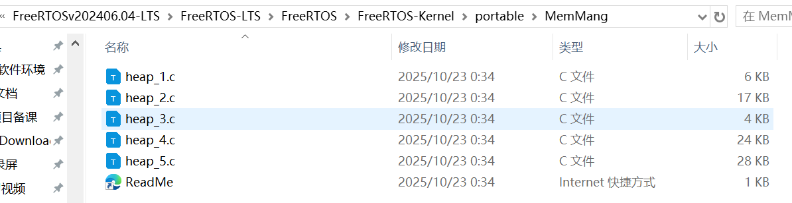

*图5-1FreeRTOS内核动态内存管理策略-图*

这些文件都会实现FreeRTOS统一的动态内存管理接口：

```c
void *pvPortMalloc(size_t xWantedSize);
void vPortFree(void *pv);
```

FreeRTOS内核创建任务、消息队列等对象时，不会直接调用C语言标准库中的malloc() ，而是统一调用pvPortMalloc() 。

至于pvPortMalloc() 内部如何管理内存，则取决于工程中选择了哪一个heap_x.c 文件。

#### 5.1 FreeRTOS内核堆概述

FreeRTOS中的很多内核对象都可以采用动态方式创建，例如：

```c
xTaskCreate();
xQueueCreate();
xSemaphoreCreateBinary();
xSemaphoreCreateMutex();
xEventGroupCreate();
xTimerCreate();
```

这些函数在执行过程中，需要申请一定的内存空间，用于保存对应的内核数据结构。

例如，动态创建一个任务时，需要申请：任务控制块TCB + 任务栈空间动态创建消息队列时，需要申请：消息队列控制块结构 + 消息存储数组区域FreeRTOS将用于动态创建这些内核对象的内存区域称为：**FreeRTOS内核堆**

#### 5.2 FreeRTOS内核堆与C语言库堆

C语言标准库提供的动态内存管理函数为：

```c
malloc();
free();
```

FreeRTOS内核提供的动态内存管理函数为：

```c
pvPortMalloc();
vPortFree();
```

当工程使用heap_1.c 、heap_2.c 或heap_4.c 时，FreeRTOS通常会在内部定义一个数组作为内核堆：

```c
static uint8_t ucHeap[configTOTAL_HEAP_SIZE];
```

内核堆大小由FreeRTOSConfig.h 中的配置项决定：

```c
#define configTOTAL_HEAP_SIZE (10 * 1024)
```

此时，C语言库堆和FreeRTOS内核堆是两块相互独立的内存区域。

只有使用 heap_3.c 时，FreeRTOS 才会直接调用 C 语言标准库中的 malloc() 和 free()，任务、消息队列等内核对象会从 C 语言库堆中申请内存。

#### 5.3 一个工程只能选择一种策略

五个heap_x.c 文件都会实现：

```c
pvPortMalloc();
vPortFree();
```

因此，一个FreeRTOS工程中只能编译其中一个heap_x.c 文件。

如果同时编译多个内存管理文件，会因为函数重复定义而产生链接错误。

#### 5.4 简单介绍五种内存管理策略

下面简单介绍一下FreeRTOS内核当中，这五种内存管理策略，大家了解一下即可。

##### 5.4.1 heap_1.c：只申请，不释放

heap_1.c 是五种策略中最简单的一种。

它使用一个连续数组作为FreeRTOS内核堆，每次申请内存时，只需要将下一次分配位置向后移动。

初始状态：

```c
┌──────────────────────────────┐
│ 空闲 │
└──────────────────────────────┘
↑
下一次分配位置
```

创建任务和消息队列后：

```c
┌──────────┬──────────┬──────────┐
│ Task1 │ Queue1 │ 空闲 │
└──────────┴──────────┴──────────┘
                 ↑
            下一次分配位置
```

heap_1.c 的特点是：

1. **支持申请内存，不支持释放内存**
2. 实现简单，分配速度快
3. 不会因反复内存释放产生内存碎片，因为压根不会释放内存。

虽然heap_1.c 中也提供了vPortFree() 函数，但该函数不会真正回收内存。

例如调用：

```c
vTaskDelete(TaskHandle);
vQueueDelete(QueueHandle);
```

任务或消息队列会在逻辑上被删除，但之前为它们分配的内存不能再次使用。

heap_1.c 使用一块静态数组作为FreeRTOS内核堆，只支持按顺序申请内存，不支持释放已经分配的内存。

**这种内存分配策略的适用场景：**

1. 适合任务、消息队列、信号量、互斥锁等内核对象创建后不再删除的应用。
2. 内存分配过程非常简单，只需要从剩余空间中依次分配，因此每次申请内存所需的时间比较稳定。所以：
   - a. 这种策略适合内存管理极其简单的应用。
   - b. 这种策略适合需要极强确定性的应用。

总结：

heap_1.c 是一种只分配、不释放的简单内存管理策略，分配时间稳定，适合内核对象创建后不再删除的系统，**但在FreeRTOS支持静态创建后，其实际使用场景已经比较有限，基本不会使用这种策略了。**

##### 5.4.2 heap_2.c：支持释放，但不合并空闲块

heap_2.c 使用空闲链表管理FreeRTOS内核堆。

申请内存时，会从空闲链表中寻找一块大小合适的空闲内存；释放内存时，会将释放的内存块重新放回空闲链表。

因此，heap_2.c 支持内存申请和释放。

但是，heap_2.c 不会将地址相邻的空闲内存块重新合并。

例如，最初的内存布局为：

```c
┌────────┬────────┬────────┬────────┐
│ 对象A │ 对象B │ 对象C | 空闲 |
└────────┴────────┴────────┴────────┘
```

删除对象A和对象B后：

```c
┌────────┬────────┬────────┬────────┐
│ 空闲 │ 空闲 │ 对象C │ 空闲 │
└────────┴────────┴────────┴────────┘
```

虽然前面两块空闲区域在地址上相邻，但heap_2.c 不会将它们合并成一块更大的空闲内存。

这可能导致：

**剩余内存总量足够，但是找不到一块足够大的连续内存。**

这种现象称为内存碎片化。

**适用场景：**

heap_2.c 比较适合申请和释放的内存块大小基本固定的场景。

例如：

```c
创建任务A：申请512字节
删除任务A：释放512字节
创建任务B：再次申请512字节
```

由于后续申请的内存大小相同，释放出来的内存块比较容易被再次利用。

但是，如果系统频繁申请和释放大小不同的内存块，heap_2.c 容易产生较多内存碎片。

**总结：**

heap_2.c 使用空闲链表管理内存，支持申请和释放，但不会合并相邻的空闲块。

因此适合反复申请相近大小内存的简单系统，实际项目中通常不会满足这种需求，所以这种策略也是非常少见使用的。

##### 5.4.3 heap_3.c：使用C语言标准库堆

heap_3.c 本身不创建FreeRTOS独立的内核堆，而是直接封装C语言标准库的动态内存管理函数。

**所以策略3，动态内存分配使用的是C语言库堆，不会创建FreeRTOS内核堆结构！！！**

其基本原理可以理解为实现了线程安全的malloc和free：

```c
void *pvPortMalloc(size_t xWantedSize){
 // 线程安全机制保护
 return malloc(xWantedSize);
}

void vPortFree(void *pv){
 // 线程安全机制保护
 free(pv);
}
```

使用heap_3.c 时，FreeRTOS创建任务和消息队列等对象所需要的内存，全部来自C语言库堆。

```c
FreeRTOS创建内核对象
↓
pvPortMalloc()
↓
malloc()
↓
C语言库堆
```

使用heap_3.c 时，需要适当增大C语言库堆，在STM32F103C8T6当中，它的默认大小是512个字节，在嵌入式环境中，多数编译器标准库提供的malloc()和free()在实时性、内存碎片控制及资源开销方面表现不够理想，因此通常不推荐使用这种策略。

##### 5.4.4 heap_4.c：支持释放并合并相邻空闲块

heap_4.c 是FreeRTOS中最常用的动态内存管理策略。

它和heap_2.c 一样，使用空闲链表管理内存，并且支持释放已经申请的内存。

**两者最大的区别是：heap_4.c会将地址相邻的空闲内存块重新合并。**

例如，初始内存布局如下：

```c
┌────────┬────────┬────────┬────────┐
│ 对象A │ 对象B │ 对象C │ 空闲 │
└────────┴────────┴────────┴────────┘
```

删除对象A和对象B后：

```c
┌────────┬────────┬────────┬────────┐
│ 空闲 │ 空闲 │ 对象C │ 空闲 │
└────────┴────────┴────────┴────────┘
```

heap_4.c 会将前面两块相邻的空闲内存合并：

```c
┌─────────────────┬────────┬────────┐
│ 大块空闲 │ 对象C │ 空闲 │
└─────────────────┴────────┴────────┘
```

这样可以明显减轻内存碎片化的问题。

###### 5.4.4.1 heap_4.c能否完全避免碎片

heap_4.c 不能完全避免内存碎片。

如果两块空闲内存之间仍然存在正在使用的内存：

```c
┌────────┬────────┬────────┐
│ 空闲 │ 使用中 │ 空闲 │
└────────┴────────┴────────┘
```

由于两块空闲内存在地址上不相邻，因此不能进行合并。

所以，heap_4.c 能够明显减轻内存碎片，但不能保证完全没有碎片。

###### 5.4.4.2 适用场景

heap_4.c 适合以下场景：

1. 需要动态创建和删除任务
2. 需要动态创建和删除消息队列
3. 每次申请的内存大小可能不同
4. 希望减轻内存碎片
5. 单片机只有一块连续的SRAM

对于STM32F103C8T6这类只有一块连续SRAM的单片机，通常最优先选择：

```c
heap_4.c
```

##### 5.4.5 heap_5.c：支持多个不连续内存区域

heap_5.c 的内存分配算法与heap_4.c 基本相同。

它同样支持：

1. 申请内存
2. 释放内存
3. 合并相邻空闲内存块

两者最大的区别是：

**heap_4.c只能管理一块连续内存，heap_5.c可以管理多块地址不连续的内存。**

某些高性能单片机内部可能存在：

```c
DTCM RAM： 0x20000000
AXI SRAM： 0x24000000
AHB SRAM： 0x30000000
```

这些RAM区域之间存在地址空洞，无法直接定义成一个连续数组。

heap_5.c 可以将这些地址不连续的RAM区域统一交给FreeRTOS管理。

###### 5.4.5.1 配置多个内存区域

使用heap_5.c 时，需要定义一个HeapRegion_t 数组：

```c
static const HeapRegion_t HeapRegions[] =
{
 { (uint8_t *)0x20000000, 64 * 1024 },
 { (uint8_t *)0x24000000, 128 * 1024 },
 { (uint8_t *)0x30000000, 64 * 1024 },
 { NULL, 0 }
};
```

每一项表示一块可以交给FreeRTOS管理的内存区域：

```c
{
 内存起始地址,
 内存区域大小
}
```

数组最后一项必须为：

```c
{ NULL, 0 }
```

用于表示内存区域表结束。

在第一次动态创建任务、消息队列等对象之前，需要调用：

```c
vPortDefineHeapRegions(HeapRegions);
```

###### 5.4.5.2 典型应用场景

heap_5.c 适合具有多块不连续RAM的芯片或系统，例如：

1. STM32F407：普通SRAM和CCM RAM地址不连续。
2. STM32H7：具有DTCM、AXI SRAM、AHB SRAM等多块RAM。
3. NXP i.MX RT：具有ITCM、DTCM和OCRAM等不同RAM区域。
4. 带外部SDRAM的系统：内部SRAM和外部SDRAM地址不连续。

###### 5.4.5.3 STM32F103C8T6是否需要heap_5.c

STM32F103C8T6只有一块连续的20KB SRAM。

如果没有额外扩展外部RAM，其内存区域可以简单理解为：

```c
0x20000000
↓
┌─────────────────────┐
│ 连续的SRAM │
└─────────────────────┘
                 ↑
              0x20004FFF
```

因此，STM32F103C8T6通常不需要使用heap_5.c ，使用heap_4.c 即可。

###### 5.4.5.4 使用heap_5.c的注意事项

不同RAM区域的硬件特性可能不同。

例如：

```c
DTCM：
CPU访问速度快，但某些DMA无法访问。

普通SRAM：
CPU和DMA通常都可以访问。

外部SDRAM：
容量较大，但访问速度相对较慢。
```

将这些RAM全部交给heap_5.c 后，普通的：

```c
pvPortMalloc();
```

通常不能指定本次内存必须从哪一块RAM中申请。

因此，不能仅根据RAM地址是否不连续来决定是否使用heap_5.c ，还要考虑DMA访问能力、访问速度和具体用途。

#### 5.5 五种策略的对比

五种动态内存管理策略可以总结如下：

| 策略 | 支持释放 | 合并相邻空闲块 | 内存来源 | 主要特点 |
|---|---|---|---|---|
| heap_1.c | 否 | 不需要 | FreeRTOS内核堆 | 只申请，不回收 |
| heap_2.c | 是 | 否 | FreeRTOS内核堆 | 支持释放，但容易产生碎片 |
| heap_3.c | 是 | 由标准库决定 | C语言库堆 | 封装 malloc() 和free() |
| heap_4.c | 是 | 是 | FreeRTOS内核堆 | 功能完整，使用最广泛 |
| heap_5.c | 是 | 是 | 多块不连续RAM | 在 heap_4 基础上支持多个内存区域 |

可以简单记忆为：

1. heap_1：只申请，不释放。
2. heap_2：可以释放，但不合并空闲块。
3. heap_3：直接使用C语言标准库堆和C语言标准库函数malloc等。
4. heap_4：可以释放，并合并相邻空闲块。
5. heap_5：heap_4策略，加上可以管理多块不连续内存区域。

#### 5.6 总结与注意事项

对于内存管理的选择，建议参考下面的方式来进行选择：

1. 对象只创建一次，之后不再删除：选择heap_1.c
2. 普通FreeRTOS单片机项目：选择heap_4.c
3. 希望FreeRTOS直接使用C语言库堆：选择heap_3.c
4. 芯片具有多块地址不连续的RAM：选择heap_5.c

heap_2.c 虽然支持释放，但不会合并相邻空闲块，通常都不会使用它。

**对于STM32F103C8T6这类只有一块连续SRAM的单片机，建议直接选择：heap_4.c**

##### 5.6.1 尽量减少运行过程中频繁申请和释放

即使使用heap_4.c ，长期频繁地申请和释放不同大小的内存，也可能产生内存碎片。

因此，对于长期运行的嵌入式系统，通常建议：

1. 尽量在系统初始化阶段创建内核对象
2. 减少运行过程中反复创建和删除任务
3. 避免频繁申请大小差异较大的内存块
4. 定期查看内核堆剩余空间
5. 对数量固定的重要对象优先使用静态创建

##### 5.6.2 查看内核堆剩余空间

FreeRTOS提供：

```c
size_t xPortGetFreeHeapSize(void);
```

用于获取当前内核堆的剩余空间。

例如：

```c
printf("Free heap: %u bytes\r\n",
 (unsigned int)xPortGetFreeHeapSize());
```

还可以使用：

```c
size_t xPortGetMinimumEverFreeHeapSize(void);
```

获取系统运行以来，内核堆剩余空间的历史最小值。

该数据可以用于判断FreeRTOS内核堆是否配置得过小。
