# 项目讲义汇总

> 由 `项目/` 目录下 9 份 PDF 提取汇总生成。所有插图保存在 `项目_assets/` 目录，请保持本文件与该文件夹的相对位置不变。

## 目录

- 00 项目规范约定
- 01 概述
- 02 蓝牙模块
- 03 WiFi模块
- 04 第一期
- 05 ADC
- 06 第二期
- 07 第三期
- 08 第四期

---

## 00 项目规范约定

### 1. 概述

在项目进入实现阶段时，我们首先要考虑的，并不是马上编写具体的业务逻辑，而是先把**工程框架和基本规范**搭建起来。

因为项目代码和普通实验代码不一样。普通实验往往只关注某一个外设、某一个功能是否能够跑通；

而一个完整项目通常会包含多个硬件驱动模块、多个FreeRTOS任务、多个单片机外设的使用，以及涉及多端之间的数据交互。

**如果一开始没有统一的工程结构，后面功能越加越多，代码就很容易变得混乱。**

因此，在正式写业务功能之前，我们需要先做好几件基础的工作：

1. **明确工程目录结构**
   - a. 比如哪些文件放在用户主程序目录，哪些文件放在硬件驱动模块目录，哪些文件放在任务目录，哪些文件属于公共配置或工具函数。
   - b. 这样后续添加功能时，代码就有明确的存放位置。
2. **明确模块职责**
   - a. 每个模块只负责自己该做的事情。
   - b. 例如串口调试模块只负责打印信息，蓝牙模块只负责蓝牙通信，WiFi 模块只负责 WiFi 和网络通信相关操作。
   - c. 这样可以避免所有代码都堆在main.c中。
3. **统一公共配置**
   - a. 项目中经常会用到一些公共资源，比如服务器 IP、端口号、任务句柄、队列句柄、WiFi 配置信息等。
   - b. 这些内容应该统一管理，而不是分散写在各个文件里。
4. **约定头文件包含方式**
   - a. 头文件的包含关系要尽量简单清晰。
   - b. 比如可以使用一个统一的公共头文件，集中包含C语言标准库、SPL库、STM32、FreeRTOS 以及项目中常用模块的头文件。
   - c. 这样可以减少重复包含和依赖混乱的问题。
5. **约定命名和代码风格**
   - a. 函数名、变量名、文件名要尽量清晰，能直接看出它属于哪个模块、完成什么功能。
   - b. 代码风格保持统一，后期阅读、调试和维护都会更方便。

**总的来说，工程框架搭建的目的，就是让项目从一开始就具备一个清晰、稳定、可扩展的结构。**

后面无论是加入各种乱七八糟的新鲜功能，都可以在这个框架基础上继续扩展。

所以，正式进入项目开发之前，我们要先完成工程框架的搭建和基本规范的约定。

这一步看起来不是具体业务功能，但它决定了后面整个项目是否清晰、是否好维护、是否方便继续扩展。

### 2. Keil5工程的目录结构

在正式开始编写功能代码之前，我们首先需要解决一个非常关键的问题：

Keil5 工程的代码应该如何组织？

也就是说，除了 STM32 基础开发支持包、SPL 库和 FreeRTOS 相关环境文件之外，我们自己编写的代码应该放在哪里？

不同类型的代码应该如何分类？

**Keil5工程的目录结构，没有绝对固定的标准，目前大家可以根据我的要求/建议来进行设计。**

**在以后的工作中，则可以服从公司的安排或者模仿公司的设计。**

对于本项目来说，我建议至少设计以下几个Keil工程目录：

#### 2.1 User 目录

User目录用于存放项目入口文件和用户级配置文件。

例如：

```c
main.c
FreeRTOSConfig.h
```

这类文件通常和整个工程的启动、配置、调度入口有关。

可以简单理解为：

**User 目录是整个用户工程的入口层。**

项目从main.c开始运行，一些和系统整体相关的配置文件，也可以放在这个目录下统一管理。

#### 2.2 Hardware/Modules 目录

Modules或者Hardware目录用于存放各个功能模块代码。

在项目开发中，我们不应该把所有功能都写在main.c里面，而应该按照功能进行模块化拆分。

通常情况下，一个相对独立的功能模块，对应一个.c文件和一个.h文件。

例如：

```c
DebugUSART1.c / DebugUSART1.h
BlueTooth.c / BlueTooth.h
WiFi.c / WiFi.h
```

这些模块分别负责不同的功能：

1. 调试串口模块负责打印调试信息；
2. 蓝牙模块负责蓝牙通信；
3. WiFi 模块负责 WiFi 和网络通信；
4. .....

这样设计的好处是：

**每个模块职责清晰，代码不会全部堆积在 main.c 中。**

后续如果某个功能出问题，也可以快速定位到对应模块中进行调试。

#### 2.3 Utils 目录

Utils目录用于存放一些通用工具函数。

这些函数通常不直接对应某一个具体硬件模块，而是为多个模块提供辅助功能。

例如：

```c
Delay_TIM2.c / Delay_TIM2.h
StringUtil.c / StringUtil.h
```

比如基于 TIM2 定时器实现的延时函数、字符串解析函数、数据格式转换函数、简单校验函数等，都可以放在Utils目录中。

Utils目录中的代码一般具有两个特点：

1. **通用性较强；**
2. **和具体业务模块的关系不强。**

例如字符串解析函数，蓝牙配网时可能会用到，ESP-01S 发送数据时也可能会用到。

这种函数就不适合放到某一个具体模块中，而更适合放在Utils目录下统一管理。

在实际公司开发中，很多企业都会维护自己的通用工具函数库。

新人入职后，除了要熟悉业务代码和项目流程，也需要尽快了解这些工具函数的使用方式，因为它们往往会被大量复用在不同项目中。

#### 2.4 Tasks 目录

Tasks目录用于存放 FreeRTOS 任务相关代码。

在裸机程序中，很多功能可能都写在while(1)循环中。

但是引入 FreeRTOS 之后，项目通常会被拆分成多个任务来运行。

例如：

```c
WiFiConfigTask.c / WiFiConfigTask.h
ESPTask.c / ESPTask.h
SensorTask.c / SensorTask.h
MonitorTask.c / MonitorTask.h
```

这些任务可以分别负责不同的业务流程：

1. WiFi 配网任务负责接收手机通过蓝牙发送的 WiFi 信息；
2. ESP 通信任务负责控制 ESP-01S 连接 WiFi、连接服务器、上传数据；
3. 传感器任务负责采集光照和温度数据；
4. 监控任务负责输出系统运行状态、任务栈水位等调试信息。
5. ....

**把任务代码单独放在 Tasks 目录中，可以让任务逻辑和底层驱动模块分离。**

也就是说：

**Hardware/Modules 目录更偏向底层功能模块，Tasks 目录更偏向上层业务流程。**

注意区分 Hardware/Modules 和 Tasks 的差异！

例如：

1. WiFi配网的过程需要使用的蓝牙模块底层功能，在蓝牙的 Modules 中实现，比如向蓝牙模块发AT指令，从蓝牙模块接收手机APP发送的数据等。
2. 而WiFi配网，什么时候进行，失败了如何处理等等，则需要放在 Tasks 中实现。

#### 2.5 Common 目录

Common目录用于存放全局共用内容。

例如：

```c
Common.h
Global.h / Global.c
Init.h / Init.c
```

这些文件通常不是某一个具体模块独有的，而是整个项目都会用到。

例如：

1. Common.h可以作为统一的公共头文件入口，用于集中包含标准库、STM32 库、FreeRTOS 头文件以及项目中常用的模块头文件。
2. Global.h可以用于声明全局共享资源，主要是全局变量的仅声明。**例如在头文件中声明任务句柄、队列句柄等，然后在Global.c中定义它们。**
3. Init.c和Init.h可以用于统一管理系统初始化流程，例如调试串口初始化、蓝牙初始化等所有的初始化，可以放在一个函数当中。

Common目录的作用是：

**把项目中跨模块共用的内容集中管理，避免全局资源散落在各个文件中。**

这样可以让工程结构更加清晰，后期修改和维护也会更加方便。

#### 2.6 头文件包含的约定与Common.h文件内容（重要）

在本项目中，我们约定：

**每一个 .c 文件只包含自己对应的 .h 文件。**

例如：

```c
// 在 DebugUSART1.c 源文件的开头，仅包含自身头文件
#include "DebugUSART1.h"

// 在 PC13Led.c 源文件的开头，仅包含自身头文件
#include "PC13Led.h"
```

这样做的好处是：每个模块的包含关系更加清晰，源文件不需要重复包含大量公共头文件。

**同时，每一个模块头文件内部统一包含 Common.h。**

例如：

```c
#ifndef __PC13LED_H
#define __PC13LED_H

#include "Common.h"

void PC13Led_Init(void);
void PC13Led_On(void);
void PC13Led_Off(void);
void PC13Led_Toggle(void);

#endif
```

也就是说，本项目的头文件包含关系可以概括为：

```c
.c 文件 -> 对应的 .h 文件 -> Common.h
```

**这种方式可以让标准库、STM32 库、FreeRTOS 头文件等公共依赖，统一通过Common.h 提供。**

**Common.h 不是用来编写业务代码的，而是作为工程统一公共头文件入口。**

它建议包含以下几类内容：

```c
#ifndef __COMMON_H
#define __COMMON_H

/* 标准 C 库 */
#include <stdio.h>
#include <stdint.h>
#include <string.h>
#include <stdarg.h>

/* STM32 标准外设库 */
#include "stm32f10x.h"

/* FreeRTOS 常用头文件 */
#include "FreeRTOS.h"
#include "task.h"
#include "queue.h"

/* 工程公共配置 */
#include "Global.h"

/* 包含具体用户功能模块 */
#include "DebugUSART1.h"

#endif // !__COMMON_H
```

其中：

1. 标准 C 库用于提供uint8_t 、strlen 、memset 、printf等基础类型和函数；
2. stm32f10x.h用于提供 STM32F10x 标准外设库相关定义；
3. FreeRTOS.h 、task.h 、queue.h用于提供 FreeRTOS 常用 API；
4. Global.h用于声明全局共享资源；
5. DebugUSART1.h用于提供调试打印接口。

**Common.h 可以作为工程的公共头文件入口，但不建议把它理解成“万能头文件”。**

**主要是，不要无脑将所有的功能模块（硬件模块实现），都放入这个公共头文件，而是只放入那些最高频，普遍使用的功能模块的头文件。**

比如：

```c
#include "DebugUSART1.h"
```

这样其他模块只要包含Common.h ，就可以直接使用这些常用模块提供的接口。

但是要注意两点：

1. **不要出现头文件互相包含**
   - a. 例如Common.h已经包含了Global.h ，那么Global.h就不应该再反过来包含Common.h 。
   - b. 否则虽然有头文件保护，一般不会无限递归包含，但仍然可能造成依赖顺序混乱，后期维护也不清晰。
2. **不要把所有模块都无脑放入 Common.h**
   - a. 如果某个模块只被少数文件使用，就不建议放入Common.h ，而应该在真正需要使用它的地方单独包含。
   - b. 这样可以避免Common.h越来越臃肿，也可以让模块之间的依赖关系更加清楚。

总结来说，本项目推荐的包含规则是：

1. 某个模块的.c文件只包含自己对应的.h文件；
2. 每个模块的.h文件统一包含Common.h ，包含一些公共的内容，公共的模块。
3. Common.h主要包含标准库、STM32 库、FreeRTOS、全局配置和高频公共模块；
4. 低频业务模块不要默认放入Common.h ，谁使用谁单独包含。

这样既能减少重复包含，又能让工程依赖关系保持清晰。

#### 2.7 推荐工程结构设计

因此，本项目建议的用户代码目录结构如下：

```c
Project
│
├── User
│ ├── main.c
│ └── FreeRTOSConfig.h
│ └── ....
│
├── Modules
│ ├── DebugUSART1.c
│ ├── DebugUSART1.h
│ ├── BlueTooth.c
│ ├── BlueTooth.h
│ └── ....
│
├── Utils
│ ├── Delay_TIM2.c
│ ├── Delay_TIM2.h
│ └── ....
│
├── Tasks
│ ├── WiFiConfigTask.c
│ ├── WiFiConfigTask.h
│ ├── ESPTask.c
│ ├── ESPTask.h
│ └── ....
│
├── Common
│ ├── Common.h
│ ├── Global.h
│ ├── Global.c
│ ├── Init.c
│ ├── Init.h
│ ├── ....
├── .....
```

当然，实际项目中还会保留 STM32 启动文件、CMSIS、SPL 库、FreeRTOS 源码等目录。

这些目录主要用于提供底层开发环境，一般不建议随意修改。

我们这里重点讨论的是：

**自己编写的项目代码应该如何组织。**

#### 2.8 总结

总的来说，工程目录设计的目的不是为了形式上好看，而是为了让项目代码更加清晰、稳定、方便维护。

本项目采用以下五个用户目录：

```c
User
Hardware/Modules
Utils
Tasks
Common
```

其中：

User目录负责项目入口和用户配置；

Hardware/Modules目录负责各个功能模块底层功能实现；

Utils目录负责通用工具函数；

Tasks目录负责 FreeRTOS 任务代码，即FreeRTOS实际上层业务逻辑的实现；

Common目录负责全局公共内容和统一初始化。

这样的结构不算复杂，但已经足够支撑本项目后续功能扩展。

无论后面加入蓝牙配网、ESP-01S 联网、传感器采集、HTTP 数据上传，还是加入 Flash 参数保存、W25Q64 离线缓存，都可以按照这个目录结构继续扩展。

### 3. 代码规范与命名约定

在完成工程目录结构设计之后，我们还需要提前约定一些基本的代码规范和命名规则。

**代码规范没有绝对唯一的标准。**

不同公司、不同项目组，可能都会有自己的编码习惯。

但是对于同一个项目来说，最重要的一点是：

**风格必须统一。**

如果同一个项目中：

1. 一部分文件使用大驼峰命名，一部分文件使用小写下划线命名；
2. 一部分函数使用模块名前缀，一部分函数随意命名；
3. ...

那么随着代码规模变大，工程就会越来越难维护。

所以，在正式编写功能代码之前，我们先对本项目的文件名、函数名、变量名、宏定义和注释风格做一个统一约定。

#### 3.1 目录命名规范

**目录名统一采用首字母大写的大驼峰式命名。**

例如：

```c
User
Hardware/Modules
Utils
Tasks
Common
```

不建议写成：

```c
user
modules
utils
tasks
common
```

目录名应简洁明确，能够体现该目录的主要职责。

#### 3.2 文件命名规范

本项目的文件名统一采用**大驼峰式命名**。

所谓大驼峰式命名，就是每个单词的首字母大写，单词之间不使用下划线。

例如：

```c
DebugUSART1.c
DebugUSART1.h

BlueTooth.c
BlueTooth.h

WiFi.c
WiFi.h

WiFiConfigTask.c
WiFiConfigTask.h
```

文件名应该能够直接体现该文件负责的功能。

一个功能模块通常对应一个.c文件和一个.h文件。

例如：

```c
BlueTooth.c
BlueTooth.h
```

表示这是蓝牙模块的源文件和头文件。

```c
WiFiConfigTask.c
WiFiConfigTask.h
```

表示这是 WiFi 配网任务模块的源文件和头文件。**（带有 Task 的后缀！）**

**不要使用含义不清的文件名，或者其它命名格式的文件名，例如：**

```c
test.c
mycode.c
func.c
demo.c
```

这些文件名在做小实验时可能还能接受，但在项目中会降低代码可读性。

看到文件名时，最好就能大概判断这个文件属于哪个模块、负责什么功能。

#### 3.3 头文件命名与保护宏规范

每个.c文件一般都应该对应一个同名的.h文件。

例如：

```c
BlueTooth.c 对应 BlueTooth.h
WiFi.c 对应 WiFi.h
```

每一个头文件都必须添加头文件保护宏，防止重复包含。

例如BlueTooth.h ：

```c
#ifndef __BLUETOOTH_H
#define __BLUETOOTH_H

// 正式代码

#endif // !__BLUETOOTH_H
```

头文件保护宏建议按照文件名转换而来：

1. 字母全部大写；
2. 单词之间可以不加下划线；
3. 前后加双下划线；
4. 以_H结尾。

例如：

```c
DebugUSART1.h -> __DEBUGUSART1_H
BlueTooth.h -> __BLUETOOTH_H
...
```

这样可以让头文件保护宏和文件名保持对应关系，后期查看和维护会更加方便。

#### 3.4 函数命名规范

本项目的函数名建议采用：

```c
模块名前缀_功能名
```

**也就是说，函数名前面先写模块名，再写具体功能，见名知意。**

**功能名的描述建议采用大驼峰方式。**

例如：

```c
DebugUSART1_Init();
DebugUSART1_SendByte();
DebugUSART1_SendString();

BlueTooth_Init();
BlueTooth_SendString();
BlueTooth_ParseFrame();

WiFi_Init();
WiFi_SendATCommand();
WiFi_ConnectWiFi();
```

这种命名方式有两个好处：

1. 可以看出函数属于哪个模块；
2. 可以看出函数大概完成什么功能。

例如看到：

```c
BlueTooth_SendString();
```

就能知道它是蓝牙模块中用于发送字符串的函数。

看到：

```c
WiFi_ConnectWiFi();
```

就能知道它是 ESP8266 模块中用于连接 WiFi 的函数。

不建议在项目中大量使用过于简单的函数名，例如：

```c
Init();
Send();
Receive();
Start();
Run();
```

因为项目中模块一多，就很难判断这些函数到底属于哪个模块。

如果多个模块中都存在Init() 、Send()这类函数，阅读代码时就会非常不清楚。

**任务模块和普通功能模块，可以使用同一套函数命名规范：**

```c
模块名前缀_功能名
```

例如，任务模块的函数名可以这么写：

```c
WiFiConfigTask_Entry(); // 任务入口函数
WiFiConfigTask_Create(); // 任务模块其余功能函数
WiFiConfigTask_Run();
...
```

以上。

#### 3.5 变量命名规范

**变量名应该尽量表达变量的真实含义，应该见名知意。**

**普通变量可以采用紧凑但有意义的命名方式，整体采用大驼峰式的命名风格。**

例如：

```c
uint8_t BTATIndex;
uint8_t ESPRxData;
uint16_t SensorValue;
uint32_t SystemTickCount;
```

这些变量名虽然不一定很长，但基本能够表达含义：

BTATIndex表示蓝牙 AT 数据下标；

ESPRxData表示 ESP 接收到的数据；

SensorValue表示传感器数值；

SystemTickCount表示系统节拍计数。

不建议大量使用含义不清的变量名，例如：

```c
a;
b;
c;
temp;
data;
flag;
```

这些名字不是完全不能用。

如果只是很短的局部代码，例如循环变量、临时变量，可以适当使用。

但是对于全局变量、模块变量、任务句柄、队列句柄等重要变量，必须尽量命名清楚。

#### 3.6 全局变量命名规范

全局变量会被多个文件访问，影响范围比较大，因此命名必须更加清晰。

例如：

```c
WiFiConfig_t WiFiConfigInfo;

TaskHandle_t StartTaskHandle;
TaskHandle_t ESPTaskHandle;
TaskHandle_t WiFiConfigTaskHandle;

QueueHandle_t BTMsgQueue;
QueueHandle_t ESPRxQueue;
```

看到这些变量名时，应该能直接判断它们的用途。

例如：

WiFiConfigInfo表示 WiFi 配置信息；

ESPTaskHandle表示 ESP 任务句柄；

BTMsgQueue表示蓝牙消息队列；

ESPRxQueue表示 ESP 接收队列。

如果全局变量命名过于随意，后期很容易造成误用。

所以，全局变量一定不要写成：

```c
TaskHandle_t handle;
QueueHandle_t queue;
WiFiConfig_t info;
```

这种写法在项目变大后可读性会比较差。

#### 3.7 宏定义命名规范

宏定义统一使用：

```c
全大写字母 + 下划线
```

例如：

```c
#define SERVER_IP "121.41.231.209"
#define SERVER_PORT 8888

#define WIFI_SSID_MAX_LEN 32
#define WIFI_PASSWORD_MAX_LEN 64

#define FLASH_LAST_PAGE_ADDR 0x0800FC00
```

宏定义通常用于表示：

1. 固定配置；
2. 最大长度；
3. 状态值；
4. 硬件地址；
5. 编译开关。

**统一使用全大写形式，可以很容易和普通变量区分开。**

例如：

```c
#define ESP_AT_TIMEOUT_MS 3000
#define SENSOR_UPLOAD_PERIOD_MS 10000
```

看到这种名字时，就能知道它是一个固定配置，而不是运行过程中随意变化的普通变量。

#### 3.8 结构体命名规范

结构体类型名建议采用：

```c
大驼峰命名 + _t
```

例如：

```c
typedef struct {
    char SSID[32];
    char PassWord[64];
} WiFiConfig_t;
```

这里的WiFiConfig_t表示这是一个 WiFi 配置信息类型。

再比如：

```c
typedef struct {
    uint16_t LightValue;
    uint16_t TempValue;
} SensorData_t;
```

SensorData_t表示这是一个传感器数据类型。

结构体变量名则按照普通变量规则命名：

```c
WiFiConfig_t WiFiConfigInfo;
SensorData_t SensorData;
```

这样写的好处是：

**类型名和变量名可以区分开。**

看到_t结尾时，就知道它一般表示一个自定义类型，类型别名。

#### 3.9 模块内部函数命名规范

有些函数只在当前.c文件内部使用，不需要对外暴露。

这类函数建议使用static修饰。

例如：

```c
static void WiFi_ClearRxBuffer(void) {
// 函数内容
}
```

static函数只在当前源文件内部可见，不会被其他文件调用。

这样可以减少模块之间的耦合，也可以避免外部文件误调用模块内部函数。

简单来说：

**对外提供的函数，写在**.h**文件中声明；**

**只在模块内部使用的函数，使用**static**修饰，并且不要写到**.h**文件中。**

#### 3.10 注释规范

注释不需要写得特别多，但关键位置必须写清楚。

尤其是以下几类代码，建议添加注释：

1. 模块对外接口函数；
2. 复杂逻辑处理；
3. 关键全局变量；
4. FreeRTOS 任务函数；
5. 中断服务函数；
6. 容易出错的硬件配置。

模块对外接口建议使用统一的注释格式。

例如：

```c
/**
 * @brief 初始化 USART1 调试串口
 * @param 无
 * @retval 无
 * @note 用于 printf1 调试输出
 */
void DebugUSART1_Init(void);
```

再比如：

```c
/**
 * @brief 发送字符串到蓝牙模块
 * @param String 要发送的字符串
 * @retval 无
 * @note 该函数采用阻塞方式发送
 */
void BlueTooth_SendString(char *String);
```

**注释的重点不是把代码翻译一遍，而是说明代码的作用、参数含义、注意事项和设计原因。**

例如下面这种注释意义不大：

```c
i++; // i 自增 1
```

因为代码本身已经很清楚。

而下面这种注释更有价值：

```c
// 延时2000个Tick，等待模块返回结果
vTaskDelay(pdMS_TO_TICKS(2000));
```

这条注释解释了为什么这里需要延时，而不是简单重复代码表面含义。

#### 3.11 代码格式规范

同一个项目中的代码格式要尽量统一。

本项目建议赋值语句、判断语句、运算表达式中，运算符两侧保留一个空格。

例如：

```c
SPI_InitStructure.SPI_NSS = SPI_NSS_Soft;
USART_InitStructure.USART_BaudRate = 115200;
GPIO_InitStructure.GPIO_Mode = GPIO_Mode_Out_PP;
```

不建议写成：

```c
SPI_InitStructure.SPI_NSS=SPI_NSS_Soft;
USART_InitStructure.USART_BaudRate=115200;
GPIO_InitStructure.GPIO_Mode=GPIO_Mode_Out_PP;
```

函数大括号风格也要统一。

本项目建议采用下面这种写法：

```c
void LED_PC13_Init(void) {
    // 函数内容
}
```

也就是函数左大括号和函数声明放在同一行。

当然，另一种写法也可以：

```c
void LED_PC13_Init(void){
    // 函数内容
}
```

**但是同一个项目中不要混用。**

如果你已经按照要求配置了AStyle格式化代码插件，并且养成了使用习惯，那这里的代码规范就不成问题！

#### 3.12 总结

为了让后续代码保持统一，本项目采用以下命名规范：

```c
文件名：大驼峰式命名

函数名：模块名前缀 + 功能名（功能名采用大驼峰）

宏定义：全大写字母 + 下划线

结构体类型名：大驼峰式命名 + _t

普通变量名：紧凑但要表达含义（一般也遵循大驼峰）

全局变量名：模块名或用途前缀 + 功能名（功能名采用大驼峰）

FreeRTOS 任务函数：功能名 + Task

FreeRTOS 任务句柄：功能名 + TaskHandle
```

例如：

```c
// 文件名
BlueTooth.c
BlueTooth.h

// 函数名
BlueTooth_Init();
BlueTooth_SendString();

// 宏定义
#define WIFI_SSID_MAX_LEN 32

// 结构体类型
typedef struct {
    char SSID[32];
    char PassWord[64];
} WiFiConfig_t;

// 全局变量
WiFiConfig_t WiFiConfigInfo;
QueueHandle_t BTMsgQueue;

// 任务函数
void WiFiConfigTask(void *arg);

// 任务句柄
TaskHandle_t WiFiConfigTaskHandle;
```

总结来说，代码规范的目的不是为了增加限制，而是为了让项目更容易阅读、调试和维护。

在一个真正的项目中，代码不是写完能跑就结束了，后面还会不断修改、扩展和调试。

所以，从项目一开始就统一文件名、函数名、变量名、宏定义和注释风格，是非常有必要的。

---

## 01 概述

### 1. 项目整体框图

项目整体的系统结构框架，如下图所示：

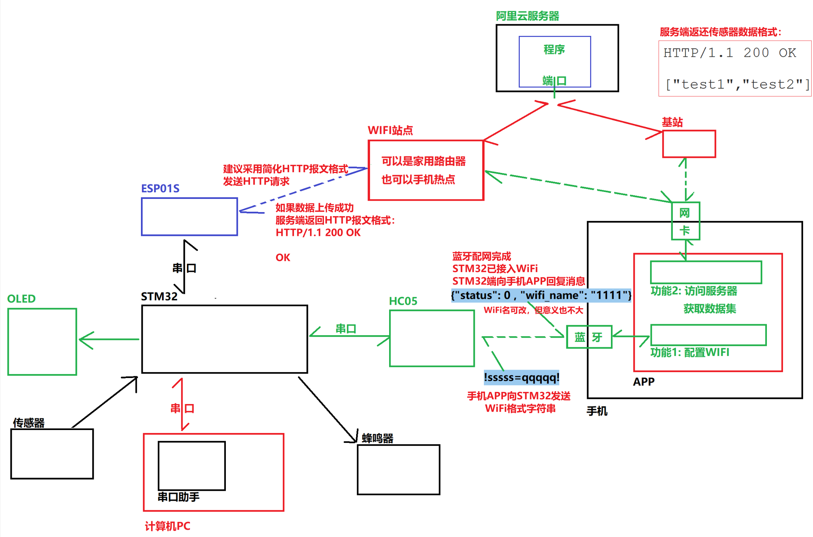

*图1-1项目整体框图*

在本项目中，我们将构建一个**完整的物联网监测系统**。

系统由 STM32设备端、通信网络、云服务器以及手机APP 四个部分组成，其整体结构如上图所示。

整个系统的数据流向可以概括为：

**传感器 → STM32 → WIFI → 云服务器 → 手机APP展示**同时系统还使用了蓝牙模块，主要用于连接手机，允许手机通过蓝牙配置设备的 WIFI 参数。

下面简要介绍一下这四部分的功能。

#### 1.1 STM32数据采集端

系统的核心控制器是**STM32 单片机**。

STM32主要负责以下工作：

1. 读取传感器模拟信号数据（例如温度、光照等，需要使用ADC模块）
2. 通过串口与 WIFI 模块（ESP01S）通信，使得STM32设备端可以将数据发给远程云服务端。
3. 通过串口与蓝牙模块（HC05）通信，主要用于支持和手机APP通信。
4. 控制 OLED 显示当前状态信息（可以直接使用前面给大家提供的OLED驱动代码，亦可以自己扩展一下）
5. 控制蜂鸣器进行报警提示（还可以插几盏LED用于指示系统运行状态）
6. ...（可以根据手上的设备再扩展一些功能）
7. ....（还增加一些兜底的机制，如独立看门狗）

在整个系统中，STM32相当于设备的大脑，负责所有数据的采集和控制逻辑。

#### 1.2 WIFI通信模块（ESP01S）

为了让设备能够接入互联网，本系统使用**ESP01S WIFI模块**。

ESP01S基于**串口通信**与 STM32连接，并负责：

1. 连接 WIFI 网络（路由器或手机热点）
2. 与云服务器建立 HTTP/TCP 通信
3. 向服务器上传传感器数据

#### 1.3 蓝牙模块（HC05）

系统中还加入了**HC05 蓝牙模块**，用于**设备的本地WiFi配置**。

HC05同样通过**串口通信**与 STM32连接。

手机APP可以通过蓝牙向设备发送配置数据，例如：

```c
!changfeng=12345678!
```

这代表着：

1. WIFI 名称
2. WIFI 密码

STM32接收到这些信息后，会将 WIFI 信息配置给 ESP01S，使设备能够连接到指定WiFi网络。

#### 1.4 扩展：嵌入式设备的联网方式

在实际的嵌入式设备设计中，很多设备本身并没有屏幕或键盘，因此无法像手机或电脑一样直接输入 WiFi 的账号和密码。

例如：

1. 智能插座
2. 智能灯泡
3. 智能门锁
4. 物联网传感器
5. 无人机设备

这些设备往往只具备简单的 MCU 控制能力，因此在首次联网配置时，就需要借助手机等智能终端来完成网络参数的配置。

一种非常常见的、主流的设计方案是：

**通过蓝牙先建立设备连接，然后向设备传输家用 WiFi 信息，设备再通过 WiFi 连接互联网。**

整个过程大致如下：

1. 设备上电后，先开启**蓝牙模块**，进入等待连接状态。
2. 用户在手机 App 中搜索并连接设备蓝牙。
3. 手机通过蓝牙向设备发送**WiFi 配置信息**，例如：
   - a. WiFi SSID（网络名称）
   - b. WiFi Password（网络密码）
4. 嵌入式设备接收到这些信息后，将其保存到 Flash 或 EEPROM 中。
5. 然后设备启动 WiFi 模块，使用刚刚收到的 SSID 和密码连接到路由器。
6. 设备成功接入 WiFi 网络后，就可以进一步连接云服务器，实现远程控制或数据上传。

整个结构示意如下：

手机 App││蓝牙通信（BLE / SPP）

▼嵌入式设备（MCU + 蓝牙模块）

││获取 WiFi 配置▼嵌入式设备（MCU + WiFi模块）

││ WiFi 连接▼路由器│▼互联网 / 云服务器这种设计方式有几个明显优点：

1. **配置简单**，用户只需要使用手机 App 连接蓝牙即可完成网络配置，不需要复杂操作。
2. **安全性较高**，WiFi 密码不会通过明文广播发送，而是通过蓝牙点对点传输。
3. **设备成本低**，设备本身不需要屏幕、键盘或复杂的人机交互界面。
4. **用户体验好**，用户只需要在 App 中输入 WiFi 信息即可完成设备联网。

因此，这种**“蓝牙配网 + WiFi 上网”**的模式，在 IoT（物联网）设备中非常常见，也是很多智能硬件产品的标准设计方案之一。


*图1.4-1手机APP添加家具设备-图*

在实际产品中，这种过程通常被称为：**蓝牙配网（BLE Provisioning）**。

我们在项目中使用蓝牙模块，主要的目的也是为了实现蓝牙配网。

#### 1.5 云服务器端

STM32设备采集的传感器数据，最终会上传到云服务器。

云服务器通常部署在阿里云等云平台上，并提供 HTTP 接口供设备访问。

服务器端主要负责：

1. 接收STM32设备上传的传感器数据
2. 存储传感器数据
3. 为手机APP提供数据接口

#### 1.6 手机APP

手机APP是系统的**用户交互界面**。

APP主要实现两个功能：

**功能1：配置 WIFI**通过蓝牙连接设备，发送 WIFI 名称和密码。

**功能2：访问服务器**通过网络访问云服务器，获取设备上传的传感器数据。

#### 1.7 系统整体工作流程

系统的典型工作流程如下：

1. 设备上电启动
2. 手机APP通过蓝牙配置 WIFI 信息
3. ESP01S连接 WIFI 网络
4. STM32采集传感器数据
5. 数据通过 WIFI 上传到云服务器
6. APP通过服务器查看设备数据

至此，一个简单但完整的**物联网监测系统**就构建完成了。

---

## 02 蓝牙模块

### 1. HC-05蓝牙模块

在正式开始项目之前，我们需要先了解一下**本项目中使用到的一些硬件模块**。

本项目中会使用到的模块包括：

1. 蓝牙模块
2. WiFi 模块
3. 传感器模块

而我们首先要介绍的，就是**蓝牙模块**。

在介绍蓝牙模块之前，我们先思考两个问题：

1. **什么是模块？**
2. **如果以后进入公司开发产品，需要使用蓝牙功能，是不是也会使用蓝牙模块？**

把这两个问题搞清楚之后，我们再来看蓝牙模块，就会更容易理解它在整个系统中的作用。

### 2. 什么是模块

在嵌入式系统开发中，所谓的**模块（Module）**，通常指的是：

**已经实现某种功能，并封装成一个可以直接使用的小型电路板。**

模块内部往往已经包含了：

1. 主芯片
2. 必要的外围电路
3. 电源电路
4. 接口电路
5. ...

开发者只需要通过STM32上简单的接口（例如**串口、I2C、SPI 等**）与模块进行通信，或者直接使用GPIO引脚驱动，就可以使用该模块的功能。

例如常见的模块有：

| 模块 | 功能 | 常见的驱动接口 |
|---|---|---|
| 蓝牙模块 | 实现蓝牙通信 | 串口 |
| WiFi模块 | 接入无线网络 | 串口 |
| OLED模块 | 显示信息 | I2C、SPI |
| 各类传感器模块 | 采集环境数据 | GPIO、ADC、I2C、SPI等 |

可以看到，这些模块本质上都是：

**已经完成复杂硬件设计和驱动封装的功能组件。**

开发者只需要通过简单接口控制，就可以快速实现对应功能。

**特别需要注意的是：**

这些模块内部都集成了自己的主控芯片，并且在出厂时已经烧录好了固件程序。

因此，模块本身就能够按照内部程序自动完成既定功能。

也就是说，在使用这些模块时，我们通常并不需要自己去编写模块内部的驱动程序，而是只需要按照模块规定的通信接口和指令协议与其进行交互即可。

例如：

以 蓝牙模块 为例，其内部主芯片中已经实现了 串口通信协议栈以及蓝牙通信相关功能。

### 3. 实际工程中会不会直接用模块

在实际工程开发中，**模块是非常常见的**，尤其是在项目开发的早期阶段。

因为使用模块可以**快速验证系统功能**，例如：

1. 蓝牙通信是否正常
2. WiFi是否能够联网
3. 传感器数据是否能够读取
4. ...

这样可以大大加快开发进度。

大家以后进入公司，如果从事嵌入式开发岗位，通常都会有一个**设备盒**，里面放着各种各样的：

1. 开发板
2. 传感器模块
3. 通信模块

甚至还会用到**面包板**。

在项目开发的早期阶段，工程师往往会直接基于这些模块进行接线，然后快速完成软件功能的开发与验证。

**当项目方案基本确定之后，公司通常会重新设计PCB电路板，将模块中的核心芯片及其外围电路集成到自己的PCB上，以便减小体积并降低成本。**

这类工作通常由**硬件工程师（PCB工程师）**来完成。

**不过需要注意的是，即使硬件电路重新设计，核心芯片一般也不会改变，软件操作这些芯片的方式通常也不会有太大的变化。**

除此之外，在一些无线通信产品中，为了简化开发流程，也有部分产品会**直接使用可贴片焊接的通信模块**。

最典型的就是：ESP32-WROOM 模块。

它是一种**集成了 WiFi、蓝牙、SPI Flash 以及必要外围电路的通信模块**。

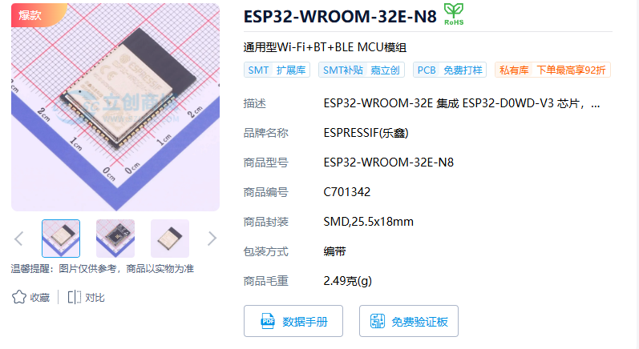

*图3-1ESP32-WROOM模块-图*

从外观上看，这种模块更像是一个体型稍大的芯片，通常需要直接焊接到PCB上才能使用，而不是像开发模块那样通过排针接线。

因此，在实际工程中：

模块既可以用于开发阶段，也可能出现在最终产品中。

**但对于我们这些嵌入式软件开发者来说，更重要的是关注模块内部的核心功能芯片以及如何通过接口对其进行控制。**

### 4. 模块简介

HC-05 是一款比较经典的蓝牙串口通信模块（Bluetooth 2.0 + EDR），广泛用于MCU、电脑、手机等设备之间的无线串口数据传输。

具体的实物，如下图所示：

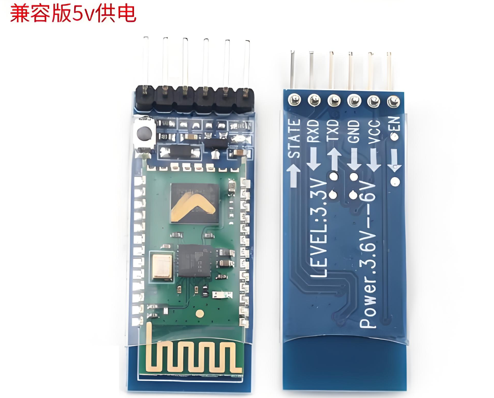

*图4-1HC-05模块-图*

**HC-05 本质上是一种串口转蓝牙模块，在单片机看来，它的使用方式与普通串口设备基本相同。**

下面这张图就展示了HC-05模块的功能：

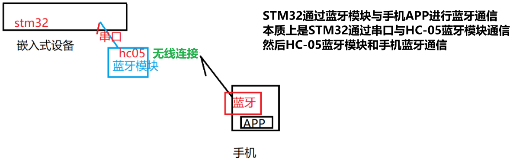

*图4-2STM32使用蓝牙模块-图*

单片机通过**UART 串口**与 HC-05 通信，而 HC-05 再通过**蓝牙无线通信**与手机或电脑进行数据交换。

#### 4.1 蓝牙模块的组成

再来一张近距离高清图：

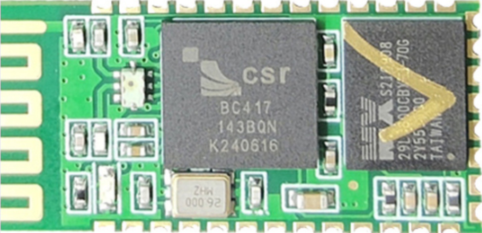

*图4.1-1HC-05模块-图2*

HC-05 模块内部使用的主芯片是**CSR BC417 蓝牙芯片**。

**它是由英国 CSR 公司设计的一款经典蓝牙 2.0 主控芯片。**

需要注意的是，主芯片本身并不能单独使用，它还需要一些外围电路才能够工作，这也是我们选择使用模块的原因。

对比上图，HC-05模块主要由五部分组成：

1. 左侧这个黑色的大芯片，就是 HC-05 模块的 CSR BC417 蓝牙主控芯片。
   - a. 内部集成 CPU 内核，用于运行蓝牙协议栈程序。
   - b. 内部集成 RAM、Flash 等存储资源，用于存储程序和缓存数据。
   - c. 内部集成蓝牙基带控制器与 2.4GHz 射频电路，用于实现蓝牙无线通信。
   - d. 内部提供 UART 等通信接口，用于与外部 MCU（如 STM32）进行数据交互。
2. 右边的黑色大芯片，实际上是一个外部 Flash 存储器。
   - a. HC-05 模块上的外部 Flash 是给蓝牙主芯片 BC417 使用的。
   - b. 用于存储蓝牙通信相关的协议栈信息、设备信息、串口配置信息等等。
3. 下面那个银色金属块，丝印“26MHz”的是外部晶振，为主芯片的运行提供时钟信号。
4. 最左边，金色的弯弯的线路。这是PCB天线，无线模块**必须有天线**，因为要发无线信号，也需要接收无线信号。
5. 周边的各种小组件。包括电阻、电容、LED等等。实现一些外围电路功能，比如稳压，LED用于指示状态。
6. 蓝牙芯片
7. 外部晶振
8. 天线电路
9. 电源稳压电路
10. 接口电路

HC-05 所使用的蓝牙协议为 Bluetooth 2.0 + EDR（Enhanced Data Rate，增强数据速率），属于经典蓝牙（BR/EDR）技术标准。

其无线蓝牙功能，工作在 2.4GHz 频段**（公共免许可频段）**，理论最高传输速率可达到3 Mbps。

需要注意的是，目前智能手机普遍使用蓝牙5.0及以上版本的标准。

不过这些新版本通常仍然向下兼容经典蓝牙设备，因此 HC-05 仍然可以正常与手机进行通信。

#### 4.2 扩展了解：无线通信的频段

**首先需要理解的是：无线通信本质上是通过电磁波在空气中传输信息。**

而电磁波是有频率的，不同频率范围就被称为频段（Frequency Band）。

在生活中：

1. 蓝牙设备
2. WiFi（2.4G）
3. 基于接收器连接的无线鼠标键盘
4. 绝大多数在工业 / 科学 / 医疗等领域使用的，支持无线通信功能的嵌入式设备
5. ...

这些设备，在实现无线通信技术时，其频段主要都集中在 2.4 GHz。

确切的说，它们的通信电磁波频率都集中在“2400MHz ~ 2483.5MHz”之间，它们统称2.4GHz频段，也可以直接叫2.4G频段。

为什么都挤在一起呢？

这是因为 2.4GHz 属于 ISM 频段（Industrial, Scientific and Medical），也就是公共免许可频段。

所谓“免许可”，是指设备在满足相关技术规范的情况下，可以直接使用该频段进行无线通信，而不需要向国家申请专门的无线电频率许可。

因此，这个频段被大量无线设备采用。

不过，由于很多设备都使用 2.4GHz，例如：

1. WiFi
2. 蓝牙
3. ZigBee
4. 无线鼠标
5. 无线键盘

因此这个频段也会比较**拥挤**，设备之间可能产生一定的无线干扰。

在无线通信中，还有一个比较重要的规律：

频率越高，通常具有以下特点：

1. 穿透能力较弱
2. 传播距离相对较短
3. 可实现的传输速率更高
4. 通常能耗也越高

这是因为高频电磁波的波长更短，在遇到墙壁、家具等障碍物时更容易被吸收或散射，因此穿透能力较弱。

同时，高频通信通常可以使用更宽的带宽资源，因此可以实现更高的数据传输速率。

例如：

| 技术 | 常见频段 | 特点 |
|---|---|---|
| 4G 蜂窝网络 | 700MHz / 1.8GHz / 2.1GHz / 2.6GHz | 覆盖范围大，穿墙能力强 |
| 5G 蜂窝网络 | 3.5GHz（主流） / 4.9GHz | 传输速率更高，但覆盖距离更短 |
| WiFi （2.4GHz） | 2.4GHz | 覆盖和速率较为均衡 |
| WiFi（5GHz） | 5GHz | 速率更高，但穿墙能力较弱 |
| 蓝牙 | 2.4GHz | 短距离低功耗通信 |

因此，在无线通信系统设计中通常需要在覆盖范围、穿透能力和传输速率之间进行权衡。

总结来说：

1. **低频段**：传播距离远、穿透能力强，但速率较低
2. **高频段**：传播距离较短、穿透能力弱，能耗较高，但可以实现更高的数据速率

不同的无线通信技术会根据应用场景，选择合适的工作频段。例如：

1. **蓝牙、WiFi**：短距离通信
2. **4G / 5G**：大范围移动通信（天线高度很高，基站多组成蜂窝状，发射功率高）

#### 4.3 扩展了解：蓝牙的版本

HC-05 所使用的蓝牙协议为 Bluetooth 2.0 + EDR，这属于经典蓝牙（Classic Bluetooth / BR-EDR）技术标准。

主要用于无线串口通信、音频传输等场景。

随着移动设备的发展，蓝牙技术也不断更新，目前智能手机普遍使用的是蓝牙5.0及以上版本。

蓝牙5.0由蓝牙技术联盟（Bluetooth SIG）于 2016年发布，它属于低功耗蓝牙（BLE，Bluetooth Low Energy）技术体系。

相比早期的经典蓝牙，BLE 的设计目标更加侧重于低功耗、低延迟以及物联网设备通信。

蓝牙5.0的主要特点包括：

1. 最大通信速率约**2 Mbps**
2. **功耗更低**，适合电池供电设备
3. **广播能力更强**
4. 对**Wi-Fi 共存环境进行了优化**，减少 2.4GHz 频段中的互相干扰

因此，蓝牙5.0被广泛应用于智能手环、智能家居、物联网设备、可穿戴设备等场景。

需要注意的是，蓝牙协议通常**具有良好的向下兼容性**。

即使手机使用的是蓝牙5.0或更高版本，仍然可以正常连接使用 Bluetooth 2.0 的设备，例如 HC-05 模块。

另外，在 2024年9月，蓝牙技术联盟正式发布了蓝牙6.0标准。

这一版本主要在定位能力、连接效率以及设备同步能力方面进行了改进，目前仍处于逐步推广和应用阶段。

#### 4.4 HC-05蓝牙模块的典型参数

**HC-05 模块的典型参数如下：**

1. **蓝牙协议：** Bluetooth 2.0 + EDR
2. **工作频段：** 2.4 GHz 公共免许可频段
3. **通信接口：** UART 串口通信
4. **默认波特率：9600 bps**
5. **默认串口参数：8 位数据位，1 位停止位，无校验位（8N1）**
6. **模块供电电压：3.6 V ~ 6 V（建议5V）**
7. **串口逻辑电平：** 3.3 V（即高电平参考值约为 3.3V，直接兼容 STM32F1 系列 MCU 的 CMOS 电平）
8. **通信距离：**一般约 10 米（典型环境）
9. **角色模式：支持主模式（Master）和从模式（Slave），默认为从模式。**
10. **工作模式：支持数据传输模式和AT指令模式**
11. **配置方式：**支持 AT 指令配置模块参数

在实际使用时，HC-05 通常通过**UART 串口与单片机连接**，单片机只需要通过串口发送和接收数据，即可实现与手机或电脑之间的**无线串口通信**。

因此，在软件设计上，可以把 HC-05 看作一个**无线串口设备**来使用。

**或者说，HC-05蓝牙模块，就是一个“串口转蓝牙”设备。**

### 5. 外部引脚定义和接线方式

HC-05 蓝牙模块提供了**6 个外部引脚**，用于供电、串口通信以及状态指示。


*图5-1HC-05模块-图*

这些引脚定义如下：

| 引脚 | 作用 |
|---|---|
| VCC | 模块供电，建议使用5V供电 |
| GND | 接地 |
| TXD | 串口发送 |
| RXD | 串口接收 |
| STATE | 蓝牙连接状态指示 |
| EN / KEY | 模块使能或进入 AT 配置模式 |

其中最常使用的引脚只有 VCC、GND、TXD、RXD 四个，其余引脚在普通通信中可以不连接。

#### 5.1 供电引脚VCC和GND

HC-05 模块内部工作电压为**3.3V**，但模块内部集成了**稳压电路**，因此可以直接使用**3.6~6V 之间的电压供电**。

出于实际考虑，建议在使用时，直接用5V作为HC-05模块的供电电压。

注意：

**既然HC-05模块需要5V供电电压，而且STM32F103C8T6最小系统版就有5V电压输出，可不可以直接用来供电呢？**

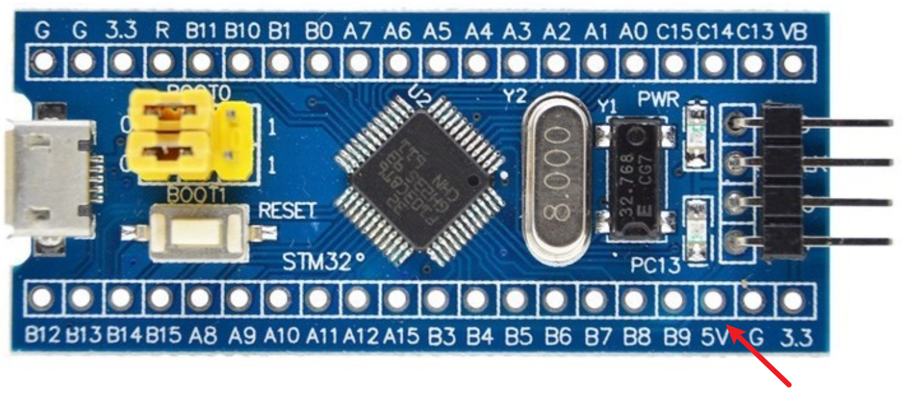

*图5.1-1最小系统板-图*

我们要知道HC-05所使用的蓝牙协议是一种较早期的、速率较高、但功耗较大的经典蓝牙通信方案。

所以如果整个系统只连一个蓝牙模块，那么直接用最小系统板供电，问题不大，实测也完全OK。

但如果是做项目，最小系统板还需要给OLED、LED、蜂鸣器等设备供电，那就有点捉襟顾肘了。

实测如果依靠最小系统板给蓝牙模块供电，通信非常不稳定，很容易失败。

所以：

**我们做项目时，使用HC-05蓝牙模块要进行单独供电，单独使用一个5V供电。**

那这个单独的5V供电去哪里找呢？

可以在两个地方找到：

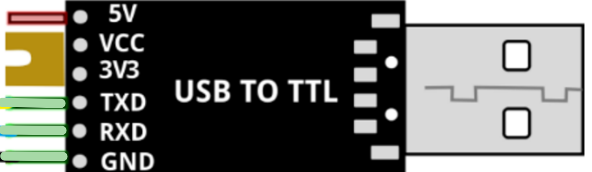

*图5.1-2USB-TTL设备*


*图5.1-3ST-Link设备*

USB-TTL设备，以及ST-Link上面都有未使用的5V供电引脚，你可以选择一个来使用。

我们设备盒中有两个ST-Link，多出来的一个ST-Link，主要目的就是用于供电。

#### 5.2 串口通信连接引脚RXD和TXD

这个就非常简单了，串口通信的两台设备，只需要注意交叉连接通信引脚即可。

如果是和STM32进行串口通信，接线方式就是：

USARTx_TX → HC-05_RXDUSARTx_Rx ← HC-05_TXD当然，这里还涉及到具体使用哪个USART外设的问题，这些细节问题，我们后面再讨论。

#### 5.3 STATE 引脚（了解）

STATE 引脚的电平变化可以反映当前蓝牙模块是否已经建立蓝牙连接。

其基本工作方式如下：

| STATE 引脚电平 | 蓝牙工作状态 |
|---|---|
| 低电平（0） | 未建立蓝牙连接 |
| 高电平（1） | 已与设备建立蓝牙连接 |

也就是说，当手机或其他蓝牙设备成功连接 HC-05 模块后，STATE 引脚会输出高电平信号；当蓝牙断开连接时，该引脚则恢复为低电平。

如果将此引脚接入STM32的一个普通IO引脚，就可以通过监听STATE的输出，从而判断HC-05模块的工作情况。

但HC-05模块已经集成了一个LED，用于指示蓝牙模块的工作状态：

| LED状态 | 含义 |
|---|---|
| 快速闪烁（约每秒 4～5 次） | 蓝牙未连接，处于等待配对状态 |
| 慢闪（约 2 秒闪一次） | 进入 AT 指令模式 |
| 常亮 | 已建立蓝牙连接，正在通信 |

**注意：上述LED行为只是众多蓝牙模块的多样LED行为之一，你买到的蓝牙模块可能并不是这样。**

出于实用考虑，建议大家不要将STATE引脚接入单片机，节省一个IO引脚。

#### 5.4 EN 引脚（了解）

**在 HC-05 蓝牙模块中，EN（Enable）引脚用于控制模块内部电源电路的使能状态。**

简单来说，可以将**EN 引脚连接到单片机的一个 IO 引脚**，通过 IO 电平来控制蓝牙模块是否工作：

1. 当 IO 引脚输出**低电平**时，表示关闭 HC-05 模块。
2. 当 IO 引脚输出**高电平**时，表示开启 HC-05 模块。

这种控制方式和我们在嵌入式开发中常见的**ENABLE / DISABLE 控制信号**类似，本质上就是通过一个控制引脚决定模块是否处于工作状态。

需要注意的是：

**EN 引脚具有默认的高电平输入，因此蓝牙模块在上电后会默认处于工作状态。**

如果只是进行基础实验或简单应用，EN 引脚也可以不连接单片机，模块依然可以正常工作。

只有在需要通过程序控制蓝牙模块的启停时，才需要将 EN 引脚接入单片机进行控制。

EN 引脚的工作原理是什么样的呢？

以下是HC-05模块内部电路设计图：

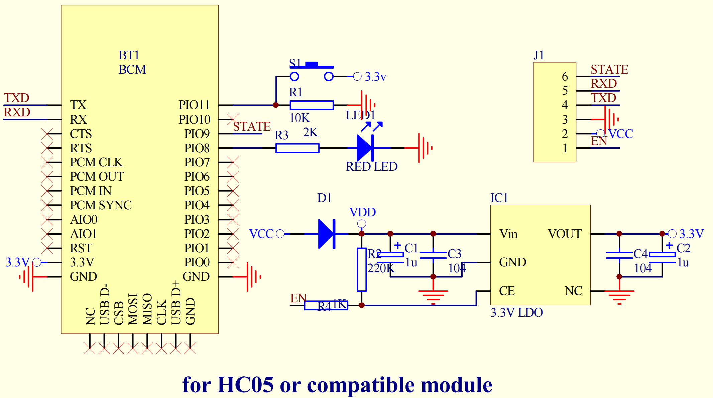

*图5.4-1HC-05模块内部电路设计-图*

从模块原理图可以看到，EN 引脚通过**上拉电阻**连接到内部**LDO 稳压器的 CE（Chip Enable）引脚**，用于控制稳压器是否工作。

HC-05 模块内部蓝牙芯片的工作电压为**3.3V**，而模块通常允许输入**5V 电源**。

因此模块内部使用**LDO（低压差线性稳压器）**将输入电压稳压为 3.3V，再为蓝牙芯片供电。

EN 引脚的作用可以简单理解为**控制该稳压电路是否开启**：

1. **EN 为高电平**：LDO 被使能，输出 3.3V，蓝牙芯片获得供电，模块开始正常工作。
2. **EN 为低电平**：LDO 被关闭，不再输出 3.3V，蓝牙芯片失去供电，模块停止工作。

因此，EN 引脚本质上可以看作是**HC-05 模块的电源使能控制引脚**。

但实际上，依靠上拉电阻，EN和CE引脚默认会输入一个高电平，因此：

只要给HC-05模块接入电源，稳压器电路就会自动启动开始工作，从而使得整个模块都启用3.3V供电，开启整个模块。

**所以，如果只是简单的使用HC-05，根本不需要额外控制 EN 引脚。**

### 6. 角色模式

在 HC-05 蓝牙模块中，我们常说的模式可以分为两类：

1. **角色模式（Role Mode）**
2. **工作模式（Work Mode）**

其中：

1. 角色模式，用于决定模块在蓝牙通信中的连接角色。
2. 工作模式，用于决定模块当前处于配置状态还是数据通信状态。

它们不是一个纬度的东西，不要搞混淆了。

比如：

对于操作系统，你是管理员身份，还是普通用户身份，这是身份角色。

而你正在操作系统上做什么事情，比如看电影，看B站，打游戏，写代码...这是行为。

管理员 + 打游戏普通用户 + 写代码...

这些组合都是不冲突的。

这里我们先介绍**角色模式**。

在蓝牙通信中，设备之间建立连接时需要确定主设备（Master）和从设备（Slave）

两种角色。

**主模式（Master）**

如果把HC-05设置为主模式，那么作为主设备，它将负责：

1. 主动搜索附近蓝牙设备
2. 主动发起连接请求
3. 主动建立蓝牙通信连接

**从模式（Slave）**

如果把HC-05设置为从模式，那么作为从设备，它将负责：

1. 被动等待其他设备搜索
2. 被动接受连接请求
3. 被动建立通信连接

HC-05 蓝牙模块同时支持主模式和从模式，可以通过 AT 指令进行配置。（怎么配置后面再说）

在我们的需求中，需要让STM32基于蓝牙模块，实现和手机端的蓝牙通信。

此时，将HC-05设置为从模式是更好的选择，因为：

1. 从模式使用起来更简单，而主模式配置使用起来更麻烦一些。
2. 手机作为主设备搜索HC-05从设备，进行连接，这个操作显然简单的多，而且这也是用户熟悉的操作。
3. HC-05默认就配置为从模式，拿到手即用，不用过多配置。

**实际上，在嵌入式系统中使用HC-05模块，绝大多数情况下，都会把它设置为从模式。**

### 7. 工作模式（重点）

在介绍完角色模式（主从模式）之后，我们再来看 HC-05 的工作模式。

HC-05 的工作模式主要有两种：

1. **数据传输模式**
2. **AT 指令模式**

在前面我们提到，HC-05 模块上通常带有一盏状态指示 LED，用于显示模块当前的工作状态。

标准模式下，这盏LED是这么工作的：

| LED状态 | 含义 |
|---|---|
| 快速闪烁（约每秒 4～5 次） | 蓝牙未连接，处于等待配对状态 |
| 慢闪（约 2 秒闪一次） | 进入 AT 指令模式 |
| 常亮 | 已建立蓝牙连接，正在通信 |

也就是说：

从 LED 状态可以大致判断模块当前所处的工作模式。

如果这盏 LED **常亮或快速闪烁**，实际上都属于**数据传输模式**。其中：

1. **快速闪烁**表示蓝牙尚未建立连接，处于等待配对状态
2. **常亮**表示蓝牙连接已经建立，可以进行数据通信，或正在数据通信

而当 LED **慢闪（约 2 秒闪一次）**时，则说明模块已经进入**AT 指令模式**。

#### 7.1 AT指令模式

什么是 AT 指令模式？

**AT 指令模式，简单来说，就是用于配置蓝牙模块参数的一种工作模式。**

在这种模式下，HC-05 不再进行蓝牙通信，而是通过串口接收特定格式的指令，对模块内部的一些参数进行配置。

这些指令通常以 AT（Attention）开头，因此称为 AT 指令。

例如，可以通过 AT 指令对 HC-05 进行如下查询或配置：

1. 查看蓝牙相关信息
2. 查询模块当前的工作状态
3. 修改蓝牙设备名称
4. 修改串口通信波特率
5. 设置蓝牙模块的主从模式
6. ...

例如：

```c
AT // 测试模块是否正常
AT+NAME=snow // 修改蓝牙设备名称
AT+ROLE=0 // 设置为从模式
AT+UART=115200,0,0 // 修改串口波特率
```

**当HC-05模块收到正确的 AT 操作指令后，会返回 OK\r\n，表示指令执行成功。如果是查询AT指令，则会返回对应信息。**

因此可以理解为：

**AT 指令模式本质上就是一种“模块配置模式”。**

在实际使用中，AT 指令模式通常只在模块初始化配置阶段使用，一旦配置完成，模块大多数时间都会工作在数据传输模式。

#### 7.2 第一种进入AT模式的方式（标准模式）

**不同厂家生产的 HC-05 蓝牙模块，在进入 AT 指令模式的方式上可能会有所不同。**

我们先来一种最标准的进入AT模式的方式。

当我们将接线完成的 USB 转串口模块连接到电脑，并给 HC-05 模块上电后，通常会看到：

HC-05 模块上的 LED 状态指示灯处于快速闪烁状态。

这种状态表示：

HC-05 此时处于等待配对状态，也就是模块当前处于数据传输模式。

**实际上，HC-05 在上电时进入哪一种工作模式，是由模块内部的 PIO11 引脚输入电平状态决定的，其控制逻辑如下：**

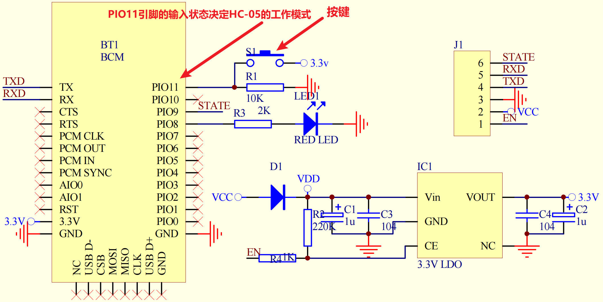

*图7.2-1AT指令模式控制电路-图*

具体来说是：

1. 如果HC-05模块上电启动时：
   - a. PIO11引脚输入低电平
   - b. 也就是**按键**不按下，默认输入，那么HC-05就进入数据传输模式。
   - c. 表现为：LED状态指示灯快闪烁。
2. 如果HC-05模块上电启动时：
   - a. PIO11引脚输入高电平
   - b. **也就是按住按键，然后上电启动，启动完成后再松开按键，HC-05就进入AT指令模式。**
   - c. 表现为：LED状态指示灯慢闪烁。
3. 进入AT指令模式后，需要把波特率设置为**38400，8N1**，才能给HC-05模块发AT指令。
4. **有些模块，还必须一直按住按键才能发 AT 指令。**

现在你可以尝试一下，让HC-05进入AT指令模式，然后发一下AT指令。

如下图所示：

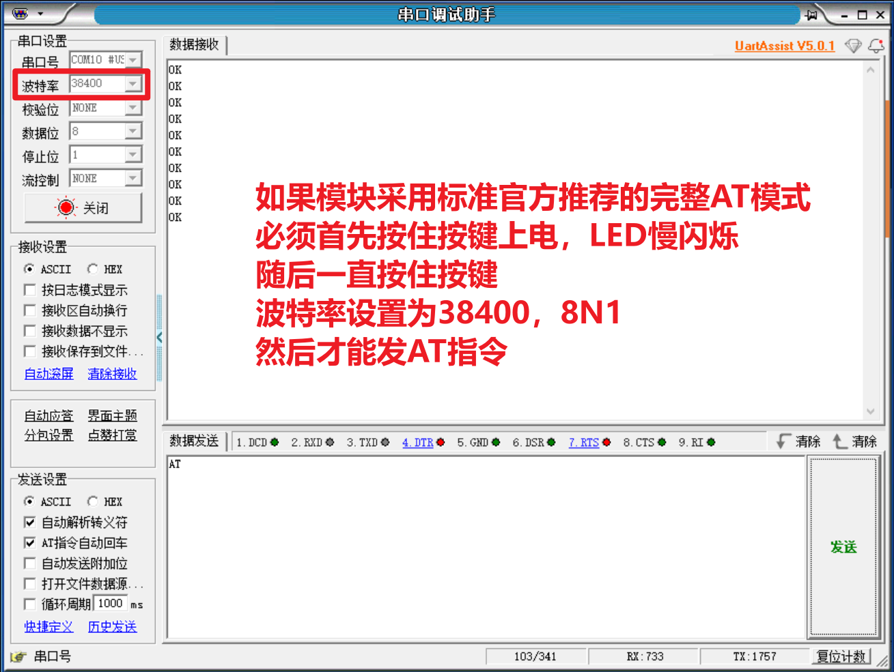

*图7.2-2完整AT模式-图*

如果你手中的 HC-05 模块，需要按照上述方式进入 AT 指令模式，那么大概率说明：

该 HC-05 模块使用的是 CSR BC417 芯片方案。

去淘宝或网店买HC-05模块时，商家通常把这种HC-05模块叫做 “进口芯片 HC-05”。

它的特点是：

1. 使用完整 AT 指令模式
2. 进入 AT 模式的流程相对繁琐
3. 但支持的 AT 指令最完整
4. 兼容性和稳定性最好

实际上CSR BC417已经停产很多年了，网上能买到的很多可能是翻新芯片，现在能买到的更常见的是国产兼容版解决方案。

#### 7.3 第二种进入AT模式的方式（简化AT模式）

有些 HC-05 模块会支持**简化 AT 模式（Mini AT mode）**。其表现形式是：

直接给 HC-05 模块上电，不需要按任何按键。

上电后可以看到：LED 状态指示灯快速闪烁。

在这种情况下，HC-05 实际上同时具备两种能力：

1. 可以等待蓝牙设备进行配对
2. 也可以直接接收并处理 AT 指令

也就是说：

**AT 指令模式与等待蓝牙配对工作状态被合并在一起了。**

这种简化AT模式下，只需要按照蓝牙模块当前的串口通信参数进行串口通信即可。

通常默认配置为：

波特率：9600数据位：8停止位：1校验位：None也就是常说的 9600，8N1。

在这种配置下，通过串口直接发送 AT 指令即可得到响应。

需要注意的是：

**一旦蓝牙完成配对并建立连接之后，模块就会进入数据通信模式，此时将无法再发送AT 指令。**

这种简化 AT 模式的特点如下：

优点：

1. 操作非常简单
2. 不需要按键进入 AT 模式
3. AT 配置与数据传输模式合并在一起

缺点是：只支持部分最常用的 AT 指令，完整 AT 指令功能可能无法使用。

如果你手中的 HC-05 模块采用的是这种简化 AT 模式，那么大概率说明：

模块内部的主控芯片并不是 CSR BC417，而是某种兼容 CSR BC417 的国产蓝牙芯片方案。

这种方案的特点是：

1. 芯片成本更低
2. AT 模式进行了简化
3. AT 指令数量有所减少

但在实际使用中：

除了 AT 指令模式有所区别之外，其余功能（蓝牙配对、蓝牙通信国产等）基本保持一致。

所以为了节省成本，这种模块也很常见。

**大家拿到的HC-05模块，就是这种简化AT模式的蓝牙通信模块。**

**大家拿到的HC-05模块，就是这种简化AT模式的蓝牙通信模块。**

**大家拿到的HC-05模块，就是这种简化AT模式的蓝牙通信模块。**

#### 7.4 常见和常用的AT指令

**AT 指令以 AT 开头，不区分大小写，必须以换行符结束（\r\n）。**

常见 AT 指令如下：

| AT 指令 | 作用 | 示例返回 | 备注 |
|---|---|---|---|
| AT | 测试模块是否正常工作 | OK |  |
| AT+NAME? | 查询蓝牙设备名称 | +NAME:HC-05 |  |
| AT+NAME=CF | 修改蓝牙设备名称 | OK |  |
| AT+ROLE? | 查询主从模式 | +ROLE:0 | 0表示从模式，1表示主模式 |
| AT+ROLE=0 | 设置为从模式（Slave） | OK |  |
| AT+UART? | 查询串口参数 | +UART:9600,0,0 | 第一个0表示停止位1位，第二个0表示无校验位 |
| AT+UART=115200, 0,0 | 修改串口波特率 | OK | 不建议修改波特率，没必要 |
| AT+PSWD? | 查询配对密码 | +PSWD:1234 | 通常用不到 |
| AT+PSWD=8888 | 修改配对密码 | OK | 通常用不到，没必要修改 |
| AT+RESET | 重启蓝牙模块 | OK | 相当于重新插拔，断电重新上电 |
| AT+ORGL | 恢复出厂设置 | OK | 所有设置都恢复出厂设定 |

在实际项目开发中，最常使用的 AT 指令通常只有三条。

**建议大家按照下面流程执行AT指令：**

```c
AT // 先测试蓝牙连接是否成功
AT+NAME=xxx // 建议修改成自己想要的名称，避免重名
AT+ROLE=0 // 设定为从模式
```

通过这些指令，就可以完成蓝牙模块的基本配置。

完成配置后，一般需要重新上电或执行 AT+RESET，让模块进入数据传输模式，此时就可以通过蓝牙进行正常通信。

### 8. 演示HC-05蓝牙模块的使用

上面我们讲解了HC-05蓝牙模块的基本情况，常见AT指令，操作方式等。

下面，我们先通过**“PC端串口助手”**，简单演示一下HC-05蓝牙模块的使用。

如此，我们需要先了解一下手机APP，相关接线方式等内容。

#### 8.1 手机APP的安装与使用

蓝牙模块，扩展了单片机“蓝牙无线通信”的功能。而与单片机进行蓝牙无线通信的对端就是手机，确切说需要在一个手机APP中完成这个通信。

**手机APP可以在微信群里获取，你可以把手机APP下载到你的安卓手机上，然后进行安装。**

随后你可以直接在以下界面进行蓝牙搜索和连接。

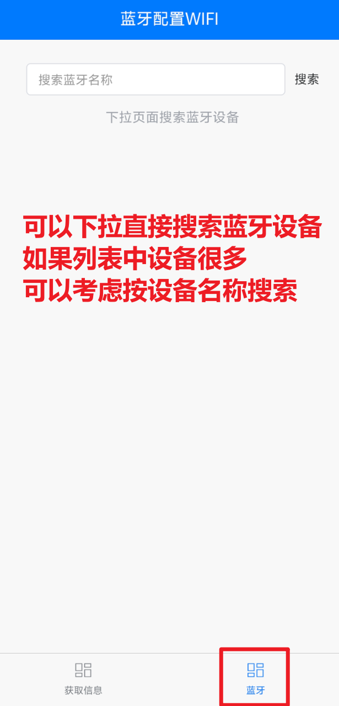

*图8.1-1APP连接蓝牙模块-图*

注意，蓝牙本身不需要定位功能才能通信，但对于安卓系统而言：

**手机 APP 在搜索附近蓝牙设备时，系统会认为这个过程可能泄露用户位置，所以需要用户开启定位权限。**

**所以，使用蓝牙功能除了打开蓝牙模块，还需要打开手机的定位权限！**

**所以，使用蓝牙功能除了打开蓝牙模块，还需要打开手机的定位权限！**

**所以，使用蓝牙功能除了打开蓝牙模块，还需要打开手机的定位权限！**

#### 8.2 演示HC-05时的接线方式

如果只是简单演示HC-05模块的功能，我建议大家可以直接让HC-05模块，和USB-TTL设备模块，接在一起。

这样可以实现PC端和手机APP的蓝牙通信。

如下所示：

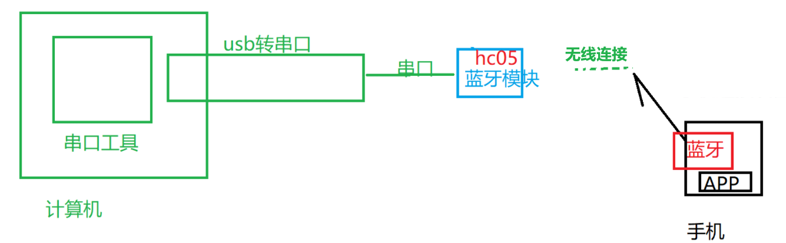

*图8.2-1PC和手机通过HC-05模块进行蓝牙通信-图*

如此，我们的接线方式，就如下图所示：

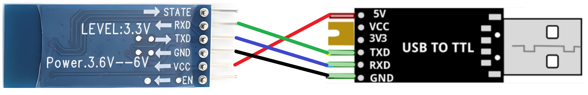

*图8.2-2演示HC-05时的接线方式-图*

随后将USB插入电脑，如此就完成了接线。

如此，通信的双方可以简单的认为就是：

**手机APP <----> PC端串口助手**

#### 8.3 手机APP蓝牙配网的流程

你需要先"下拉页面"搜索蓝牙，如下图所示：

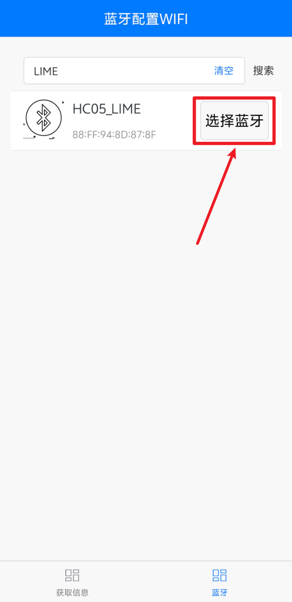

*图8.3-1蓝牙配网流程-图1*

随后，输入WiFi信息后，点击"开始蓝牙配网"：

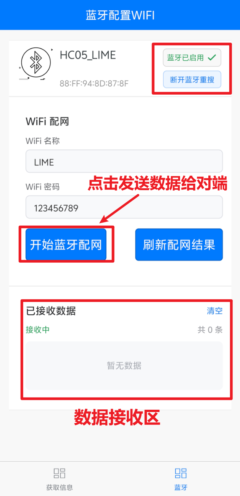

*图8.3-2蓝牙配网流程-图2*

点击“蓝牙配网”按钮后，手机APP会通过蓝牙模块，发送给“对端”这样的一条数据字符串：

```c
!WiFi名称=WiFi密码!
```

例如：

```c
!LIME=123456789!
```

对端，比如STM32在收到WiFi配网信息后，STM32可以借助WiFi模块，基于这个WiFi配置信息，连接WiFi热点。

如果WiFi热点联网成功，需要向手机APP（通过蓝牙模块）反馈一条字符串消息：

```c
{"status":0}
```

当然，演示时我们使用PC端串口工具，向手机APP发送一条相同格式的字符串，同样可以起到一样的效果。

**STM32端WiFi连接成功后，务必按照这个字符串格式反馈给手机APP，其余格式无效！！！**

**STM32端WiFi连接成功后，务必按照这个字符串格式反馈给手机APP，其余格式无效！！！**

**STM32端WiFi连接成功后，务必按照这个字符串格式反馈给手机APP，其余格式无效！！！**

在基于PC端串口工具进行通信时，我们可以这么做：

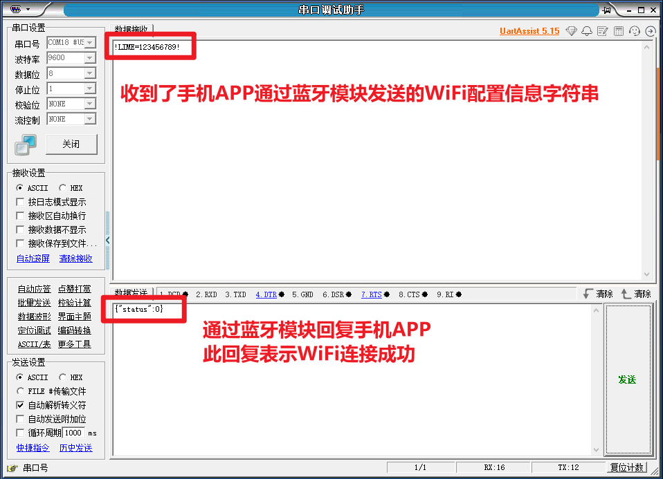

*图8.3-3蓝牙配网流程-图3*

手机端APP收到表示成功的字符串消息后，会显示以下信息：

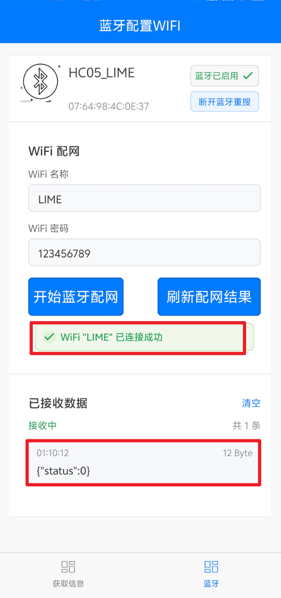

*图8.3-4蓝牙配网流程-图4*

上面是蓝牙配网成功了，WiFi连接成功后的APP交互逻辑。

如果 STM32 端借助 WiFi模块连接 WiFi 失败了，需要通过蓝牙模块向 APP 返回一条表示连接失败的字符串消息。

失败反馈格式如下：

```c
{"status":1,"error_code":x}
```

其中：

1. status = 1，表示 WiFi 配网失败。
2. error_code，表示具体失败原因。

目前已经设定好的error_code含义如下：

1. error_code = 1，目标 WiFi 不存在
2. error_code = 2，目标 WiFi 密码错误
3. error_code = 3，未知错误

**例如，如果目标 WiFi 不存在，STM32 端需要返回：**

```c
{"status":1,"error_code":1}
```

APP 收到后，会显示：

```c
WiFi"LIME"连接失败，目标WiFi不存在！
```

**例如，如果目标 WiFi 密码错误，STM32 端需要返回：**

```c
{"status":1,"error_code":2}
```

APP 收到后，会显示：

```c
WiFi"LIME"连接失败，目标WiFi密码错误！
```

用PC端串口助手，也可以模拟这个过程。如下图所示：

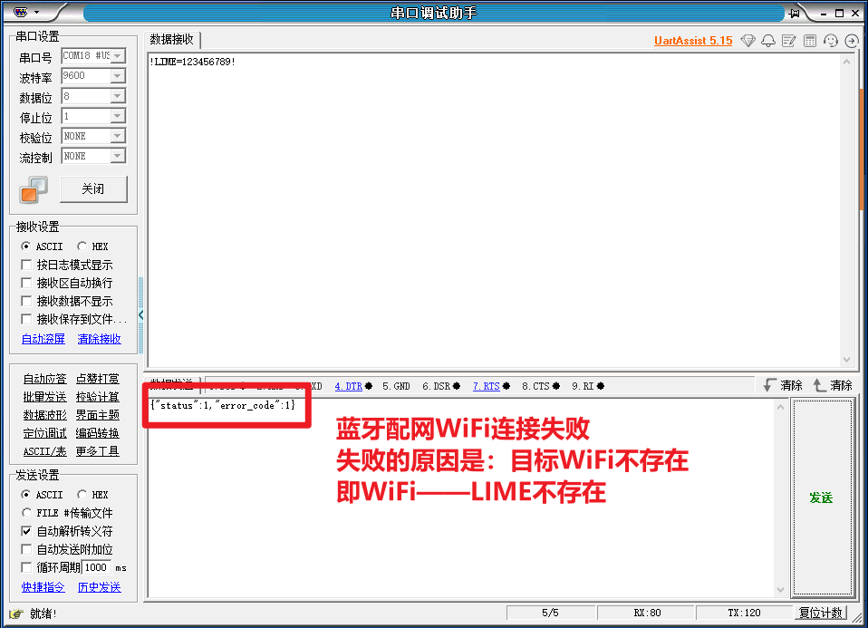

*图8.3-5蓝牙配网流程-图5*

手机端APP收到这条信息后，会反馈如下图所示：

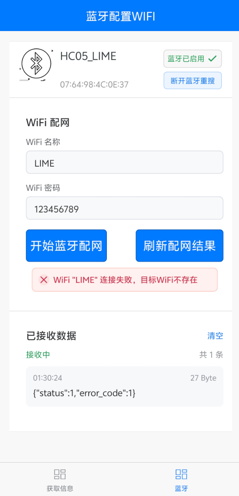

*图8.3-6蓝牙配网流程-图6*

**如果STM32连接WiFi时发生未知错误，需要通过蓝牙向手机APP返回：**

```c
{"status":1,"error_code":3}
```

其中：

1. status=1 ：表示WiFi配网失败；
2. error_code=3 ：表示未知错误。

手机APP收到后会显示：

```c
WiFi "名称" 连接失败，未知错误
```

当然，APP还会处理一种特殊的情况：

**最多等待20s，如果一直没有收到反馈，也会显示“超时未收到反馈！”，你可以自行测试一下。**

### 9. 在项目中集成蓝牙模块

**如果你已经熟悉了基于 “PC → USB转串口设备 → HC-05蓝牙模块 → 手机APP” 之间的通信过程。**

**那么现在把 HC-05 蓝牙模块直接连接到 STM32 上，其实并没有太大的难度。**

因为从本质上来说：

**之前 PC端串口工具所完成的工作，现在只不过是由 STM32 程序来完成而已。**

换句话说：

STM32 只需要通过串口，与 HC-05 蓝牙模块进行通信，就可以实现与手机之间的数据交互。

#### 9.1 HC-05与STM32接线

首先，我们需要确定一个问题：

HC-05 蓝牙模块应该连接到 STM32 的哪一个 USART 外设？

这里建议大家将蓝牙模块连接到 USART3，原因是：

在本项目中，USART1 和 USART2 已经有了其他用途。

1. USART1 与 PC 端的 USB 转串口设备连接，用于在开发过程中打印调试信息。
2. USART2 与 WiFi 模块连接，用于让 STM32 设备接入互联网。

因此，将 HC-05 蓝牙模块连接到 USART3 是一个比较合理的选择。

对于 STM32F103C8T6 来说，USART3 外设的默认引脚如下图所示：

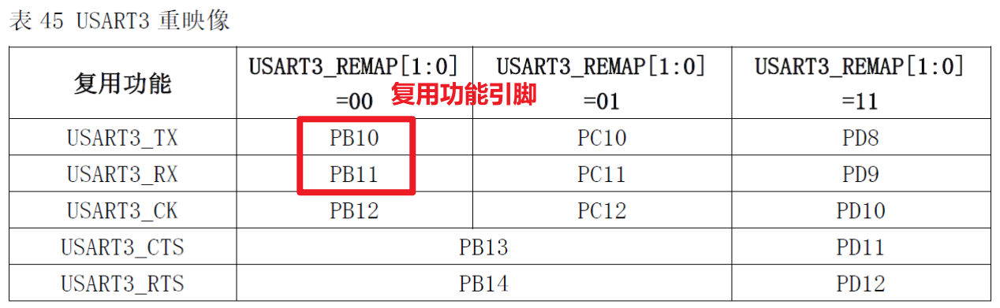

*图9.1-1USART3复用引脚-图*

也就是说：

STM32 通过 USART3 串口外设与 HC-05 蓝牙模块进行通信。

HC-05 蓝牙模块与 STM32 的接线关系如下：

| STM32 | HC-05 | 说明 |
|---|---|---|
| PB10 (USART3_TX) | RXD | STM32发送 → 蓝牙接收 |
| PB11 (USART3_RX) | TXD | STM32接收 ← 蓝牙发送 |
| GND | GND | 共地 |

请你清理自己面包板上的接线与设备，只保留最小系统板和ST-Link，以及电源轨供电接线。

紧接着，将上述HC-05模块的对应引脚接入面包板。

#### 9.2 HC-05模块供电

HC-05模块需要接四根线，上面只接了三根线，剩下一根供电线接在哪里呢？

我们已经讲过：

HC-05模块需要单独是一个5V供电，而且不要依赖面包板来完成这个供电。

USB转串口设备刚好多出来一个5V供电引脚，恰好可以给HC-05模块供电。

于是：

顺便我们还可以让 USART1 外设与 USB 转串口设备连接，用于调试输出信息。

这样在程序运行过程中：

1. STM32 可以通过**USART1**向电脑打印调试信息
2. STM32 可以通过**USART3**串口外设，接收 HC-05 蓝牙模块发送的数据（用于蓝牙配网）

对应引脚连接如下：

| STM32引脚 | 连接设备引脚 | 说明 |
|---|---|---|
| PA9 (USART1_TX) | USB 转串口 RXD | STM32打印调试信息 |
| PA10 (USART1_RX) | USB 转串口 TXD | / |
| PB10 (USART3_TX) | HC-05 RXD | STM32向蓝牙发数据 |
| PB11 (USART3_RX) | HC-05 TXD | STM32接收蓝牙数据 |
| GND | USB转串口 GND / HC-05 GND | 所有设备必须共地 |

**HC-05的VCC引脚，与USB转串口设备的5V输出引脚相连。**

上面的接线都完成之后，我们需要在程序中初始化**USART3 串口外设**，并配置为：

1. 波特率：9600
2. 数据位：8
3. 停止位：1
4. 校验位：None

也就是常说的波特率9600，8N1 串口通信格式。

这样一来，STM32 就可以像串口工具一样，通过 HC-05 蓝牙模块与手机进行通信。

#### 9.3 STM32与蓝牙模块的串口通信

STM32与蓝牙模块的串口通信，需要完成什么工作呢？

由于蓝牙模块在我们的项目中，基本只用于“蓝牙配网”。

因此 STM32 的核心任务就是接收 HC-05 模块转发的 WiFi 配置信息即可。

**在手机端APP操作时，手机通过蓝牙向STM32设备发送一段 WiFi 配置字符串，其数据格式如下：**

"!xxx=xxx!"其中：

1. 等号**前面的内容**表示**WiFi 名称（SSID）**
2. 等号**后面的内容**表示**WiFi 密码**

例如：

!MyWifi=12345678!

表示：

1. WiFi 名称：MyWifi
2. WiFi 密码：12345678

在 STM32 程序中，可以先对这段字符串进行简单解析。

然后通过 USART1 调试串口，将解析得到的 WiFi 名称和密码打印到 PC 端串口工具中进行验证。

如果串口打印结果正确，说明：

1. 蓝牙通信正常
2. 字符串接收正常
3. WiFi 信息解析正常

随后，STM32拿着这个WiFi信息，通过ESP01S模块进行联网操作，在联网完成后。

STM32可以通过蓝牙向APP回复一段固定消息：

"{"status":0, "wifi_name": "xxx"}"当然，其中的WiFi名称是可以改的。

**至此，我们项目中蓝牙配网功能的核心功能逻辑就基本讲完了。**

整个数据流动的链路是：

```c
手机APP
   │
   │ 蓝牙发送 WiFi 配置信息
   │ "!SSID=PASSWORD!"
   ▼
HC-05 蓝牙模块
   │
   │ 负责将蓝牙数据转换成串口数据
   ▼
USART3
   │
   ▼
STM32
   │
   │ 通过 USART3 接收蓝牙模块数据
   │ 解析 WiFi 名称和密码
   │
   ▼
USART1
   │
   ▼
PC 串口工具
   │
   │ 输出调试信息
   │ 例如：
   │ SSID = MyWiFi
   │ PASS = 12345678
```

下面就请你，用代码来实现这个过程吧。

特别需要注意的是：

**蓝牙模块的AT指令配置，大家自己用USB转串口工具，使用PC端串口工具配置完成即可，不需要用STM32来控制完成这个事情。**

### 10. 手机APP成功交互

由于你还没有学过FreeRTOS，所以还是可以继续采用SPL标准外设库的开发方式。

整个main函数流程大体上如下：

1. 完成系统初始化
2. 等待完成接收蓝牙发送的WiFi信息
3. 切割字符串，得到WiFi名字和密码
4. 通过USART1打印串口调试信息到PC端串口工具

5. STM32 端，直接回复 {"status":0} 这段字符串消息给手机端 APP，表示 WiFi 连接成功。**（注意这个消息格式不能改变，是固定的！）**

6. 最终APP会显示一行字，表明STM32联网已成功。

由于整个逻辑只是演示蓝牙模块的使用，所以整个流程仍然是线性的，串行的。

当然，即便引入FreeRTOS，由于业务逻辑的简单性，流程仍然是线性串行的。

### 11. 参考代码：字符串切割函数

STM32单片机端收到了WiFi配置字符串后，需要将这个字符串切割，得到WiFi名和WiFi密码。

那么具体怎么将!WiFi名称=WiFi密码! 这个字符串，切割得到WiFi配置信息呢？

这里需要编写一个字符串的处理函数，参考代码如下：

```c
/*
 * 函数功能：解析蓝牙发送的 WiFi 配置字符串
 * 字符串格式：!NAME=PASSWORD!
 * 例如：!MyWiFi=12345678!
 * 解析结果：
 * Name -> MyWiFi
 * Password -> 12345678
 *
 * 实现思路：
 * 第一个 for 循环提取 '=' 左侧的 WiFi Name
 * 第二个 for 循环提取 '=' 与 '!' 之间的密码
 */
void SplitWiFiInfo(char *Src, char *Name, char *Password) {
    /* 提取 WiFi 名称，第一个字符是感叹号，从第二个字符开始切 */
    int i;
    int j;

    for (i = 1; Src[i] != '='; i++) {
       Name[i - 1] = Src[i];
    }

    Name[i - 1] = '\0';

    /* 提取 WiFi 密码 */
    for (j = 0; Src[i + 1 + j] != '!'; j++) {
       Password[j] = Src[i + 1 + j];
    }

    Password[j] = '\0';
}
```

**当然，你也可以有不同的实现思路，只要能够切割得到WiFi名和WiFi密码字符串即可。**

---

## 03 WiFi模块

### 1. 概述

在前面，我们已经介绍过 HC-05 蓝牙模块。

蓝牙模块解决的是：

手机怎么把 WiFi 名称和密码，通过无线方式发给 STM32。

但是，手机把 WiFi 信息发过来，并不代表 STM32 就已经联网了。

因为：

STM32F103C8T6 本身并不具备直接连接 WiFi 网络的能力。

所以，在本项目中，我们还需要再接入一个新的通信模块：

**ESP-01S 无线 WiFi 模块。**

如果说：

1. **HC-05 负责蓝牙配网**
2. **那么 ESP-01S 负责的就是真正接入 WiFi 网络**

也就是说：

在整个 STM32 物联网监测系统中，ESP-01S 模块承担的是设备联网这个核心任务。

### 2. ESP-01S模块简介

ESP-01S 是一款经典的小型 Wi-Fi 通信模块：

1. ESP-01S 模块本身，由深圳安信可科技（Ai-Thinker）设计并生产。
2. 模块所使用的核心芯片为上海乐鑫科技（Espressif）设计的 ESP8266 系列芯片（常见型号为 ESP8266EX）。

ESP8266 是一款高度集成的 Wi-Fi 微控制器芯片，可以理解为一颗自带 Wi-Fi 功能的MCU 单片机。

芯片内部不仅包含处理器核心，还提供了 GPIO、UART、SPI 等常见外设接口。

**ESP8266 芯片经预先烧录了 AT 固件程序，支持 AT 指令模式，AT 固件程序内部已经集成了完整的 TCP/IP 协议栈。**

**用户只需要通过串口发送 AT 指令，就可以控制模块完成 Wi-Fi 连接以及 TCP / UDP 网络通信等功能。**

ESP-01S 模块则是在 ESP8266 芯片的基础上，进一步将以下电路集成到一块小型电路板上：

1. 外部 SPI Flash 存储器
2. 必要的外围电路（如电源控制电路）
3. 板载 PCB 天线
4. ...

同时，还将 UART 串口相关引脚引出，使用户能够方便地与其他主控芯片（如STM32）进行连接通信。

我们实际使用的 ESP-01S 模块如下图所示

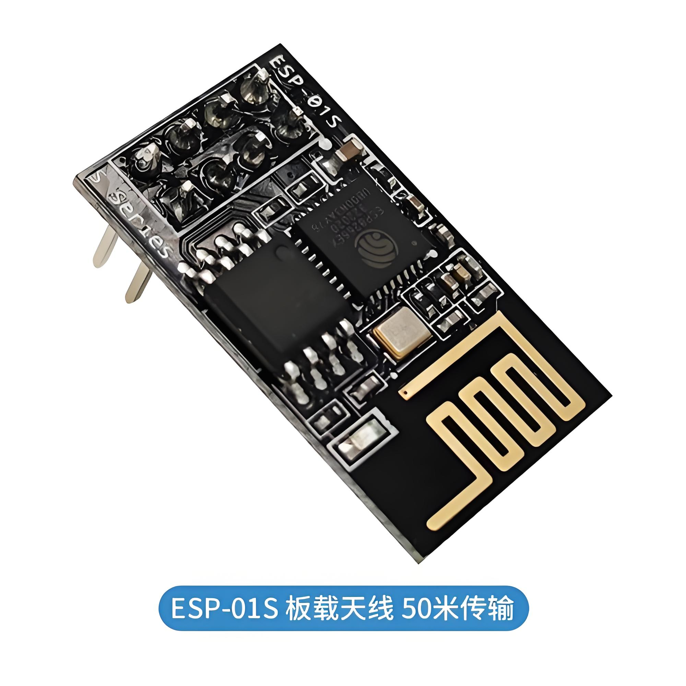

*图2-1ESP01S模块-图*

使用这种模块，当然是为了方便我们接线做实验使用。

而在实际公司项目中，则可以选择板载ESP-01S模块，集成到自己产品的PCB上去使用。当然这是硬件工程师需要做的事情。

总的来说，如果我们站在 STM32 单片机开发者的角度来看：

ESP-01S 的使用方式，其实和 HC-05 蓝牙模块非常类似。

对于 ESP-01S 模块来说：

1. 模块内部的芯片已经预先烧录好固件，支持 AT 指令模式，并提供 TCP/IP 网络通信功能
2. STM32 不需要自己去实现复杂的 Wi-Fi 协议和网络协议栈
3. 只需要通过串口发送 AT 指令，并接收返回结果，就可以完成网络通信相关操作

因此，从使用方式上来看，ESP-01S 本质上可以理解为一种：

**串口转 WiFi 模块。**

或者也可以形象地理解为：

**一块通过串口连接的 Wi-Fi 网卡。**

### 3. ESP-01S模块的组成

ESP-01S的模块结构图，如下所示：


*图3-1ESP-01S模块结构-图*

从模块结构上看，ESP-01S 主要由以下几个部分组成。

#### 3.1 PCB板载天线

模块最上方弯曲的金色走线部分，就是模块上的 PCB 印刷天线。

其作用是：用于发射和接收 2.4GHz 频段的 Wi-Fi 无线信号。

需要特别注意的是：

**ESP-01S 不仅可以接收 Wi-Fi 信号，也可以主动发射 Wi-Fi 信号。**

也就是说，它既可以作为 Wi-Fi 客户端（Station）连接到路由器，也可以作为 Wi-Fi 热点（Access Point），供其他设备连接。

#### 3.2 ESP8266EX主控芯片

模块中最大的芯片就是 ESP8266EX，它是整个 ESP-01S 模块的核心。

ESP8266EX 实际上是一颗 Wi-Fi SoC（System on Chip，片上系统），芯片内部集成了多种功能模块，例如：

1. 32 位处理器核心
2. Wi-Fi MAC 与基带电路
3. SRAM 存储器
4. 多种外设接口（GPIO、UART、SPI 等）

配合官方提供的固件或开发框架，ESP8266 还可以实现 Wi-Fi 连接以及 TCP/IP 网络通信功能。

因此，ESP8266 不仅仅是一个 Wi-Fi 收发器，同时也是一颗可以运行程序的微控制器。

在很多应用中，ESP8266 既可以独立运行用户程序，也可以作为 Wi-Fi 协处理器，与其他 MCU（例如 STM32）配合使用。

#### 3.3 SPI Flash 存储器

ESP-01S 模块使用的主控芯片是 ESP8266，而 ESP8266 本身并没有内部程序 Flash。

也就是说：程序需要存储在外部 SPI Flash 中。

在主控芯片旁边，可以看到一个 8 引脚的小芯片（SOIC-8 封装），这就是模块上的 SPI Flash 存储器。

因此可以理解为：

**SPI Flash 实际上就是 ESP8266 的程序存储器。**

当模块上电后，ESP8266 会从该 SPI Flash 中读取程序并开始运行。

该 Flash 主要用于存储以下内容：

1. **AT 固件程序，用于支持 AT 指令、连接WiFi，网络通信等相关功能（默认烧录，默认使用）**
2. Wi-Fi 参数配置，例如已连接的 Wi-Fi 名称和密码等信息
3. 网络相关程序代码（例如 TCP/IP 功能相关代码）
4. 用户程序（如果用户重新烧录固件的话）

ESP-01S 模块上常见的 Flash 容量为 8 Mbit（约 1 MB），容量并不算很大。

从功能上来看，ESP8266 外接的 SPI Flash 与 STM32 内部的 Flash 用途是类似的，主要都是用于存储程序和一些必要的配置数据。

#### 3.4 外部晶振

在主控芯片附近，可以看到一个金属封装的小器件，这就是模块使用的外部晶振（External Crystal Oscillator）。

其作用是：为 ESP8266 提供稳定的系统时钟信号。

由于 Wi-Fi 无线通信对时钟精度要求较高，因此需要使用外部晶振来保证系统时钟的稳定性，从而确保无线通信能够正常工作。

ESP8266 常用的晶振频率为：26 MHz。

#### 3.5 外围辅助电路

在模块周围可以看到许多小型贴片元件，例如：

1. 电阻
2. 电容
3. 滤波元件
4. 射频匹配元件
5. 等等

这些元件共同构成了模块的外围辅助电路，主要用于保证芯片以及无线电路能够稳定工作。

具体来说，它们主要承担以下几个作用：

1. 保证电源稳定，对电源进行滤波和去耦。
2. 实现部分启动配置电路（后面会详细讲）。
3. 构成射频匹配电路，用于保证 Wi-Fi 信号能够高效地发射和接收。

虽然这些贴片元件体积很小，但对于模块的稳定运行、无线通信性能以及抗干扰能力都起着非常重要的作用。

### 4. 引脚定义和接线方式

ESP-01S 模块一共对外提供 8 个引脚，如下图所示：

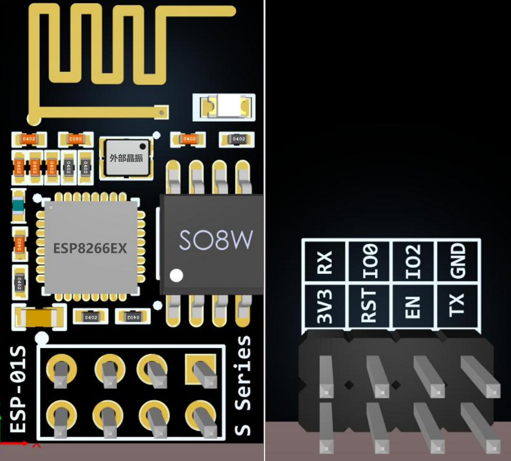

*图4-1ESP01S模块-实物图*

其电路设计原理图，如下所示：

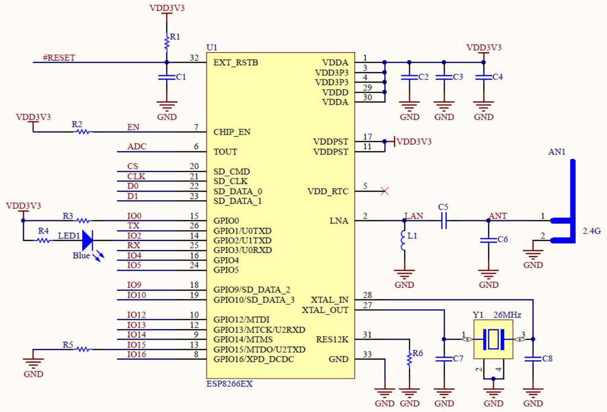

*图4-2ESP01S模块引脚定义-图*

模块的 8 个引脚可以分为三类功能：

1. 电源相关引脚
2. 串口通信引脚
3. 其他特殊功能引脚

下面分别介绍。

#### 4.1 电源引脚

**3V3（VCC）**：模块的电源输入引脚。

需要特别注意的是：ESP-01S 只能使用 3.3V 供电，绝对不能直接接 5V 电源。

另外，ESP8266 在 Wi-Fi 发射数据时电流会瞬间增大，峰值电流可能达到 300mA 左右。

如果电源不稳定，就可能导致模块不断重启或工作异常。

因此建议：

**ESP-01S 模块应当单独使用3.3V供电，不要直接使用面包板电源给模块供电。**

**可以选择使用烧录器或者 ST-Link 提供的 3.3V 电源来为模块供电。**

GND：模块电源地，需要与 STM32 系统的 GND 共地。

#### 4.2 串口通信引脚

ESP-01S 与外部设备之间的通信方式为串口通信（UART）。

在 STM32 项目中：

如果使用 ESP-01S Wi-Fi 模块作为无线通信模块，就需要将它连接到 STM32 单片机的某个 USART 外设，通过串口进行数据收发。

**在这次项目中，我们选择使用单片机的 USART2 外设。**

对于 STM32F103C8T6 单片机来说，USART2 的默认引脚如下图所示：

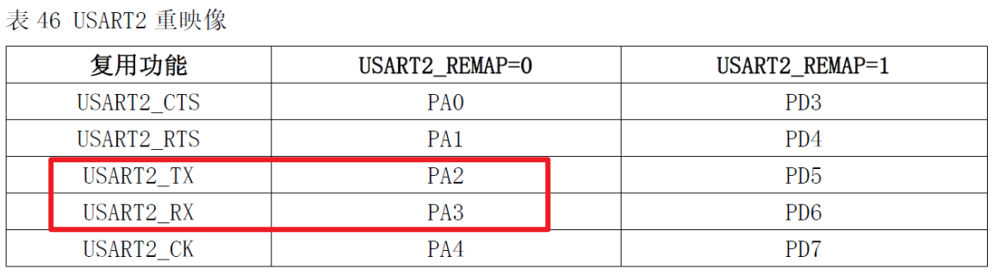

*图4.2-1USART2外设引脚-图*

因此，ESP-01S 模块与 STM32 单片机的连接关系如下：

| STM32F103C8T6 | ESP-01S | 说明 |
|---|---|---|
| PA2 (USART2_TX) | RXD | STM32发送 → ESP接收 |
| PA3 (USART2_RX) | TX | ESP发送 → STM32接收 |
| GND | GND | 双方共地 |

**需要注意的是：ESP-01S 模块需要单独供电，供电电压为 3.3V。**

#### 4.3 IO0引脚（了解）

GPIO0 是 ESP8266 的启动模式选择引脚之一。

在模块上电或复位时，ESP8266 会检测 GPIO0 的电平，从而决定进入哪一种启动模式。

具体情况如下：

| 模块上电时 GPIO0 的输入状态 | 启动模式 | 说明 |
|---|---|---|
| 高电平 | 正常启动模式 | 从 SPI Flash 启动程序 |
| 低电平 | 下载模式 | 用于烧录固件 |

也就是说，上电复位瞬间：

1. 如果 GPIO0 输入高电平 → 正常启动，从 SPI Flash 启动程序。
2. 如果 GPIO0 输入低电平 → 进入下载模式，通过串口烧录程序。

如果只是正常使用 ESP-01S 模块，通常不需要连接 GPIO0 引脚。

这是因为 ESP-01S 模块内部已经带有上拉电阻，GPIO0 默认被拉为高电平，因此模块上电后会自动进入正常启动模式。

**在大多数嵌入式项目中，使用 ESP-01S 模块通常都会直接使用模块内部已经烧录好的AT 固件程序，而不会重新烧录程序。**

这套固件已经实现了大量网络功能，例如：

1. WiFi 扫描
2. WiFi 连接
3. TCP / UDP 网络通信
4. HTTP 等网络功能

所以，我们没有必要再去自己编程烧录固件程序。

**STM32 等单片机只需要通过串口发送 AT 指令，就可以控制 ESP-01S 完成各种网络操作。**

如果真的需要给 ESP8266 烧录固件，则需要：

1. 将 GPIO0 拉低
2. 再给模块上电或复位

这样 ESP8266 就会进入串口下载模式，不建议在我们的项目中这么做，没有必要。

因此在我们的项目中：

**GPIO0 引脚不需要连接到 STM32，不需要接线，让它基于上拉电阻保持高电平默认状态即可。**

#### 4.4 IO2引脚（了解）

GPIO2 是 ESP8266 的一个通用数字 IO 引脚，在 ESP-01S 模块上也被引出供用户使用。

从功能上来说，GPIO2 既参与系统启动配置，也可以在系统运行后作为普通 IO 引脚使用。

需要注意的是：

**GPIO2 是 ESP8266 的启动检测引脚之一。**

当 ESP8266 上电或复位时，芯片会检测 GPIO2 的电平状态：

| 模块上电时 GPIO0 的输入状态 | 启动结果 |
|---|---|
| 高电平 | 系统正常从 SPI Flash 启动 |
| 低电平 | 系统可能无法正常启动 |

因此，在正常使用时必须保证 GPIO2 在启动时保持高电平。

在 ESP-01S 模块内部，GPIO2 已经通过上拉电阻连接到 3.3V，因此默认状态为高电平，这也是模块能够正常启动的重要原因之一。

当 ESP8266 完成启动并进入程序运行阶段后，GPIO2 就可以像普通单片机 IO 一样进行使用。

例如在自行开发 ESP8266 程序时，可以将 GPIO2 配置为输入或输出，用于：

1. 控制 LED
2. 读取按键
3. 控制外设等

不过在 STM32 + ESP-01S 的典型应用场景中：

我们通常直接使用模块内部已经烧录好的 AT 固件，STM32 只需要通过 USART 串口发送 AT 指令来控制 WiFi 功能。

因此在我们的项目中：

**GPIO2 引脚不需要连接到 STM32，不需要接线，让它基于上拉电阻保持高电平默认状态即可。**

#### 4.5 RST引脚（了解）

RST（Reset）引脚是 ESP-01S 模块的复位引脚，用于对 ESP8266 芯片进行硬件复位。

其工作方式如下：

1. 当 RST 被拉为低电平时，ESP8266 会立即复位，系统重新启动；
2. 当 RST 恢复为高电平后，芯片会重新执行启动流程，并从 SPI Flash 中加载程序运行。

因此可以简单理解为：

RST 引脚的作用就是让 ESP8266 重新启动。

**在正常工作时，RST 引脚必须保持高电平，模块才能持续运行；如果 RST 被拉低，模块就会进入复位状态，程序停止执行。**

在 ESP-01S 模块内部，RST 引脚已经通过上拉电阻连接到 3.3V，因此模块上电后会自动进入正常运行状态。

在实际应用中，RST 引脚也可以连接到外部电路，用于实现以下功能：

1. 手动复位模块，通过按键将 RST 短暂拉低，即可让模块重新启动。
2. 由 MCU 控制复位，可以把 RST 引脚连接到 STM32 的一个 GPIO，引脚输出低电平时即可复位 ESP8266。

不过在大多数 STM32 + ESP-01S 的应用场景中，如果没有特殊需求，RST 引脚一般保持默认的上拉状态即可，不需要额外控制。

因此在我们的项目中：

**RST 引脚通常不需要连接到 STM32，不需要接线，让它保持模块默认状态即可。**

#### 4.6 EN引脚

EN（Enable）引脚是 ESP-01S 模块的芯片使能引脚，用于控制 ESP8266 芯片是否工作。

其工作方式如下：

| EN 引脚输入电平 | 芯片状态 |
|---|---|
| 高电平 | 芯片正常工作，使能开启 |
| 低电平 | 芯片关闭（进入掉电状态） |

也就是说：

1. EN = 高电平 → ESP8266 正常运行
2. EN = 低电平 → ESP8266 被关闭

因此在正常使用 ESP-01S 模块时，需要保证：EN 引脚保持高电平（通常连接到3.3V）。

**在 ESP-01S 模块上，EN 引脚已经通过上拉电阻连接到 3.3V，因此只要模块上电，ESP8266 就会自动启动并开始运行。**

如果你觉得有必要的话，也可以通过控制 EN 引脚来实现以下功能：

1. 将 EN 拉低，关闭模块以降低功耗，ESP8266 会进入掉电关闭状态。
2. 先将 EN 拉低，再拉高，ESP8266 会重新启动，重新执行启动流程，类似复位模块。

不过在大多数 STM32 + ESP-01S 的应用场景中，如果没有特殊需求，EN 引脚一般保持默认的上拉状态即可，不需要额外控制。

因此在我们的项目中：

**EN 引脚通常不需要连接到 STM32，不需要接线，让它保持模块默认状态即可。**

注：

掉电状态，指芯片内部电路被关闭，停止工作，功耗极低。

但掉电状态不是完全断电，VCC电源断路才能称得上完全断电。

#### 4.7 总结

**ESP-01S 模块与 STM32 接线的总结：**

| ESP-01S 引脚 | STM32 连接方式 | 作用说明 | 备注 |
|---|---|---|---|
| VCC | 3.3V 电源 | ESP-01S 模块供电 | 必须使用稳定 3.3V 电源，不能接 5V |
| GND | GND | 与 STM32 系统共地 | 必须连接 |
| TX | PA3（USART2_RX） | ESP 串口发送 → STM32 接收 | 串口通信 |
| RX | PA2（USART2_TX） | STM32 发送 → ESP 接收 | 串口通信 |
| EN | 默认内部上拉 | 芯片使能引脚，高电平模块才会工作 | 一般无需外接 |
| RST | 默认内部上拉 | 芯片复位引脚，低电平复位 | 一般无需外接 |
| IO0 | 默认内部上拉 | 启动模式选择引脚 | 默认高电平正常启动 |
| IO2 | 默认内部上拉 | 启动检测引脚 | 启动时必须保持高电平 |

也就是说，在 STM32 + ESP-01S 的常见应用中：

**通常只需要连接 4 根线即可正常使用：**

VCCGNDTXRX其他引脚在模块内部已经通过上拉电阻处理好，一般不需要额外连接3.3V。

#### 4.8 关于接线的重要注意事项（必看！）

上面介绍的接线方式，是在 ESP-01S 模块内部确实存在默认上拉电阻的前提下成立的。

也就是说，在符合原理图设计规范的情况下：

EN、RST、IO0、IO2 这四个引脚理论上都已经通过内部电阻上拉到高电平，因此在使用时可以不额外连接到 3.3V。

但是需要特别注意一点：

实际市面上购买到的 ESP-01S 模块，其硬件设计并不完全统一。

很多模块在内部并没有实现完整的上拉电阻设计，或者上拉阻值非常大，导致电平并不稳定。

因此在实际使用过程中，经常会出现下面这种情况：

**EN、RST、IO0、IO2 这四个引脚，到底是否需要外接 3.3V，并不能完全依赖理论设计判断，往往需要实际测试后才能确定。**

以往期使用ESP01-S的经验而言，需要进行如下接线：

1. **IO0、IO2 这两个引脚，可以悬空使用。**
2. **EN 和 RST 这两个引脚，需要外接 3.3V 上拉，建议直接接入面包板电源轨正极！**

也就是说，在大多数情况下，推荐的电路接法是：

EN → 接 3.3V（面包板电源轨正极）

RST → 接 3.3V（面包板电源轨正极）

IO0 → 可以悬空IO2 → 可以悬空这样的接法，可以避免WiFi模块无法启动、随机复位、工作不稳定等问题。

简单总结一句话：

ESP-01S 模块的这四个引脚，并不能完全依赖原理图的定义，直接不接3.3V，而是需要结合具体拿到手的硬件模块实际测试。

目前来看，从经验上：

**EN 和 RST 建议接3.3V电源轨正极，IO0 和 IO2 可以悬空。**

当然，你也可以拿你手中的WiFi模块，自行测试一下。有些同学拿到的模块，可以四个引脚都悬空。

### 5. ESP-01S的角色模式

ESP-01S 模块内部的 ESP8266 芯片既可以接收 WiFi 信号，也可以发出 WiFi 信号。

因此，在无线网络中，ESP8266 可以扮演不同的角色。

根据工作方式的不同，ESP8266 的 WiFi 工作模式主要有三种：

1. STA 模式（Station 模式）
2. AP 模式（Access Point 模式）
3. STA + AP 模式（混合模式）

#### 5.1 STA 模式（客户端模式）

STA（Station）模式也叫客户端模式。

在这种模式下，ESP8266 会像手机、电脑一样，连接到一个已经存在的 WiFi 网络（家庭路由器、手机电脑热点等）。

连接成功后，ESP8266 就可以通过该 WiFi 网络访问局域网或互联网。

例如：

ESP8266 → 家用路由器 → 互联网服务器**在物联网设备中，STA模式最常见，最常用。**

例如：

1. 智能插座
2. 智能灯
3. 智能温湿度计

这些设备通常都会连接到家庭 WiFi 路由器，然后与云服务器进行通信。

#### 5.2 AP 模式（热点模式）

AP（Access Point）模式也叫热点模式。

在这种模式下，ESP8266 自己会创建一个 WiFi 热点，其他设备可以直接连接这个热点。

例如：

手机 → 连接 → ESP8266 WiFi热点这种方式通常用于：

1. **设备配网**
2. **本地控制**

例如很多智能设备在第一次使用时，需要先连接设备热点，然后通过手机配置家庭WiFi 信息。

在我们的项目中，ESP-01S 会被配置为 WiFi 客户端（STA 模式），用于连接一个已存在的 WiFi 网络，从而使得STM32可以接入互联网。

**因此，在本项目中并不会使用 AP 模式。**

不过，AP 模式在很多实际应用中是非常有用的。

许多嵌入式设备在使用时，会通过创建自己的 WiFi 热点：

让手机或电脑直接连接该热点，从而完成设备的网络配置、参数设置以及数据通信等功能。

这种方式在智能家居设备、物联网终端等产品中非常常见。

#### 5.3 STA + AP 模式（混合模式）

ESP8266 还支持同时开启 STA 和 AP 两种模式。

也就是：

ESP8266 既可以连接路由器，又可以提供 WiFi 热点。

这种情况，在物联网设备中也是比较常见的。

例如：

设备第一次开机时：

1. ESP-01S 先开启热点
2. 手机连接设备热点
3. 手机把家用 WiFi 的账号密码发送给设备
4. ESP-01S 再去连接家庭路由器

这个过程通常叫：**WiFi 配网（WiFi Provisioning）**

当然，在我们的项目中，我们使用蓝牙模块完成配网，就不使用这种方式了。

#### 5.4 总结

**在本项目中，我们需要让 STM32 通过 ESP-01S 模块接入 WiFi 网络，从而实现设备联网功能。**

**因此会将 ESP-01S 设置为 STA（客户端）模式。**

### 6. ESP-01S的数据通信模式

在本项目中，我们使用的是 ESP8266 官方提供的 AT 固件程序。ESP-01S 模块出厂时已经预先烧录了这套 AT 固件。

该固件内部已经实现了 WiFi 连接、TCP/IP 网络通信以及 AT 指令解析等功能。

因此，在使用 ESP-01S 时：

STM32 等外部单片机不需要自己实现复杂的 WiFi 和 TCP/IP 协议，只需要通过串口发送 AT 指令，就可以控制 ESP8266 完成各种网络操作。

在官方 AT 固件中，ESP-01S 模块在进行数据通信时，有两种不同的模式：

1. AT 指令模式
2. 透传模式

这两种模式是 ESP8266 AT 固件提供的两种数据通信方式，下面分别介绍一下。

#### 6.1 AT指令模式与常用AT指令

**ESP-01S 在使用官方 AT 固件时，上电后默认处于 AT 指令模式。**

在这种模式下，STM32 等外部设备通过串口发送 AT 指令，控制 ESP8266 完成各种网络操作。

**AT 指令都以 AT 开头，使用时不区分大小写，但必须以“换行\r\n”结束。**

在我们的项目中，ESP-01S 的主要作用是：

通过 WiFi 将 STM32 的数据上传到服务器。

因此，只需要使用少量几个 AT 指令即可完成整个网络通信流程。

下面来介绍一下这些指令。

完整的AT指令，可以参考给大家发的AT指令手册，但通常也没必要看。

##### 6.1.1 AT

作用：

测试 AT 指令通信是否正常。

模块如果正常工作，会返回：

**\r\nOK\r\n**也就是：

```c

OK

```

实际上在所有的AT指令执行成功后，ESP-01S模块都会给你返回"换行OK换行"。

注意这个细节。

这个AT指令，通常在调试WiFi模块时使用，确认：

1. 串口配置连接正确
2. ESP-01S 模块，当前可以正常工作

##### 6.1.2 ATE0/ATE1：回显功能开关

作用：

控制 AT 指令回显功能（Echo）。

也就是说，当串口发送 AT 指令时，控制模块是否把收到的指令再返回一遍。

```c
ATE1 开启回显
ATE0 关闭回显
```

在默认设置下，回显是开启的，比如发送一个“AT”指令，模块给你返回的数据是：

```c
AT

OK
```

最上面的"AT"就是回显数据。

一般在项目中都会执行：

```c
ATE0
```

关闭回显，避免多余数据影响 MCU 解析。

##### 6.1.3 AT+CWMODE?：查询角色模式

作用：

**查询当前 ESP-01S模块的角色模式。**

返回示例：

```c
+CWMODE:1

OK
```

CWMODE冒号后面的数字，代表的模式含义是：

| 模式值 | 含义 |
|---|---|
| 1 | Station 模式（客户端模式） |
| 2 | AP 模式（热点模式） |
| 3 | AP + Station（混合模式） |

在物联网设备中最常用的是模式 1。

**初始设置时，ESP-01模块的默认角色模式是2，即热点模式，所以拿到模块后需要手动修改它的角色模式。**

##### 6.1.4 AT+CWMODE=1：设置客户端模式

作用：

设置 ESP-01S WiFi 模块为 Station 模式（STA）。

也就是说：

让 ESP-01S WiFi 模块作为 WiFi 客户端，去连接路由器的 WiFi 网络，从而实现上网。

这是 ESP-01S WiFi 模块最常见的工作模式，在实际项目中通常需要手动设置为该模式。

发送示例：

```c
AT+CWMODE=1
```

返回示例：

```c
AT+CWMODE=1

OK
```

##### 6.1.5 AT+CWJAP?：查询连接状态

作用：

查询 ESP-01S WiFi 模块当前连接的 WiFi 信息。

如果模块已经连接到 WiFi，会返回当前连接的 WiFi 名称（SSID）。

返回示例：

```c
+CWJAP:"TP-LINK_1234"

OK
```

如果模块没有连接任何 WiFi，通常会返回：

```c
No AP
```

##### 6.1.6 AT+CWJAP="ssid","password"：连接指定WiFi

**核心 AT 指令。**

作用：

让 ESP-01S WiFi 模块连接指定的 WiFi 网络。

参数：

```c
ssid WiFi 名称
password WiFi 密码
```

发送示例：

```c
AT+CWJAP="TP-LINK_1234","12345678"
```

执行成功返回：

```c
WIFI CONNECTED
WIFI GOT IP

OK
```

说明：

1. WIFI CONNECTED 表示已连接路由器
2. WIFI GOT IP 表示已经成功获取 IP 地址

如果目标WiFi不存在时，该指令通常会返回错误码：3ESP-01S反馈的错误信息如下：

```c
+CWJAP:3

FAIL

```

如果密码错误时，该指令通常会返回错误码：2ESP-01S反馈的错误信息如下：

```c
+CWJAP:2

FAIL

```

**注意，此指令的执行需要时间，不要着急。**

**苹果手机开热点，请开启兼容模式，尽量使用安卓手机开启2.4GHz频段的WiFi热点。**

##### 6.1.7 AT+CIPSTART="TCP","IP",Port：建立指定TCP连接

**核心 AT 指令，必须在WiFi连接成功后才可以使用。**

作用：

让 ESP-01S WiFi 模块与服务器建立 TCP 连接。

发送示例：

```c
AT+CIPSTART="TCP","121.41.231.209",8888
```

参数说明：

```c
TCP 协议类型
121.41.231.209 服务器 IP 地址
8888 服务器端口
```

成功返回：

```c
CONNECT

OK
```

说明：

表示 ESP-01S WiFi 模块已经成功与服务器建立 TCP 连接。

**注意，指令的执行需要时间，不要着急。如果IP、端口信息不正确或服务端出现问题等情况，可能建立连接失败。**

##### 6.1.8 AT+CIPSEND=Length：向服务端发送固定字节数据

**核心 AT 指令，必须在TCP连接建立成功后才可以使用。**

作用：

用于向 TCP 服务器发送指定长度的数据。

参数：

```c
Length 要发送的数据长度（字节）
```

发送示例：

```c
AT+CIPSEND=5
```

ESP-01S WiFi 模块随即会返回下面内容：

```c
OK
>
```

其中字符“>”，表示可以开始发送数据了。

**但注意：ESP-01S模块，只会将你随后发送的Length个字节的数据发给TCP服务端。**

例如：

接下来我发送一个字符串“hello”

最终ESP-01S模块会给我如下反馈：

```c
Recv 5 bytes

SEND OK
```

含义分别是：

1. Recv5bytes ：ESP-01S 已经从**串口 AT 指令端口**接收到 5 字节数据。
2. SENDOK ：ESP-01S 已经将这 5 字节数据提交给 TCP/IP 协议栈发送

**注意，指令的执行需要时间，不要着急，受网络环境影响比较大。建议开启手机热点，供STM32联网使用。**

除此之外，如果服务端返回了一些数据，那么 ESP-01S 也会通过串口将数据传回。格式如下：

```c
+IPD,5:nihaoCLOSED
```

这表示：

1. +IPD,5: ：ESP-01S 接收到服务器发送的 5 字节数据。
2. nihao ：服务器实际返回的数据内容。
3. CLOSED ：服务器已经主动关闭 TCP 连接。

注意，nihao和CLOSED连在一起，是因为服务器发送的nihao后面没有换行。

CLOSED是 ESP-01S 输出的连接状态信息，不属于服务器发送的数据。

如果服务端发送的nihao后面带有换行\r\n ，收到的反馈可能如下：

```c
+IPD,7:nihao
```

在程序中处理时，应根据 +IPD 中记录的数据长度读取数据。这里长度为 5，因此只读取后面的 5 个字节 nihao。

当然，具体的处理方式，还要具体情况具体分析。

##### 6.1.9 AT+CIPCLOSE：断开TCP连接

作用：

关闭 ESP-01S WiFi 模块当前建立的 TCP 连接。

发送示例：

```c
AT+CIPCLOSE
```

执行成功返回：

```c
CLOSED

OK
```

说明：

1. ESP-01S WiFi 模块会主动断开 TCP 连接
2. 服务器端也会检测到客户端已经断开连接

##### 6.1.10 AT+RST：复位/断电重启

作用：

复位**ESP-01S WiFi 模块（ESP8266）**，相当于断电重启。

发送示例：

```c
AT+RST
```

执行后模块会重新启动，并在串口打印启动信息，随后重新进入 AT 指令模式。

##### 6.1.11 AT+RESTORE：恢复出厂设置

作用：

将 ESP-01S WiFi 模块恢复为出厂默认设置。

执行后模块会清除之前保存的配置，例如：

1. 已连接的 WiFi 信息
2. TCP / 网络相关配置
3. 工作模式等参数

恢复完成后，模块会重新启动并回到默认状态。

#### 6.2 AT+CWAUTOCONN=0：关闭上电自动重连

默认情况下，ESP01-S模块上电后会自动连接上一次保存过的 WiFi。

如果希望关闭这个功能，可以发送下面的 AT 指令：

```c
AT+CWAUTOCONN=0
```

**该指令的作用是：禁止模块上电后自动连接之前保存过的 AP/WiFi。**其中：

```c
AT+CWAUTOCONN=0 // 关闭上电自动重连
AT+CWAUTOCONN=1 // 开启上电自动重连
```

需要注意的是，AT+CWAUTOCONN=0只是关闭自动重连功能，并不会删除之前保存的WiFi 名称和密码。

如果只是想关闭上电自动重连，可以这样操作：

```c
AT+CWAUTOCONN=0
AT+RST
```

其中，AT+RST用于重启模块，方便验证模块重启后是否还会自动连接 WiFi。

如果模块当前已经连接了 WiFi，并且希望立刻断开当前连接，可以再发送：

```c
AT+CWQAP
```

因此，一个比较完整的操作流程如下：

```c
AT+CWAUTOCONN=0 // 关闭上电自动连接
AT+CWQAP // 断开当前 WiFi
AT+RST // 重启模块，验证效果
```

后续如果还需要重新连接 WiFi，仍然可以手动发送：

```c
AT+CWJAP="ssid","password"
```

总结来说，AT+CWAUTOCONN=0适合在调试 ESP-01S 时使用。

它可以避免模块一上电就自动连接旧的 WiFi，从而让我们更方便地测试蓝牙配网、WiFi 重连、联网失败处理等逻辑。

#### 6.3 推荐的ESP-01S操作流程

在实际项目中，ESP-01S 通常使用官方 AT 固件进行通信。

STM32 并不直接操作 WiFi 协议，而是通过串口发送 AT 指令来控制 ESP8266 内部的网络协议栈。

整个使用过程，本质上就是：

STM32 → 串口AT指令 → ESP8266 → WiFi网络 → 服务器ESP-01S 的典型使用流程可以分为五个步骤：

1. 测试 AT 指令通信
2. 设置 SAT客户端的角色模式
3. 连接路由器 WiFi
4. 建立 TCP 连接
5. 发送数据到服务器

首先第一步，一定要测试 AT 指令通信是否正常。

模块上电之后，通过串口发送：

```c
AT
```

如果模块工作正常，会返回：

```c
OK
```

实际上，ESP8266 在所有 AT 指令执行成功之后都会返回：

```c
\r\nOK\r\n
```

也就是换行 + OK + 换行。

这一条指令通常用于调试阶段，主要确认三件事情：

1. 串口接线正确
2. 波特率设置正确
3. ESP 模块已经正常启动

在调试 AT 指令时，可以考虑关闭指令回显（Echo）。

默认情况下，ESP 会把接收到的指令，再原样发送回来。

例如发送：

```c
AT
```

串口工具可能会看到：

```c
AT

OK

```

其中第一行**AT**就是回显。如果不希望出现回显，可以执行：

```c
ATE0
```

这条指令的含义是：

**关闭 AT 指令回显功能**如果需要重新打开回显，可以执行：

```c
ATE1
```

接下来需要设置 ESP-01S 的 WiFi 工作模式。

ESP8266 一共有三种工作模式：

| 模式值 | 模式 | 说明 |
|---|---|---|
| 1 | Station | 客户端模式 |
| 2 | AP | 热点模式 |
| 3 | AP + Station | 混合模式 |

可以使用下面的指令查询当前模式：

```c
AT+CWMODE?
```

返回示例：

```c
+CWMODE:2

OK
```

其中数字 2 表示当前工作在 AP模式（热点模式）。很多 ESP-01 模块出厂默认就是**模式2**。

**但是在物联网设备中，通常希望设备连接路由器上网，因此需要使用 Station 模式。**

可以执行：

```c
AT+CWMODE=1
```

将 ESP-01S 设置为**STA 模式**。当 ESP 进入 Station 模式之后，下一步就是**连接路由器WiFi**。

使用最核心的 AT 指令：

```c
AT+CWJAP="ssid","password"
```

例如：

```c
AT+CWJAP="TP-LINK_1234","12345678"
```

如果连接成功，ESP 会返回：

```c
WIFI CONNECTED
WIFI GOT IP

OK

```

**这表示：ESP 已经成功连接到路由器，并且获得了 IP 地址。**

如果需要查询当前连接的 WiFi，可以执行：

```c
AT+CWJAP?
```

返回示例：

```c
+CWJAP:"TP-LINK_1234"

OK
```

当 ESP 已经连接到 WiFi 网络之后，就可以开始进行 TCP 网络通信。

首先需要建立 TCP 连接。

使用指令：

```c
AT+CIPSTART="TCP","服务器IP",端口
```

例如：

```c
AT+CIPSTART="TCP","121.41.231.209",8888
```

执行成功后会返回：

```c
CONNECT

OK

```

这表示：

ESP 已经成功和服务器建立 TCP 连接。TCP 连接建立之后，就可以发送数据了。

发送数据需要分为两步。

第一步：

告诉 ESP-01S 即将发送的数据长度。

例如：

```c
AT+CIPSEND=5
```

ESP 会返回：

```c
>

```

这个符号表示：ESP-01S 已经准备好接收数据。

第二步：

发送数据内容，例如：

```c
hello
```

**ESP 会把 hello 这5个字节，通过 TCP 发送到服务端，服务器端即可接收到数据。**

如果通信结束，可以关闭 TCP 连接。

使用指令：

```c
AT+CIPCLOSE
```

执行后，TCP 连接会被关闭，服务器端也会检测到，客户端连接已经断开。

如果模块状态异常，可以使用以下指令重新初始化模块。

重启模块：

```c
AT+RST
```

恢复出厂设置：

```c
AT+RESTORE
```

恢复出厂设置后：

1. WiFi 信息会被清除
2. TCP 配置会被清除
3. 工作模式恢复默认状态

在实际的嵌入式项目中，ESP-01S 的完整 AT 指令流程通常如下：

```c
AT
↓
ATE0
↓
AT+CWMODE=1
↓
AT+CWJAP="WiFi名称","WiFi密码"
↓
AT+CIPSTART="TCP","服务器IP",端口
↓
AT+CIPSEND=数据长度
↓
发送数据
↓
AT+CIPCLOSE
```

从整体结构来看，可以把 ESP-01S 理解为一个**带 WiFi 功能的网络模块**。

STM32 只需要通过串口发送 AT 指令，ESP8266 内部就会自动完成：

1. WiFi连接
2. TCP/IP协议处理
3. 网络数据发送

因此在很多物联网项目中，ESP-01S 就相当于**STM32 的网络接口芯片**。

#### 6.4 透传模式（了解）

在前面的实验中，我们一直使用的都是**AT 指令模式**。

也就是说：

STM32 需要不断向 ESP-01S 发送 AT 指令，例如：

```c
AT+CWMODE=1
AT+CWJAP="WiFi名","密码"
AT+CIPSTART="TCP","服务器IP",端口
AT+CIPSEND=长度
```

然后 ESP-01S 再根据这些 AT 指令去完成对应的网络操作。

**这种方式的特点是：STM32 需要主动控制整个通信过程，每一步都需要发送 AT 指令。**

接下来我们再介绍 ESP-01S 的另一种通信方式：透传模式（Transparent Transmission Mode）

所谓透传，其实可以理解为：ESP-01S 不再解析数据，而是直接把串口数据原样发送到网络。

也就是说：STM32 通过串口发送的数据

```c
USART2 → ESP-01S → WiFi → TCP服务器
```

ESP-01S 不会再把这些数据当成 AT 指令解析，而是：直接把数据原封不动发送到服务器。

例如：

STM32 通过串口发送：

```c
hello
```

ESP-01S 会直接把：

```c
hello
```

发送到 TCP 服务器。

而不需要再发送：

```c
AT+CIPSEND
```

这样的 AT 指令。

因此透传模式的一个最大特点就是：

通信效率更高，数据发送更加简单。

STM32 只需要像普通串口一样发送数据即可。

不过透传模式也有一些明显的缺点：

第一，一旦进入透传模式，就无法再发送 AT 指令。

第二，如果想退出透传模式，需要发送特殊指令：“+++”，并且：

1. **发送**+++**前至少 1 秒不能发送任何数据**
2. **发送**+++**后至少 1 秒不能发送任何数据**
3. 从软件层面上看，也就是需要前后各延时最少1秒钟。

第一种：

**开发阶段使用 AT 指令模式**方便调试和控制网络连接。

第二种：

**产品稳定后使用透传模式**提高数据通信效率。

在 ESP-01S 中，如果想进入透传模式，通常需要按以下步骤操作：

第一步，建立 TCP 连接，例如：

```c
AT+CIPSTART="TCP","服务器IP",端口
```

第二步，开启透传模式：

```c
AT+CIPMODE=1
```

第三步，进入透传发送：

```c
AT+CIPSEND
```

当执行AT+CIPSEND之后，如果模块返回：

```c
>
```

说明**已经进入透传模式**。

此时 STM32 再发送的所有数据，都会被 ESP-01S **直接发送到服务器**。

例如：

STM32 串口发送：

```c
temperature=25
```

ESP-01S 就会直接把这一段数据发送到 TCP 服务器。

如果想退出透传模式，需要：

发送

```c
+++
```

注意：

发送+++前后**必须保持一段时间不发送数据**，否则模块不会退出透传模式。

总结一下：

ESP-01S 在 AT 固件下有两种通信方式：

**AT 指令模式**特点：

1. 灵活
2. 可控制
3. 适合开发调试

**透传模式**特点：

1. STM32 只负责发送数据
2. ESP-01S 不解析 AT 指令
3. 数据直接通过 WiFi 发往服务器
4. 适合稳定运行后的项目

两种方式都可以使用，具体用哪一种大家可以自由选择。

**个人推荐使用AT指令模式去传输数据，更加简单，不容易出错。**

### 7. ESP-01S的默认出厂配置（重点）

ESP-01S模块，出厂自带的AT固件程序，默认配置如下：

1. **串口配置：115200，8N1，无流控**
2. 启动日志采用的串口配置是：74880，8N1，无流控
3. 支持客户端（1）、热点（2）、混合（3）三种模式，我们通常使用客户端模式。

**但ESP-01S恢复出厂设置时会变成AP热点模式，这一点要注意。**

4. 默认开启上电自动连接WiFi功能。

更多的默认配置，大家可以自行测试，以上配置只是我们比较关注的。

### 8. ESP-01S烧录器

ESP-01S 烧录器本质上是一个 USB 转串口设备，内部通常使用的芯片就是CH340，和USB转串口设备使用的主芯片是一样的。

其作用是将**计算机的 USB 接口转换为串口（UART）接口**，从而让电脑能够通过串口与 ESP8266 芯片进行通信。

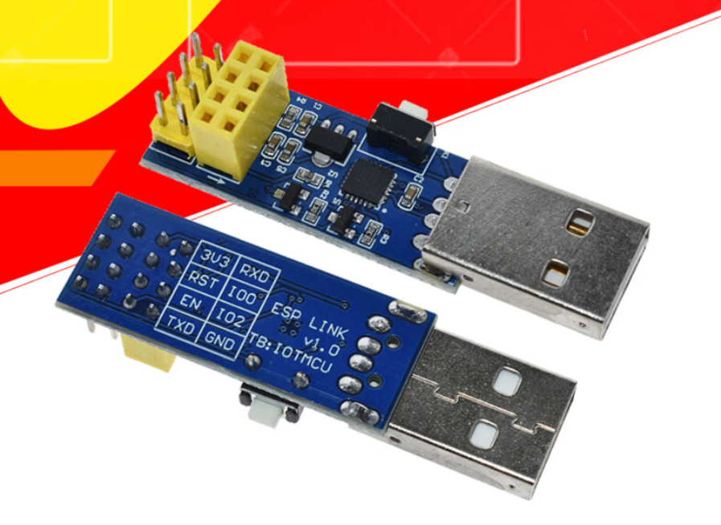

*图8-1ESP-01S烧录器-图1*

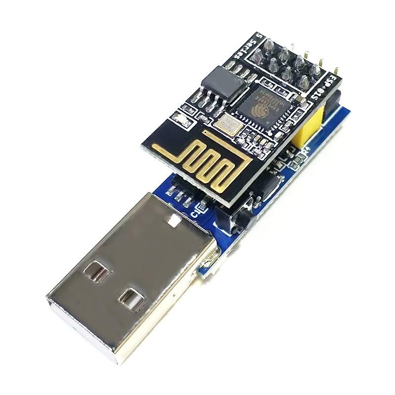

*图8-2ESP-01S烧录器-图2*

在本项目中，我们通常不需要重新烧录 ESP8266 固件。

原因是：

ESP-01S 模块出厂时通常已经烧录好了官方 AT 固件。

因此：

STM32 只需要通过串口发送 AT 指令，就可以控制 ESP8266 完成 WiFi 连接和网络通信。

所以在大多数情况下：

ESP-01S 烧录器主要用于测试模块和串口调试，而不会频繁用于烧录固件。

### 9. WiFi模块使用流程总结

强烈建议大家在写代码使用WiFi模块之前，先借助烧录器，连接PC端，使用串口助手，先把整个流程跑一遍。

一个理想化的流程，如下图所示：

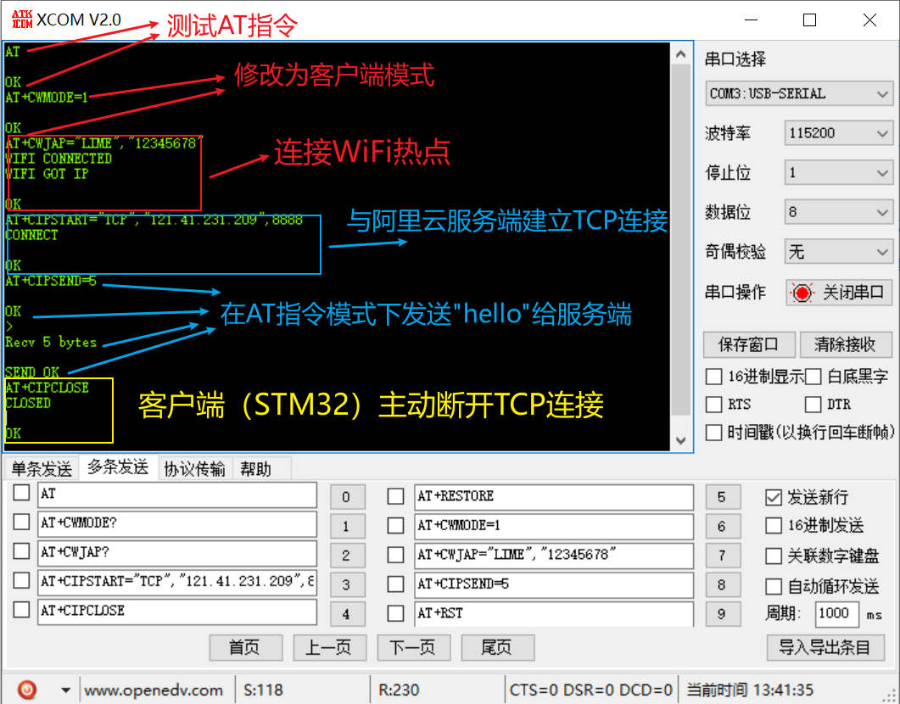

*图9-1WiFi模块使用流程-图*

第一次写代码时，大家先不用考虑诸如：

1. WiFi热点连接超时判断及重试
2. TCP连接建立超时判断及重试
3. ....

这些问题，这些针对错误的处理，可以等到跑通理想流程后再尝试也不晚。

### 10. AT指令反馈处理的重要注意事项（必看！）

我们把ESP01-S这个WiFi模块，与单片机的USART2外设相连，单片机基于串口向WiFi模块发送AT指令来驱动控制WiFi模块。

那么单片机势必要接收处理WiFi模块的AT指令反馈。

**建议的做法是：把 WiFi 模块返回的 AT 指令反馈逐字节接收，构建成一个字符串，然后在这个字符串中匹配成功标志的核心字符串。**

ESP01-S 的一条 AT 指令可能会返回多段内容，例如连接 WiFi 的AT指令，在成功时返回：

```c
WIFI CONNECTED
WIFI GOT IP

OK
```

其中 WIFI CONNECTED、WIFI GOT IP 属于过程提示，真正表示本条指令执行完成的是最后的 OK。

**因此，AT 指令建议等待最终结果，以最终的一个字符串作为成功标志。**例如：

```c
OK // 大多数AT指令执行成功，最终都会反馈一个OK

> // AT+CIPSEND=5指令成功的最终标志是一个">"
```

建议不要使用中间过程的字符串作为成功标志，比如：GOTIP 、CONNECT这类中间提示。

否则可能判断函数提前返回，导致上一条指令后续返回的OK混入下一条指令的接收流程。

发送新 AT 指令前清空接收队列是有必要的，但它只能清掉“已经进入队列的数据”，清不掉之后才到达的旧反馈。

**所以更重要的是：上一条 AT 指令必须等待完整结束后，再发送下一条。**

---

## 04 第一期

### 1. 概述

在前面的学习中，我们已经完成了蓝牙模块和 WiFi 模块的基本使用，并初步打通了STM32、服务端、手机端三端之间的通信链路。

但前面，我们写的代码更多的是：在练习蓝牙模块和WiFi模块的使用。

当前的系统还处在“三端能通信起来”的阶段，还没有形成一个真正可用的工程项目。

核心功能（数据采集、上传、存储与获取）还没有完整建立起来。

因此，从这一期开始，我们将正式进入项目的实现阶段。

同时，在前面我们也没引入RTOS，从这里的项目第一期开始，我们需要在项目中集成FreeRTOS。

### 2. 服务端的设计与实现

在前面的课程当中，我们已经介绍了项目整体的系统结构框图，如下所示：


*图2-1项目系统结构框图*

可以看到，在这三端通信交互的过程中，处于居中核心的地位的是服务端。

所以我们首先考虑完成服务端的设计与实现：

**搭建一个最基础的数据接收与存储平台，使 STM32 上传的数据能够被正确接收、保存，并支持手机端进行查询与删除操作。**

通过这一部分内容，我们将建立起整个系统的数据中枢，为后续整个系统结构与功能的完善打下基础。

#### 2.1 服务端与STM32端的交互

STM32 与服务端的交互可以概括为：

1. STM32 负责采集传感器数据，并将传感器数据拼接成字符串
2. STM32 按照固定格式构造 HTTP 请求，将传感器数据发送给服务端
3. 服务端接收到 STM32 发送的 HTTP 请求后，将传感器数据**写入文件**进行存储
4. 服务端处理完成后，返回简单的响应结果，用于表示本次通信是否成功

整个过程中，核心问题在于：

**需要提前约定好数据的通信格式和解析方式。**

在实际公司开发中，STM32 端和服务端通常由不同人员分别完成，因此必须提前“对接口”，明确好通信格式，否则双方无法正常对接。

而在我们当前的项目中，这两部分都由你自己完成，所以从本质上来说：

**应用层通信格式是可以自由设计的。**

不过，为了写起来更容易、更方便，这里提几点建议：

1. STM32 与服务端之间通过 TCP 建立连接，而且**建议使用长连接**。**（后期可以考虑做超时踢人机制）**
2. **服务端需要同时与手机端进行 HTTP 通信，因此建议 STM32 与服务端之间也采用HTTP 协议通信。**
3. STM32 发送的 HTTP 报文可以自行设计，但应尽量保持简单，避免引入不必要的复杂度。
4. **由于服务端要处理至少两个连接，建议使用select。**

在明确了这些思路之后，接下来我们将给出一套推荐的通信格式，作为本项目的参考实现方案。

建议你不要直接看参考，可以考虑先自己动动脑子想一想。

通信的数据帧格式完全可以自定义，并非固定。

**参考的一套HTTP数据帧格式：**

在本项目中，STM32 与服务端约定的通信格式如下：

**STM32单组传感器数据上传服务端（/x）**

```c
POST /x HTTP/1.1

[light=xx,temp=xx]
```

说明：

1. [ ] 表示一段完整的数据内容
2. /x表示上传一组数据
3. 请求体仅包含一行数据
4. 不包含额外 HTTP 头字段

**STM32多组传感器数据上传服务端（/y）**

```c
POST /y HTTP/1.1

[light=xx,temp=xx;light=xx,temp=xx]
```

说明：

1. [ ] 表示一段完整的数据内容
2. /y表示上传多组数据
3. 每组格式一致
4. 使用;分隔多组数据

**服务端完成处理后，对STM32的响应**

```c
HTTP/1.1 200 OK
（空行）
```

说明：

**STM32 建议以收到"200 OK"判断这一次数据上传成功。**

最终统一约定的数据格式为：

```c
[light=xxx,temp=xxx]
```

这也是整个系统中存储传感器数据的，最核心的数据结构。

有两点注意事项与建议：

**第一，为了简单起见，建议在服务端直接使用一个TXT文件来存储传感器数据。**

**同样为了简单起见，TXT可以直接基于下面的格式来存储数据，直接把请求体存入磁盘文件的一行：**

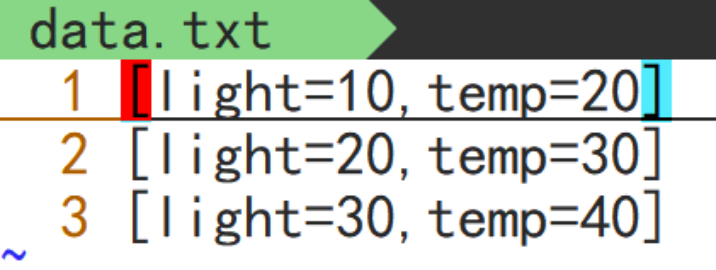

*图2.1-1image-20260806084222417*

**即一行存储一条传感器数据。**

**第二，STM32通常AT指令向服务端发送传感器数据后，接收反馈是通过串口实现的。**

此时的反馈有两个：

1. ESP01S 的 AT 指令反馈。
2. 服务端的HTTP响应报文反馈。

由于串口本身就是字节流，这两个反馈大概率会混在同一个串口接收缓冲区里。比如：

```c
Recv 45 bytes
SEND OK // AT指令成功执行的反馈

+IPD,21:HTTP/1.1 200 OK // HTTP响应报文成功的反馈

```

所以在处理发送AT指令反馈时，最多专门定义一个函数，等两个成功标志字符串。比如：

1. **先等 "SEND OK"，用于判断Send AT指令是否发送成功。**
2. **再等“200 OK”，用于判断服务端是否成功响应。**

**第三，关于TCP的长短连接。**

手机 APP 与服务端之间的通信频率较低，通常是用户在 APP 上点击一次按钮，才向服务端发送一次 HTTP 请求。

**因此，手机 APP 与服务端之间可以采用 TCP 短连接，即每次请求时建立连接，请求处理完成后关闭连接。**

STM32 与服务端之间的通信方式不同。STM32 需要持续、周期性地上传传感器数据。

如果每次上传都重新建立 TCP 连接，就会频繁进行三次握手和四次挥手，增加通信开销，也会降低系统稳定性。

**因此，STM32 与服务端建立 TCP 连接后，建议保持长连接，在同一条连接上周期性发送数据。**

以上。

#### 2.2 服务端与手机APP端的交互

服务端与手机APP端的交互可以概括为：

1. 手机APP按照固定的 HTTP 格式向服务端发送请求
2. 服务端接收到请求后，根据请求路径判断操作类型
3. 服务端对本地文件中的数据进行读取或清空
4. 服务端按照固定格式构造 HTTP 响应，并返回给手机APP

整个过程中，核心问题在于：

**需要严格遵循手机端已经约定好的请求格式和响应格式。**

在本项目中，这一部分与 STM32 不同：

1. STM32 与服务端的通信格式可以自行设计，因为服务端和STM32端都是自己写自己的。
2. 而手机端的代码是固定的，手机端的 HTTP 请求格式与服务端响应格式是固定的，不能随意更改

3. 手机端采用短连接方式进行通信：每次发起一次 HTTP 请求，接收对应的响应报文。

4. **当服务端完成响应后，应主动关闭该 TCP 连接，作为本次 HTTP 响应结束的标志。**

因此，服务端的实现需要去适配手机端的通信协议。

**手机端在请求服务端传感器数据时，固定的请求HTTP报文格式：**

```c
GET /1 HTTP/1.1
（空行）
```

注意：

1. /1表示手机端获取所有传感器数据
2. 请求格式由手机端固定定义，不允许自由定义。
3. 服务端只需识别资源路径并进行处理

**手机端在获取服务端传感器数据时，固定的响应HTTP报文格式：**

```c
HTTP/1.1 200 OK

["light=xx,temp=xx","light=xx,temp=xx"]
```

说明：

1. 服务端响应格式字符串是固定的，不能自由定义。
2. 手机端的解析代码已经写好了，只要你按照格式响应，手机端就能正常解析数据。
3. **手机APP会自动解析这个“JSON字符串数组”，然后每一个字符串会在APP中展示一行。**

比如，HTTP响应报文的格式是：

```c
HTTP/1.1 200 OK

["light=100,temp=100","light=44,temp=55","light=66,temp=77"]
```

那么手机APP中，点击“刷新”后，效果就如下图所示：

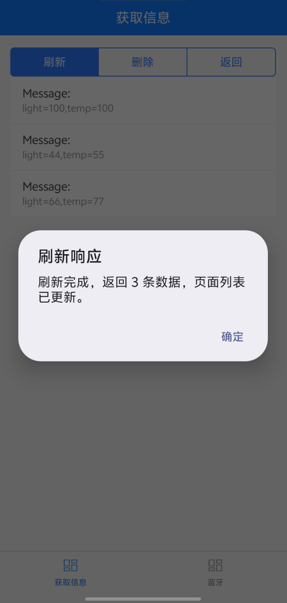

*图2.2-1刷新结果-截图*

**手机端请求服务端删除传感器数据（其实就是清空服务端数据文件），固定的请求HTTP报文格式：**

```c
GET /2 HTTP/1.1
（空行）
```

说明：

1. /2表示请求清空服务端数据
2. 请求格式同样由手机端固定定义，不允许自由定义。
3. 服务端只需识别资源路径并进行处理

**服务端删除完毕后，响应删除结果的固定格式报文：**

```c
HTTP/1.1 200 OK

[]
```

说明：

1. 返回空数组表示当前无数据
2. 同时表示删除操作执行成功
3. 响应格式必须与手机端约定一致

#### 2.3 参考代码1：简易TCP服务端代码

**示例代码如下：**

```c
#include <header.h>

#define SERVER_PORT 8888
#define BUF_SIZE 4096

int main(void){
 /*
     * 1. 创建 TCP socket
     * AF_INET：IPv4
     * SOCK_STREAM：TCP
     */
    int listen_fd = socket(AF_INET, SOCK_STREAM, 0);
    ERROR_CHECK(listen_fd, -1, "socket");

    // 允许端口号直接复用
    int opt = 1;
    int ret = setsockopt(listen_fd, SOL_SOCKET, SO_REUSEADDR,&opt,sizeof(opt));
    ERROR_CHECK(ret, -1, "setsockopt");

    /*
     * 2. 设置服务端地址
     * INADDR_ANY 表示绑定本机所有网卡 IP
     * 端口号使用 8888
     */
    struct sockaddr_in server_addr;
    server_addr.sin_family = AF_INET;
    server_addr.sin_addr.s_addr = INADDR_ANY;
    server_addr.sin_port = htons(SERVER_PORT);

    /*
     * 3. 绑定 IP 和端口
     */
    ret = bind(listen_fd, (struct sockaddr *)&server_addr,sizeof(server_addr));
    ERROR_CHECK(ret, -1, "bind");

    /*
     * 4. 开始监听客户端连接
     */
    ret = listen(listen_fd, 10);
    ERROR_CHECK(ret, -1, "listen");

    printf("TCP server start, port = %d\n", SERVER_PORT);
    printf("Waiting client connect...\n");

    /*
     * 5. 等待客户端连接
     */
    struct sockaddr_in client_addr;
    socklen_t client_addr_len = sizeof(client_addr);

    int connected_fd = accept(
       listen_fd,
       (struct sockaddr *)&client_addr,
       &client_addr_len
    );
    ERROR_CHECK(connected_fd, -1, "accept");

    char client_ip[INET_ADDRSTRLEN] = {0};
    inet_ntop(
       AF_INET,
       &client_addr.sin_addr,
       client_ip,
       sizeof(client_ip)
    );

    printf(
       "client connected: %s:%d\n",
       client_ip,
       ntohs(client_addr.sin_port)
    );

    /*
     * 6. 接收客户端发送的数据
     */
    char buf[BUF_SIZE] = {0};

    // recv 等价于 read，但套接字默认是阻塞的
    // 如果对方没有发送数据，代码会阻塞在这里
    ssize_t recv_len = recv(connected_fd, buf, sizeof(buf) - 1,0);
    ERROR_CHECK(recv_len, -1, "recv");

    if (recv_len > 0) {
       buf[recv_len] = '\0';
       printf("client say:\n%s\n", buf);
    }

    /*
     * 7. 回复 nihao 给客户端
     */
    const char *response = "nihao";
    ssize_t send_len = send(connected_fd, response,strlen(response),0);
    ERROR_CHECK(send_len, -1, "send");

    printf("server send nihao to client\n");

    /*
     * 8. 关闭连接
     */
    close(connected_fd);
    close(listen_fd);

    return 0;
}

```

**该代码为一个最基础的 TCP 服务端示例，用于演示STM32客户端——服务端的基本工作流程。**

程序首先创建 socket 文件描述符，并完成绑定与监听，然后通过accept等待客户端连接。

当有客户端连接成功后，进入循环使用recv接收客户端发送的数据，并将接收到的数据打印出来。

当客户端断开连接或发生错误时，关闭当前连接，重新等待新的客户端接入。

这是最简单TCP服务端代码示例，只能用于演示TCP连接。

#### 2.4 参考代码2：简易的手机端HTTP请求处理服务端

**示例代码如下：**

```c
#include "header.h"

#define SERVER_IP "0.0.0.0" // 监听所有本机网卡地址
#define SERVER_PORT 8888 // 服务器监听端口
#define BUF_SIZE 4096 // 接收缓冲区大小

/* 处理 HTTP 请求 */
static void handle_requests(int connected_fd, const char *req_buf){
    static int light = 100;
    static int temp = 100;

    /* 只处理 GET /1 请求 */
    if (strstr(req_buf, "GET /1 ") != NULL) {
       char body[128] = {0};

       sprintf(body,
               "[\"light=%d,temp=%d\"]",
               light,
               temp);

       char resp[BUF_SIZE] = {0};

       sprintf(resp,
               "HTTP/1.1 200 OK\r\n"
               "\r\n"
               "%s",
               body);

       send(connected_fd, resp, strlen(resp), 0); // 向客户端发送HTTP响应

       light += 5;
       temp += 5;
    }
}

int main(void) {
    printf("server start\n");
    printf("listen ip : %s\n", SERVER_IP);
    printf("listen port : %d\n", SERVER_PORT);

    /* 创建 TCP socket */
    int listen_fd = socket(AF_INET, SOCK_STREAM, 0); //IPv4+TCP
    ERROR_CHECK(listen_fd, -1, "socket");

    /* 设置端口复用，避免服务器重启时 bind 失败 */
    int reuse_flag = 1;
    // SOL_SOCKET 表示设置 socket 通用层选项，SO_REUSEADDR 表示允许地址/端口复用
    // reuse_flag 为 1 表示开启该选项，为 0 表示关闭该选项
    setsockopt(listen_fd, SOL_SOCKET, SO_REUSEADDR, &reuse_flag,sizeof(reuse_flag));

    /* 配置服务器监听地址 */
    struct sockaddr_in server_addr;
    memset(&server_addr, 0, sizeof(server_addr));

    server_addr.sin_family = AF_INET; // 使用IPv4地址族
    server_addr.sin_port = htons(SERVER_PORT); // 端口号转为网络字节序
    server_addr.sin_addr.s_addr = inet_addr(SERVER_IP); //IPv4地址转为网络字节序

    /* 绑定 socket 到指定 IP 和端口 */
    int bind_ret = bind(listen_fd,
                      (struct sockaddr *)&server_addr,
                      sizeof(server_addr));
    ERROR_CHECK(bind_ret, -1, "bind");

    /* 让 socket 进入监听状态 */
    int listen_ret = listen(listen_fd, 5); // 全连接队列长度为5，单线程下最多同时处理1个连接
    ERROR_CHECK(listen_ret, -1, "listen");

    while (1) {
       printf("waiting client...\n");

       struct sockaddr_in client_addr;
       socklen_t client_len = sizeof(client_addr);

       /* 阻塞等待客户端连接 */
       int connected_fd = accept(listen_fd,
                               (struct sockaddr *)&client_addr,
                               &client_len);
       ERROR_CHECK(connected_fd, -1, "accept");

       printf("client connected: %s:%d\n",
              inet_ntoa(client_addr.sin_addr),
              ntohs(client_addr.sin_port));

       char buf[BUF_SIZE] = {0};

       memset(buf, 0, sizeof(buf));

       /* 接收客户端发送的 HTTP 请求 */
       int recv_ret = recv(connected_fd, buf, BUF_SIZE - 1, 0);

       if (recv_ret < 0) {
           perror("recv");
           close(connected_fd);
           continue;
       }

       if (recv_ret == 0) {
           printf("client disconnected: %s:%d\n",
                 inet_ntoa(client_addr.sin_addr),
                 ntohs(client_addr.sin_port));
           close(connected_fd);
           continue;
       }

       printf("recv:\n%s\n", buf);

       handle_requests(connected_fd, buf); // 解析HTTP请求并发送响应

       /* HTTP 短连接：响应后主动关闭客户端连接 */
       close(connected_fd);

       printf("response sent, connection closed: %s:%d\n",
              inet_ntoa(client_addr.sin_addr),
              ntohs(client_addr.sin_port));
    }

    close(listen_fd);

    return 0;
}
```

该代码实现了一个最基础的 HTTP 服务端示例，用于演示手机端与服务端之间的数据交互流程。

程序通过 TCP 建立连接后，接收手机端发送的 HTTP 请求，并调用handle_requests()函数进行HTTP请求处理。

当检测到请求为GET/1时，服务端构造一段传感器数据（light、temp），并按照约定好的 HTTP 格式返回给手机端。

### 3. STM32端的设计与实现

在项目第一期中，STM32 设备端的重点，并不在于新增外设功能，而在于搭建完整的系统框架。

由于当前阶段尚未学习 ADC 等传感器采集相关内容，因此本阶段不引入真实采集逻辑。

STM32 端仅需构造一组假数据，并按照约定的通信格式发送给服务端，由服务端完成数据存储。

也就是说，在第一期中，我们关注的并不是“数据从哪里来”，也不关心其他业务逻辑。

我们重点关心：

**数据如何被组织、如何被发送、以及系统整体如何运行。**

因此，在项目的第一期，STM32 端的核心工作可以归纳为两个方面：

1. **完成系统基础框架的搭建**
   - a. 集成 FreeRTOS 操作系统
   - b. 构建基本的多任务运行环境
   - c. 为后续功能扩展预留结构空间
2. 完成工程级设计（重点）
   - a. 合理划分项目模块
   - b. 明确各模块职责，避免代码混乱耦合
   - c. 设计任务模型，明确各任务分工与运行关系

也就是说，在第一期，我们要完成：

**从“能跑的单片机程序”，过渡到“具备工程结构的嵌入式系统”。**

后续所有功能（传感器采集、数据处理、协议扩展、远程控制等），都将在这一阶段搭建的框架之上逐步叠加完成。

#### 3.1 Keil5工程的目录结构

在正式开始编写功能代码之前，我们首先需要解决一个非常关键的问题：

Keil5工程的代码应该如何组织？

Keil5工程的目录结构应该如何设计呢？

**这个大家可以自行设计，开动脑筋。**

除了STM32基础开发支持包、SPL库和FreeRTOS相关环境的文件夹外，我建议大家至少应该设计包含以下文件夹目录：

1. User目录，用于存放main.c程序入口，各类可修改配置文件。
2. Module目录，用于存放各个功能模块代码。每一个功能模块都对应一个头文件和它的源文件。
3. Utils目录：用于存放一些零散的、互相关联不大的、通用的函数工具。比如基于TIM2定时器的延时函数、解析字符串的函数等等。
4. Task目录，用于存放FreeRTOS任务相关的代码。
5. **Common目录，用于存放一些全局共用的头文件，全局共享资源，以及专门的统一初始化管理等。**

当然，你还可以酌情增加一些目录，但通常没必要加太多。

以上五个目录，即便是真正的工程项目，也是完全足够使用的。

#### 3.2 模块设计

每一个相对独立的外设硬件，都可以单独设计为一个模块。

比如：

1. 调试串口
2. 蓝牙（HC-05）
3. WiFi（ESP-01S）
4. ...

模块的具体划分方式没有固定标准，可以根据实际需求自行设计，这也是你的自由。

但不要搞得太复杂，不要花里胡哨，应当尽量简单。

我们设计模块的目标是做好隔离，实现功能间的“解耦”，尽力做到“高内聚，低耦合”。

#### 3.3 任务设计

**模块只是描述功能“如何实现”，但具体到“功能该什么时候使用，在哪里使用，如何去使用”，需要任务来解决这些问题。**

在 FreeRTOS 系统中，任务负责组织各个模块的运行流程。

举一个例子：

假如你创建了一个蓝牙配网的任务，需要完成从蓝牙接收WiFi信息，到完成WiFi连接成功的整个过程。

这个任务肯定需要使用蓝牙模块的API，也肯定需要使用WiFi模块的API。

除此之外，任务也是宜少不宜多。

作为项目第一期，是一个从0到1的过程。

所以我仍然给出一些提示，建议至少设计两个任务：

1. 蓝牙配网任务
2. TCP通信上传数据任务

当然，具体怎么设计实现，这仍然是你的自由。

但我还是想给你一句提示：

**需要在main函数中一次性创建所有任务吗？我们做的所有事情，前提是什么？**

下面仍然给出一些参考的设计，你可以看。但我强烈建议你先思考思考再说。

###### 参考的任务设计思路

任务不一定要在main中一次性全部创建。

因为很多功能本身是有前提条件的，例如：未完成蓝牙配网，就无法进行后续联网与通信。

因此，可以采用一种更自然的方式：

**先创建前置任务，当前置条件满足后，再创建后续任务。**

例如：

1. 先运行蓝牙配网任务
2. 配网成功并完成联网后，再创建 TCP 通信任务

这样可以让任务的执行顺序与实际业务流程保持一致，结构更清晰，也更易于扩展。

实际上蓝牙配网任务，应该是整个系统的第一个任务，至少在第一期完全可以这么设计。

但如果考虑后续的扩展：

1. 蓝牙配网不是唯一联网手段，后续可以直接把WiFi信息存入STM32的Flash当中，这样可以跳过蓝牙模块的工作。
2. ESP-01S 本身具备自动重连能力，系统上电后有可能已经自动连上 WiFi，此时也可以直接跳过整个配网流程。
3. 还有一点需要注意的是，联网不是一个必然成功的操作。可能需要反复尝试，而且如果实在连不上网，也要考虑扩展备用方案。

总之，可以考虑再把蓝牙配网任务一分为二：

1. 创建一个初始任务作为系统启动时的第一个任务，它目前完成：
   - a. 蓝牙获取WiFi配置信息，解析获取WiFi名和密码，随后存入一个全局变量（WiFi配置区）中。
   - b. 随后创建联网任务，进行WiFi联网。
   - c. 当然后续保留扩展的可能性。
2. 联网任务。从WiFi配置区，获取WiFi信息后，完成联网功能。

#### 3.4 引入FreeRTOS后模块的实现

在引入 FreeRTOS 之后，模块的实现方式与之前基于 SPL 库时**并不完全相同**。

因为在单纯使用 SPL 库时，模块更多只需要关注功能本身的实现；

而在引入 FreeRTOS 之后，模块除了完成具体功能外，还需要进一步考虑：

1. 这些功能会被哪个任务调用
2. 是否需要与其他任务进行配合
3. 是否需要借助队列、信号量、消息队列等等任务间通信机制

也就是说，模块仍然要完成具体的业务逻辑，例如：

1. 蓝牙数据收发
2. WiFi 控制
3. 数据处理

但与此同时，模块在接口设计上，往往也需要适当考虑任务环境下的使用方式。

因此可以这样理解：

**模块负责功能实现，任务负责组织运行流程。**

引入 FreeRTOS 后，模块的核心功能并没有改变但模块与模块之间、模块与任务之间的协作方式，会比之前更加复杂一些。

所以更准确地说：

**引入 FreeRTOS 后，模块实现的核心思路没有变化，但在接口设计和协作方式上，需要开始考虑多任务环境下的使用需求。**

#### 3.5 任务的实现（重点）

在实现任务时，需要明确一点：

任务关注的是系统如何运行，而不是具体功能实现。

在第一期中，任务设计应尽量保持简单，注意以下几点即可：

1. 每个任务职责尽量单一，不要在一个任务中堆叠过多功能
2. 任务数量不宜过多，控制在 2~3 个核心任务即可
3. **任务不一定要在 main 函数中一次性创建，可以按流程逐步创建，前置任务执行完毕后可以考虑删除此任务。**
4. 任务之间不要强耦合，可以考虑使用全局共享数据区，或任务间通信机制进行配合工作。

总结一句话：

**任务设计的核心是让系统运行清晰，而不是把功能拆得越细越好。**

任务实现过程中，往往需要使用任务间通信机制，以及一些用于共享数据的全局变量。

例如：

1. 任务句柄（TaskHandle）
2. 队列句柄（消息QueueHandle）
3. WiFi 配置信息等系统共享数据

这些资源通常需要在多个文件之间访问，因此可以考虑采用一种更清晰的方式进行管理。

这里建议采用“全局资源集中管理”的方式：

1. 单独创建一个用于存放全局资源的源文件
2. 配套创建一个头文件，用于对这些全局变量进行extern声明
3. 在源文件中完成变量定义，在头文件中提供声明，供其他模块引用
4. 将系统级资源统一放在这里进行管理

这样做的好处是：

**结构清晰，便于查找，也方便后续扩展。**

当然，具体如何划分和使用，可以根据实际情况自行调整，不必拘泥于固定形式。

除此之外，还可以统一提供一个公共头文件，用于集中包含常用头文件，方便各模块引用。

但需要注意控制层级关系，避免出现过于复杂的头文件嵌套。

注：

这两部分公共的头文件、以及公共全局资源，建议放到Common目录下。

#### 3.6 STM32端实现打样——程序入口main.c

最简单的就是程序入口main.c的实现。

伪代码如下：

```c
// 包含所需头文件

int main(void){
    // 调用common下的统一Init函数
    // 创建第一个起始任务
    // 启动任务调度器
    while(1);
}

```

这里需要强调一下：

stm32f10x_conf.h虽然可以看作是 SPL 库中的一个公共头文件，但它本质上仍然属于 SPL 库配置文件，其中还包含了一些库相关的额外配置内容。

因此，不建议直接把它当作我们自己工程的公共头文件来使用。

建议单独创建一个属于本工程自己的公共头文件。

#### 3.7 蓝牙模块实现打样

就拿蓝牙模块来说，之前我们会使用多个全局变量，来实现串口中断接收手机APP发送的WiFi信息：

1. 在中断中把收到的字符依次存入全局缓冲区Buffer
2. 确定接收WiFi信息完成后，
3. 再通过设置标志位的方式，通知主程序可以开始进行 WiFi 字符串解析以及后续流程处理。

但在引入 FreeRTOS 之后，如果蓝牙模块仍然完全沿用这种实现方式，就不太合适了。

因为在多任务环境下：

1. 仅靠全局缓冲区和标志位，流程之间的衔接不可能同时满足低延迟和高CPU利用率。
2. 如果多个任务都可能访问这些全局变量，还容易带来同步与共享问题。

因此，在 FreeRTOS 环境下，更自然的一种思路是：

**中断只负责接收数据，后续数据处理交给任务完成。**

**中断只负责接收数据，后续数据处理交给任务完成。**

**中断只负责接收数据，后续数据处理交给任务完成。**

例如：

1. 串口中断接收到一个字节后，不再直接写一大套全局缓冲区逻辑
2. 而是将接收到的数据，发送到FreeRTOS的消息队列中
3. 再由专门的蓝牙相关任务，从消息队列中读取数据并完成字符串拼接、解析和后续处理
4. 中断只负责处理轻量的数据接收，后续的一系列流程都交由任务完成。

这样设计后，蓝牙模块的实现思路就从原来的：

**“中断处理业务逻辑 + 全局变量 + 标志位 + 主程序阻塞等待标志位”**

逐步转变为：

**“中断仅接收数据 + FreeRTOS消息队列 + 任务处理业务逻辑”**

这也是引入 FreeRTOS 后，模块实现方式发生变化的一个典型体现。

这样的设计好处多多。比如：

1. 职责更清晰。中断只负责“收数据”，任务负责“处理数据”。结构更清楚，也更符合工程设计。
2. 避免全局变量混乱。不再依赖全局 Buffer 和标志位，数据通过消息队列传递，更安全也更便于管理。
3. 更适合多任务系统，提升CPU利用率。任务可以阻塞等待数据，不需要CPU阻塞式轮询，CPU利用率更高，运行更高效。

总结一句话：

**用任务通信机制代替全局变量，是为了让系统更清晰、更稳定。**

---

## 05 ADC

### 1. 传感器模块概述

在我们的配件盒当中，有几个比较常见的传感器模块，如下图所示。它们分别是：

**光敏电阻传感器模块：**

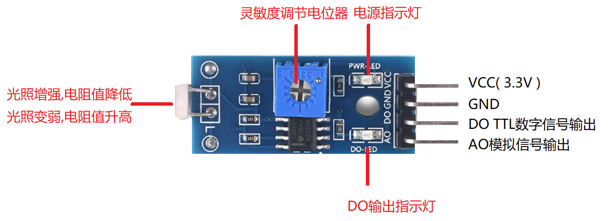

*图1-1光敏电阻传感器-实物图*

光敏电阻传感器用于检测环境光照强度，其核心器件为光敏电阻（LDR）。

其工作原理如下：

1. 光照越强 → 光敏电阻的电阻越小
2. 光照越弱 → 光敏电阻的电阻越大

**模块内部采用分压电路设计，将光敏电阻随光照而改变的阻值变化转换为电压变化输出。**

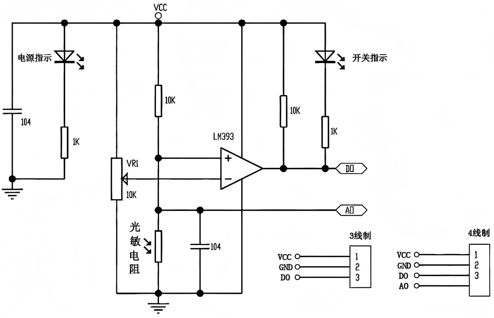

*图1-2光敏电阻传感器-电路图*

输出形式有两种：

1. **模拟输出（AO）：直接输出连续变化的电压信号（模拟信号），用于 ADC 采集**
2. **数字输出（DO）**：通过LM393电压比较器，配合电位器设定阈值，最终输出高低电平信号（0或1）。

**温度电阻传感器模块：**

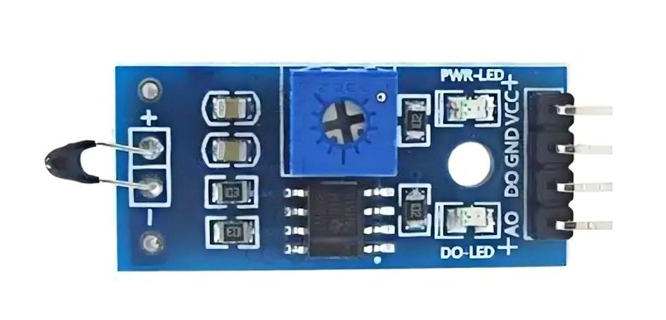

*图1-3热敏电阻传感器-实物图*

温度电阻传感器通常采用热敏电阻（NTC）作为核心元件。

其工作原理如下：

1. 温度升高 → 热敏电阻的阻值减小（NTC特性）
2. 温度降低 → 热敏电阻的阻值增大

同样通过分压电路将电阻变化转换为电压输出。

原理和光敏电阻传感器是一模一样的，只是采集的物理信号量改变了。

**气敏电阻传感器模块（MQ系列空气传感器）：**

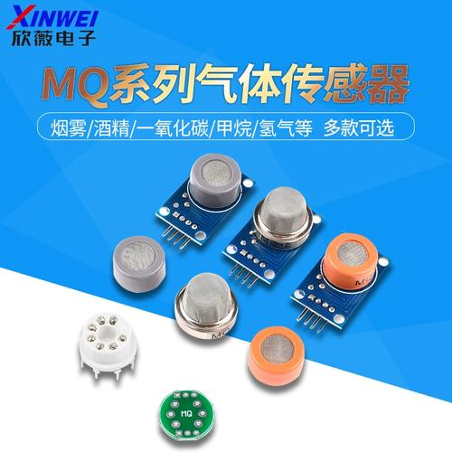

*图1-4气敏电阻传感器模块-图*

MQ 系列气体传感器是一类常见的气体检测模块，如 MQ-2、MQ-135 等。

其核心器件为半导体气敏电阻（SnO₂ 材料）。

其工作原理如下：

1. 内部加热丝将敏感材料加热至工作温度
2. 气体与材料表面发生化学反应
3. 改变材料导电能力
4. 导致电阻值发生变化

最终表现为：

**气体浓度变化 → 电阻变化 → 电压变化**最终仍然通过分压电路将电阻变化转换为电压输出。

以上三类传感器虽然检测对象不同，但具有一个共同特点：

**它们的核心本质都是“电阻随物理量变化”。**

系统中的信号转换过程可以统一表示为：

某种被监测的物理量改变 → 电阻变化 → 分压电路 → 电压信号 → 比较器比较正负极输入电压，从而输出高低电平（模拟信号转换成数字信号）

在前面的课程学习中，我们已经知道如何使用传感器模块的DO口输出：

1. 输出1表示一种状态
2. 输出0表示一种状态

所以DO口的输出显然是一种数字输出模式。

它虽然能表示两种和物理量相关的状态，但还是不够直观的表示物理量本身。

**今天我们来学习传感器模块的AO口输出功能，通过采集AO口的输出，就可以更直接的获取物理量的相关数据。**

当然，我们首先需要明确的一点是：

**传感器模块的 AO 口输出的是连续变化的电压信号，属于模拟信号输出。**

### 2. 模拟信号和数字信号

关于模拟信号和数字信号，我们之前已经简单提到过。

它们之间的区别，可以用一句话概括：

**模拟信号是连续的，数字信号是跳变的、离散的。**

自然界中的物理量（如温度、光照、声音、电压等）本质上都是连续变化的，因此属于模拟信号。

从理论上来说：

模拟信号在时间和数值上都是连续的，其精度可以无限细分。

也就是说：

任意两个模拟信号的数值之间，还可以继续细分出无限多的数值。

正因为这一点：

**我们实际上无法精确地记录或存储一个真正的模拟信号。**

比如：

我的身高是180cm，真的是刚好180吗？

不可能“刚好就是 180.000000…… cm”，它一定是一个非常精细的连续值，只是我们做了近似表达。

**而数字信号，则是对模拟信号的一种处理结果。**

数字信号是通过对模拟信号进行“采样”和“量化”得到的离散数值。

所以：

**数字信号其实可以理解成，是对模拟信号在某一个时刻的一种“近似表示”，是一种为了便于表述和存储使用的估值和约数。**

总之：

1. 所谓模拟信号，是出现在自然界当中的数据信号，其数据随时间连续变化，数据的精度理论上无限大。真实，但不易描述和存储。
2. 所谓数字信号，是对模拟信号的近似表示和约数，它的数值随时间离散变化，数据的精度是有限的。数据不真实，但易于描述和存储。

比如参考下图：


*图2-1模拟信号和数字信号-图*

自然界的温度是连续变化的，而且温度的数值理论上是精度无限的，这就是模拟信号。

模拟信号是无法直接存储在计算机当中的：

因为计算机进行数据采集存储总会存在一个时间间隔，而且计算机由于存储位数的限制，也不可能存储无限精度的数据。

现在传感器模块的AO口输出的是连续变化的电压模拟信号，单片机肯定是无法直接保存使用的。

还需要经历一步：将模拟电压信号，转换成数字电压信号的过程。

此时就需要使用单片机的ADC外设。

**在嵌入式系统当中，外围传感器采集模拟信号数据后，需要使用ADC模块转换成数字信号，然后才可以进行存储。**

### 3. ADC概述

ADC也是单片机内一种常见，常用的片内外设。我们可以从ADC这个名字入手，来探究一下什么是ADC。

**ADC（Analog-to-Digital Converter）**即模拟信号 - 数字信号转换器，是嵌入式系统中实现模拟信号数字化的核心功能模块。


*图3-1ADC的解释-图*

**在实际的嵌入式系统中，各类传感器通常会将外界的物理量（如温度、光照、气体浓度等），转换为随之变化的电压信号。**

**随后，ADC（模数转换器）模块会对该电压信号进行处理，将其转换为对应的电压数字量（离散数值）。**

**这样，程序员就可以通过读取 ADC 的电压数字值结果，间接获取当前物理量的近似值。**

举一个例子，以温度传感器为例：

1. 外界温度发生变化
2. 热敏电阻的阻值发生变化
3. 通过分压电路转换为电压信号（模拟电压信号量）
4. ADC 将该模拟电压量转换为数字电压量
5. 程序员获取这个数字电压量，从而更直观的在数字上感受温度发生了改变。
6. **当然，通过这个数字电压量，还可以通过公式来计算近似温度值。**

总结流程如下：

温度改变 → 热敏电阻的阻值变化 → 电压变化（模拟量）-> AO口直接输出模拟电压量 → ADC外设 → 电压数字量 → 利用公式，近似换算温度

### 4. ADC模数转换的工作原理

单片机中的ADC外设，其核心作用就是：**把连续变化的电压（模拟量），转换为离散的电压数字值。**

也就是“模数转换”。

那么，它是如何完成这个过程的呢？

核心过程可以分为两个步骤：

**步骤1，采样：**

采样就是在某一个时刻获取当前输入电压的状态，就像给连续变化的电压模拟信号“拍一张照片”。

1. 模拟信号本身是连续变化的，如果想把它转换成一个确定的数字值，就需要先在某个时刻把这个电压“固定住”。
2. 在实际 ADC 内部，通常会通过采样保持电路，将当前输入电压暂时保持下来，然后再进行后续转换。

**步骤2，量化：**

量化就是将采样得到的电压值，映射成一个有限范围内的整数值。

这个整数值就是 ADC 的转换结果，也可以理解为这个电压对应的数字表示。

**ADC 模数转换的本质就是：在某一时刻测量模拟电压，并用一个数字去表示这个电压。**

#### 4.1 采样和采样时间

具体到**采样**这个流程，大体的过程如下所示：

1. 输入信号接入 ADC 通道，外部的模拟电压信号（例如光敏电阻、热敏电阻分压后得到的电压）通过引脚进入 ADC 内部。
2. 采样开关闭合，输入信号连接到采样电容，开始采样阶段
   - a. 在采样阶段，ADC 内部会通过一个开关，把输入信号连接到一个采样保持电容上。
   - b. 这个过程，可以理解成：输入电压正在给这个电容“充电”。
3. **采样电容开始充电（关键过程）**：
   - a. 由于电容物理特性的限制，需要一定的“充电时间”，使得电容两端逐渐充到接近输入电压。
   - b. 当采样时间足够长时，采样电容上的电压就会非常接近当前输入电压。
4. **电容电压充到接近输入电压**，采样时间结束，采样阶段完成。
   - a. ADC 会断开输入通道与采样电容之间的连接。
   - b. 此时，采样电容上的电压被暂时“保持”下来，后续 ADC 就会基于这个保持住的电压进行量化转换。

**所以，采样这个过程本质上就是：让 ADC 内部的采样保持电容充分充电，并在采样结束后保持住该电压。**

基于这样的原因：

采样必须留出充足的时间，这个时间被称之为**“采样时间”**。

采样时间是ADC外设的可选配置参数：

1. 采样时间越长，采样电容越有机会充到接近真实输入电压，**采样结果通常越准确、越稳定**。
2. 采样时间越短，单次 ADC 转换所需的总时间越短，因此单位时间内可以完成更多次采样，**采样频率可以更高。**

如此，会带来下面的影响：

1. 采样时间越长，采样结果通常越准确、越稳定；但采样频率会降低，导致对快速变化信号的捕捉能力变弱，系统响应也可能变慢。

2. 采样时间越短，采样频率通常可以更高，更适合采集快速变化的信号；但如果采样电容充电不充分，转换结果可能出现偏差，稳定性也会变差。

因此，采样时间的配置本质上是在**采样精度**和**采样频率**之间做取舍：

采样时间长，偏向于提高采样准确性；

采样时间短，偏向于提高采样频率。

在实际工程中，应根据被测信号的变化速度和信号源阻抗来选择合适的采样时间：

1. 如果被测信号变化较慢，例如温度、电池电压、光照强度等，可以适当选择较长的采样时间，优先保证采样精度。
2. 如果被测信号变化较快，例如音频信号、电机电流、快速脉冲等，则需要保证足够高的采样频率，不能一味加长采样时间。

我们使用的传感器，例如光敏电阻传感器、热敏电阻传感器等，信号变化速度较慢，不需要很高的采样频率。

**因此，在配置 ADC 时，可以适当延长采样时间，优先保证采样精度和稳定性。**

对于，这类变化较慢的信号来说，采得准，通常比采得快更重要。

#### 4.2 量化和量化值

采样完成后，ADC 内部的采样保持电容上已经保持住了某一时刻的输入电压。

下一步，ADC 就需要把这个模拟电压转换成一个有限精度的数字值，这个过程称为**量化**。

模拟电压本身是连续变化的，理论上可以有无限多种取值，例如：

例如：

2.0131000.....V省略号表示精度无限但 ADC 的数字输出位数是有限的，因此不可能把这个电压的所有小数细节都完整表示出来。

**所谓量化，就是将这个连续的模拟电压，映射成一个有限范围内的、有限精度的整数值。**

那么ADC模块是如何完成量化过程的呢？

画了一个简化的ADC量化过程工作原理图：

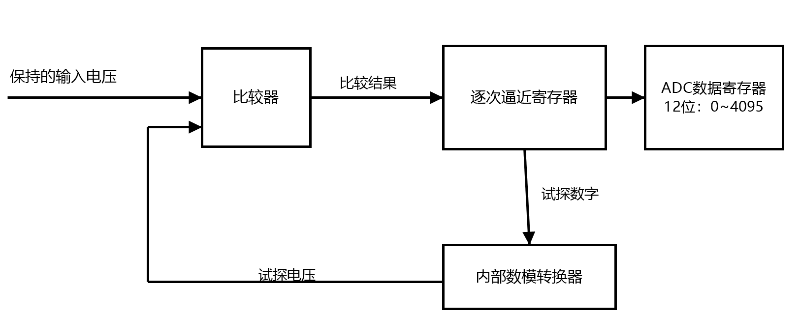

*图4.2-1ADC的量化原理-图*

其核心就在于：

**STM32F103C8T6单片机的ADC是一个12位逐次逼近型ADC。**

那么什么是12位逐次逼近型ADC呢？

可以简单理解为：

**ADC通过“不断试探”的方式，用一个12位的数字，逐步逼近输入电压的真实值。**

12. 位表示 ADC 最终输出的数字范围是：

```c
0 ~ 4095
```

也就是把0V~参考电压(3.3V)之间的电压范围划分成 4096 个等级。

其基本工作过程如下：

1. ADC 内部包含一个 DAC（数模转换器）、一个电压比较器和一个逐次逼近寄存器。
2. 转换开始后，ADC 从最高位MSB开始尝试，把当前位先置为1 。
3. 内部 DAC 根据当前尝试的数字值，生成一个对应的模拟比较电压。
4. 比较器将这个比较电压与采样保持电容上的输入电压进行比较：
   - a. **如果 DAC 输出电压大于输入电压，说明当前数字值试得太高了，该位清零。**
   - b. **如果 DAC 输出电压小于或等于输入电压，说明当前数字值还没有超过输入电压，该位保留为 1。**
5. 然后 ADC 继续判断下一位，从高位到低位逐位试探，直到最低位LSB判断完成。

经过 12 次的逐位试探比较后，ADC 就可以得到一个 12 位的数字结果。

这个数字结果就是本次 ADC 转换得到的**量化值**。

**简单来说：逐次逼近型 ADC 的量化过程，就像用二分法不断试探输入电压所在的位置，最终用一个有限位数的数字表示这个电压。**

**举一个具体例子：**

STM32F103C8T6的供电电压是3.3V，所以参考电压为3.3V，假设输入电压为2.0131.......V由于是12位ADC，总共有4096个量化等级。

每一级对应的电压约为：3.3 / 4096 ≈ 0.000805V接下来从最高位开始试探，过程如下：

**首先试探 bit11（最高位）：**

1000 0000 0000 = 2048对应电压：

2048 / 4096 × 3.3= 0.5 × 3.3= 1.65V因为 1.65V < 2.0131....V这说明100000000000 表示的电压还不够，保留最高位的1，继续向下试探。

**试探 bit10：**

1100 0000 0000 = 2048 + 1024 = 3072对应电压：

3072 / 4096 × 3.3= 0.75 × 3.3= 2.475V因为 2.475V > 2.0131V这说明110000000000 表示的电压已经超了，所以bit10位清零，继续向下试探。

当前结果：

1000 0000 0000**试探 bit9：**

1010 0000 0000 = 2048 + 512 = 2560对应电压：

2560 / 4096 × 3.3= 0.625 × 3.3= 2.0625V因为 2.0625V > 2.0131V这说明101000000000 表示的电压已经超了，所以bit9位清零，继续向下试探。

当前结果：

1000 0000 0000**试探 bit8：**

1001 0000 0000 = 2048 + 256 = 2304对应电压：

2304 / 4096 × 3.3= 0.5625 × 3.3≈ 1.856V因为 1.856V < 2.0131V这说明100100000000 表示的电压可能还不够，所以bit8位的1保留，继续向下试探。

当前结果：

1001 0000 0000**试探 bit7：**

1001 1000 0000 = 2304 + 128 = 2432对应电压：

2432 / 4096 × 3.3≈ 0.59375 × 3.3≈ 1.959V因为 1.959V < 2.0131V这说明100110000000 表示的电压可能还不够，所以bit7位的1保留，继续向下试探。

当前结果：

1001 1000 0000**试探 bit6：**

1001 1100 0000 = 2432 + 64 = 2496对应电压：

2496 / 4096 × 3.3≈ 0.609375 × 3.3≈ 2.010V仍然略小于**2.0131V → bit6 保留**当前结果：

1001 1100 0000**试探 bit5：**

1001 1110 0000 = 2496 + 32 = 2528对应电压：

2528 / 4096 × 3.3≈ 0.6171875 × 3.3≈ 2.036V因为 2.036V > 2.0131V说明超了，**bit5 清零**当前结果：

1001 1100 0000**试探 bit4：**

1001 1101 0000 = 2496 + 16 = 2512对应电压：

2512 / 4096 × 3.3= 0.61328125 × 3.3≈ 2.024V因为 2.024V > 2.0131V说明超了，**bit4 清零**当前结果：

1001 1100 0000**试探 bit3：**

1001 1100 1000 = 2496 + 8 = 2504对应电压：

2504 / 4096 × 3.3= 0.611328125 × 3.3≈ 2.017V因为 2.017V > 2.0131V说明超了，**bit3 清零**当前结果：

1001 1100 0000**试探 bit2：**

1001 1100 0100 = 2496 + 4 = 2500对应电压：

2500 / 4096 × 3.3= 0.6103515625 × 3.3≈ 2.014V因为 2.014V > 2.0131V说明还是略大，**bit2 清零**当前结果：

1001 1100 0000**试探 bit1：**

1001 1100 0010 = 2496 + 2 = 2498对应电压：

2498 / 4096 × 3.3= 0.6098632813 × 3.3≈ 2.0125V因为 2.0125V < 2.0131V说明还不够，**bit1 置位保留**当前结果：

1001 1100 0010，即2498**试探 bit0（最低位）：**

1001 1100 0011 = 2498 + 1 = 2499对应电压：

2499 / 4096 × 3.3= 0.6101074219 × 3.3≈ 2.01335V因为 2.01335V > 2.0131V所以**bit0置位后就略大，所以bit0清零**当前结果：

1001 1100 0010**最终结果为：**

**1001 1100 0010 = 2498**可以看到，ADC 经过从 bit11 到 bit0 的逐位试探，最终得到了一个不超过输入电压、且最接近输入电压的 12 位整数值 2498。

这个过程的本质就是：

从高位到低位逐位试探，每试探一位，就比较一次大小，若超过输入电压则清零，未超过则保留。

#### 4.3 分辨率

在学习ADC时，ADC的分辨率是绕不开的一个名词术语。

ADC 的**分辨率**，指的是 ADC 能把输入电压划分成多少个数字等级。

例如，STM32F103 的 ADC 是**12 位 ADC**，表示它可以输出：

```c
0 ~ 4095
```

一共：2^12 = 4096个数字等级。

如果参考电压是3.3V ，那么每一个等级对应的电压约为：

```c
3.3V / 4096 ≈ 0.000805V
```

也就是约0.805mV 。

所以可以简单理解为：

**ADC 分辨率越高，电压被划分得越细，能够区分的电压变化就越小，ADC转换的数字结果也越精细。**

当然，如果想要提高分辨率，最简单的方式就是：使用更高位数的ADC。

STM32F103 内部 ADC 的硬件分辨率固定为 12 位，无法直接提高。如果想要使用更高位数、更高分辨率的ADC，则需要换MCU或使用外部ADC。

### 5. ADC外设的使用

下面结合单片机上具体的 ADC 外设，来讲解 ADC 的实际使用方法。

也就是讲一下ADC外设，如何配置，如何让它可以正常工作。

首先，我们使用的STM32F103C8T6单片机一共有2个ADC外设，都挂载在APB2外设总线上，如下图所示：

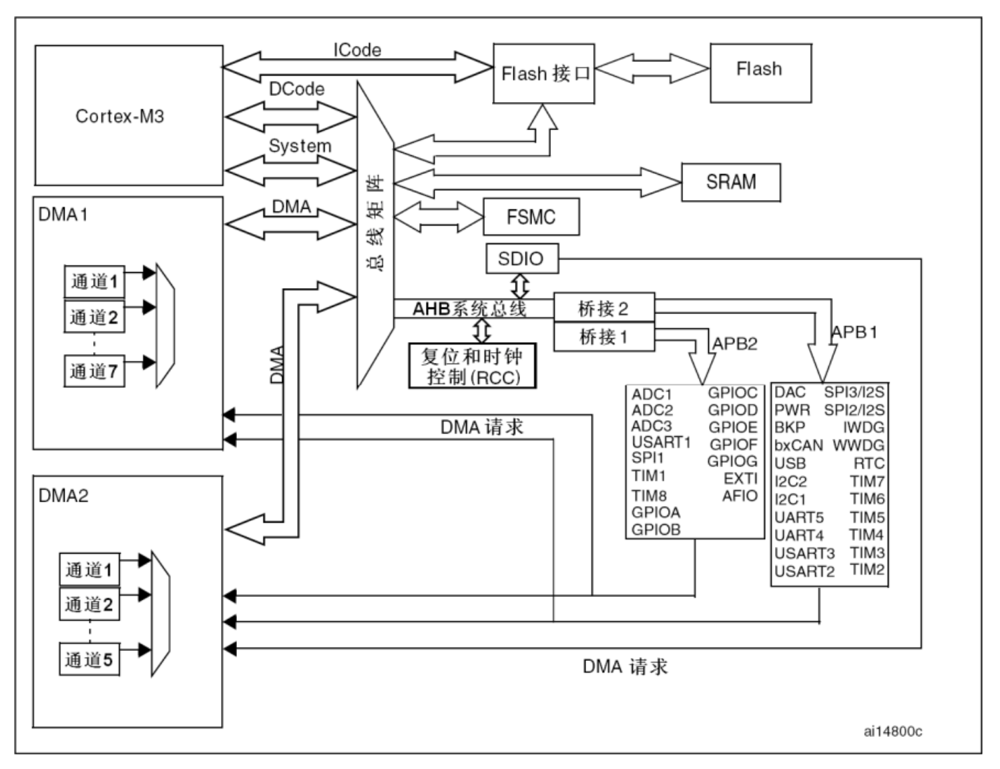

*图5-1单片机系统框图*

通常来说，通常只需要选择其中一个 ADC 即可满足需求，比如ADC1。

#### 5.1 ADC的引脚选择

首先，若想要使用ADC功能，完成模数转换，传感器的AO口必须接入特定ADC引脚。

如下图所示：

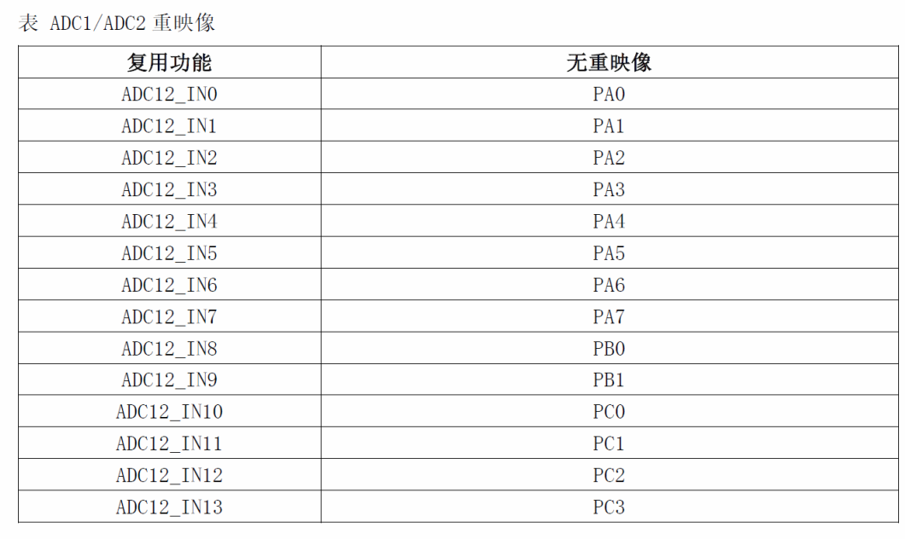

*图5.1-1ADC引脚选择-图*

其中，PC0~PC3这四个引脚，我们使用的单片机是没有的。

所以能使用的ADC引脚实际只有10个，即单片机**可用的外部ADC通道**有10个。

即：

1. PA0 ~ PA7，ADC12_IN0 ~ ADC12_IN7，一共8个通道。
2. PB0 对应 ADC12_IN8
3. PB1 对应 ADC12_IN9

考虑到：

1. **我们让WiFi模块占用了USART2，即占用了引脚PA2和PA3**
2. **SPI1外设占用PA5、PA6、PA7**

排除这些冲突引脚以后，还能用于 ADC 采样的就只剩下：

1. PA0 → ADC12_IN0
2. PA1 → ADC12_IN1
3. PA4 → ADC12_IN4
4. PB0 → ADC12_IN8
5. PB1 → ADC12_IN9

也就是说：

**只有5个引脚PA0、PA1、PA4、PB0、PB1，可以用于连接传感器模块的AO口。**

#### 5.2 为什么是ADC12_XX

在 STM32F103 系列单片机的数据手册中，经常可以看到类似ADC12_IN0 、ADC12_IN1这样的引脚标注。

这里的ADC12并不是表示“第 12 个 ADC”，而是表示：

该模拟输入通道同时连接到 ADC1 和 ADC2 两个 ADC 外设。

也就是说：

1. ADC12_IN0表示：该引脚可以作为 ADC1 的通道 0，也可以作为 ADC2 的通道 0。
2. ADC12_IN1表示：该引脚可以作为 ADC1 的通道 1，也可以作为 ADC2 的通道 1。

本质上，这些模拟输入引脚在芯片内部同时连接到了 ADC1 和 ADC2 的输入通道，只是在实际使用时，需要在程序中选择由哪个 ADC 外设来采样。

因此，ADC12_INx可以理解为：

该引脚对应 ADC1 和 ADC2 共享的第 x 号模拟输入通道。

在实际配置时：

1. 如果使用 ADC1，就把它配置为 ADC1 的通道 x。
2. 如果使用 ADC2，就把它配置为 ADC2 的通道 x。

但需要注意：

**同一个通道在同一时刻只能被一个 ADC 使用，不能同时被 ADC1 和 ADC2 采样。**

这种命名方式的目的，是为了明确说明该引脚资源是两个 ADC 外设共享的。

#### 5.3 ADC外设框图

从《STM32F1参考手册》中，我们可以获取以下ADC外设框图：

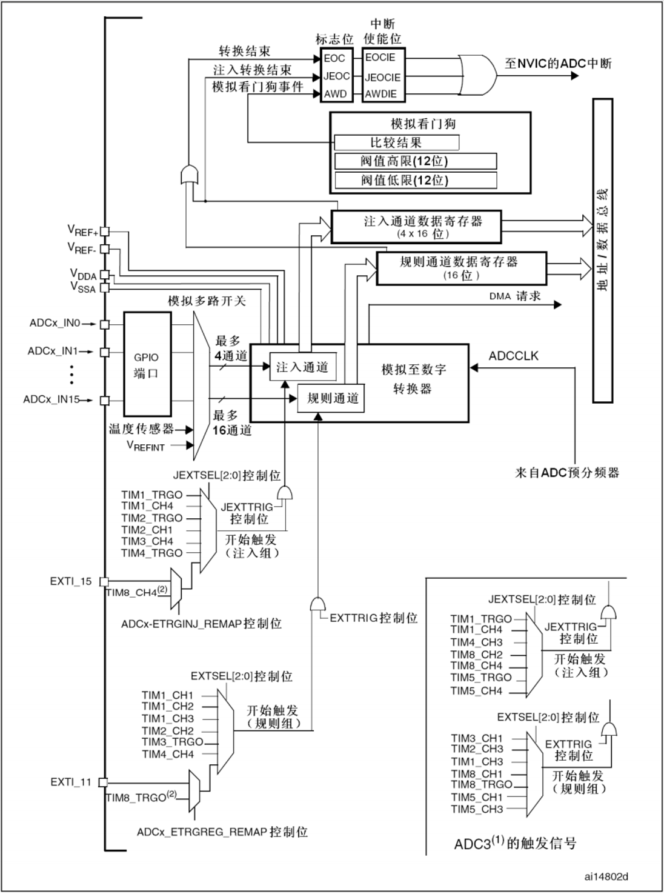

*图5.3-1ADC外设框图*

对我们而言，完整搞懂这个框图并没有太多必要，我们可以将框图精简成如下图所示：

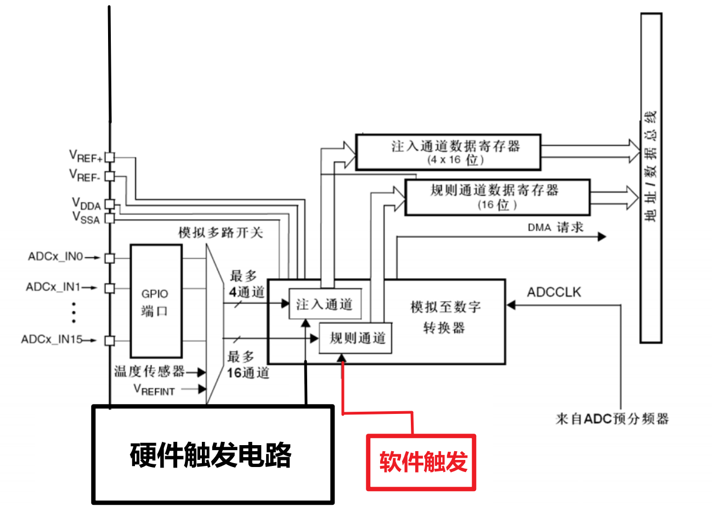

*图5.3-2ADC外设框图-简图*

下面来解释一下这个简化框图。

#### 5.4 简化ADC外设框图讲解

ADC 外设的工作流程，可以结合这张框图按从左到右的顺序理解。

**首先是参考电压和模拟电源。**

ADC 的转换必须依赖参考电压和模拟电源，包括：

1. VREF+、VREF-：用于确定 ADC 的测量范围（通常为 0 ~ 3.3V）
2. 是 ADC 的模拟电源和模拟地，用来给 ADC 内部模拟电路供电。

可以简单理解为：

这一部分决定了 ADC 能测量的电压范围。

**接下来是模拟信号的输入部分。**

外部模拟信号可以通过ADCx_IN0~ADCx_IN15这些引脚进入 ADC。

此外，芯片内部也有一些模拟信号可以接入 ADC，例如内部温度传感器和内部参考电压VREFINT 。

这些信号本质上都是：

等待 ADC 测量的模拟电压来源。

**随后，模拟电压信号，进入模拟多路开关（多路复用器）。**

因为 ADC 内部一次只能转换一个通道，所以需要通过多路开关，从多个输入信号中选择当前要转换的那一路。

可以简单理解为：

多路开关负责“选中当前要采样的通道”。

从多个输入中选出当前要转换的那个通道。

**之后信号会进入规则通道或注入通道。**

规则通道用于普通的 ADC 采样，通常按照配置好的顺序依次转换。

注入通道优先级更高，可以在规则通道转换过程中插入执行，适合一些需要优先采样的场景。

**规则通道式是 ADC 外设最常用的普通采样通道。**

什么是规则通道呢？

**在规则通道中，还涉及两个非常重要的工作模式：扫描模式和连续转换模式。**

扫描模式（Scan Mode）：

1. 当配置多个通道时，ADC 会按照设定的顺序，依次对多个通道进行转换。
2. 如果关闭扫描模式，则每次只转换一个通道。

连续转换模式（Continuous Mode）：

1. 开启后，ADC 在完成一次转换后，会自动再次启动下一次转换；
2. 关闭时，则每次转换都需要重新触发。

可以理解为：

1. 扫描模式决定“采几个通道”；
2. 连续转换模式决定“采一次还是一直采”。

**接下来是触发控制部分。**

ADC 转换需要被触发后才会开始。触发方式主要有两种：

1. **软件触发**：由程序启动 ADC 转换。
2. **硬件触发**：由定时器等外设事件自动启动 ADC 转换。

需要特别强调：

其中硬件触发不需要 CPU 每次手动参与，适合定时、周期性采样。

**随后进入 ADC 核心模块（模拟到数字转换器）。**

这一部分完成模数转换，通过逐次逼近的方式，将输入电压转换为 12 位数字量。

转换完成后，数据进入结果寄存器。

规则通道的结果存放在 ADC_DR 寄存器中；

注入通道有独立的寄存器，用于保存其转换结果。

这一块的就是量化的工作原理，在上面我们已经讲过了。

**最后是 ADC 的时钟部分。**

ADC 需要时钟驱动，该时钟来自 APB2，并经过 ADC 预分频器分频后提供给 ADC 内核。

ADC 的转换速度与该时钟直接相关。

**需要注意的是：ADC的输入时钟频率不得超过14MHz。**

**最后做一个总结，ADC外设的工作流程，大体上是：**

提供参考电压 → 输入电压信号 → 选择通道 → 触发转换 → 完成转换 → 保存结果出于简单考虑，我建议大家采用这样的ADC设置：

**使用规则通道，关闭扫描模式和连续转换模式，每次读取前手动指定通道，再通过软件触发完成一次单次转换，并适当延长采样时间以保证结果稳定。**

#### 5.5 扩展/了解：为什么有14MHz的限制

**需要注意的是：在 STM32F103 中，ADC 的输入时钟 ADCCLK 不能超过 14MHz。**

这是因为 ADC 内部并不是一个时钟周期就能完成转换，而是需要经历采样、保持、逐次比较、量化等多个过程。

如果 ADC 时钟过高，虽然看起来转换速度变快了，但每个步骤可用的实际时间会变短，可能导致：

1. 采样电容充电时间不足，保持的电压不够准确；
2. 内部 DAC 和比较器没有足够时间稳定；
3. 最终转换结果出现误差，甚至变得不稳定。

因此，ADC 时钟必须限制在芯片手册规定的范围内，保证内部模拟电路有足够的建立时间。

可以简单理解为：

ADC 不是越快越好。时钟过快，反而可能降低测量精度。

主动把 ADC 时钟控制在合理范围内，是为了让 ADC 能够稳定、准确地完成转换。

### 6. 具体代码的编写

实际上我们学到今天，对于某个外设配置使用，应当在心里已经有了一个大体的流程。

ADC模块的初始化配置，实际上也只需要以下几个步骤：

1. 开启ADC外设时钟，若还需要使用其它外设则也需要同步开启它们的时钟。
2. 调用ADC_Init函数，初始化ADC外设。
3. 调用ADC_Cmd函数，使能开启ADC外设。
4. ...（如果有的话）

下面我们就逐一介绍一下这些步骤。

#### 6.1 开启ADC外设时钟

假如我们使用ADC1外设，它挂载在APB2外设总线上。

那么如何开启ADC1外设时钟呢？是不是就是直接写代码如下：

```c
RCC_APB2PeriphClockCmd(RCC_APB2Periph_ADC1, ENABLE);
```

**大体上确实是这样的，但在这一句代码之前还需要做一步小的操作，那就是分频时钟频率。**

这是因为在开发手册文档中，官方明确提出了：**ADC的输入时钟频率不得超过14MHz。**

ADC的输入时钟频率上限（如14MHz）

由硬件电路设计极限和信号稳定性决定，超出会导致转换精度下降或数据错误，厂商设定此值以确保可靠性和抗噪能力。

APB2外设总线的默认时钟频率是72MHZ，这个数值显然远超14MHZ，那么如何实现分频呢？

只需要调用函数"RCC_ADCCLKConfig"即可。

该函数就专门用于分配ADC外设的输入时钟频率，其函数声明如下：

```c
void RCC_ADCCLKConfig(uint32_t RCC_PCLK2);
```

其形参RCC_PCLK2的传参可以是下列取值：

```c
RCC_PCLK2_Div2: ADC clock = PCLK2/2
RCC_PCLK2_Div4: ADC clock = PCLK2/4
RCC_PCLK2_Div6: ADC clock = PCLK2/6
RCC_PCLK2_Div8: ADC clock = PCLK2/8
```

这些取值就分别表示：二分频、四分频、六分频、以及八分频。

由于默认时钟频率是72MHZ，那么选择六分频就得到最终ADC输入时钟频率为12MHZ，这是一个常见的选择。

所以开启ADC外设时钟的代码最终就写成下列格式内容：

```c
// 配置 ADC 时钟，确保低于 14MHz
RCC_ADCCLKConfig(RCC_PCLK2_Div6); // 设置 ADC 时钟 = APB2 时钟 / 6 =12MHz（恰好合适）
// 使能 ADC1 外设时钟
RCC_APB2PeriphClockCmd(RCC_APB2Periph_ADC1, ENABLE);
```

这是第一步。

#### 6.2 选择模拟信号的输入引脚

在配置使用ADC时，通道是一个重要数据，而ADC的通道和固定的引脚绑定：

1. 外部传感器的AO口和PA0相连，则使用通道0
2. 外部传感器的AO口和PA1相连，则使用通道1
3. 外部传感器的AO口和PA2相连，则使用通道2
4. ...

具体内容如下图所示：


*图6.2-1ADC引脚选择-图*

所以我们可以把**两个传感器的AO口分别和PA0与PA1引脚相连**，并且使用ADC外设的通道0和通道1进行数据转换。

这两个引脚应该设置为什么模式呢？

**它们用于接收模拟信号的输入，那么自然这两个引脚就应当被设置为模拟输入模式！**

#### 6.3 实验电路接线图

我们在本实验中使用光敏电阻传感器和热敏电阻传感器。

传感器通过 AO 口输出模拟电压信号，分别接入单片机的 PA0 和 PA1 引脚。

单片机内部的 ADC 对这两个模拟电压进行采样，并转换为对应的数字量。

随后，再根据传感器特性，将数字电压值进一步换算为实际的光照强度和温度数据，最终显示在 OLED 屏幕上。

这就是本实验的核心目标：

**完成“模拟信号采集 → ADC转换 → 物理量计算 → 显示输出”的完整流程。**

下面是实验的电路接线图：

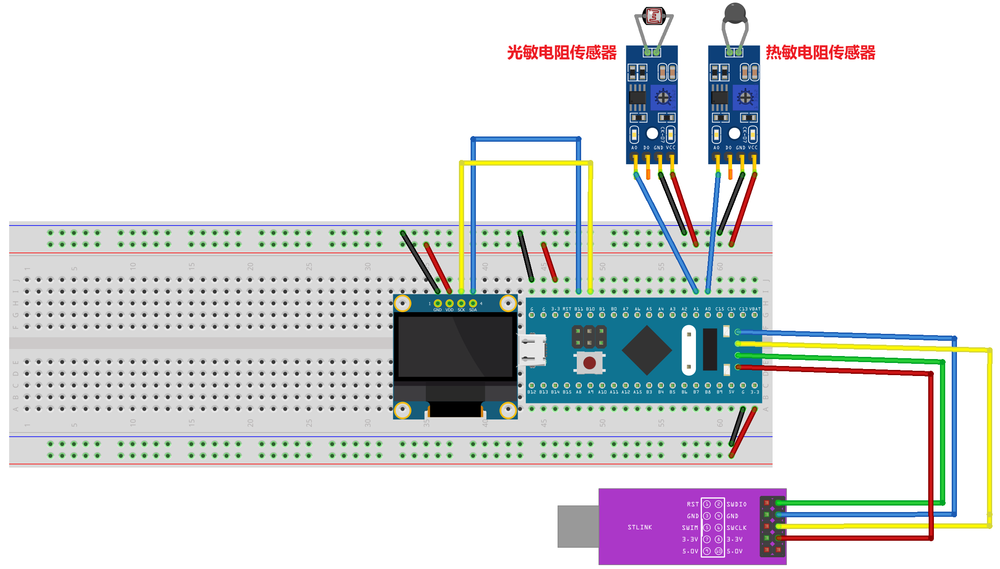

*图6.3-1ADC转换实验－电路接线图*

在接线时，都是使用杜邦线连接的，注意不要接错了。

#### 6.4 输入引脚初始化

由于前面的铺垫，两个模拟信号输入的引脚的初始化，就非常简单了。

可以直接参考下列代码：

```c
// 开启 ADC1 和 GPIOA 时钟
RCC_APB2PeriphClockCmd(RCC_APB2Periph_GPIOA, ENABLE);

// GPIO 配置模拟信号输入引脚
GPIO_InitTypeDef GPIO_InitStructure;
GPIO_InitStructure.GPIO_Pin = GPIO_Pin_0 | GPIO_Pin_1; // 选择 PA0和PA1作为ADC输入通道0和1
GPIO_InitStructure.GPIO_Mode = GPIO_Mode_AIN; // 配置为模拟输入模式
GPIO_Init(GPIOA, &GPIO_InitStructure); // 初始化 GPIOA
```

注意输入模式就无需配置引脚输出速度了。

### 7. ADC外设模块的初始化

ADC外设模块的初始化，使用一个我们"看起来"特别熟悉的函数：ADC_Init函数。

该函数的声明如下:

```c
void ADC_Init(ADC_TypeDef* ADCx, ADC_InitTypeDef* ADC_InitStruct);
```

第一个参数非常简单，表示要初始化的ADC外设的模块名字。

这里直接传参"ADC1"即可。

函数的第二个参数，需要传参一个ADC_InitTypeDef结构体对象指针。

也就是需要创建一个该类型结构体对象，然后逐一给结构体对象的成员赋值，最终再将该结构体对象的指针作为参数传递。

该结构体当中需要手动赋值的一共有以下六个成员：

```c
typedef struct{
    uint32_t ADC_Mode;
    FunctionalState ADC_ScanConvMode;
    FunctionalState ADC_ContinuousConvMode;
    uint32_t ADC_ExternalTrigConv;
    uint32_t ADC_DataAlign;
    uint8_t ADC_NbrOfChannel;
}ADC_InitTypeDef;
```

下面逐一讲解一下这些成员的赋值：

#### 7.1 ADC_Mode成员

**ADC_Mode：**

用于设置 ADC 的工作模式，出于简单使用考虑，我们的实验中仅需要一个ADC外设工作就足够实现功能。

所以该成员的取值可以直接填：ADC_Mode_Independent具体的赋值代码如下:

```c
ADC_InitStruct.ADC_Mode = ADC_Mode_Independent;
```

即选择独立工作模式，只使用1个ADC外设，ADC1 不与 ADC2 组成双 ADC 联合工作模式。

#### 7.2 ADC_ScanConvMode

**ADC_ScanConvMode：**

英文全称：Scan Conversion Mode，用于设定是否开启扫描模式，即ADC外设工作时是否自动按照顺序切换多个通道实现转换功能。

在我们的实验当中，虽然用到了两个通道，但完全可以一次转换使用某个单一通道，所以没必要使用扫描模式，直接关闭扫描模式即可。

具体的赋值代码如下:

```c
ADC_InitStructure.ADC_ScanConvMode = DISABLE;
```

#### 7.3 ADC_ContinuousConvMode

**ADC_ContinuousConvMode：**

英文全称：**Continuous Conversion Mode**，用于配置是否开启自动连续转换模式，即是否自动的重复的完成数据采样以及转换。

为了简单起见，我们选择每次都手动进行信号转换，而不进行自动转换，所以也要关闭这个自动转换模式。

具体的赋值代码如下:

```c
ADC_InitStructure.ADC_ContinuousConvMode = DISABLE;
```

#### 7.4 ADC_ExternalTrigConv

**ADC_ExternalTrigConv：**

英文全称：**External Trigger Conversion**在STM32的ADC配置中，ADC_ExternalTrigConv参数用于设置ADC转换的外部触发源，即什么情况和场景下，会触发ADC进行数据转换。

触发方式可以粗略的分为两种：

1. 自动触发：也叫做硬件触发、外部事件触发，比如借助定时器，借助外部事件等方式进行触发。
2. 手动触发：也叫软件触发，即配置ADC外设模块自行触发数据转换，**实际上就是需要程序员手动调用函数来触发数据采样和完成转换。**

出于简单实现功能考虑，我们的实验就选择手动触发的方式，此时成员的赋值代码如下：

```c
ADC_InitStructure.ADC_ExternalTrigConv = ADC_ExternalTrigConv_None; // 不使用外部触发，采用软件触发
```

#### 7.5 ADC_DataAlign

**ADC_DataAlign:**

英文全称：**Data Alignment**，即数据对齐方式，该成员用于设置ADC转换后的数字电压信号的数据存储对齐方式。

它一共有两种对齐方式：

1. 左对齐
2. 右对齐

这两种对齐格式分别意味着什么呢？

这就不得不提ADC外设的一个重要属性：**分辨率，它用于表示最终转换结果存储的位数。**

我们使用的ADC都是12位的，即最终ADC转换后的最终数据是使用12位二进制位存储的。

而ADC外设存储最终结果的寄存器共有16位，于是左对齐和右对齐就如下图所示：

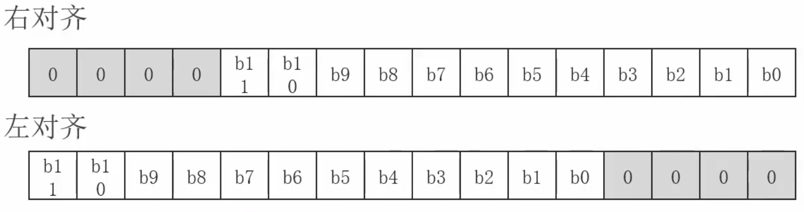

*图7.5-1数据对齐方式-图*

一般我们建议大家直接选择右对齐的方式，因为这种对齐方式，结果寄存器的高位补0，更便于计算。

那么这个结果寄存器当中存储的是不是真实的电压值呢？

答：其实并不是，结果寄存器当中存储的只是电压数字信号的特殊表示形式，要想得到真实的电压值还需要进行一步转换。

那么为什么需要转换呢？以及如何进行转换呢？

**这里就需要了解ADC外设的工作原理了，即"逐次逼近型ADC"。**

由于我们使用的是12位ADC，所以它的最终结果取值是0 ~ 4095，一共有4096种可能性。

单片机的供电电压是3.3V，也就是说这个3.3V要被分为4096份，每一份是3.3 / 4096 = 0.0008056641V。

然后我们再算权重：

1. b11位为最高位，所以当只有b11位取1时，就表示实际电压为2 ^ 11 * 0.0008056641V = 1.65V
2. 当只有b10位取1时，就表示实际电压为2 ^ 10 * 0.0008056641V = 0.825V
3. 当只有b9位取1时，就表示实际电压为2 ^ 9 * 0.0008056641V =0.4125V
4. ....

全部数据可以参考下列表格：

| 位数（bX） | 对应的二进制值 | 权重（实际电压增量） |
|---|---|---|
| b11（最高位） | 2^11 = 2048 | 2048 × 0.0008056641 = 1.65 V |
| b10 | 2^10 = 1024 | 1024 × 0.0008056641 = 0.825 V |
| b9 | 2^9 = 512 | 512 × 0.0008056641 = 0.4125 V |
| b8 | 2^8 = 256 | 256 × 0.0008056641 = 0.206 V |
| b7 | 2^7 = 128 | 128 × 0.0008056641 = 0.1035 V |
| b6 | 2^6 = 64 | 64 × 0.0008056641 = 0.0517 V |
| b5 | 2^5 = 32 | 32 × 0.0008056641 = 0.0258 V |
| b4 | 2^4 = 16 | 16 × 0.0008056641 = 0.0129 V |
| b3 | 2^3 = 8 | 8 × 0.0008056641 = 0.0064 V |
| b2 | 2^2 = 4 | 4 × 0.0008056641 = 0.0032 V |
| b1 | 2^1 = 2 | 2 × 0.0008056641 = 0.0016 V |
| b0（最低位） | 2^0 = 1 | 1 × 0.0008056641 = 0.0008 V |

举一个例子：

当实际电压为**2.2V**时，结果寄存器应该存储哪个二进制数呢？

整个计算过程就是从最高位权重开始累加，只要该位累加后还不超过这个实际电压，那么该位就可以取1。

计算过程如下：

| 位数 (bX) | 权重 (V) | 累积电压计算过程 (V) | 是否已超出 | 该位是否取 1 |
|---|---|---|---|---|
| b11 | 1.65 V | 1.65 V | 未超出 | 是 |
| b10 | 0.825 V | 1.65 V + 0.825 V = 2.475 V | 已超出 | 否 |
| b9 | 0.4125 V | 1.65 V + 0.4125 V = 2.0625 V | 未超出 | 是 |
| b8 | 0.206 V | 2.0625 V + 0.206 V = 2.2685 V | 已超出 | 否 |
| b7 | 0.1035 V | 2.0625 V + 0.1035 V = 2.166 V | 未超出 | 是 |
| b6 | 0.0517 V | 2.166 V + 0.0517 V = 2.2177 V | 已超出 | 否 |
| b5 | 0.0258 V | 2.166 V + 0.0258 V = 2.1918 V | 未超出 | 是 |
| b4 | 0.0129 V | 2.1918 V + 0.0129 V = 2.2047 V | 已超出 | 否 |
| b3 | 0.0064 V | 2.1918 V + 0.0064 V = 2.1982 V | 未超出 | 是 |
| b2 | 0.0032 V | 2.1982 V + 0.0032 V = 2.2014 V | 已超出 | 否 |
| b1 | 0.0016 V | 2.1982 V + 0.0016 V = 2.1998 V | 未超出 | 是 |
| b0 | 0.0008 V | 2.1998 V + 0.0008 V = 2.2006 V | 已超出 | 否 |

于是ADC的结果寄存器当中存储的数据就是: 101010101010 ，即0XAAA，十进制数就是2730。

**也就是说，当实际输入电压是2.2V这个模拟电压信号量时，ADC转换后输出的数字电压值是：2730**那么如何将这个ADC转换后的结果，再转换成实际的电压值呢？

很简单，2730这个值表示实际电压值有2730份，而每一份是3.3 / 4096 = 0.0008056641V，那么它表示的实际电压就是：

2730 * 0.0008056641 = 2.1994628906V**这个结果为什么和实际电压值不同呢？**

很简单，这就是模拟信号连续、且精度无限和数字信号不连续，精度有限的差别，所以模数转换是存在误差的。

而且不难发现，随着ADC分辨率位数的增加，误差就会减少。

所以提升ADC的分辨率是有效提升数据采集精度的方式，当然代价就是更贵以及更高的功耗。

回到ADC_DataAlign成员的配置本身，这个成员的配置代码如下：

```c
ADC_InitStructure.ADC_DataAlign = ADC_DataAlign_Right; // 结果右对齐（低位对齐方式）
```

以上。

#### 7.6 ADC_NbrOfChannel

**ADC_NbrOfChannel:**

英文全称: Number of Channels，即一次性ADC转换的通道数量。出于简单和本实验的需求，我们直接传参数值1就可以了。

此时成员的赋值代码如下：

```c
ADC_InitStructure.ADC_NbrOfChannel = 1;
```

ADC_NbrOfChannel 与扫描模式（Scan Mode）是配合使用的。

1. 当只配置 1 个通道时，是否开启扫描模式没有影响
2. 当配置多个通道时，必须开启扫描模式，ADC 才会按顺序依次转换多个通道

#### 7.7 开启/使能ADC外设

和很多外设一样，在调用ADC_Init 函数完成外设初始化以后，需要使用相应的Cmd函数用于开启此外设。

ADC外设也不例外。

函数调用代码如下:

```c
ADC_Cmd(ADC1, ENABLE);
```

#### 7.8 ADC外设复位校准和校准操作

ADC作为一种转换数据信号的外设，它的精度是非常重要的。

所以ADC外设内部提供了一个用于实现校准的寄存器，但是在进行校准之前，建议先复位这个校准寄存器，以防止上一次的校准数据影响到这一次的校准。

其函数调用代码如下：

```c
// 复位 ADC1 校准
ADC_ResetCalibration(ADC1);

while (ADC_GetResetCalibrationStatus(ADC1)); // 等待复位完成
```

复位校准完成后，就可以开始进行ADC校准了，其函数调用代码如下：

```c
// 开始 ADC1 校准
ADC_StartCalibration(ADC1);

while (ADC_GetCalibrationStatus(ADC1)); // 等待校准完成
```

**为什么需要校准？**

实际上官方手册文档上对校准操作是有说明的，手册上明确指出："校准可大幅减小因内部电容器组的变化而造成的准精度误差。"所以在ADC外设上电开启（也就是ADC_Cmd函数执行）后，就需要执行上述ADC校准操作，以获取最佳的转换精度，减少误差。

#### 7.9 完整参考代码

至此，关于一个ADC外设的初始化操作，就全部完成了。

**STM32 官方推荐的 ADC 初始化流程，标准顺序就是：**

1. 配置时钟
2. 配置 GPIO
3. 配置 ADC 参数
4. 使能 ADC
5. 复位校准
6. 启动校准

完整的参考代码如下：

```c
/**
 * @brief 配置 ADC1 以进行模数转换
 * @note 只配置了通信ADC_Channel_0 和 ADC_Channel_1这两个通道
 */
void ADC1_Init(void) {
    // 配置 ADC 时钟，确保低于 14MHz
    RCC_ADCCLKConfig(RCC_PCLK2_Div6); // 设置 ADC 时钟 = APB2 时钟 /6=12MHz（恰好合适）

    // 开启 ADC1 和 GPIOA 时钟
    RCC_APB2PeriphClockCmd(RCC_APB2Periph_ADC1 |RCC_APB2Periph_GPIOA,ENABLE);

    // GPIO 配置模拟信号输入引脚
    GPIO_InitTypeDef GPIO_InitStructure;
    GPIO_InitStructure.GPIO_Pin = GPIO_Pin_0 | GPIO_Pin_1; // 将PA0、PA1配置为模拟输入引脚，对应ADC_Channel_0、ADC_Channel_1
    GPIO_InitStructure.GPIO_Mode = GPIO_Mode_AIN; // 配置为模拟输入模式
    GPIO_Init(GPIOA, &GPIO_InitStructure); // 初始化 GPIOA

    // ADC1 外设初始
    ADC_InitTypeDef ADC_InitStructure;
    ADC_InitStructure.ADC_Mode = ADC_Mode_Independent; // 独立模式，ADC1不与ADC2组成双ADC联合工作模式
    ADC_InitStructure.ADC_ScanConvMode = DISABLE; // 关闭扫描模式，每次只转换一个手动指定的通道
    ADC_InitStructure.ADC_ContinuousConvMode = DISABLE; // 关闭连续转换模式（手动触发转换）
    ADC_InitStructure.ADC_ExternalTrigConv =ADC_ExternalTrigConv_None;//不使用外部触发，采用软件触发
    ADC_InitStructure.ADC_DataAlign = ADC_DataAlign_Right; // 结果右对齐（低位对齐方式）
    ADC_InitStructure.ADC_NbrOfChannel = 1; // 规则通道序列长度为 1，即每次只转换1个通道
    ADC_Init(ADC1, &ADC_InitStructure); // 初始化 ADC1

    // 开启 ADC1
    ADC_Cmd(ADC1, ENABLE);

    // 复位校准，SET表示动作执行中，RESET表示完成
    ADC_ResetCalibration(ADC1);
    while (ADC_GetResetCalibrationStatus(ADC1) == SET);

    // 启动校准，SET表示动作执行中，RESET表示完成
    ADC_StartCalibration(ADC1);
    while (ADC_GetCalibrationStatus(ADC1) == SET);
}
```

ADC1 外设完成初始配置后，由于我们采用的是**手动触发模式**，所以 ADC 并不会自动开始转换。

每次需要读取某个通道的电压时，都需要按照下面的流程手动执行一次：

1. 指定本次要转换的 ADC 通道；
2. 软件触发 ADC 开始转换；
3. 等待转换完成；
4. 读取 ADC 转换结果。

下面我们用代码完成这个读取流程。

### 8. 读取ADC转换后的结果

在上述配置ADC外设完成后，ADC就可以开始工作了，我们就可以读取ADC转换后的结果了。

这里先来讲解几个重要的函数。

#### 8.1 ADC_RegularChannelConfig函数

ADC_RegularChannelConfig，正如这个函数的名字，RegularChannel规则通道，该函数用于ADC外设的规则通道。

通俗的说，该函数用于指定使用哪个 ADC 通道、该通道在规则序列中的顺序，以及该通道的采样时间。

该设置一旦完成，就相当于ADC外设做好了采集数据、转换数据的准备。

该函数的声明如下：

```c
void ADC_RegularChannelConfig(ADC_TypeDef* ADCx, uint8_t ADC_Channel, uint8_t Rank, uint8_t ADC_SampleTime);
```

**其函数的前两个参数非常简单，可以直接传参：**

1. ADCx参数，指定ADC外设，直接传参ADC1 或者ADC2
2. ADC_Channel参数，指定数据采集的通道号。
   - a. 由于我们使用单通道数据采集，所以在需要采集某个通道数据时，就直接传参对应通道即可。
   - b. 比如我们上面使用的通道0: ADC_Channel_0 和通道1: ADC_Channel_1 。

**随后我们来看一下第三个参数：Rank**该参数表示：

如果**使用多个通道、扫描模式**采样时，Rank用来**指定该通道在转换序列中的顺序**。

但我们仅使用简单的单通道数据采集，所以这个参数可以直接传参1，表示每次只转换一个固定通道。

**重点来看一下最后一个参数: ADC_SampleTime**这个参数用于设置ADC 的采样时间，由于 ADC 开始转换之前，ADC 采样电容（S/H 电容）需要充电，以便后续转换。

所以ADC_SampleTime这个采样时间设置，就决定了电容的充电时长：

1. 采样时间越短，充电时间就越短，采样速率越快，转换速率就越快，但精度可能下降。
2. 采样时间越长，充电就更充分，精度就更高，但相应速率就会降低。

ADC_SampleTime可选值如下表格：

| 宏定义 | 采样时间 |
|---|---|
| ADC_SampleTime_1Cycles5 | 1.5 个时钟周期 |
| ADC_SampleTime_7Cycles5 | 7.5 个时钟周期 |
| ADC_SampleTime_13Cycles5 | 13.5 个时钟周期 |
| ADC_SampleTime_28Cycles5 | 28.5 个时钟周期 |
| ADC_SampleTime_41Cycles5 | 41.5 个时钟周期 |
| ADC_SampleTime_55Cycles5 | 55.5 个时钟周期 |
| ADC_SampleTime_71Cycles5 | 71.5 个时钟周期 |
| ADC_SampleTime_239Cycles5 | 239.5 个时钟周期 |

设置好了采样周期后，相应的一次转换的总转换时间就可以计算了。

STM32F103系列芯片的**ADC 总转换时间**可以由下列公式来进行计算：

T_conv =（采样时间周期 + 12.5）× T_ADC_Clock

其中：T_ADC_Clock 是**一个 ADC 时钟周期所耗时间**，ADC 时钟频率由 RCC_ADCCLKConfig() 函数调用设置，我们使用的时钟周期是 12 MHz。

如此我们可以计算出，ADC一个时钟频率时间是：1 / 12MHz 秒。

**加上的12.5是什么意思呢？**

12.5就是12.5个时钟周期，我们查看硬件手册的说明，STM32F103 系列芯片的ADC外设在采集完数据后的，转换数据的时间是固定的。

固定为12.5个ADC时钟周期时间。

**为什么固定为12.5个ADC时钟周期呢？**

因为ADC是12位的，每一个时钟周期用于确定对应位的值为0或1，再留半个周期进行数据存储，总共12.5个时钟周期。

所以ADC外设，完成一次采样，并且转换数据的总转换时间，其计算结果就如下表格所示：

| 宏定义 | 总转换时间（Cycles） | 总转换时间（µs，ADC 时钟 = 12MHz） |
|---|---|---|
| ADC_SampleTime_1Cycles5 | 1.5 + 12.5 个时钟周期 | 1.17 µs |
| ADC_SampleTime_7Cycles5 | 7.5 + 12.5 个时钟周期 | 1.67 µs |
| ADC_SampleTime_13Cycles5 | 13.5 + 12.5 个时钟周期 | 2.17 µs |
| ADC_SampleTime_28Cycles5 | 28.5 + 12.5 个时钟周期 | 3.42 µs |
| ADC_SampleTime_41Cycles5 | 41.5 + 12.5 个时钟周期 | 4.50 µs |
| ADC_SampleTime_55Cycles5 | 55.5 + 12.5 个时钟周期 | 5.67 µs |
| ADC_SampleTime_71Cycles5 | 71.5 + 12.5 个时钟周期 | 7.00 µs |
| ADC_SampleTime_239Cycles5 | 239.5 + 12.5 个时钟周期 | 21.04 µs |

那我们应该选择什么样的采样时间呢？

**采样时间的选择主要靠模拟信号源的阻抗决定。**

在模拟电路中，信号源阻抗 (R_source) 是信号源输出端的等效电阻，它表示信号源驱动电流的能力。

简单来说，信号源阻抗越高，提供的电流越小，ADC 采样电容充电就越慢，因此需要更长的采样时间 (ADC_SampleTime) 以确保准确测量。

下面给出一张表格展示了常见的信号源阻抗和采样时间的选择:

| 信号源阻抗 ( R_source ) | 推荐ADC_SampleTime | 适用场景 |
|---|---|---|
| < 1kΩ | 1.5 ~ 7.5 Cycles | 运放缓冲输出、低阻抗电压测量 |
| 1kΩ ~ 10kΩ | 7.5 ~ 13.5 Cycles | 分压电路、电位器、低阻抗 NTC |
| 10kΩ ~ 50kΩ | 28.5 ~ 55.5 Cycles | 光敏电阻（LDR）、NTC 热敏电阻 |
| 50kΩ ~ 100kΩ | 55.5 ~ 71.5 Cycles | 高阻抗 NTC、电容式传感器 |

由于我们实验的目标就是采集光敏电阻传感器、热敏电阻传感器的模拟信号，所以这里我们选择55.5个时钟周期时间作为采样时间。

以上，这个函数调用的代码就如下：

```c
// 配置 ADC 通道（指定ADC1外设, ADC通道，单通道采样，采样时间 55.5 时钟周期）
ADC_RegularChannelConfig(ADC1, ADC_Channel_x, 1, ADC_SampleTime_55Cycles5);
```

**当然，如果不追求采样速度，更加追求采样的精准度，可以进一步放慢采样时间。**

#### 8.2 ADC_SoftwareStartConvCmd函数

完成上面ADC通道规则配置后，就可以开始ADC采集数据、转换数据的流程了。

在上面配置ADC外设时，我们选择的触发方式是软件触发，即使用某个函数调用触发ADC的数据采集、转换流程。

这个函数就是ADC_SoftwareStartConvCmd。

该函数的声明如下：

```c
void ADC_SoftwareStartConvCmd(ADC_TypeDef* ADCx, FunctionalState NewState);
```

其函数传参可以参考下列表格:

| 参数 | 类型 | 作用 |
|---|---|---|
| ADCx | ADC_TypeDef* | 选择 ADC 外设（ ADC1 、 ADC2 ） |
| NewState | FunctionalState | ENABLE 触发一次转换， DISABLE 关闭软件触发转换功能 |

注意事项：

1. 只有ADC设置为软件触发模式，才需要调用该函数手动触发ADC采集和转换数据。
2. **由于上述ADC初始化时，禁用了连续转换模式，所以每转换一次数据都需要调用一次该函数。**

在上面讲解ADC_RegularChannelConfig函数时，我们知道: ADC从采样数据到完成转换数据，将结果存储到结果寄存器是需要耗费很多时间的。

那么在读结果寄存器的数据时，就需要等待ADC采样、转换、存储数据全部完成后，才能够进行读取。

如何实现这样的等待过程呢？

很简单，依靠标志位。

**标志位EOC（End of Conversion）被置为1时，就表示ADC采样、转换、存储数据全部完成。**

我们可以通过函数: ADC_GetFlagStatus来获取ADC外设标志位的状态，于是一次完整的软件触发ADC采样转换数据的代码就是：

```c
// 开始 ADC1采样,转换数据的过程（软件触发）
ADC_SoftwareStartConvCmd(ADC1, ENABLE);

// 等待转换完成（检查 EOC 标志）
while (ADC_GetFlagStatus(ADC1, ADC_FLAG_EOC) == RESET);

// 代码执行到这里, 说明可以读ADC数据了
```

那么怎么读ADC结果寄存器当中的数据呢？

#### 8.3 ADC_GetConversionValue函数

ADC_GetConversionValue函数就用于ADC一次数据采集转换后，结果数据寄存器当中的16位数值。（文档上面已经分析过这个数值了）

其函数声明如下：

```c
uint16_t ADC_GetConversionValue(ADC_TypeDef* ADCx);
```

其传参非常简单，传入对应ADC外设名即可，如ADC1 、ADC2 。

该函数调用就表示从ADCx外设中读取对应通道的转换结果。

**重要注意事项：**

我们已经知道EOC标志位在转换完成时会被自动置为1，那么读完数据后就应该置为0，以进行下一次ADC采集转换数据。

那么需要手动将EOC标志位置为0吗？

**不需要，按照官方手册文档中的说明，在调用ADC_GetConversionValue函数读数据后，EOC标志位会自动置为0！**

#### 8.4 读ADC结果函数的完整代码

我们仍然可以写一个函数来完成读ADC结果的这个操作，其完整参考代码如下：

```c
/**
 * @brief 读取指定通道的 ADC 值
 * @note 如果要读取 PA0，就传入 ADC_Channel_0；如果要读取 PA1，就传入 ADC_Channel_1。
 * @param channel: 要转换的 ADC 通道号，只配置了ADC_Channel_0 和ADC_Channel_1
 * @retval uint16_t: 12 位 ADC 转换结果（范围 0 ~ 4095）
 */
uint16_t ADC1_ReadChannel(uint8_t channel) {
    // 配置 ADC 通道（指定通道，规则组序号 1，采样时间 55.5 周期）
    ADC_RegularChannelConfig(ADC1, channel, 1,ADC_SampleTime_55Cycles5);

    // 开始 ADC1采样,转换数据的过程（软件触发）
    ADC_SoftwareStartConvCmd(ADC1, ENABLE);

    // 等待转换完成（检查 EOC 标志, 等待该标志被置为1）
    while (ADC_GetFlagStatus(ADC1, ADC_FLAG_EOC) == RESET);

    // 读取并返回转换结果, 自动将EOC标志位置为0
    return ADC_GetConversionValue(ADC1);
}
```

以上。

### 9. ADC1模块化编程

为了更好的解耦，我们将ADC1外设模块的初始化配置，以及读ADC1一次数据转换，这两个API合并构成一个独立的ADC1模块。

**头文件ADC1.h参考代码如下：**

```c
#ifndef __ADC1_H
#define __ADC1_H

#include "stm32f10x.h"

void ADC1_Init(void);
uint16_t ADC1_ReadChannel(uint8_t channel);

#endif // __ADC1_H

```

**实现源文件ADC1.c参考代码如下：**

```c
#include "ADC1.h"

/**
 * @brief 配置 ADC1 以进行模数转换
 * @note 该函数初始化 ADC1，并配置其转换模式、数据对齐方式等
 * @param 无
 * @retval 无
 */
void ADC1_Init(void) {
    // 配置 ADC 时钟，确保低于 14MHz
    RCC_ADCCLKConfig(RCC_PCLK2_Div6); // 设置 ADC 时钟 = APB2 时钟 /6=12MHz（恰好合适）

    // 开启 ADC1 和 GPIOA 时钟
    RCC_APB2PeriphClockCmd(RCC_APB2Periph_ADC1 |RCC_APB2Periph_GPIOA,ENABLE);

    // GPIO 配置模拟信号输入引脚
    GPIO_InitTypeDef GPIO_InitStructure;
    GPIO_InitStructure.GPIO_Pin = GPIO_Pin_0 | GPIO_Pin_1; // 选择PA0和PA1作为ADC输入通道
    GPIO_InitStructure.GPIO_Mode = GPIO_Mode_AIN; // 配置为模拟输入模式
    GPIO_Init(GPIOA, &GPIO_InitStructure); // 初始化 GPIOA

    // ADC1 外设初始
    ADC_InitTypeDef ADC_InitStructure;
    ADC_InitStructure.ADC_Mode = ADC_Mode_Independent; // 独立模式，不与其他ADC共享通道
    ADC_InitStructure.ADC_ScanConvMode = DISABLE; // 关闭扫描模式（同时只有一个单通道进行转换）
    ADC_InitStructure.ADC_ContinuousConvMode = DISABLE; // 关闭连续转换模式（手动触发转换）
    ADC_InitStructure.ADC_ExternalTrigConv =ADC_ExternalTrigConv_None;//不使用外部触发，采用软件触发
    ADC_InitStructure.ADC_DataAlign = ADC_DataAlign_Right; // 结果右对齐（低位对齐方式）
    ADC_InitStructure.ADC_NbrOfChannel = 1; // 只配置 1 个转换通道
    ADC_Init(ADC1, &ADC_InitStructure); // 初始化 ADC1

    // 开启 ADC1
    ADC_Cmd(ADC1, ENABLE);

    // 复位校准，SET表示动作执行中，RESET表示完成
    ADC_ResetCalibration(ADC1);
    while (ADC_GetResetCalibrationStatus(ADC1) == SET);

    // 启动校准，SET表示动作执行中，RESET表示完成
    ADC_StartCalibration(ADC1);
    while (ADC_GetCalibrationStatus(ADC1) == SET);
}

/**
 * @brief 读取指定通道的 ADC 值
 * @note 该函数启动 ADC1 进行单次转换，并返回转换结果
 * @param channel: 要转换的 ADC 通道号（ADC_Channel_0 ~ADC_Channel_17）
 * @retval uint16_t: 12 位 ADC 转换结果（范围 0 ~ 4095）
 */
uint16_t ADC1_ReadChannel(uint8_t channel) {
    // 配置 ADC 通道（指定通道，规则组序号 1，采样时间 55.5 周期）
    ADC_RegularChannelConfig(ADC1, channel, 1,ADC_SampleTime_55Cycles5);

    // 开始 ADC1采样,转换数据的过程（软件触发）
    ADC_SoftwareStartConvCmd(ADC1, ENABLE);

    // 等待转换完成（检查 EOC 标志, 等待该标志被置为1）
    while (ADC_GetFlagStatus(ADC1, ADC_FLAG_EOC) == RESET);

    // 读取并返回转换结果, 自动将EOC标志位置为0
    return ADC_GetConversionValue(ADC1);
}

```

本模块采用“每次读取前临时指定通道”的方式，因此虽然初始化时把 PA0 和 PA1 都配置成模拟输入。

但 ADC 每次实际只转换ADC1_ReadChannel()传入的那个通道。

在main.c中，可以写一段代码，测试这个ADC1模块（需要引入printf1串口打印模块），参考代码如下：

```c
#include "stm32f10x.h"
#include "ADC1.h"
#include "Delay.h"
#include "DebugUSART1.h"
#include <stdio.h>

int main(void) {
    DebugUSART1_Init();
    ADC1_Init();
    printf1("ADC1 test start\r\n");

    while (1) {
       // 读取 ADC1 通道 0 的转换结果
       // ADC_Channel_0 对应 PA0 引脚（比如接入了热敏电阻传感器的AO口）
       uint16_t Adc0Value = ADC1_ReadChannel(ADC_Channel_0);

       // 读取 ADC1 通道 1 的转换结果
       // ADC_Channel_1 对应 PA1 引脚（比如接入了光敏电阻传感器的AO口）
       uint16_t Adc1Value = ADC1_ReadChannel(ADC_Channel_1);

       // 将 PA0 的 ADC 原始值换算成电压值，单位为 V
       // 为了保留 4 位小数，这里先把电压放大 10000 倍
       // 电压 * 10000 = ADC值 / 4096 * 3.3V * 10000 = ADC值 *33000/4096
       uint32_t Adc0VoltageX10000 = (uint32_t)Adc0Value * 33000 /4096;

       // 将 PA1 的 ADC 原始值换算成电压值，单位为 V，同样放大 10000 倍
       uint32_t Adc1VoltageX10000 = (uint32_t)Adc1Value * 33000 /4096;

       // 拆分 PA0 电压的整数部分和小数部分
       uint32_t Adc0VoltageInt = Adc0VoltageX10000 / 10000;
       uint32_t Adc0VoltageDec = Adc0VoltageX10000 % 10000;

       // 拆分 PA1 电压的整数部分和小数部分
       uint32_t Adc1VoltageInt = Adc1VoltageX10000 / 10000;
       uint32_t Adc1VoltageDec = Adc1VoltageX10000 % 10000;

       // 通过串口打印 PA0 的 ADC 原始值和换算后的电压值
       printf1("PA0: ADC=%d, Voltage=%lu.%04luV\r\n",
               Adc0Value,
               (unsigned long)Adc0VoltageInt,
               (unsigned long)Adc0VoltageDec);

       // 通过串口打印 PA1 的 ADC 原始值和换算后的电压值
       printf1("PA1: ADC=%d, Voltage=%lu.%04luV\r\n",
               Adc1Value,
               (unsigned long)Adc1VoltageInt,
               (unsigned long)Adc1VoltageDec);

       printf1("--------------------\r\n");

       Delay_S(3);
    }
}

```

注：

由于在STM32F103等多数低端单片机中，都没有硬件浮点运算单元，所以float 、double的加减乘除都需要编译器用软件模拟。

虽然也可以做，但占用资源多，性能比较多。

**所以尽量不要在STM32F103单片机上使用浮点数。**

通过上述代码，我们可以获取传感器AO口输出的近似数字值和电压值。

那么它们有什么规律与特点呢？

拿光敏电阻传感器与热敏电阻传感器为例：

1. 光敏电阻传感器：
   - a. 光照越暗，光敏电阻的阻值越大，在分压电路中分得的电压就越大，AO口输出的模拟电压信号值就越大。
   - b. 光照越亮，光敏电阻的阻值越小，在分压电路中分得的电压就越小，AO口输出的模拟电压信号值就越小。
2. 热敏电阻传感器：
   - a. 温度越高，热敏电阻的阻值越小，在分压电路中分得的电压就越小，AO口输出的模拟电压信号值就越小。
   - b. 温度越低，热敏电阻的阻值越大，在分压电路中分得的电压就越大，AO口输出的模拟电压信号值就越大。

所以，结论如下：

1. **AO 口输出的是模拟电压，电压越高，ADC 读取值越大。**
2. **光敏电阻传感器中：光照越暗，AO 电压越高，ADC 数值越大。**
3. **光敏电阻传感器中：光照越亮，AO 电压越低，ADC 数值越小。**
4. **热敏电阻传感器中：温度越高，AO 电压越低，ADC数值越小。**
5. **热敏电阻传感器中：温度越低，AO 电压越高，ADC 数值越大。**

### 10. 传感器Sensor模块

在实际工程中，ADC1模块显然属于传感器数据采样的底层实现，这些底层实现并不需要直接暴露给外界使用。

比如：

**我们把光敏电阻传感器的AO口接在PA0引脚上，热敏电阻传感器的AO口接在PA1引脚上。**

对于应用层实现而言，它只关心两个问题：

1. 需要一个接口，直接获取光敏电阻传感器对应的数字值，用于指示光照强度。
2. 需要一个接口，直接获取热敏电阻传感器对应的数字值，用于指示当前温度。

所以，在上述ADC模块的基础上，我们可以进一步编写传感器Sensor模块，以实现将将ADC转换的结果 --> 实际电压数字值。

**甚至将实际的电压数字值转换成近似的、真实物理量。**

这里，我们先做一下约定：

1. 由于光照强度对应的物理量，lux、勒克斯，在生活中不太常见，所以光敏电阻传感器的ADC采样数据，直接使用ADC转换的结果：
   - a. 取值范围是[0, 4095]
   - b. ADC转换数值越大，代表光照强度越弱，光线越暗（阻值大，分压多）
   - c. ADC转换数值越小，代表光照强度越强，光线越亮（阻值小，分压少）
2. **而温度这个物理量是非常常见的，所以热敏电阻传感器的ADC采样数据，需要转换成实际电压数字值，然后再套公式，获取真实的物理量。**

#### 10.1 热敏电阻传感器的计算公式（了解）

对于我们使用的热敏电阻传感器而言，相关的公式如下（了解）：

所以如果想根据AO电压算出温度，大体需要两步：

第一步：根据 ADC 值算出热敏电阻阻值如果模块供电和 ADC 参考电压都是3.3V ，那么可以直接用 ADC 值计算热敏电阻阻值：

```c
热敏电阻阻值 = 10000 × ADC值 / (4096 - ADC值)
```

这里的10000 ，就是模块上的10K固定电阻。

第二步：根据热敏电阻阻值算出温度得到热敏电阻阻值后，再代入 NTC 热敏电阻的温度公式：

```c
温度 = 1 / (1 / 298.15 + ln(热敏电阻阻值 / 10000) / 3950) - 273.15
```

其中：

```c
10000：表示 25℃ 时热敏电阻的阻值约为 10KΩ

298.15：表示 25℃ 对应的开尔文温度

3950：是常见 NTC 热敏电阻的 B 值

ln：表示自然对数
```

简单理解就是：

ADC 值先换算成热敏电阻阻值，再根据热敏电阻阻值换算成温度。

也可以概括成：

```c
ADC值 -> AO电压 -> 热敏电阻阻值 -> 温度
```

需要注意的是，3950只是常见热敏电阻的经验参数。

实际热敏传感器模块可能略有差异，所以算出来的温度通常是一个近似值，但对我们而言也够用了。

#### 10.2 参考代码实现

**头文件Sensor.h的参考代码如下：**

```c
#ifndef __SENSOR_H
#define __SENSOR_H

#include "stm32f10x.h"

// 初始化传感器模块
void Sensor_Init(void);

// 获取光敏电阻传感器 ADC 转换后的数字值
// 光敏电阻传感器的AO口接入PA1引脚
uint16_t Sensor_GetLightADCValue(void);

// 获取热敏电阻传感器的 ADC 原始值
// 热敏电阻传感器的AO口接入PA0引脚
uint16_t Sensor_GetThermistorADCValue(void);

// 获取热敏电阻传感器的近似温度
double Sensor_GetTemperature(void);

#endif // !__SENSOR_H

```

**实现文件Sensor.c的参考代码如下：**

```c
#include "Sensor.h"
#include <math.h>

/**
 * @brief 初始化传感器模块
 * @note PA0 接热敏电阻 AO，PA1 接光敏电阻 AO
 */
void Sensor_Init(void) {
    // 配置 ADC 时钟，确保低于 14MHz
    // 若 APB2 = 72MHz，则 ADC 时钟 = 72MHz / 6 = 12MHz
    RCC_ADCCLKConfig(RCC_PCLK2_Div6);

    // 开启 ADC1 和 GPIOA 时钟
    RCC_APB2PeriphClockCmd(RCC_APB2Periph_ADC1 |RCC_APB2Periph_GPIOA,ENABLE);

    // PA0、PA1 配置为模拟输入
    GPIO_InitTypeDef GPIO_InitStructure;
    GPIO_InitStructure.GPIO_Pin = GPIO_Pin_0 | GPIO_Pin_1;
    GPIO_InitStructure.GPIO_Mode = GPIO_Mode_AIN;
    GPIO_Init(GPIOA, &GPIO_InitStructure);

    // 配置 ADC1：单次转换、软件触发、右对齐
    ADC_InitTypeDef ADC_InitStructure;
    ADC_InitStructure.ADC_Mode = ADC_Mode_Independent;
    ADC_InitStructure.ADC_ScanConvMode = DISABLE;
    ADC_InitStructure.ADC_ContinuousConvMode = DISABLE;
    ADC_InitStructure.ADC_ExternalTrigConv =ADC_ExternalTrigConv_None;
    ADC_InitStructure.ADC_DataAlign = ADC_DataAlign_Right;
    ADC_InitStructure.ADC_NbrOfChannel = 1;
    ADC_Init(ADC1, &ADC_InitStructure);

    // 开启 ADC1
    ADC_Cmd(ADC1, ENABLE);

    // 复位校准，SET 表示动作执行中，RESET 表示完成
    ADC_ResetCalibration(ADC1);
    while (ADC_GetResetCalibrationStatus(ADC1) == SET);

    // 启动校准，SET 表示动作执行中，RESET 表示完成
    ADC_StartCalibration(ADC1);
    while (ADC_GetCalibrationStatus(ADC1) == SET);
}

/**
 * @brief 读取指定 ADC 通道的原始值
 * @note Sensor 模块内部使用，不对外暴露 ADC 细节
 */
static uint16_t Sensor_ReadAdcChannel(uint8_t Channel) {
    // 配置本次要转换的 ADC 通道，规则序列位置为 1，采样时间为 55.5 个 ADC时钟周期
    ADC_RegularChannelConfig(ADC1, Channel, 1,ADC_SampleTime_55Cycles5);

    // 清除上一次转换完成标志
    ADC_ClearFlag(ADC1, ADC_FLAG_EOC);

    // 软件触发 ADC1 开始一次转换
    ADC_SoftwareStartConvCmd(ADC1, ENABLE);

    // 等待转换完成，ADC_FLAG_EOC 置位表示完成
    while (ADC_GetFlagStatus(ADC1, ADC_FLAG_EOC) == RESET);

    // 读取并返回 ADC 转换结果
    return ADC_GetConversionValue(ADC1);
}

/**
 * @brief 获取光敏电阻传感器 ADC 原始值
 * @note 光敏电阻 AO 接 PA1，对应 ADC_Channel_1，返回值范围 0 ~ 4095
 */
uint16_t Sensor_GetLightADCValue(void) {
    return Sensor_ReadAdcChannel(ADC_Channel_1);
}

/**
 * @brief 获取热敏电阻传感器 ADC 原始值
 * @note 热敏电阻 AO 接 PA0，对应 ADC_Channel_0，返回值范围 0 ~ 4095
 */
uint16_t Sensor_GetThermistorADCValue(void) {
    return Sensor_ReadAdcChannel(ADC_Channel_0);
}

/**
 * @brief 读取热敏电阻并返回近似摄氏温度
 * @note 分压电路固定电阻为 10kΩ；NTC 在 25℃时为 10kΩ，B 值为 3950
 */
double Sensor_GetTemperature(void) {
    uint16_t AdcValue = Sensor_GetThermistorADCValue();

    // 避免 ADC 为 0 时参与对数计算
    if (AdcValue == 0) {
       AdcValue = 1;
    }

    // 根据分压公式计算热敏电阻阻值：R_NTC = 10kΩ × ADC / (4096 - ADC)
    double Resistance = 10000.0 * AdcValue / (4096.0 - AdcValue);

    // 根据 NTC 的 B 参数公式计算温度 并将开尔文转换为摄氏度
    // 根据 NTC 的 B 参数公式计算温度，并将开尔文转换为摄氏度
    return 1.0 / (1.0 / 298.15 + log(Resistance / 10000.0) /3950.0)- 273.15;
}

```

当然，这一套关于温度的经验公式有可能存在误差，实际使用时需要注意。

---

## 06 第二期

### 1. 第一期服务端参考代码

首先要想完成服务端程序的编写，除了既定格式的TCP和select代码，还需要约定好手机端和STM32端与服务端交互的方式。

以下服务端参考代码，基于下面的约定：

#### 1.1 STM32端与服务端的通信约定

**STM32端与服务端的代码都由你个人完成，所以下面格式约定完全可以修改。**

**STM32端与服务端的代码都由你个人完成，所以下面格式约定完全可以修改。**

**STM32端与服务端的代码都由你个人完成，所以下面格式约定完全可以修改。**

在本项目中，STM32 与服务端约定的通信格式如下：

**参考的一套HTTP数据帧格式：**

在本项目中，STM32 与服务端约定的通信格式如下：

**STM32单组传感器数据上传服务端（/x）**

```c
POST /x HTTP/1.1

[light=xx,temp=xx]
```

说明：

1. [ ] 表示一段完整的数据内容
2. /x表示上传一组数据
3. 请求体仅包含一行数据
4. 不包含额外 HTTP 头字段

**STM32多组传感器数据上传服务端（/y）**

```c
POST /y HTTP/1.1

[light=xx,temp=xx;light=xx,temp=xx]
```

说明：

1. [ ] 表示一段完整的数据内容
2. /y表示上传多组数据
3. 每组格式一致
4. 使用;分隔多组数据

**服务端完成处理后，对STM32的响应**

```c
HTTP/1.1 200 OK
（空行）
```

说明：

**STM32 建议以收到"200 OK"判断这一次数据上传成功。**

最终统一约定的数据格式为：

```c
[light=xxx,temp=xxx]
```

这也是整个系统中存储传感器数据的，最核心的数据结构。

有两点注意事项与建议：

**第一，为了简单起见，建议在服务端直接使用一个TXT文件来存储传感器数据。**

**同样为了简单起见，TXT可以直接基于下面的格式来存储数据，直接把请求体存入磁盘文件的一行：**


*图1.1-1image-20260806084222417*

**即一行存储一条传感器数据。**

**第二，STM32通常AT指令向服务端发送传感器数据后，接收反馈是通过串口实现的。**

此时的反馈有两个：

1. ESP01S 的 AT 指令反馈。
2. 服务端的HTTP响应报文反馈。

由于串口本身就是字节流，这两个反馈大概率会混在同一个串口接收缓冲区里。比如：

```c
Recv 45 bytes
SEND OK // AT指令成功执行的反馈

+IPD,21:HTTP/1.1 200 OK // HTTP响应报文成功的反馈

```

所以在处理发送AT指令反馈时，最多专门定义一个函数，等两个成功标志字符串。比如：

1. **先等 "SEND OK"，用于判断Send AT指令是否发送成功。**
2. **再等“200 OK”，用于判断服务端是否成功响应。**

**第三，关于TCP的长短连接。**

手机 APP 与服务端之间的通信频率较低，通常是用户在 APP 上点击一次按钮，才向服务端发送一次 HTTP 请求。

**因此，手机 APP 与服务端之间可以采用 TCP 短连接，即每次请求时建立连接，请求处理完成后关闭连接。**

STM32 与服务端之间的通信方式不同。STM32 需要持续、周期性地上传传感器数据。

如果每次上传都重新建立 TCP 连接，就会频繁进行三次握手和四次挥手，增加通信开销，也会降低系统稳定性。

**因此，STM32 与服务端建立 TCP 连接后，建议保持长连接，在同一条连接上周期性发送数据。**

以上。

#### 1.2 手机端与服务端的通信约定

**注意：由于手机APP端代码写死，所以手机端与服务端的通信约定也是固定的，不能改变。**

**手机端在请求服务端传感器数据时，固定的请求HTTP报文格式：**

```c
GET /1 HTTP/1.1
（空行）
```

注意：

1. /1表示手机端获取所有传感器数据
2. 请求格式由手机端固定定义，不允许自由定义。
3. 服务端只需识别资源路径并进行处理

**手机端在获取服务端传感器数据时，固定的响应HTTP报文格式：**

```c
HTTP/1.1 200 OK

["light=xx,temp=xx","light=xx,temp=xx"]
```

说明：

1. 服务端响应格式字符串是固定的，不能自由定义。
2. 手机端的解析代码已经写好了，只要你按照格式响应，手机端就能正常解析数据。

**手机端请求服务端删除传感器数据（其实就是清空服务端数据文件），固定的请求HTTP报文格式：**

```c
GET /2 HTTP/1.1
（空行）
```

说明：

1. /2表示请求清空服务端数据
2. 请求格式同样由手机端固定定义，不允许自由定义。
3. 服务端只需识别资源路径并进行处理

**服务端删除完毕后，响应删除结果的固定格式报文：**

```c
HTTP/1.1 200 OK

[]
```

说明：

1. 返回空数组表示当前无数据
2. 同时表示删除操作执行成功
3. 响应格式必须与手机端约定一致

#### 1.3 参考代码

**参考代码如下：**

```c
/*
 * 第一阶段传感器数据服务端
 *
 * 本程序主要完成以下功能：
 * ------------------------------------------------------------
 * 1. 接收STM32周期性上传的单组传感器数据
 * 请求格式：POST /x HTTP/1.1
 *
 * 2. 接收STM32一次上传的多组传感器数据
 * 请求格式：POST /y HTTP/1.1
 * 3. 响应手机APP的刷新请求，返回TXT文件中的最后10条数据
 * 请求格式：GET /1 HTTP/1.1
 *
 * 4. 响应手机APP的删除请求，清空TXT文件中的全部数据
 * 请求格式：GET /2 HTTP/1.1
 *
 * STM32与服务端使用TCP长连接，上传完成后不会主动断开连接。
 * 手机APP与服务端使用TCP短连接，每次请求处理完成后关闭连接。
 *
 * 传感器数据统一使用以下格式：
 * [light=10,temp=20]
 *
 * 服务端使用data.txt文件保存传感器数据，每条数据单独占一行。
 */

#include "header.h"

// 服务端监听所有本机网卡地址
#define SERVER_IP "0.0.0.0"

// 服务端监听端口
#define SERVER_PORT 8888

// 单次接收客户端数据时使用的缓冲区长度
#define BUF_SIZE 4096

// 构建手机APP的HTTP响应时使用的缓冲区长度
#define RESP_SIZE 4096

// 保存传感器数据的TXT文件名称
#define DATA_FILE "data.txt"

// 客户端socket数组可以保存的最大连接数量
#define MAX_CLIENTS 10

// listen函数使用的全连接队列长度
#define LISTEN_BACKLOG 10

// 手机APP每次刷新时最多返回最后10条传感器数据
#define MAX_LAST_LINES 10

// TXT文件中一条传感器数据允许占用的最大长度
#define MAX_LINE_LEN 256

/*
 * 删除一个客户端连接。
 *
 * client_fds数组用来保存所有已经连接的客户端socket。
 * index表示需要删除的客户端在数组中的位置。
 */
static void remove_client(int client_fds[], int index) {
    // 数组元素为-1，表示这个位置没有保存客户端socket
    if (client_fds[index] == -1) {
       return;
    }

    // 关闭客户端socket
    close(client_fds[index]);

    // 将数组中的这个位置重新标记为空
    client_fds[index] = -1;
}

/*
 * 提取HTTP请求的第一行。
 *
 * 例如，客户端发送：
 *
 * GET /1 HTTP/1.1\r\n
 * Host: 192.168.1.100\r\n
 * \r\n
 *
 * 提取结果为：
 *
 * GET /1 HTTP/1.1
 *
 * 服务端通过请求第一行判断客户端希望执行什么操作。
 */
static void get_request_line(const char *buf, char *line, intsize){
    // i表示下一个字符在line数组中的保存位置
    int i = 0;

    /*
     * HTTP请求行以\r\n结束。
     *
     * 因此，从接收缓冲区开头开始复制字符，
     * 遇到\r、\n或者字符串结束符时停止复制。
     */
    while (i < size - 1 &&
          buf[i] != '\0' &&
          buf[i] != '\r' &&
          buf[i] != '\n') {
       line[i] = buf[i];
       i++;
    }

    // 在请求行末尾添加'\0'，将其变成一个完整的C语言字符串
    line[i] = '\0';
}

/*
 * 向客户端发送HTTP响应。
 *
 * client_fd表示接收响应的客户端socket。
 * resp表示需要发送的完整HTTP响应字符串。
 *
 * 返回0表示发送成功。
 * 返回-1表示发送失败。
 */
static int send_response(int client_fd, const char *resp) {
    /*
     * 本项目的HTTP响应内容较短，
     * 因此直接调用一次send函数发送完整响应。
     */
    ssize_t send_len = send(client_fd,
                          resp,
                          strlen(resp),
                          0);

    // send返回值小于或等于0，说明数据发送失败
    if (send_len <= 0) {
       return -1;
    }

    // HTTP响应发送成功
    return 0;
}

/*
 * 从HTTP请求中找到请求体。
 *
 * 本项目的STM32请求格式为：
 *
 * POST /x HTTP/1.1\r\n
 * \r\n
 * [light=10,temp=20]
 *
 * HTTP请求行和请求体之间使用一个空行分隔。
 * 这个空行在字符串中表示为\r\n\r\n。
 */
static char *get_http_body(char *buf) {
    // 在完整HTTP请求中查找请求行与请求体之间的空行
    char *body = strstr(buf, "\r\n\r\n");

    // 没有找到空行，说明请求格式不正确
    if (body == NULL) {
       return NULL;
    }

    /*
     * body当前指向\r\n\r\n的第一个字符。
     *
     * 向后移动4个字符，跳过\r\n\r\n，
     * 返回HTTP请求体的开始位置。
     */
    return body + 4;
}

/*
 * 保存STM32通过POST /x上传的一组传感器数据。
 *
 * STM32发送的请求体格式：
 *
 * [light=10,temp=20]
 *
 * TXT文件中的保存格式：
 *
 * [light=10,temp=20]
 *
 * 左右方括号会一起保存到TXT文件中。
 */
static int save_single_sensor_body(const char *body) {
    // 查找传感器数据左边的'['
    const char *left = strchr(body, '[');

    // 查找传感器数据右边的']'
    const char *right = strchr(body, ']');

    /*
     * 没有找到左右方括号，说明传感器数据格式错误。
     *
     * right <= left + 1表示两个方括号之间没有实际数据。
     */
    if (left == NULL ||
       right == NULL ||
       right <= left + 1) {
       return -1;
    }

    /*
     * 计算一条完整传感器数据的长度。
     *
     * 这里的长度需要包含左右方括号。
     *
     * 例如：
     * [light=10,temp=20]
     */
    int line_len = (int)(right - left + 1);

    // 数据长度超过数组容量时，不能继续保存
    if (line_len >= MAX_LINE_LEN) {
       return -1;
    }

    // 用来保存一条完整的传感器数据
    char line[MAX_LINE_LEN] = {0};

    // 从左方括号开始复制，左右方括号都会被保存
    strncpy(line, left, line_len);

    // 在数据末尾添加字符串结束符
    line[line_len] = '\0';

    /*
     * 使用追加模式打开data.txt。
     *
     * 文件不存在时，fopen会创建文件。
     * 文件已经存在时，新数据会添加到文件末尾。
     */
    FILE *fp = fopen(DATA_FILE, "a");

    // 文件打开失败，不能继续保存数据
    if (fp == NULL) {
       return -1;
    }

    /*
     * 将一条完整的传感器数据写入TXT文件。
     *
     * 每条数据后面添加\n，
     * 保证每条传感器数据单独占一行。
     */
    fprintf(fp, "%s\n", line);

    // 数据写入完成后关闭文件
    fclose(fp);

    // 返回保存成功
    return 0;
}

/*
 * 保存STM32通过POST /y上传的多组传感器数据。
 *
 * STM32发送的请求体格式：
 *
 * [light=10,temp=20;light=20,temp=30]
 *
 * 多组数据之间使用分号分隔。
 *
 * TXT文件中的保存格式：
 *
 * [light=10,temp=20]
 * [light=20,temp=30]
 */
static int save_multiple_sensor_body(const char *body) {
    // 查找多组传感器数据最外层的左方括号
    const char *left = strchr(body, '[');

    // 查找多组传感器数据最外层的右方括号
    const char *right = strchr(body, ']');

    /*
     * 左右方括号必须同时存在，
     * 并且两个方括号之间必须包含数据。
     */
    if (left == NULL ||
       right == NULL ||
       right <= left + 1) {
       return -1;
    }

    /*
     * 计算左右方括号之间的数据长度。
     *
     * 这里不包含左右方括号本身。
     */
    int data_len = (int)(right - left - 1);

    // 数据长度不正确或者超过接收缓冲区容量时返回失败
    if (data_len <= 0 ||
       data_len >= BUF_SIZE) {
       return -1;
    }

    /*
     * 用来保存左右方括号之间的多组传感器数据。

     *
     * 例如，STM32发送：
     *
     * [light=10,temp=20;light=20,temp=30]
     *
     * data数组中保存：
     *
     * light=10,temp=20;light=20,temp=30
     */
    char data[BUF_SIZE] = {0};

    // 从左方括号后面开始复制数据
    strncpy(data, left + 1, data_len);

    // 在数据末尾添加字符串结束符
    data[data_len] = '\0';

    /*
     * 使用追加模式打开data.txt。
     *
     * 多组数据会依次添加到文件末尾，
     * 不会覆盖文件中已经存在的数据。
     */
    FILE *fp = fopen(DATA_FILE, "a");

    // 文件打开失败时，不能继续保存数据
    if (fp == NULL) {
       return -1;
    }

    /*
     * strtok使用分号拆分多组传感器数据。
     *
     * 第一次调用传入data，
     * 后续调用传入NULL，继续查找下一组数据。
     */
    char *item = strtok(data, ";");

    // 依次处理分号分隔的每一组传感器数据
    while (item != NULL) {
       /*
        * item中不包含左右方括号。
        *
        * 例如：
        *
        * light=10,temp=20
        */
       size_t item_len = strlen(item);

       /*
        * 写入TXT文件时，需要重新添加左右方括号。
        *
        * 因此需要为'['、']'和'\0'预留空间。
        */
       if (item_len + 3 > MAX_LINE_LEN) {
           fclose(fp);
           return -1;
       }

       /*
        * 每组数据写入TXT文件时重新添加左右方括号。
        *
        * 例如，item为：
        *
        * light=10,temp=20
        *
        * TXT文件中写入：
        *
        * [light=10,temp=20]
        */
       fprintf(fp, "[%s]\n", item);

       // 继续获取分号后面的下一组传感器数据
       item = strtok(NULL, ";");
    }

    // 所有传感器数据保存完成后关闭文件
    fclose(fp);

    // 返回多组数据保存成功
    return 0;
}

/*
 * 处理一个客户端发送的HTTP请求。
 *
 * client_fd表示发送请求的客户端socket。
 * buf中保存客户端发送的HTTP请求。
 *
 * 返回值说明：
 * ------------------------------------------------------------
 * 返回0：
 * 请求处理完成后保持TCP连接。
 * STM32上传数据时使用这个返回值。
 *
 * 返回1：
 * 请求处理完成后主动关闭TCP连接。
 * 手机APP请求处理完成后使用这个返回值。
 *
 * 返回-1：
 * 请求格式错误或者处理失败，关闭TCP连接。
 */
static int handle_request(int client_fd, char *buf) {
    // 用来保存HTTP请求的第一行
    char req_line[128] = {0};

    // 从完整HTTP请求中提取请求行
    get_request_line(buf, req_line, sizeof(req_line));

    /*
     * ------------------------------------------------------------
     * POST /x
     * STM32上传一组传感器数据
     * ------------------------------------------------------------
     */
    if (strcmp(req_line, "POST /x HTTP/1.1") == 0) {
       /*
        * STM32发送的完整请求格式：
        *
        * POST /x HTTP/1.1\r\n
        * \r\n
        * [light=10,temp=20]
        */

       // 获取\r\n\r\n后面的HTTP请求体
       char *body = get_http_body(buf);

       // 没有找到请求体，说明HTTP请求格式错误
       if (body == NULL) {
           return -1;
       }

       // 将一组传感器数据追加到TXT文件
       if (save_single_sensor_body(body) != 0) {
           return -1;
       }

       /*
        * 传感器数据保存成功后返回：
        *
        * HTTP/1.1 200 OK\r\n
        * \r\n
        *
        * 响应报文没有响应体。
        * STM32只判断响应中是否包含200 OK。
        */
       if (send_response(client_fd,
                        "HTTP/1.1 200 OK\r\n\r\n") != 0) {
           return -1;
       }

       /*
        * STM32需要周期性上传传感器数据，
        * 因此服务端处理完成后保持当前TCP连接。
        */
       return 0;
    }

    /*
     * ------------------------------------------------------------
     * POST /y
     * STM32上传多组传感器数据
     * ------------------------------------------------------------
     */
    if (strcmp(req_line, "POST /y HTTP/1.1") == 0) {
       /*
        * STM32发送的完整请求格式：
        *
        * POST /y HTTP/1.1\r\n
        * \r\n
        * [light=10,temp=20;light=20,temp=30]
        */

       // 获取\r\n\r\n后面的HTTP请求体
       char *body = get_http_body(buf);

       // 没有找到请求体，说明HTTP请求格式错误
       if (body == NULL) {
           return -1;
       }

       // 拆分多组传感器数据，并逐行写入TXT文件
       if (save_multiple_sensor_body(body) != 0) {
           return -1;
       }

       /*
        * 多组数据全部保存成功后返回：
        *
        * HTTP/1.1 200 OK\r\n
        * \r\n
        *
        * 响应报文没有响应体。
        */
       if (send_response(client_fd,
                        "HTTP/1.1 200 OK\r\n\r\n") != 0) {
           return -1;
       }

       // STM32上传完成后继续保持TCP长连接
       return 0;
    }

    /*
     * ------------------------------------------------------------
     * GET /1
     * 手机APP获取TXT文件中的最后10条数据
     * ------------------------------------------------------------
     */
    if (strcmp(req_line, "GET /1 HTTP/1.1") == 0) {
       /*
        * resp开始保存HTTP响应状态行，
        * 同时写入JSON数组的左方括号。
        *
        * 初始内容：
        *
        * HTTP/1.1 200 OK\r\n
        * \r\n
        * [
        */
       char resp[RESP_SIZE] =
           "HTTP/1.1 200 OK\r\n\r\n[";

       /*
        * last10是一个循环数组，
        * 用来保存TXT文件中的最后10条传感器数据。
        */
       char last10[MAX_LAST_LINES][MAX_LINE_LEN] = {0};

       /*
        * count记录从TXT文件中读取到的有效数据总数。
        *
        * 即使文件中有100条数据，count也会增加到100，
        * 但是last10数组中始终只保留最后10条。
        */
       int count = 0;

       // 以只读方式打开传感器数据文件
       FILE *fp = fopen(DATA_FILE, "r");

       /*
        * 文件存在时读取数据。
        *
        * 文件不存在时不属于错误，
        * 后面直接向手机APP返回空数组。
        */
       if (fp != NULL) {
           // 用来保存本次从TXT文件中读取的一行
           char line[MAX_LINE_LEN] = {0};

           // 每次读取TXT文件中的一行数据
           while (fgets(line, sizeof(line), fp) != NULL) {
               /*
               * fgets会把行末尾的\n一起读入数组。
               *
               * Windows文本文件中也可能存在\r\n，
               * 因此这里同时去掉\r和\n。
               */
               line[strcspn(line, "\r\n")] = '\0';

               // 空行不属于有效传感器数据，直接跳过
               if (line[0] == '\0') {
                  continue;
               }

               /*
               * 使用循环数组保存最新的10条数据。
               *
               * count为0时保存到last10[0]。
               * count为9时保存到last10[9]。
               * count为10时重新覆盖last10[0]。
               */
               strcpy(last10[count % MAX_LAST_LINES], line);

               // 有效数据总数加1
               count++;
           }

           // 文件读取完成后关闭文件
           fclose(fp);
       }

       /*
        * 没有读取到传感器数据时，
        * 向手机APP返回一个空JSON数组。
        */
       if (count == 0) {
           strcpy(resp,
                 "HTTP/1.1 200 OK\r\n\r\n[]");
       } else {
           /*
            * 文件中的数据少于10条时，
            * 返回文件中现有的全部数据。
            *

            * 文件中的数据达到或超过10条时，
            * 只返回最后10条数据。
            */
           int num = count < MAX_LAST_LINES ?
               count : MAX_LAST_LINES;

           /*
            * 计算循环数组中最早一条数据的位置。
            *
            * 数据不足10条时，数据从数组第0个位置开始。
            *
            * 数据超过10条时，count % MAX_LAST_LINES指向
            * 当前10条数据中最早的一条。
            */
           int start = count < MAX_LAST_LINES ?
               0 : count % MAX_LAST_LINES;

           // 按照时间顺序拼接需要返回的传感器数据
           for (int i = 0; i < num; i++) {
               // 计算当前数据在循环数组中的实际位置
               int idx = (start + i) % MAX_LAST_LINES;

               /*
               * JSON数组中相邻两个元素之间使用逗号分隔。
               *
               * 第一项前面不需要添加逗号。
               */
               if (i != 0) {
                  strcat(resp, ",");
               }

               /*
               * TXT文件中的一行数据为：
               *
               * [light=10,temp=20]
               *
               * 手机APP需要接收JSON字符串数组，
               * 因此每条数据外面还要添加双引号。
               *
               * 最终JSON格式为：
               *
               * ["[light=10,temp=20]","[light=20,temp=30]"]
               */
               strcat(resp, "\"");
               strcat(resp, last10[idx]);
               strcat(resp, "\"");
           }

           // 所有数据拼接完成后添加JSON数组的右方括号
           strcat(resp, "]");
       }

       // 将传感器数据发送给手机APP
       if (send_response(client_fd, resp) != 0) {
           return -1;
       }

       /*
        * 手机APP只在用户点击按钮时发送请求，
        * 本次查询完成后关闭TCP连接。
        */
       return 1;
    }

    /*
     * ------------------------------------------------------------
     * GET /2
     * 手机APP清空TXT文件中的全部传感器数据
     * ------------------------------------------------------------
     */
    if (strcmp(req_line, "GET /2 HTTP/1.1") == 0) {
       /*
        * 使用w模式打开data.txt。
        *
        * 文件已经存在时，原有内容会被清空。
        * 文件不存在时，会创建一个新的空文件。
        */
       FILE *fp = fopen(DATA_FILE, "w");

       // 文件打开失败时，无法完成清空操作
       if (fp == NULL) {
           return -1;
       }

       // 不需要写入内容，直接关闭文件
       fclose(fp);

       /*
        * 清空完成后返回空JSON数组：
        *
        * HTTP/1.1 200 OK\r\n
        * \r\n
        * []
        *
        * 手机APP收到[]后会清空页面中的数据列表。
        */
       if (send_response(client_fd,
                        "HTTP/1.1 200 OK\r\n\r\n[]") != 0) {
           return -1;
       }

       // 手机APP删除操作完成后关闭TCP连接
       return 1;
    }

    /*
     * 当前服务端只支持以下四种请求：
     *
     * 1. POST /x HTTP/1.1
     * 2. POST /y HTTP/1.1
     * 3. GET /1 HTTP/1.1
     * 4. GET /2 HTTP/1.1
     *
     * 其他请求不属于本项目约定，
     * 返回-1并关闭客户端连接。
     */
    return -1;
}

/*
 * 服务端程序入口。
 *
 * main函数主要完成以下工作：
 * ------------------------------------------------------------
 * 1. 创建监听socket；
 * 2. 绑定本机IP地址和端口；
 * 3. 开始监听客户端连接；
 * 4. 使用select同时等待多个客户端；
 * 5. 接收并处理客户端发送的HTTP请求。
 */
int main(void) {
    /*
     * 创建一个TCP监听socket。
     *
     * AF_INET表示使用IPv4。
     * SOCK_STREAM表示使用TCP。
     * 第三个参数为0，表示使用默认的TCP协议。
     */
    int listen_fd = socket(AF_INET,
                         SOCK_STREAM,
                         0);

    // 创建socket失败时打印错误并结束程序
    ERROR_CHECK(listen_fd, -1, "socket");

    /*
     * 设置SO_REUSEADDR。
     *
     * 服务端程序退出后重新启动时，
     * 可以继续绑定相同的端口。
     */
    int reuse = 1;

    int ret = setsockopt(listen_fd,
                       SOL_SOCKET,
                       SO_REUSEADDR,
                       &reuse,
                       sizeof(reuse));

    // 设置端口复用失败时打印错误并结束程序
    ERROR_CHECK(ret, -1, "setsockopt");

    /*
     * 配置服务端地址。
     *
     * sin_family指定使用IPv4。
     * sin_port保存网络字节序的端口号。
     * sin_addr保存服务端监听的IP地址。
     */
    struct sockaddr_in server_addr = {0};

    server_addr.sin_family = AF_INET;

    // htons将主机字节序的端口号转换成网络字节序
    server_addr.sin_port = htons(SERVER_PORT);

    // 0.0.0.0表示监听本机所有网卡地址
    server_addr.sin_addr.s_addr = inet_addr(SERVER_IP);

    /*
     * 将监听socket与本机IP地址和端口绑定。
     *
     * 绑定成功后，发送到SERVER_PORT端口的数据
     * 才能由当前socket接收。
     */
    ret = bind(listen_fd,
              (struct sockaddr *)&server_addr,
              sizeof(server_addr));

    // bind失败时打印错误并结束程序
    ERROR_CHECK(ret, -1, "bind");

    /*
     * 开始监听客户端连接。
     *
     * LISTEN_BACKLOG表示允许在全连接队列中
     * 等待accept处理的最大连接数量。
     */
    ret = listen(listen_fd,
               LISTEN_BACKLOG);

    // listen失败时打印错误并结束程序
    ERROR_CHECK(ret, -1, "listen");

    /*
     * client_fds数组保存所有已经连接的客户端socket。
     *
     * 数组中的元素为-1，表示当前位置为空。
     * 数组中的元素不为-1，表示保存了一个客户端socket。
     */
    int client_fds[MAX_CLIENTS];

    // 初始时，客户端数组中的所有位置都为空
    for (int i = 0; i < MAX_CLIENTS; i++) {
       client_fds[i] = -1;
    }

    // 打印服务端启动信息
    printf("server start: %s:%d\n",
          SERVER_IP,
          SERVER_PORT);

    // 服务端进入主循环，持续接收客户端连接和HTTP请求
    while (1) {
       /*
        * max_fd保存本轮select需要检查的最大文件描述符。
        *
        * 初始值为监听socket，
        * 后面会与所有客户端socket进行比较。
        */
       int max_fd = listen_fd;

       /*
        * readfds表示本轮select需要检查的可读socket集合。
        *
        * 每次调用select之前都必须重新设置这个集合。
        */
       fd_set readfds;

       // 清空读集合
       FD_ZERO(&readfds);

       /*
        * 将监听socket加入读集合。
        *
        * 监听socket变为可读，
        * 表示有新的客户端正在连接服务端。
        */
       FD_SET(listen_fd, &readfds);

       // 将所有已经连接的客户端socket加入读集合
       for (int i = 0; i < MAX_CLIENTS; i++) {
           // 数组元素为-1表示当前位置没有客户端
           if (client_fds[i] == -1) {
               continue;
           }

           // 将有效的客户端socket加入select读集合
           FD_SET(client_fds[i], &readfds);

           // 更新本轮需要检查的最大文件描述符
           if (client_fds[i] > max_fd) {
               max_fd = client_fds[i];
           }
       }

       /*
        * select会阻塞等待以下事件：
        *
        * 1. 监听socket收到新的客户端连接；
        * 2. 某个客户端socket收到新的数据；
        * 3. 某个客户端关闭连接；
        * 4. socket接收过程中发生错误。
        *
        * 最后一个参数为NULL，表示没有超时时间，
        * 没有事件发生时会一直阻塞等待。
        */
       ret = select(max_fd + 1,
                   &readfds,
                   NULL,
                   NULL,
                   NULL);

       // select返回负数表示等待过程中发生错误
       if (ret < 0) {
           perror("select");
           continue;
       }

       /*
        * ------------------------------------------------------------
        * 处理新的客户端连接
        * ------------------------------------------------------------
        */
       if (FD_ISSET(listen_fd, &readfds)) {
           /*
            * accept从监听队列中取出一个客户端连接，
            * 并返回一个用于和该客户端通信的新socket。
            */
           int client_fd = accept(listen_fd,
                                NULL,
                                NULL);

           // accept返回负数表示接收客户端连接失败
           if (client_fd < 0) {
               perror("accept");
           } else {
               /*
               * inserted表示新的客户端socket
               * 是否已经成功保存到client_fds数组。
               */
               int inserted = 0;

               // 在客户端数组中查找一个空闲位置
               for (int i = 0; i < MAX_CLIENTS; i++) {
                  // 找到值为-1的位置
                  if (client_fds[i] == -1) {
                      // 保存新的客户端socket
                      client_fds[i] = client_fd;

                      // 标记客户端socket已经成功保存
                      inserted = 1;
                      break;
                  }
               }

               /*
               * 客户端数组已经没有空闲位置时，
               * 不能继续管理这个新连接。
               */
               if (!inserted) {
                  close(client_fd);
               }
           }
       }

       /*
        * ------------------------------------------------------------
        * 处理已经连接的客户端发送的数据
        * ------------------------------------------------------------
        */
       for (int i = 0; i < MAX_CLIENTS; i++) {
           // 数组元素为-1表示当前位置没有客户端
           if (client_fds[i] == -1) {
               continue;
           }

           /*
            * FD_ISSET用来判断当前客户端socket
            * 是否在本轮select中变为可读。
            */
           if (FD_ISSET(client_fds[i], &readfds)) {
               /*
               * buf保存本次从客户端接收到的数据。
               *
               * 数组初始化为0，
               * 便于后面按照字符串处理HTTP请求。
               */
               char buf[BUF_SIZE] = {0};

               /*
               * recv从客户端socket中读取数据。
               *
               * 最多读取BUF_SIZE - 1个字节，
               * 最后保留1个字节存放字符串结束符'\0'。
               */
               ssize_t recv_len = recv(client_fds[i],
                                    buf,
                                    sizeof(buf) - 1,
                                    0);

               /*
               * recv返回0，表示客户端已经正常关闭连接。
               *
               * recv返回负数，表示接收过程中发生错误。
               */
               if (recv_len <= 0) {
                  remove_client(client_fds, i);
                  continue;
               }

               /*
               * 在接收到的数据末尾添加'\0'，
               * 将接收缓冲区转换成一个完整的C语言字符串。
               */
               buf[recv_len] = '\0';

               // 根据请求行处理客户端发送的HTTP请求
               int deal_ret =
                  handle_request(client_fds[i], buf);

               /*
               * deal_ret为0：
               * 保持TCP连接，继续等待下一次请求。
               *
               * deal_ret为1：
               * 当前请求处理完成，主动关闭连接。
               *
               * deal_ret为-1：
               * 请求处理失败，关闭连接。
               */
               if (deal_ret == 1 ||
                  deal_ret == -1) {
                  remove_client(client_fds, i);
               }
           }
       }
    }

    /*
     * 当前程序会一直运行在while循环中，
     * 正常情况下不会执行到这里。
     */
    close(listen_fd);

    return 0;
}
```

代码看起来比较长，但其实都是注释。

除了一个正常的TCP + select轮询代码外，主要就是一个HTTP请求处理函数。

你可以自己仔细看看这段代码，这应该就是我们给出的最后一个服务端参考代码。

#### 1.4 用curl指令测试HTTP服务端

服务端代码编译完成后，先启动服务端程序，然后确认端口是否已经处于监听状态。

可以使用下面的命令查看：

```c
ss -anp | grep 监听端口号
```

其中：

1. ss ：查看网络连接信息
2. -a ：显示所有socket状态
3. -n ：直接显示数字形式的 IP 和端口
4. -p ：显示占用端口的进程信息
5. grep端口号：只筛选出和这个端口有关的内容

如果能看到：

LISTEN 0 10 0.0.0.0:你的监听端口号 0.0.0.0:*这说明服务端已经在监听了。

如果看不到对应端口，就说明服务端程序还没有正常启动，此时不要急着测试接口，应该先检查服务端程序是否运行成功。

**curl指令：**

curl是一个命令行客户端工具，可以用来模拟浏览器、APP 或设备向服务器发送请求。

**可以把 curl 理解成：“命令行版浏览器”**

它可以做的事情包括：

1. 发送 HTTP / HTTPS 请求
2. 上传数据（POST）
3. 下载数据（GET）
4. 测试端接口是否正常
5. 调试后端服务
6. ...

虽然我们使用的HTTP协议不是标准HTTP格式，但仍然可以使用curl指令进行测试。

```c
# curl -i 表示：在输出中同时显示“HTTP响应头 + 响应体”
curl -i HTTP请求
```

尝试进行如下测试：

**首先，模拟STM32端，先上传一条传感器数据：**

```c
# printf 构造 HTTP 请求报文，nc发送 TCP 数据，HTTP报文本质上就是字符串
printf 'POST /x HTTP/1.1\r\nHost: 127.0.0.1\r\n\r\nlight=100,temp=200' | nc -q 1 127.0.0.1 你的监听端口号
```

正常情况下，你会看到：

```c
HTTP/1.1 200 OK

OK
```

这里的意思就是：服务端已经收到了这一条传感器数据，并写入文件。

此时你可以直接看文件内容：

```bash
cat data.txt
```

应该能看到：

```text
light=100,temp=200
```

**随后，模拟手机APP端，尝试拉取这条传感器数据：**

```c
curl -i http://127.0.0.1:你的监听端口号/1
```

你应该可以看到返回的响应格式是：

```c
HTTP/1.1 200 OK

["light=100,temp=200"]
```

**随后，模拟手机APP端，尝试清空传感器数据：**

```c
curl -i http://127.0.0.1:你的监听端口号/2
```

你应该可以看到返回的响应格式是：

```c
HTTP/1.1 200 OK

[]
```

此时你可以直接看文件内容：

```bash
cat data.txt
```

文件内容应该已经被清空。

**除此之外，POST请求也是可以用curl指令模拟发送的：**

```c
curl -i -X POST http://127.0.0.1:你的监听端口号/x \
  -H "Content-Type: text/plain" \
  --data-raw "light=100,temp=200"
```

参数含义如下：

```c
-i 显示响应头和响应体
-X POST 指定请求方法为 POST
-H "Content-Type: text/plain" 指定上传内容是普通文本
--data-raw 指定 POST 请求体内容
```

如果服务端正常处理，应该看到：

```c
HTTP/1.1 200 OK

OK
```

**当然，还可以用shell脚本的形式来发送POST请求：**

```c
for i in $(seq 1 20)
do
    light=$((0 + i))
    temp=$((0 + i))
    printf 'POST /x HTTP/1.1\r\nHost:127.0.0.1\r\n\r\nlight=%d,temp=%d' "$light" "$temp"|nc -q 1127.0.0.1你的监听端口号
done
```

上述也是一个shell指令，直接复制到shell命令行中执行。

当然你要改一下监听端口号。

**它循环执行20次后，其实就是模拟STM32端连续上传20条传感器数据。**

**随后，模拟手机APP端，尝试拉取传感器数据，此时应当只显示最后十行：**

```c
curl -i http://127.0.0.1:你的监听端口号/1
```

你应该可以看到返回的响应格式是：

```c
HTTP/1.1 200 OK

["light=11,temp=11","light=12,temp=12","light=13,temp=13","light=14,temp=14","light=15,temp=15","light=16,temp=16","light=17,temp=17","light=18,temp=18","light=19,temp=19","light=20,temp=20"]
```

以上。

这样，我们的服务端程序，就基本准备好了。

### 2. 第一期STM32端参考代码

第一期STM32端参考代码，我会提供一个Keil5工程压缩包。

你可以直接参考Keil5工程结构设计以及相关源码。

### 3. 第二期需要完成的事项

第二期，分为必做和可选做的事项。

#### 3.1 选做的事项：服务端日志完善

**开发一个服务端的日志系统。**

**日志（Log），就是把系统、程序或设备在运行过程中发生的一些重要信息记录下来。**

例如：

1. 程序启动成功
2. 客户端建立连接
3. 收到某个请求
4. 某个文件打开失败
5. 某个错误发生
6. 程序退出前的状态信息

日志本质上就是一份“运行记录”。

在 C 语言中，有几个非常适合配合日志使用的预定义宏：

1. __LINE__ ，表示**当前代码所在的行号**
2. __FUNCTION__ ，表示**当前函数名**
3. __FILE__ ，表示**当前源文件名**

这些宏可以帮助我们在输出日志时，附带更加明确的定位信息。

**简单示例：**

```c
#include <stdio.h>

void Func(int line, const char *function, const char *file) {
    printf("%s : %s : %d\n", file, function, line);
}

int main(void) {
    Func(__LINE__, __FUNCTION__, __FILE__);
    Func(__LINE__, __FUNCTION__, __FILE__);
    return 0;
}
```

基于前面已经学习过的文件操作知识，把服务端运行过程中的一些关键信息写入日志文件中。

例如可以记录：

1. 服务端启动成功
2. 监听端口成功
3. 有客户端连接
4. 收到客户端请求
5. 处理请求完成
6. 某些错误信息

**如果时间允许，可以继续扩展日志系统，实现按日志级别分类记录。**

常见日志级别如下：

1. DEBUG ，调试信息，主要给开发人员看
2. INFO ，普通运行信息
3. WARN ，警告信息，说明程序虽然还能运行，但已经出现了不太正常的情况
4. ERROR ，错误信息，说明程序出现了明确的问题

进一步还可以做成：

1. 所有日志写入同一个文件
2. 不同级别日志写入不同文件

例如：

```c
debug.log
info.log
warn.log
error.log
```

参考的例子：

```c
#include <stdio.h>
#include <string.h>
#include <fcntl.h>
#include <unistd.h>

/* 日志级别 */
typedef enum {
    LOG_ERROR,
    LOG_WARNING,
    LOG_INFO,
    LOG_DEBUG
} LogStatus;

/* 当前日志等级 */
int LOG_LEVEL = LOG_DEBUG;

/* 根据日志级别返回文件名 */
const char *GetLogFileName(int level) {
    if (level == LOG_ERROR) {
       return "error.log";
    } else if (level == LOG_WARNING) {
       return "warning.log";
    } else if (level == LOG_INFO) {
       return "info.log";
    } else {
       return "debug.log";
    }
}

/* 根据日志级别返回字符串 */
const char *GetLogLevelName(int level) {
    if (level == LOG_ERROR) {
       return "ERROR";
   } else if (level == LOG_WARNING) {
       return "WARNING";
    } else if (level == LOG_INFO) {
       return "INFO";
    } else {
       return "DEBUG";
   }
}

/* 写日志 */
void LogWrite(const char *message, int level) {
   int fd;
    char buf[256];

   /* 超出当前日志等级则不记录 */
    if (level > LOG_LEVEL) {
       return;
    }

    fd = open(GetLogFileName(level), O_WRONLY | O_CREAT | O_APPEND,0666);
   if (fd < 0) {
       return;
    }

   snprintf(buf, sizeof(buf), "[%s] %s\n", GetLogLevelName(level),message);
    write(fd, buf, strlen(buf));

    close(fd);
}

int main(void) {
    LogWrite("socket create failed", LOG_ERROR);
    LogWrite("client connect timeout", LOG_WARNING);
    LogWrite("server start success", LOG_INFO);
    LogWrite("select begin", LOG_DEBUG);

    return 0;
}
```

**在一个项目中，有些参数不适合直接写死在代码里，这时就可以把这些参数写到配置文件中。**

程序启动时，先读取配置文件，再把里面的内容加载到程序中使用。

这类文件就叫做**配置文件**。

为什么需要配置文件使用配置文件的主要目的是：

1. **避免硬编码**，比如 IP 地址、端口号这类内容，如果直接写死在代码中，后续修改会很麻烦。
2. **提高灵活性**，只需要修改配置文件，不需要重新改代码、重新编译。
3. **便于维护**，项目的可配置参数集中管理，更清晰、更规范。

一个简单的配置文件示例例如新建一个config.ini文件：

```c
ip=192.168.106.129
port=8080
```

这里表示：

1. 服务端 IP 为192.168.106.129
2. 服务端端口为8080

配置文件读取示例

```c
#include <stdio.h>
#include <string.h>

int GetParameter(const char *key, char *value) {
    FILE *file = fopen("config.ini", "r");
    if (file == NULL) {
       return -1;
    }

    while (1) {
       char line[100] = {0};

       char *res = fgets(line, sizeof(line), file);
       if (res == NULL) {
           fclose(file);
           return -1;
       }

       char *lineKey = strtok(line, "=");
       if (lineKey == NULL) {
           continue;
       }

       if (strcmp(key, lineKey) == 0) {
           char *lineValue = strtok(NULL, "=");
           if (lineValue != NULL) {
               strcpy(value, lineValue);
               fclose(file);
               return 0;
           }
       }
    }
}

int main(void) {
    char ip[100] = {0};
    char port[100] = {0};

    if (GetParameter("ip", ip) == 0) {
       printf("ip = %s", ip);
    }

    if (GetParameter("port", port) == 0) {
       printf("port = %s", port);
    }

    return 0;
}
```

这段代码的基本思路：

程序读取配置文件时，整体流程如下：

1. 打开配置文件
2. 每次读取一行
3. 按照=进行分割
4. 左边作为键名
5. 右边作为键值
6. 如果键名和目标参数一致，就把对应值取出来

例如：

```c
ip=192.168.106.129
```

读取后可以拆成：

1. 键名：ip
2. 键值：192.168.106.129

#### 3.2 必做功能：TCP粘包半包问题解决

我们的服务端程序，还没有处理TCP粘包半包的问题，请你基于HTTP应用层协议，解决这个问题。

当前服务端默认一次recv() 刚好收到一条完整HTTP请求，但TCP并不能保证这一点：

1. 一条请求可能被分成多次接收；
2. 多条请求也可能被一次性接收。

怎么解决这两个问题呢？

**可以考虑为每个客户端准备一个独立的接收缓冲区**，将每次recv() 收到的数据追加到其中，然后根据HTTP请求格式判断是否已经收到一条完整请求。

可以根据GET请求和POST请求的不同格式，分别判断一条HTTP请求是否接收完整。

**GET请求：**

GET请求通常没有请求体，因此只需要查找\r\n\r\n 。收到完整的请求头，就表示收到了一条完整GET请求。

**POST请求：**

在请求头中增加Content-Length ，说明请求体的字节数。例如：

```c
POST /x HTTP/1.1
Content-Length: 18

[light=10,temp=20]
```

服务端先查找\r\n\r\n 确定请求头长度，再解析Content-Length ，计算：

完整POST请求长度 = 请求头长度 + Content-Length数据不足一条完整请求时继续接收，直到收到一条完整请求。

缓冲区中包含一条或多条完整请求时，依次序处理。

尚未构成一条完整请求的数据继续保留在接收缓冲区中，等待接收后续数据。

#### 3.3 选做功能：OLED屏幕

可以考虑加一个OLED屏幕显示一些系统的关键信息。

比如，当前系统运行的状态信息，错误信息等。

OLED屏幕使用软I2C驱动，所以引脚使用可以灵活一些，可以结合当前自己面包板的接线灵活分配SCL和SDA引脚。

**除此之外，若使用OLED屏幕的话，尽量单独供电，不要使用面包板供电，面包板当下的负载已经比较重了。**

#### 3.4 必做功能：LED指示和蜂鸣器警报功能

在系统运行过程中，可以通过 LED 指示灯和蜂鸣器来表示当前设备的工作状态和异常情况。

LED 指示灯主要用于显示系统是否正常运行：

1. 例如系统上电后指示灯点亮，表示系统初始完成
2. WiFi 或蓝牙连接成功后也可以通过不同的灯光状态进行提示
3. 这样即使不看串口信息，也能大致判断系统当前的运行情况。

蜂鸣器主要用于异常报警，主要用于提示用户对系统进行干预。

比如：WiFi实在连接不上时，可以报警提示用户。

通过加入 LED 指示和蜂鸣器警报功能，可以让系统的运行状态显示更加直观，也能让异常提醒更加及时，从而提高整个系统的实用性和交互性。

#### 3.5 必做功能：ADC传感器数据采集

至少添加两个传感器模块。

将传感器模块的AO口接入IO引脚，输入模拟电压信号，基于单片机的ADC外设转换成数字值。

然后将ADC转换得到的数据，上传到服务端，如此就不再需要上传假数据了。

**上传服务端的数据，既可以直接上传ADC转换后的数字值（0 ~ 4095），也可以考虑上传公式计算后的物理值。**

### 4. 其余细节/补充/提示

ESP-01S模块，在第一次连上WiFi后，会将WiFi信息保存到外置的flash存储器当中，所以可以自动重连已连接WiFi。

但这个功能是可以关闭的，对应下列AT指令：

```c
AT+CWAUTOCONN? // 查询是否支持自动重连
AT+CWAUTOCONN=1 // 设置支持自动重连，这是默认设置
AT+CWAUTOCONN=0 // 设置关闭自动重连
```

除此之外，还可以将模块恢复出厂设置，这样也会忘记已连接WiFi信息：

```c
AT+RESTORE // 恢复出厂设置
```

所以在系统启动时：

1. 要判断WiFi是否自动重连
2. 如果没有自动重连，才使用蓝牙配网，这个细节需要注意

关于引脚的使用：

可以灵活分配，后续项目实现，除了ADC还需要加一个W25Q64基于SPI通信。

可以提前规划一下引脚的使用。

---

## 07 第三期

### 1. 前两期功能回顾

在开始第三期之前，先对前两期已经完成的功能进行总结。

#### 1.1 服务端

当前服务端主要负责处理 STM32 和手机 APP 发送的 HTTP 请求。

已经实现的功能包括：

1. 接收 STM32 周期性上传的模拟传感器数据；
2. 将传感器数据保存到本地文件；
3. 接收手机 APP 的查询请求；
4. 读取文件并向手机 APP 返回传感器数据。
5. 接收手机 APP 清空传感器数据的请求；
6. 根据 HTTP 请求格式处理 TCP 粘包和半包问题。

手机 APP 的 HTTP 请求格式和响应格式已经确定，服务端需要按照 APP 的约定进行处理。

STM32 与服务端之间的 HTTP 通信格式由我们自己约定，只要 STM32 和服务端保持一致即可。

手机 APP 的 HTTP 请求格式和响应格式已经确定，服务端需要按照 APP 的约定进行处理。

STM32 与服务端之间的 HTTP 通信格式由我们自己约定，只要 STM32 和服务端保持一致即可。

除此之外，服务端还在第二期进行了两个小优化：

1. 增加配置文件，将服务端 IP、端口号等容易发生变化的参数放入配置文件中，避免直接写死在代码里；
2. 增加日志系统，记录服务端启动、客户端连接、请求处理和错误等运行信息，并可以进一步按照DEBUG 、INFO 、WARN 、ERROR等等级分类记录日志。

#### 1.2 STM32端

前两期主要完成了以下功能：

1. 通过蓝牙接收手机 APP 发送的 WiFi 配置信息；
2. 控制 ESP-01S 连接 WiFi，并与服务端建立 TCP 长连接；
3. 使用 ADC 采集至少两种真实传感器数据，并通过 HTTP 请求周期性上传；
4. 使用 LED 和蜂鸣器提示系统运行状态和异常；
5. 增加 OLED 显示系统运行状态信息。

需要注意的是：

我们在代码实现时，配置关闭了 ESP-01S 的上电自动重连WiFi功能。

**调试阶段的时候可以这么做，但正常来说，建议开启这个功能。**

### 2. 当前存在的问题

现在，我们的系统仍然存在一个问题：**WiFi 配置信息只自动保存在 ESP 模块内部。**

这会带来几个比较典型的问题：

1. 如果更换 ESP 模块，那么原有 WiFi 信息会全部丢失，需要重新配网
2. 如果ESP模块被恢复出厂设置，或者配置被清空了，系统无法自动恢复连接
3. STM32 无法获取当前 WiFi 信息，无法判断配置是否存在，也无法进行管理
4. ...

总之，我们更希望单片机能掌控和管理WiFi信息，这样更符合“微控制器”在嵌入式系统的控制核心身份。

为了解决这个问题，我们可以考虑：**将 WiFi 配置信息存储到 STM32 的内部 Flash 中。**

如此，我们系统启动阶段的思路，就变为：

### 3. 启动阶段新思路

如此，我们系统启动阶段的思路，就要稍微改动一下。

系统启动阶段的联网流程需要进行调整。

WiFi 配置信息可以同时保存在两个位置：

1. ESP-01S 自带的 Flash；
2. STM32 内部 Flash。

正常情况下，优先使用 ESP-01S 的自动重连功能。

如果 ESP-01S 自动重连失败，再读取 STM32 内部 Flash 中保存的 WiFi 配置信息。

如果 STM32 内部 Flash 中也没有有效配置，或者使用该配置仍然无法连接 WiFi，最后再进入蓝牙配网流程。

一个参考的思路如下：

###### 系统启动阶段的思路改变

**第一步，等待ESP-01S启动：**

系统上电后，先完成基础硬件初始化。

随后使用 TIM2 延时约10秒，等待 ESP-01S 启动稳定。

等待期间，应当通过调试串口打印提示信息，让开发人员知道系统当前正在等待WiFi 模块启动。

ESP-01S 启动后，完成以下基础配置：

1. 检测 AT 指令通信是否正常；
2. 关闭 AT 指令回显；
3. 将 ESP-01S 设置为 Station 模式；
4. 开启 ESP-01S 上电自动重连 WiFi 的功能。（默认就是开启状态）

开启自动重连使用下面的 AT 指令：

```c
AT+CWAUTOCONN=1
```

需要注意，第一次将自动重连功能从关闭改成开启时，ESP-01S 不一定会立即连接以前的 WiFi。

但是完成一次正常联网后，ESP-01S 会保存新的 WiFi 配置信息。以后重新上电时，就可以自动尝试连接。

**第二步，查询ESP-01S的联网状态：**

ESP-01S 基础配置完成后，STM32 主动查询模块当前是否已经连接 WiFi。

可以使用下面的 AT 指令：

```c
AT+CWJAP?
```

根据查询结果分别处理：

1. 如果 ESP-01S 已经连接 WiFi，直接与服务端建立 TCP 连接；
2. 如果 ESP-01S 没有连接 WiFi，继续读取 STM32 内部 Flash；
3. 如果 AT 指令通信失败，打印具体错误信息并进入错误处理。

正常情况下，ESP-01S 中已经保存过正确的 WiFi 配置，并且目标 WiFi 可以正常使用时，模块会在上电后自动完成联网。

因此，大多数情况下不再需要重新进入蓝牙配网流程。

**第三步，读取STM32内部Flash：**

如果 ESP-01S 自动连接 WiFi 失败，STM32 读取内部 Flash 中保存的 WiFi 配置信息。

读取后，适当判断一下存储的WiFi信息是否有效。

如果内部 Flash 中保存的配置有效：

1. 取出 WiFi 名称和密码；
2. 控制 ESP-01S 连接目标 WiFi；
3. 可以根据实际情况尝试连接2～3次；
4. 连接成功后，与服务端建立 TCP 连接；
5. 开始执行后续的数据采集和上传任务。

通过这种方式，即使 ESP-01S 中保存的配置被清除，STM32 仍然可以使用自己保存的 WiFi 配置恢复联网。

**第四步，进入蓝牙配网：**

出现以下任一情况时，系统进入蓝牙配网流程：

1. ESP-01S 没有自动连接 WiFi；
2. STM32 内部 Flash 中没有保存 WiFi 配置；
3. Flash 中保存的 WiFi 配置校验失败；
4. 使用 Flash 中保存的配置多次连接 WiFi 仍然失败。

用户通过手机 APP 发送新的 WiFi 名称和密码后，STM32 按照下面的顺序处理：

1. 接收并解析蓝牙配网信息；
2. 控制 ESP-01S 使用新的配置连接 WiFi；
3. WiFi 连接成功后，向手机 APP 返回配网成功信息；
4. 将新的 WiFi 名称和密码写入 STM32 内部 Flash；
5. 与服务端建立 TCP 连接；
6. 开始采集并上传传感器数据。

必须先确认 WiFi 连接成功，再将新的配置信息写入 STM32 内部 Flash。

如果 WiFi 连接失败，不能使用本次配网信息覆盖原来保存的有效配置。

如此，完整的启动流程如下：

```c
系统启动
    ↓
等待ESP-01S启动并完成基础配置
    ↓
查询ESP-01S当前是否已经连接WiFi
    ├─ 已连接
    │ ↓
    │ 连接TCP服务端
    │
    └─ 未连接
          ↓
      读取STM32内部Flash
          ↓
      判断WiFi配置是否有效
          ├─ 配置有效
          │ ↓
          │ 尝试连接WiFi
          │ ├─ 连接成功 → 连接TCP服务端
          │ └─ 连接失败 → 进入蓝牙配网
          │
          └─ 配置无效 → 进入蓝牙配网
                           ↓
                      WiFi连接成功
                           ↓
                保存配置到STM32内部Flash
                           ↓
                     连接TCP服务端
```

**最终的 WiFi 配置使用顺序为：**

```c
ESP-01S自动重连
     ↓ 失败
STM32内部Flash配置
     ↓ 失败
手机APP蓝牙配网
```

**完成改造后，系统具备以下能力：**

1. 正常情况下，由 ESP-01S 在上电后自动连接 WiFi；
2. ESP-01S 中的配置丢失后，可以使用 STM32 内部 Flash 恢复连接；
3. 更换 ESP-01S 后，不需要重新进行蓝牙配网；
4. 只有两处保存的配置都无法使用时，才进入蓝牙配网；
5. STM32 可以统一保存、校验、更新和清除 WiFi 配置信息；
6. 用户不需要在设备每次重新上电后都进行蓝牙配网。

### 4. 第三期需要实现的需求1：将WiFi配置信息保存到内部Flash

手机 APP 进行蓝牙配网时，会发送下面格式的字符串：

```c
!WiFi名称=WiFi密码!
```

例如：

```c
!LIME=123456789!
```

将这条完整的 WiFi 配置信息字符串保存到 STM32 内部 Flash 的最后一页，并将字符串末尾的'\0'一起写入：

```c
!LIME=123456789!\0
```

**具体保存地址建议使用最后一页。**

然后系统启动后，从内部 Flash 的最后一页读取 WiFi 配置信息字符串，并调用已有的解析函数得到 WiFi 名称和密码。

如果字符串格式正确，则使用其中的配置信息连接 WiFi；如果没有有效的配置信息，或者使用该配置无法连接 WiFi，则进入蓝牙配网流程。

注意：

1. 只有ESP-01S自动重连WiFi失败时，才需要加载内置Flash的WiFi配置。
2. 只有 WiFi 连接成功后，才能将手机 APP 发来的配网字符串写入 Flash。
3. 需要清除 WiFi 配置信息时，直接擦除内部 Flash 的最后一页。

### 5. 第三期需要实现的需求2：增加配置按键

将一个双脚按键连接到 STM32 的 GPIO 引脚，并实现短按复位和长按清除配置两个功能。

**短按复位：**

按下按键并在长按时间以内释放，执行一次软件复位。

软件复位后，程序会重新从启动文件的复位入口开始执行，然后再次进入main() ，效果接近按下最小系统板上的RESET按键。

可以使用 CMSIS 提供的NVIC_SystemReset()实现软件复位：

```c
#include "stm32f10x.h"

int main(void) {
 // 完成相关处理后，主动触发系统复位
 NVIC_SystemReset();

 // 正常情况下，程序不会继续执行到这里
 while (1) {
 }
}
```

**长按清除配置：**

按键连续按下达到5秒（或者更长时），认为发生了一次长按操作。

检测到长按后，按照下面的顺序处理：

1. 擦除 STM32 内部 Flash 最后一页中保存的 WiFi 配置信息；
2. 输出配置清除成功的调试信息；
3. 使用 LED 或蜂鸣器提示用户；
4. 调用NVIC_SystemReset()执行软件复位。

系统重新启动后，由于内部 Flash 中已经没有有效的 WiFi 配置信息，因此会进入蓝牙配网流程。

**按键检测流程：**

可以建立一个按键任务，周期性（比如10ms）读取 GPIO 引脚的电平状态。

按键处理流程如下：

```c
检测到按键按下
    ↓
记录按下时间
    ↓
判断按键是否持续按下
    ├─ 5秒以内释放 → 软件复位
    └─ 持续达到5秒 → 清除WiFi配置并软件复位
```

实现时需要对按键进行消抖，避免机械按键抖动导致一次按键被识别成多次操作。

长按操作只能执行一次。达到长按时间后，应当立即清除配置并复位，不能在按键保持按下时反复擦除 Flash。

思考一下：

这个按键任务的优先级，该如何设置？

按键属于低速人机输入，晚几十毫秒执行都不会影响使用，所以谈不上紧急的、需要立刻执行的任务，所以优先级保持正常优先级即可。

**扩展实现：**

长按按键时，还可以继续将 ESP-01S 和蓝牙模块恢复到出厂设置。

相关的AT指令可以查询一下。

但是需要注意的是：

1. HC-05蓝牙模块恢复出厂设置时，会改变串口参数的波特率为38400，而不是9600
2. ESP-01S WiFi模块恢复出厂设置时，会将角色模式设置为AP热点模式。

在实现时，需要留意这些配置的改变。

### 6. 看门狗

**对于一个正式的嵌入式项目而言，养一条“看门狗”几乎可以说是标配。**

因为单片机程序在实际运行过程中，不一定永远都能保持完全正常。

有时候，系统可能会因为外部干扰、代码异常、死循环等原因，导致程序卡死，甚至出现跑飞现象。

一旦程序跑飞，系统就可能长时间停在异常状态，无法继续完成原本的工作。

为了尽量避免这种情况，我们通常会在系统中加入看门狗机制。

看门狗（Watchdog Timer，WDT）本质上是一种**硬件定时器**，它的作用是持续监视程序是否正常运行：

1. 当系统正常运行时，程序需要按照规定的时间，定期进行“喂狗”
2. 只要程序能够持续正常喂狗，就说明系统运行基本正常，此时看门狗不会影响程序的正常功能
3. 如果程序没有在规定时间内喂狗，比如程序卡死了，或者跑飞了，那么看门狗就会认为系统已经发生异常
4. 这时，看门狗会触发系统复位，让程序重新开始运行

通俗一点来理解就是：

养了一条狗，只要你按时喂它，它就不会咬人。

如果你长时间不喂它，它就会“咬人”，也就是触发系统自动复位。

**因此，看门狗可以理解为：系统发生严重异常时的一种自动复位保护机制。**

#### 6.1 看门狗的使用场景

看门狗并不能直接帮我们“修复错误”，但它可以在系统出现严重异常时：

通过复位系统的方式，**尝试尽量**把系统重新拉回到可运行状态。

举一个例子：

假如我们的设备在上传数据的过程中，服务端异常断开了，此时嵌入式端就会陷入上传数据失败卡死的境地。

如果使用看门狗机制，它会帮助我们自动复位程序，尝试重连服务端或者执行备用方案。

所以看门狗常常被用于那些对稳定性要求较高的场景，例如：

1. 工业控制设备
2. 物联网终端
3. 智能家居设备
4. 长时间无人值守运行的嵌入式系统

#### 6.2 看门狗的分类

在 STM32 中，看门狗分为两类：

1. 独立看门狗（Independent Watchdog，简称IWDG）
2. 窗口看门狗（Window Watchdog，简称WWDG）

它们的共同点是：

1. 都属于看门狗机制
2. 都可以在程序异常时，触发系统复位
3. 都是为了提高系统运行的可靠性和稳定性

但它们具体的工作方式有所不同，下面先简单讲一下两种看门狗的工作方式和特点。

##### 6.2.1 独立看门狗的工作方式与特点

独立看门狗，它的特点是：独立工作，比较“死板”，但非常可靠。

所谓独立，主要是指它有自己独立的时钟源，使用内部低速时钟源 LSI，因此即使主系统时钟出了问题，它通常仍然可以继续工作。

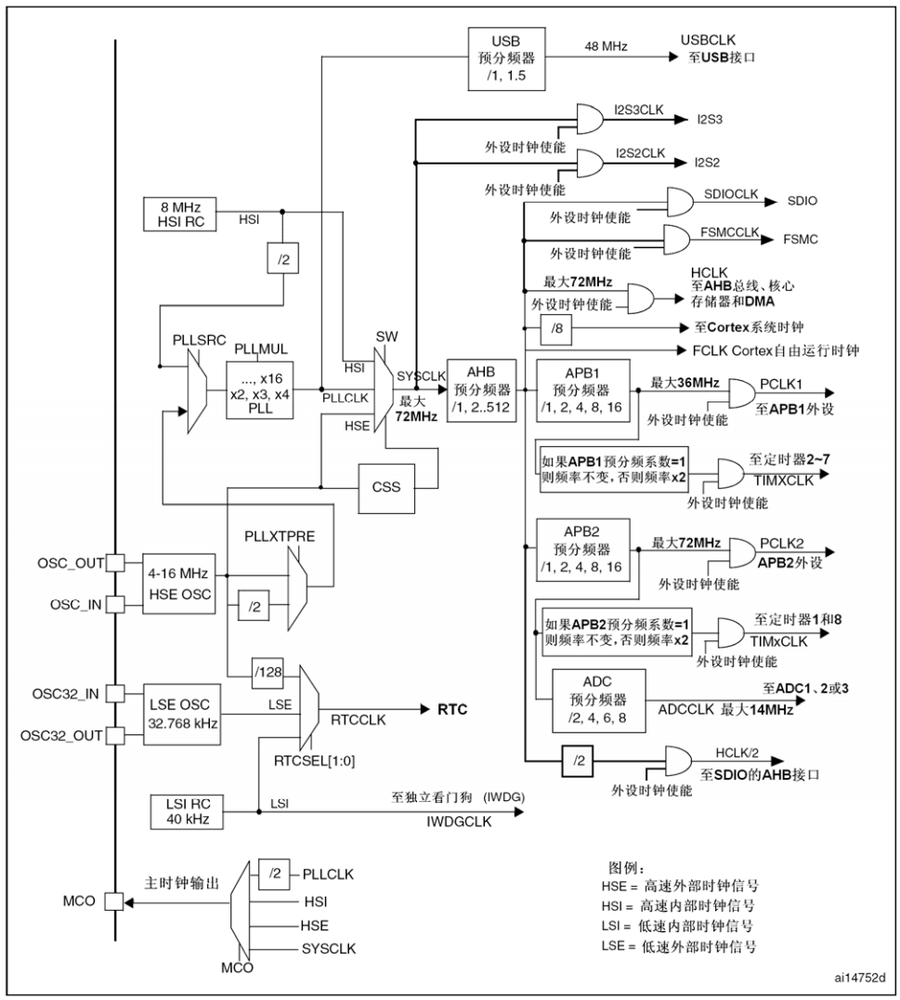

*图6.2.1-1时钟树-图*

它的工作方式比较简单：

1. 启动 IWDG
2. 设定一个超时时间
3. 程序必须在超时之前及时喂狗
4. 如果超时还没有喂狗，就触发复位

**所以，IWDG 更像是一种最基本、最直接的超时保护机制。**

它的优点是：

1. 结构简单
2. 工作稳定
3. 可靠性高
4. 适合做系统最后一道保护

不过，IWDG 也有一个比较明显的缺点。

但由于内部低速时钟源LSI的本质依赖RC振荡产生时钟，所以时钟精度比较差。

这就会导致：

**我们根据公式计算出来的超时时间，往往只是理论值，实际超时时间可能会存在一定误差。**

例如，理论上设置的是 800ms 超时，但在实际运行中，真正的复位时间可能会比800ms 略早，也可能略晚一些。

因此：

在实际使用独立看门狗时，一般不会把喂狗时间卡在理论超时点附近，而是会预留出一定的安全余量。

**所以，超时时间精度不高，就是独立看门狗的一个主要缺点。**

除此之外：

1. 独立看门狗一旦启动后，正常是无法关闭的
2. 功能相对简单，只能做“超时复位”，只要在超时时间之前喂狗就不会有问题。
3. 所以独立看门狗无法检测一些比较复杂的异常情况，比如：
   - a. 程序卡死了，疯狂喂狗，别的事情都不干
   - b. 程序跑出异常了，比正常运行要快的多，喂狗的频率变得远比预期高

通俗一点来理解独立看门狗就是：

养了一条狗，这条狗比较“单纯简单”，只要每天在中午12点之前喂它，它就不会咬人。

一旦到了这个时间点，还没有人喂它，它就要咬人了。

当然，考虑到独立看门狗，简单有效，它也是最常用、最常见的看门狗。

**在我们的项目中，也建议大家使用独立看门狗。**

##### 6.2.2 窗口看门狗

窗口看门狗，它和独立看门狗不同。

**它不只是要求你“必须喂狗”，还要求你“必须在合适的时间喂狗”。**

也就是说：

1. 喂狗太晚，不行
2. 喂狗太早，也不行
3. 必须在规定的一个时间窗口内喂狗，才算正确。

这就是窗口看门狗命名的由来，必须在一个**“正确的时间窗口期内”**进行喂狗。

如果不在这个窗口期内喂狗，窗口看门狗同样会认为程序运行异常，从而触发系统复位。

所以，WWDG 的监测会更严格一些。

它不仅能防止程序长时间卡死，还能够防止某些程序异常地“跑得太快”，例如程序进入异常循环，疯狂执行喂狗操作。

它的特点可以概括为：

1. 监测更严格
2. 对喂狗时机有要求
3. 适合检测更复杂的程序异常情况

通俗一点来理解窗口看门狗就是：

养了一条狗，这条狗比较“精明要求高”，它要求：

你必须每天三点到四点之前喂它，只要不符合这个要求，它就要咬人除此之外，窗口看门狗作为一个外设，挂载在**APB1外设总线**上，如下图所示：

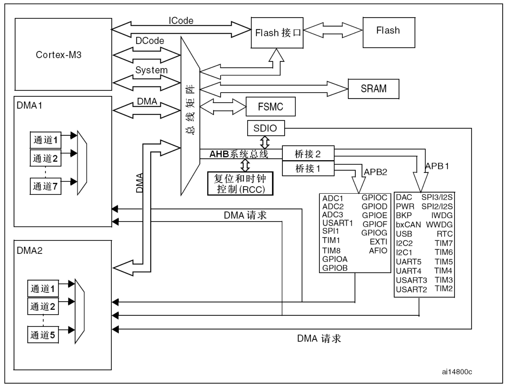

*图6.2.2-1STM32F1系统结构框图-图*

所以：

1. 它使用系统时钟工作，通常比独立看门狗在时间上精确的多。
   - a. 系统主时钟信号源通常是外部高速晶振，精度高
   - b. 窗口看门狗在时间上的精度比较高，通常没有什么误差。
2. 一旦系统时钟出了问题，窗口看门狗自然无法正常工作。
3. 所以理论上来说，窗口看门狗没有独立看门狗稳定可靠。

##### 6.2.3 总结

可以这样理解这两种看门狗：

1. 独立看门狗 IWDG：只要你别忘了按时喂狗就行，超时了就会出问题。
2. 窗口看门狗 WWDG：不仅不能喂晚，也不能喂早，必须在规定时间窗口内喂狗。

怎么选择呢？

在实际项目中：

1. 如果只是希望系统具备基本的死机自动复位能力，通常使用独立看门狗 IWDG 就够了
2. 如果希望更严格地监测程序运行节奏，连“喂狗过早”这种异常也要检测出来，那么可以使用窗口看门狗 WWDG

**所以，大多数项目使用独立看门狗就足够了，下面我们也只学习独立看门狗。**

### 7. 独立看门狗

**独立看门狗的工作原理和SysTick非常类似，本质上都是一个在时钟周期驱动下的递减计数器。**

如下图所示：

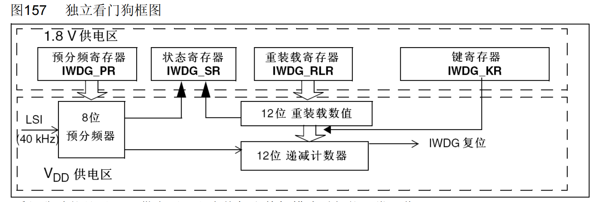

*图7-1独立看门狗框图*

和系统嘀嗒定时器一样，它们都是：

1. 先给计数器装入一个初始值（重装值）
2. 然后在时钟脉冲的驱动下不断递减，也就是来一个时钟周期重装值减1**（这里的时钟周期指的是独立看门狗的时钟周期，不是系统时钟的）**
3. 当计数器减到 0 时，触发系统复位

只不过，SysTick 计数到 0 之后，通常是产生中断；而独立看门狗计数到 0 之后，是直接触发系统复位。

所以，独立看门狗的核心作用就是：

**如果程序没有在规定时间内及时喂狗，那么当计数器减到 0 时，就会自动复位 MCU。**

#### 7.1 喂狗

那什么是喂狗呢？

所谓喂狗，本质上就是在独立看门狗计数器还没有减到 0 之前，重新把计数器装回初始值，让它重新开始倒计时。

所以，“喂狗”其实并不是真的给狗喂东西，而是程序主动告诉看门狗：

**系统现在还正常，不要复位。**

#### 7.2 超时时间计算

独立看门狗的超时时间，本质上就是计数器从重装值开始，一直减到 0 所需要的总时间。

它的计算公式为：

**超时时间 = (重装值 + 1) × 预分频系数 ÷ LSI 时钟频率**也可以写成：

T = (RL + 1) × Prescaler / fLSI其中：

1. RL是重装载值（Reload）
2. Prescaler是预分频系数，预分频系数不是可自由填写的，而是固定的：**4、8、16、32、64、128、256**
3. fLSI是独立看门狗的时钟频率，**独立看门狗使用LSI作为时钟源，时钟频率为固定 40kHz**

这里要特别注意一点：计数器是从RL一直减到0 ，所以总共经历的是RL+1个计数节拍，而不是RL个。

例如：

若LSI=40kHz ，预分频为4 ，那么分频后的计数器时钟频率就是：

```c
40kHz ÷ 4 = 10kHz
```

也就是说，计数器每秒减10000次，计数器每减1需要的时间是：

```c
1 ÷ 10000 = 0.0001 秒 = 0.1ms
```

然后再考虑重装值的设定，由于重装载寄存器是**12 位**的，所以RL的取值范围是：

```c
0 ~ 4095
```

也就是说：

1. 当RL取最小值0时，只需要一个时钟周期就超时了，此时超时时间最短
2. 当RL取最大值4095时，需要**4096个**时钟周期才超时了，此时超时时间设置达到当前预分频系数的最大值。

在预分频为4的前提，IWDG 的最小和最大超时时间，实际上就是：

1. 最小重装值0时取得最短超时时间，也就是1个时钟周期，即1ms
2. 最大重装值4095时取得最长超时时间，也就是4096个时钟周期，即409.6ms

**不过要注意，这些都只是理论值。**

**因为 LSI 是内部 RC 时钟，精度不是特别高，所以实际超时时间可能会有一定误差。**

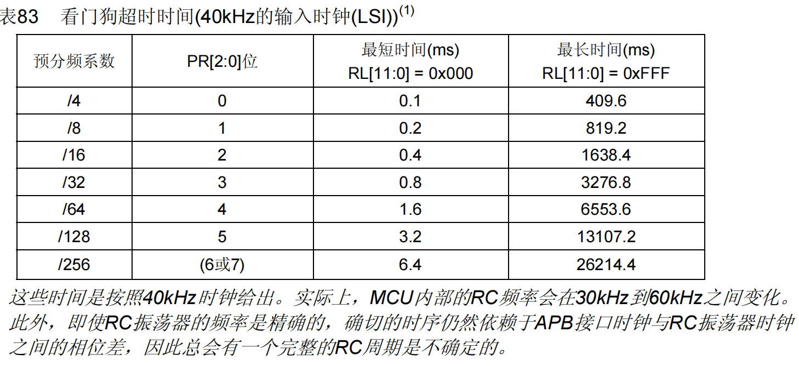

*图7.2-1独立看门狗超时时间计算表-图*

上图的表格中，就展示了不同预分频系数下，最短和最长超时时间。

#### 7.3 SPL库操作独立看门狗的函数

常用的函数，如下：

```c
// 使能IWDG独立看门狗, 启动倒计时. (需要注意的是, 一旦启动 无法关闭, 只能通过复位MCU停止)
void IWDG_Enable(void);

// 喂狗(重装计数器值)
void IWDG_ReloadCounter(void);

// 设置IWDG预分频系数, 用于调整计数器的递减速度
void IWDG_SetPrescaler(uint8_t IWDG_Prescaler);

// 设置重装载值
void IWDG_SetReload(uint16_t Reload);

// 允许/禁止修改预分频和重装载值(上电默认是锁定的, 必须先解锁才能配置)
void IWDG_WriteAccessCmd(uint16_t IWDG_WriteAccess);

// 检测是否IWDG触发了复位
FlagStatus RCC_GetFlagStatus(uint8_t RCC_FLAG);
```

#### 7.4 参考代码案例

STM32 每次复位后，硬件会在 RCC 中记录复位原因。

RCC_GetFlagStatus(RCC_FLAG_IWDGRST)函数调用，可以用来判断这次复位是不是由独立看门狗 IWDG 触发的。

值得注意的是：

这个标志位会在看门狗复位后硬件置位，但需要软件手动清除，否则它将一直保持置位状态导致误判。

可以用RCC_ClearFlag()来清除复位这个标志位。

参考代码示例：

```c
#include "stm32f10x.h" // STM32F10x 标准外设库头文件
#include "DebugUSART1.h" // 调试串口模块（printf1）
#include "TIM2_Delay.h" // 包含TIM2定时器延时模块

int main(void){
    DebugUSART1_Init();

    /*
     * 检查本次启动是否是由于独立看门狗 IWDG 触发复位。
     *
     * STM32 每次复位后，硬件会在 RCC 中保存复位原因标志。
     * 如果 RCC_FLAG_IWDGRST 被置位，说明之前发生过 IWDG 复位。
     */
    if (RCC_GetFlagStatus(RCC_FLAG_IWDGRST) != RESET) {
       printf1("reset by IWDG\r\n");
    } else {
       printf1("other boot or reset\r\n");
    }

    /*
     * 判断完成后，清除 RCC 中保存的复位标志。
     *
     * 如果不清除，旧的复位标志会一直保留，
     * 后续启动时可能导致误判。
     */
    RCC_ClearFlag();

    /*
     * 允许修改 IWDG 的预分频系数和重装载值。
     */
    IWDG_WriteAccessCmd(IWDG_WriteAccess_Enable);

    /*
     * 设置 IWDG 预分频系数为 4。
     *
     * LSI 理论频率约为 40kHz。
     * IWDG 计数频率 = 40kHz / 4 = 10kHz。
     * 1秒钟递减计数10000次
     * 即递每0.1ms递减1
    */
    IWDG_SetPrescaler(IWDG_Prescaler_4);

    /*
    * 设置重装载值为 4095。
    *
     * 理论超时时间：
     * (4095 + 1) / 10000 = 0.4096s = 409.6ms
    *
     * 但是 LSI 时钟不精确，所以实际超时时间会有误差。
     * 正常使用时，不建议卡着 409ms 喂狗，建议 300ms 左右喂一次。
```

正常使用时，不建议卡着09 s喂狗，建议300 s左右喂次。

```c
     */
    IWDG_SetReload(4095);

    /*
     * 先喂一次狗，把重装载值装入 IWDG 计数器。
     */
    IWDG_ReloadCounter();

    /*
     * 启动独立看门狗。
     *
     * 注意：
     * IWDG 一旦启动，通常不能再由软件关闭。
     * 如果后续程序没有及时喂狗，IWDG 会触发系统复位。
     */
    IWDG_Enable();

    while (1) {
       /*
        * 当前配置下，IWDG 理论超时时间约为 409.6ms。
        *
        * 如果这里延时 500ms，超过理论超时时间，
        * 程序会被 IWDG 复位。
        *
        * 如果想演示正常喂狗，可以改成 TIM2_Delay_Ms(300);
        */
       TIM2_Delay_Ms(405);
       // Delay_Ms(300);

       /*
        * 喂狗：
        * 把重装载值重新装入 IWDG 计数器，
        * 避免看门狗超时复位。
        */
       IWDG_ReloadCounter();

       printf1("feed dog\r\n");
    }
}

```

以上。

### 8. 第三期需要实现的需求3：增加独立看门狗

增加独立看门狗 IWDG，为系统提供异常复位保护。

系统正常运行时，程序需要在看门狗超时前定期喂狗。如果程序发生死循环、任务调度异常或者长时间无法继续运行，看门狗就会因为没有及时得到喂狗而触发系统复位。

需要完成以下功能：

1. 系统启动后初始化并开启独立看门狗；
2. 系统正常运行时定期喂狗；
3. 系统异常、无法继续喂狗时，由看门狗自动复位，让程序从头开始执行；

注意：

**独立看门狗周期上不太准确，喂狗周期应当明显小于独立看门狗超时时间，不能刚好卡在超时时间附近。**

下面讲一下两种实现方式策略。

#### 8.1 实现方式一：建立低优先级喂狗任务

建立一个独立的看门狗任务，专门负责定期喂狗。

**该任务的优先级设置得比正常任务的优先级低，属于滞后执行的任务。**

系统正常运行时，高优先级任务总会在某一个时间段都放弃CPU阻塞，看门狗任务能够获得 CPU 运行，并按时完成喂狗。

如果系统发生严重异常，例如高优先级任务进入死循环、任务调度停止或者程序跑飞，看门狗任务将无法继续运行。

看门狗长时间没有得到喂狗，就会触发系统复位。

这种实现方式比较简单，推荐优先考虑这一种方式。

需要注意，这种方式主要可以判断出低优先级任务是否还能获得 CPU，能够判断出系统是否还正常运行，但无法精准判断具体哪一个业务出现了问题。

#### 8.2 实现方式二：检查关键任务的运行状态

如果需要更加准确地监控系统，可以让网络管理任务、数据上传任务等关键任务定期更新自己的运行标记。

看门狗任务周期性检查这些标记：

1. 所有关键任务都正常更新了运行标记，执行喂狗；
2. 某个关键任务长时间没有更新运行标记，停止喂狗；
3. 看门狗超时后自动复位系统。

这种方式中，看门狗任务的优先级可以略高于普通业务任务，确保它能够按时完成状态检查。

看门狗任务每次检查完成后必须主动阻塞，不能一直占用 CPU。

### 9. 扩展：第四期

如果嵌入式端实在无法联网，那么可以使用W25Q64本地存储传感器数据，作为最终的离线解决方案。

一旦联网成功，则把W25Q64当中存储的离线传感器数据，再一股脑上传到服务端。

---

## 08 第四期

### 1. 第三期功能的回顾和提示

首先回顾一下第三期需要实现的功能，以及提示一些可能出现问题的地方。

#### 1.1 Flash存储器功能

Flash存储器的功能非常简单，只需要注意：

1. 在第一次蓝牙配网成功后，WiFi连接成功后，才把数据写入Flash存储器。
2. 向Flash存储器当中存WiFi配置信息时，为了便于校验，可以给数据加一个头和尾。
   - a. 比如，想要存的WiFi信息是字符串：!MyWiFi=12345678!
   - b. 加一个头尾，实际存储字符串#WIFI#!MyWiFi=12345678!#1234 ，前后都加校验
   - c. 当然，具体实现时，你可以结合实际情况而定。
3. 读取Flash存储器当中的WiFi配置信息时，从存储的起始地址开始读，读到空字符或者'0xFF'结束。

最后，有必要专门给Flash搞一个任务吗？

#### 1.2 按键功能

思考以下几个问题/提示：

1. 按键的功能在什么环境下实现？中断？任务？
2. 按键按下了，系统中的其余事项还重要吗？还需要执行吗？
3. 如何识别短按？如何识别长按？（核心区别是按下保持的时长）
4. 长按的时间一定要长，起码在5s以上，避免误触发。
5. 短按功能复位程序，其实就是调用一个函数
6. 长按功能更复杂一些，其实就是执行一些恢复出厂设置操作，然后再调用函数复位。

#### 1.3 独立看门狗功能

养狗需谨慎。

一旦决定养狗，整个系统的运行过程中，都要考虑这条狗。

思考以下几个问题/提示：

1. 时钟设置几分频？这和超时时间强相关。
2. 要不要单独设定一个看门狗任务，用于喂狗？
3. 其余任务正常执行，如何避免看门狗复位？

### 2. 第四期的功能

第四期我们要实现的功能，说起来非常简单：

1. 在系统中集成W25Q64，基于SPI通信驱动它（这一点我们之前已经学过了）
2. 实现断网缓存功能，当系统**实在**无法联网时，不再直接上传数据，而是把当前采集到的传感器数据先写入 W25Q64。
3. 实现联网恢复后的补传功能
4. 最后把 W25Q64 纳入系统复位流程，长按按键复位时，可以考虑清空W25Q64

但实际上实现起来还是非常复杂的，里面的小细节很多。下面我们来分析一下其中的关键节点。

#### 2.1 W25Q64的接线，初始化，基本操作流程等问题

这些问题前面讲SPI时，已经都解决过了，如果忘记了也没关系，回去看看即可。

代码能抄就抄。

#### 2.2 传感器数据到底以什么格式写入 W25Q64

因为传感器数据最终还是希望上传到服务端，所以建议采用字符串的方式存。

而且建议：**按照HTTP请求报文的请求体格式去存传感器数据。**

#### 2.3 STM32端与服务端

STM32端与服务端之间的交互，是不是要新增一种HTTP请求方式？

#### 2.4 W25Q64的功能有没有必要单独创建一个任务？

当然有。

#### 2.5 断网时如何把数据连续追加写入 W25Q64

默认从W25Q64芯片的起始位置开始写离线数据，假如仍然保持10秒，15秒的周期来保存离线数据。

那么如何实现追加写呢？

由于我们保存离线数据的周期比较长，例如 10 秒或 15 秒才写一次，所以这里可以采用一种简单直接的方法：**每次写入前，先扫描 W25Q64，找到当前末尾地址，再把新数据写到末尾后面。**

这样虽然每次保存前都要多做一次查找，性能不算高，但实现起来非常容易，而且对于这种低频保存场景来说，完全可以接受。

#### 2.6 怎么确定可以重新联网？（重点）

当系统因为断网而切换到 W25Q64 缓存模式后，还需要有一个专门的网络状态检测逻辑。

周期性判断 WiFi 和 TCP 连接是否已经恢复。

一旦确认网络恢复正常，系统就可以退出缓存模式，重新开始上传当前数据，并把W25Q64 中之前缓存的数据补传到服务器。

**这个所谓的“网络状态监测”逻辑，应该是一个什么呢？**

它肯定需要独立运行。（独立任务）

它都工作逻辑应该是什么样的呢？

参考：

1. 先判断系统是否具备重连 WiFi 的条件
   - a. 如果 ESP 之前连过 WiFi，或者 STM32 内置 Flash 中已经保存了 WiFi 配置信息，那么系统就具备自动重连或主动重连的基础。
   - b. 如果 ESP 从未连上过 WiFi，且 STM32 内置 Flash 中也没有保存任何 WiFi 配置信息。
   - c. 那么系统当前就不具备联网条件，此时无需频繁检测网络，直接进入离线缓存模式即可。
2. 如果具备重连条件，就周期性检测 WiFi 状态
   - a. 可以先通过发送 AT 指令，查询 ESP 当前是否已经自动重新连上 WiFi。
   - b. 如果还没有连上，并且 STM32 的 Flash 中保存了 WiFi 配置信息，那么可以周期性地主动尝试重连 WiFi。
3. 如果发现 WiFi 已恢复，再进一步尝试建立 TCP 连接。
4. 如果 TCP 也建立成功，就说明系统可以退出 W25Q64 缓存模式，重新进入上传模式。

也就是说，网络监测不是只看一层，而是：WiFi恢复 + TCP恢复这两个条件都满足，才算真正恢复联网。

#### 2.7 重新联网后补传多少条传感器数据

如果想要实现的简单一些，可以考虑：

只补传最后十条数据。

还是先找到W25Q64的存储末尾，然后从末尾往回找十条数据，然后封装成HTTP请求发给服务端。

当然，一旦联网成功，本身的周期性上传任务也不能让它失效，应当优先保证实时数据能够上传。

#### 2.8 联网补传后如何擦除数据

联网补传成功后，不能按字节删除 W25Q64 中的数据，而应该在逻辑上将这批数据标记为已处理，后续读取时不再补传这部分内容。

当已处理区域累计达到完整扇区后，再按扇区为单位执行擦除。

也就是说，必须坚持“先补传整个扇区，后擦除扇区，删掉数据”。

当然，如果你选择只补传最后十条，则可以做的简单一些，可以补传十条后，擦除数据。
